# 【麻省理工】计算音乐学与分析‌ ｜ MIT 21M.383 Computational Music Theory and Analysis,S 2023 p08 08 四级视频：乐谱与音乐表示法入门 -BV17xUmBDEUC_p8-

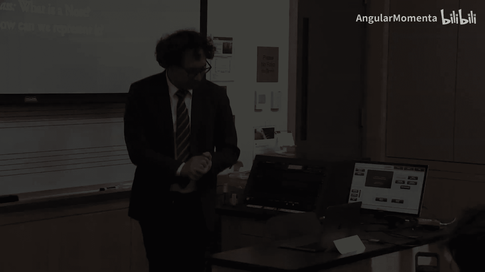

Let's get started。So we're gonna number the classes as if when you have a substantial thing to do over the weekend。

 as you did this time that that counts as a class。 When you watch me talk on a screen。

 So we'll call this class 4， even though this is the third time we get together。

 And last time we were together。 I suppose this should be anultimate class If I' numbering the other one。

 We talked quite a bit about what is a note， right， And let's just take a second to review。

 because there were a couple people who weren't here on Friday。

 what what are some of the things that are complicated when you're talking about what is a note。

Quick hand and shout when it's quiet。 We're just。Does it need a pitch， Does it need a duration。

 Does it， Does it need a pitch， Does it need a duration， Great， What was the problem when we went。

Couldn't tell if notes were slurred。 You couldn't tell if notes not so much slurred。

 You can tell what's the other word he's looking for。 T。 Yeah， it goes。

 that could be four tied notes， right， depending on if we think of the notation as one domain as our definition of the note。

 or if we think of what we hear as a domain domain。

 Good anything else that's screwed up our easy conception of what a note is。

Remember or make up your own。We had 14 notes in a Ganddo。 we had。Yeah， go ahead。The term where you。

Well， sing it for us。Well what was， what was that called。Something else。😔，야站。A tri。 Yep， tris。

 one of them。 And the other one that we talked about was， y， trem。

 How many notes does it take to write a trail。On a a standard score。1。

 how many notes does it take to write a tremolo 2， How many notes are there in a tri。Whole gob。

 right， a lot， lot of them as many as you can put in。 Yeah， so。

 so these kinds of different representations we did a lot on today。

 we're gonna be talking more about not just what is a note。

 but how can we represent a note or how can we represent something else for a computer。

 You know what。I made really nice handouts that I put online and didn't forgot to put them out。

 So I'm gonna keep one for myself and well try to do a group here going this way。

 a group here going this way。And in the back where I see people the least。

 I see the fewest name text。 So if you don't mind， I'd really like to get to know everybody by。

 by name。There's some discussion of various configuration problems and a few solutions and a few things still left unsolved on canvas。

 If you'd like， stick around after class or and we'll talk through some of those things。

 And the' another question。W is who raised it， Hannah。Now。

 about whether or not the standard library is okay。 So the standard。

 and that includes things like math and reex and things in Python that some classes don't let you import。

 Yes， if it comes with Python when you download it， you may use it on anything。

 So I'll unlock the entire standard library。 So go ahead and import math within the math library。

 Some people saw that there's a particularly useful function in the math library， what， what's that。

Log， yeah， the log， when you're dealing with frequencies and things。

 you'll see that the logar function。 So if anybody re implementedplemented the entire logri function。

 you know。You， you， we， we can talk about getting a life rate。 No， no， no did' great。 Super。

 we can give extra points on that。 But but yeah， if it's something that you have to download via P。

 then always ask beforehand。 but I do want to say at the end of the semester when you have final projects as anything goes。

 So if you can find it on the Internet。😊，Or you can build it。 you can use it。Okay， we're gonna start。

 we're not as talkative as we were on Friday。 Friday， we were very， very energetic。 So maybe we'll。

 we'll start with talking amongst ourselves。 I want you to， you have 1 bite。

 How many Bs are in a bite。8， good。 So you， you have eight positions where you can have ones or zeros。

嗯。And I want you to try to encode。Pitch。And duration。So the two things that in one representation。

 one definition of a note are two of the fundamental parts。 I want you to try to encode a note。

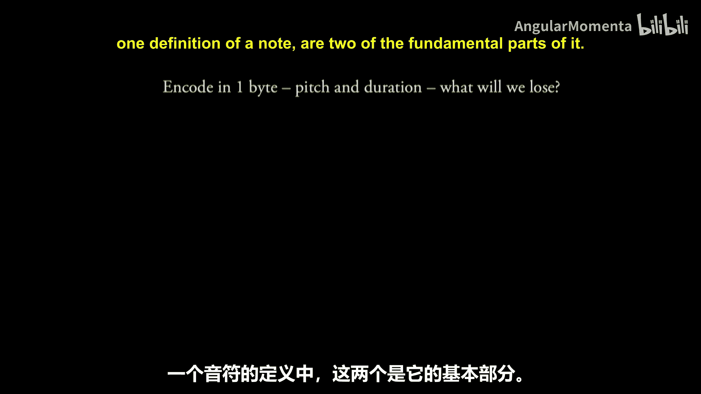

In one B。And then talk about what kinds of things you've had to decide you're not going to represent in order to make that possible。

 I'd like you to do this in groups of two。 So it's very， yeah。

 everybody is either at a desk with somebody else or not at a desk with somebody else。

 So if you could just make that the group。 And we'll give it about about three minutes。Okay。

 let's come together and let's。See， well， we started middle of the alphabet last time。

 Let's who's a group involving somebody with a name toward the end of the alphabet。

 I don't think we have any Z's。X is y。Vnessa and Adam， either way， I had started this。

 You guys would be going first。 What， what's something that you that you decided to encode and what sign you decided to compromise on。

😊，I think we decided that it would be more important to like preserve information about pitch than it was。

Okay。So， that's always。A choice the， So we're going to have a lot more information or all the information on pitch rather than on duration。

 Good， So we， we have to make a compromise that even though I said these two things。

 maybe one of them is more important than another。 Great going alphabetically backwards。Oh。

 we should have started with Vincent and Jake， sorry。Yeah。

 I think what we decided first was that like the Me group pitch is most important and so we decided to like prioritize encoding like the 12 discrete chromatic Western pitches。

 Okay， so we decided to limit to Western pitches which is already a compromise losing all those great microtones and we said we want 12 of them great how many how many bits is it going to take to encode 12 distinct things。

W let's， let's do fingers。Good， I see a lot of fours because。Why， why is it for， somebody explained。

嗯。你 want呢。Yeah， Jordan，2 to the46。 So2 to the four。Is 16， and what's I have to do with 12？

combinations。You can have that many perutations into there。 What's2 to the2 to the third， everybody。

8， so it's sort of yeah that。8 is less than or well， it is less than 12。

 It is less than or equal to 16。 Therefore， we need。To to the fourth。 So we need four bits for that。

 So we have four bits in one thing for， for pitch class。 Is that a term that everybody knows。

 It's not a term taught in all of of 3，01 first semester theory。 Its well。

 say sort of encoding C as 0， C， sharp or D flat as1 D as2 or also I suppose C double sharp or E。

 double flat。 We don't really care。 So we're gonna use four things for pitch。Class。

Something like that， great。And anybody else use do something like this in the other groups。

Jason and okay， so quite a number of groups。 Let's see。 Yeah， we'll go with Phil Angelica's group。

 What， What did you do with your other part。Oh enjoy the way。Theations。Se the。啊。Can go the direction。

So how many durations can you encode with what's remaining。16。

 what are some durations that you might have chosen to encode or we'll move on to Lila Liilla。

 Liilla and John。We could do like polls happen。Dodgers for。Whole notes， half notes。

 dotted quarter notes。 explain a little bit more there， etc cetera。 Oh Yeah。

 so you can have like your best like full half quarter Then liket dotted because you have 16 bi work okay cool。

Whole half quarter and eighth。And so how many bits it going to take if we just stop there？

Only two because we have two to the two squared is 4， right， so we can put that into there。

 And then if we want to encode if it has a dot or not。Is that another bit？So then we have dot or not。

 What happens if we say， we just put one more thing in we'll put in 16。What do we get as a problem？

Can we squeeze that into 4 bit into 2 Bs， No， So once you decide that you're gonna be able to encode 16th。

 you might as well go and do your 32nd，64th。We want to do 1，28th or breathe。 doubleub hole no。

 They're both， both pretty uncommon。 So， so we're slightly wasting some space on some pretty uncommon things。

 but we get the dot。嗯。So that's 3。 about doing just 16th notice as your base。

 And then you can have all。Multiples of 16， okay， you can have multiples of 16th。

 So you have 16th as a base。 And then how if you had like the number two or1。

 I guess you'd get like 0 would be 116th note， or I guess or maybe not， maybe you'd want like。

That you'd want to be able to have zero time。 But if you have0 is 116 note， then one would be 2。

16 notes between 8 node。 And then you do like a dots and stuff。 And you can do all of that stuff。

 And you can encode up to something that has 1616th notes， right with that way。

 which would be a whole note。 So that's that's pretty， that's pretty great way。

 It does mean we are spending quite a bit of energy dealing with。Things that are a little bit。

Unusual， but yeah。Anybody have any， any ways that we didn't talk about very much。ますいや。

We thought that it was important to encodeoctave information too。So we spent six bits encoding like。

The 64 or 64 of the midi note numbers。 Okay， and then  two bits on duration，64 minii notes。

 So now we have octave goods 64 out of the 88 keys in the keyboard。

 You just decided to do just the outside ones， right and leaf out the ones in the middle。 Okay， good。

 and， and then two bits for， for duration。 So we get maybe whole half quarter8。Not too much more。

 great。嗯。Super， this great thinking exercise。 Why why you want to do that？ Well。

 there's some people who use。That's the most confusing slide， in a while。

There are quite a number of people who are very interested in not even one B， but6 B encodings。And。

For instance， in the Braille music code。

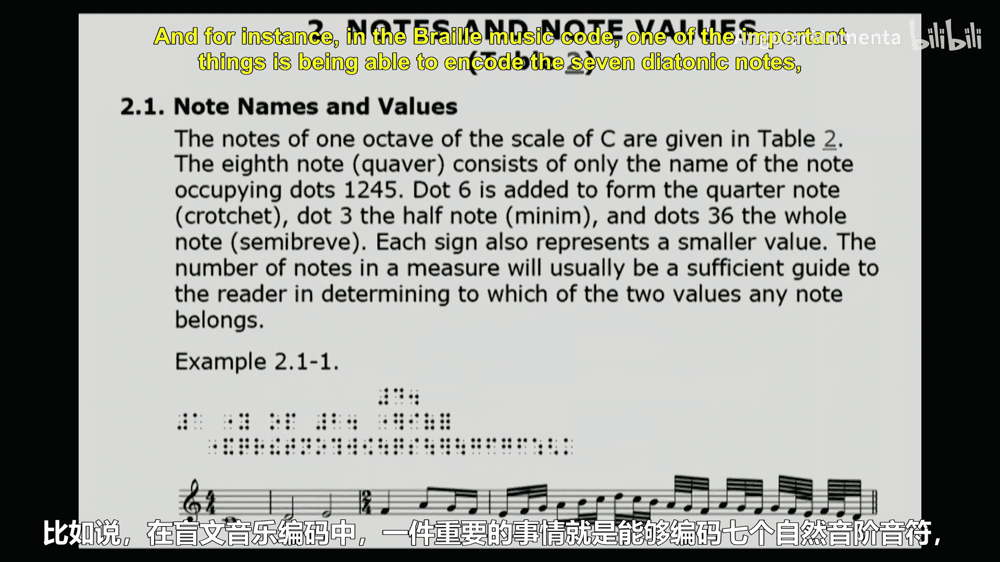

One of the important things is being able to encode the seven diatonic notes。

Because the diatonic notes tend to be used much more often。 And maybe somewhere else。

 you have something that tells you the key signature。

 the seven diatonic notes and 8 durations in 6 bits。How do they do that。

 How do they get eight durations？They've doubled up。And said， look， if you're on a hundred 28th note。

 you're really unlikely to move to a whole note。So that contextually。

 you take advantage of the fact that it's very rare to have a whole note and then a 64th note。And if。

 if it's really， really， really unclear， fortunately， they put in a space， the Braille music code。

 puts in a space where there's an end of a measure。 So if you're really unclear， like。

 I wonder if these are all 128th No No， No， the measure ended。 Okay， they're。

 they're probably the long notes。

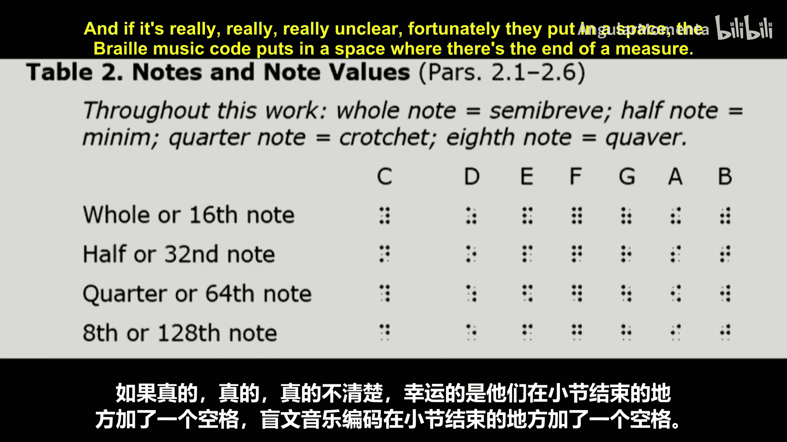

So， that's。One， one reason why you might be thinking of very efficient encoding。嗯。

Many things are lost there。 We'll take， I don't want to spend as much time on this。

 but get back in your same group and talk about what you could do if now you had3 B on average。

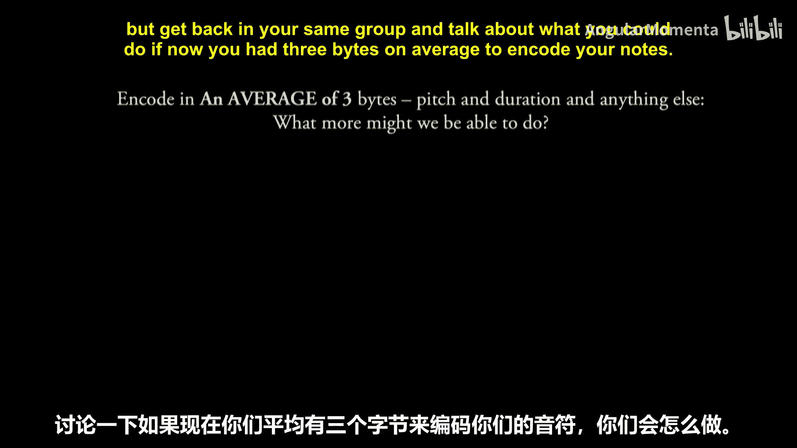

To encode your notes so that if we have a typical score。

 and I'll leave you to think what a typical score looks like that you could be doing sometimes you take a little bit more。

 sometimes a little bit less。 So just talk through。

 you don't need to come up with a full representation like this for it。

 But just what are some of the things that you might add。Okay， let's come back together。

 What are some things we use this enormous bounty of space of three Bs to do that you didn't do before。

s， let's just go， go around。 and you can say pass， but we'll start over here in second row and go。

 I guess， left to right。And we say the update for。Okay， great。

 weve stopped leaving out octave for everybody， right， group。Dots， okay， we have dots in here， great？

Gtter articulation， articulation。 Oh， yeah， does every note needed articulation。No。

 so this is where average might come into play， right， You might have something， some sort of a flag。

 somewhere， some condition that says more information to come。

 And then you can use the additional space。 Great articulations， other things。你 second都睇。

Dynamics or volume。Next。Volume。Just in case I forget to mention it at some point。

 a lot of people in the computer music world call the dynamics of volume， the velocity。

Which is which really tells you that the that the piano was the first instrument they were thinking in Cody because it' how fast you hit the note。

 how fast you hit the key on the clarinet doesn't really make it any any louder。 But velocity。

 dynamics， volume， velocity， good， continue on。couldDo something like what you just said for the。

Like if it's an extreme range of a note or extreme duration， then you say。This is an unusual。

Extreme cases。To follow， right or something like that。 to follow。And。😔，Yeah， so that could be。

These could be little flags。ます。Do people think flags look yeah， flags look better going left。Good。

Other。Continuing around other。Things chose that aren't on here。I think。Was。

I guess like time signature。Oh。It encoded with like just。あるんですか。The musical half done corner。Yeah。

 information isn't necessarily stored with them。I actually made， yeah。

 I put in and anything else on this slide that I didn't put on the other one because， yeah。

 I thought maybe time signature go in。Keep signature chair。Other things that go at the beginning。

 what else comes at the beginning piece。So shout out signature key signature time signature tempo。

Name of the piece， metadata。 name of the piece。 metadata， very important。Who wrote it？Meada， sorry。

 that was， was yesterday's metada。 now metadata。 Yeah， cl。Exact， quickly go through the front row。

 If you have something that you'd like to throw on this， we'll continue。Was that。Adam。

 did you just smoke， right now。No， did you cause you you you shouted out when I said anything else you put in your encoding for。

Ts， good。That lets you build a lot of things。 Jordan and Misha， anything。Trits yep。Trits， yeah。

 I was。Just。What's the generalization of triplets if they're not？3。Anyone know term four？

Ts or twos or， more often twos in the British pronunciation， Tts。

 more often in the English pronunciation。Good， anything else。Why would we want？

 And so here are some examples， by the way， of how the Braille code uses an average of  one B。

 but allows for or one cell，6 bit。 but allows for other things。 So if you have accidentals。

 we can be adding particular marks to say， hey， there's gonna be something else coming next。

 look up what this extended mark is。 or sometimes there is a sign that you can use for saying， hey。

 I know youd think that I'm all in 30 second notes。 And I'm probably gonna jump to a 16th note。

 But actually， I'm gonna jump all the way up to a half note or something。 So there is。

 there are some cautionary signs for that。 and beam and things of that sort can be put in。

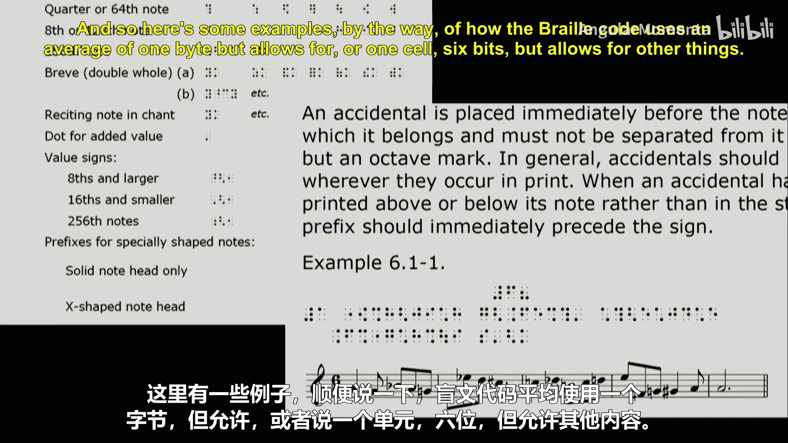

嗯。Yeah， Adam Morse code for music notation Morse code。Not that I know of。Not that I know。

 the Braille， by the way， music code predates the Braille text。

 Louis Braal invented the music code first and then decided to do it with text before in part because text is already a little bit easier to read with raised impressions whereas music was just impossible to read with raised impressions。

 So there was more of a need for reading music than there was for text at the time。嗯m。

And just for second。Let's just think， what could you do？

That you couldn't do with this if you had about a megabyte per note。WellThat's a million bytes。

People have thought of this all the time。 and you've probably done it。

 and you're not even thinking of it。 You've probably used a megabyte encoding per note already today。

I know that John has。就是。そア性。Kd of like different friend。

Features for like the output of the notes or like whether there's like a stereo。Sereo mono sound。

 or yeah， you're getting yeah fidelity the fidelity， just the audio wave of the note。

 You can encode the exact， you know， why do you need to encode is this a C sharp percentage when you can just hear it。

 And you can also be encoding without， the fidelity。

 the mono thing you're encoding the exact instrument how it was performed， you're losing generality。

 right， because you're encoding one performance of a particular piece and not every performance。

 But maybe maybe you can do one MBby plus plus an average of3 B to also store what the note was supposed to be。

 So， so we'll be able to get the best of all worlds。😊，Okay， do we have。

Why do I care about efficiency， It's in part because we're at a point where we can start storing a lot of information about notes。

 you know， most of us don't bat an I anymore at the notion that we're streaming in high death or 4K or whatever and you know。

 gigabs of billions of billions before I meant millions before billions of bys in an hour just to watch a movie。

 So why do we care about if we can store one extra thing in the note。

 It's because almost entirely based on history。 This is one of the earliest encodings of。

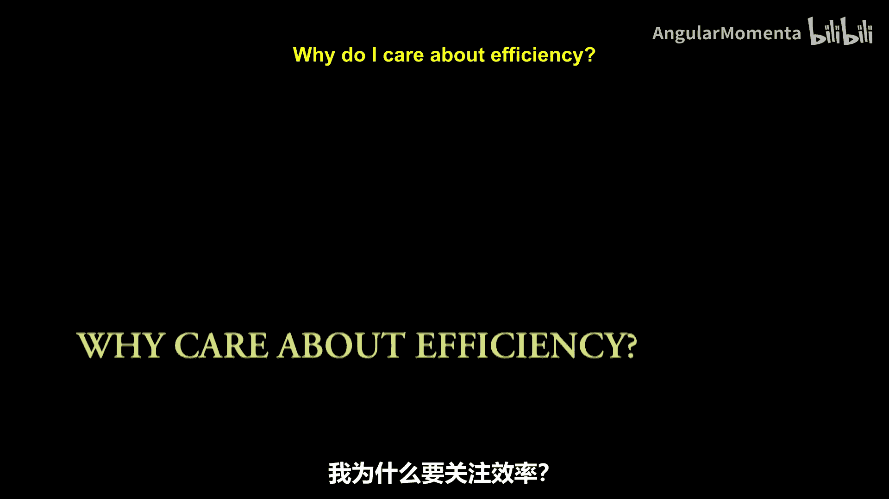

Of a musical piece of the dissertations from 1982。 But this is going in the 60s and things。

 And we started with with punch cards。 And punching cards takes a long time。

 So the more efficient you can get with your encoding the fewer cards you're going to need。

 And this is left consequences on us for today。 By the way， I always thought that， oh， punch card。

 you can， you know， you get 1，2，3 or 5，6，7，8， you know， you can， you get 10 Bs of information。

 It turns out you punch too many holes in a punch card and you start to put it through the punch card reader and a jams。

 So you actually have a limited number of ones， you can do per bite per per row in a punch card。😊。

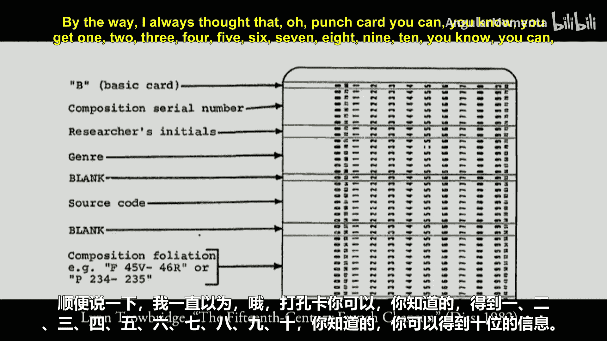

But we're still， so we're still having to deal with some of the choices that were made in order back when computers might have 4 kiloB of。

 of memory or 16 kB of memory for every single thing。 So if you want to store。You know。

16 kiloB of 16。16000 bys。 if you're storing 10 by per note， you only store 1600 notes。

 you can't get through a whole piece。 But if you can get it down to two matters。

 And so we have a lot of ways that are very compact representations。

 Theyre still out there and that we're only over time feeling like， you know。

 we can expand a little bit。 This is your first file。

 your first encoding format that you've seen in this class， I believe， right。

 besides stupid weird ones I make up on the， on the fly。 This is called muse data。

 This was one of the first major projects of encoding。Yeah。

 of encoding a lot of music into things made by Walter Hewlett of Hewlett Packard fameme。

 And let's try to guess what some of the things might be in this。s Let's。

 let's start reciting really obvious。 What do you think this means。Rest， okay， good。

We're obviously already in a period where we can afford 4 bys。To write out rest。

 rather than putting R in。 So that's， this tells you that this is a little bit later than other things that were happening。

 Some else， take a guess what something else might be。Yep， good。 is Q sumer。

 Q might send for quarterer。 Let's see we， we might find something that will help us with that else。

 I'll go easy measure stance for measure and measure stands for measure in one stands for one and 2 stands for2。

 right， Is there anything that would let you think that Q。

 Q cube in one measure might be the right thing。😊，坐。T time signature 3，4， right， Every。

 everybody's notation teacher always told you you never put a slash in a time signature when you're running on the page。

 Well in the computer stuff， we always do， because we have nothing better to separate them。 Good。

 cues that。I think these are。Notes， good， good。interestingtering thing is that they end up encoding the duration twice。

Since this one， I've tried to do the long time meal。 What do you think that is， And。

 and it's obviously possible to get。 So you have the quarter note。

 and you also have something that says a quarter takes2。Some things ticks。

 maybe some things like that。 And so you encode it twice once。What's the difference between。

This two each quarter is two of something and that this is a Q。Who needs what for what？Yeah。

 what's printed on the page versus what's played。 What's put on the page and what's played so that you don't need to convert between visual and and and time duration。

 And this is a function on almost all modern storage things still today。

 It's also helpful for there are some very weird cases that that you'll run into in one of the readings later where composers have used durations to mean something slightly different from what they actually。

 what they generally are。Okay， so this is some of the reasons why we went through efficiency。

 You're gonna be on the second problem set， the one that you'll get on Friday。

 which will be done in groups。 you're gonna be coming up with your own representation system for some sort of thing that is music。

 except for the thing I'm just about to talk about common Western music notation。

 So something else besides normal scores that we see all the time。 and you'll。

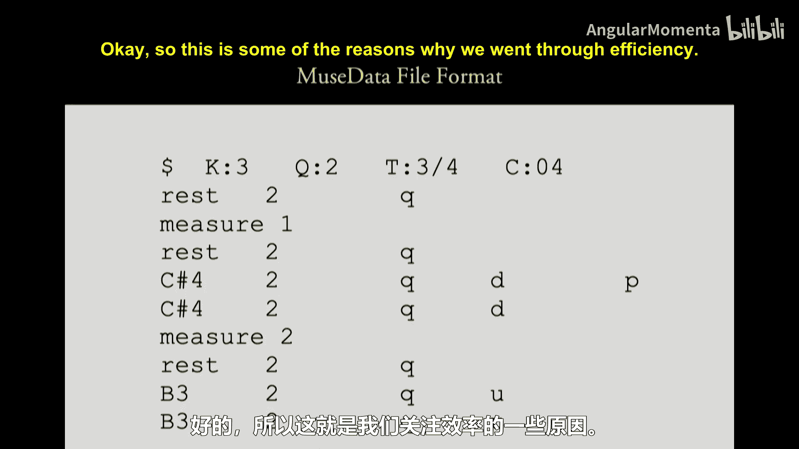

Need to make the same choices， decisions， mistakes。

 maybe that that pioneering people did in the 60s and 70s and hopefully learned something about what trade offs happen along the way。

收。We're going to be talking the slides a little bit out of order。Should be here。

 This slide should be about something in the class， which is called common Western music notation。

 often abbreviated to leave out one word， one letter， either common Western music notation。

 common music notation， common Western notation， some things like that this is an example of what I think most people would believe is common Western music notation。

 It uses notes， staves， clefs， things left to right means earlier to later。Up to down means。

Higher to lower， right， so that here's a whole bunch of high notes and here's a whole bunch of low notes。

 right。No， except for that there's certain， theres certain things that we say only within its particular staff is higher and lower。

 And then we have divisions， and we move on to other systems and stuff。 So， yeah。

 so these are things that are standard in common。Common Western music notation。

 that was a piece by Joseph Bologche， the Chevalier de San George。 This is a piece by Clara Schumman。

 her piano trio， materialo for piano violin and cello。

 And see some things that we consider to be common Western music notation， including slurs， ties。

 Grace notes， beams， all these types of things。Common Western music notation can represent a piece of music in multiple ways。

 This is an Aria from Wolfkang Mozart's Opera Don Giovanni。

 Aria song in that Iki Medidi Chi Mai by Donna Levira and we have the top of each of these systems。

 Vo part， Italian translation to English。Two two staves for a piano。And then the exact same。Music。

 in some way。Here's her part here， except where the English is gone very helpfully replaced with German and her nice treble clefph was nicely replaced by soprano Clef for ease of reading for all of us。

 because she's a soprano。 and the piano is gone， replaced with。 take a guess。

What are these parts for？Or orchestrachestra， yeah， so we have， we have strings。

 We have other things going on。One of the questions would be。

When we have multiple representations of the same piece， how do we translate。From one to another。

 is there a way that we can go from this exact moment to that exact moment And what kinds of relationships would make that possible。

So jumping back to Cla Schumman's piano trio， there are some things that。

Are that violate particular norms of commonwe West music notations， such as。Well， I mean。

 they're part of it， but they violate the basic， basic principles。 What are these things up here。

Greatrace notes let's say。A quarter note takes one tick， a half note takes， two ticks of some sort。

 an eighth note takes half a tick， how much does a grace note take？Yeah。

 you usually have to be lot done。Usually half the aot of times。 So if I put that that's。

 that's very true in one sense。 So correct。Absolutely correct。 It's also not true in another sense。

 So if I have。4，4。And I put in。dotted half note。And then I put in a grace note。

That takes half of that。 So it's one quarter。 So I still have enough room for。That amount of space。

 right， can everyone see from back here， that's dotted。 What's。

 what's wrong with this representation。The grace though also eats away at the actual time for the。

 so the grace note steals time。From the note that it's next to。

 or it steals it sometimes from the one before。 So in terms of how， how many grace notes can you。

 how many grace notes can you put in a 4，4 measure。Let's put this way。It's a trick question。16， no。

 you can put as many in as you want。 because the grace notes just steal time。 So， for instance， here。

 we're in 6，8。 So we have two dotted dotted8 note beats。 and we have a dotted quarter note。

 And so we have a dotted coordinate note here and the equivalent of a dotted quarter note here。

 And we can squeeze in5 grace notes there，7，8。Doesn't matter。

 But where conceptually do you play that， And if we have this notion that in Western common Western music。

 everything that happens at the same time is vertically aligned。

 I hope your theory teachers taught you that。 That's the most important rule， in general。

How do we know where to align these notes。With the grace notes。 So that that's one violation。

The limits of common Western music notation are not strictly defined。

 This is a very common genre of music from around 1700，1687。 Elizabeth Cla Jaqueette dere。

cque de Lare， very interesting piece， a lot of things that look like。Common music notation。

 until you start getting。What is this。What do these。All the symbols of common Western music notation。

 but used in a different way。 These are unmeasured preludes。

 So certain places that should be played in time and certain other things that some most people believe。

These tell you play these notes for exactly how long you want。

 I kind of figure some other people think maybe improvise something on those notes， but。

It's common Western music notation， but it becomes a problem for the computer。

 What's the problem for the computer when it's all handwritten。And so there's all kinds of ambiguity。

 Can you， you can tell that， okay， this is going， going and that's an A， And that's you， that's an A。

 and that's an E， And that's a C。 And that's either a D or an E。 right。

 We can conceive of a note that is hard to read。Does your representation have a way of notating that？

So musical handwritten scores also tend to contain lots of things that that don't that violate common music notation。

 I saw a Beethoven manuscript once where he was just going along， going along on two statess。

 Then it became obvious that the top part was just gonna repeat。 sorry。

 the bottom part was just gonna repeat what he was doing。

 So goes along and just uses the top one next time he drawing the next system。

 and he needs another staff。 Oh， and there's this empty staff above。 So goes ahead and uses it。

 So you can be jumping forward and backwards in time in the same thing。They are small。

 almost every composer。Of， of significance has made their own tweaks to common music notation。

 This is by the 20th century composer Igor Strinsky。 Later in his life， he started to ask， why do we。

 when you have instruments that don't play very much， Why do we waste all the staff。Putting them out。

 So it's really easy to see what's resting。 if you just。

Start the staff where they come in and end it when they end。It a little bit there。

Limits of common Western music notation come out in certain pieces。 This was。

 I think my freshman composition assignment when I was trying to be a composer where I've used some things that look like normal notes。

 but then。At this point， I didn't want to calculate what the tempo was。

 So just hold it for about2 seconds。 Hol this for about 2 seconds and then get to this point。

 And this part should the chill Loondo。 So we'll just show about how kind of end like a 64th note。

 Is that part of common Western music notation。 It wasn't。50 years ago。

 but there's quite a number of scores that do it now。

A lot of the music being written today are stretching common Western music notation。

 quite to the limits。 This is Kate Sopper， who was a Pulitzer Prize finalist a few years back。

 teaches at Smith College， one of her pieces from part of Ipsa Di Se， her opera， She herself said it。

 where。Moves back and forth in the voice between sung and spoken and uses these other symbols to tell you how much to open and close the mouth and something。

A little bit odd about the violin。Lots of things odd。 I'm thinking about the staff itself。

It's a usual clef for the violin。Were violin in percussion clef with。4 lines。

 What do you think those four lines represent。 What does violin have four of strings。

What string to play on， You'll figure out the notes。This is a piece by Brian Ferniehow。

 part of a compositional group called New complexity， which if we look just at the first measure。

 there's almost nothing that violates common Western music notation principles that we learn in our theory classes。

 but they tend to take it to the extreme。 So for instance。

 first measure to 8 where we're going put in place of four the four，16th notes of 28。

 we'll put seven，16th notes in within that， for most of these。

 we're gonna to put 21 32 notes in the place of the first 20 of them or 2 And then within that we can have triplets so that topts can be nested almost indefinitely and there's no reason why our time signatures have to be powers of two。

So people are playing with things lot， okay。Professor stop talking about the weird music。

 This is all， all strange new music。 It's nobody in the great past like Mozart would do things like this。

 So this is we go back to Mozart。 This is again， Donjiiovanni。

 the end of the first act very cool moment。 If you don't know the upper。 they go to a very。

 very rich ball。 And it's kind of like going to a club today with multiple rooms and multiple people DJs or whatever we doing things。

 And so here at this big ball， we're going to have in one room in3。

4 stately mint for the upper upper classes。 They like their 3，4 dances at the time。

 And then in another room， we're gonna have a dance in2。

4 for sort of the middle class because they like those things。 And then for the farmers and things。

 we're gonna have like they like their chival time，3，8，6，8 dances。😊，Altogether。At the same time。

The bar lines。When you say， well， let's start at measure 22， you go， I'm sorry。

 my measure 22 or her measure 22， because you don't have a concept that measures are universal。

This is， I think this。Yeah， this is Ravel or DBC。 I think it's。IThink it's ABC， little dense de。

 very， very common。 Everything looks great， Everything looks great until。What does that mean。

We're in treble cl and tble clef， but we have a base cl just， just for this one note。

 as I also go here。 No， you can tell what this is。What that means。

Better not to write a whole another staff just for one note， right。

 But you can have two clefts simultaneously on the same。St， you can also。

 there are examples from Bach of two time signatures in the same stuff are changing time signatures mid measure。

 And what does that mean。So almost every composer has pushed the limits in some ways of conventional music notation。

Jump back to Cla Schuman one more time。 There's certain things that might be very obvious to us。

 but that can be very difficult for encoding in such a way that it's completely unambiguous for a device as stupid as a computer。

 such as。We're in the measure。Does this begin。You all are musicians。 You all know that。This。

Line is continuing up to here。 That's why there's something empty here。And empty here。

But how would you ever。How would you teach a computer？

To make that kind of abstraction that lines can move from staff to staff and therefore don't need to be。

Filled in。So。Any questions on this， Sorry on， on any of these things or any discussion points。

 Adam will start with to。What is this rest？This the beginning of a Oh， this one here。

 This is because your professor did not print a PF， but took a really fast screenshot from finale。

 And so it's even it's even a new thing that our user interface。

 So this is the user interface that says this is a hidden rest until we get to this note that has to be added onto here。

 Super great。 No one's ever ever seen that。 But yes。

 the user interfaces also end up being part of our conception of notation today。😊。

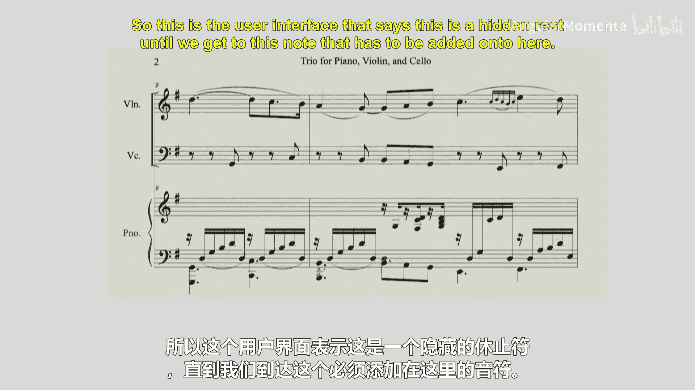

go。Other。Points sir。Oh。So where does common Western music notation end。

 and where does other things go and。sorryorry。And。What might we want to represent that's not common Western music notation。

 So this is a type of thing I work on from time to time。 This is church music from。

 I think the early 17th century or or late， late， sometime late 17th century maybe。

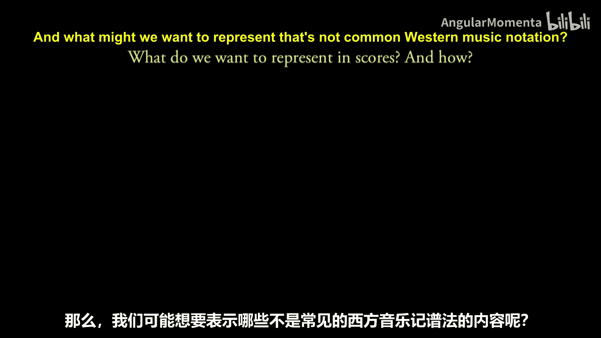

And looks very much like ours， but just。The note shapes are a little bit different。

Common Western music notation， just with a little， little twist， maybe not sure but。

It's not too far off。All of our notation goes back and back and back in time or has come from things decisions behaved for。

 Let's start with this is Western music notation。 This is the first music notation of Western Europe from about the 9th century。

 this is the chant for the mass on on Christmas Day。 and what these things do。

 is they tell you how many notes there are。 And if they go this case 1，2，3 and they go。😊，Start low。

 Go high。 Come back down。Not the same， about the same higher note， same thing we have up down。

 Most of these go up and down。 Here we have 1，2，3 notes going down， three notes going down。

 The height means nothing。His music。Might we want to represent this and how might we want to？

And some of the things people are always wondering， we have pages and pages and pages。

 thousands of pages of music in this notation。How is it helpful for somebody to know how many notes to sing and whether they go up and down。

 but not what notes they are。Right， so that's something a lot of people count。

 wish we had met yesterday， be a little bit more obvious。

 this is a piece from around 1420 Valald Corierier' peaceace Beet Bonsage in the shape of a heart。

So something about。The the shape of the piece， is that something we want to represent when we're making our representations。

About the same period。 It's a piece in the shape instead of a heart， shape of a harp。

 hard to say where it's basically the music notation of its time except it sideways。

 but we're writing on the strings， so we need twice as many strings and we don't write anything on the spaces。

Getting back to more modern music， some of the things that definitely。

Violate almost every principle of common Western music notation， but use some of them。

 This is Cornelius Cardu's Pe treatise， which uses a lot of notational symbols。

 a lot of things that look like music notation。But it's up to you to interpret them。Done differently。

 Every group。Performs this quite differently。If you're going to have a graphical score where you use music notation elements。

 but they don't mean anything， maybe。A musical score doesn't necessarily need to have any elements at all。

 Earl Brown's folio from December。 Yeah， December， what is it，1962。

That's all things that have come out of the West， Japan， China。

 every of many cultures in the world have developed their own notational systems。

And then there are notational systems that have been made to try to study the physicality in this case of Iuit throat songs without using anything that might have the cultural baggage of Western patients。

 so。We start notating the， the actual you know， the， the spectrograms。

 I that a form of music notation。 And so how would we do that， one more of。I tablet her。

Just giving a sense of some of the notations。That might be happening in the world。

In addition to notations that that have been sort of created over time by people。

 there are invented notations that tend that have been found to be very useful times。

 This is something called tubs。 if anybody has taken the time unit box system。

 It was invented around the 1970s， I'll look up exact time later。

 but the notion is kind of like I did with the bits。

 things that you can specify what the smallest tick you want to notate is and specify when somebody plays。

 or if you need to specify different things they might play。 You can put in the box。

 This has become a very useful and used system， especially in the notation of West African music。

Lots of notational system representations have been created， many of which have not been successful。

 This is the turntableist notation system because there's nothing that's greater and cooler than spinning at a bar while reading music notation。

 right， But it's it is a way of notating what somebody did for reproduction later。

if my sound is working before doing this， I'll be very disappointing。

 I should checked that at a time。Give me one second。Graand it。Go the。Yeah。What is。打。Yeah。Oh。たこか。So。

 but not all notation and representational systems end up being very successful。

 I think this's a super cool。 I don't know why I made a joke about it。 I it's really innovative。

 The website has been down for about six years now。 So I assume it did not take off。

One of the earliest mechanical notational representation systems that's still very influential is the player piano role。

 or we just call it the piano role now where the actual punching of of the notes on the staves becomes a very important part how well encodes the notes so we get again the same kinds of notions of up and down the side and side for height。

 I guess sort of height turned sideways and as the role progresses， there's a cursor。

 there's a technical name for it， I can't remember in piano roles that is reading at that moment what should be happening and or what is happening at that moment。

 there are other ways of controlling usually on the side。

 what the dynamic of the entire piano is but usually not of encoding what the dynamic of any individual notes。

and quite often written along the side， though， there will be the lyrics of the song written kind of like when you're driving。

 and it says like you know， slow crossing， pedestrian crossing written read upside down so you learn to read it that way so that you can sing along with what the piano is playing。

 Very cool multimedia。😊，Questions about about things going forward or discussion or just things that you're thinking about because you're going to be thinking about something to represent that isn't common Western music notation。

Next week， yeah。一緒だ。M are a bit of line。Line writerer， Oh， yes。

 the game where you're riding on the you draw all the things。

 and then you get to see the how the motorcycle jumps around。

 Is that one Yeah some people have the composition in which line rider motions are sync to a piece of puzzle。

Very， very， very cool， nice。I want to see that at some point。 Yes。

 is this just kind of like a big music。Yeah， it is。

 but often something that you could also attach to your home piano so that you。

 you have your home piano early on。 And then later they become。

 or I might have my chronology reversed， but then they become sort of things that。

That become standone objects， but there were things that allowed people to feel more like they were playing the piano by having you pedal it and control the volume so that you could do and control certain levels of softness kind of like using a Betty Croocker bake mix to bake your cake。

 you get feeling that you really did something to make the music but not the really hard parts。

や cool。Yeah， these these are interesting， we have some of these over at the Lewis Music Library。

 which I'm going to be talking more about later as we go into representation things。

 but the Lewis Music library just over here has put as one of its sort of longter visions to try to get all of the different technologies that have been used to encode and playback music over time so there's wax cylinders and piano roles and stuff and re reels and trying to make it so that there's some of they're very valuable and need to be preserved and some that we can just play with and。

You wouldn't want to have a problem， but if you did end up breaking the real tape， it's okay。

 we got more。Yeah， so definitely， if you haven't been to Lewis Music library。

 check out what they have there。They also have a theament if you want to play that。 And。

 and you might be using them at the end of the semester when we make some videos because they have a nice podcast video recording space for editing there。

Okay， so we've been thinking a lot about the common Western music notation in sort of general terms。

 Now， I want to think about a little bit computer representations。

 I don't know why I didn't write the word computer representations。And again。

 these are slides that I'm borrowing from a composition package named be bone。

 exactly the named after that piece in the shape of the heart。

 So we talked about this extremely fast on day  one。 But I want to slow down a little bit more。

 The two main ways that people have chosen generally to encode common Western music notation for the computer are in terms of。

😊，The container based thing， the box based。 So you have a big box that might be the whole score。

 you know， some kind of thing and then you have smaller boxes that you， might be parts。 within those。

 you have measures。 and quite often voices become things inside that。

 And then going all the way down to notes。所。This representation。

 the other second one that is very common is the time sliced based container。

So everything that happens at a certain moment in musical time is it's in its own slot。

 Some people would not。Puts。These in three different slots because these four things in four different slots。

 because all of these things happen musically at time zero。Right， the cleft。You know， there。

 there is no note or anything that there's no conceptual notion that the clef comes first。

 and then the time syn， then the key signature comes then the time signature comes in the first note。

 except that we have to write them in certain order on notation。

 but all of them are present at the very beginning of the score。

So I want to start talking about some of the reasons why you might want to use one of these and why they're all bad choices。

 Every choice you make is going to be a bad choice at some point。

So thinking about the part based representation。You can immediately see certain problems。

 Anyone know an Ose staff what you use that for。It we explain that。 Adamt。

 I think we've been really great， but I want to hear a few more voices right now。

Anyone ever heard that term， I'll see you stuff。不'事。No now。It's a little stuff。No， no。

 pianist violets see it quite often， especially when you're。

Starting when you're playing against Charo science in a really hard part。No。看了。

Alern ways to play that。Yes， it's an alternative way to play that measure。

This is a hypothetical one because I don't think that that would ever be an alternative way to play this。

 But quite often if it goes too high for some people， especially for singers， actually。

 singer see O is a lot because if something's not in your voice range。

 something slow right different different part。 Yeah。

 so you have a staff that just appears for a minute。

 we said that our top level thing might be the parts beyond that， sometimes for a piano thing。

 you might have the part。 And then staff 1 and staff 2。But here we have a staff that just comes up。

 And if everything is in a box and one of the lowest boxes is a measure。You have these problems。

What do you do when you want to say if everything's in a box？

That a crescendo goes from the beginning to the next。 How。

 how might you solve some of that computationally。When everything has to be in a box and think of a box as like an array or top。

 Yeah， go ahead Jill， have like a flag， start something in one box。結こする。Yeah。

 so everything could have a start and an end or certain things might maybe a note doesn't need to have a start and end。

 but yeah， you might have a flag for starts and ends。 So there are some ways around it。

 other possibilities。唔。Yeah， go ahead。 Maybe just set them a higher level up。

 like they don't belong long inside measures。 Maybe the long inside parts。 Yeah， so you can move。

 move up one level。 That's great。When you do that， that works quite often。

 But then you have a second problem that comes up。 and that don't worry。

 this problem was gonna to come up anyhow， especially once Mozart brings his three bands to the page。

 But you have， maybe here's your part。And you have your measures and things。

 And now you want to elevate。The crescendo that went across two measures。

 you want to elevate it up to the next part。The next thing。

Let's assume that these are some sort of arrays。 So we're putting commas then。

Then you might have the problem， maybe you put it here， maybe you put it here。But suddenly。

 the array is no longer sequential。In other words， that certain things can appear at points that are out of line。

 and so we sometimes call this the forward backwards cursor so that we're at a certain point。

 but we need to look back or to look forward in order to see what's happening at that point。

But it's also a very good solution。 And it's something that happens quite often。

 So two great solutions。Any other。It doesn't even have to be that great。

 Those are like the two industry most standard ways of getting around this。 I couldn plant a better。

Okay， good， that's， that's fine。 I should have said。

 Those are two of the three great industry standard ways。

 And one of you would have come up with a third way and invented something new。 Never。

 never say that there's no more possibilities to M I T student。

Here is one of the problems that we were talking about this earlier with a timebased system that Grace notes which take up no concept。

 no number of ticks in the time signature， but of course take up time to play and take up space on the page how are they engraved and they end up being one of the great problems of the time method。

So， you could say。Hey。I'm great。 I'm not a bagpiper， so I don't use grace notes。

 Baagpipers use grace notes all over the time。 So I can do the time based system。

 or somebody else can say， look， my， my piece is fortefe from the beginning to end。

 I'm never gonna have a crescendo。 I don't need to worry about。 I can use the part system。

One of the things this class is not just is not computational representation。

 but it's computational music theory and analysis。 Eventually。

 we're going to be diving into our representations and doing musical analysis on them， right。

And there' are certain things that we often like to do。 we said first class。

 who is written a parallel fifth， almost every hand went up。 That's what we call voice leading。

 where we're looking at how certain chords or certain voices at one moment move to something at another。

 Any have a have a professor who frowned on this。Do know yeah， overlap。

 I sometimes call this where the bottom note has jumped above the place where the top note had recently vacated in certain styles of music。

 it's not very idiomatic。Well， let's analyze how would we find overlap in part in the box system。

 in the container system。WellWe'd probably have there's one container for this。Part or measure。

 And then there's going be one container for the uptmed notes。 That's a voice。

 one container for the downt notes。We need to know if at this moment。At this moment。

 this note has crossed over。The previous notes in the other containers。

 So we have to be able to jump back and forth among containers。 And that's it's not very good to do。

So the time slice， we want to look at everything that's happening here。

And then everything that's happening here。And then it becomes a problem of yes， but。

 but how does this note in the first slice relate to the second？ So for voice leading problems。

 the jump to the conclusion there。Neither system works well。 They both have problem。

 They both have big conceptual difficulties that make voicelea one of the。

 one of the hard problems that always need to be solved。

 specifically for music before any deeper analysis can happen。 And it means that generally speaking。

 you're going to be writing a system for moving from one representation。

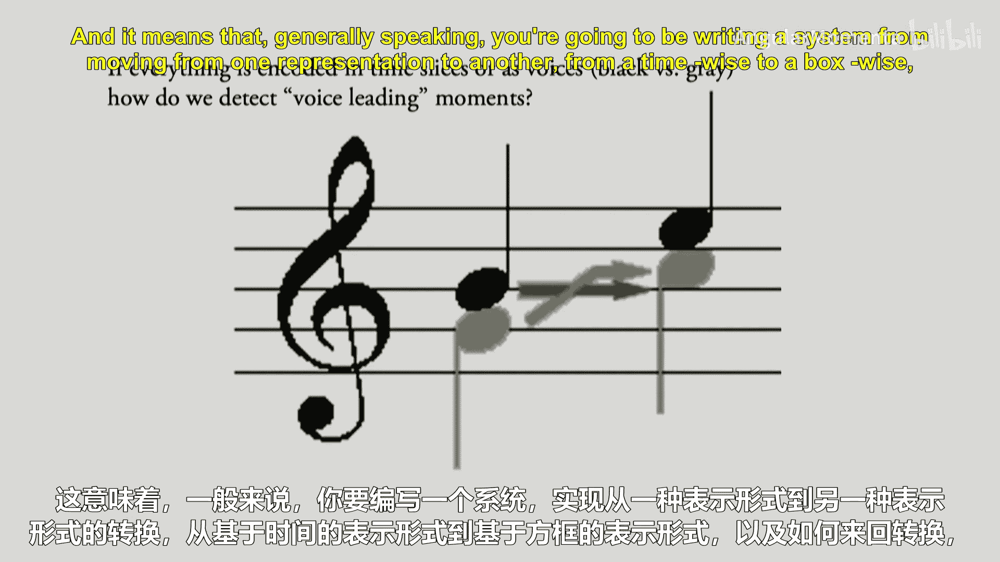

To another， from a time wise to a box wise and how to move back and forth and have your system be able to have multiple representations。

 It' one of the major problems。Last little topic for today。

 and I think we're done with slides so I can put this up。嗯。Is just。

Some of the terms that you're gonna come up。 actually，2，2 little things。

 I'll always make sure because I don't like to keep anybody late。

 I want to cover the last last item on there。 You will get problem set2 on Friday after you turn in problem set1。

 It will also be a one week assignment。 There is one one reading to add on。 It's about。

 I think 15 pages or so， but 20 pages but most of its pictures。 that you'll find on canvas。

 It is a article by Nicholas Cook who's one of the main people in this field called computational Comp and computational musicology。

 And it is。It's one of the foundational texts in this field。 So I want to read it。 It's little。

 it's 1819 years old now。 So it's a little bit out of date。

 you'll see some of the encoding some of the ways of writing computer code are are a little archaic now。

 But what it says is still really， really good。 So you'll find that online and we'll discuss that there are certain questions to start thinking about。

 you don't need to write out answers to them。 but maybe sketch down an answer to one or two of them so that you can。

Be quite participatory on Friday。And if you haven't been reading very many scholarly articles。

 or this is your first time reading an article written for academics。

 I have a like little six minute optional video on how I read these articles that maybe even if you are a master at。

 great at doing this。It might still be useful to see how a professor doesn't read from the beginning to the end in one set。

 So if you want that。That could that might be particularly useful。

So we have about four minutes for the last topic against the one thing that I want that you'll probably want to look at the outline for。

 I usually put the outline for you to get later。 but something and it's about。

The different music representation， some of the different terms that we're gonna be using a lot。

Has anybody taken more than one or a couple philosophy classes and come across this term？Yeah。

Philosophy class。 What about in a C S class， computer science， anybody ever see。

 I'm not going to ask for a definition right now unless you want to do it。 Yeah， great so。

Ontologies are sort of this ontology is the study some people say of essence of meaning。

 of what it means to mean something general， philosophy and computer science have two slightly different definitions of ontology。

 So you're going to start seeing the word ontology and a lot of representations。

 It has to do representation for， for philosophy。And this is， I mean， really fellow soul。So。Your。

You're getting a lot about what are the limits of something that makes something no longer something。

 So we did a lot of philosophical， ontological discussions in the today and on and last class， right？

 What's， what's something that we were trying to play。Find the limits of。这么嘴。

When something is no longer something。A note。 Yeah， we wrote that there。

 So what's some of the things， When is a note，1 note，1 is a note， two notes，1 is a note，6 notes。

 right， We plan with that。 When is common Western music notation。No longer。Does that apply。

 I kind of， you know， did the the frog boiling in hot water trick like kind of slowly， slowly。

 slowly moving out until finally， it's like wait a second。 professorfesor。

 that's a whole bunch of thoughts on a page， right， But but we got there very， very slowly。

 How do we put a dividing line because its a philosophical definition。 And then。

 and that's we're gonna be using that one in this class， because this is also a humanities class。

 We are we thinking about those types of things。 What is the limit of something， What is the note。

 what is， if a piece of music is every note and every and every duration that's in there how many notes can you get wrong and still say that you're playing。

😊，You know， Beethovins， how many cl your Sonata。10%，5%。One note wrong， and this is not the piece。

These are some of the things that that the philosophical definition does。

 We're not gonna to get to the second half here。 But so just end with the computer science usage。

 which is also very， very cool and related。 And that would be， what are all of the objects。😊，Yeah。

 just suck。Objects。Names。Relationships。Used in a representation。

So on ontology of a file of of your computer's file system might say that there are documents and there are folders。

Can folders， can documents go in folders。Yes， can folders go in documents， no。

Can documents go in documents， No， can folders go in folders。 Okay。

 so we're starting to make some kind of representation of something。

 Can a document appear twice somewhere in your hard drive。Different different operating systems。 Yes。

 no， there are ways of doing it。 So these are all the decisions that make up the systems and objects and representations in use。

 We're gonna start up again on Friday by talking about some of the ontologies that we've already been creating some of the relationships and some of the different ways starting to get back into programming。

 We haven't really done that for a little bit in class。

 Some of the ways that we might represent the relationships between notes and pitches and durations and so much else。

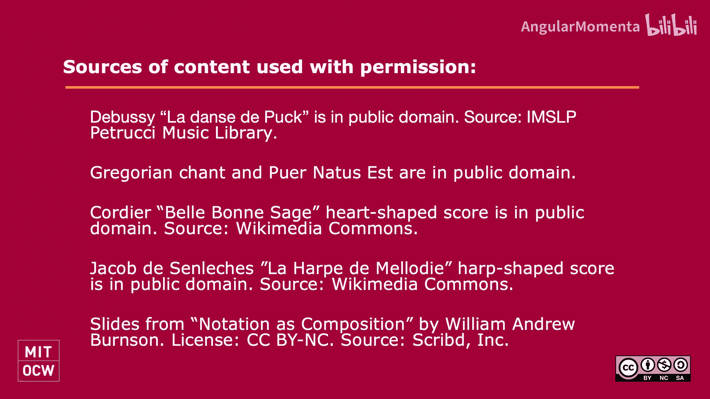