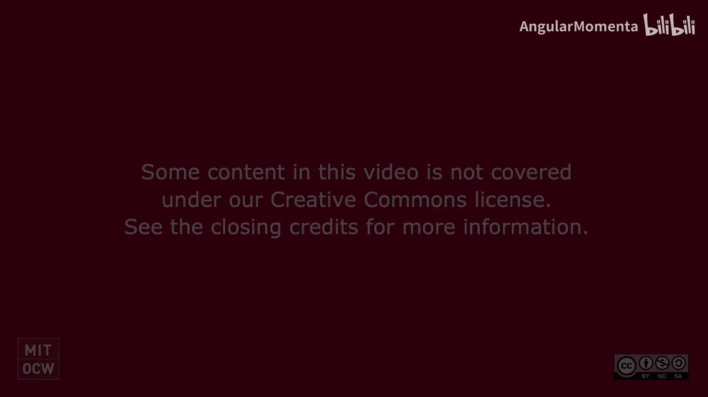
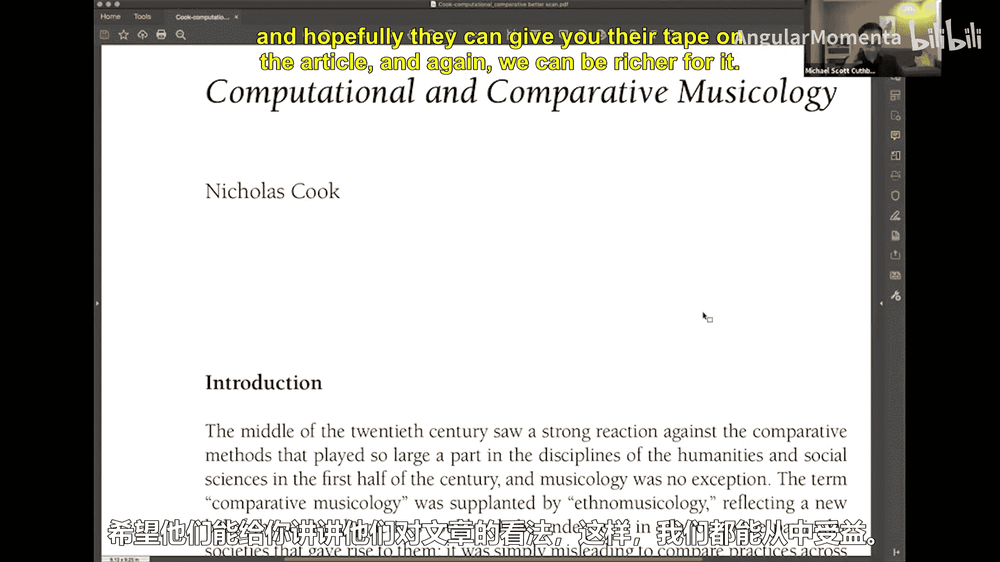
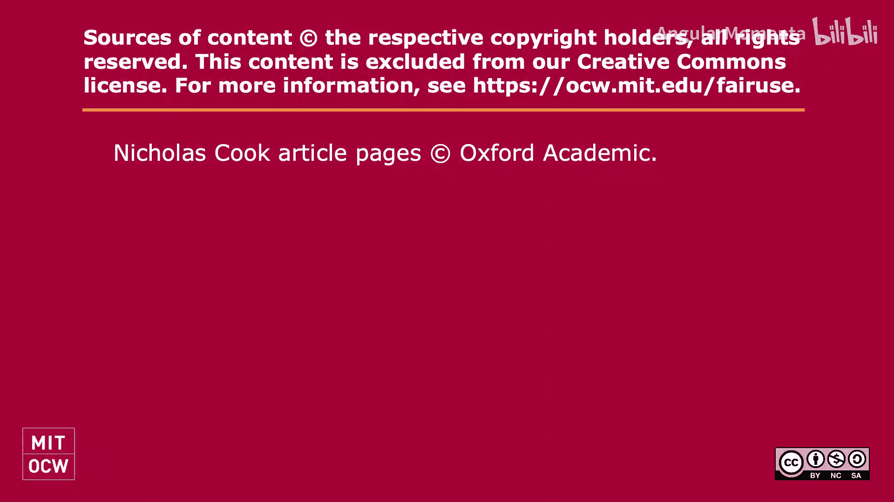

# 【麻省理工】计算音乐学与分析‌ ｜ MIT 21M.383 Computational Music Theory and Analysis,S 2023 p09 09 视频4a：如何阅读学术文章 -BV17xUmBDEUC_p9-

Let's see。This is an article and I want to say just a few little things about it that it's an article that was written for for other academics at the time so just just so we know that it wasn't at the time it was published in 2004 really designed that we' were going to read it in class and we're going to have various academic articles in here so some people are old hats reading academic articles in the humanities or in science or this case at the intersection of humanities and science and other people have had less less introduction to that so I just want to take a minute and say how I approach reading a new article because we'll have some of them up first。

Always take a second， think about the title or second， figure out， okay， is you know。

Sometimes I even can just write it down and put it somewhere because when i'm not assigning articles there are things that you can put down at any point and so when I get to the point where I'm somewhere through it and I see they're not answering they're not talking about the title they' not then I can throw it away you're not allowed to do that in this class but that's you know assigned to do。

When。I always start paying attention to the bold points and try to see about that because I don't read very fast and think so I'll want to jump ahead of it。

But always read the introduction really carefully I would in some ways if you have， you know。

 let's say this would never happen to you， but you're behind on a reading or something it's 10 minutes before class and you're trying to figure out what to do don't read the whole thing fast read the introduction really carefully twice and that's because that's where almost everything should be there it's a good article。

We may read because you'll get to very specific things in as you get to your projects。

 we may get to the point where you're kind of assigning yourself articles or it's like， hey。

 look at this these five articles that I may have seen if at the end of the introduction again you don't know anything what it' going to be about throw it out move to the next article but a well written article should give everything there。

I go to the pictures yet next I don't want to ever see that cliche of pictures with thousand words in any of your things。

 but it's kind of true so you can figure out okay， what are we going to be talking about？

From reading the introduction I knew we're going to be talking about music representation so I start asking are these music representations that are being talked about and then when I look at the text I can do it I can see okay the next topic is issues representation I've skimed to head so I know there's only two real topics and this so this should be the first half of it oh my gosh like that's why I remember and like okay and read the first sentence the first paragraph of that and go ahead and see if。

If the if the ending tells you what it's going to be about it's this is not like watching your favorite movie don't academic article you shouldn't feel like you're spoiling the the great reveal there's maybe five articles in my life where I think。

If I did if I read this way the first time I saw I would have ruined the article all the rest。

 I just improved my stuff so I can see that okay so we have a problem of multiple requirements and we have some sort of a solution that doesn't work so then I can go back and read and try to figure out what it is we're going be talking about。

And we can see the final thing is an introduction to the next section。

You see that the second part is a case study。Of one particular。

Example of computational and comparative and computational meology。And。

I can see okay I probably should have some fun looking at that later and then jump to the conclusion and this articles great in that it does label its conclusion with。

Where is it the word conclusion， not every article does that。But again。

Go ahead and read the last couple paragraphs。Outut the article so you find where it ends， go back。

And go ahead and figure out。What the orbit is going to beeped out。

When you're assigning articles to yourself。And the articles just keep getting longer it's this weird thing that people used to write things in typewriters double spaced in courier 14 point now we write single spaced in times you ro in 11 or 12 or something and but people keep thinking that my article needs to be 30 pages long and that's actually double the length of articles so they're starting to get too long I do encourage you to read like this and then only only after you figure out。

What the mean？conclusions of the article are。This one。

Pretty obvious to those of us in this class that we can use computational methods without giving up gymistic values only once we've done that we go back hopefully you can skip notes the first time you read because if they've written wild they should be additional parts over places that you can look at later if it's a poorly written article then you have to read the notes to get to it。

And if it's a new subject， go ahead and look at the references and see who appears a lot。

So you can see， okay， these are probably important people that okay， this got Paul von Hpo， hippo。

 Huron， Huron， Huron， Huron， Huron， Huron， Hu， I should probably if I want to go further。

Read something by hero on this one I think of yeah， it wass just more more and more of them and。

And then also if there's anybody that we recognize from the class who you'll be looking at Elmer Selridge Field's writings today。

 she is awesome。I'm going so with this in mind。These are some of the strategies that I go through in looking at it and then the other great strategy is talk to people and hopefully they can give you the their tape on the article again。

We can， be richer for it。

