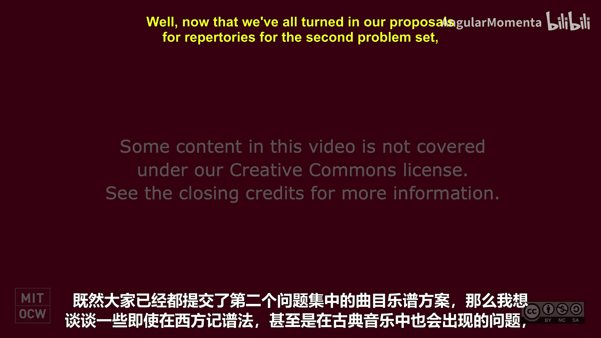
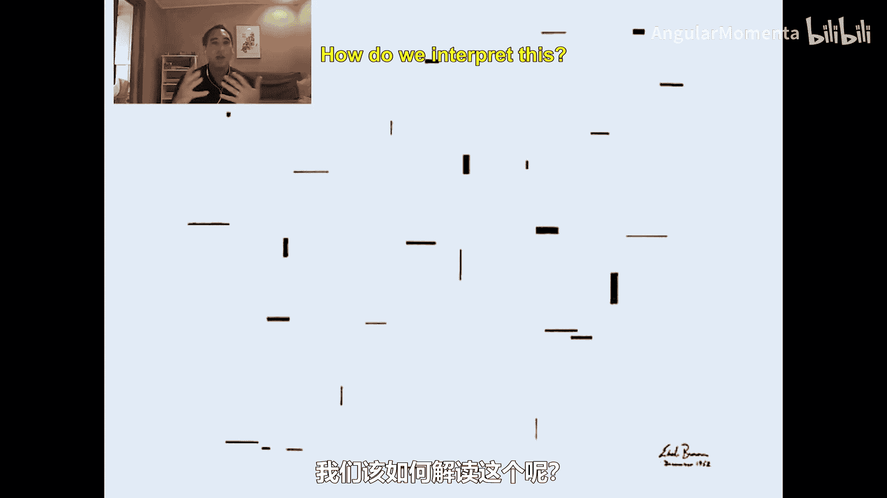
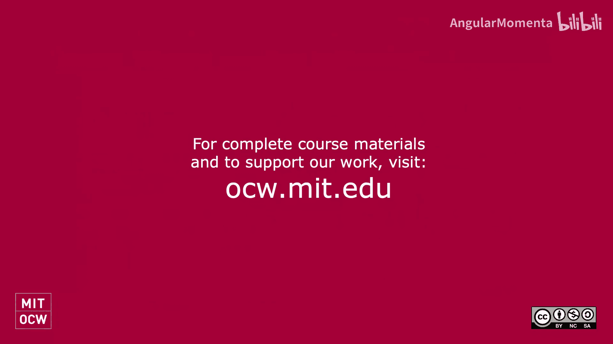

# 【麻省理工】计算音乐学与分析‌ ｜ MIT 21M.383 Computational Music Theory and Analysis,S 2023 p10 10 视频 4b：音乐表现概论 -BV17xUmBDEUC_p10-

Well， now that we've all turned in our proposals for repertoies for for the second problem set。

 I want to go through some of the problems that arise。

 even in Western notation and even in classical music that raise interesting questions for representation。

 So we're looking here at a piano trio。 This by Cla Schhuumman。

 And it might look like there's not too many problems to represent。

 But we'll get back to it a little bit and look a little bit deeper。

 Here is a little piece from Don Giovanni by Mozart。 And you can see it's not a high quality scan。

 but there's still interesting things here。 This is not actually Don Giovanni。

 This is a piano reduction。 So we have the singer Don Lo Verra and all the orchestra reduced to to staves。

 Here is the similar。

Passage， the same passage actually with different language we have Italian and English before and now Italian and German。

 but where we have the full orchestral score out and how do we represent the differences and the connections between these two scores？

This alreadyr difficult problem that hasn't been fully solved。 but wait till we try to represent， oh。

 how do the manuscript parts for various pieces relate。

When we go into the 20th century and 21st centuries there are even more complex problems。

 this is a late score by Ikotinsky， which is actually pretty standard in many ways in that it uses notes and things but the clefs。

 if they continue to the next staff， they're continued with lines and probably most obviously when an instrument doesn't play its part is its staff is removed。

Or something like this。 This is from one of my scores when I was in college。

 where the staffs staves are removed toward people don't play， but also。At various points。

 the representation， the distances between notes are not given with standard note heads。

 but are given with time durations， and some of the notes such as these here that are accelerating aren't given in exact they're not given exactly between a quarter an eighth note or a 64th note。

 but some continuum in between。A lot of the greatest music being written today。

 such as this piece by Kate Soper uses extended notational techniques。

 So here we have filled in circles representing closed mouth， and we have open mouth signals。

 and we have symbols for pure speech， and the violin part you might see actually isn't in trebleclo。

 but it's in percussion cloth with four lines。 Each one representing just to play on that string。

 These at the notes。 strings to be playing on。😊，There are many pieces。

 such as this piece by Brian Ferurnyhow Atu Transcendalal that that require us to have notational formats that that go again beyond what we might think of as common notation。

 but only push it a little bit further， such as early on here。

 we have a triplet in the place of 21 over 20 in the place of 7，4。 or at the end。

 we have a measure whose time signature denominator is not the power of 2。

 how do we represent such things。We don't have to get into 20th and 21st century music to run into problems like this。

 Here is another passage from Mozart Don Giovanni， where there are three different orchestras playing on stage and in the pit。

 and they are in three different time signatures representing the different classes of。

People whose dances would be represented in different temps in 3，8，2，4， and 3，4。

Measures do not necessarily line up how do we even count measures in something like this。

In an otherwise seemingly normal passage by DBC， we have this moment。 And I thank Donald Bird。

 for pointing this out where we actually have two different clefts。

Active simultaneously on the same staff。How does this get represented？

If we go back to the Cla Schumman example with which we began。

 we can see that there are actually certain things that are extremely difficult to represent。

 Why is this rest here， But there's no rests before， What part of the measure does this mean， Well。

 it's kind of obvious this voice is moving up to here。 But how is that obvious for a computer。Or。

What parts exactly are these notes that cross staves part of how do we represent cross ta beaming。

 how do we represent some of these the time that would actually be used in a grace note。

And when we go earlier in time， there are problems that expand even further。

 this is only a little bit different from common Western music notation in this example from。

 I believe the6 from the 17th century of church music。

 but we are using different symbols for different notes and not having leaving out one layer of the open notes。

When we go very far back in time， such as in this， I believe。

9th century chant manuscript from the opening of the mass for Christmas。

 we have symbols that just tell us the direction that notes go not their exact pitch。

Do we want to be able to encode things such as this？

Here is a beautiful manuscript from the beginning of the 15th century in the shape of a heart。

 because the composer's name， Bd Cordiier Cor means heart and。

Do we want to represent the graphical layout of the original score let alone these notes that are in RA or other unusual formats？

And here is another example from the same tide period where the harp strings become the staff lines。

 but the notes only appear on the staff lines。 Therefore。

 all of the notation is sort of expanded in double size。What do we want to do with this？

What do we want to do with a piece such as Cornelius Cardu's treatise。

 where notational symbols are used to give inspiration to the performer， to the singers。

And how to perform this。There is a score， but every performance is different。

Here is another score for a Earl Brown folio from December of 1952。How do we interpret this。

 How do we store the interpretations up this piece。

I already mentioned in class that non Western music and popular music。

Have their own difficulties as well have their own problems and interesting points， as does。

Machine music， electronic music。Where in this case。

 a piano player role where exact precise differences， distances between notes can be encoded。

So I hope that this gives some sense of some of the rich variety of representation。

 and I'm looking forward to seeing how your representations end up。

