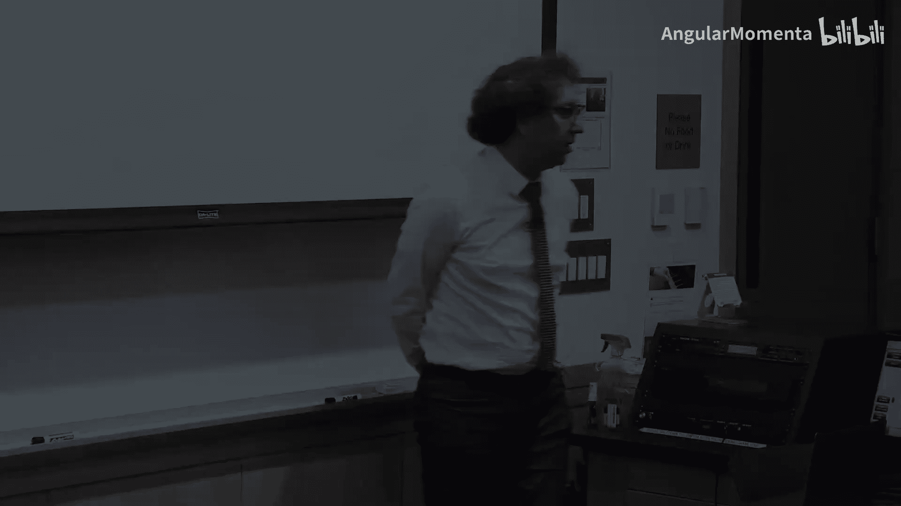
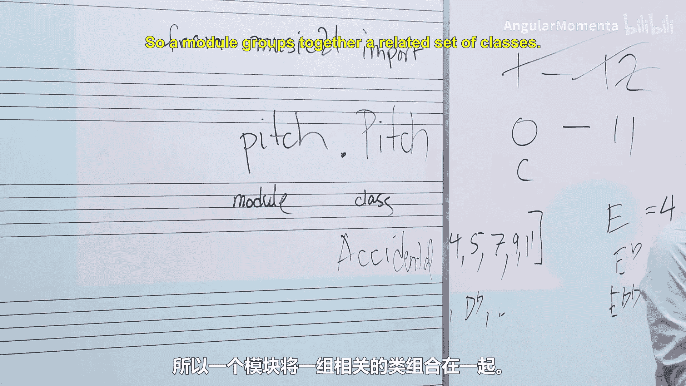
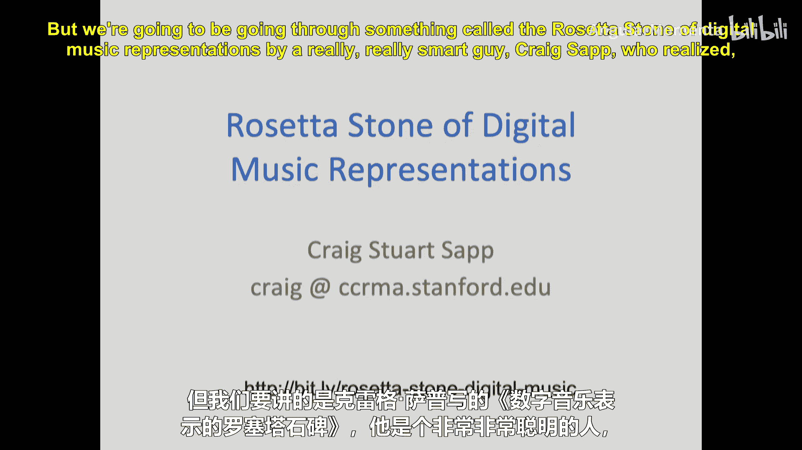
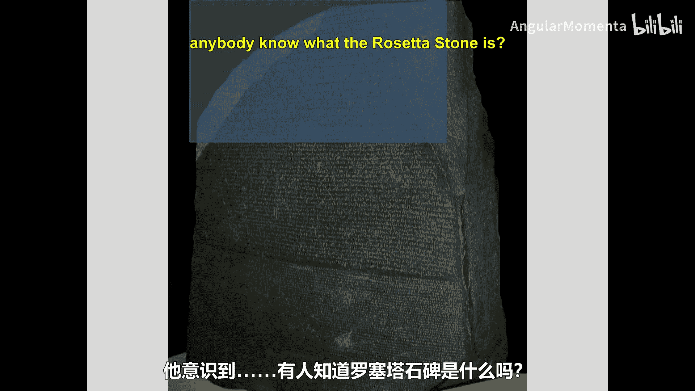
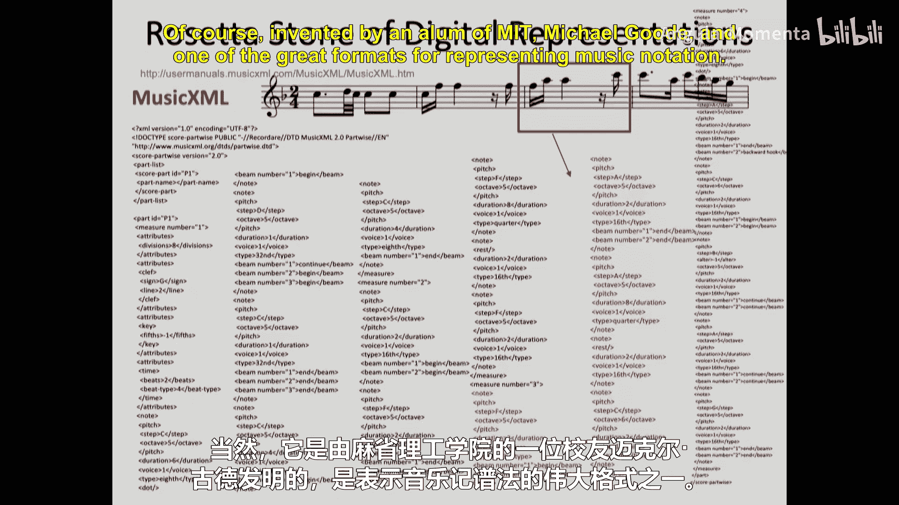
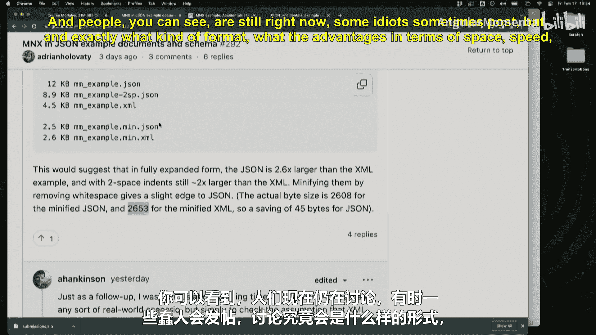
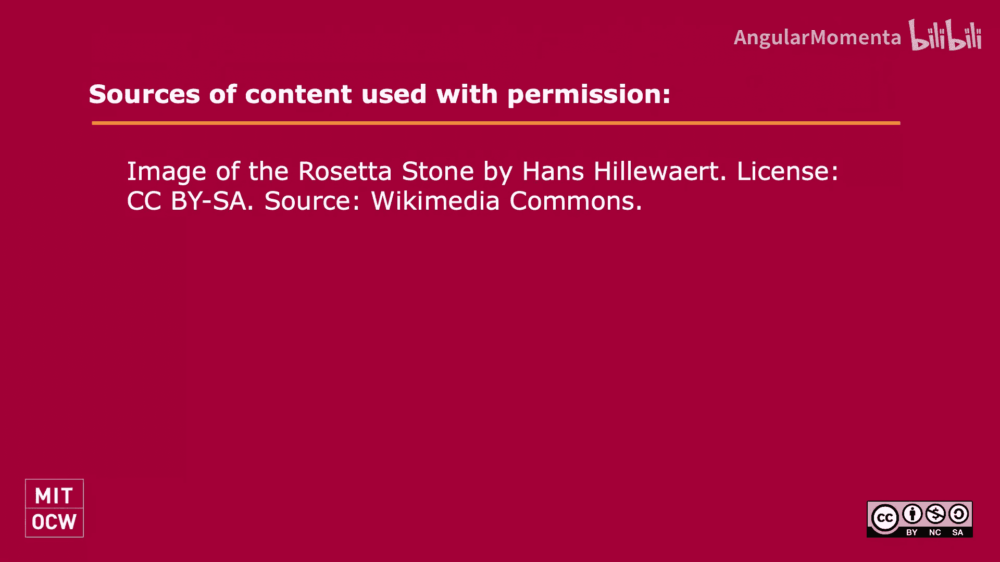

# 【麻省理工】计算音乐学与分析‌ ｜ MIT 21M.383 Computational Music Theory and Analysis,S 2023 p11 11 第五课 视频：音乐表达（二） -BV17xUmBDEUC_p11-

Okay， welcome everybody， wonderful。Warm February， Friday here。

And we're continuing with our second topic the class first one being about notes， pitches， durations。

 and now we're getting to how to represent bigger musical scores。I'm going to start， though。

 by jumping back to topic one for a second and want to talk through a couple things first。

Great job on Pet 1 there I can， and I can say it's nice when you can say that to the whole class without putting。

 For the most part， Pet  one was really great。 Now， every single piece at one was。

 was very strong there when。😊，And that's， that's my quick two second overview of having the computer automatically go through and just spit out every error that detected。

 And I'll go through it by hand because and figure out places where there might be partial credit where a mistake early on was causing cascading problems and things of that sort。

 But some really， really great things happening。 You guys seem to be really strong on。On pitch names。

 on representation， on manipulating， transposing some really。

 really good work with inversions for the most part。

 which is some of the most challenging parts of the problem set。 And yeah， so。😊。

I'd love to dwell for the next hour on everything you all did， right。

Give yourself thumbs up for that。 But let's， let's talk a little bit on a couple of the things that were challenging on the problem set。

 some of them that， you know， that maybe I could have done better。 some of them， maybe， you know。

 we all could just thought that one，1 a little bit harder。

 Let's start with the concept of pitch class。How many pitch classes are there。

 Let's shout it out on 3，1，2，3，12。 And they what，1 to 12。0211， great super。

 so we almost all got that and what's a note that's pitch class 0。LetSee， good， good。

 So let's see if we know our major scales pretty well， pitch class4。第。E， good。 So4 is E。E flat。3。

E double flat。这个。Great， triple a flat。Qurup不。Quntumpple flat。11。So this ends up being。

 this was one of the things challenge that there's a modo operator， right， you know。

 trying to make sure everything is between。0 and 11 at first， when you're looking at the names， see。

 And so almost everybody somewhere encoded right array that looks something like this， I think。5，7。

 getting this right，9，11。Who did something like that at some point？ Yeah。

 and then so if you didn't do that and you encoded all of them， then the hard part was Nhar。Monics。

 yeah， if you said that one is C sharp。 Oh， it's also D flat。 Okay， I think I've got it。

 but it's also you very， very odd notes like。B。Double sharp。 oops I should do a proper double sharp。

 and not a programmer is double sharp， right？Yeah。Things like that。 That's correct， right， Yeah。

 So if you did something like this， there's a weird thing that that a lot of people forgot that when you get your modo to get everything into 0。

2，4，5，7，9，11 by stripping off the accidentals， then you start adding what is it。

 you subtract  one for every flat。Add one for every sharp。 So you can do。

 you can have your computer be very smart at first， with things that that's a E。Double sharp。

 My handwriting will get better。啊。And you can do that。 But remembering at the end that， O， if B。

Is 11 that B sharp is not 11 plus one。But，11。Plus， one。What I want to put after that。まま。Moon 12， yep。

 good。Good， so that was， that was one thing。 The other thing that came up quite a bit。

 And you're gonna think that this is like a pretty。Dirty trick for me。 Let's start with this。

This is pitch set。One， this is pitch set。two。Is there a way we is there an access inversion somewhere。

That will let us transform pitch set 1 to pitch set 2。No， I'm seeing seeing some， some nose。 Matthew。

 you， you had the first head shock head head rock。 What， what， how do you compute that very fast。

 Did you try all， all 132 possible axes of rotation and saw that there were none。

The way that I did it was I made sure that the intervals of one were the negatives of the intervals of the other。

 Great， so what when we talk about the intervals of one， intervals pitch at one。

 what's the interval that we're looking at here。What do we call。2。And what's the interval here？One。

 if we're thinking of chromatic， what if we're thinking of it in more of our traditional tonal space。

 what do we want to call this one？What's up whole step， good， another word for Who step。

Usually major second， good， and here half step right or。Minor second。 good。 So you knew。

That you weren't going to be able to find that。 You didn't need to do all the computation。

Let's do one that's a little bit harder。Is there？Something like that。And can we。

Find some sort of inversion， exus of inversion。But。Allows us。To transform it into。That。Why。

It's pretty obvious。 So go ahead take always take the easy participation points when you。

 when you can。所以这个。I sick one has four those。One has four notes and the other one has five notes。

 good。I believe 15 out of the 17 problem sets turned in found that to be acceptable。

Because we weren't comparing first the obvious thing that they had to have the same number of notes。

 which does happen quite often， right， that you're going along and you're thinking of。

 here's a triad。 Here's a triad。 Here's a seventh court。 Here's a triad。

 Is there a way that we can manipulate the first triad to be the second triad。 Yes。

 I there a way that we can manipulate the second triad to be the。The the seventh chor。

 the fournote chord， not with the tools that we've learned so far。 right。

 So those are some things and a very， very， very small this one。

 I think is important because this will come up in real music everywhere。Very， very。

 very small problem。 And this one， this one， you might hate your professor for doing that。

Can P set one。Be converted to P at 2 by inversion。Yes， because there's nothing here。

 You don't need to do any operation or any operation you do to nothing can transform。Into this。

 right， if you think about the reciprocal or you know， the negation of an empty set。

 it'll be sort of the empty set and that that one， I think I put like one。

110th of one% on because it' it's kind of a nasty thing。

 but it was one of the cases where unlike the fornote thing where a lot of times programs。

 your algorithms were returning the incorrect answer。

 This one was causing the programs to crash quite a bit。A couple years ago。I didn't。

 My automatic assessment system didn't。 I was I I stole it from Ora Goi。

 He's very generous with that did not handle crashes very well。 Now， you know， it does。 So we'll。

 we'll see that so。That's a big parentheses around the fact that the Ps were great。We're very。

 very strong。 I think you should all be proud on that。 But keep keep thinking of the corner cases。

 I especially liked how many test cases that I didn't write that I saw。 I mean， I was going really。

 really fast the code because you all just turned it in this morning grew late last night。

 But for the most part。 But I was， I was very impressed with how。

 how much people were trying to get at the corner cases and things。 And that's a good thing to。

Feel free to， you know， use that kind of collaborative discussion when we're gonna encourage some collaborative discussion in the next problem set coming right up。

There was one other thing besides some reading and video watching。That I asked y' all to do。

 And I got some really great answers。 And that was talking about various kinds of pitch representations。

 What you might do and what some of the stakeholders might be who。

 who might want a particular pitch representation and that might be different from somebody else。

 So anybody， I read through them， I'm gonna you know， say， say some things to。

 especially things I found really great and。😊，But anybody find anything that you thought was interesting to different groups or audiences or stakeholders that might prefer very different representations of pitches。

Yeah粉。Like people that are more like editing and really analyzing sound files might be a lot more interested in seeing like frequency values。

 if you have like a musician who' reading sheet music。

 they look at a frequency value doesn't mean anything to them so they would want like one of their letter。

'reYeah，Yeah， totally nobody's going to see。And I don't know，5，19。8， I'm just making these up in 947。

point。82 and be like， this is my most beautiful chord。 I just， I just love that。

 it's very hard to do on the guitar。 But when you get it just right， yeah， yeah， so definitely。

 definitely different stakeholders for different。😊，For different， for different places。

 different agendas， good other other circles。 So we have peoples sound editors and， and musicians。

 and we can refine that either way。 Thanks So that was great。😊，Anybody else I think。Yeah。

 Matthew' you some people care about endharonic spelling and for some people that's just excess information it's useless yes。

The big。Fight on enharonic。Sppeing。Yeahや。I just。Got a bug report in Music 21 on Wednesday that Music 21 was not properly calling this。

Let's see if I can even do it now maybe it was here。

Was not properly calling this a dominant seventh court。And was saying it was something else。

But if we split flip this。Actually， I hope I actually wrote a dominant seventh sign that sounds like a dominant seventh chord。

That's right， right， Not， I'm not too far away from teaching music theory for a year。 So， yeah， so。

I am a stakeholder in an harmonic spelling。 The bug report was from somebody who wasn't a stakeholder in an harmonic spelling。

 great。Who， who might not care about anharonic spelling。 Yeah， go ahead。We could say okay guitar Tos。

 who doesn't know sheet music， Yeah， totally totally or who doesn't whose's t？

Maybe if they they just be a little more generous maybe， they know something。

 but it's translating from the sheet into the tabletature into the position before translating to the next stage of mental processing。

 I mean， we do that a lot people who are native speakers in in two languages。

 don't translate from one language to another before there's before there's， you know。

 some of conception， whereas when I'm learning a new language。

 It's always going through English before it has a meaning to me。 Yeah， so。

 so somebody who plays guitar might be translating what they're seeing to a fret position and then saying。

 that's great。 You see that quite often in in a lot of。Fakebook scores in things where you'll see。

 I don't know。 Well， same， same type of thing。 you'll see like E flat minor on something。

 And then you'll。Read on that， the。The cord。That's right。Quite often， you know。

 or some something like that in a melody。And。Well， obviously， the， that's not。

 But because it's all about translating it first， That's good。 Good， other stakeholders。

Or other interesting people who might use pitch in a different way。Yeah。

 I've heard there like people who like make incredible music。

 but they don't even know music theory at all。いやね失なな。Yeah。

 totally there's a big big area now of study on implied cognitions of music theory that the idea being for some of the people who are working on this that nobody who's making absolutely amazing music has no conception of what they're doing。

 they might not have the vocabulary to share it with us。

 but there's some sort of underlying conception and how do we get at best， one of my colleagues。

 one of your fellow professors you can take class with Leslie Tiy who teaches rhythms of the world and the Balinese gamma on and music of Bali and Indonesia thinks she just wrote a book that that just won the big big ward in music theory。

 which is on trying to figure out what the conception of Balinese musicians who play these two people who play these improvised drum patterns interlocking。

Huge super， super fast intervals， but sometimes one of them stops a bit and does the other one。

And they， you almost， almost never miss。 And when they do， you know， just like a fluub note they。

 you know， they laugh and say， oh， how do， how do we it up。 But， you know， they say。

 and her book begins with asking people， how do you， how do you do this They said， oh。

 you just play whatever you want。😊，And so question place， I said， no， no， no， not that。 not。

 And so how do you get at the implied the implied music theory conception。 Super great question。

 Jordan， I keep saying who are the people who do this， But some people。

 some people in this class identified stakeholders that weren't people。그や 거。

I like digital audio workstations。 Yeah， yeah， so we。

 we can give autonomy to a digital audio workstation or to a computer in general or to a neural network。

There's been a lot of talk about autonomy and sentience in neural networks this week， and。And。

 you know， so， so why not talk about them as stakeholders。

 What makes it easier for a digital audio workstation to process P usually eliminate and harmonic spelling helps quite a bit。

 yeah。Great， anything else that came up that that you found， especially if you。

 if you read something and even if you don't remember who it was but somebody else's that you read and liked and you thought。

 oh， I wish I had thought of that。 I'll see it when we go through the， the sheets and stuff。

 So so that's， that's great。 That's mostly leaving aside topic 1。 Now。

 there's one more thing in topic 1。 I've put it on video to watch this weekend。

 you will have unlocked your first music 21 module。 So now in any problem set from now on。

 it is will be fair game to say from。😊，Music 21。Import。Pch。

And the video will go into more detail from this pitch's lowercase in Python。 What's that signified。

If you're importing science lowercase， probably。Actually， okay， there's， there's a。

 there's a pitch dot capital pitch。 What， what's the distinction between those two。In this case。

就我系 class。What is a class and， the other one is what？啊そ。It acts exactly like a folder。

 It Great answer。 Theres specific name that， that's used in。 Yeah， Jason， module。 Yep。

 so which one's which。class。That one's a class。 Im， I'm， I'm very bad at。

 I turn around and you pointed of the other。Capital P is a class。And lowercase one is the module。

 So you have everything module。Module， yeah， everything that's in the pitch module is on because you will also find in there things like accidental。

 which is pretty。Helpful， so a module groups together related set of classes。 if you， yeah。

Sorry， just going back to the。I was wondering if there are any studies on people who don't have perfect pitch that only does pitch。

Like， take the same piece of music and then just subscribe it。 I there any emotional difference。

Like to this matter its like， you know， starting on D or sorry。't2 doesn't have perfect pitch。

 I'll have to look that up。 I imagine， I mean， I don't have perfect pitch。

 but absolute pitch is the term that we're using more often。 now。

 I don't have perfect or absolute pitch。 but， but there's definitely pieces that you play you know。

 some song that I know really well and you play up a half step or up a whole step。

 It's going to impact me。 Now， if it's a song。 I don't know。 I'm not， not entirely sure。

 but I'll I'll， I'll see，Let me just make make a note on that。

 I found in one unscientific study that。In for a paper I was working on that there's a particular case where you can very strangely the the number of notes within repetition of contour is decreasing。

 but the number of repetitions of that contour before something changes is increasing。 So the tempo。

 depending on if you hear the harmony or with the harmony changes。

 the harmonic changes as determinedminant of tempo。

 or if you hear the repetition of contour as determinedmin of tempo。

 you can hear the same piece beating up or slowing down。 And a lot of people were like， oh， yeah。

 I hear this and things。 But in that unscientific experiment， people with absolute pit said。

I don't hear repetition of contour when the notes are different。That。

 that doesn't seem to me a kind of repetition。 So there's。

 there are probably different ways we can do that， great。Super great question。

 We'll put this aside When we edit it， We'll edit that about 10 seconds back and we'll jump back to here just for a second。

 don't， don't be afraid of， of doing that。 If， if it's something you know， and if。

 if it's something that I think it's gonna be super confusing to everybody。 if we jump back。

 I'll say， we'll hold that for a bit。 But I think we we can still code switch。

 we can switch back and forth between what we were talking about 30 seconds early and what were just talking about。

 right。😊，Good， okay， so you're going to be able to import and use anything in the pitch module as long as it doesn't have the word transpose。

In it。Somewhere， because certain kinds of traps position will be things for us to work out in the next couple problem sets。

Good。 so that's what's coming up and then we'll be done with that。Now， so last class。

 we were talking a lot more about moving from the representation of individual pitches。

 individual notes into larger things what you might call it representation of a score or simply representation of music。

Something of that sort。I introduce a term that some of you already knew from other classes that come goes back to philosophy。

 but has a interesting twist of a meaning in。In computer science。

 I remember that term without looking down at the outline。Ontology， good。And last class， we explored。

Some of the things in the philosophical the definition of essence of， of what something is。

 remember some of the things that we， we had trouble defining when something ended and became something else。

Yeah。we talked about notes that we can't really tell is， is this one note， Is this two notes。

 Is this six notes， I infinity of notes or 14 or yeah， then a larger system of musical notation。

 Remember， we called it used in。He'd in one part of the world。Yeah。Come in Western music notation。

 Yeah， and we had， we had some trouble distinguishing when what was common or what was Western about it。

 or I suppose， in one case， what was music about it seemed to be， you know， on the edge。 Good。

 Then we also brought up a little bit。 the computer science definition。

And that's what we're going to be working looking at a little bit now。

 but always feeling like we want to jump back to the philosophical definition because we don't want ideas from computer science always to what。

 what is easy to conceive of， We don't want that to limit our imagination of what we might be able to conceive in the future。

So we talked about so in the computer science definitions， there are various ones。

 there's ones that are more formalized。 There's ones that are less。

 one that I can't keep in my head because I can remember it when I come come up is when we're trying to represent something like music or you know。

 you can be your ontology of a website or something。

 But when you're trying to think of a particular object that's either conceptual or or。

 you know raified really real。 I want to think about how is it made up of what objects are in it。

What are the relationships。Sipps。Between objects。And what are they called or what are their names。

What was it， There was something It was like first or second class that we had a real， Oh。

 I remember now， really hard time figuring out the name of it。 And it had to do with the。Well。

 this is this is a eighth note。 And this one's a whole note。 And so the blank of the note is eighth。

 The blank of the note is whole。 what did we come up with had some the almond of it。 Yeah。

 we had so sometimes sometimes pushing it way out there can make that。

 I mean some of you all have taken physics。 that probably subatomic particles do not have a charm a color。

 things like that， But these kinds of names can help us conceive of some property of something。

 So we might have the almond of a note。 I think I went with something very generic the type of the note always avoid type if you can come up with something better because type it's too valuable to use and too generic。

 So good。 So what are things what are they called。 and I'm spending notice what are the objects you're gonna be thinking about that a lot。

 What are the relationships you're always gonna be thinking about that a lot。

 But the name of something can really， really help。

Somebody somebodybody else understand how you're conceiving something， and it can be very， very hard。

 Some of you have probably heard the computer science joke that there's only three really difficult things in programming。

What to name something and off by one errors。Good， good。Good， some people hadn't heard that。

 And some other people have。 Yeah。 So what is something called and。And that。

 But we're going to jump now to what are the relationships between objects。

What are some things in music that we might consider an object。Let's，s， let's rapid fire。

 Just shout out over each other。Note， good。 Always take the easy one。 get the easy push space credit。

 great。Rest， I heard yep。Okay。Measure， oh， that's good。Phrase，Good。articulation。Good， let's。

 I'm gonna stop writing down unless I hear something that that I've never。

 never thought of and could what else。Cliff score， the whole score， good， the score。The dynamic。

The instrument， tempo。Name of the performer。Concert haller was performed in。Maybe， maybe not。

 can we can kind of go， but these are things we might represent when we're thinking about a performance of a music。

 good。Anything else on people's jumping on people's mind， Angelica。

 Do you have one that you haven't heard。Beat， oh yeah， beat。See that。

 That's great because that's something we don't see on the score， but we're thinking all the time。

 right， Yeah Tamber。Good， the instrumental color。Tmber。Great， so so these are all different things。

 and that might we might think of as as objects。 One of the things and some of them we might not represent in every programming language as an actual。

 you know， object class， depending on your programming language。 But you know。

 there are things we can think of that have a particular。😊，Nounness。

 can you say nounness that they act like nouns that they have the essence of a noun as opposed to a verb。

 Nobody said that a fundamental object was transpoposedse。Or perform。Right， that that those。

 those verbi things。 So when we want to think of various ways that objects can be related。

Ass any we talk often about taxonomies and meomies。Any。

 has this come up in anybody else's in computer science classes， think doesn't come up in was it 6。

 double09，6，1，0，1，0。 Okay， good， who is， but who has heard of a taxonomy in another concept？ Yeah。

man， where have you heard it。嗯。Animals， kings play cards on fat green stools。

 Do they still teach that or kingdom phhilum， Yeah， I mean， now there's all these。

 they keep rearranging it， right， They're keeping sub classes and super kingdoms and。

 and things like that。 But yeah， so we can have a taxonomy that way。😊，So。Taxonomy is one that we're。

 we're used for Ton I can。When you're too close， it's hard。 Okay。

 taxonomy in this definition in in ontology， it's something is。Something else。

So give the example here that。That a miniewt is a dance。

For those who know the minuet style in the early 18th century， the mint is a triple time dance。

 which means it is a dance。Or it is a， or that， I don't know。 what's。

 what's something else in music that is something else。Yeah， Alegreto is a temple。

 Aleg Greto is a temple Good。 I put up this， what what do you call this one in this context。

Stccato now， now you'll understand when， when you do optical music recognition how the context is so important。

 Otherwise， you'd say augmentation dot， right， So staccato is。artrticulation， good。

 I there any higher level thing that we might say is。Musicians probably not。

But when we're thinking of representing a computer， yeah， Sean。A have note ist O。

A half note is a note， good。Half note is a note。Great。

 I was just gonna to go back to the articulations also。

 but we'll jump to half note is a note in a second because that's a pretty fundamental one。

 Sometimes with with your own representations， you might think of， for instance。Is tri。

An articulation。Who votes yes？Who votes no？Who votes？ I have never thought about this。

 And I hope I never have to think about this again in my life。 Okay， good， good。

 A lot of people call a tri in ornament。A turn in ornament。Something like that。

 So you might need what is the class of， But， but we know that a tri is more related to an accent mark than it is to a half note or to。

A gielle， right？ So， so we might think of what's some some kind of slightly just some kind of slightly bigger thing that holds。

 that holds articulations and ornaments。What might we call that？

 And when we come up with a name for that， Yeah， Jason， first， then a modifier， good。

That's what a lot of people。That's believe what it's called in the Vexflow notation software。

 So somebody' sitting like， yeah， I think maybe could envelope。Envelope。Are they onve lopes。

They might be。En envelope changers， envelope，s something then in themselves， the Stccado doesn't。

 Does the staccado have an envelope。 Maybe it does。 I'm not。 I don't work in this as much。

 bes like it's just a good attack。呃对。Sustain。Attack， no， attack D decay S sustain R。

Residents are release。 Yeah， not this class。 Not， not we're talking about But some people have that knowledge from doing electronic music things。

 Yeah， so that， so this is something that changes how we attack。

 how we decay how we sustain how we release。 right， So， so yeah， maybe that that is a very good term。

 We're going to be coming up with a bunch of these conceptual grouping things because of。

 of something that you can do with。😊，With， with things that are in a taxonomic relationship。

And I'll work that out， and while， while you all think what might be in those missing letters。

 I had a had a had a comment on the previous one。 I say like augmentation。There。

 they might be an augmentation， or in the case of a staccato。

 maybe a negative augmentation or something or of yeah， a length reducer， good。What do you think？

The in computer speak， when we say that something is something else， we can represent it with。

Subclass relationships who subclass is something that comes up。 I'm 99% sure in the prere for this。

 right， you guys deal with classes and subclass and things。 So quite often， theyre。

 they're a bunch of built in subclass in。In Python that you have various。

 a lot of things are that we think of things are subclasses of number complex numbers。 Oh， yeah。

 we all learned taxonomies in， in our math classes， too， right， complex numbers floats。Ins。

Things like that。 And quite often， for different purposes， that's why we thought about stakeholders。

 for different purposes， different， different sort of taxonomies can be created， right？ I mean。

 in certain cases， you could think， well， an integer is a special kind of float。

 that has nothing past the dot。And that's a very great mathematical way of thinking of an integer。

If you tried to implement that way in your computer programs。

You got some slowness going because you have a whole bunch of added baggage that you wouldn't need。

 Or you can think of if you are， I don't know if you're when you're in third grade， fourth grade。

 when's the first time we learn about decimals。 we don't know the word int。

 but we know that there are integers， we aren't know that there's 5 and 7 in things。

 And the first time that you see 5。2。You would think， oh， well。

 this seems to be a subclass of this because it's a different kind of number。

 So depending on how our ontology， how we're conceptualizing the world。

 taxonoms could run in two different directions。So let's。Well we'll get back to。

 I just want to make sure that we can get through this a certain amount of time。Then。

 there's something called。Would I break it down today， not ready nope。Something called a meonomy。

An meronomy。Something that instead of is， it's something that something has。嗯。Michael。Kthbert。

Is a human most of the time， and therefore。He is an animal because all humans are animals。

 therefore he is a living thing， or that is because that we can think of that as a taxonomy。

Michael is an arm。 He's actually two arms， and he's also two legs。Now， that doesn't make sense。

 There is a relationship between my arms and my legs and me， but it's not the is relationship。

 or at least not the way I conceive of it。But it's something that I have。So what is something， oh。

 sorry， I meant to leave up John's great half note is a note thing。So a half note is a note。

 What is something that a half note has that it is not。this is Jason first。Alment。It has almond。

 which we used for the type。Right， because the al meant。Great。

 I'm going I already have chives as a vocabulary later。 now we have almonds。

 So it has a particular type。Great， what else does？Half note， have。duration， good。

 might have a duration。嗯。What does an eighth note have？That a half note waxs。Fg， flag。

Call that a flag。And what might two eighth notes have that one eighth note doesn't end。

A bar or what do we call that thing？Beam， good， good。

 I'm gonna the center of the room has been really active I'm gonna focus over here and over here for a little bit for the next couple answers good。

 So has a beam。😊，So we can think of this。And here's where your conception go。8th note has a beam。

16th note have a beam or 16th notes have a beam， yeah。Do they have。

 Do 16th notes have a beam that has two。Lines in it。 Or do 16th notes have two beams。

You can imagine you're going to encode this very differently。If you encode number of things。

And some eighthth notes don't have beams。 They have flags instead。

 but they have the potential for gaining a beam。 perhaps if we think of you know， mommy。

 I always want to grow up and be a beamed eighthth note， not not not a flag eighth note。 So might。

 you might say， well， we're not going to have certain eighth notes that have no now know again to computer speak。

 rather the philosophy speak， they have no attribute that where beam could go because that's just silly。

 I don't want to have unbeamed eighth notes and beamed eighth notes。

 maybe as two different concepts as two different objects。 Maybe you say。

 well I'll have one type of eighthth note， and it has either has or doesn't have beams。

Then in your representation， you might be asking yourself， oops， leave that up。

Might be asking yourself， does it make sense to say that8 notes，16th notes，32 notes，64th notes。

 whatever go on to the highest power of two， you can think of have beams。

 but quarter notes and half notes and whole notes don't。Or。Do we say that whole notes？

Have the potential to have beams。 But we， you better not put any on。I don't know。

 There isn't a correct answer for that。 And so sometimes what we conceive of we。

I cannot conceive of a whole note with beams。 I can conceive of a half note with beams。 But。

 you know， I can think of it。 I don't know what it means。Actually。

 it means I was tremoose D all need all did all。 But， but， for， but that's something else。

 that's something， maybe that something visually that looks just like a beam， but means something。

 or maybe it's not。So some of the things that come up in music。

 musical forms give so a Sonata is a type of musical form it's used quite often in the 18th and 19th century。

 and it's a musical form that has an exposition， the thing close to the beginning and the exposition has a first theme group and a second theme group and the first theme group has a phrase and that phrase has measures and those measures have notes。

😊，Perhaps is one way of conceiving it。 It would make much less sense to say。

 what it has a phrase and a phrase is a measure， and a measure is a note。Right。

This is going be part of your， the big part of problem set， too。 In fact。

 we're gonna to skip some other things。 We're just going to do a little bit of the the cook discussion and then then I want to give you time to start thinking about problem set2。

 problem set 2， you're going to think of a type of music that is not common Western music notation might not even have to be a type of music。

 Some people have done。Have done things related to music。

 such as there was a chess playing music generating system in the 1960s of somebody decided to work on it。

 or it might be the the structure of a concert or something like that？

 And I want you to come up with the kinds of what's the taxonomy in the ontology in the in the conception of the system。

 How does this work And what is what are these relationships。

 What's the neuroonomy and the taxonomy there， over the weekend， we're going to be going through。

Some of the past notational formats for Western music notation， for common Western music notations。

 some of the representations， the ontologies， the file formats that that have sort of。

Come up over time。 One of the things a lot of the pieces。

 the discussions that people were talking about have some connection to common Western music notation。

 things I was hearing， but are not themselves， Common Western music notation。

 they might have you know， oh， yeah， the rhythm is the same as you as common Western music notation。

 but saying else， anything that you think is just part of common Western music notation。

 assume that part of the the of the ontology of the file format has already been solved。

 So you know saying if it's sort of like you're doing something with oh， this is a dance groove。

 And here's and the baseline is stored this way it's represented in this way。

 and the notes of the baseline are is stored in know C W M N or something And were stored somehow stored in music X stored saying you'll get some formats And but don't the only way that。

People have gone really wrong on on similar assignments to this in the past is spending too much time thinking about the things that have already been solved。

 If you need to， your format needs to encode in images at certain points。 Just say the JPex。

 don't invent your entire new image format。 Don't invent a new， you know， things。

 things that you already know that spend the time on conceptualizing what hasn't been conceived before。

I just want to。Point out a little bit。 Oh， sorry that is completely illegible。

 Always feel free to tell me when something is completely illegible。 So there we go。 Now it's not。

We're going to go through this more slowly。 I think I， I can。

Can't remember over the weekend or on Wednesday， I should have my syllabus in my head。

 but I write it down so I don't have to memorize it。

But we're gonna be going through a something called the Rosetta Stone of digital music representations by a really。

 really smart guy， Craig Sap， who realized， anybody seen know what the Rosetta Stone is。

 It was the same text written in three different languages， in especially in Greek and in ancient。

Hyeroglyphics that allowed hieroglyphics to finally be。Finally， be decoded。 Craig Sps。

 Rosetta Stone takes the exact same little melody。They can go over it。What is it。

My rhythm was pretty bad on that but that exact same melody and shows how that melody is encoded in I think he has like 32 on his website。

 I have edited it down to about 8。 so that you can see what different representational choices people have made and what kinds of ontologies they make。

 for instance， I've remember in this case， beans。Are high level things。

 They are represented by these braces。 And so therefore， they enclose things。 beams， in this case。

 seem to have a meomy that beams have notes。Not notes have beams。

 So we'll try to see some of these things。 It's another format called ABC。

 one of the ones still in use， even though quite a bit old because it's very， very simple。

 We'll be looking at these in more detail， various formats that at some point were very big。

But have mostly faded。 this is one that we saw once before Muse data where the Q was quarter and the eight。

Was the certain number of durations in F5。 Do you remember that from class or two ago y？

And we'll see over time。How the formats have gotten to be。A little bit more。Complex。Here we go。

This is music X M L， which we're gonna be talking about quite a bit。 of course。

 invented by alum of MI I T， Michael Good and。And one of the great formats for representing music notation。

 the first one with N harmonics just was taken and used by almost everybodys about 2022 years old。

 a lot of us thought。

This is the final format。 This is the representation that really， really works。

 even if there's some weird quirks， we use it forever。

 And then a terrible thing started happening to music。 great and terrible thing。

 started happening to music about。10 years ago，12 almost 15 years ago。

 But we started looking at music， sheet music on various sized screens。And therefore。

 where its the screen is too small to look at a whole page at the time or you turn it sideways and suddenly your page has changed。

 so the notion that music cannot just be represented by where it is on a page but has to be able to keep continuously reflowing has caused a big change to people today trying to come up with what is the optimal format for representing music whose presentation might be different for you because you have an iPad and it might be different over here because you have a 15 inch monitor and it might be different for somebody else because you've just printed it out in the old-fed way。

 how do we represent music that way， I wanted to point out because there is a huge debate so there's a big discussion happening right now on what the music notation next format will be and exactly how it will what it ontology。

Moronomy will be so that it survives into the next generation of musical scores and people。

 you can see are still right now some idiots sometimes post。

 but and exactly what kind of format what the advantages in terms of space， speed。

 various representations are going on， and I haven't checked it this morning。

 but it seems to just still be going on。 So this is a continuous topic of discussion。

 people are still very interested in what's in what's happening。

 what music representations are out there。 And I'm looking forward to five new musical representations existing a week from now that don't today。

😊。

Thanks， everybody。

