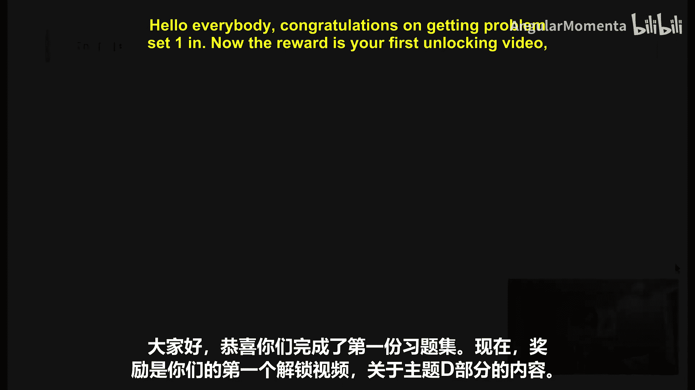
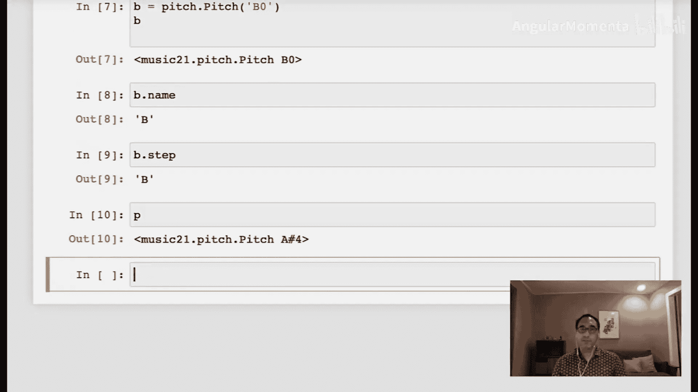
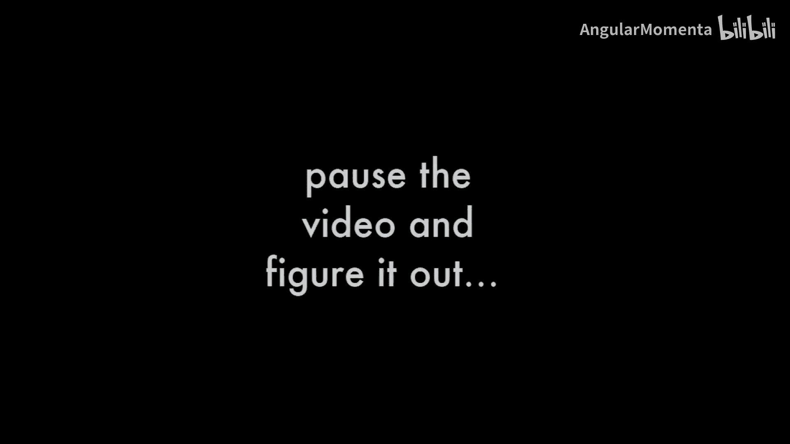
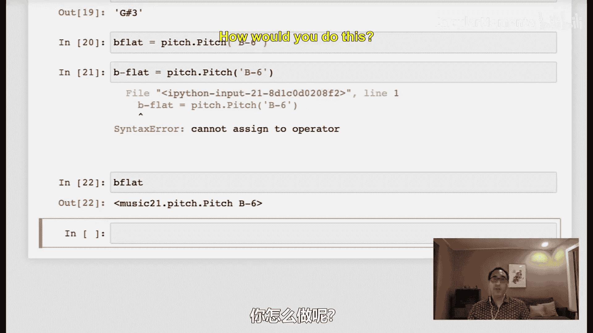
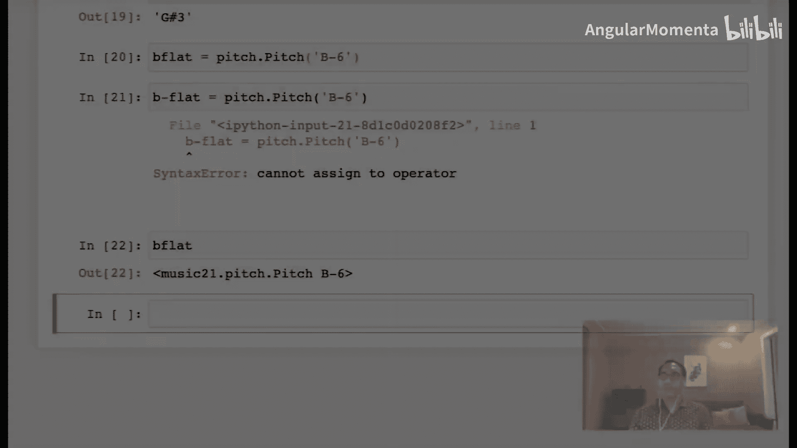
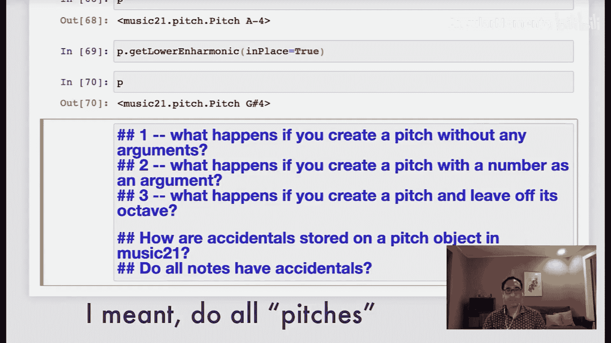
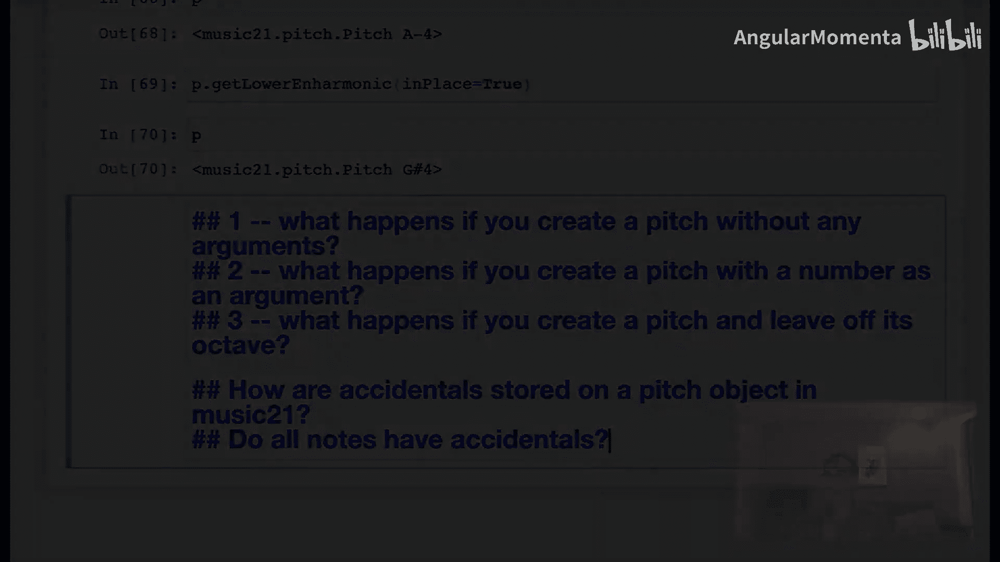
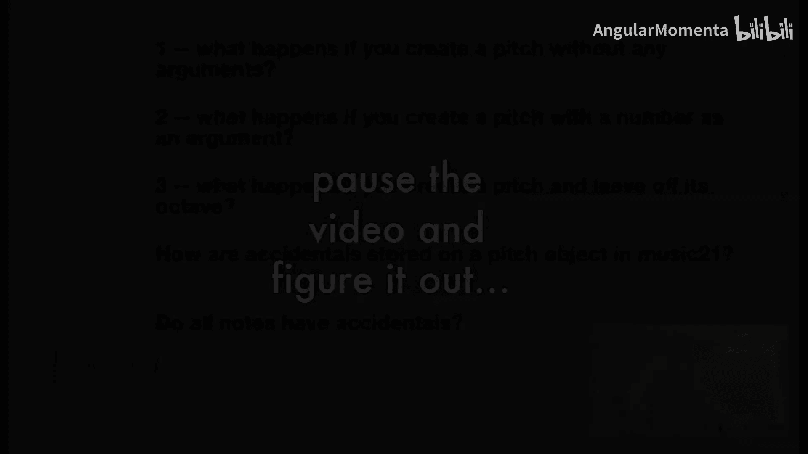
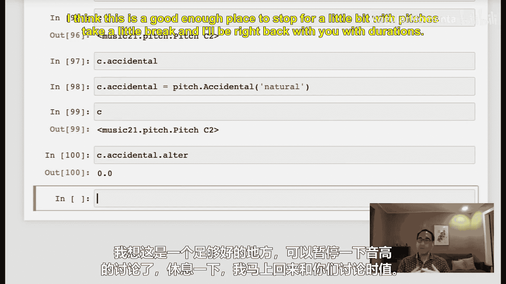

# 【麻省理工】计算音乐学与分析‌ ｜ MIT 21M.383 Computational Music Theory and Analysis,S 2023 p12 12 视频 6a：音乐表示法（三）：解锁 music21 中的音高 -BV17xUmBDEUC_p12-

Hello， everybody。 congratulations on getting problems set one and。

Now， the reward is your first unlocking video。 So a topic part D。 This is topic1 D。

 and you get to have certain tools that you can use to build future problems and solve future problems and build future problem sets using music 21。

 So I'm in Jupiter。 You probably want to be doing this。 well。

 you can do it in Jupiter or you can do it in your own favorite editor。 By the way。

 pie Char will really save you problems on in this class。 Okay， so we're going to introduce music 21。

 You can。Import music 21。 but man， not really， we're going to do from Music 21 importport hitch because you've unlocked your first。

Pitch object and pitch module。 pitch is lowercase here。

 So it represents a module in music 21 and we'll be calling things in it。 Now， in the problem set。

 you were probably representing pitches as something like this or you know。

In harmonically equivalent， whatever in Music of 21， you'll probably want to use our pitch object。

 So the pitch object is found in the pitch module。 It's the pitch modules lowercase P。

 The pitch object is capital P。 and we can do the same thing。 a Sha 4。 and in。Jupiter。

 we can just hit P and get that。 You could also， if you're on the terminal print P。

 and you can see the representation is slightly different。 Okay， so。

Let's figure out what we know about this pitch object。 So in during the problem set。

 you were creating functions that worked on string or other b inputs。

 But now we're gonna that we have an object we're going to be calling methods and attributes directly on it。

 So one of the attributes of the pitch is its name And the name you can see is a string。

 That's why it has the quotes around it。 a sharp。Great and。Well， where's its octave， Take a guess。

You don't opt。Okay， so this is nothing too surprising here。

Let's grab ourselves a slightly different pitch。 we'll say B equals pitch pitch。Be0。s be。

Here is that B0。 and we can get them B's name， which is B also get B step， which is also B。

 So those two things look like they do the exact same thing。

 But go back to our P object and figure out for a second what the difference between name and step is。

对对对对等下。Okay K， did you figure out that P's name has the sharp in it。 The P's step does not。

 So this says what diatonic step， What letter name is in the pitch itself。And。

Are these things mutable。 I actually made a mistake in the 4 to 5 class on the first day and said that music 21 objects were not mutable。

 They actually are and。What but most of the methods that are called on them try to not mutate by default。

 So if you want to， you can change it。 So now P is。A G Sha 4。P's octave stays at 4。

How do we get that G sharpp for， You could do print P dot name plus string of P dotoctave。

And you get that， or there's something called name withoctave， which is pretty nice。

Now let's create a B flat in octave 6。 So we'll call B flat equals pitch dot pitch。

Take a second on what goes here。Okay， we're back。 and then we're gonna get B flatten up to 6。 notice。

 by the way， again， that we don't ever name variables with hyphens in then because it's trying to say。

 well be flat yeah， that doesn't make you any sense。 So B flat is B-6。And sorry， yeah， B flat six。

Take a second。And try to figure out what if you wanted a being natural inoctave negative 6。

 How would you do this。

Great， did you get really in low B equals pitch dot。Pitch。B。😔，7ty4。And how really low。

Dotoctave equals negative 6。Notice that。The name wasoctave。Where this is the same as。

OopsWhere was it because be flats？Name withoctave。So properly， you're going to。

Want most commonly to when you're actually working with your， with your objects to do the two parts。

Separately， so you can see the difference between that and。That。Okay。

 so now we have a pitch and it's kind of like big whipty do you could have done this your self and why do we need to do anything with this well？

Let's create。Another pitch。 and we'll make it a pitch that's。Pretty common。We call that middle C。

 right？Great， so here's middle C。 and we can get its midi number。 And so it knows things like this。

 If we say p do octave equals 5， now it's。Middle of troubleclo in frequently。

Figure out what its many numbers， that's pretty fantastic。We can also do plenty of fun。

 interesting things。What's its name in Spanish， what's its name， what's say？See， how flat。Man。

 it's Spanish now。I think that that's pretty right。 What's his name in German。Okay。

 it's actually a little bit more fun if you work with German names。认识。And。Right。

 that's not part of the literature in this class， but kind of a fun thing to do we worked on the distinction between MIdi and P in your in your problem set。

 so let's recall what does PS stand for。Yet pitch space。

 So the pitch space is the same in this case as the midi number。 They're exactly the same。

 some things we can do， though is， well， let's say， I just set it to 70。5。 Does that have a name。

 Yep， thats kind of weird thing。 It can get its full name。Be half flat。 Okay。

 so we're learning certain things that we can do with this。 But P's P S is 70。5。

 but Midi must be around number。 So it's I guess be， just be natural。The other thing is。

 if we go to really low B was a little little B flat。 now really low。错。It was just few natural。

 really low。B。And get its。Let's  Ota make 6 kits name。And it's P。Wow， that's extremely low。

 That's what is that100909 notes below Middle C， but its midi number is constrained to be between 0 and 127。

 Okay， these are just kind of fun things to play around with。 You can。

Do a directory on any pitch object and。See some of them， the things that are in here。

 ignore the ones with underscores。 for now， We can see that， oh， there's the frequency。 So let's。

 let's create。What's the only one that most of us know the frequency up。On the top her head。Right。

 a4 is 440。 So we're well an American made this。 So it's not 442 or anything like that。

So you'll see that not everything we'll be working with here。

 there's certain things of fundamentals and and harmonics and stuff like that that we'll get to。

 but let's let's see which some of these are。are。Eethods and not and not attributes。

 So let's do P dot get lower and harmonic。And that gives us a G double flat。

 Maybe we'll make P and A flat。 And now we can play around O415。 Yep。

 that's lower and harmonic as G sharp and。What's。The higher and harmonic of。A flat。

 think about it in your head。Right，B triple flat。Okay， by the way， P doesn't change。

 as what I said about this being。Mostly non mutable。

 So we have to assign that be triple flat to something else triple。Flat flat。Yeah， so much great。

 And now we can do the B triple flat dot。Name and let's do its full name。Great。Okay， going back to P。

 which is this a flat 4， one of the other things we can do if we want to have mutable objects will go lower and harmonic to get the G sharp。

 but let's we have we can do this particular attribute where we can see。In place equals true。

And now it doesn't return anything， but P has switch from a flat to G sharp so you can do things however you would like。

Take a minute now to explore the system and cure some questions that I'd like you to work on while youre exploring。

Number one。我。Happens if you create a pitch。Without。Any。Arguments。

What happens if you create a pitch with。啊。Number as an argument。Too big。I hand。What happens？

You create a pitch and leave off its octave。Okay， those are pretty fast ones now some a little bit more fun ones。

How were accidentals stored。On a pitch。Object in Music 21。Do all notes have accidentals？

Click few minutes and work through that on euro。

Great， are you back。 Let's see what our answers are。

 What happens in create a pitch without any other arguments。We get that it's a C。

 And if we get what that notes MIi number is。60， so it's a C 4。 Okay， something a little bit strange。

 What if you create a pitch with a number as its argument。Let's say， 61。Okay， now we get a C sharp。

four。How does it know it's already D flat doesn't really know that great。

Now let's see what happens if you create a pitch and leave off its octave。

 I think we might have already seen this， but。See's sharp， we'll call this。是。Sharp。

And notice the difference here， there's no octave number shown when we， when we do this。 that's。

 but when we look at its midty， it's still 61。 Well， what does this mean， well。

It means that certain things were going to end up。Getting treating octave as something that's implicit。

 So here， if we just say a pitch is a C。And midea 60。Let's get its lower and harmonic。

 That should be a be sharp。我靠。The S。chart。B sharps are kind of B S。

 and now let's look at its midi number。Oh， it's jumped all the way up because what it tries to do in this case is if you give it no octave。

 it tries to create everything in the octave round middle sea。 So that's kind of neat。Okay。

 the next question is a little bit harder。 How are accidental stored on a pitch object in Music 21。

 Well， looks like a B S is accidental。B I dental spelled that right and。It has these little。

Carrots a rabbit， which probably means it's some sort of a object thing。 So we'll call it。

Aack for accidental。And。See that here， and we can。Get the type of it okay。

 it is its own object and we can the accidental to see certain things that it knows its alteration。

 What is that。1。2， that's the number of semitons above the。Accidentalless object there， great and。

Well， that's basically the one， I mean， you can do， I think it has a name also。RightWell。

 that's a sharp。B name equals flat。 Okay， we're going to be able to change。Plat it's string。

Does this change？Ay， it does。 Now， ACC was attribute on this B sharp object。 So now let's see。

 do we change anything about B sharp。Hey， now it's a B flat。嗯。Bang， great。 We can see that。

 We can also do。Unicode name and get okay， right。 so we get to see the nice flats if you ever want to print something out。

 you have all of that。The last question was， do all， sorry？Stick do all pitches have accidentals。

So let's try working on that。Example， obviously， does great。 but what about C equals pitch dot pitch。

 Let's make a low C here。 C 2， Great C， C dot accidental。How do I fert how to print something。Well。

 let's get the altar on it。Oh， we get an error， so。Certain notes。Do not have。

Accidental say if accidental set to none。But we can assign it explicitly in accidental。

 so we can call pitch do accidental。Natural。And now。

We can see that it has an accidental with an alteration of 0。

Think this is a good enough place to stop for a little bit with pitches， take a little break。

 and I'll be right back with you with durations。

