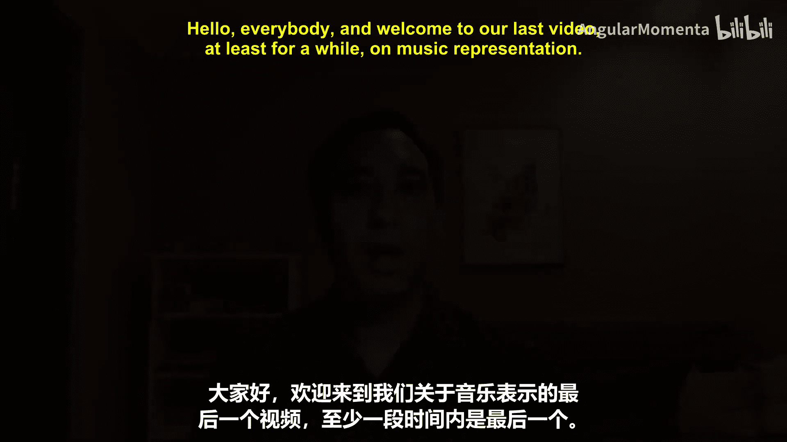
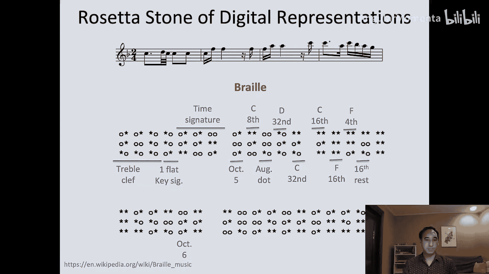
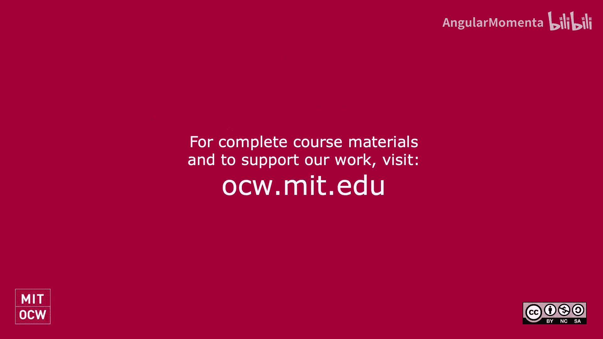

# 【麻省理工】计算音乐学与分析‌ ｜ MIT 21M.383 Computational Music Theory and Analysis,S 2023 p13 13 视频 6b：本体的表示方式：克雷格·萨普的罗塞塔石碑 -BV17xUmBDEUC_p13-

Hello， everybody。 and welcome to our last video， at least for a while on music representation。

 And I want to talk about a remarkable tool created by a researcher at Stanford， Craig Stuart Sap。

 that he calls Rosetta Stone。😊，I'm going to be skipping a few slides from his presentation and have added a few other things。

 but。In this module， I will also present his entirety of slides。

That he has given add my hats off to Craig Sap for all he's done is generosity。

So the Rosetta Stone was a stone discovered in， I think，1799 deciphered over the next。10 years or so。

 that was a remarkable discovery， because up until that point， Egyptian hieroglyphics。

 such as those highlighted here， were。Not legible by anybody living at that point。

But the Rosetta stone had。Two forms of Egyptian hieroglyphics and also in the top two sections and also at the bottom。

The exact same text in Greek。 And so since people knew how to read ancient Greek。

 they were able to go through each of the signs of the ancient Greek and figure out what the signs of the hieroglyphics in the two forms of writing meant。

Craig Sappps， Rosetta Stone， allows us to look at how different digital representations of music work by encoding the exact same melody in I think almost two dozen different formats。

 These are all the formats that've ever been used。 but it's a good chunk of them。

 So here's the melody。 And it has some interesting things here， it has different octaves。

 It has key signature， type signature has beaming information。 the only thing it really， well。

 some of the things it doesn't have are chords and triplets and things like that。

 But once you see how this melodies encoded in a lot of formats。

 You can figure out how all the other things might be encoded in those formats。😊。

So here's an example of a code that's not used as much today but was once very important plain an easy code and you can see that we have something like backing tocipher。

 okay， maybe that's a G on clLap on line2 and then we have a flat on the on B24 and then we have an eighth note with a dot on C and then。

I guess the three means 32 notes DC， and there's a little bracket around it and that probably means theyre beam together then we have two eighth notes on C beamed together have slash means new measure and so on throughout the whole thing we can see that maybeoctave isn't encoded here or something like that and we can figure out how those go here is another format。

 this is primarily used for folk songs called ABC and we can see that well example。

 maybe that's the title of the piece24K key is F。L means the smallest possible encoding is a 16th note。

 and that we see that C is worth three of those 16th D is worth。

I guess one/ half Cs one/ half C is worth two of those， that's the eighth note。

 C is worth two of those。 we have a bar line and so on。

 and we can see that the high C is encoded with C with a apostrophe after it。

This is what's called Dm's code。 It was once highly used。

 but it hasn't really been used very much recently and。Well， I don't know how to read Dms code。

 but I think that the numbers represent pitch here we have an eighth with a dot and T means 30 second I'm guessing。

 and so on， we have some RS's， which it might mean RE 16th note。This is Guido music notation。

 which uses backslashes to indicate certain kinds of musical elements。 we can see clefts， keys。

 meters are encoded in here， bar lines are explicitly encoded and it looks like you put a slash before。

Beat a duration and there's some notes that don't have durations。

 but they seem to be the same duration as before and so on。

I think it looks like underscores our arrests。This is muse data which Michael Good said was one of the inspiration behind music XML。

 it's a little bit bigger format takes more space， it was one of what we used to use a lot these fixed position encodings so that if you're writing in a monobased font every single place has a particular meaning so you can look at column8 for something like that and see the duration and then this was a major positive step because it encodes duration in terms of the number of。

Something's the number 30 second notes and also separately the the look of the duration。

 And so you can still see that in music Xl and formats that are still in use today。

 I really like the use of these left and right square brackets to indicate the start and end of beams。

Humdrum is a code that we have encountered a couple times。 And here it is。

 And maybe it's easier with humdrum to rotate the musical examples so we can see how things go。

 Maybe maybe not， but we can see that there's L's and Js that represent the starts and ends of beams and different octaves are represented by doubling or tripling the letter。

Lily Pond is actually a set of macros for the scheme programming language。

 which is a kind of variant on Lisp。 And so you can actually write computer code in lily Pond。

 And here we have the same representation。 you can see again， back slashes indicating starts of。

Larger musical elements， type signatures， bar lines that are explicitly encoded with what they look like and so on。

Mismma was an interesting code format that's a little bit similar to what we might have with MII and what we're doing here is we're encoding only the numeric duration so we can say that I guess 125 is a 32 note and we can figure out from there that 500 is an eighth note and so on and on the far right column we have the pitch encoded so we're losing here。

Beans and some other things。 we're actually even losing the clef and the time searcher。

But we do have an info tag that tells us the key signature。

Aegro is a more compact version of the same format that looks like we have mii numbers 72，74。

72 for CDC and so on and I believe 64 is encoding the velocity that is how loud。

 each note is and since we haven't encoded any dynamics here， there're all 64s。

 and we have toward the end start and end offsets of each note， I think if we can go through note 1。

2，3，4，5，6，7，8，9 would be a rest and at 1，2，3，4，5，6，7，8。We have sorry。

 we're not doing start and we're doing start offset and duration。

 and there we have a start offset note 8 of 2。5 duration of  one。

 and then the next element does not start at 3。5， but it just starts at 3。75。

 so we're not even encoding rests。 We're saying that they are gaps in the musical format。

Director Muicus is also a Lsp based format， I believe that's why we have all these extra parentheses where we're loading things into a stack and we can see that we're encoding the meter after the first note。

 which is kind of interesting and 32 notes are 1 over 32 that's kind of nice。

 the dotted eighth note is 316th notes wrong long， so we see 316th can be interesting format。

Score has come up at least once in class。 It is perhaps the best most beautiful music。Editor ever。

 this is how a user might input score。And it makes it a little bit easier to enter things。

 You're putting slashes between notes and so on。 And then it generates an internal syntax that specifies exactly where on the page。

 every note ti is。 And so musical engravers really like working with score because you can precisely moved things around。

 probably a professional engraver would have moved the C at the beginning of a second measure a little bit to the right。

 because it's a little bit close to that bar line。 And you might confuse the bar line for a stem。

 So score is sometimes still used， even though it hasn't been updated in decades。This is Music XML。

 as we've seen from Michael Goods presentation， it is much more verbo format things are。Displayed。

 you know， it takes a lot more space to do it。 But music atimmel was invented around the year 2000。

 Some of these other formats were around since the 80s。

 So there's a lot more space on the hard drive。 Well there are hard drives。 Now。

 to be able to store all this information。 So here， Craig Sap has simply highlighted the part。

 one measure you know where to see how this would work in music atimel。😊，MEI is another format。

 you can't really see things here， but it's very similar to music XML。

s as said it's the format or as Michael Good said， is a format mostly used by professional music colleges and almost nobody else for encoding commonwe music notation。

 I don't see it as having advantages over music XML and in fact has many disadvantages because it's not supported by many formats。

 but MEI can't also encode music such as medieval music which uses different representation formats。

 So it has a particular niche。This is a standard midDi file represented in binary。

 and it's a little bit unfair to compare the two because it's a binary format so we can't really see anything but look at what's mean highlighted here we begin with 0090。

 which is the indication for a note off So we're ending the previous note。

 if we go to the beginning of the next line we can see 80。

 which is the beginning of a note on and then 4D， which let's see if I can still aware y hexadecials of 4 times 16 is 64 add D to that that is what was that。

I don't know1413 and so you end up somewhere around 7078 or so。

 which is the representation of the note F and then the 40 after that is 64 in。

InIn decimal and so that would be the velocity， how hard we're hitting since velocity hasn't been encoding this and there's a number between0 and 127。

64 seems a pretty good numberer， and then we state that the note is turned off with the 90 and we say it's turned off after a certain amount of time。

 So how much time has passed and you'll see this 51 seems to be a representation of the length of a 16th note。

If you really want to look at MII， you want to use translator， there's one in Music 21。

 there's one in other places that will translate this format into a series of events like no ons。

 no ops， pitch bands， and the time detas which move us forward in time that will allow you to actually get this particular a fair shape。

You can see also this is NIF format which Craig Sap has translated some of the hexadeadeciimals into particular letter so that we can see what they are somewhere in the middle of the page。

 I see clef， I see f fingering， I see a font change Glysson heart， I'm not sure that this is。

Oh these are just all the things that could be in here。

 so we haven't even gotten to encoding the piece yet。

 but basically NIF encodes where each shape is on the page。

 It is a format used by music scanners It's not used very much anymore。

 but the idea is that it's much more important to get an exact representation of what the page looks like rather than what it might encode。

The last format， which in his presentation， Craig Zappputs first。

 isn't really a digital format at all， but intos the Braille music code。

 which is encoding of music notation that was created by Louis at about the same time that he created the text Braille So he was really interested in music encoding also and we can see some parts of Braille that does encoded clef even though it's not really used in the reading because we're going to encode specific notes why encode a clef because because blind and visually impaired musicians often need to talk to musicians who have cite so it's easy to say well。

 you know it's in trouble clef and there's one flat key signature and so on so there's a time signature and then that's not October 5。

 it's octave 5， we set the octave and we see that there's a C 8 we encoded in augment。do D30 seconds。

 C，30 seconds， C 16， F 16th and so on and so there's。Interestingly。

 we can usually get both the note and the duration into a six dot segment。

 which would represent 6 byte， a 6 B or less than a byte。

 So it's a very efficient encoding that makes it reading music with your fingers very fast。

If you want to know more about the Rosetta Stone and these various musical encodings。

 I have also included correctsapps of which I'll find you。 Thanks for watching。

