# 【麻省理工】计算音乐学与分析‌ ｜ MIT 21M.383 Computational Music Theory and Analysis,S 2023 p14 14 第7课视频：音乐表现（四）与层级结构（一） -BV17xUmBDEUC_p14-

So we're going to make a good part of today about talking about some of the other people who have thought about music representation or talking about other people's thoughts and whether we agree with them or not specifically to giants of the field。

 Eleanor Suffrage Field， her article on music representation and Nicholas Cook on what's comparative musicology and what's computational musicology and what they might have to do with each other。

 if anything。So， let's。Let's start by， by talking a little bit about the Eleanor Suffdge Field article。

She's before getting into computers and continuing afterwards， shes a specialist in brokeoque music。

 which is sort of Western European musical era from a lot of people say 1600 to 1750。

 roughly 1580 to 1770， but with the previous areas overlapping previous and next ones for a bit。

And so she talks about some things in her article。

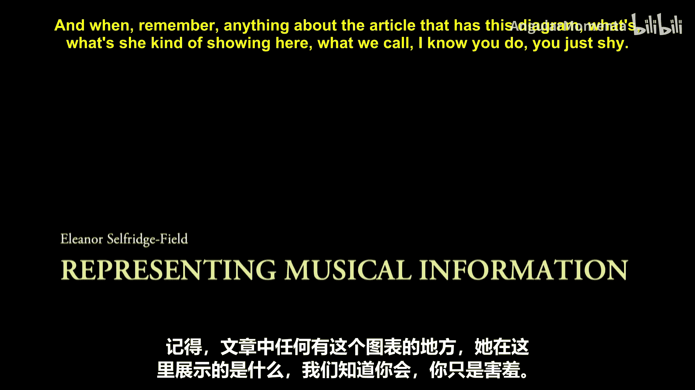

Meber。Anything。About the article that has this diagram。 What's， what's the kind of showing。Here。

Re callll。I know you do。 You're just shy。I know it has a lot。Note has a lot of parameters。 Yes。

 Notee has a lot of parameters。 What kind of relationship are we talking about has a。Mings。

Word pops into your head when you think of has us。So into your ontologies。

Forgotten what are the two choices。Yeah， but taxonomy and Moromy。 Hannah。

 did you have your hand for which one of those two that would be Moromy， Yes， yes， yes。

 because the taxonomy is the one that we use for kingdom phylum。 You know， what。

 what kind of a thing。Is something。 Yeah， so a note has a lot of different， different parameters。

 and it's made up of a lot of different parameters。 I think it。

 it's something that maybe just sounds so obvious。 But but this was， you know。

 a really revolutionary way of thinking about some of these things。

 And this diagram has become sort of the one of the legendary diagrams in the field。

 Every field has these legendary diagrams。 And I know that Dr。

 Suffragefield would have drawn that flat a little bit better。

 if she had known that this was going to become so famous。 But yeah， this is。

 this is the one that we， oh， yeah， we're talking about components of a note。

 and we're going to argue about certain things。 And we can see that some of these things are。😊。

Well what， what kind of a thing is duration， She talks about， is it a graphical thing。

 Can you see duration。W。 it's interesting。Thats that's good。 It's good that you're。

 you're puzzling over it。Well， let's， let's try to figure out the context that I'm talking about when we talk about duration。

 She talks about three contexts。That musical representation happens in。I don't if you remember。

Then three contexts。It's a big part of。One of the early parts of her article。Give。😔，The first letter。

Of each of them。Trickgger。And you think， what are some ways musics represented yeah？The graphical。

 yep， the graphical， how it looks， right？Yes。Great， let's。

 let's fill out the other two before getting back to the question I was talking about。 Yeah。

 go ahead。 What's that sound。😊，Good， and then the other one she uses is kind of。To。

Words at different points。Of graphic the sound， graphical。is that a just。Semantic， yep。

Semantic or semantical。 like semantical and。What would the L be， It's a synonym in this case。Loical。

 logical， yeah， So the semantic。 Yeah， you're right。 It should be sort of all logical。Great。

What's duration in this， Which context are we talking about。In this diagram。What's it。

I just can't hear。Graphal and logical graphical or logical， great， So definitely not sound。 right。

 Are we all in agreement with Jake that the。That， that this doesn't sound very good unless you have a good internal imagination。

 right， This is， we're not hearing anything good， so。What's and who。

 you gotta take a stand on this if even if you're wrong， who。

 who wants to say that that this duration here is more in the graphical domain。 I mean。

 we're seeing the picture here， Good。 And who thinks it's more in the logical domain。Great。

 great super。 So we have have a little bit of disagreement。 More people on the graphical side。 What。

 what would be the argument that， that it's a graphical duration， somebody who。

 who went for the graphical。 Yeah， Vanessa it's visual。你緒面。这份没说。

supposed to be at itll make it's be Great， super。 So we can look at it and we can see what's going to be seeing a graphic and we see the graphic and go there。

 Who wants to make an argument for the logical on this。There three people。 yeah。

 I guess like even just seeing this， it's all relative to other parts of the like unique the context thesymmetrical context of like beat per minute or like yeah the time're sharing right。

 So so we we're going quite a bit further and saying， yeah。

 the duration only makes sense in a larger context of things。Super。

 let me come up with two ways that you might describe something。 We'll stop there。

Describe what I did， what I have on the board in the most purely graphical description possible。

その texture。John。I three notes of Google。We have three notes of equal duration， great。Im。D。Notctor。对。

Anyone want to see if we can go even more graphically。 Yeah， let's go ahead Jason。

Two vertical lines with。Three filled in circles with dis attached。

Through2 vertical lines with three filled in circles with sticks attached。

 I like everything about that， except the word that came before attached。 Why don't I like sticks。😊。

It extends even less。Lines， yeah， what do I like about stems if we're going for sticks？Yeah， Adam。

 they already give a。Contexualization for an abstract symbol。 Yes， we're already abstracting So。

 Jason， that was fantastic。 and， and and Adams great to the。 Yeah。 So， so we can go。

 We're already making assumptions that well， you know， a line could represent a stick， so。😊。

It was John's thing that three notes of equal durations is a great description。 But which one but。

3 filled in circles。 And by the way， we're already。We're already doing some sort of。

We're already interpreting a little bit that a bunch of continuous lines that are kind ofolvinine and stick out。

 We think， oh， that kind of represents a circle。 But yeah。

 but we'll go with that three building circles between。2。Lines。With more lines， Okay， something like。

 like that。 Which one of these。Does suffrage field consider to be on the graphical domain And which one do be on the logical。

Too obvious。Set it up。Graphical or logical。对。まずか。Describe the thing that is pointing to you in the most graphical form you can。

So we want to take a shot at this， Matthew。 Do you want to take a shot what it's pointing to in the most graphical。

It's a flag hanging off the end of the stem。It's a flag hanging out and。 who， who wants to go even。

Even further。But this corner。F shot。I mean， a strip that like decreases in。It curled。

A strip that decreases in width in a curled manner。 Yeah。

 so I think we can go further even than a flag。 But we can， but we sort of have curled strip thing。

Your interpretation says， oh， that's a flag。And then there sort of the next level up says flags represent duration。

So we can go in all these worlds and what why I love this article， even though it's， you know。

 now over 20 years old， is that nobody puts out so clearly to me to。😊。

To think about what all these things actually mean。

 So we have three domains Let' just talk about the sound。A context， she says， she uses。

 I call them domains in my head。 We'll use her term。 context sound。Graphical。

 or she mostly uses the word logical， but semantic。

Or semantical could also be is also a term this's used。 And that one is coming up a lot more。

Together， these last two parts。 and， and we're pretty good at distinguishing between sound and either these other ones。

 right， yeah。Together， these last two will sometimes put them together as symbolic。

That these are things that deal with symbols。On a page or conceptually on a page or conceptually written。

 written or conceptually written。嗯。Great， now she says in her article。

 which one of these holds the most interest。remember this。 It's okay。 It's a longish article。

 but yeah， is the graphical。Praphical。Unfortunately not。 the thanks， thanks for taking bold stance。

 Sos good。 We've eliminated graphical， which one。I take it。Yes。I'm going to say sound。

 you would say sound and you would be。With most human beings。

Because most people buy many more C Ds than they buy abstract musical scores encoded in computer。

 But she's really on the logical。 So it's good。嗯。So sound， yeah， sound is。

 is what most of us work with the music。 But for， for her purposes。

 for the purposes of representation， especially she was really interested in logical things。 Thanks。

 right， everybody who didn't speak was thinking of logical and， and things。 No。

 thank you bold people for， for taking a stab at this。😊，Great， so。

One of the things that she talks about later on， Do you remember that she talks about musical scores。

 And anyone remember any sorts of musical scores she brings in。

Some funny ones and some pretty normal ones。We had a lot more fun on our。

 on our problem set this weekend。😊，不一定。Time， I can tell。Went in， but not in the depth。你说。

Second trio from the Mozart cleric  Quintet was the first one。 She also， thank you。 Thank you， Jake。

 I was you know， you're allowed to have computers open so you can also look at these if you want。

 Yeah， she also talks。 oops， sorry， Thank you。 somebody。😊。

I going gonna assign tasks for each person to fix very stupid cutth criticismdism。

 So I'm gonna want one person to be the， we can't see anything task and one person for the the the things rolled up。

 Okay， yeah， so this particular one。 She also does some other things， including Gregorian chant。

 A lot of things representing sort of a music historical perspective。 And each one chosen。

Many of the later ones chosen because they have a particular interest and difficulty in representing。

Part of your problem set2， is to make a contribution to that set of repertory。

That when you say and you will hear software people and coming up with things who haven't been taking the the full liberal arts education in music。

 you know， oh， I have a system that can represent all music。 I want to be like， great， here's DDR。

Show me how your system represented。 Here's， here's South Indian music。 How does it。 So these are。

 are all challenges， and there'll never be a system that can represent all of them， but。

Hence why most of us will avoid the all music thing。This particular score has had。

T as much impact from the article as this diagram had。 It's sort of become the ho world。

 a little bit more complex than ho world of music in representation encod。

 I wouldn know computers explain what a hello world is。Yeah。

 I the basic file that everyone write at the beginning as a sample。

 and what do you do with Hello world， You you print it out somewhere， Great， And some languages。

 you put that back slash and otherwise， nothing prints。 Yep， great。 So it's how do you get。

 how do you do something very simple in a programming language。 This piece。

 or at least the clarinet part， the top part of the five has become that a piece so。😊。

At least one of it。 So I think we should at least hear it once so we can get it in our head。 Oh。

 and just， just so you just so I can kind of hear kind of go when you might do it involuntarily。

 when something happens that's not in this score from this recording。

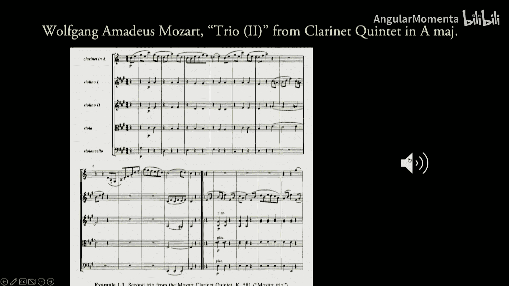

NoAdam got it anything else？🎼不我我。They kind of glazed over the trip loop。Glazed over the triplet。

 Yeah， great， which is， which is kind of a problematic performance for this particular one。

 because one of the reasons why this is almost certainly chosen was。

 can your system represent triplets。😊，The performers playing on a clinet that we hypothesized Mozart originally with this for that could go two notes lower than this and so played those low notes instead of starting high and going down。

 good。So this is the Holo world piece that you'll be getting。

 Any other thoughts about Eleanor Suffolitch Field's work will。

 we'll come back to her more as the semester comes on。Well， just just a reminder。

 there's one exam in this class and it's sort of the midterm。

 but it's about two thirdds of the way through the semester。

 And it's the one the only one that's not based it all on programming。

 but based on readings and and the big thoughts。 I put it that way so that you have these readings and big thoughts going through your head is you start working on your final projects。

 I think this is， I think you can pretty much count that some thoughts this and some of these questions might be on there。

 So give it another read when you get a chance。 And let's move on to。嗯。

Nicholas Cooks comparative versus computational musicology article。

 And here I've given you questions I'm going to be asking written down on the outline today。 And I。

 And so take a second to， you jot down some， some of the notes。

 So you probably already have them because I gave you these also on the， on the canvas。 right。

 thinking。

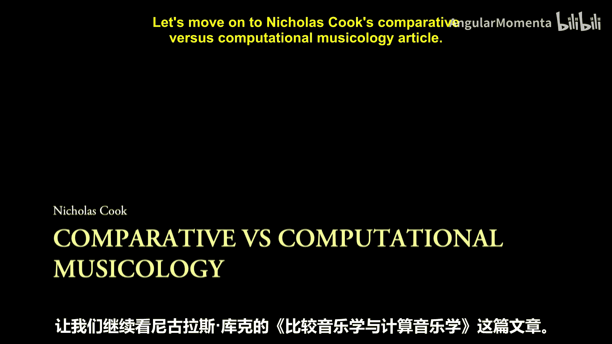

About take a second while I play a little example from the first piece that。That he discuss this。おお。

おお。お。We would know 2001 space Odyssey。🎼The pieces。Okay， so。

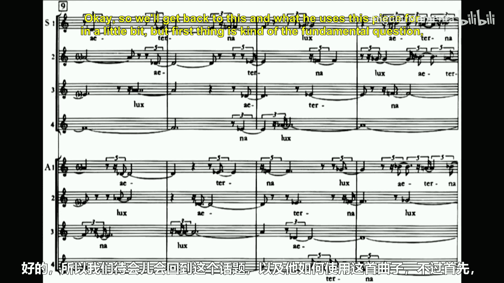

We'll get back to this and what he uses this piece for it a little bit。

 But first thing is kind of the fundamental question。

 of a couple of the fundamental questions about Ha。

 what does he mean There's no such thing as a good or bad representation of music。Perers se。

 givenness。Like just to the point and。It's all that's perfectly good or bad。

It's like depending on what Jerry attempting to use it for they're in a different situations where like certain characteristics might be more beneficial than others and in that scenario you can make a good or a bad choice。

 but it doesn't mean it is all around the good or。Great， so so fantastic。

 I think that really captures a lot of what Cook saying it all depends on what you're trying to get out of it。

 What are you trying to do， So some of your own representations are going to be really bad representations。

 even if you get an a plus for certain things。😊，But I have the whole recording going。

But they could be great representations for some other things。

 Some want to give an example either from the reading or or from your own thoughts。

 but maybe preferably from the reading if you have it of what one representation that would be bad in a specific case and and the same representation。

 hell it could be really good for something。Else。下个曲。We just went some more detail。

 but like at the beginning， they had a lot of。chartts。That represented pieces。

 and we mentioned that this would be really good for comparing the formats of different。

Do each other or like finding similarities between repertore， for example。this representation。

Fantastic， so Cook begins his article by showing certain charts that might help compare similarities across pieces。

 but not be very good for a performer。 So this is。😊，From the same piece from Luke's Aterna。

 one of the parts showing at any given moment what the full range of the peace is。嗯。What's the。

 what can you say about what happens to the range of the piece around measure 60，65。我 take it。

LetGo ahead。The average pitch。What frequency frequency， the average frequency。

Increases quite a bit there， right， Anything else you could say about it。 that's going more specific。

 even that that the average pitch， because that， that's also a very good representation。

 average pitch。 Yeah， Adam， there's a descending sequence that goes throughout the。别老。There's。

 there's yeah， there's a descending line sequence， something like that that's continuing on。

 And then it continues。 But what else happens。Yeah， Jason， a bunch of voices up here in the top。

 Great。 Yeah， a bunch of voices come in the top。

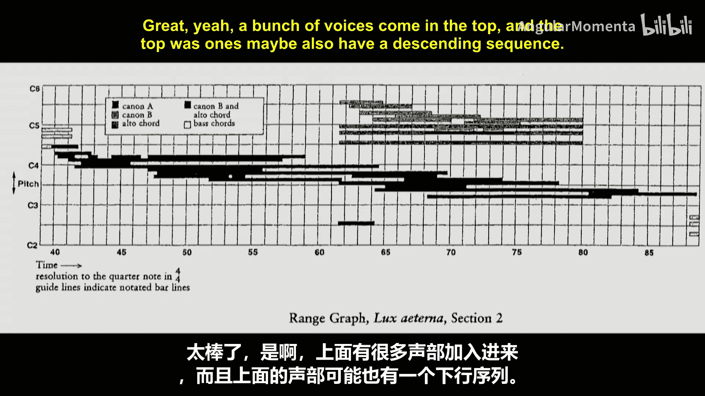

And the top ws ones maybe also have a descending sequence。That's。It's great。 Now， I mean。

 you can get all of this from a musical score， but。We'll go back here。Wheres the first。

 first point that there's two different notes。

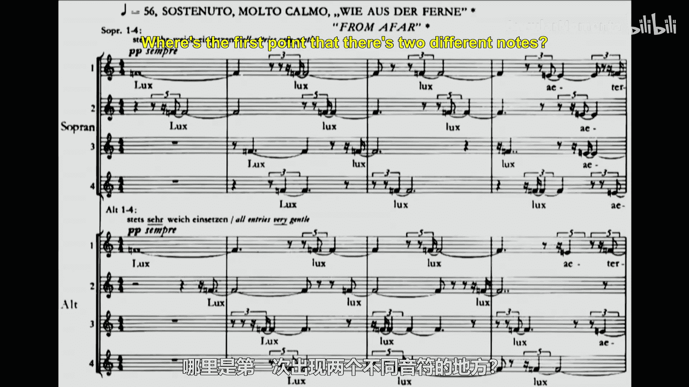

The measure。Here。Here。You could do it。 You can do it， but that is。

What this is not a very good representation of， On the other hand。

 it's a very good representation for seeing， oh my gosh。

 I'm gonna have to count really hard if I want to get in exactly at that right moment， right。

 But second representation showing the number of different notes， pitch count graph。

 How many different notes are being sung is a very good representation。 If you just wanted to now。

 now you're doing your next horror film or something in you're big Stanley Kubrick fan。

 So you're gonna to rip off what he did in 2001。 But you just need a five secondcon clip for that your scariest part。

 where you' gonna choose。Give me a message number。That give a shot 252，53， yeah。😊，Right。

 we have a whole bunch of different pitches all sand at the same time。 that can be really tense。

 And I think this is talking about pitches without octave pitch classes。 You all know that term now。

 So yeah， a lot of things happening very easy to do in this graph， but very hard to do in others。😊。

So。Close through some of the different things now。Oh。This sorry， I just forgot this， this one。

Can you perform from this one， from this graph。See a lot of news。 I see some I， I see， I see some。

 yeah。It's not the best。Thing for being able to form that piece and probably not the best thing。

 But you can almost perform from it from the range graph thing。 So there's。

Some things are in between better。The pitch count graph， can you perform from this。No。

Though you could， I mean， thinking about in the future。

 you could take a piece's pitch count graph and use a computer to write a different piece that had the same pitch count profile。

 and it might be an interesting type of thing。 But yeah。

 you couldn't perform the same piece for some ontological definition of the same piece， right。

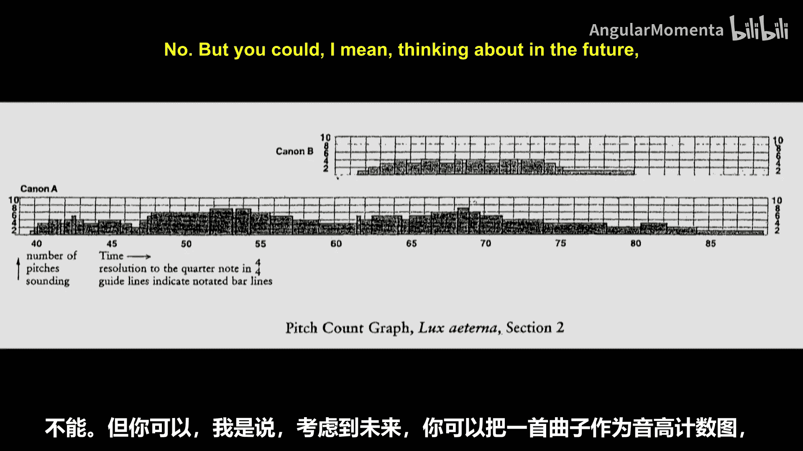

Good we can skip the interest graph second。Peace talks about。2个试试。The bartlk string quartet， number4。

 oops。We'll get it tiny。It's working a few seconds of that if it doesn't give me a YouTube ad。No。

 okay。Bart talk， similar similar area a little bit earlier， composer， also Hungarian。

 So this is showing。What is this showing， Anyone remember。Somebody who I haven't heard from yet。

Jonathan， do you remember this？Soadways， what particular parts of it， anybody。好饭。😔，Not not sure。

 Okay， good， good， not， not sure。 saves the whole cost。 Great， super。直玩。Harharmonics。

 not not exactly this。 amplitude， how loud each part is。What does it mean when theveal is really。

 really， really， really quiet？Not playing。 Yep。 so you can quickly see which parts are playing where and then somehow make a composite that is more like the。

 the， what do you call the amplitude wave type the。The sound wave of， of the piece as a whole。

 You say， yeah， I don't。 this is， this is one of the ones in that article。

 But one of the moments that I'm always like， it doesn't get so much out of it。 But。

 but because this is the type of thing。 computational people do wrote my own program to generate the same thing。

This is a piece by Hyyn by Joseph Hyidein around。I guess 1790 called the surprisepri symphon。

Anyone know where this surprise happens from looking at this。 Yeah。

 so sometimes these things can be very great。 I didn't even realize， though。

 that the dynamics were kind of thinning out， leadinging up to it。

 I always knew that there was one gigantic chor right about here。😊，Go on。

 and you can see the various other places that these things happen， so。

So these can be good representations for some things。啊。

So what's this humdrum that he's talking about， Any remember。This part， yeah。あまし。那个。个加的。Yes。Great。

 so I think I heard it's a framework that's used to manipulate musical data in the UniX terminal。

Great。It's written by， it was originally written by music，g cognition and perception and theory。

 specialist David Huron and who were going to read a lot about what he used Hmdrum to kind of demonstrate new about music。

 But right now we're， we're mostly， you know， we're looking at。 Oh， what he did。 Hmdrum is。

In many ways， the the predecessor to Music 21 and a lecture that David Huron the inventor gave when I was。

 I think I was a first year grad student like change my life。 like oh my gosh， I want to do this。

 but your system。 the system was already 10，15 years old by then 20 years old maybe and like we have these things called objects now。

 So but so it's a non objectject oriented， it' shell scripting things。 it just pretty cool。

 if anyone every pipe a script from one thing to the next， yeah， input send it to a program。

 input text usually or bytes and it send something out。 and you can send it to the next program。

 So you could have one program that just goes through and strips all the ties from notes。

 they have another program that you know labels the pitch classes of everything。😊，Very， very cool。

 very new things。 And so Hamd had its own format， which was called actually。

 I'm gonna jump through some， some of these questions don't。

 don't seem as relevant for class discussion called Kern。

 which was basically a musical score turned sideways。 So first part when vertically here。

 Second part vertically here， third part and so on。😊。

And so this was a way that meant that looking horizontally。

 you could see anything that was happening at the same time。

I'm very useful back before graphical editors where you can tab among them。Y不。Contrasting。

In the article was this particular。Format。Eec code。 and this is one of the ones。How do we read this。

Some you Adam， great， but I wanna want to get some more the reluctant participants。

 and we'll come back。Anyone want to take a guess what anything means。Yeah， John。

s some sort of figured base。 some sort of figured base。 Yeah， does totally look like that。

Not exactly what， what it actually is， but great， great first， first guess。 what。

 what numbers you see that that that make you think it's like figured base scale degrees。 Yeah。

 so something maybe to do with scale degrees。 Do we see 8 and  nines。Or zeros。 No， no， so。

 so that could be a good good thing what。Its a great。

 great guess that moved us in toward the right direction。These are scale degrees。

 What's all this other stuff might be。Yeah，So sharps probably a good one do with this。

 So this piece would have a lot of accidentals if the underscorescorded。 and it might the。

Shorter dashOh the shorter can you tell me where one is I guess like in the first line Yeah I should be like can somebody point out one die I can reach Yeah。

 this one or this one good， good， Yeah， so minus signs you've I think we've already seen that as a way of representing I mean flats flats and sharps I mean。

When we say there is no such thing as a good representation or bad representation， per se。

 I will say it is a bad representation if this means flat and that means sharp， but。

If we reverse them， so Ill assume that good， what are some of the other symbols we see？

Yeah Adamam then。Syms of andy or。Any， what's some other things you see up here， Top is the composer。

 Top is the composer， maybe Boem。It's not actually， but but good guess。 good guess。It's great。Yeah。

 it'。ThatSo， sorry y， Vita and then， I don't think he's gonna s fire everything。 yep。

 duration and then like the 16。Okay， good， good， good， good。 So we'll start with one thing。

 The underscores might represent duration。 So what does that。What's that mean， Think。

 think about that for a saying。 We'll come back。 That's totally We're saying， Okay， well。

 then fill it out a little bit。 Well， I was gonna guess that like one underscore would be some standard。

 like maybe a co or something like that。 And then two is。Yep， than two is more。 It's。

 it's a fix with font， but it's still hard to see。 Do we， What are the lengths that we see the most。

1。Qu。😔，Do we see three a lot？唔我。2 many end of the line， end of the line line。 Yeah。

 so there's some places where we see through good， good。

 So that might have something to do with things。Any places where there's two that are。Numbers there。

Without separating underscore。John， where do you see one。Bot left， bottom left， good。

 thanks for finding 1 I can point to。 Yep， so， and what's right preing。Period。

 what period might represent。Might represent arrest。What else might it represent yeah。a Dutch。

 so it could be one of those things。Quite often after， let's see。

 So one ways we can figure out is if we get a particular length and then does everything else work。

 What do you think the space means。Go measure separation。

Measure separation some measures seem to be a lot。Shorter than others。 But yeah。

It could be a measure of separation could also be， as a lot of these formats are。

 just to make it easier for us to read。That there's a certain readability that's built into some good。

 good。Vincent， you were starting to say something about the 16 up there。

 having something to do with the。So like how the end in， how somehow like one or two。

 but those would all be multiples of like whatever's best right there be the 16s awake。

The first one would be like 216 notess an eighth mode。So this should be2。

16th notes or So got that five theres one underscore1，16th notes。the6 Great， So let's see。

 what do you think of 4，4 means everybody，4，4 right good if you on that yeah yeah basically along these lines。

 and yeah， I think the thing we were probably trying to get to now is that like it doesn't quite seems to add up if it's 4。

4 on each one with one is16 So like there are a lot of measures And I believe it's two underscore like I'm sorry make you point super high there's an example lower。

 but the top line the first what it seems like the full measure Yeah underscores Yeah。

 which would imply they're all quarter。 its sufficient 44 which means that like and then the one right below it has the exact same but like and the last with the duration of the quarter notes splits up。

 So those seem like 16 minutes。😊，Super。ます。Great let's do a tiny bit of the metadata。

 can take a guess what language is the metadata。Maybe no。I see hasnm yeah， Jason。Yep。

 this Ia and what， what's the Isa or EN is the two ways of putting it。 Yep。

 and anyone know where EN is， yeah。German Germany， do we see some German things good。

 So this is a very famous piece。 And I want to say。

 as you're choosing things to represent and choosing things in it， and Nicholas Cook is amazing。

 I think Nicholas Chook chose the absolute worst piece。

 He possibly could have chosen to be the demonstration。😊，This， and I've thought of。Switching out。C。

 U T might be。 It's not Stanford Cuthber。 It's signed about the title， Germany， Germany， out。

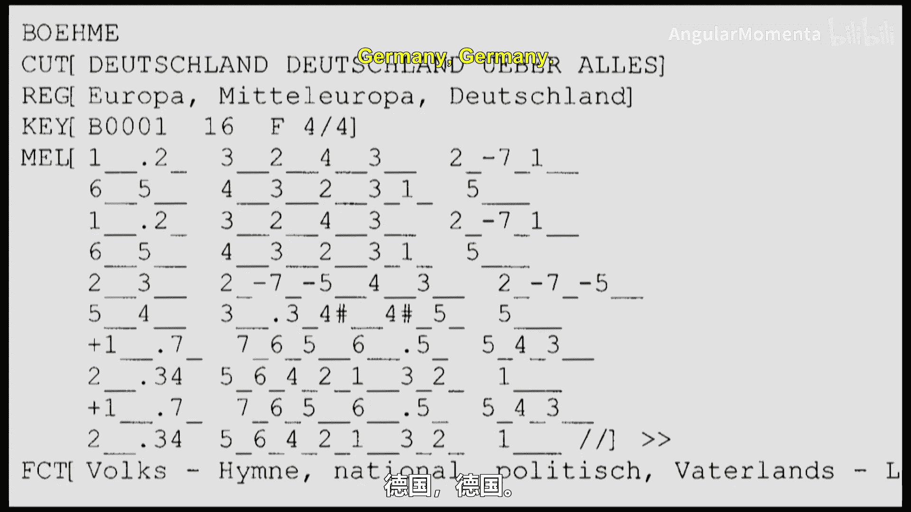

Overall。It's the Nazi National anthem。So I I wish that he had chosen。 but but fortunately。

 if we crop off the top， it is also the pre Nazi national anthem with different words and the current national anthem and a piece composed by Joseph Hyiden。

 So the surprise symymphony composer。 And I wanted to put it up。 It's rather small。

 might need to zoom in or get up。 But see or you can look at the article。

 see if you can read now read the notation from hearing this。

 assuming YouTube' is going to work this time。😊，And this is the modern word。Second lines。🎼虽云开。ま。🎼2，3。

 was that a flat？Might be an octave sign。you can hear the shas are definitely sharps。

 those who can hear secondary dominance。

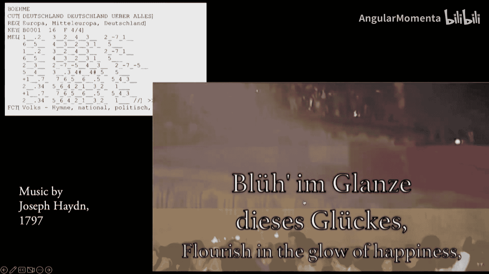

Anyhow， we don't get to hear the rest。Yeah， yeah， yeah， you win the World Cup more than us， you know。

Okay。So。2 more， two more questions，1 I didn't put on here before we move on to another topic。Yeah。

What does comparative musicology？Mean， and how's it have anything to do with computational musicology。

 And that's the main title。Of the piece。The article。And let's take stand take the first one。

 what is comparative。Musicology。You can probably figure it out for the words， so we get。

I mean it was like just concept of comparing music to each other。

 regardless of where they necessarily from。 Yeah， so it's。

 it's comparing pieces of music to each other， but not necessarily， you know， close things， not。 oh。

 let's look at the first movement and compare it to the second movement。 But let's look at oh。

 let's look at a nationalist song from Germany。 And let's look at a nationalist song from Kenya and see if they have any connection。

 Let's look at，Oh， shoot， I forgot to put it into into the slides。 The person blanking on her name。

 I'm not checking my email。 I have the picture to put into the slide。

 and I didn't get her name is trout。 sorry， yeah， Thub。

 big New York Times obituary I have a notification that won't get Sandra the pioneer。

 one of the pioneers in the psychology of comparative music musicology died very recently。

 and she was one who famously did experiments to show that people could identify here are two songs from the same culture。

Which one's the lullaby and which one is not？All throughout the world。

And this experiment's been replicated with other musics quite a lot recently over in the lab at Harvard。

 But she was a big one。 So this notion of looking across cultures。Anybody take in this class。

 I think a couple people have intro to to global music or world music。 Yeah， So great。 So did。

 did the word comparative musicology come up much in your class。😊，Not really good。

That's what used to be ethnicnomusicology， The study of music in cultures。 and it。Yep。

 did you you also didn't see in your classes。 Yeah。

 so comparativeivist approaches of looking at things from here and。

 and there and saying what's similar to them got of。So it gave way to modern ethnomusicology。

 which is the study of music in its culture， and so the notion that you go to a culture。

 you get to know the culture very well and then learn from how the culture itself is describing its music in order to say something valuable and that the more you get to know one culture and the less you spend time comparing this culture in Paraguay to that culture in lapland。

 the more that you just focus on one place， the more depth of knowledge you'll get。And in part。

 because the early negative history of comparative。Musicology deserves its very bad rap。

 And we have to still be really careful for it because we're always going to be comparing。

 you know what are the countries I keeping， you know。

 Paraguay and Laland and and Kenya and Okinawa and Japan and all these things together。

 And then we're also going to compare with Beethoven's 9 Syphony in order to demonstrate what if you're a German around 1914 or German around 1933。

 What is the conclusion you will always come after comparing all these things。

So someone'm gonna take a guess， Fling a hypotheical mind。 What's that， Yours is the best。

 So Whos is the best， Your whoever like you identify with。Yeah， and the people doing this were。

Mostly white Europeans。So the Comparivist project， while it gathered a lot of data。

 we would now say it was embodied in the narrative of， of white supremacy。 Oh。

 now this class can't be shown in in Florida。But， you know， and that really really happened and。

The issue is， and so eno ecology， this focus tried to say。

 let's stop making this comparative type of project so that so that we can actually understand why。

Individual piece of music are great and interesting and valuable and meaningful and touching to people all over the world。

 and a lot of。😊，People even in Germany， don't like Beethen's9th symphony。嗯。

So working as particularly things。 And then the irony that comes out is that the compartivists were still。

 you know， looking at a small number of pieces to compare。 I mean， quite often。

 look at comparative musicology， also called systematic at that time， systematic musicological works。

 We're talking about one piece from here， one piece from here， because that's all that people had。

 And so this goes out of style right when。This thing comes along。And suddenly， I mean， not。

 not this particular lightweight thing， but the gigantic， you know。

 hunking ones that you can still see in the computer。

 museums and stuff that were able to compare large numbers of information and at least encode their biases。

😊，If not， you know， at least you could see what had been encoded into it。

 So this is where the Compivist project comes together with the computational project。But。

 as you can see， I mean。The danger。Is that by using a computer。

 we can still be replicating the kinds of mistakes that were made quite a bit ago。

🎼So we're going to have to be hyper vigilant， the more we looked at。I'mper vigilant against that。

We're gonna be hyper vigilant and it probably means that some。

 sometimes if for that we shouldn't be focusing on on musical things for major projects that we don't know anything about。

 So I'm very glad that the encoding of Indian music that we have somebody in the group who is of expert okay I call you an expert on a very。

 very strong。😊，Understanding this and that we want to get to know our repertoies before we work too much on them。

And I think it kind of comes back to， to this anyhow。

 even for repertoies that might be more conventionally studied。

 So we're going look at some pieces in a bit。 and we're going to start by jumping into a particular ba cr and。

I want everybody to， at some point to do all the things of trying to get into the style of that piece by hand because we don't want we want to be able to at least be a little expert ourselves on a particular repertory before we turn it over to the computer。

Helps to avoid the G IGO or Geco problem。 I want to know what that is， G IGO。

garbage in equals garbage out， so we want to make sure that we're not putting garbage in。Great。

I think I'm gonna skip number 3 for now， we'll do it。

 the same score to sound because that one's a little bit me talking more。

 And let's jump to a little bit of programming because we haven't done that in class in a while。

 So go ahead and take， take a second or two and。Grab a Jupiter notebook while I try to get my screen set up to。

Have two things at once。How about that， Great， You've already。

 we're gonna do some unlocking as you know that this means that from here on out。

 unless you're told otherwise， you may use these materials in any problem set going forward。

 So you've already unlocked the pitch module。 lowercase P， meaning。

 it's a module and will also unlock the note and the duration。Moduleles right now。And we don't even。

 We're not even really going to need the pitch or the duration modules。

 So let's start with everything on the note， let's。Okay， then I need to get this later。What's。

Start with。One of my favorite notes。 I don't know why C sharpp 5 became one of my favorite notes。

 I think it just demonstrates something。 and it's right in the middle screen。 Good and。

Always remember that you can get a list of， of what any object can do。 And by the way。

 you all got itss upper。 And the class rule is， I go too fast。 You say slow down。 Okay。

 everybody practice that。 say it out。Slow down， good。 You don't want me to slow down right now。

 But at some point， you will and just shout it out。 Great。

 So you can always get this Python unhelpfully gives it an alphabetical order。

 which means the things you don't want to know about the private things come first， but。

You can see some of the things are happening here。 And very nicely。

 you'll see that duration is one of the attributes or properties or something of。Of a note， and。

Pitch is also a property of a note。 So that's pretty good。So we can get that pitch。

From the note object。 And it's。Looks pretty similar to the other note things。

So can we get the octave of a note， Yes， we can。Can we get the name of the note？ Yes， we can。

What are some other things we did with pitch， Can we get the accidental。From a pitch。Yep。

 can we get the accidental。Of note， no， we cannot。So one of the things you'll find in the Music 21。

 and again， Music 21 is just one framework。 You can use humdrum。 You can use， build your own。

But one of the things is it started with this that there's some things about a pitch that seemed like you're going to use so often that we might as well put it on the note。

 make it a shortcut。 And then a lot of things just too complicated。 So you。

 if you want something deeper， go grab it from the accidental。Like to grab it from the pitch object。

嗯。Notes also have a duration。Note dot pitch， and。Pitchches do not have a duration。

 So this is sort of going into the logical representation mode that some things have durations。

 and some things don't。Let's see what we can。Do with this。 Let's。

 let's look at the duration since we haven't looked at the duration。马作一。Or the duration class。Okay。

 so we have a duration and we can see some of the things， duration almond。Unfortunately。

 I did not go with that great idea。 anyone remember what I said I went with boring。Type。

So everything starts off as a quarter note， but we can make it。Half。And。

Remember early on in the semester， we talked about representations of duration before it was a duration of one。

Now it's some sort of a duration of two， to whats。Could be a lot of things could be two seconds。

With the temple of 60。It be two beats， two ticks。Music 21 has chosen to represent everything。

In numbers of quarter notes。So duration is one， duration of two is a half note。What's。Have dots0。

 so let's add some dots。And now we've added six dots to the notes。And we get something。Like。

Like this。My favorite random MI T thing that you all can figure out based on that thing， what。

What is the limit of half no as the dots approaches infinity？sorry。Allll note， good， good。

 y'all can play with the Easter egg and set the dots to infinity later and see what happens。

So we have some of these things。 Let's put the dots spec down to。I don't know something manageable。

And quarter length。Each of these things affects。Each otherss， and they're almost all set。

 so that can be helpful in your programming， like 3。5 and。And we get that it's a double dotted。

And probably a mistake on my original part。 But everything， most of these objects are are mutable。

 So if we go back to the original and duration， it still now has the quarter length。

 So you can change the duration on the side similarly with pitch dot。Pitch dot step。It's already C。

 we'll make it a D。And now we've changed the step of the pitch to D， but not changed It's accidental。

 And now this is still on here。 give everyone a second or two to catch up。

 I'll make it a little small， smaller so that any parts that people have missed。

 you don't have to write down everything that I write down only write things down as they're helpful for you to finger memory remember it。

Okay， that's all I'm going to talk about with unlocking notes and durations at this point Ill。

I don't think I've put a permanent a prominent enough link， but you can Google it。

 Music 21 has a user's guide。 And so you've kind of gone through chapters 1 through two in this class so far。

But let's， let's unlock some other things。Unlocking。Scores。

So we're going to give you your first larger representation things and to do this。

 we're going to from Music 21， import。Sign called stream and sign called corpus。Oops， no trailing。

I was putting that there because you can also import sign called converter。

 I'm not going to talk about it， but converter is a way of loading things from your hard drive corpus uses a batteries included set of about 8000 pieces that comes that come with music 21 So there's about 8000 pieces in there and we'll grab one of them and when I'm not thinking very much I apologize I go this Bach so we'll load from the corpus we're gonna to parse。

 meaning make sense of the of the representation。 Bach BwV 66。6 Bwv means the bach Vk verness。

 the box work index and by Bach in this case， mean Johann Sebastian Bach daddy Bach。

There's some other box in there。 And this is the work number 666 movement。

 It's the one that we're going to use quite a bit because it's the smallest。

 shortest corral he wrote。And。What I'm going to ask you to do。Over the next couple classes。

 as part of the avoiding garbage in garbage out， want you to learn to sing your part。

From this corral。Can you can you do that， can you go to the piano and match pitch on one of the parts if you're really not you feeling very confident you're singing。

 you can do the soprano part at whatever。Octave is most comfortable。

 but it would be nice to be able to sing this as a group and we'll come back to this one next class。

 So you now have。😊，Sorry， I should have slowed down。 I was like talking about something else。 Buckch。

 we're gonna store this piece as a variable。 And one of the things you're gonna to find very helpful is dot show。

 Can you raise your hand if you have gotten everything installed so that you can see scores when you call to on things。

 anybody still having some difficulty， Okay， great super， well make sure that we can get that up and。

And and see if we can get that straightened out。 There was some。

 some helpful hints put onto one of the discussion points about dealing with new score 4。

 want to get that。 Yeah， linked。 Yeah， I can make sure to do that。

 just if there's something that I create in the middle of class。 It's not a one button thing。

 and you don't see it by 9 AM the next day， just drop me a line， but try to do that。

 And sometimes I'll give you the cleaned up one。 I should have a script on my other monitor。

 but I'm not getting it now。 great， So let's look at that bach thing。 It is something。

In the project is Music 21， St is what is it。車れ up。Module and score is a。Clas class， class， good。

 so this is an object of class score in the stream module in the Music 21。Package project。

 What do you call it。 And this is the particular memory location that you can hack on my computer to。

To deal with the stream， we can change。We'll just make this change its I D to buck short。

 something like that。Then we'll see something nicer than just a memory location that's sometimes helpful。

 O， so。This we call at the beginning of the。semestermester we have how many things are in Bach。

 this was a trick question on the first day， you all stuck around for a lot of trick questions and。

There are six things in the box。 Whats What are two basic answers that you thought might be the a good answer to how many things there are in the box。

Ballpark figures。100，100。 Yep， why， maybe about 100。What's notes， Note， good。

 What's another number that you might have thought could be there。F， why number one of parts good。

 so let's see what those things are。 Well， one of the things streams， scores are type of stream。

 everything in there's type of stream can be treated like。Like lists so you can index them。

 get what zeroth object is。 get the first object。There's our part， second。And so on。

So what's that last object， Everyone remember Python give have negative one indexing。

 we have something that says all of these soprano Alto tenner base are all have these。

 what do you call it。It'Pretty little。Thinkhing around them。 So that's how we get6 things。

 We have metadata， which is data about data。 That is usually having the title of it。 So。

 and things like that。 We'll get to metadata later。 But I know you want to get so。

Let's see what's an index I can use to get something that might have notes in it。Zero。

 probably not negative one。Which one do we all look at。Give me a number to put in2，2。Okay。

 so the two is in this case， the al part。 And you would think if you don't get that metadata as 0。

 that this would be。This might be， you know， that one index or something right， one is ofgramno2。

 but no it's zero index， but the zero metadata。There might be multiple things at the beginning。

 not just one metadata。 There could be more， could be metadata lists。

 So its you might not always get this。 So you could do something like like this for B for thing。

 I always use thing in Bach because I don't know what it is if is instance thing。

Music 21 dot stream dot。Part。Print thing。Oops， what I do didn。嗯。Sorry。

 I streamed up part because I imported that， I imported stream into it。So that can be one way to get。

I'm going to tell you all of the most general ways of doing things now so that it sort of forms a mental habit。

 but。But we want to。But just， just to know， you will learn some shortcuts so that you won't need to have to code all this later。

 Great， So now we have the parts。 What do。Let's do this。 We， we got the Bk2。

Let's see for thing in bach2。 Let's， let's just call that alto。 Let's call that alto， right。

 Alto equals Bch2 for thing。In Alto， I always like good naming。

 So I'm calling it thing things the best naming when you don't know what something is yet。

 supposeupp you could call it L for element or something print thing。

And what and when we call from the very fast thing for stay what it's going to be。

So it's a bunch of measures， but also an instrument。

Think that that's been fixed in the latest version and it looks like everything else， but yeah。

 so we have an instrument there so we can do this again， I'm going to copy， I just copied here。

 I'm going go here and paste and we'll again do that is instance checking if is instance that is a member of this class。

Thing stream dot measure。Print。Think， okay， now we've gotten just the measures。And。We can get， oh。

 I don't know。 measure 2 equals alto3。Weve got that I guess right， okay？

And we can keep writing the same。Type of thing。For thing in。In M2。

We don't need that because we're already in a measure， and finally we get to know。

Finally we get to know。So that's where I'm going to end this part now that I've given you a very tedious way to get two notes from a score that you go through。

All the parts。You go through everything that's in the score， find the things that are parts。

And then you could do a next iteration on here another。F loop， another if。

 go through each of the parts。And figure out everything that's a measure。Thank you。What sorry。

 everything that's a measure and go through each of the measures and do this。

 A for loop within a for loop within a for loop。

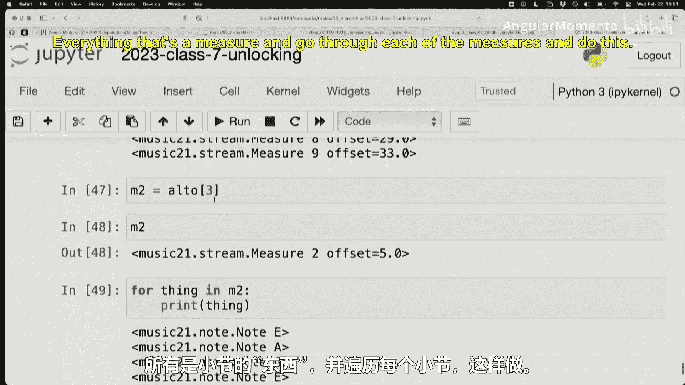

嗯。But we're going to learn some better ways to do this later。

 but I want to leave you at least two days with trying to do everything the hard way before we start to get to the easier ways。

 So you can do this so。That's that your only assignments continue working with on your problem sets and to learn to sing your little part of BWV 66。

6。

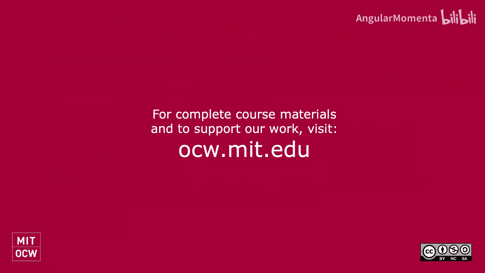