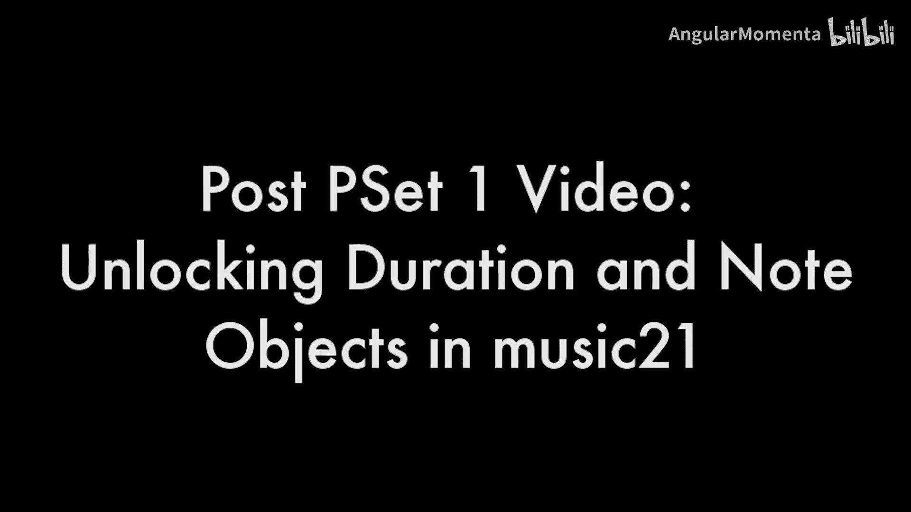
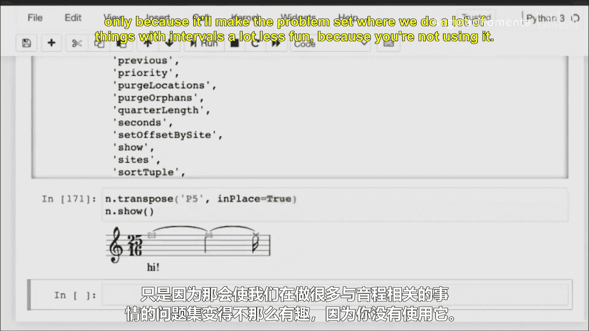
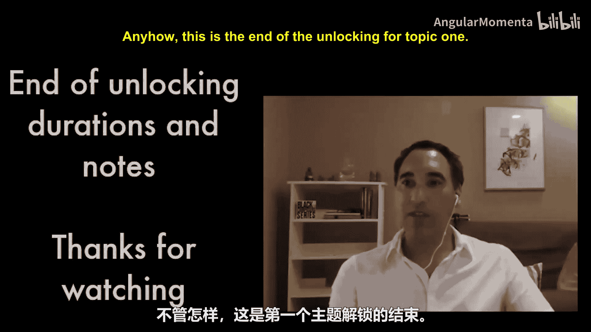
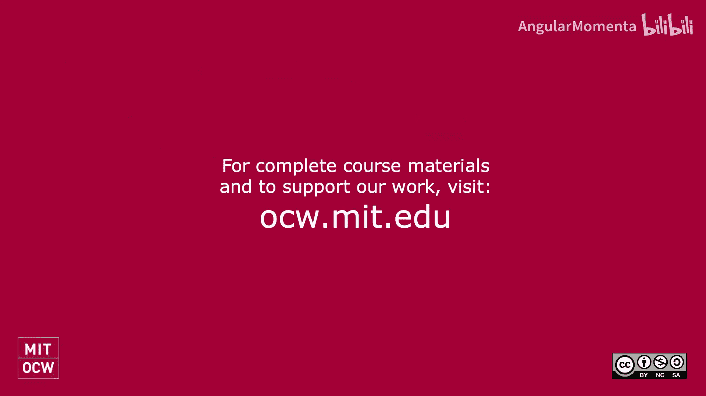

# 【麻省理工】计算音乐学与分析‌ ｜ MIT 21M.383 Computational Music Theory and Analysis,S 2023 p15 15 视频7a：在music21中解锁时长与音符对象 -BV17xUmBDEUC_p15-

This is a short video following up on the unlocking of pitches where we will unlock duration and no objects in Music 21。

Go ahead and start up your Jupiter notebook， and let's get programming。

Start with durations so go ahead and from Music 21 import duration。

And that thing we've just imported duration， is it put a thumbs up， if it's an object。

 put a thumbs down if you think it's a module。Okay。

 so in this case it is a module there if you didn't get it right。

 no worries because there is no way you can actually tell just from that except for by convention Python by convention we write our modules in lowercase we can see that it's a module by chicken type a good might be terrible if I didn't within the module there is usually an object with the same name as it I hit tab and I get oh there is a duration object so we'll create one assign it to D and I'm going create a duration of 3。

0。What I want you to do is open up the chat and don't yet hit in on it。

 but if you could put what you think 3。0 might represent。Yep。

 so we have a lot of beats going on some I like。Aification with some standard of how long a beat is and we also have dotted half and things like that。

 nobody seems to like our favorite thing milliseconds。

 maybe if I had purposely made my thing 3000 than people would have thought that you know but it is the flow it could have be seconds or something in this case wolf sugar out well okay that doesn't tell us much of anything and what we can do is we can get the full name of this and。

See it is a dotted half so it could be beat still I'll just go ahead and say in Music 21 I made the decision to have a number represent the number of quarter notes I may over time I have sometimes regretted that decision but it had to be something and one of the reasons I decided not to go with half with beats is that。

The length， the representation of a note in terms of beats is dependent on something external and that is the type signature right so22 has a different number of beats from 6a has a different number has a different type of beat from 6a which has a different type of beat from 44 so that's that's one of the reasons going with this so every every duration object has a full name it also has a type。

Half and has a。It's great。It also a sign called quarter length。

 which in this case is you have the number of quarters and that's not so bad。

 but maybe I mean that's something you already knew how to do。

 but maybe we do we can create a duration in a different way。

 we'll say type equals whole and dots equals four。And suddenly the quarter length。

Of this is a little bit harder to compute。Anybody all off the top of their head？Right。

 you're all too shy to say7。75 Okay， good well， I don't I don't know that number Okay。

 so here are some of the things that that we can。That we can do。 Can we can we create。A triplet。

 let's try that。One one third of a note， so what kind of a triplet is that somebody shouted out。

And triple let's see。Yeah80 triplets so we can create triplets notice we'll go back to D here notice that some durations are expressed in floats。

 some are expressed in rational fractions and that tells you whether or not you're going to safely be able to add them up and get an exact number anything that's a multiple of a power of two in binary will be exactly representable。

 anything that isn't will be here so great so tripp type is。8。

 so it doesn't tell me anything about it。 It's dots。 I hope are zero。 There's no dots there great。

 So there is something called。Tlet， which alate is a type of like of quadruplate。

 a quintupt triplet is one we most know what I want you to do is take a second and put in the chat what kind of object was just returned from button dot topts。

Okay， we have a couple different answers， but most people say it's a couple， right。

 a couple of couplets， which she tried not to say that she may tie fast and you know it's a couple because it has this comma at the end so。

It's an immutable list of it and that means there's you can have more than one topt so you might have a triplet within a triplet and so on。

 so those are some things we can do the top so we can get at that darn topt object I'm just trying to pull it out pullll out oh right it's not bi graphical environment so we'll get the first one and we'll call it T。

And we'll see that the tut itself is also a complex object tweaking。Dre it。

 and we can see it has certain things like。Tupplet multiplier， which I happen to know is a method。

 And so we can see that when you throw this templatet onto a note that note becomes two third of its previous Here are just some of the things you can do。

 you will learn this in。In music in the music 21 users guide two and three。

 which we'll get to in a bit， some of the things you might see are。Juration， that。Obviously。

 four is a whole。For people who like these things， eight is dotted a double hole note also called a breathe which means short because there used to be longer notes and they're still somewhere and that's the longest possible note which no longer exists except that somebody used to double the longest possible note。

 but then at a certain point you can't do it similarly on the small side you can go。

And let's go the type of that。Notice that the type of an eighth note is EIGH TH。

 the type of a 16th note， I misspelled 16th too many times， so I decided we go from here。

I don't think I know my fractions below that， so we'll just keep going like that you can go down pretty far。

 let's skip a bit oops or 16。And you can go down to 120。1024 notes。Theoretically。

 notes go on forever， but。Music 21 at a certain point says， yeah， this isn't representation music。

Great， I want to do one more little exercise and this is a trick question。

 so just put put ahead what you think， I'm going to sing something to you and you tell me how many notes I sang。

到。Yes， I sang eighth note tied to a 3 second note slightly longer than half of a beat in my head so how do we deal with things like that well let's make it a whole note tied to a co let's say the duration list passed so I'll call it an odd thing and by the way thank you one thank everybody for saying one and not saying seven because of Catholicthic warbles too much but let's take that eighth note tied to a 32 note what is that 125。

So we can see that you can create things and this is it's complex。

 it is a duration that has multiple what I call components。

 which that there's an eighth and an eighth and a 32nd theyre put together and so what we mean by the length of a note。

Will depend on where a note splits， will depend on the context that we want to use it。

So if we're thinking about。Hey， you're just saying that note in a sound context in a recording context。

 obviously that's one note。There's no other way around it。

But if we're thinking about it in a notation context and you're writing something that has to draw notes on a page。

 you're going to want to put say that， well， that's actually two notes because there's no way to represent the duration that we heard with just one note。

So some of the things we're going to be working on this class is how do we move from different one representation to another so that we're always using the representation that is most appropriate for the situation。

 and so we'll spend a lot of time in this class working on translations among representation。Okay。

 remember you can always。Take the directory of。Of usinging 21 or any Python object to get some more things about it。

 but you can also in Jupiter you can。Put in question mark afterwards and get some docs or look at the docs online。

So now you have unlocked pitches and you have unlocked durations。

 let's move on to the last thing that we want that we're going to unlock today and that is those are notes。

So。There are a million ways we could have。Called something a note。We could say， you know。

 a note is the same thing as that pitch， some people say that but here is how I have chosen with my advisors and stuff how to represent a note。

 a note takes in sort of a string just like a pitch， just like you saw in the pitch video。

It's called a note， it doesn't print the octave for some reason。But and it has a name just like。

Just like a pitch does， but it also all those things are in a stored pitch object。

So a note has a pitch object。And so you could change that and dot pitch dotoctave nus4。See all that。

 but a note also has a duration。And so in this case。

 the default all notes start off with a duration of one quarter note。

 I don't know why I'm privileging quarter notes， but somehow I have we can change the quarter length。

Of that， 3。5。And then。Well， it has a full name so we can look at this。

Be flat in octa4 double dotted half note， okay。So that's all there hopefully working one cool thing that you can do that you can't do with a pitch or a duration really is you can show a note it's weird that the first time it always takes longer and then later so here we go we have a particular note and figures out some kind of context for it。

As a couple other things we can do， we can change the note head to be an X， we can change the note。

To be I don't know， red， I'm slightly colorblind， so I can't really see the difference but you can。

Tell me。😔，that it works。Yep。And we can also。Make it into a complex note so I think we learned 6。25。

Couldn't be represented normally， but。We can see that Music 21 will figure out how many notes are necessary to represent it on the staff。

There's other miscellaneous things。You can give it a lyric。And so on， so again。

 everything there is in the during it and you'll see there's a lot of stuff and we're going to get through a good chunk of learning these things later。

No， you will not be ever quizzed on okay， what does purge orphans mean on a note it's not that kind of class but we want you to I want you to feel free。

 play around with this， play with anything except just like with pitch。

 anything that begins with transpose is off limits only because it'll make the problem set where we do a lot of things with intervals a lot less fun because you're not using。

Anyhow， this is the end of the unlocking for topic one。

