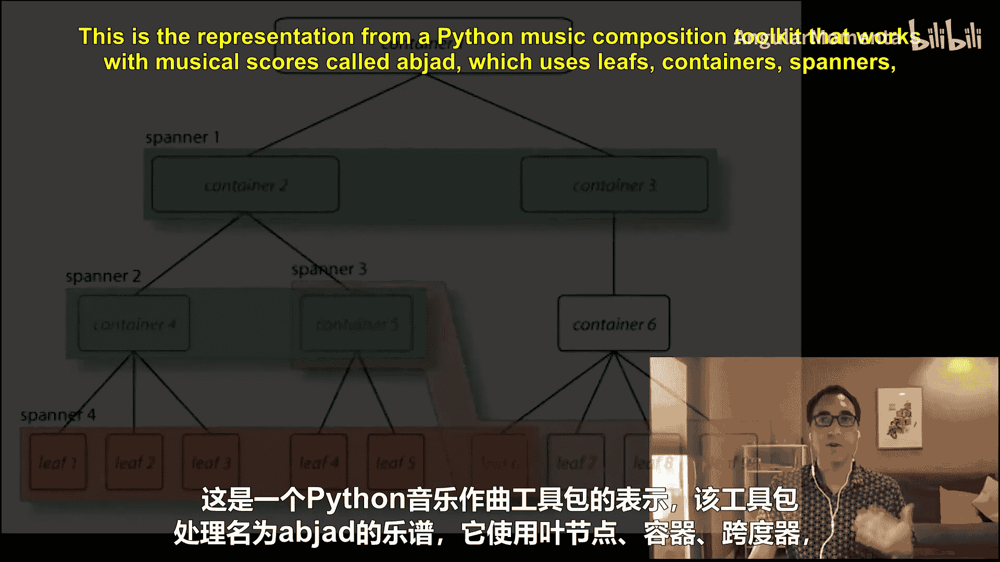
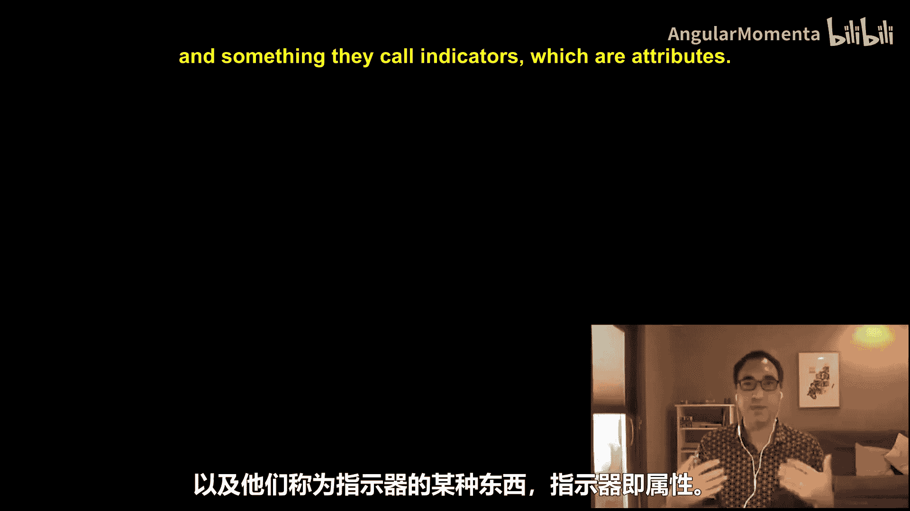

# 【麻省理工】计算音乐学与分析‌ ｜ MIT 21M.383 Computational Music Theory and Analysis,S 2023 p16 16 视频 7b：音乐21中的流层级结构：容器类型 -BV17xUmBDEUC_p16-

Welcome to the first video of the third topic for 21 M3，83。 And this is on streams as。😊。

Containers in。Music 21。Nearly all computational music processing systems。

 especially those that work with scores， have a concept of a container。

And something that's contained in size that called leafs， sometimes they're in music 21。

 they're called elements or boringly music 21 objects。And there's usually the concept of a container。

 whether called it or not， the concept of belief， whether called it or not。

 and a third thing we'll talk about later called spanners。

This is the representation from a Python music composition toolkit that works with musical scores called Abjad。

 which uses leafs， containers， spanners， and something they call indicators which are attributes in Music 21 attributes on elements。

So now that we've seen how containers and elements or leaves work in general。

 let's look at how containers work in Music 21， where they're called streams。

