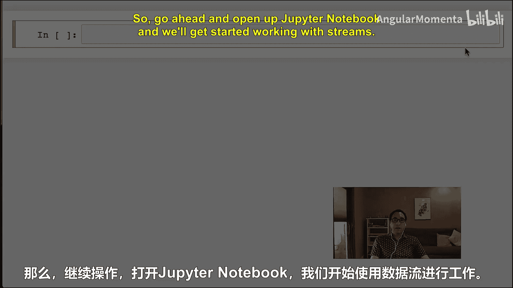
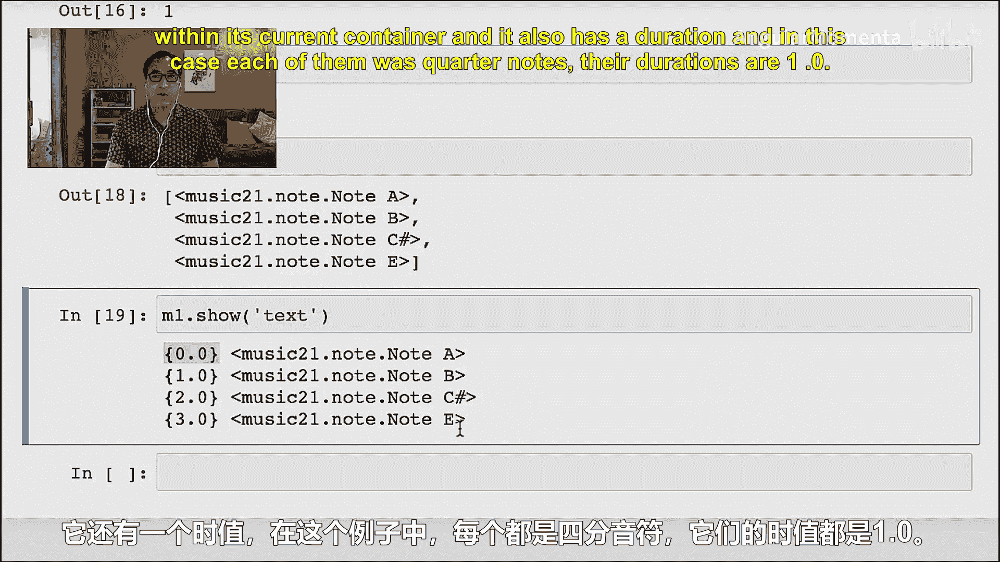
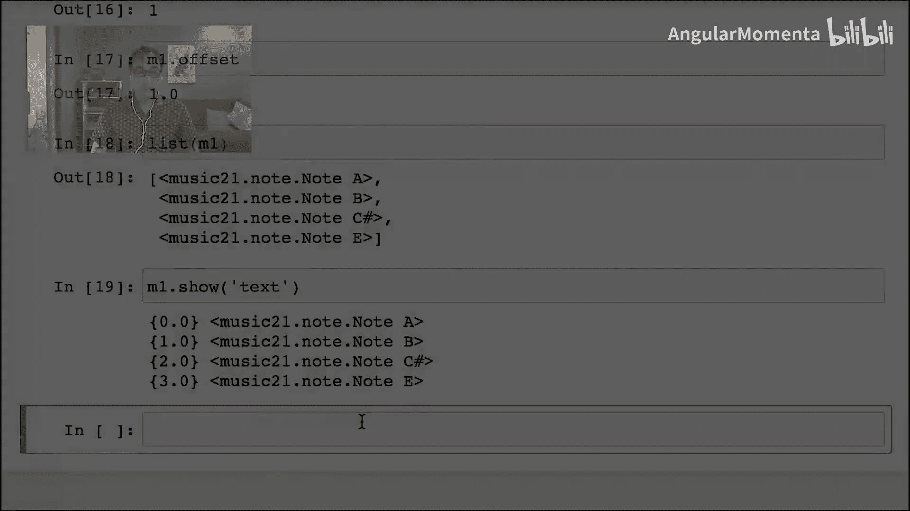
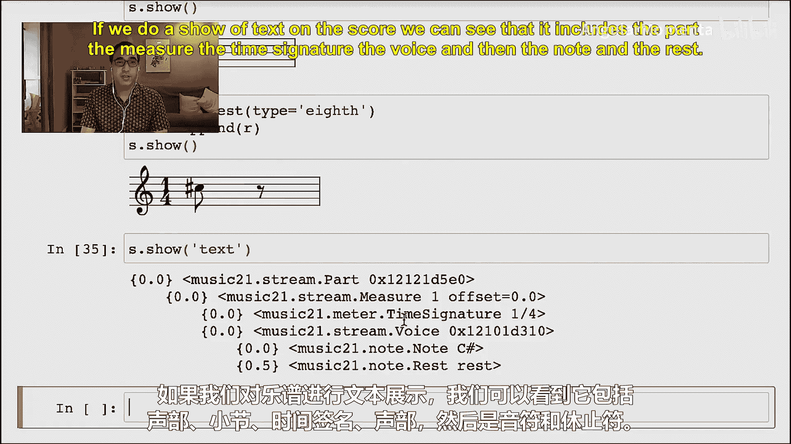
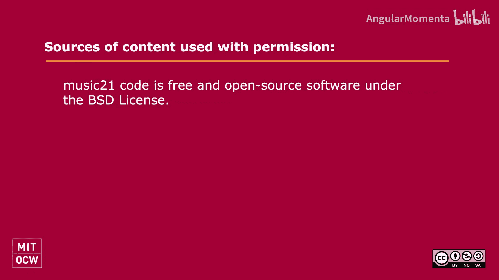

# 【麻省理工】计算音乐学与分析‌ ｜ MIT 21M.383 Computational Music Theory and Analysis,S 2023 p17 17 视频 7c：music21 流、语料库与节拍特征 -BV17xUmBDEUC_p17-

So go ahead and open up Jupiter Note， and we'll get started working with streams。What's。

Very different from this topic and many other topics willll have is that。

The introduction to the topic will also be the unlocking video for the topic。

 You've certainly done enough with representation in topic 2。

 representation that you deserve to have some way of representing music to start so we can go ahead and from Music 21。

 import strain the stream module。You're also going to get a second unlocked now， and that is。

From Music 21， Im corpus and corpus is a collection of pieces that you've either created yourself or what we'll be using a collection of pieces that come with Music 21。

 So the corpus。 The corpus module has one method that we'll use a lot。

 and that's parse and so you load something from the disk。

 you can look online in the Music 21 user' guide to see the list of pieces that come together。

 come with the Music 21 corpus， but we happen to know one pretty well from our last look in that Sp BWV 66。

6。 and we'll call that。Bock score。Second， now we'll just call it back。Bock equals speed W hit 66。6。

 And we see what Bach is。 We see， hey， it's a type of stream called a score。

 What we'll find out is that music 21 basic。Way of representing music starts usually with a score。

 There are some things bigger This score called Opus and stuff like that。

 But usually you're going to start with a score and。Like any Music 21 object， you can show it。

And so we can show the entire score。 It usually takes a little bit longer the first time。

 but then it comes up and we can see it has four parts。

 Soprano Alto Tennerbase in 44 abbreviated this common time begins with a pickup。

 That's always going to be hard。 And one of the things we' will see that though Music 21 will call this measure 0。

12 and so on。 your notation software such as muse muse score。

 which is what I'm using to automatically generate this might not know how to work with pickup measures as generated from music 21。

 we're generating automatically to music Xml， and then loading that into muse score and then generating a PG file and putting it back into Jupyter notebook a lot's happening on the fly when we say Bch dot show。

 In any case， for some reason， the measure numbers don't translate。 So watch out for this。

 Music 21 thinks。As measure three and me score think so it is measure four Soia we have four parts。

 pretty short score all fits over here and I've already asked you to think about what the key is。

 what are some interesting weird moments in various parts and so on。

We can also show this as a MIDI file。Though the sounds not nearly as good as the recording you listened to。

So that's kind of useful。 if I made my screen bigger then then the thing looks pretty white but。So。

We have。A score and a score is a type of stream and a stream is a type of container。

 and so it works kind of like a list。 You can see exactly what is in the score。

 and we can see that there's a metadata object and then four part objects and something called the staff group and that kind of makes it so that all the parts look right together。

So within this， we can get the soprano part by getting the second element from it。

 which we can call that p 0 for the first part because。We can get that as the first thing。

 and we can see that p0 is another type of stream called a part。

 and so parts are contained within scores。 Think about whether this is time wise or part wise。Well。

 as part。 So it's part wise。 So we can also take this and show this particular part。

And I've reset for a second。 So it takes a little bit longer。 There we go。 Just one part going there。

 And we can see everything that is in part 0。 Since I've said that this is a part wise format。

 Think about what you would expect to see next。Okay， here we thought about it。That's right。

 It's mostly a bunch of measures。 There's an instrument object that says it's a soprano instrument。

 But then there's just 10 measures。 Measure 0 is numbered that way because it's a pickup measure and so on。

 So we can get the。Pick up measure and call it pickick up。And what do we want to do。

 It's the second element in there。 So we get one right， and we can just show the pickup。出。

That's not so exciting。 Let's get the first real measure。Yep， great， and we can see that M1。

Is also a strain。It's a measure object， and it reports that its number is one。Yep。

 and we can see I has something called an offset。And as we said in music 21。

 we measure things in quarter lengths for the most part。

 And so measure 1 begins one quarter note from the beginning of the piece itself。

 And we we look again at this part。 Yeah， you can see there's note 0， quarter note 0。5。

 quarter note 1。 So measure 2 begins where。Right， it offset far。And then 9。

13 in this particular score， they're all off by 4。 Great。 So we， let's see what's inside measure 1。

And here we have the notes finally。There could be， if there were multiple voices in the stream。

 There could be voices at this point， but there aren't。 This is just a single part。

So now that you can see。These elements of stream。 Let me show one other important thing that you can do。

 you've done this show， which by default， puts it out as music XML when you're putting it in。

A script or in the Jupyter notebook， it puts it out as music XmL。Opens up Muse score。 If you have it。

 turns it into a P G and puts it right back。 But there's another thing you can do。

 You can show it as a text file。 And that shows you not only what elements are inside the measure。

 but also what their offsets are。 So every element， every mea 21 object， every note， every clef has。

Oh an offset。Within its current stream， within its current container， And it also has a duration。

 And in this case， each of them was coordinate out to their durations are 1。0。

I forgot when I was making this video first that there's something really important here。

 Notice that this first note has an offset of 0， but it's not the first note in the piece。

 It's the second or third note in the piece。 but at the second quarter note。 So why is it offset。

 not one。 Well， it turns out all of the offsets are measured from the start of the container。

 So this is a measure that begins at offset  one。 And therefore。

 its first note is at offset 0 within the container。

 So if you're going to figure out what the offset of a particular element is within the piece as a whole。

 you're going to need to add up all of the offsets of previous containers。Back to previous my。

So this is how you can。Gad up a score that already exists and get to particular notes。 So， in fact。

 let's get that a， say， 0。We can see that A is a note and we can get its full name and all the other things that we worked with before。

Pitch。Duration。Turation dot type。And so on。 So this is how you can。

Gad a pre existing stream from a music XML file like BWV 6 and 6。

6 or from a MIDi file or from an ABC file， or any of a number of music representation formats that Music 21 supports。

But now let's go the opposite way。 Let's create and build up our own stream。 So we'll。

Build it up from scratch。Let's import notes which have already been unlocked。And let's create a note。

When we show this note， Music 21 is actually doing something for us。

 It's creating a whole set of streams around it for us， but we can do it our own way。

 So let's create a voice， which is a tu of stream。😊，And we will。Insert that note at position 0， oops。

We will insert that note at position 0 into the stream。

 you only think that working with Music 21 for 15 years and having created it。

 I do remember what goes first， the offset or the element， but I size forget， great。

Will unlock another。Module for you right now。No unlock the meter module。Yeah。

 unlocking and we'll create。A meter and a time signature of 1，4。We kind see at time like this， yes。

Things like that， Now let's create a measure for it。

And we will insert at the beginning of the measure。

 the time nature and also insert at the beginning of the measure， the voice。That contains the note。

We can put more than one thing at the beginning because time signatures don't have any duration。

That we can create a part。And we can insert the part。At the beginning， the measure at the beginning。

 the part。Or we can。Put the measure。At the end of the part。

 And since there's nothing in the part right now， a pan is will be the same as inserting a 0。

 But you don't have to remember how many things are in there yet。Now we'll create a score。

And we'll put the part at the beginning of the score。

 One of the mistakes that people make with Music 21 quite often is that they get so used to appending things that they'll append the part to the score。

 which the first part that's fine。 But then they'll append the second part to the score。

 And if you think about it， parts don't follow each other。 Theyre all at position 0。

 So you want to make sure to always insert parts at position 0。 Now we have。

A score that looks basically the same as when we created the n note。If we modify some parts of the。

Of the original note objects， something we can。See that。The score will be updated。As we do。No。

That doesn't match the time signature because we explicitly put a time signature in there。

 so it doesn't create one for us。 So let's create。A rest。And then in that voice， let's insert at 0。

5 Now， let's，'s make it easier。 Append the rest to there。 and now。Show all this。

If we do a show of text on the score， we can see that it includes the part， the measure。

 the time signature， the voice， and then the note and the rest。

Well， that's enough for streams for to day。 Thanks for paying attention。

