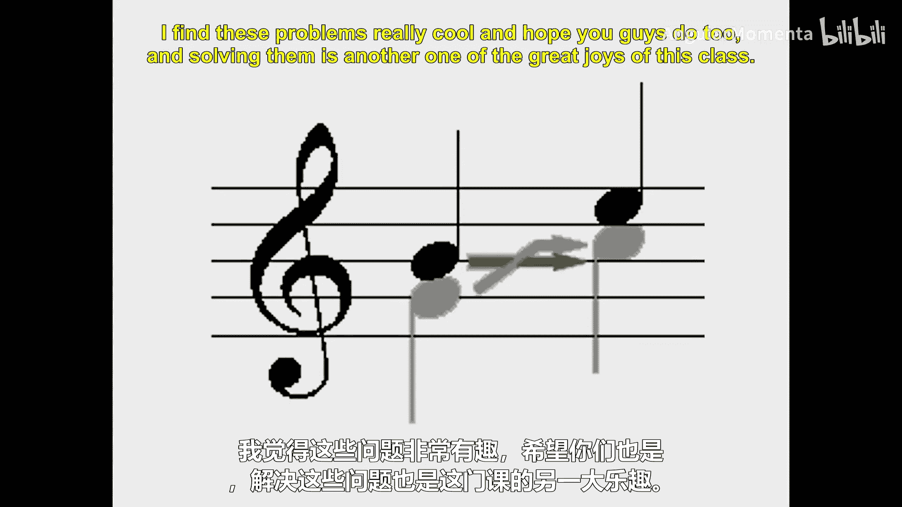
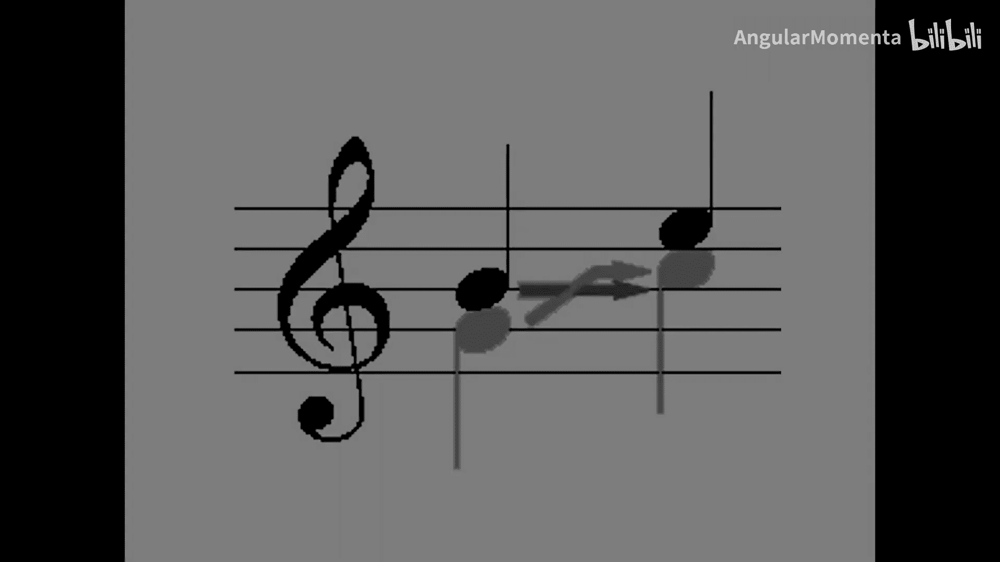
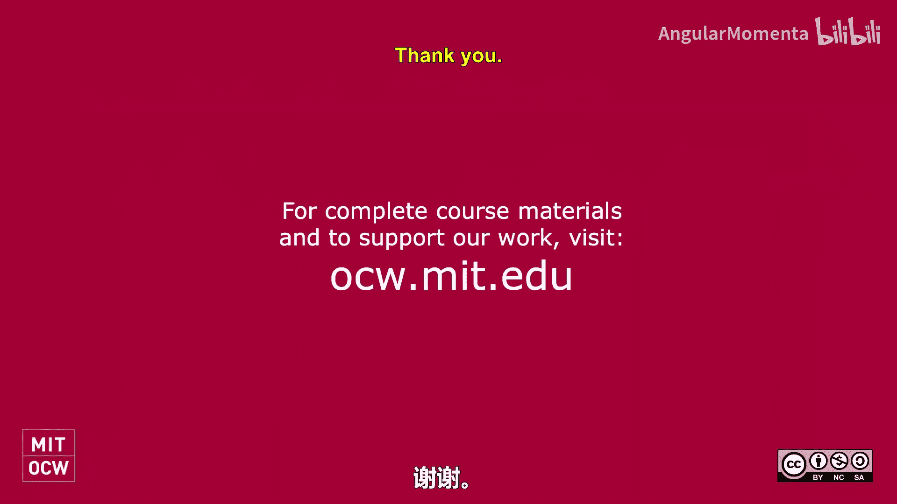

# 【麻省理工】计算音乐学与分析‌ ｜ MIT 21M.383 Computational Music Theory and Analysis,S 2023 p18 18 视频 7d：声部分立与时间维度复调音乐表征 -BV17xUmBDEUC_p18-

Hello， as the last element in our discussion of musical representations。

 I want to talk about two different fundamental ways that we can represent musical scores。

Time wise and part wise。 And these really matter in anything that has more than one note or more than one independent part going as once。

 And I want to acknowledge， I'm going to be using slides from a presentation called notation as composition by William Andrew Burnsson。

 creator of the Belbonage notation package。One of the ways that we can look at musical notes is as musical scores is as a series of containers so that we can think of and part piece containers。

 So we have a score。 and within that score as the first element， we have two parts in this case。

And within those parts， we have measures。 and we might even go further and think that within those measures。

 we have voices。 But first， when we think about dividing the score into parts， let's say it's。

 you know， the score of a massive three hour opera。 Well， you start with。

 whatever is at the top of the pickiccolo or something like that。

 And you go with the pickiccolo part from measure1 all the way to the end of the three hours。

 then you go to the second part， where probably leave the flute and you go all the way from one to the end。

 and so on。 And so you have everything in one part from the beginning to the end。

 And it makes it very easy to do the kinds of analysis that look at what happens in a part。

The other principle way of looking at musical notation representation is you have a score。

 And within that， you have all the things that happen at a certain moment。 So at beginning， you know。

 you might say， well， there's all the cls。 And if it's a 10 par score， you might have trouble。

 trouble， trouble， trouble， trouble alto， base， bass， bass， bass， bass， so on。

And then you have all the time signature， key signatureries， all the time signatures。

 and then every note， everything that happens at the beginning of the piece。

And then you have everything that happens at the next instant。

 the next time that something happens here。And in this particular case。

 when we get to the third instant， which is the E coordinate note in the base and then the C the C eighth note in the E。

 there is something that is happening in the top part that that G half note that is not represented in that instant。

 but is thought to be continuing from before。 And in the next instant。There was just an eighth note。

 with nothing else happening。And so this makes it very nice to see what's happening at every attack。

 And you might be able to programmatically go back and see what's happening at every instant。

 but it makes it very hard instead to figure out what's happening from one。

A beginningin of the score to the end。By the way， we call these instance or offset moments or cuts through hierarchies。

 generally speaking but。Often we colloquially call these salami slices in the process of creating these things sami slicing。

It's just kind of something that's come out in Music 21 we call this processqudification。

 and so you'll see the quadify happens a lot。So which is better part based containers or time based containers。

Etue's formats has their own。Positive things add drawbacks， as I said。

 part based containers make it very easy for us to follow entire part from the beginning to end an entire line from the beginning to end。

 T based containers。 Let us see what chords are happening in a certain moment。

But very hard to follow melody。But each of them has certain difficult to encode things， for instance。

 an OseA a staff where something optional is happening or you can do this instead of something else。

What part is that in How do you encode that， Do you put a part with hidden measures all the way up to this moment and hidden measures all the way to the end。

 and how do we indicate that the player could do this so。

This is something that's very hard to encode when we do part based representations。

 So instead let's move to time based representations because it doesn't have this they don't have this problem。

But instead they have other problems， where do we put these grace notes in， you know。

 in in encoding like this， especially when， you know。

 we know that not all five of those grace notes come after that last。

's so is troubling bass after that last B of the subeptopt within the triplet。In where do we go。

 How do we encode grace notes， Do they attach to the note next to them。Or， or what。

And both of the representations have major problems where we want to look at things that involve horizontal and vertical at the same time。

 things like voice leading。 Here's a common voice leading error in in sort of very strict traditional harmonic writing。

 where we have。And we have an overlap where the low G crosses the boundary established by the B before and goes up to the C above it。

Which format makes this possible to see if you just look at each part alone you see， okay。

 there's a B going to an E。And we get to the next part。 theres a G going to a C。

But you don't see that the G going to the sea。Overlaap the B going to an E。 On the other hand。

 if we look at it in time based， we have a G and a B， and we look at that。

 then the next part we see there's a C and an E， but it's hard to tell well。

 did the G go to the C did the G go to the E did the what happened。

 How's the voice leadinging happen。So these are the problems in musical representations and will quite often find that we have to convert from part based representation to time based representation and back or in the case of a voice leading moment。

 we have to keep both the part and the time based representations in our head in the musical memory in the representation at the same time in order to find these things。

I find these problems really cool and hope you guys do too and solving them is another one of the great choice of this class。

