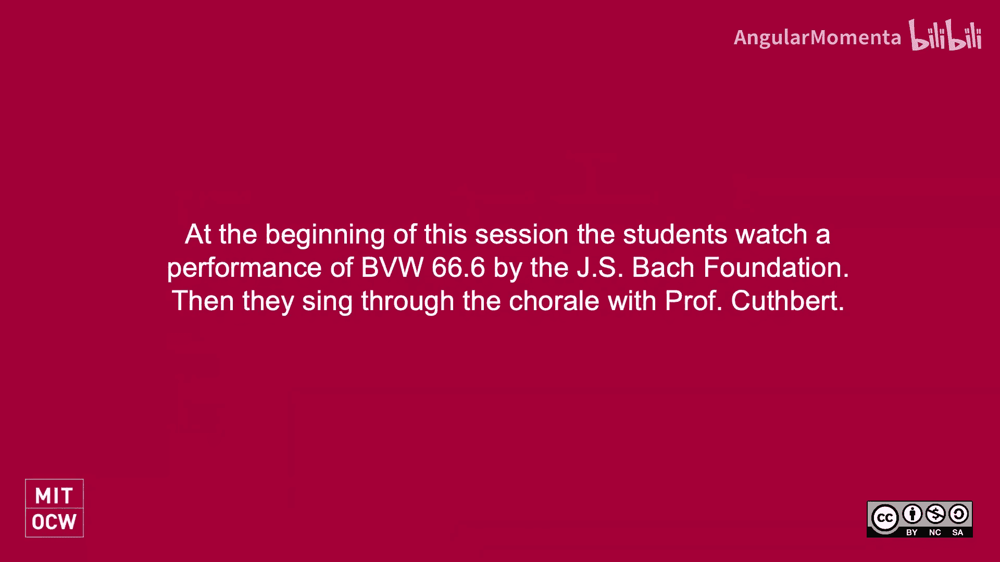
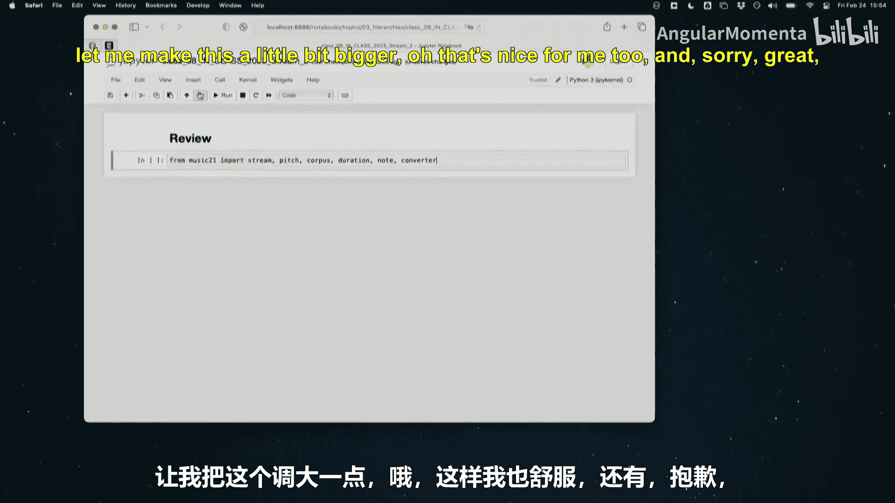
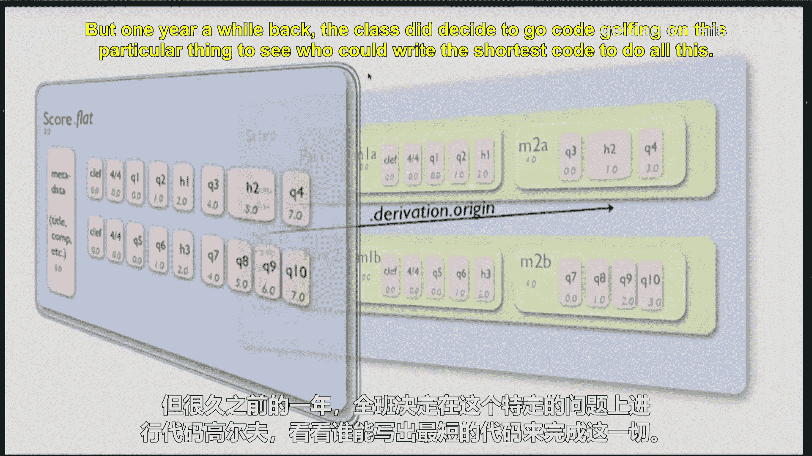
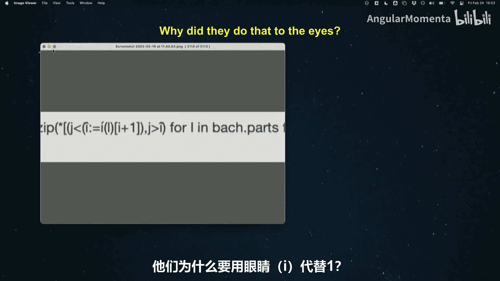
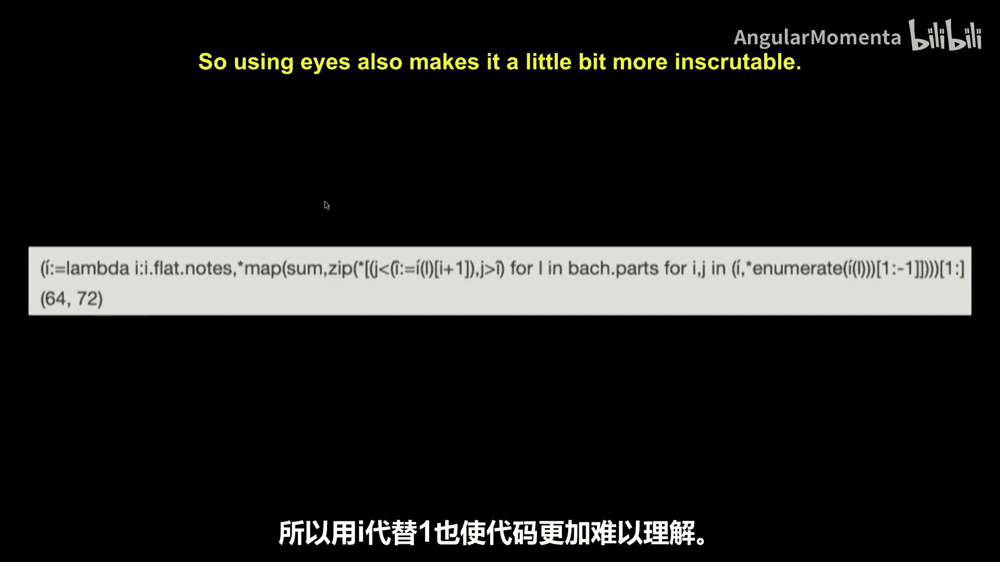

# 【麻省理工】计算音乐学与分析‌ ｜ MIT 21M.383 Computational Music Theory and Analysis,S 2023 p19 19 第8课 视频：层级结构（二）：流与递归 -BV17xUmBDEUC_p19-

I'm going switch over to the Jupiter notebook to talk sort of a review of last class and then going forwards。

 So what are some of the things we unlocked last class， So music 21 objects that we can use。上猫。

What's up stream， good。Pitch corpus， I heard anything else。

 duration and pitch from duration lets you do what。Not， good。 We remember that。

 And there's one other 1。 I just w to remind you。 we're not gonna use it very much。

 It's called converter。 Let me make this a little bit bigger。 Oh， that's nice for me， too。 And sorry。

Great。Because converter does the same thing as corpus。

 but loads any file on your hard drive or anywhere on the web。

 but since I don't know what's on your hard drive， we're not going to use it that much。Great。And。

What's something we did last class， What's the problem， So let's all load that fuck piece。

I remember what I should type corpus dot。Pase， good and。It said it was Bach B W V 66。6。

 The only thing you actually need is whatever is necessary to distinguish it from anything else。

So you'll sometimes see I'm going to be taking a shortcut there， good。

And how many things were in box Do you remember estimate 6。 Oh， good。 We have the exact number。 Yep。

 why。Where are the notes？We have a score object。 I'm pretty sure， just to recall。一ep啊。

Weve score object。 And then what's inside of it， The main thing， four of the thing of the six things。

 parts good。 And then inside of part， Hannah， did you， you had your hand up on the last one。

 I'll get you what's inside of a part。Meeasure objects。 good。 And what's inside the measure objects。

Notes and other things。 But primarily， so we have this hierarchy， this nested hierarchy score parts。

 measure notes。 There may sometimes even be another level of hierarchy， for instance。

 in scores like this， where you have two different voices on the same part。

 there what do you call it， There may be a voice object inside of a measure。

 And if you have a whole collection of scores， we call it something begins with an O P。Opus， yeah。

 so there you can have a something that's bigger than a score。 You can have opuss， oph， technically。

 an opus that has scores inside it。 And then you can put opuss inside opuss because I didn't want to make anything bigger。

 Yeah， God aheadsha。 Oh， yeah， sure， sure。 You close the door for somebody who can get there， thanks。

😊，Appreciate it。 great。 So let's， how did we get down to the。

How do we get down to the notes last time we did something like for thing in score。

 You don't have to type this as all review in Bch。If thing in， if。

We remember that is instance is the Python way of figuring out saying thing in score is a stream dot part。

 we can also just say stream dot stream if it's some sort of a stream then for thing in part in thing in score。

I don't want to waste too much time on this。 I can do this。If instance， thing in part。

 somebody tell me if I type something wrong on this because I'll probably do it。 And that's not the。

 There's no tricks on this for thing。In。What is it。Measure in thing in part。Print。Fingbin。Measure。

 hopefully that works。Yep。So that lets us get down to the lowest level。What's happening here。

They have a whole bunch of notes。What are we doing Z。Are these， are we doing。

 you'll remember the two representations， the box representation or the sloy slice time wise。

What are we doing， Are we going through all the parts here first。

 or we going through one part and then another。H， you can always look back at your score。

 you know the piece。And you have the notes。Go ahead and when you have it。

 just look up and then shout it out。We're going part by part， right， The soprano， C， sharpp， B， A， B。

 C， sharp， fora。Oh， it's nice to see that Ramas are not in here。

 so they must be someplace else E C sharpp。 Yeah， so we're going part by part in this case， great。😊。

And we also saw last class that we could do something。 If we knew exactly where something was。

 we could say bach。2， which I happen to remember。 there's a metadata， soprano then Alto。

 So that would be 2。 I don't know。 Let's choose a random measure。And we can make a list out of this。

 I can't remember if I think I demonstrated that， and get。What is in here。

 And we'll keep seeing that these random other things keep popping up here。

 like system layouts and so on。So。We'll need a better way to get to notes。Questions， this is review。

 So I went pretty fast。 But the important thing is， if I'm reviewing it。

 it's probably important that we have good understanding before we move on。Yeah， re on。

So we're going to get to that in just a second， yep。Good， yeah。Sure， great， great。There we go。

Sorry that the blackout blind over there doesn't seem to be working。是。If you email me after class。

 I'll remember to put in facilities request。 Or if you email me right now in class。

 Ill you'll hear a ding， then I'll put in a facilities request because that's gonna get annoying as after daylight savings time starts for this class。

Good。Okay， any， any other things that we want before。From the review last time。 Yeah。

 I showed a whole bunch of things on the first class that are not done yet。

 but we'll we'll be getting to them sooner。 So assume everything on the first class。

 I think I said at the end was then immediately relocked。 But， But as far as recur。

 this recurse thing， we're gonna get to it and unlock it in just a few seconds。Great。So， any。

Any stream can be converted to a list by doing it so we can get the list of everything that's in。

The top level score for Bach here。 And then we can。Yeah， do， do other things。

 And we can There are some differences between a stream and a list that are pretty important。

 So when I say a list list array in other languages， what are some of the things you can do。

 It's a mutable container。 So what some things you can do to it。要。You can add to it， great。

Other things。usually can add。 you can， you can pop things off of it， right。

 You can remove things out of it。 What are some other things that listens to。 Yeah， good。

 you can change things at certain。 You can change things at certain indice。 Yeah。

 you can replace one thing with another。 Could any other things we can do。 We're getting。Yeah。

 just find the link。 You can find the length。 Great， You can find the length。

 Then you can append to it and change the length。 All those things。

 One other thing beginning with I T。You can do。 Yeah， John， you can iterate it。

 You can put into a for loop and get things great。 Great， any there's one more over your mouth。

 splicing。 Yeah， you can， you can get little parts of it， too。 So in this way。

 a stream really does work like a。😊，Like a list， we can get out， get rid of that metadata。

 We can get rid of other things here。 if I had been smarter。20 years ago。

 it probably would inherit from list， but it does not。

 but it has a lot of things that are like list like。

 But there's some things that you can also do that are a little different。 Let's get Actually， where。

 what was that over here。 We went up to Buck2，4。 Let's get that out here。

 I think that should be measure。呃。Measure 3， let's see。 And M equals this。 and we'll see what M is。

 Y， measure 3。Great， so measure 3 of the second thing。Up here。 So the third thing。

 because we're doing 2，0 indexes 0，1，2 measure 3 of the alto part。

 Here is something that I don't think for all the amazing things MI I TC S training does。

 I don't think it does very， very well。 I think that we， this says measure 3 of the alto part。

 And here's the contents of it。 Let's just go through and make sure remember pickups are measure what。

😊，0， so let's make sure that this is actually measure 3。Of。Is that right。

 Do we get the right measure。The next problem set the one that we're going be talking about at the end of class today。

 it's not as it's probably the least time consuming of any of the ones you've had so far。 So good。

 I feel figure every third one。 you need a little bit of a break。 So we'll go down on that。

 I will tell you in advance where people lose points on this problem set is that they write the code。

 The code works。 And then they go on。 and there's a little programming error somewhere that could have easily been fixed by looking at the score during show and checking that your answer was actually what it should be。

So just to have that there。Now， I， you know， my， my feeling is everybody can get an A plus。

 We can all get perfect on everything。 I don't need to。Do play gotcha games for， you know， Ha ha ha。

 now， now， there's nothing to mark off。 So good。 So make sure that you're always doing that and make sure to do these call them sanity checks that you're getting out from your data。

 what you should be getting in。Okay， so these are some things that that are similar。

 One of the things， though， in。So we have this measure object， and we'll look， oops。

Shape of your brackets does matter， right， You have something here。 Now。

 if this was just a normal list。M dot， insert。2， we're gonna put it position 2。

 Let's put a note dot note。 Let's， let's do one that we can immediately recognize a double flat for。

 Okay， we can create an object in here。 Actually， we'll， we'll be smart。

 We'll call that n and define it before n equals so that we can reference it again Sorry。

 I' will try not to get this at the very bottom of the screen， right。

So what should have happened if this were。If this were a normal list。Where should。

 where would you expect it to see that double flat， A double flat。Adam， after the G sharp。

 after the G sharp。Think that。Everybody agree。Sometimes professor。

 everybody agrees when the professors like， yeah， does it go after to a desert， I can't remember。

 But yeah， I'm pretty sure that's right。 So it should be somewhere over here。Why is it here。

 Let's go back to that alto part， measure 2。And see， it's coming after the sea sharp。

 Does the sea sharpp have a fada on it or not。Just want to make sure we' all in the same place。Yeah。

 John's， John's nodding his head。 And John's almost always right on these things。 So good， good。

 And yeah， so we have it on the last yah of that word that I'm not gonna say during left， right。

 And good。 So it's come in right after there。 And yet， we said we should put it at 2。

What might be happening here。要证。It's been part like the。Second be2 zero index。The second beat， Yeah。

 with the beginning being 0。 Now， I told you that's very， very close to the right answer。 So great。

 great。 I said at the beginning， there was a reason why I didn't like to use beat as a fundamental unit。

 What was that。Or if， if don't remember， because of things like 5，8 were fast 5，8。Y。

 don what and what and to and where beats can change their duration， even within a measure。

 So what might whats something equivalent， What would durations measured in。

 I'm gonna call on missha next。 But I want to make sure that we have。 Yeah， I think it was just said。

 I think you said you use quarter notes。 Yeah， So quarter length。 So in this case。

 it's exactly the same as beat。 So correct answer in this case because we're in 4，4， right。

 But so we' put it in if what do we have 8th，8， So that's。All within 0，0。51。2。O。

But there might be a problem here。 Why is it after the sea sharp。Well let's。Let's do this。

 We remember some of our iteration 4， I'll still say thing in M， even though they're mostly notes。

Print。Thing and things new term that we haven't seen。 It's offset。So the offset。

 just like the duration has a is measured in quarter lengths。

 The offset from the beginning of the current container is measured in quarter lengths。

 So we have here， and we can actually now have two notes at the same time。

 So you can have multiple position things at the same position。

 That makes it a little bit harder to remove by。By offset that you want to have， because there。

 unlike in a array where there can only be one thing at a particular index here you can have multiple things at the same index。

This is a simplification。 We'll see in a little bit that notes and everything else can have an infinite number of offsets simultaneously。

 but this is good enough to start here。Yeah， guys said you show it doesn't。If you put it in the show。

 it doesn't right because not。That's， that's a great thing you're gonna to find。

 It is easy to create things that are valid musical concepts that cannot be shown by any of our。

 of our sort of music representation software or muse scores or finales or whatever like that。 Why。

 Because do you usually， if you have a part， do you have two。😊。

This is this is an ontological question。 Do you have two notes that sound at the same time in one part。

Or do you have something else。That happens when you have two notes at the same time。What。

 what other representation might be for two notes， for2，2 things that sound at the same time。

 I won't say notes。你不对呀。What are we parts， you would have， you would have a。

 You can have it in two different parts， which is what we've normally seen， or yep。

One person like going up。Yeah， you see have a split。 Yeah， a split。

 we'll call those voices in this way。 you have two voices of that thing。

 What's the other other thing that another fundamental part of our ontologies。Cord。 So in this case。

 your software wants me to have created a chord object。

 which is not yet unlocked for us out of these two。 So it just。Does whatever it wants。Great question。

Super， so keep playing with the limits。 We're a little bit behind in time because we're。

 we're really asking great questions。 So I'm gonna hold off a little bit on some until we can get a little bit further into。

Some things。 So let me， yeah。Question。How do you remove。You'll be able to。

 you can either remove the thing and it will find it or you can remove something at an offset。

 and we'll get that will be， fortunately， all of these other things will be all these other options will be revealed to you in in the reading before next time we meet together。

 which is the users guide chapter on streams。 So I think that remove is mentioned in there。

 It can be a little bit more complicated， as I said。

 So I want to hold that off for just a little bit。Okay， let me。Do another little thing for a second。

 and we'll jump。To some ways that we can make our life easier by not doing for thing and thing than for next thing and。

 next thing and fixing and previous thing。 obviously， we're going to have some other。Ideas。

 so this is one notion， one way of a score。 score might be represented in Music 21 with two parts。

And so within the score and this， its score's length is how much。To sell it up。2 or three。

 because we have this metadata。 And so what I've put underneath is the offset of everything。

 Both parts start at the beginning of the score， right， So they have offset 0 within part 1。

 There are two I'm calling measures， measure 1， A， measure 2， a。Their offsets are at 0 and 4。

 which makes sense because somewhere in here， there's a 4，4。Time signature， right？嗯。

And within a notice， though， that when we're looking at measure 2， measure 2s offset is 4。

 but we start again with offset 0。 So， so if you want to know how many quarter notes into the piece。

Quarter note 9 happens。 You'd have to add 2 plus 4。Plus，0。Fortunately， adding zero is easy。 So yeah。

 it's six quarter notes into the piece。So this is one， the representation that's happening。Now。

 when you iterate over the score for all size use L element think。

 things comes off the tongue better。 But L is quicker to type。 And when you do this， you'll。

 you'll see we've already seen you get the metadata。You get part one。And then you get part two。

 and that's all。so you get the three things that are there。嗯。

The more powerful way to do this is something called recur， the recur method on here。

 And what this does is it goes through the first thing。

 And then if there's anything inside the metadata， which there isn't， it's not a container。

 it would go into it。Then part one is a container class。 All containers are called streams。

 but the general term in computational music theory is the container。And then。Within this container。

 we have another container， and it will go through these things that are not containers。

 Sometimes these are called leafs， leaves， the leaf mode node， like in a graph。

 the thing that has no descendants on it。 And then it will go through the second one。

Then it jumps back to part 2， and goes through each one。And tells you that。 So who。

 that's gonna be make life a lot easier。 Let's recurse through。Can help。move over here and go。

 let's recurse through Bch。For L in Bch。recur。Print， let's do L and L's offset。Oops。

 and now I have to get my scrolling back。Go。So now we're seeing there's the metadata。

 There's the soprano part。 If we were writing a program。

 we could keep track of what part we're certain we're in at a certain point。

 And every time we see a new part do something， and then we see up where measure 0。 here we go。

 Here's all the different things to measure  one， measure 2。 And if I scroll far enough。

 eventually we should see。嗯。Here we go， part Al2。So， that's。It's pretty good。

 Theres all this information about what's its offset and things。 This can be done。

 Also gotten in a way that just prints。 It's not useful for parsing。 I would not say parsse this。

 But if you do Bach dot show。Text。And it just gives you basically the same information as that routine。

 but nicely formatted。So I'll give a second where the current offset is given first。

 and then the next thing also。Puts everything like this。Questions on。On this part。Okay。

 now your computer science question。Recur。Is what type of graph search， don't shout it out yet。

 everyone think what there are a number of ways of searching through a graph or iterating through a graph。

 what kind would we call this？I'll give you a hint。 The second word is usually first。Okay。

 that wasn't much a hint。O， give raise your hand if you're confident that。

 you know the answer to this now and。go like this if you're。

 if you're not confident that you know the answer。 could you talk with the person next to you。

 and especially if you， if you have a couple people who aren't so confident。

 just and share your answer and see if you're in the same， same boat。Okay。who is。

 who is now a little bit less still， Whos didn't come to an agreement on your thing。

You guys are still in disagreement。No， you're you're in agreement。 Good， good， Okay， so。

It's all shout out at the kind of search is a first search， a depth first search， good， so。

We're always gonna be following the left most。 I should do this in different colors。

 So it's easier to see。Rightrite the leftmost node that we haven't yet seen。

And doing something with that and then going back up here， going back up down， right， Does that seem。

To fit other people's computer science things。 I have neither a concentration minor major or PhD in computer science。

 So please， if I get something wrong， you all shout to me because you've done more of that than I have。

😊，Okay， great。 So we have depth first search。 What are some of the things anybody knows from other things that depth first searches are good for。

 And what are some of the things that they're not good at。So good for anybody wants。So。That我s。

Safe space and。Surehor is。Sor is path problem， good。

Good short spectrum from anybody do you want to explain or anybody else want to explain what that is for those who havent。

Shortest path between two notes， right， how to， how to get there， right。

 you don't might not want to do something else it might be good for。

It's just when you're in a scenario where you think you want to look over like everyone。我。Great。

 when you scenario where you want to look at every possible object。

 now that there's other search methods that also have that property。 But this one has that property。

 So it's already a lot better than for thing and thing than thing and thing， thing and thing。 right。

 You know that you're going to get to every point。 What's something it might not be good for。

another search method might be a better way of doing it。要。Caase of like breath for ci。

 is that producerster。If someone's close by， there's not a lot of it。The trees like Super。D。

But the answer is like super close。ep， depth search will search through everyone like to go to the depths of the tree just check Great。

 super， super。 And we should， we should say what we're comparing there's lots of lots of searches。

 But the two key key ones。 we have depth first search。

 And it's compared to what breadth first search。 Yep， the breakfast search as I always say。

 breadth first search。 So that one， what are we gonna do if we want a breadth first search in here。

 What are we gonna see first。What's the first node we're gonna visit， S C， the score， right， good。

 So so far， it's exactly the same as a depth for certain。 Second node we're gonna see in this higher。

Part one， good third note， part two， okay， so we're already different。Next note。

Most one yep ist BFS better for shortpa searching？Rather than De。

It depends on how you're doing the path if you're looking for。It's one like that。

Iant to find the first one that gets you there that's better， but you're doing like positive playing。

Distance。Trying to remember the exact what I remember which one of these like a。Maybe even better。

 Yeah， so we'll get to these particular types of searches later。 The controversy in the class。

 I'll try to remember exactly what it's one。 do we have a， But yeah， I'll trust that we solve that。

 because we're not gonna be doing shortest path yet in this in this class。 But we'll。

 we'll see that there's there's certain advantages to one versus the other。 The other thing。

 So what's a musical thing that we want to how about this。

 do all parts start with the same with the same key signature。😊，Breathth first or depth first。

Which one's going to be fastest to get you your answer。Right。

I heard depth and breadth who's on depth。Who's on breath。Yep， okay， good。

 So we're gonna want to have both types of searches available。

So recur will give you always what do you call the depth first search。

There's another one that we're gonna have。 and you're gonna see it's the flatten operation。

 and you're gonna to see it sometimes in my old slides， I haven't figured out how to update dot flat。

 but used to be a property that is to say you didn't need the calls called flat。

 Now it's a method called flatin There are two reasons for this one。

 if anybody has a new uses an I DE like VS code or pie charm or something like that。

 which I highly encourage you to do know it's nothing elite use V anymore in life。

 then a lot of those will now go through and call and check every one of the properties at certain point So we can repeat for you and flat ended up being for a very。

 very large score time very space and time sensitive。 And so once I upgraded to a thing realize。

 okay that can't work。AnyMore that flat。 So we had to do it this。

 I also wanted to make it a few more letters so that people would stop calling flat instead of recur just because it was less to type。

 So now that now they're much more equal， flattened。

 And what flatten does is it gives you the option of doing everything first that's at the same offset。

everything。 So we start with， I think I have an animation on this。 The metadata， again。

we get one clef。Next clef。Both the time signatures， everything that's at the same point。

 When you have a half note here， willll get both， both quarter notes before getting to the other thing。

The other thing that flatten does that's different is you'll see the offsets are now because it's flattened。

 they're now all relative to the start of the score。So because of this。

 they're implemented in different ways。Recurse， the breadth first search just sort of has a little pointer that's going around。

 figuring out where I am， figuring out how to go back up to the next hierarchy level and walk around and do this。

 So it's very， very fast and not very memory intensive。 the flatten， on the other hand。

 in order to compute where everything should be and which one is actually coming next into this hierarchy。

 And for historical reasons， flatten will take that same score。

And put it all into a new score object， a new thing。

 But with oh it also removes all the parts and stuff。 flatten， there are no parts or anything。

 There's just the things， just the leaf nodes at the end。 So you'll get the clef， the other clef。

 the time signature， the other time signature， and so on， all in a new stream object。

And this is the first time when I was saying that a note might have more than one offset。

 because this is the same。Oops。This quarter note here is the same as that quarter note there。

 So dot offset will be changing as this happens。嗯。This is something that will occasionally bite you。

 but usually not。 What does which offset does it tell you when he put dot offset。

 It tells you whatever the offset is in the last stream that you iterated over that has that object in it。

So we call that the active site。So it tells you the offset in its active site。

You will find that it's often you're looking at something in a flattened stream。

 that should say flattened up there。 And you want to know something about， oh。

 I Christssa Cuthford said， get me all of the notes between offset 5 and 7 and tell me what measure they're in。

Shoot we've gotten all things 5 and 7 from the beginning of the score。 The problem is。

 we've lost all the measure information were here。 So there is a property on all streams。

 dot derivation dot origin， which will take you back to the original， the place where it came from。

 So the pre flattened stream。 And that's something you're going to be working with a lot。

 This is an ontological choice I've made on how things are How flattened versions of scores have a derivation to the origin of the original score。

Now I'll take questions on anything。 It's pretty confusing。 It's a lot to jump in。 Yeah。

 Adam last time， what was Burma in the， in the German at and Cody。What was， what was very。

 very top I said was the composer Oh， Bo。 Okay， so， we're jumping jumping quite bit back。

 It's the location Bohemian， originally， a Bohemian song。不。

That was a pop quiz to see what I remembered。Any other questions on。

 on this material specifically and then on anything。Okay， well let's。

Let's start by having a little bit of programming exercise time。 We have this bach corral。BWV 66。6。

Are there more。 Yep， good。 So does flatten mut the object。 So flatten mutates。Yes。

 it mutates something on every object called sites that keeps track of where things are。

 but it does not change。 I think there were some choices that now that music 21s。

 20 years old almost there are some things that I would have done differently。

 And I think it probably time for somebody whos you know。

 younger and more ambitious and wants to do something for the next 20 years to come up with things。

 because I did not listen to our great software engineering professor Peter Jackson's warnings against mutability in objects as well as I should have。

 And now I'm trying to make more things immutable， But you will find that a lot of things will by default。

 not mutate。 but then can and objects can't be mutated。 So that's great question。

 Everyone knows mutable versus immutable objects。 you can change。 not lists are。

What is the equivalent of a list in Python that is immutable。 Tupple， good， good。

 You all say tuple here。 I always look at as a tuple， but tuple。 Okay， great。Super。

 so here's any other questions before I go on to my question for you。About Bach。Okay。

 here is the question for you。啊。To answer。 And let's do this in groups of two。

 because it's much more fun to be talking to。 Does Bach use more ascending notes。😊。

Or descendsing notes。Dec sendingending notes。Or about the same。I mean， you might think the piece。

 the piece doesn't start off Halu and and all right， And it doesn't go the opposite。

 So it must be about the same。 maybe， but we'll see。 So talk who。

 everyone know who they're gonna be paired up with。S part。 It's easy if you're sitting on think。

 sit par， paired。 great， So start talking about， about how you， how youre gonna do this and what。

 which type of。I I have a quick question。 Why does that flat。这也都知道。Ftten， why does Flten show。

 Because it's able to。 because recursed is not a stream。 Recur isn't， Yeah。

 so I should say recur recur just gives you an iterator around that。 You could do recur。😊。

And then there's a dot stream that you can put onto it， and they'll give you a stream。

 But it's just going to give you the same thing you started with because yeah。'No， no， no。

 then do it。 Yeah， thank you。 Thank you。 Always say we're going talk first about how to do it。

 then then implement。 But I don't it's in class。 I don't care however you'd like to do it。

 but always start talking， then implement。Okay， I， I'm hearing the discussion start dying down and hearing some。

 some clicks。 you can keep talking。 but just an informal poll， which， which groups are on。

on team flatten。We have 1，2，3， good， good。 Which groups are on team recurse is the best way， Good。

 good， good。 And which groups are on team for thing and thing and thing and thing and thing。Okay。

 there no just there was a smile with that one。 Okay， so keep， keep going。

 There's ways to keep working on it。 I think you'll find there's one that's better than the other。

 but we'll figure out which one that is。😊，两天都。啊。奥德。

And if you're lucky to be sitting next to a group that's on the different team。

 maybe talk across groups and figure out， well。Dialogue across religions and political views。しますは。

I'm gonna interrupt for one，1 second to say something that I've heard just a second。

 Yeah just one second。 Can I interrupt for one second to say something I' have heard from two different groups。

 Matthew。You introduced for two different groups。 I have heard this something like， oh。

 but think of the memory。 we're going to have to keep a reference to the previous note。

 What is to keep a reference to the previous note， What is the big O memory consideration that we're thinking about。

What我 what。Do we care about O of one memory？No，No， we do not。 Good。 keep going with that。

 Just wanted to make sure that we had that we don't care about O of one operations very often occasionally。

 But just this piece just this piece。 Oh， Oh， it was just this。 I， I just heard。

 is it just this piece or all of Bach。Just this piece is what I'm asking for。 But you could do for。

Cral。In Corpus。it probably point that I think we。So you can。Derek， if you wanted to。

There is a for loop you can do above it。 And so you unlocked corpus that will give you all looking good。

 looking good。😊，So if anybody， if anybody's finished ands gotten， I think a couple of questions。

 once， once you have that， they're not exactly the same。 I'll say that。 And what explain。

 what are some features in the corral that explain that， The other thing you could do is。

Do this for all。360 corrals。뭐。theThat's a lower QC in across。たべます。Icorpus do cors do Okay。

 just before we go， who， just who is still on。Who is still on team Flten。

You used flatten a little bit。 Okay， and who you， who it will say who used flatten anywhere in their score and who used recur anywhere in their score。

Okay， I' curious how， how did Flten work for getting。Getting this， did you do？

I have time flatten it and it's the same for a Sunday and then for Sunday we're off by you Inter。

 I'll be curious to see how that happened Great。So I think we're we're wrapping up a bit。

 You can keep keep working。 Obviously， I， what is it item 9 on your thing， sound to score。 I。

 it's one of my favorite things to teach in class because it's really， really fun。

 But I have made a video so we can save some time outside and that I'll add that。

 that's about 10 minute to watch。 There's trying to make it quite a bit easier on this this weekend Try to make it a little bit lighter。

 So it's just some some interesting added things that are happening there。 And。😊，For the first time。

 I'm going to really recommend that you read the music 21 user guide chapters。

 There's an optional one。 Chapter 26 at the end， you don't need to read it because it's a little bit complex。

 But if you do read it and get through it， there are some tips in there that can make some aspects of the problem set 3。

A little bit easier， so。Any any other questions on what we do。 Oh one one last thing。

 one last thing on on this， I always recommend， I really， really recommend readable code。

 write readable code， write code so that you can do this collaboration and give it to friends， right。

 things like that。 But one year a while back the class did decide to go code golfing on this particular thing to see who could write the shortest code to do all this And。

Oop sorry。 did do that Because back then， we were using piazza for a discussion board。

 which used a proportional font。 So using eyes made it also makes it a little bit more scutable。

 So never write code like this。 But I do believe that that works。 if you want it。 And your prof 1。

 but see if you can beat that one。 Thanks， everybody。😊。

