# 【麻省理工】计算音乐学与分析‌ ｜ MIT 21M.383 Computational Music Theory and Analysis,S 2023 p20 20 视频 9a：音乐信息检索（MIR）- 从声音到乐谱与音乐理论 -BV17xUmBDEUC_p20-

Hello， computational music theorists。Here's a short video on what some of the problems in MIR or music information retrieval are and how they can be connected to music theory and musicology。

 which is the main topic of this class 21 383。These slides owe a lot to Avi Fetter。

 Professor at Harvard， who inspired them with his lecturers。

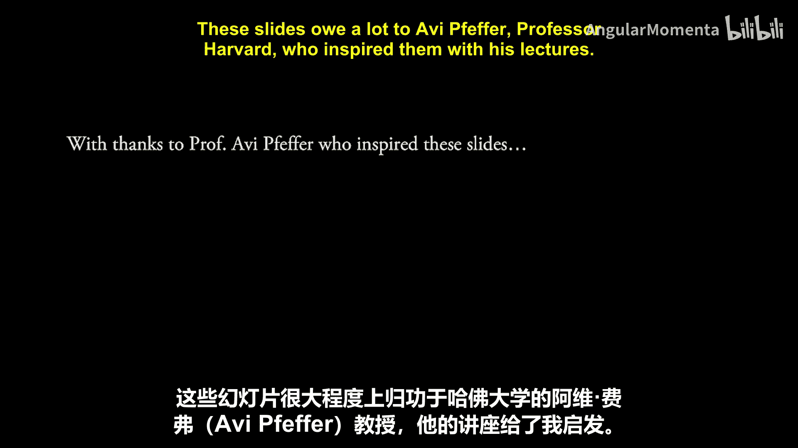

The main question that we'll be working on is how do we move from sound that's made in the real world？

To a score that's printed out or displayed on the screen。

What kinds of technologies are needed and what kinds of problems need to be solved in order to do this really well。

 Well， first， when we sing or play an instrument， we're making actual sound waves in the real world。

 So we need to solve the problem of how to most accurately transform sound into a signal and this involves microphones and other devices and it's kind of a pure engineering problem that we're not going to be focusing on in this class。

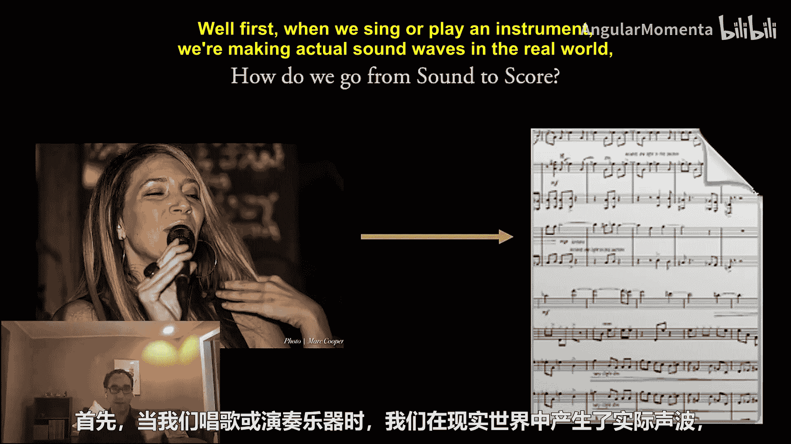

But it's very complex and very valuable。 and we offer some courses in the music department that will help you do this better。

But once we've got the sound from the real world into an electrical signal。

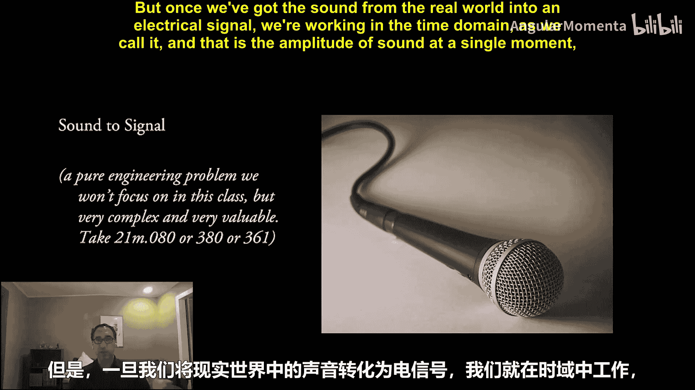

We're working in the time domain， as we call it。 And that is the amplitude。

Of sound at a single moment。Forward backwards， positive or negative。

 and we usually record in something close to CD quality or 44，000 times per second。

 we're measuring the amplitude as a 16 bit signed integer。

And so the sound at this point looks something like this if this was。

 I don't know an attack of an instrument that's decaying maybe a piano or something of that sort。

The problem here is how do we convert from the time domain to frequency to being able to say， okay。

 all these impulses。Add up to a particular frequency。How do we decode it from the signal？

And understand that， hey， in this sound， there's two principal frequencies that are being cur。

And to do this， we use Fourier transforms。And the fast Four your transform algorithm is something thats very good to know in order to work in this field。

 so now we have frequencies。

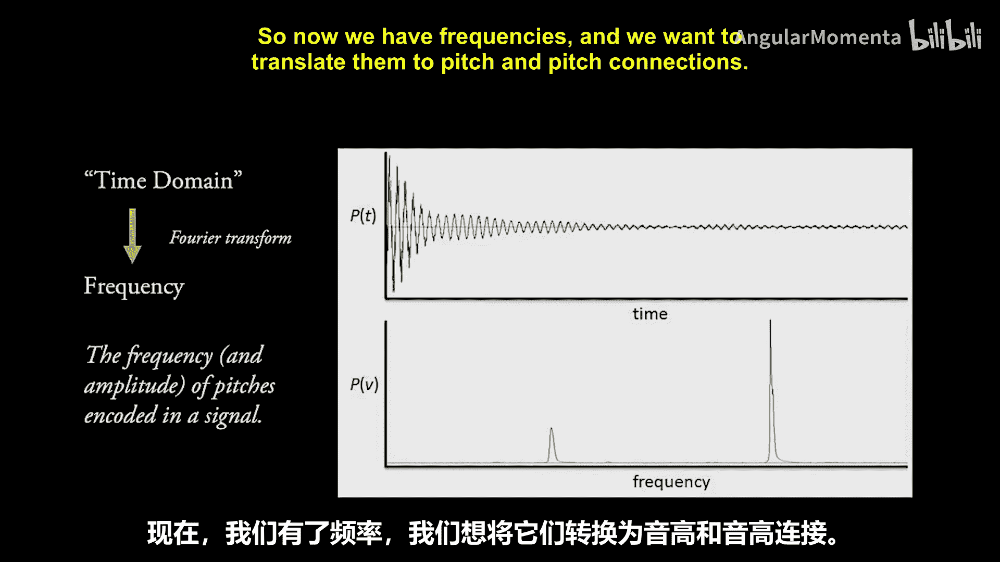

And we want to translate them to pitch and pitch connections。 And that's not just。

Thinking about you know what is a4440 hertz or second。

 but which of those frequencies that pop up are prolonged to make a particular pitch because even while I'm speaking。

 there are particular frequencies that are popping up but they don't necessarily make pitches the attack on a flute isn't necessarily the pitch that we want so which ones are connected。

And once we had these particular frequency pitch connections。

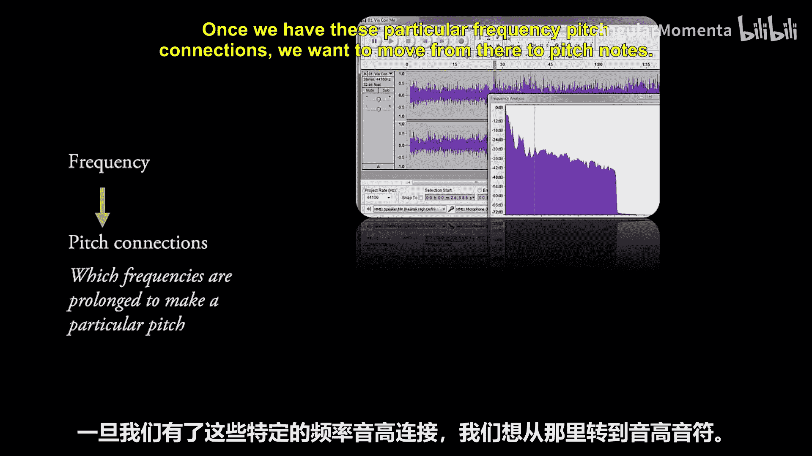

We want to move from there， to pitch notes。As we saw with the piano example。

 there were two frequencies there， does that mean two pitches or is one of them reverberation in the room。

 or if you're listening to another instrument， maybe you hear seven pitches。

 six of them are higher and much quieter and you might think， oh。

 that's the overtone series of that instrument and so going from pitch connections to pitch notes involves the estimation of tomber。

 what is the tombre of the instrument， What is the overtone series that one expects and who we remove them and from there do we end up still with multiple pitches in chord。

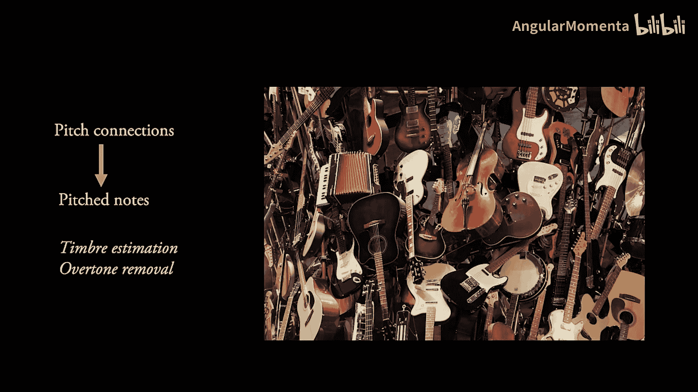

Now that we know the musical pitches that we're interested in。

 we want to go from there to understanding the duration these pitches and the tempo of the piece and so。

There are particular algorithms that we can use to estimate the duration。

 I mean one thing is you know you just milliseconds of things and then say。

 okay well that's going to be the most common note we'll call it a quarter note and so on and from there we can estimate the tempo。

Or we can do it in the other way， we can take all these pitches and try to estimate a tempo based on what are the recurring onsets that seem to be beats and from there go and figure out the duration。

 quarter note half note， three beats long， something like that for each of the notes。

So which direction do MIR people go， it turns out that we usually create a sort of feedback loop so we try to do both at once and estimations of tempo lead to durations which then can be rejected or accepted and estimation of the duration lead to estimations of tempo。

And so the technologies involved are beat tracking and self similarity detection and others。

From the pitches， the duration and the tempo， we can create what we call the full notes or just the notes that is something pitch and a duration combined。

From all these full notes， we can construct what we call a virtual score。

 and that is the score as represented purely as collections of notes and other events we might be。

Esimating at this point， crescenos and dec crescenos and maybe we're hearing certain notes are slurred。

 and we're keeping these all as objects inside memory。

 And so this involves the technology of music representation。

 which we will be getting to very soon in this class。

 and so how might we represent a score maybe as a set of parts with measures and notes in between。

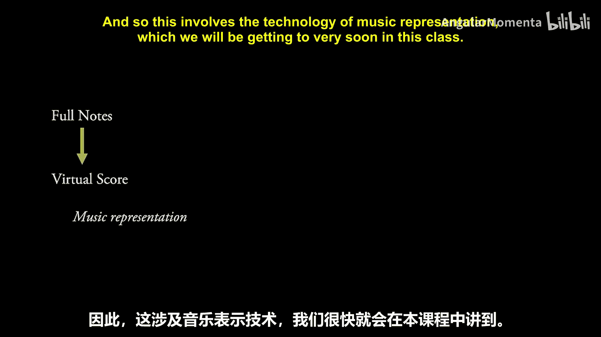

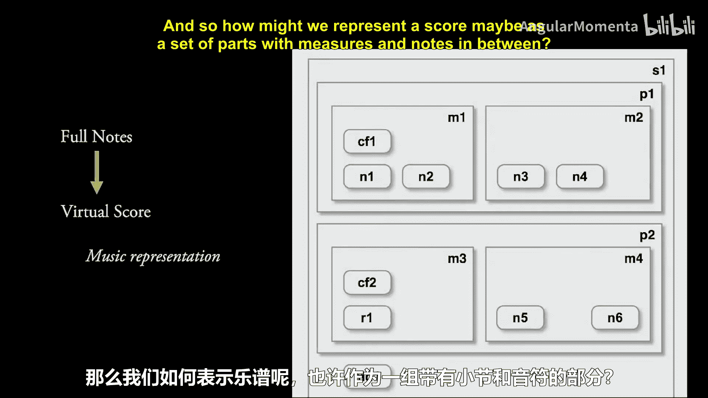

From the virtual score。We need to figure out， okay。

 how is this going to look on the page or on the screen and so we perform layout estimation and we create a layout score where there's not just notes inside of an array or a list or something like that。

 but actual positions on a page。Add this involves some technologies that we'll be getting to in the class。

 here's an example of very poor layout estimation。From the laid out score。

 we choose what the glyphs that would be appropriate are and where are they going to be placed on the page？

Sampled some of the things that might be involved in doing that。

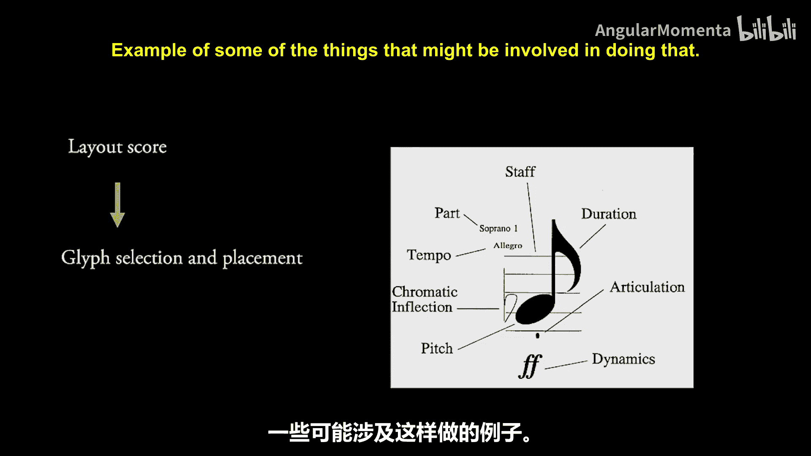

And then once we have the laid out score， the glyph selection and placement。

 we move to pixel rendering individual dots， no longer connected to any semantic meaning。

 but just is this XY coordinate going to be black， white。

 or something betweenweing or something else？And from there we have particular technologies that we're going to need such as screen drawing。

 you know old school caar array tubes， LED display， things like that。

 or how to actually make a printer or distribute on a page。

 and these again are engineering problems that are beyond the scope this class， but still very。

 very important。

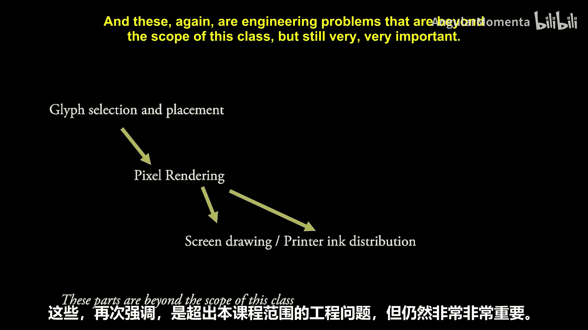

So let's look again a summary of what we have here， we move from the time domain to frequency。

 frequency to pitch connections， we estimate the duration of the tempo， creating full notes。

 create a virtual score or logical score some people separate these two out and we try to make the layout and to the output。

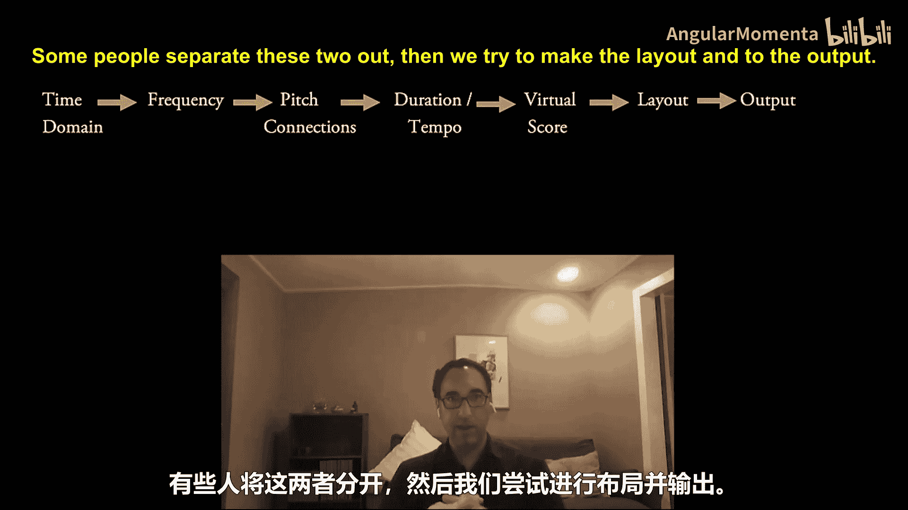

At each of these points in the process， we can involve music theory or musicology and we can learn。

Aspects about music theory or musicology from the data that we're getting at this point。

 so for instance， at the duration tempo level we can start to ask well what are the most commonly used rhythms in this piece and from there。

 hey， let's create a backing drum track to accompany the soloist because we figured out you know what kinds of durations。

 what kinds of rhythms connected this with a database so on。Or。At the。

Frequency to pitch connections level we can now understand based on which overtones were removed。

 what instruments were being used， are they playing in during natural ranges。

 and from there we can might estimate the year of this recording based on particular sounds and sound artifacts or the year of the piece based on instruments that are used and so on。

So these are places where music theory and musicology can get data from this MIR process。

But there's another side that's been much less talked about and it's a place of great potential that I think people in this class will be able to contribute to and that is going from music theory or musicology back and using things that we know about theory or history of music or music studies to enhance the quality of the algorithms being used in these places。

 For instance， at the pitch connection level， we can say， well。

 let's look at the metadata and it suggests that this is a piece by Mozart and he died in 1791。

 so let's look at those instruments now。The frequency overtone estimation was saying okay。

 the most likely instrument is electric guitar this is very likely wrong I mean I don't know maybe it's a modern arrangement。

 but it's pretty likely wrong why don't you try this overtone profile of a forte piano early piano said wow you find out okay that was the second best score but probably the best one would take into account the metadata on the piece。

So。Or we can use music theory and musicology at the frequency detection level， so we might say， hey。

 all of the notes you've been detecting around this note have been an E major and then you hear an a sharp and that let's say it's a little fishy Oh hey there's a runner up note of a natural that was 95% as likely。

From a music theory standpoint。I think that more likely we've detected the wrong note。

 so these are ways that music theory and musicology can enhance this process。

Most exciting at all though， is when parts of the process feed into music theory and musicology algorithms we get and are enhanced by it so we say。

 oh， hey， we' given these frequencies， pitches， durations， and we get a style of the piece。

 and we suggest that it's from the swing era。And then we can help later parts of the process。

By saying， you know， if the style the pieces from the swing error， when you do your virtual score。

 your logical score， probably all those triplets， thoseum ba b b b b bum should be written down and represented as achenets for the conceptually they are。

But， we can。Not just move forward， we can at the virtual score level。

 maybe it's beginning to lay out the score and you they're putting everything nicely into three。

4 and the musicology and music theory algorithm says， well。

 these rhythms are highly unusual for three， four time。

Let's go back and rerun some of the previous steps with that notion that that was highly improbable and try to make the score again so we can move backwards in time。

 redo a particular part of the process。Rerun it。And then maybe come up with a different result。

 we'll put this in68。

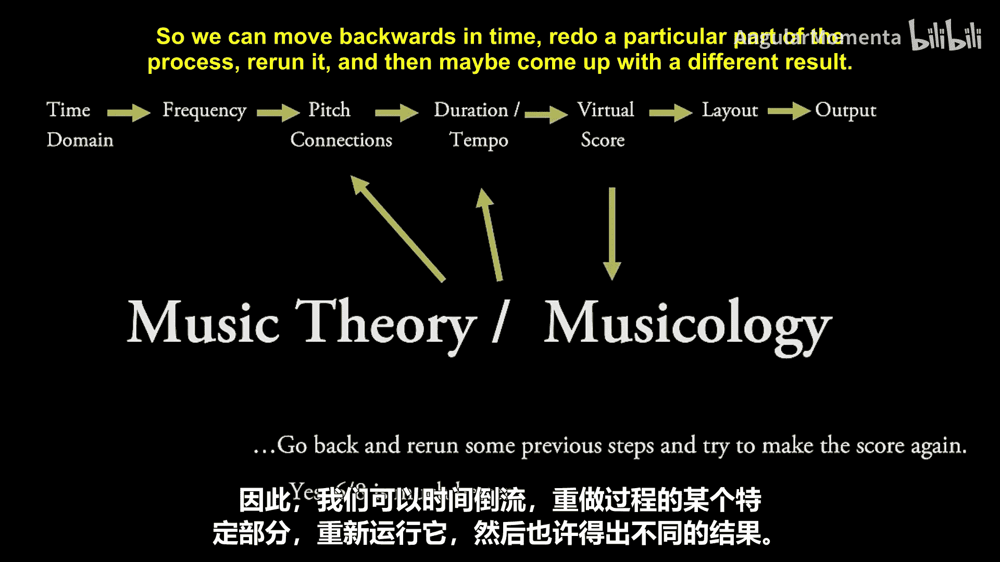

So here are some of the ways that music theory and musicology can feed back into the MIR sound to score process。

Next time， sometimes soon I hope to say how we can go the opposite direction。

 how we can take a score and automatically perform it。

 and even though we're going to be going in the opposite direction。

 turns out that there's a totally different set of problems that we have to solve。

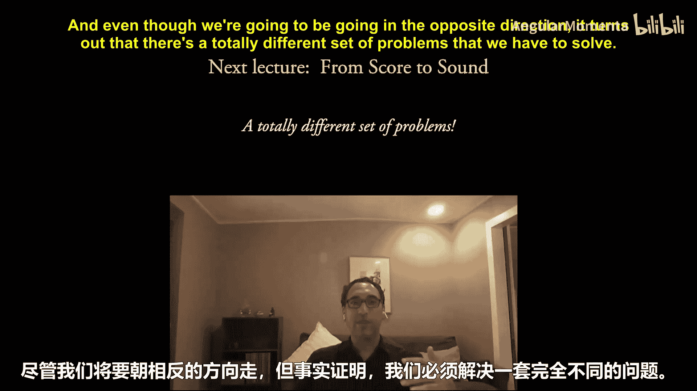

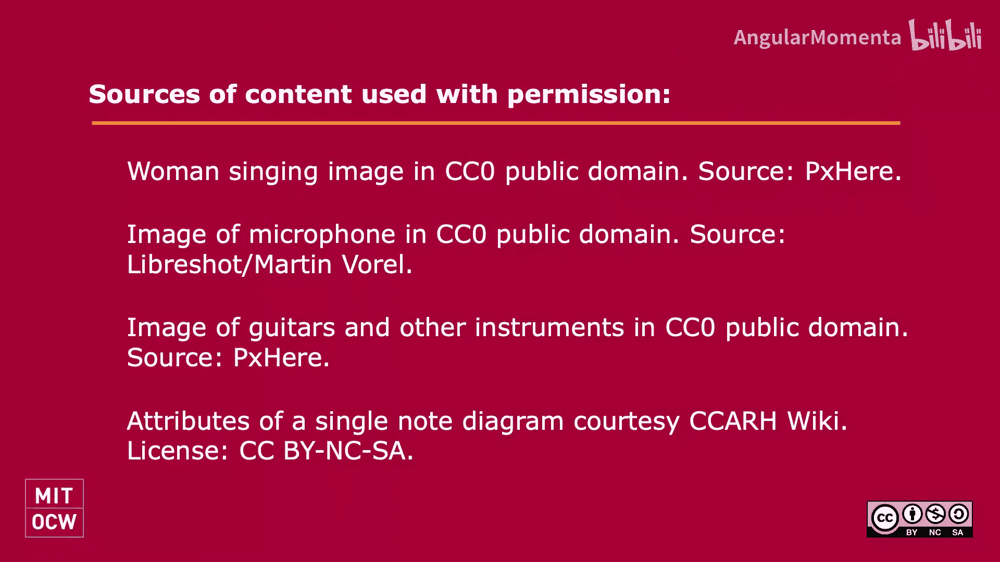