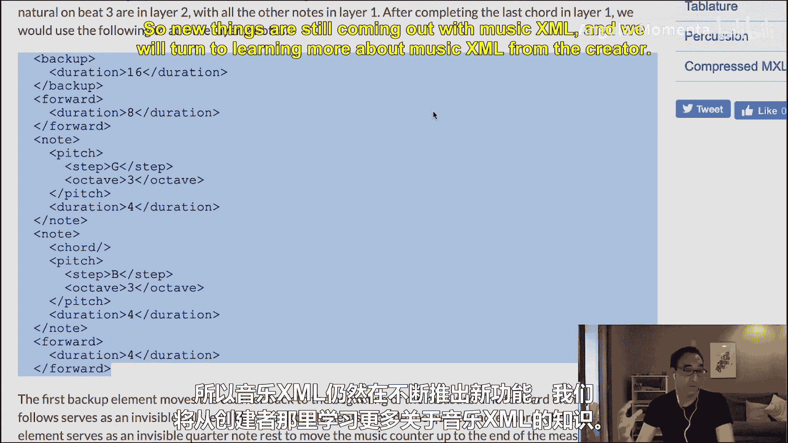

# 【麻省理工】计算音乐学与分析‌ ｜ MIT 21M.383 Computational Music Theory and Analysis,S 2023 p21 21 视频 9b：MusicXML 简介 -BV17xUmBDEUC_p21-

Hello， computational musicologists and music theorists。

While you're working on your own representation formats， I want to introduce。

One representation format， indeed the most commonly used representation format for common Western music notation scores。

 and that is music XML created by Michael Good around the year 2000。

Looking over at the Music Xl website， we can see their version of Holello world， As you know。

 in programming traditions， it's become traditional to print out the word Holello world to show how how a programming language works in music notation。

 it's become common instead to show how note middle C would be represented Hol note or something like that。

 And here is the example of that middle C Hol note in music Xml。

 One of the things you can see in music Xml just like any XL or like HTML。

 we have these things called tags which are enclosed in angle brackets。

Then we have a content for the tag。And then the tag is closed with those same angle brackets with a slash front。

Tags can enclose other tags。 So for the score part encloses a tag called part name。

 and then it's closed later。 and tags can also have attributes。 I D equals P1。

 and we'll look at those in just a little bit。Let's scroll down to the note。

 So all of that is to set up what we might solemly do for a note。

 So a note is a tag called note Within it。 There's a tag called pitch。 Within that。

 there's a tag called step。Had the step has a single letter。 This is very similar to Music 21。

 In fact， I borrowed these concepts from here and。So that the accidental would be encoded elsewhere。

 Then the octave is encoded as a single number， Then the pitch is closed。After that。

 we have a duration tag， and we'll get back to that in a second， but's duration 4。

And then there's something called a type， which is different。 and it says whole。

 so it says that this notes type is a whole note。We have the duration and the type encoded separately。

 because the type explains to notation software， how to。Represent this note what it should look like。

And the duration instead tells it how long it is。 So you could， in theory， put a。

Dur of any number and a type of any number。 And you could make things that looked very different from how they sounded or how they were represented In practice。

 most notation software reads one or the other of these。 That's kind of too bad。

 The duration 4 does not， like in music 21， represent necessarily four quarter notes。

 What it does is it refers back to the last tag within an attributes tag called divisions。

 And this says how many parts， should。Should a quarter note be divided up into So in this case。

 because the only note is a whole note， we can just divide up the quarter note to one part。

 not divide it at all and then say a whole note has four of these。

But if we were going to later have an eighth note， then this would have to be at least two because the quarter note can be divided into two parts if we might have 16th notes。

 it would need to be four because it could be divided into four parts and if we were going to have 16th notes and triplets also then it would need to be 12 because you can divide it into 12 different ways。

In practice， these divisions usually end up being much higher numbers。Some people use 16384。

 which is a power of2。 I like using a high power of two， multiplied by three， multiplied by5。

 multiplied by 7 so I can exactly represent triplets， quats， s upts， things like that。

 but you can change this division with each， I think at least each measure so that you can make sure that whatever you're going to be representing will be there。

We can also see that there's a key signature and that's marked in the number of fifths from。From C。

 so remember your circle fits， if you want a key signature of D major of two sharps。

 that would be two if you want B major that should be5。If you want F major。

Well we're going the other way， so that's going to be negative 1， so we can represent keys that way。

Time you can probably figure out beats and beat type or 44 could be called numerator denominator。

 but it is one of these things about music XML that the formats likes to show the。

The musical meaning， not just you know how it's going to be laid out， we have the clef。

Instead of saying it's trouble Clef， we say that it is a G Cl online too。And so here's some of the。

Basics of musicXML， you can go to musicxML。com and read more about this。

 we're going to look at a few other components of musicXL before going on。

 but we don't do not necessarily need to learn everything about it。

So for looking at how music XML works， we're going to look at a slightly more complex example than just a single coordinate note we have a vocal part and then a piano part representing on two staves。

Here we're using a divisions that's a higher number than one minor negative3 for the key signature。

 and then we can explicitly encode that it's actually in， so we're not in e flat major organs。

C minorter， right？There's transposition， but we don't need to know that for this。The pitch element。

 the note element， sorry to say， sorry can also have。Have ties on it and can have lyrics。

 You can say that this is an end of a syllable that ends miA。 and we end an extension。

 This is another thing you can do in X， M L based formats。

 If you want to open a tag and immediately close it， you can just put a slash at the end instead。

We look at tide notes， even though it's just a little little thing。

 and that is that there are two different parts in a T note in Music XML and for a number of things in Music XML。

There is the tie element which represents conceptually， is this note tied。

And then there is the tide with a D element， and that says how do we draw the tie on the page so you can draw a tie without having a note that sounds tied or is conceived of as tide。

 or you could have science conceived of as tide， but not draw。And this shows up in other places。

 namely in accidentals， because you can imagine a B flat， you conceive of it as a B flat。

 but you also put a flat sign in front of it。 The next B in that same measure。

 you conceive of it as B flat， but you don't put a flat sign in front of it。

 So there's a distinction between how we represent a note on paper and how we conceive of it。

 and this is very important also。We can look over here at chords and see that a chord is simply。

 here's a three note chord。 we start with a note it's a C。See in octave 4。

 And then we have the next note has this empty chord tag that says it's part of a chord of the previous note。

 So in music， smell， if you want to know whether something is a chord。

 you won't know it from the first note， you'll only know it from the second note odd。

 Here' is an example where we have E flat altered by negative1 semitones。 And then the next note G。

Here's a little example of multi part music， and especially this part where we have two different voices in the same measure。

 so we have two chords that can be represented as just a single。Sort of set of note elements。

 and then we have chord here and chord here， but in between we have this separate voice with separate stem directions and so on。

 one of the things that music Music XML does is that when you get to a certain point you're reading through all of your durations are' all considered to be in a row。

 you get to maybe the end of the measure and you can back up a certain number of divisions。

And then you can go forward again。 in this case， you would probably just back up 8。

 but a lot of notation software seems to only use backup to go to the beginning of the measure。

 And then if you need to skip forward， use a forward again。And it is also customary。

 though not strictly required， I don't believe， but almost a lot of notation。

Things that read music XML we call the consumers and Music X。

 a lot of them might have a problem or might crash if you don't include what's customary again。

 then you end at the end of the measure by going forward until the very end。

Theres all kinds of other things on repeats on sound suggestions so on。

 But one of the things you can see is that compared to some of the thoughts we had on compact representations。

 music Xml is very verbose。 It takes up a lot of space on the screen。

 It takes up a good amount of space on disk， though not nearly as much as this video would ever take。

 So there is a compressed format， and we call it M Xl。 we call dot Xml or dot music Xml。

 the file extension for a standard music Xml format。 and dot Mxl。

 if it's just Gyped and right now working on ways so that a G zipip archive can include the score。

 maybe a compressed score， trans post score and also all of the parts。

 So new things are still coming out with music XMl。

And we will turn to learning more about music Xml from。The creator。

