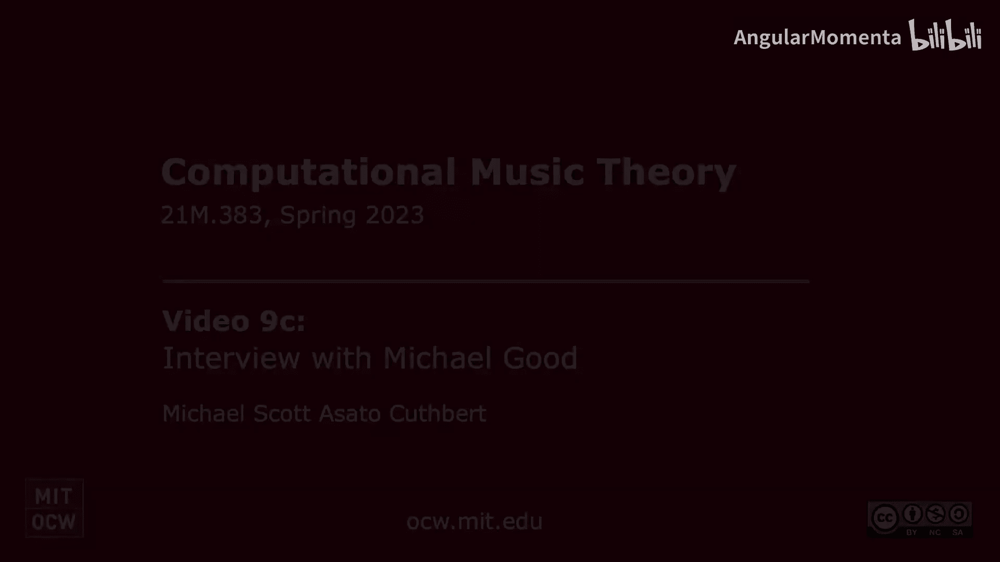
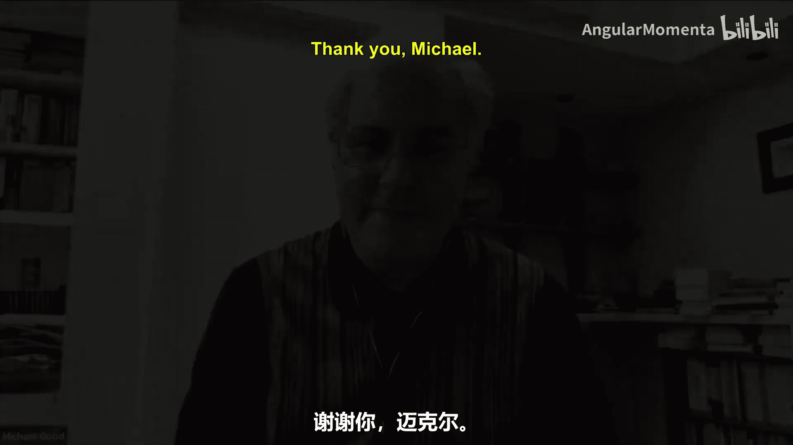

# 【麻省理工】计算音乐学与分析‌ ｜ MIT 21M.383 Computational Music Theory and Analysis,S 2023 p22 22 视频 9c：迈克尔·古德关于 MusicXML 的访谈 -BV17xUmBDEUC_p22-

Yeah。Hello， we welcome today Michael Good， who is Vice president of Music XML Technologies at Make music Incorporated。

 creators of finale， smart music and so many other great things and a dear friend of computational musicology and music theory at MIT welcomee Michael。

Hi， thanks for the invitation。 Great to be here。 Great， virtually。 Yeah， Well。

 there are some great advantages to to the way we're setting things up right now。

 and allows you to the students to get to meet you in a way that we wouldn't be able to perhaps in the past。

 I just want to jump in there。 And and just ask you're the creator of music X andL。 I mean。

 this is incredible for me to be able to talk to person who has done so much。

 why did you create music XmL in 2000。 and what what problems existed that you hoped to solve with it？

 Yeah， and 2000， I was working at Sap And I was representative actually to the MIT Media lab at that point。

 which will come in later。 And it was just the beginning of digital sheet music happening。

 sheet music Direct was out there， which I didn't know at the time。

 But Sunhawk release things where you could download digital sheet is。

 this is really cool until I figured out， oh， you can only play it in the Sunhawk player。😊，Well。

 that's really silly。 I want An finalia and Sbelius were there for notation programs。

 You couldn't move them back and forth and get anything reasonable out of it。 And it was like。Well。

 the internet boom is happening and people want to make money on digital。

 this isn't going to work without a standard format that。

To exchange sheet music between applications， people aren't going to want to be stuck in just one thing。

 You know， we need something like Midi for musical instruments or H for the web。

 and a lot of people tried to do an interchange format hand succeeded。

 but I figured I couldn't give it a good go and I had some ideas for it。

 And when I visited the media lab。 I went to my old thesis advisor， Barry Vico， Professor Barry Vico。

 who is at the experimental music studio and then the media lab and bounce this idea off him。

 you know you've worked in this area a lot。 am I missing something obvious that makes it not going to work。

 I said it， sounds like it's going to work。 go over to Stanford and talked to Walter Hewlett and Eor Selfridge field with Mus data and talk with David here on of humdrum because they're doing the stuff closest to what you're doing and David Humdrum was at Stanford that term So that was great。

 I didn't have to go to Ohio to to talk with him。 So I did。

And basically the first version of Music XML was an XML version of Mus data used XML because at FAP we were using XML to communicate between our free system and other systems so it's like OG seems like you have some standard technology that the whole computer industries behind why not use that to exchange music notation back and forth and so it's just we've got to be able to exchange between applications so the format is optimize very much for exchange between applications not as a native format for any particular application。

So how did you get。The initial application users to buy in to this format。Yeah。

 that was always going to be a tricky question I knew that it had to work with either finalnalia Sevalius or nobody would care and so I gave myself if I can't get it within two years or so to do two way you know。

 not just writing not just reading but two way communication with either final or Svalius I didn't care which one then nobody was going care and it turned out that finale had a better plug development kit than Sebelius for that so I was able to build a plugin that did the two way communication。

And the way that things really got rolling is that there was a developer up in the north of Scotland。

 Graham Jones， who had the sharpr eye music reader program。

 which was the best scanning program out there except。The difference in the scanning， I mean。

 you could only transfer via MII so you all the great recognition that you got in Sha eye。

 y'all lost going into a notation program， course Midi couldn't handle it。

So I contacted Graham and said， hey， we got this music XM L format。 You know， if you do that， we can。

 and I got this importer that goes into finale。 So if you add this， you know， you could。

Really make things work better for finale and increase your sales and he said。

 well because he suborted NF at the time NF was an older attempt at a standard notation format that only worked well for scanners so all the scanning programs implemented it but nobody else did so they said well you could do a niF to music XML converter and then I wouldn't have to do that I yeah I'm not going to do that you can do a music XML and he did he wrote a music XML exporter out of sharp eye and then the make music people saw geez the scanning pan this is better than what we have built in with finale and it's better than what Sebelius has so that's when they got interested in music XML and started to include the plug as part of finale 2003 for Windows and so once finale had it in there you know you keep marketing and you keep pushing it you know I spent you know。

11 years really pushing developers to you marketing to developers to support the format and now we have over 250 applications that support it。

 so it's great。So you started with a leader in one domain of music notation and a leader in a different domain that could communicate and that ended up being part of the snowball instead of right because it's two useful things and it solve some people go oh。

 this is useful because I could imagine that some of the industry leaders might might have life lock in that they had before Sure everybody was very skeptical of you know a standard format。

 which is one of the reasons why it's not designed at all to be a native format because。

It had to be to a reference， you know， it's modeling a musical score。

It's not modeling how somebody would represent a musical score because then you would get， oh。

 your favoriteing finale， your favorite sabelius and and you would get into all that that conflict。

 But once we had， you know， make music had the finale plug developer kit。

 and we had the two way communication。 that was already working when I made my first presentation to make music。

 And John Paulson， the CEO said， yep， it's going to happen， nobody's going stop you。

 So make music figured they might as well jump on board because there wasn't a way to to stop it now that it was out。

 so。Let's use it for the benefit of the company， which turned out to be for the enormous benefit of the company over the years。

So just to be clear for people who see your current position and things you were not an employee at make music。

 this was not right music project Yeah no I started my in 2000 at the beginning of 2000 I left Sap and started my own company called Reari don't have me name your company nobody can spell it or pronounce it unless they're choal Singers and I did a program called Dove for the which everybody calls dolet to go with record Air so yeah don't have me。

Music Xls okay， but don't have me do creative names for your products。 I'm not very good at it。

 but I can， I can write music notation software pretty well， so。😊。

I had my own company called Rekaari。 that was through 2011。

 and then the assets of the company were purchased by make music in November 2011。

 and I've been a make music employee ever since。So you mentioned 250 applications which。From my look。

 this might be an undercount， can read or write or do something interesting with music XML。

 I imagine you defined find that a success。Why。Beyond the initial startup。

 what aspects of music at Samel have or your advocacy have led to this a continued success？Well。

 the con， I mean， it's good technology and we。Now， beenen continuing to market in and improve it where we're now working on music Xml 4。

0。 And a nice thing now is that it's part of the it's being maintained in the World web consortium is you know。

 as a community group， we have a music notation community group。

 which is independent of make music or recordri。 I mean， when I was at recordri。

 we were kind of independent。 you know it was just， you know。

 a one and one8th person company very I had one one very part time person helping me。

 So we were sort of like Switzerland。 you know， the neutral place everybody could go to。

 But once I joined make music， forgetge about it。 And and things did not improve with music Xml。

 So Joe Berkovviitz was very persuasive and worked on me for many years to。

To transfer music XMl from make music ownership to being maintained in the worldwide web consortium as part of a community group。

 And my condition on that was that Steinberg also transfer the smoothful standard music Fo layout at the same time。

 which they agree to。 So we have both of those standards in the W3C music notation group。

 as well as a next generation project called them at NX， which。

Tries to deal with the issue of a native format and take the， you know。

 we're trying to disrupt music Xml from inside rather than out because if you don't keep improving formats and improving technologies。

 if you think， yeah， we're done， it's succeeded， we can kick back and relax。 Yeah， in a few years。

 your， your toast。 and so whether， you know， we there have been these awkward transitions from MIi1 to Mii2 from Python 2 to Python 3。

 HTML 4 to HTML 5。 So， you know， we're trying to。Manage that as best we can for what's the next step in the evolution of notation technologies and be ready for that while still just keep on on working on improving music X andL for the use cases that it does really。

 really well So you mentioned W3C's MN X format and also that music XLs soon to release version 4。

0 and we see that there are other notation formats that are not part of W3C such as MEI and other more niche formats that are continuing to be developed why why is music or music representation formats still being developed what are the things that are that are not totally solved yeah。

Well it's not so much that they're whether they're totally solved。

 it's having the very tool for the right job Music XML is optimized for the exchange between。

Documents， it's not optimized for doing editing as In finale or musicology is in Music 21 or assessment as in smart music。

It's designed for exchange。 And M& X is designed more for a native format。

 but that's still going to be you know， more simple applications。 web based applications。

 It's probably not something where if you wanted to build the next competitor to finale Sebelius or Doraco。

 you would use M& X， maybe you would， but if not intended for that level。

 as as you get more and more sophisticated problems and more specialized problems。

 you want your own you know your own abilities to， you know。

 you want to optimize things for those problems。 So Me I is optimized for you know。

 they think for the issues of musicology， I have issues with how they have done that and whether it really serves serves the community or not。

 but。It's it's a specialized format for a particular type of application。

 but nearly anybody who's developing their own new application。 It might be music Xml influenced。

 and a lot of them are now， you know okay， I can take if I cover all these concepts from music Xml。

 I'm probably doing pretty good， but it's not going to look exactly like music Xml。 I mean。

 smart music is that way。 the format is very much influenced by music Xml， but it's not， you know。

 music Xml inside。 It's a lot closer to music Xml inside than finalias， but it's still not， you know。

 it's a different format。Now you mentioned your advisor， Barry Vico， you're an MIT grad。

 you're a Rra， Rra， yeah， there we go。You're at MIT grad and you're a supporter of the MIT Music Theat Arts section。

 the Lewis Music Library and especially jazz programs so I just want to ask you what advice would you give to MIT students or I suppose students anywhere who want to combine their love for computer and their love for music throughout their life like you yeah that's an interesting question because everybody has their own path it's not just me I met my wife in the MIT concertor band and we're both lifelong performers so one thing that we found out as an adult it's a lot easier to have high quality performance opportunities if you're a singer or a string player than if you're a brass or a wind player like we were because there are a lot of really good community orchestras and choruses but not so many good really good community bands so we switched to singing I switched when I was 30 and my wife followed a few years later and now we sing together。

And opera courseruss so you know being able to maintain you know high quality performance opportunities is one thing if you want to do it for your day job that's harder because it's a small industry I mean I spent the first 20 years of my work working like well when I graduated from MIT there was this was before MIi there was no computer music industry there was okay there was New England digital doing and Gvis but outside of that there you know and a few other synthesizer things but there was no computer music industry at the time so I did usability work for the first 20 years of my career and then moved into。

Mic software， but when I worked I worked at deck and then I worked at SAP with a virtual reality startup in between there。

 but deck and SAP those companies by themselves were way bigger than the entire music technology industry so it's hard but you know you're from MIT you do hard things so you know connect with people。

Do， you know， do projects， make your projects visible。

 contribute to open source projects network you can't go to a NAM show now because NAM isn't going to happen next year but when NAMs come back you could you know visit the NAAM show and visit all the different companies doing things that you want to do show folks what you're doing most companies I mean you see the NAAM thing it says it's only open to members of the trade and go I'm a student I'm not a member of the trade well sometimes they have a student programs for access and most companies have a very large guest list that they can use to invite people so。

Go to one of the companies that youre that you， you are a customer of， you know。

 something where you've， where you've bought something from them and see if they're。

 if they're exhibiting the damp， see if they can get you in or something to。To。

 to exhibit the just it， it's like anything else in。When when you have a niche market。

 you know you gotta do a lot of networking and make your stuff， you know self-promotion。

 make yourself self visible， you know look for the job openings that are there if you're specifically interested in music technology you know I've got a list of you know the 250 programs that support music XMl on the musicxMl。

 co websites with links to all of them so you can here are all the folks who are doing at least musicxmL related stuff so there's a handy list of you know most of those are like one or two person companies。

 but some of them are quite a bit bigger so。Everybody has their own path。 I mean。

 my path was start my own company。 That's another way to do it。

 But I could do start my own company because I married well。

 and I marrieded an analog integrated circuit designer， Cotic one who did very well at her company。

 And so we were able to take the financial hit of， yeah。

 let's start this totally speculative thing which may not have any income for a couple years。

 Most people are not in such a lucky position to be able to do that。Well， thank you Michael。

 your path has certainly been inspirational to so many including myself so I really want to thank you for taking the time to speak to me and to speak to the students in 21 and 383 Comp music theory and analysis Well thanks so much for the invitation and everything that you've done with music 21 which has been a big contributor for music XML and for musicology and just the whole general area of computer music technology and everything that you do at MIT。

Thank you， Michael。

