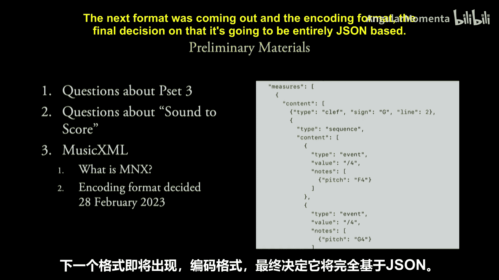
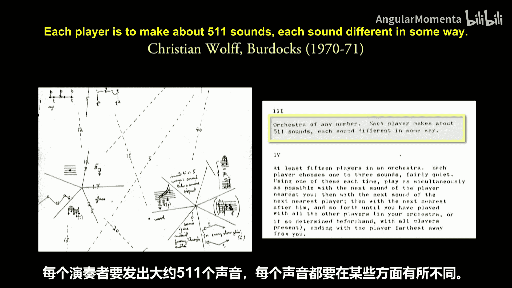
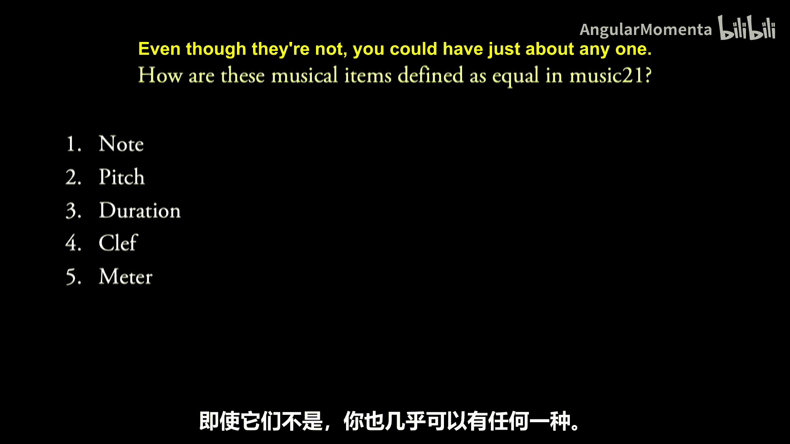
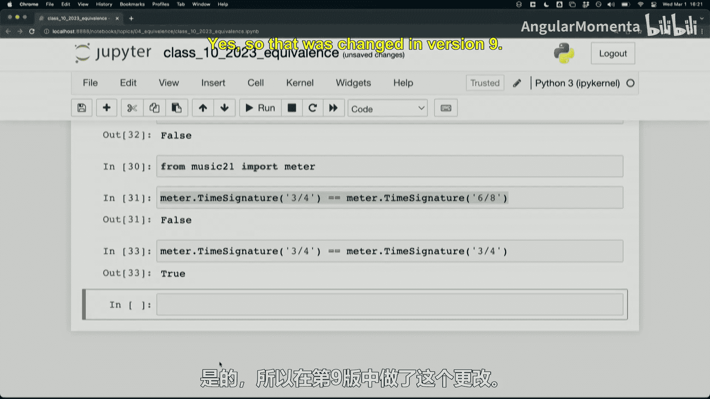
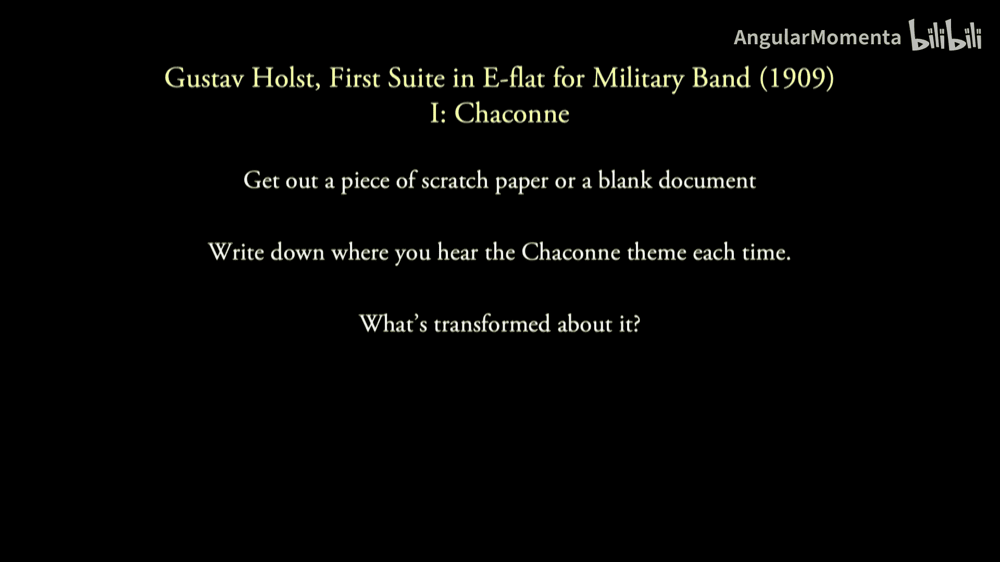
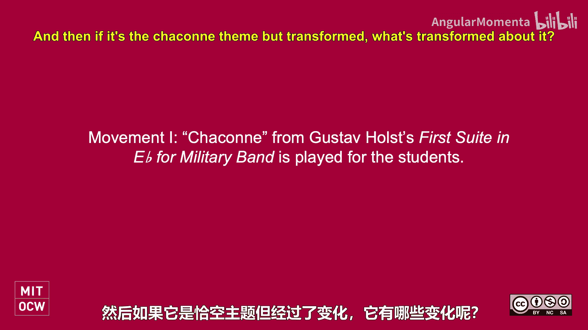
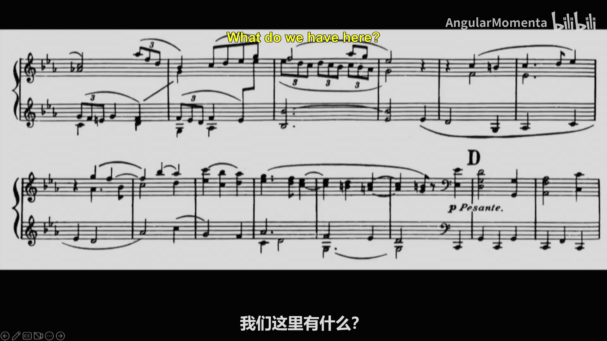
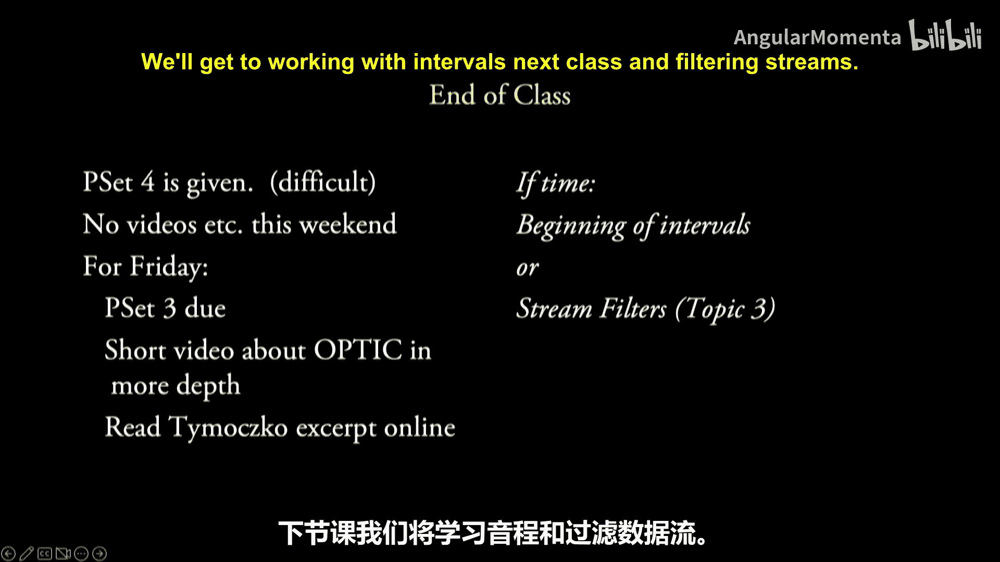
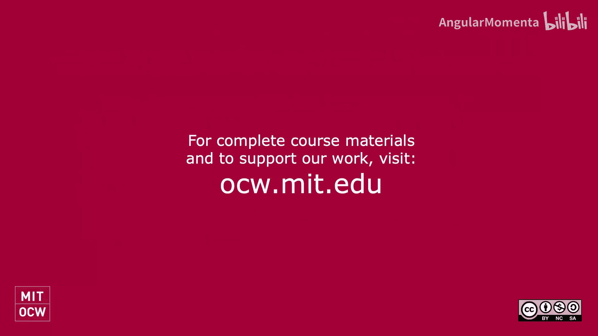

# 【麻省理工】计算音乐学与分析‌ ｜ MIT 21M.383 Computational Music Theory and Analysis,S 2023 p23 23 第10课视频 - 等价与区间（一）；层级结构（四） -BV17xUmBDEUC_p23-

Okay， let's get started。 Let's get this。 we're moving on。 This is week 4。 So we're on topic 4。

 they're not always going line up so neatly with a week。 But as long as we can do。

 it just makes the mind a little better。 And week 4 is about equality equivalence in intervals。

So first things， first。Any questions on problem set 3， those who have started working on it。这这个。

That was。Yeah， and else C， anything weird about 10。7， did you show the score？ Yeah。

 I showed this score。 I counted the number of notes， and then I actually like。

Maybe I'm not to give 10。7 then if it didn't immediately like three times as many notes when I。

But didn't have it on any other the pieces， but I actually physically counted them。Interesting。Look。

 look at that one。Yeah， show doesn't。 Yeah， show doesn't show the entire score in Jupiter。

 That's a feature。 Thank you for， for reminding me。 That's a feature in in version 9。

 which was supposed to be released before the beginning of the class。

 But we found bugs in that where you'll be able to look at the other parts。 Yeah， yeah，10。

9 is a longer。 One of the longer scores。 Thank you。 Thank you。

 One of the other scores has something a little bit different to about it。 that's worth looking at。😊。

Cool， yeah， yeah。 So especially if you don't， if it doesn't seem to conclude with a nice。

 authentic cadence or something like that。hen probably not and actually for anybody， nice。

 I don't have any prizes It bring any candy or anything 66。

6 one we're working on does it end with an authentic cadence？Or something else。

Thatll be an interesting point when we get around to automatic Roman nual analysis。

 which we will get to later that the preview， I think that's Pet7 in my PPP set8。

 that's the other one and I'll give you some notice in advance。

 that's the other Pet that takes a little bit more time， though that ones you have a group for that。

Okay， great。 you all watched。 I can。 I can see most people are doing a very good job of keeping up with videos and things。

 this weekend， by the way， you won't have any。 Youd all need a break from that definitely。

 But most people keeping up with videos。 Anything about the sound to score the thing I would hope to get into class。

 but that we instead watch me。😊，Not blabbber Live， but blabb her own video。Any about that。

 there were some really cool other examples anybody want to share theirs？On there that one。

 that one I did give sometimes just one to two words feedback。

 But what what were some of the things that you could use。

 what are some of the steps do you remember in going from an audio file to audio to score？

 What were some of the things you needed to do。What's that frequency analysis， good。

 good more toward the end or toward the beginning。Toward the beginning。 Okay。

 so somewhere over here with frequency analysis， y。Pitch connections。 What did we mean by that？Just。

I guess that's spec。Analyzing the what out。M。One not to make。

What notes are being produced in the frequencies， Yeah， what's slightly different about frequency。

 I think you started to say， oh， that's actually this。 then you're like， no， it's not actually same。

 what's the difference between frequency analysis and pitches， musical pitches。

What's the thing we need to do I guess some like pitches or notes。

 they have multiple frequencies like overtes so they're trying to analyze that。Yeah， yeah。

 when you play a really low note。You can hear some of them， especially if I take one of the。Doats。

🎼And you。Get rid of the really low frequencies。Start hearing the thing。

 If you ever are writing a piano piece and you need some bells in the background。

 that's always a good trick。Just okay。Not too many composers writing for piano and wanting bells。

 Okay， so good。 So we have， yeah， So we're， we're taking out the harmonic spectrum and we're getting the pitches and things from that。

 What's， what's the byproduct If we're thinking of like nuclear fission we have all these energy And we have this radioactive byproduct。

 What， what do we learn when we strip out the overtones。

 What might we be able to learn and get down to the frequent to the notes themselves。😊。

If you do that with a whole bunch of notes。Or a whole bunch of sets of frequencies。

it was it was already said， but it wasn't super explicit。

 The word already appeared in what you just said。I to take a stab。

 what are we talking about when we're talking about overtones and harmonics？😔。

Are they always the same？ Yeah， Vanessa。's kind of par for all of the different individuals that you be playing。

 so you need to determine when that's something that you should be paying attention to as opposed to like if it's in a corridor。

Yeah， super。 So chor chors definitely an issue。 A problem。 Well leave the office up。

 What if we just follow up are， does every D that you analyze， Let's say D octave for。

 does it always have the same overtone spectrum。What determines the difference？Yeah it's okay， great。

 John the instrument。 Yeah， so I said this， this was a。

 So one of the things while we're going from frequency。

 I should have had something up here while we're going from frequency to， to pitches。

 the byproduct is we're determining what。😊，Instrument is being played。 So we have that good。

 What are some other other parts of it that of the， of the process that we remember。看了。

The duration and tempo， Great， Does duration tell you the tempo or does tempo tell you who votes？

 duration tells you the tempo。Who votes， Temple tells you the duration。Who votes something else？

Soing more complex。 Yeah， you could also have raised your hand on both of them。

 There's kind of that weird feedback loop that you can't tell the tempo unless you have a whole bunch of durations。

 But then the tempo will also tell you something about， is that a quarter note。

 So you So second duration could any other parts。That stood out。

What what what somebody else is people give great， great examples of something that you could。

 once you think you have a score， once you're at some part。

 you could use something from music theory or history to bring back。

Sure I'm going to put you on this spot because I remember yours was very good。Okay， good。よろしか。

You all do your work early in the weekend and it's out of mind。And want to make up。

I yours was our articulations， was it not？Sppicccato， Oh Yeah。

 that you could find that there's go ahead what。Oh， no I'm just going to say that。

Right here it I was like a lot of me。short。解 about微。Based on the piece or style。Go back。Yeah， yeah。

 based based based on having a whole bunch of notes that always have this larger amount of bras。

 you might say a spccato or staccado or something where the notes are all running into each other。

 you might say this is Logato。 you might get out slurs， things good anybody else。

Either remember theirs or something else come to mind。

I trying to remember there were at least three that I've never seen that I never thought of that I was like。

 wow， and then about seven more of that I were on the same wavelength。

Okay we'll come back to that later one of the things you'll find the end of problem set three asks you to write your own question right it asks you。

 hey， if you had a whole bunch of cr and based on the tools you have for statistical analysis。

 what kinds of questions you could ask and it doesn't ask you to answer that。

But you're going to find that as the semester goes on。

 those become bigger and bigger parts of the problem sets， taking more time。

 you'll be asked to pose your own question and answer them。 And both the quality， the answer。

 but also the interest or the the you know， of the question becomes really important And why。

 why is that important， What are we going to do at the end of the semester。

We're going to pose our own question and try to solve it。

 right And what what do researchers do in the world for the most part。

They pose an interesting question。 and they try to solve it。 So we're gonna try to make it。

 So by the end of the semester， you're not just students who are you are given an assignment to do。

 but also posing your own your own questions。 And you'll probably get sick of the fact that I'm asking you to document write doc strings and all that stuff in your problems that's now And at first it's pretty silly because I'm asking you specifically to do you know one task。

 But you know， but then as it goes on， the more and more complex problems。

 you're gonna be making your own subproble piece at four is the first one where I suggest that you might write some helper functions that won't be graded。

 Itll be the first time where I think you probably shouldn't try to solve everything right in the answer。

 And so， you know， that's a good time to practice doing that type of thing。

Anything else before moving on to the third。Little topic。From from the weekend discussion， music XML。

Any thoughts anybody watched the interview with Michael Gooddon take away anything you want to share？

Yes。He's going to drop into this class in a couple weeks。 I think he's visiting campus。think it is。

 yeah， good。何もってくだらかな。And it was just how。Much effort goes into it。

In Nor sure it's like survivability。The like how much of your own efforts going to advocating for something？

Yeah， yeah。 So he did this huge。 He said， you know， well， I came up with this format。

 And then I had to market it。 And I don't know if everybody knows finale and Sebelius。

 Some of you all know Muse score and note flight and things flat might be the things you know now as much。

 But yeah， but those were the two big leaders。 And he just felt like if he couldn't get one of them to use his product。

 he might as well not have made it。 And then just going around。

 trying to trying to make more and more and more。Thanks out of it and it's been a super successful legacy。

 Michael Good finally retired from running the music XML spec from taking charge and making sure it was all working after doing that for what was a 0 24 years of doing it。

 but he finally found some poor schmuck to take on that role and agreed to do it for the next couple years。

He also mentions in there's sign called M and X， which is interesting that it's really beginning to pick up some steam。

 And so what music XMl was primarily about if you recall it was about you have data in one application and you want to get data in some other application and you don't want to convert it down to Mii and loose spelling and lose all the things about tempo estimation and beat and spccatos and all these other things。

 you want to transfer over and so music Xl was really great is really great for transferring documents。

 things。 But once you get it into your application。

 almost every application you use has some sort of internal memory representation right you've coded things that you store I'm going to store the name here as a string in somebody else's well I'm storing it as an array of character so I can manipulate it you know whatever is everybody has a different representation and music XML。

Was not good for that。 That wasn't what was designed for。 But now more and more people want that。

 and they want something。 And so M and X， something like music notation next or saying the X doesn't really mean anything。

 The next format was coming out and the encoding format。

 The final decision on that it's going to be entirely Json based who is heard of Json who is。

 not feels。

Okay， yeah， so it's the the data format， interchange format originally for jascript。 That's the J。

JS stands for， but now used by almost every language。It's sort of where X。

 M L was 20 years ago that this is the thing that everybody knows。 That's the thing now。

 And so trying to figure out exactly what's going to how it's going to work， but。

But this is pretty exciting things that that the next 2025 years。

30 years of music notation was finally decided。😊，Yesterday。So that was that's pretty good。

 it's an exciting， exciting world。 And if you get very into notation and representation and things。

 you can jump onto the Github repository and start saying， you know， no。

 if you represent accordion symbols in this way， it will never be useful for what I like to do with accorion。

 It doesn't have to be that esote。 It could even be on octaves。 The question is， we all like writing。

😊，Things like pitch。C 4。Something like that。 But， boy， you know， should it be。Should it be like name？

See and octa。4， and therefore， you have one less thing that you have to convert from a string to an int。

ThereAnd so that when you get， so that your program won't crash on octave negative2 or whatever happens。

octave 10， all the things that we always forget to do。So。

 that's what's been happening a little bit in the world。Okay， let's get to the main topics today。

 Let's start with the concept of equality。What's it mean for something in music to be equal to something else。

 What's it mean， What does it mean for two notes to be equal。I'm going to wear a little bit less。

Sort of less I don't know， vigorous today than we have in the past I'm going to call on some people just because there's not really a right wrong answer on this and first first I'm going to call on is Jason。

 then I'm going to call on。Then I'll call on。H呢。Then pop。

So what would you say means for two notes to be equal？Okay， so pitches are the same。

That is for single。It's same。Duration。Sa。What do we mean by pitch is the same。Abstractly， mostly。

If you really want to compare the frequencies like the overtones and stuff that might cause some issues。

 so I guess abstractly just。Maybe going down to MIDea is a little too simple。Because name。Okay。

 great。 The name。And accidental are the same。 This is a very good definition， So， so。

We could completely go with that。 And do you want to。Change anything。 go with it。

I was going to see something really similar， probably also considered。So octave。Has to be the same。嗯。

Anybody else want to jump in to one point？ある。I will said that the answer。

You wouldn't say that the accidentals have to be the same。So。

give an example of something that would be the same without。D flat。And。And see， sharp。Great。

So in this case， not only is the accidental different， What else is different。The name， good。

 So what， what could we put instead for that。What what do we call what's。

 what's a representation that allows these to be。Iguo。question？Pitch class。 you might be thinking of。

 yeah， pitch class。Or pitch class plus octave。 What's another thing that encodes pitch class plus octave。

I've heard this four letter acronym used it a couple times done。そこは全生スペースかさん。

It's not four little space。 Space is good。 Yeah Mii。 So it's Mii number。Good， so we could do this。

That。So， when you。Turn in your。Homework for your tonal harmony class。 And it says F major。5。😔，To one。

 write this and you put in。嗯。And you get it wrong。Markked wrong by your teacher that that wasn't 5 to 1。

 I think I got， no， that's definitely。 Well， that wouldn't be 5 to 1 anyhow。

That's one I'm looking for。Do， do all of these notes have the same Mii number as。我す yeah。Good。So。

So maybe we don't want to go with that because there's a place where your teacher says it's wrong。

 right？On the other hand， what are the consequences of that， of not saying that Midy。

 are these two notes the same。Of course， when I do this， it's always a trick question。

What do you think the answer should be？Yes， but we always said we'。

 we're not going to count that the same。 And I played a C in a B sharp。You all， you all knew that。

 right， I conceptually flip the and harmonic between the two。 So， so， okay， so we've looked。

 worked ourselves into a real bind。 I think this is a useful exercise But the answer really comes with we don't really。

 really know。 and we can define different cases where where we use the words。

 we don't use the word equal too much。 Well， let's say the same。😊，The same。If I， yeah， good。

I have a question about what cases would this like the details of？The meeting。管理员。Great， we're about。

 we're about to get into that。 What， what cases， Let's， we'll open that up as。

 as a topic to to think about there。 I can， I have some in my head。 and it's gonna be your， your one。

 one slide ahead of me。 but， but maybe。😊，Everybody， sing this with me。嗯。🎼うん。🎼哦他他他他。Well。

 the men sang。With me， but the woman didn't。Unless。

We have an saying seeing this doesn't include the octave。Right。So but also。we。

 we can think of a lot of different things that might be slightly different with each other。

 We can also say that here are two notes。八棒。Are they same？Yeah， in some ways。 but also， no。

 the first one was on beat 1。 The second one was on beat 2。

There might be cases where we wanted to not just consider the duration。

 which we didn't even talk about， because I already began this semester with the trick question of how many notes。

 Remember that good， good， good。 I'm starting to see some smiles and think， and not just you know。

 scared who they call me。 but yeah， but， but not only duration。

 but we might also consider the what beat itss on。That we might not say that to be the same。嗯。

So there might be different cases like that。 Here's an example from one of these。 Oops， Well。

 it's even more complex than I expected to be without that。

W who is my designated tell professor when he's projecting without projecting。

 that's all of you right you'll all take it on yourselves to say and safe time good so this is one of these weird experimental pieces from the 60s and 70s and things called Burds by composer who's a Dartmouth professor of philosophy actually a Christian Wolf friend of John cages and this is a typical things it's in a whole bunch of movements。

 but very famously for me is。The opposite of equal is the instructions for number three。

 each player is to make about 400511 sounds， each sound different in some way。

 And I remember talking with Professor Wolff。

He was sort of a guest speaker in one of my composition classes once。

 And he was talking about the interpretation that this part movement ended up being one of his favorite ones。

 watching it performed to see what people did。😊，🤧And in one case。A player had a bucket。

And then had another bucket filled with water and took an eye droppper and dropped one drip of water into the other bucket and hit it。

 dropped one， hit it， dropped one because the frequency would change。 And after 511 changed a lot。

 And so you thought。TheThe composer was saying， oh， I thought this was very interesting。

 And other people did all kinds of things。 But as you can imagine。

 you get your piece played with a larger ensemble。 and some people are really。

 really into this kind of music。 I can find it if you never performed a piece like this。

 don't knock it until you try it。 It always sounds kind of I won't enjoy it。

 Then then you go and do it And with all your friends and you and you're trying to follow these instructions and can be quite。

 quite wonderful。 But there's always somebody who's not going to want to do it。

 And it said there was， I think it was it was a trombone player who just S there。😊，8。8。

Back and the composer only came to the performance， not the rehearsals。

 And he said he got so furious at first， because the only thing。

 the only constraint he put on him was on on the performer was that each note had to be different in some other way。

 And so the only thing you could do anything you want choosing not to。 Then he said。But， of course。

 it's 511 notes。 So I had a long time to think about it。 And after a while， I began to really。

Really like what he was doing because every one of them was different because first two was a bot out of the blue。

 Then it was a bot that had been preceded by a bot。

 Then it was a bot that had been preceded by two other ones。

 And the one that you hear in the 100th time is very different。 So this is all to say that we。😊。

We can think of equality in many， many different ways and that there could be different cases where you want to do something different than the other。

 Let's go ahead and start a Jupyter notebook， you guys seem to be pretty fast at getting this。

 And we want to figure out some definitions of equal that music 21 has used。

 but just only to think of what kinds of assumptions were built into the system。

 even though they're not you could have just about any one， So over here。

 And how do we just just to review how do we test in Python that X is equals 5。

What's up， just shouted it。Assert。X。5。No。No， what。What if you were doing in an if statement。

 what would you do if。equals equals 5。 Good， good。 Yeah。

 problem is I have to remember where my trick questions are and where we're going to the。

 the real one。 So you can do it good。And Python's a little bit interesting that we can create two mutable arrays。

 we'll say A is3， comma 4， B is3 comma 4。Does a equal B？Remember you say yes， no。

 we can hit shift enter and get it。This case， yes， let's。

 think I can do this up here without anything going。 I I make this any bigger。 Yep， I can。

 Let's do this in Javascript。 Let X equals 3 comma 4。Let y B equals 3 comm a 4。A equals equal P。Fse。

So two very well often used languages， both kind of scripting type languages。

s first time I'm to show my console in a while。That yeah， that end up with very different。Results。

On that， let me just make a note for myself too。Make sure to do that。睇啊。This is， by the way。

 one of the first mistakes I always make when switching over to JavaScript。 Now。

 Python has a second equality operator。So there's equals equals and there's。Is， yeah， so。A is B。

False。So。X is5。Yes or no。You get all kinds of warnings now if you're on a new Python saying。

 that's not really a great way to do it。 That's not really a great way to do it。 Hey。

 stop doing this。 Michael， stop doing。 Oh， but yeah， it's true。 So various things。 But if we。So。

 x equals 5。Y equals 5。X is y。True。It's very odd。 There's all these weird things that happen。

 So you'll find that。That there are other things that that come up quite often。

 that are all the choice that somebody made at some point to do it。 So let's do music equivalents。Os。

嗯。From Music 21， I note。So's big enough。 know， it got smaller。

And here's something I'm going that I going to do when I'm in class n equals note dot note capital n equals note dot note。

 notice I'm not calling it。 What I'm saying is the variable capital N can now be used as the class note dot note。

 so I can do things like N C 4。So。And same as。I else， I probably。And called that and works the same。

Give everybody a second to catch up。I'm going to create two of those C4s， I call it C。

 I'll call it C2。And what do you hope that the answer on this is。是。By the way， I did。

 I am running music 21 version 9。 and you all are running version 8。1 or 8。3 or something like that。

 we changed a few equals things。 So if something up here is different from yours， shout out。

 and I'll try to remember if that's a place we changed it。

 But I don't think we'll get too much into that。 Good。 So， so two notes same are there。

 let's call C 3 equals and and the same note an octave higher。So go and type that。What do we hope。

If you're all ever behind。So false， they're not， not the same。Operation。

Does the duration need to be the same？So let's just remember that C is the same as C。 let's say C2。

Duation， quarter length。Equals 4。0 anyone remember what's the default quarter length in Music 21？One。

 that's why it chose a court note， so we'll make it four， which is what？Hn up， good。

C is the same as C2。False， so， so good。 We some a lot of us have the same。Sort of intuition as。

 as each other。 maybe that's bad。 Maybe that's group think。So does anything make an object the same。

 We'll say C 4。Equals we'll create another。In this case， C4 is C4。C equals C 4。What about。嗯。C。

Here's something you probably haven't seen。 Lyric equals hello。We can sell。

Hopefully that should work。And C4's lyric。I don't know， what's your favorite language？

French will do Ponzur。Does C equals C4 now。Is that the same on yours？So we've decided。The we。

 the Music 21 community。 I I can't if I decided this one or not， but I'm living with it。

 that the lyric。Does is not an essential part of the equality of a note。The two notes can have。

Different lyrics， but still be the same thing。Where all Yankovvik has been working on that for a very long time。

 right， You can do the same song， different lyrics， still the same song。嗯。Okay。

 well let's do this one。B， S， not。For B sharpp， let's create a B sharpp。AndBut oh。

 if I want the same note， let's see how anal your music theory teaching was。

 if I want the same note as C sharpp sorry C4。In as a B sharp， what's the octave。for。4，3， Well。

 first， lets， let's create B sharpp 4。And by the way， this is one of these things。

 I think that theres a lot of consensus on this， but not unanimity。

 So somebody might have taught you something else， but。The octave number。Refers to the letter name。

And so when you put lots of sharps on it， even though this， this is the same note as C。55。

It's still in octave 4 because the B is an octave 4。 These are all weird things。 So we want B S。

 Well， we can say dot pitch dot octave。Equals 3。Now。Yes should be the same note。Oh， I just slipped。

 This should be the same note as as C sharp， right， So if it's the same note C natural。

 So if it's the same note， then these two should be equal， right。And they are not。

So how do you work in a world where。Where you want this to be equal。 One way you can do this。

 a nice thing about a lot of languages like Python is you can monkey do something called monkey patching。

 so we can just create a new equality thing， return。😊，Whether or not。

Dot pitch dot midi equals B dot pitch dot midi， Whos。嗯。Idea and then we can say that n。

 which is the same as note dot notes。It's special thing that you run， underscore， underscore E Q。

 which is run anytime you check equality equals new E Q。 So now anytime there's want to do equality。

 we can check that。 So we can do this is。😊，S I use German when I need to do things E sharpp。

Equals that， and F is our normal F。Now we can see is E sharp， the same as F。Just before I do it。

You will create things like this all the time to deal with your definition of equality。

 Do this much less often， because I'm not even sure if note dot show will work anymore。

 or if there's other things。 So yeah what did you say about like the B sharp for going back to C for So so that the this definition of octave。

 which use quite a bit， has the notion that。The octave defines a range of。Sort of staff spaces。

 So if we're in troublere clef。This is all。Octave 4。October 4th。

It doesn't matter how many flats or sharps you put down anything。

 Anything that's written on those staff spaces in shovel Cl will be octave for。So in this case。

 writing B sharpp 4 would be pointing outside of this study。No， so， so B， you first see， okay。

 I want octave 4， and then I want the B and octave 4。 So it's gonna be this one。 So B sharp。

Be this one。Even though the C inoctave 4 is down here。So like if you played the B sharp form in this。

 it would still sound the same as a C5 a C5， yep， great。Like I said。

 you could probably find somewhere or someone who's not using that definition。

 and you can definitely find a lot of places where this has not been well defined in a lot of textbooks。

 But yep， any other questions on that， we can try certain things are。Meter time signature。

 Anyone play this， play this3，4， the same as meter。 This is why I abbreviate these things。

 Time signature 6，8。你 다边个。Oops。Yes， it's exactly the same if you don't import meter。

 They're both an error。B music 21， import meter。So it's not just based on the duration。Of the meter。

 you can try to figure out there's some ways that you can define time signatures such that they。

They might look the same， but D different is28 plus 38， the same as 38 plus 28 and so on。Any other。

Questions on。Oh， and even in this case， by the way。

 where we've redefined to be MIi is here I'm going to put this up here。 So it's next to it。リアやス。Is F。

False。34 is he equal to 34 and trans false， so that's what have。

I think that might be one of the places that was fixed in version 8。In version 9。Yes。

 so that was changed in version 9。 I think that I remember that was some time over。

Over the holidays， I got an urgent call from somebody who was like， I needed this to work。

 and it didn't。 Okay， so that's， that's good。 There's a lot of things that' are still up in the air。

 And， and there' are all things that people can debate。

 So equal isn't equals kind of slightly arbitrary in this case。😊，playlay。 But let's。

 let's do one exercise。 It'll take five minutes to do。 either get a blank document。

 You can probably just jot it down also in Jupiter。

 or it's kind of more fun with a blank sheet of paper or something。 And you're gonna hear a chaone。

 which is a theme that repeats over over。 And what I want you to do is there'll be some letters and maybe don't try to count the number say like just before a or a little bit after a B rehearsal letters。

 And want to find out where you hear the chaone theme each time。 It begins at the beginning。

 So you all get that as as a freebie。 But I want to try to do。 And then。

If it's the chaone theme button transformed， what's transformed about it。

Anybody know that piece before？a few people， anyone playing it right now？I believelie it's y。

 it's on the Win ensembles next concert。 I saw that around great。 So I like it's a great piece。

 one of host's greatest， maybe after the planets of things。 but one of one of his wonderful pieces。

 So about how many did people find。😊，tell me if you find。7 or so， go。

But it's pretty much like it's there the whole time。 Good anyone find a place where it wasn't。

What's different on the second entrance。John goods the。So it's been harmonized。

 so something can be a thing can be the same theme， but harmonized， what else is different？🎼Yeahゃ。

It's what instrument the instrument that place it good。

I always think that one the clarinet' is going to enter it。

 but then somebody other one does what else has changed？I remember where sorry， yep。

 the dynamics good， so dynamics， we consider something sometimes to be the same。

 sometimes not if the dynamics are different。Now we're back to a very low octave。

Which we weren and every time。🎼，What's different this time？Duration。

 or we could say spacing between the two， right， because the duration hasn't really changed。

So that's another thing that we might think of as the same but different。Register instrument again。

So I'm going to fade it out for a little bit so that we can stock so all of these things that we wouldn't say it's they playing the exact same music。

But we're saying in some sense， they're playing the same thing as before。

 and we'll get one more coming in up in just a little bit。🎼This is very beautiful。What's here？

Does anyone hear the theme？Holst seems to think。But the theme is still playing。Here。So he doesn't。

 Yeah， so it's like the concept of the theme solar there is just kind of the more。

A little bit more majorist theme。Good得。Yeah。Is it inverted？Da da， da， what do we have here？

And say， So it's an inversion。Is playing something upside down the same as playing？Depends。

 it really， really， depends。 If I say， let's all sing happy birthday。 see like it is。

 And you gonnata go happy birthday to to hows it go to you you T， like okay。

 you just ruin my birthday， right， right？ So it's not always to say yet。😊，There are some cases where。

Composers think of it as the same。 By the way， if you don't have that。

 one of the things nobody said was it's the same when the rhythms the same。If nothing else， right。

 John， John， John， John， John， John， John， John。 So it is even still the same rhythm。

 even if it wasn't perfect， if it wasn't fully inverted。 But yeah。

 so things that are sometimes we want to consider the same。 And sometimes we don't。

 We don't tend to call them equal very much。 we tend to say that they're equivalent。

And they're equivalent in some way or what we'll often use I'm putting this up。

 So somebody might put this back down。Is that they're equivalent under something。嗯。

Let me take something that you might know right now。 just looking up there。 It's a very musical。

 Weve just do a follow of John Cage。 And the time right now is that。Anybody prefer that time？

What's the equivalence here？How， how is it that that some people might say。

 especially if they put that on。That these two are equivalent， but let's get rid of that for now。要不要。

Yeah。So， 12 hour。Can each time in a 12 hour we could call it an AM PMM。

World has an equivalent in a 24 hour。 You could call it military time。

 whatever you want to call it world so that there is an equivalent that allows the mapping back and forth between not all equivalences allow perfect mapping。

 Good， mathematically。What do you need to do。If you're at。To。0，5 PM。

What do you do to convert that to 24 hour time。Good and what do you do if you are at 1405？Pm。

And you need to。You can subtract 12， or you can think of it as mod， mod。 Yeah。

 is it mod 12 or modd 24。We'll tap into work。Do that No， mod 24 doesn't work because 2023。

50 In this case， yes， in this case， it works。 Yes， good。 always。

 always solve for the most specific case you can。 And no， of course no。

 we'll try solve for the most general case。 So modd 12。

 there's some other little thing that you have to do on this right。 if you're at 12。😊，0，5。呃。Pm。

Let's see。 Yeah， in that case。 Yeah， I can't remember anyhow。 There's something off by one errors。

 Don't follow。 Don't try to figure them off at the But there's this particular case where if it equals 0。

 you're gonna want to add 12。 So it's mod 12 plus I can't remember。 You'll， you'll figure out。

 I know how to do it in music and stuff。 So let's think of some musical equience classes。

 One of the ones that we've put up here。 And so one of the reasons we debate a lot about equals。

 I that equals is trying to create a set of equivalence classes once and for all。 This is better。

 I'll keep this。Just是。So。Here's a particular。hing that we can debate whether or not they're equal。

Music 21 has decided that they are not， but that could be a debatable， but we。

 I don't think it's debatable that there is some form of equivalence between these two。

 What do we want to call that。And harmonic equivalentvals， good。And harmonic。Equivalence。

They are n harmonically equivalent。 So told me if I got my's and A's right。 yeah I did this time。

We can also sometimes say they're equivalent under spelling。

Under lack of spelling or saying equivalent with spelling。 good。

 What's another equivalentvalence class that we're， we're gonna to go really fast。 So。

 So let's start， start thinking。 what's， what's something else that we might sometimes think is equivalent。

 We said inversion。Sometimes， but often not good。 What's another in。没事。Duration。

 sometimes we don't care how long two things are， good。好。Key， who， that'll be good。 Great。

 I heard another one just tell octave。 I should have chosen the one without staff lines twice the much space。

 Keep going。😊，Everybody。What's that instrument， yeah。Sometimes it。

Sometimes it doesn't matter what instrument is playing。 We'd say it's the same thing。

 And sometimes when you hire a musician to perform at your wedding and they show up with an accordion and a bagpipe。

 it's not equivalent。 Right， Good。 What are other things that。That we might say， what's it？

Context No， two brown，2 bro。 We'll have to good， good idea。 Will give me one context that might be。

Like where you're coming from。Where you're coming from。Coming from。From going to。

So the same song is the same。Under equivalentvalence of car stereo versus home， right？

It's interesting that， that we might think， give me a context We're listening to the same song in your recording studio versus or at home versus your car might be a difference。

The same song might not be equivalent under that。The car has police sirens in it。

 if the car has police sirens in， I was thinking if you're trying to mix your composition。

For submission， right？ Does it， Does it matter if you're listening at home in stereo with your very nice headphones。

 Is it the same piece as if youre， you know， let's hope you're not doing while driving。

 You're in the passenger seat， but you're doing on a noisy road。 Yeah。

 so the amount of background noise might be a context that changes whether or not you think this piece of music is the same。

 Yeah， if you're looking at a pitch like what the court is coming。 Yeah， I do that。 I knew that。

 I you， but yeah， so preceding。😊，Seating versus following。Good。Other things。

 this would have been super great。Yeah， articulation， good。Articulation， good shout some more。Tempo。

The same piece is the same piece if you rush through it， right， sometimes beside that。 But yeah。

 good， anything else。keep thinking of more。 I want to use them all up because I think we're gonna be asked to come up with at least one that are great。

 So this， this is really， really okay。 You're gonna be。Reading。HaYou all's got to be faster。

You'all going to be reading another section from this book by Dimitri Towachko， a Geometry of music。

 and a second part of chapter 2， which you read earlier when we were talking about those flipped inversions with the mirrors。

 and he defines，5 points in version，5 equivalentvalence classes that we think of quite often in music。

And， and he gave them the， the ordering isn't。The greatest ordering in the world。

 except it makes it very easy to remember opt。And I'm going to add a sixth one because I think it's very important too。

The octave， quite often， we don't care。 We consider two musical elements， two chords to be the same。

If they're in different octaves。Right， or， two notes， the same note or equivalent note。Pmutation。

 what do you think that means？Yeah。Perhaps you want to consider them the same。Yeah。

 so if you have an inversion of the chord， you might consider it the same。

 you might the order that goes that would only work if you also have octave。嗯。Let me。嗯。

🎼Is there some way that。Those are the same。They're both， if I told you the first note was C。

 They're both apeated。See major triads， right， You can hear hear that。 Does it matter。

 Sometimes it matters if， well youre arepeating it up in size it matters if you're peeding it down。

 if you're doing your theory analysis， does that matter。If you're trying to a record， no， no。

 So sometimes on the other hand， if you take， let's stick with happy birthday。

 I'm going to say happy birthday to you。 but I I've run it through my Python scramble thing。

 I'm going to do every note in a different order。😊。

We would not apply that equivalence class at that place。

 So permutation is something that quite often when we're just analyzing the cordal structure of a measure。

 we don't really care what order the notes come in。

 We just want to see what are all the notes in the measure and then figure out what chor it might be。

 So the permutation。Transposition， wouldn't us who shouted key Yeah， John， were you thinking of of。

Of the same piece in two different keys could be。Saying like， oh， I mean。Thiss kind of。

Sonymous toharonics like you're like UG plot major。Okay， yep， also， great。 But sometimes it。

 it doesn't matter actually what key you're in。 if you're if you're a singer and you show up and people used to be able to pianist。

 accompanist collaborators used to really know how to do this and stuff。

 you've been practicing all all week in G major。 and this the singer comes to the concert and says。I。

 I woke up with a scratchy throat。 Can we take it down to F。Today。And they play。

 and you're still playing in some ways the same piece。 So the， the transposition might not matter。

In some cases， in some cases， it really bit one place it really matters is if you're playing the Viola in the orchestra and you choose to transpose and nobody else does。

 I think people will notice right， So transposition， again， these are all equivalence classes。

 I didn't do a good job with this in other years of lecturing。 So I want to say， now。

 these are things that in certain contexts make sense to apply。

 And in certain contexts do not make sense to apply。 And so transpositions won here。

Inversion we've already talked about。 in some cases， it makes sense to apply。 and some cases。

 it doesn't want to say there are two different， a number of different definitions of inversion。

 And that's actually one of the things this happens。

 One is science that we call a tonal inversion where you。Ci。No total。

 I'll put it in the key signature， something like that。 instead of going up four notes。

 we go down four notes。And then go down one more note。 So in this case， it's exactly the same。

 Let me go。 Let me keep going up。Here。I have to go one more note up as soon these go here。Eventually。

 you get to a point where this is a half step。And this is a。Thats good to later lines。

Whole step in a tonal inversion， you just care that you went up a step in one and you went down a step in the other。

 If you went up four steps。 you don't really care if it's a perfect fourth or whatever in in a tonal or posttonnal or nontonnal thing。

 we would really want to make sure that where did I screw up。 There has to be someplace。Cause。

'cause this， this is an octave up。 I'm pretty sure if you go up in octave。

 you end up going down in octaves。 series of notes in the， the right hand。

So's sorry now I'm in a posthoal world。 so now I need to write all my accidentals。 there it is。

 that's the whole step。 And so that would have to be the half whole step whole step in there， right。

Yes， so。So those are two kinds of inversion that he's talking about and sometimes it makes sense so nice it doesn't。

 if you listen to the music of the posttonal music of the early 20th century。

 they use inversional symmetry a lot。 And so if you're trying to figure out oh how does this relate to something I heard before。

 almost always try， well， is it the inversion of it？And there's some cool things that。Here's。

 here's four triads。 And you might know them by name。 not you don't need to know the name。

 but what type of triad are they。They shut up。Get major？Minor。And。🎼Augmented。Dinished。

 so there's be four different triads。Major， minor， augmented。Dimminished。

 a lot of people think that major and minor have more something more in common than the other two。

 because。This goes what's up a major third。Up a minor third。If you start instead。

 go the opposite way and you start here and you go up a minor third。And then you go up a major third。

You end to put the minor triad。 So the minor triad is the inversion of the major triad。And therefore。

 they both have the exact same interval content。 They both have a minor third， a major third。

 and a perfect fifth。Within them， whereas an augmented triad。Cannot。Be inverted。

To become a diminished triad。Or to become a major or minor trade。

 So they don't have an equivalence class between them。 So this comes up often。Last。Carinality。

Sometimes how many notes there are， Sometimes it matters size it doesn't。Versus。🎼う。

Some ways the same。Also， if you put it together with octave and cardinality。

 I'm not going to run over there again。 I to put my keyboard here。 a fournote triad major triad C。

 E G C。 Now you say that octave doesn't matter。 So now it's C， E G and a second C here。

 And now you really want Carinality not to matter。 if you want to say。

 is this the same as some other C major triad。And the last one I think is really important Demitri deologicalco comes from a slightly different practice world is that he just assumes that spelling equivalent or we call middi equivalent or endharonic equivalent。

 I should have called it enharmonic， but I can't figure out a way to make an E into the optic acronym stuff。

 So does enharonic equivalent， does spelling matter。And one of the things in his world。

 which is very different from Music 21， but in problem step4。

 you're going to be working in the world of optic of geometry of music。

 the spelling equivalence is always assumed。Yeahep。Poetic。Yeah。POP。P， O。 oh yeah。

 But then Id have to rearrange his Yeah， no， that's really， really good。 There's another one。

 you know， that we can start putting in。 we can start thinking of tombre equivalents。

 We often think of that All these other things that you wrote up there。

 But these are the ones that will give you the most hard time on the next problem。😊，Let's。

There's not time。 So we'll end this up。 end a little bit early for the first time in a while。 Cool。

 We'll get to。

Working with intervals， next class and filtering streams。 Thanks， everybody。

