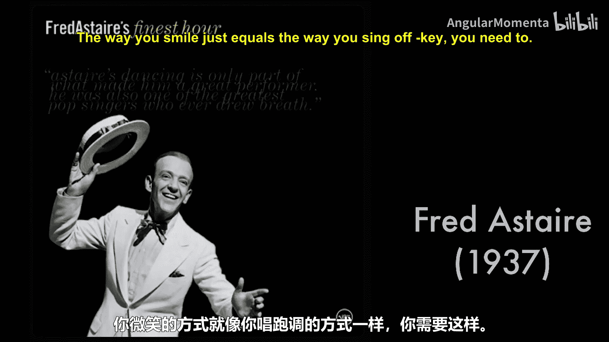
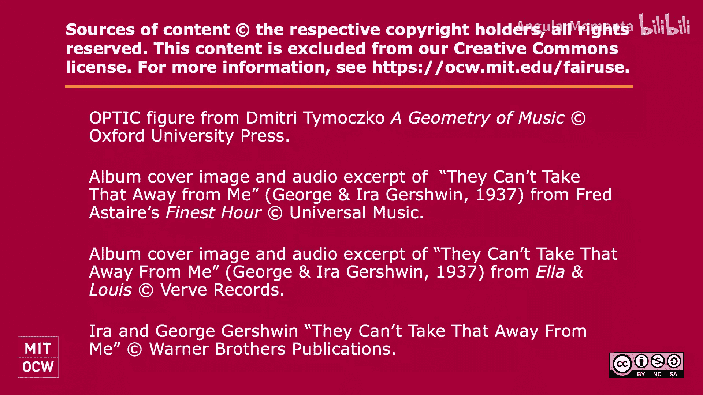

# 【麻省理工】计算音乐学与分析‌ ｜ MIT 21M.383 Computational Music Theory and Analysis,S 2023 p24 24 视频 10a：复习：等价类与OPTIC -BV17xUmBDEUC_p24-

Hello， computational music theorists， Our topic for the coming week is going to be on intervals and equivalents and working with。

😊，What equal and the same and so on mean。I am very much trying to treat everybody。

In this class and everybody I meet as equals。But that doesn't mean that I think that everybody is the same。

In fact， that would， that would be a very unequal way to treat people。

 So we can have this notion that。Equality does not mean the same thing。

And that equal does not mean identical。 This is something I hope we practice in our lives。

 but it's also very important in thinking about。How we compare musical structures。

I'm asking you over the weekend to read a very interesting chapter from Dmitri to Moscowco's a geometry of music。

In which he talks about five kinds of equivalents。F more。

 but mostly about five kinds that he calls opticoctave permutation， transposition。

 inversion and cardinality。These ways of thinking about equality of。

Notes or melodies or chords or other musical structures。

 even whole pieces is going to be very important when we want to find particular musical gestures or when we want to identify particular things using a computer。

I'm sitting at the piano because I'm going to demonstrate a few of the things that we might think mean that something is equal or something is the same。

 but maybe they're not identical。But first， I want to。

Play something that doesn't work very well on the piano， so listen to these two pieces。

The way you w your hat。The way you sip your tea。The memory of all that。No， no。

 they can't take that away from me the way your smile just be。WsThe way you sing off can you need to。

🎼The way you wear your hand， the way you sip your teeth。The memory of all that No， no。

 they can take that away from me the way your smile just been the way you sing of King。

I asked you to listen to two pieces。 Actually， I just played excerpts， but did I play two pieces。

Or did I play one piece twice？Were those two pieces the same piece？Were they the same recording？

I think we' think that。Well， they were the。Same piece， but different recordings。

 different performers， different styles， different interpretations。

 But there was something the same about them。 so we can think of an equivalence class or a kind of equivalence。

Between pieces， that doesn't necessarily mean that they are identical。

Now let's turn to some musical structures that we can demonstrate at the piano。

So I want to talk concretely about some ways that we might think about equis。

 and what do we mean by equivals when we're talking about notes or chords or melodies or pieces and。

I want to think about some of the things that we might be doing。 So， for instance。

Can we think of a context where。Noils。As a group， are the same。

Regardless of the order that we talked about them， let's start with just a C major court， C， E G。

And if I say C3 E3， G3。That's the cord， or if I say that it's G3， B3， C3。🎼It's still the same chord。

 Or if I said that the chord is E 3， Sa 3， G3。 it really doesn't matter。

 So this could be when we're talking about chords， a place where there is。

🎼Hererm equivalentvalence doesn't matter what order they're in。 On the other hand。

 if we're talking about a melody or something， some sort of a piece that has， you know。

Then it matters if we go。🎼So。🎼，Those don't seem to be equivalent in some context that we might think of as equivalents。

So there could be a context where P permutation equivalence is active and a context where it isn't。

 we can also think of cardinality。Especially on the piano， it doesn't matter if I play CEG。🎼。As a ch。

Or if I play CCEG。You can't even tell maybe I can put two fingers on the sea or something like that。

But。On in a cordal context， on the piano， we would normally say， well。

 that that cardinality doesn't really matter in terms of the sound。

 If you're going to be notating it， then yeah， it matters。We also can think of octave equivalentvals。

That all those notes are seen。When we say something like all these things are。

 we're saying that they're equivalent in some way。 So we are saying that in this case。

 when I say all these notes are C， we're talking about an ocve equivalentence relationship。

🎼But I can't say that all of those notes are C 3。 Only that note is C 3。C2。C4， if you were， you know。

🎼An instrumental teacher。 and you ask somebody on instruments like， you know。

 flew to the clarinet or the violin to play a scale in three octaves。

 and they just play the same octave。🎼爱 don。🎼You'd really say， no， no， you know。

 I ask for three octaves so we can think of a world where there isn't an octave equivalentence and we can put these two things together that we can think CEGC。

We have a kind of world where we say， well， that's the same as C EG in the sense of play the tonic Triad in C major it doesn't matter if I play。

🎼Yeah there。Those all fulfill this particular equivalence。And。

There are other ones I one of the ones that too much Co。

Sort of assumes throughout is and isn't even a part of his optic OPT IC world is spelling。

 so it doesn't matter。See major is a little bit hard， but it doesn't matter if I。

Think of a single note。Play， he fought， play D。🎼It's the same thing。

 So we can think of a spelling equivalence。 Now， if you were to be in theoryory 1 class and you're asked to write a C minor triad and you write C you're probably going to get marked wrong because that's a context where there is not spelling equience。

We can also think of a world where there's a transposition equivalents。 So， for instance。🎼拜拜。Poings。

🎼哎哎。🎼叮冰。We can say。Oh， well， those are both the same piece。 Those are both。 Mary had a little lamb。

 so that there's a transposition equivalentvalence that makes that piece till Mary had a little lamb。

And we definitely use that when we're talking about chor types。 So we talk about。

That's a major triad。That's a major triad。🎼That's a major triad so that we can have talk about a concept like major triad that。

Takes into account that there's a transposition equivalence。

Probably the one that people like the least and think that it's not really a context that we want to be working with is the inversion context。

 and when we play something in a tall context like a C major triad，🎼And then we invert it。

 So let's see from E to G is a minor third。 So we'll go from G。 B flat is a minor third。

 and E E to C is a major third。 So B flat to D is is a major third， so。We can say。🎼。

🎼In an inversion and transposition context that those。

 Well I just tell them not even a transposition context that those two are equivalent。

 and that like go， whoa， whoa， what are we talking about？

 But there are some places in post tonal theory where that's important。

 But we can even think about it even in the tonal or in this case， a pretonnal context here。

 I'm going to play。Four pieces。One goes all to the one we just played。🎼B。🎼Here's another piece。🎼と裕。

🎼という。And here's another piece。🎼哎如。Play out one one more time so you get in your ears。🎼。

And then we can have a piece like this。I played。In some sense， for different melodies or something。

 But maybe I only play three different pieces because we can recognize， oh。

 those last two are the same piece， but one is upside down from the other。

 This is actually a piece of is really famous in the 15th century called Lomarma or the armed man。

 and composers at that time like to play around with that They transposed it。

 They did diatomic transposition so that you play in in。Well， you different modes， so instead of。

Maybe you play something， maybe you play something like。🎼，🎼And it's a slightly different piece。

 but still the same piece。 so you can think of a diatonic transposition equivalentvalence。

 but they also definitely played with what I was showing the inversion equivalentence context so that。

🎼A。Are in some ways the beginning of the same piece。

We're going to be asking you in the problem set to see if you can come up with other contexts where we talk about。

 oh， that's the same thing。 Like， is this a C major triad。Good， well， this is a fancy piano。

 so I'm going to change the temperament to mean tone and now we go。🎼Maybe'll resume。

 you can't hear the difference as much， but we can go to him slightly different one even。🎼Yeah。Or。

🎼等等等。And those are all the notes。C，E G。Then not exactly the same。

 but do we think of them as the same so we can think of a temperament context or a tuning context where we allow things to be equivalent。

So I think this is the background that you need in order to go through the reading of Dmitri Chamchco on optics and equivalents。

As usual， you're going to be implementing your code in Python， using musical objects。

 either that you create or that you have unlocked in Music 21。 and when youre。Doing this。

 you think about what two objects are。 What are two notes that Python defines as equal or that I have defined in music 21 defines as equal。

 What do we mean by that。 And you'll see that each object in the computational language generally has only one built in。

So of equience set that defines what the equal equal operator or whatever it is means。 And well。

 there's actually a second one that is operator that defines something else。

 and what do we mean by these two objects。Are the same is the same as why I want you to say。

 but and what choice was made and how could we have made a better choice and who's going to hate me for the choice I made and who would have hated me if I made another choice on defining equality in a note or in accord。

Thanks for listening to this video， and now let's get started with reading what De Richard Gewachko has to say on this subject。

