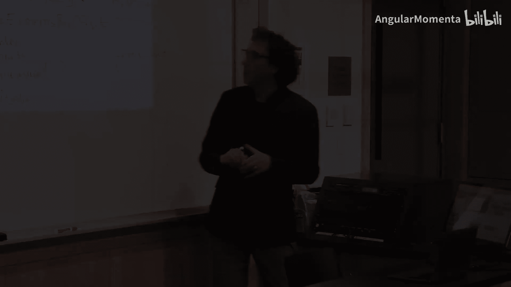
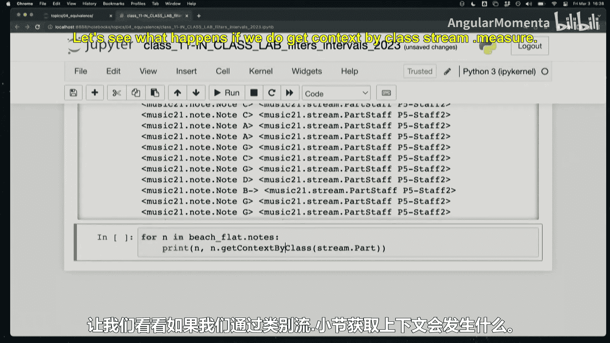

# 【麻省理工】计算音乐学与分析‌ ｜ MIT 21M.383 Computational Music Theory and Analysis,S 2023 p25 25 第11课视频：音乐21中等价与音程（二）及滤波器 -BV17xUmBDEUC_p25-

Okay we're going to go through a little bit a topic that you've unlocked now with the end of problem set three。

 which wasn't totally wasn't officially locked but we didn't really talk about it and that's stream filtering so let me put this down and let's do a little bit of Jupiter work so go ahead and get yourself situated in that give you second or two。

啊。I， and I think I saw scores generated in text for everybody。

 There was a great question on the list。 What do you do if youre score if you're not yet on version 9。

 which none of us are。And you want to see more of the score。You can do show music X，M L dot P F。

And if you have mu score， that will。That will open automatically generate you a P F of more than just the first page。

 You can also just。Do show dot music show music X， M L。 Sorry， those should be straight quotes。

 I'm just used to putting them as curly quotes。 You all know that， right。

 And that will just open it in your favorite notation editor。Great， so let's get started。 Let's。

Let's not load our favorite ba Raral， but let's load our new favorite piece by Boston based composer。

 Amy Beach。And it's a piece for， if you say， I even start typing Bach， makes life oops。啊。

When I'm not teaching。In the semester， I have。Let's import star all right now。

 so we don't have to remember everything， but not every module is unlocked。

Usually when I'm not teaching class， I make it so that that's automatically imported for me。

So I don't have to type that。 So if you see me make that mistake， that's what it is。We'll just start。

By looking at this piece。And it has a similar structure to the piece that we have been doingooh。

 we have some layout errors today on my thing， but it's piece called Prayer of a tired Child for four part course of women's Voices。

And。See that the four parts are soprano 1， soprano 2， Alto 1， Alto 2。 And then there's a fifth part。

 the piano。And the piano part has， well， we'll see what it is in just a bit。So。

How would we get the soprano2 part？What do we want to do。

 You all have been gotten pretty good at manual filtering。So beach do something。

Actually talk talk with your， talk with your neighbors a little bit about that。

 We have some odd number neighbors and try to， try to talk through what you do。

 It's more important that you can talk， can explain things than do it instantly。No。

You want to get the soprano two part。快啲。So good， good one way。 If you， if you find one way。

 keep going for another or two until we get it， There's about five different ways。Thanks。Go to。なで。

Everybody。Give a thumbs up if you think you know how to do it。If not， keep talking with。

Was that almost， that's almost universal thumbs up。 Jonathan was that a thumbs up。 Yep， good。 Okay。

 great。Let's see， Jordan， how would you do it？Brackets for one。 good。

 So we've already started with one of the things on today。

 This was in one of the users' guide things。 dot parts is。😊。

A kind of filter that filters out everything that is not a part object。

And so this will let you find things good， what's another way we can do it？

Somebody else who have I not been calling on so much， Derek？I think you can like put in quotes。

As the。Like， the index。For the index2。Parts。唔。Sometimes that autocomplete is less than helpful。Wops。

What I have to do。What am I looking for？Somebody help。Saprano， too， yup。Great， so it has to be exact。

 Does not grab the first one that kind of makes that good。 What's another way， somebody else。那是。

You did the first one， good， Matthew？Good。Get element by I D。Souprano。wo。😔。

That's helpful if you don't know。Well， for instance， well not piano piano。

 Let's try that do part get element by ID D。Piano。You actually get nothing in that case。

We'll see that there's some interesting things when it comes to piano。

Let's do this for P in beach duck parts。Print P。And we can actually see a couple things here。

 One is that the piano is represented by two of something called a part staff that are separate parts in the ontology of Music 21。

 in a lot of other systems， they are the same part and they're two staves within a part。

 And every one of these representation things has huge drawbacks to them。

 And when somebody comes up with a representation for piano music that does not have the drawback。

 you can please， please publish that and you will make the world so happy because everything is fine with treating a piano as two parts。

Let's say it's in 3，4。嗯。As two separate parts， as long as I should try to make this at least vaguely consonant。

As long as you do something like this。It's when you start doing。

That should build option shouldn do proper stemming。That you have the problem， right？

That suddenly a musical melody that starts in one part continues into another part。

 does your ontology allow for beams to cross parts？

 I I I Denver you asked me to create an ontology for something that wasn't Western classical music。

 I have no ontology for Yeah， but this is， this ends up being one of the main things When somebody says they've created a new way of representing classical music。

thing I always do， because I'm a smart aec。 And if you want to be a smart a。

 just always go up to that person who's like， oh， I have a much simple way。 Just ask them。

 how do you do crossta beams in your ontology And if they go， well， we haven't gotten to that。

 This is like， this is the first thing that almost every ontology should start with。

 How do we represent crossta beams。 If you figured out how to represent crossta beams or。

 or chords that span what be a good chord on this。😊，I guess we。First inversion here。

Cords that span multiple staves。 you know， figured out the music 21 ontology on this is bo。

 It's really not what it should be。 On the other hand。

 when you represent everything as one staff and you have to say， okay， well。

 this is a note on staff 1， This is a note on staff 2。 Then you're sort of left to right。Pser。

Ends up failing quite a bit because you go left to right。 And then you say， okay。

 now let's jump backwards a bit。 And when you have some sort of array。

 some sort of a sequence of objects that go all in a row。

 But then sometimes jump backwards and fill things in I guarantee you。

 you will be managing what we call cursor hell for the rest of your life。

 trying to figure out where you are left to right。 And how if you're thinking about your big O algorithmic notation。

 how， how can we simplify things， how can we make walking through a score。

 be O of N or how can we do。If， if we do guess a number between 1 and 100。

 now I tell you higher or lower， what's the。Big O we're talking about。Log and good， good， yeah。

Some things M T does really， really well with。 This is great。 A lot of things M T does well。 Yeah。

 so you all know log N。 Well， what happens to your log 10 log n guessing if you have an array of things that go 0。

1，2，5，11，14。😊，8，2。For suddenly， what are we back to to find any element in something O of。

And you have to look at every element。 So you can't know where something is。 Yes， Adam， the bit。

 I think I will ask yes， but， but。Something， something we， we will get to later in the class。

 the strong law。Of。small。Numbers。You can look at this up somewhere， it is the number numbers。

 numbers。It is。One of the biggest mistakes with computational work in any noncomp nontraditionally computational field like musicology。

 And that is to say， you don't have to look it up now。 You can look at it later。 Basically。

 there aren't enough small numbers for all the things that you want。

 So anytime you're giving out small numbers。 There's almost always gonna be a patterns。

 It's gonna be k in numbers。 It's gonna be Fibonacci numbers。

 And people always find patterns in all these these things。 Okay， thats digress on a digression。

On a slight progression。 So we'll go back to the main thing， which is finding parts in here。 good。

 So we have a way of going through and finding interesting parts。 I'm going to turn this off。

So we can see better is that a little bit better yeah？Good， okay。Great。

 so we can figure out all the parts。 Some of the other things you can do it for。For thing in beach。

Dot recur。If is instance， help me。Let'm me start with this if is instance， be my GitHub autopilot。

I've checked this。 Oh， good， because some people have played with this。 is instance。Thing comma。

 what are we looking for？Stream dot part。也。Well， we can say。we can start with this part nu。

Equals 0 to 10 every 1。 We'll say negative one。 part nu equals one。Here we'll say soprano2。

Equals none。Partum not equals  one plus equals one。 if part none equals。

So we start with negative one， so we go to1。Sorano2 equals thing。

And let's see if that works coding on the fly。Okay， good。 I can still do that。 That's a really。

 really brutally awful way of doing it， right， But you can， can do it that way。嗯。

So there's one other way that I'm going to get you。

 and why did I come back to the recur way of of doing this。

 Because there is one particular shortcut that you're going to find very useful and that is。So we。

So beach index， you know this one， right， index zero。

 Oh this one for those of you who just assume that everything starts with a lot of things。

 we have a whole bunch of text boxes， what happens around10。 we're still doing text boxes。

 which appear somewhere on oh， there we go。Part 19 is soprano，2， but。

Here's another way that we can start getting to parts。A little bit different we have。

 but instead of putting a number in there， we can put in a class。

And that lets us go through everything。 So we can say for P in。Beach， streamed up part。Print P。

And that will be one of your simplest ways of going through things。For instance。

 for our in stream beach， sorry I should scroll down a beach。Note dot rest。Print R。And now。

 you can see。Quickly get a sense of what durations are used in every rest in the piece。

 Sorry I'm not gonna scroll down because people want to see that。 Give you a chance to catch up see。

 what is some of your favorite things， Does the piece have any cleft changes。actually。

 let's just not say Kctic。 Does it have any time signature changes。So let's see if we can。

 how quickly you can have the computer figure out， does this piece change time signature。Have any。No。

Are there any cleft changes， Let's try that。I'll code one behind you。

 all code doesn't have any time search changes。C you don't have this。

What do we think about cleft changes， Yes， no。No， we got yes， we got yes。不对。Yes。

 it does have some cleft changes。So shall you do the thing。

 I'll get let people have a little bit more， and then we'll let。

We let a yes give me the code for doing this。Okay， I heard talking who's yes。

 Jason were you yes or yeah， so what should I be typing？Recurse if instance。 Okay， let's。

 let's go to the new new thing instead if is instance， what do you want to do instead of that。

 you're on the right track。 But now we have a new way of doing it。

So this is a shortcut for recur and things Jonathan clef do cleft， Yeah。

 so it's basically the same thing。 And oh， here is something that came up in a couple things。Now。

 I know it's going to be a clef。 So maybe think isn't the best thing best。 So Z do you like that。No。

 this， this comes up a lot。 What Adam doesn't like you as somebody else not who not anybody else not like this。

 Yeah， Paul， what do you not like about it。経在。Because Ho is part of the music。Yeah。

 this cl is part of the music 21 input。 Some people who hate that I recommend。

Importing all of Music 21， so you could do this if you wanted。

And then clef is only referenced with what do you call it with a prefix of music 21。

 And some people really insist on that。 you might have a friend who talks about。

 don't pollute your name space by things you don't know， which is can be pretty good advice。

 but yeah， you can do that。 so so thing is not bad。 I sometimes do leave off the vowel。

 Some people don't like that。 somebody in piece at 3 did a lot of this with note putting an underscore afterwards。

 That's a pretty good think the other thing I will often do is just use the first letter。

 even though I usually like for both things。 if I'm going do that。 So okay， And Jason or Jonathan。

 whoever was starting wants to go next Pri， I that what you did or。Yep。Right。I'm going through well。

 and we have a cl change。So clef chains， anybody object？Angelica， you go Adam't see has a bit。 yeah。

 open it。 I think I that first。 I don't really know it like the bi belong to。And so maybe like。

 you could probably print up the part and then the clef that it corresponds to Oh， okay。

 is within the part。 Good， so what we could do。Let's see how， how you get the part name on this。

For yeah， good。 Just have another for that。For pe in Beach and now we'll。So the different difference。

 by the way， dot parts is not recursive， but we're hopefully the parts are at the top most level of the score。

 So it doesn't matter。 We could do either way。 Yep， and then for。Print Pete， maybe。Print P。Actually。

 I usually like to do something like this when I have an outer loop。Oops。

Then we'll do for sea in Beach。Clef dot clef。Print see。What do they do well。I'm recursing in Beach。

 what should I be doing？P cleft do cl。 good don't。In no， in any life。

 don't let me make it fool of myself。 especially out when we're， when we're filming this class。

 So call me out when I do something like that。 but great。 So now we can see。😊，Oh。So there are。

 there actually is a cleft change， but not in one of the voices。

 I was thinking none of the voices did that the piano part does change cleft。

 Here's another way we can。We can do this。 I'm gonna be unlocking some nice stream things for this。

 We can just skip that outer loop for C。 You can just keep going and， doing things for in beach。

Clef do cl。Let's do this。 print C， comma。 I'll let everybody get caught up on that。

C do get context by class。Stream dot part and make sure to close your second parentheses。

So this is a way of moving upward in a hierarchy to try to get what the most recent part is。

Same type of information， but maybe a little bit easier for your computer to parse。

What what should we do if we want to know， Let's see where that base cl change takes place。

Let's assume it's like Foag newss lowing green。 we don't wantan to switch the whole thing。 Yeah。

 I can get get contact by class for not。 great， So I'm gonna cut and paste because we don't want to spend this whole class watching me make。

Make typos context by class stream dot measure。O it's a lot of things。 when you're zoomed in。

 you don't get very much。 Maybe I should print that in separate lines。

 but I want to look at the bottom one。Measure 29 offset 112。 Heres a trick that。

That I explained at the beginning of this class， I'll open it up in a PDF reader。And。Hopefully。

 this one has measure numbers defined， yep，112。No，29。29， there we go。Finally。There。What is在。

Give me some ideas。 What's the piece scored for。What what the what are the instruments in this？

Women's course and piano。What are you going to guess unless Amy Beach likes to use 20 million ledger lines。

 There's something about the piece。About the piano part。Miha， it's like pretty high ups。Yeah。

 so it's up with the voices the whole time until。Right at the very end。

 And so you can probably take a guess that something dramatically changes。At the end。

And it doesn't just go down because， well， we're a tiny bit。 Where's that No。

 We're a tiny bit too low for troublere clefs。 So we're going to drop down into base cl， no。Now。

 we get。Very， very low at the end。嗯。So you could think about it， you know， immediately。

 you could kind of ask， what are pieces that have a dramatic change in range only at the very end。

Anytime you see something like like this， always be thinking of one are the next three questions you can go from here。

 So this is pretty interesting type of research problem that becomes faster to find with the computer。

 We could also， you all know how to find the highest or the lowest note in a part， right， Yeah， okay。

 you all， you're all experts at that now after problem set 3。 So。😊，We can figure out this。from here。

IBy the way， given the。Let's look at the beginning and stuff。And is there anything。

 always Take a second when you have a new piece， I should。

 There isn't a good recording of this piece。 If anybody sings in a four part women's choir or a Capella group that could do it。

 it would be really nice to get a good recording。But。What is。Where。

 where is the interest in this piece， in Soprano 1， Soprano 2， Alto 1 or Alto 2。

Or more than one place。 Adams will give other people just a little bit of time。Adam。

 where do you think interest is， the middle too？Who we we asked this before who who sings out a middle voice。

 an Alto， a Meso Soprano， tenor voice， some people。

 how often is that the most interesting part in the piece？Almost never。 Okay。

 so either either Amy Beach is very， very kind to middle voiced people。

 or there might be another reason。What's the name of this piece？I toldold you a little bit ago。

 you have it on your computer。See see how much that sticks And when we're doing these kind of corpus analysis。

 I'm going give it back to you in a second。 when we're given one of these corpus analyses。

 try to think of what kinds of questions you might answer based on thing。

 What's the prayer of a tired child。How do you think， I don't know why the layout so bad today， but。

I think there might be any connection。OfThe title to this spokenening。Just spread around， I see this。

Well， first， what makes it a prayer？Yeah， starting with our father starting with our father。 Yeah。

 depending on your religious tradition that that's for some Christians。

 that can be a pretty standard thing。What makes it do you think the prayer of a tired child？Okay。

 good。 Call on somebody else。 Let's put somebody else on the spot。Vanessa， what makes it tired。完。必须得。

Sa okay， so the checks definitely good， good。 Always go， go with that。 Yeah， and do。

 I think it's soft it starts out。 So it's definitely soft。 Yeah， so we want to do that good。

 Anything else。😊，If you start then to the part。S say no over right， So what does that。

 What might that have to do with tiredness。 I mean， you're just not moving。

 You're just not moving here， Yeah， you're， you're either not moving because you're。

 you're falling asleep or you're not moving because you're。

 you don't have the energy to move up or down， so。This is one of the things you can start thinking about。

 how is how in a text can how might the text have something to do with the amount of motion in a piece。

So， you know， we can look at that and then finally， finally， you measure 4， they finally get to move。

 And which direction does the Soprano one move when it finally gets to move。Down， okay， so。

 so these are some of the things that you guys were putting in your questions on the ba corrals that can apply to other pieces。

 not just by ba。 By the way， how long， Yeah， then when the lowest voice， I always want to say base。

 but Alto 2 moves。 Where is it finally go。downown。Also。Great。

 so some of the things we can do with this。 Now， let's get back to filtering back to the piece。

 Let's say we want to see this measure here。 Let's grab the entire context for。

 for where this happens and just show， show it。 So what we can do is we can do beach dot measures。

 Let's say 28 to 30。Dot show。Hopefully， I got the right one。有。So。

 everything gets cleaned up when I don't show the the beginning。

 So you can get another one of these commonly filters is the measures thing now。

I don't know if this was a mistake in ontology or not but Ive decided that measures will be based on how a musician thinks of them。

 so 28 to 30 is 2 measure number 28 to measure number 30 inclusive so some of you guys saw this。

 what are some things that can cause the number of let's say bar lines minus1 to be not the same as the number as the measure number。

 the highest measure， what are some things that might look like measures that don't get counted as measure numbers。

In your experience， Yep， Vanesssa。Pick ups。Great。Pick ups。

 so did you have another one that you're saying？Nope， could anybody else think of？Something。这个可能。そだ？

If you have a quota or a repeat。And then you expand the repeat。 We tend to call that like measure 1。

2，3，4，5。We'll say six because usually repeat even numbered measures and then you repeat it。

 we'll sometimes call that like 1， a，2， a，3， a，4， a5， a6 a the measure after 6 is usually seven。

 It is not 13 if you repeat right， we don't count that。Here's another commonly encountered one。

 especially it seems to happen in 3，4。Here， will sorry， let me。Let's talk that again。Pick up。

 measure，哦。Anyone see this。Et cea。Where you have incomplete measure， a repeat sign。

 and then you begin the pickup again afterwards。Generally， we'd call this measure 12。3。4。😔，5。

But most computer representations will represent this as a measure， and this is a measure。

That are both part of the same conceptual measure。 Why it's easier sometimes just to only look for repeat signs at the ends of measures and not have to look through between every note to see if there's a repeat sign。

 So those are some of the reasons it might call off。 So here's how we can do it this way。

Another thing that you'll find quite often。 And it said what the offset of that， offset 1，12。

 we could say。Well。Piano yeah， left hand。Equals beach dot parts， the final part。And then。

 piano left hand。Get elements by offset。 Would we say10。 let's， let's grab a little of context。

100 to 1。50。Yops， and。We want to cast that into like a list or something like that。

And so that lets you get。Things from， from within a smaller area。

 you'll find there's also because get elements by offset is not recursive。

 There is a recursive version， get elements by offset in hierarchy。

 And I wish I had come up with a shorter name for that， but。

So you can be able to find anything at a particular element within a hierarchy。

So these are some standard things some other people were putting in using Lambda filters in some of the code who has worked with a Lambda filter before in their life。

 not every but most people， okay so you can say you can write a little piece of code to say just get me things that are on here one thing that one reason you might want to use some of these built in features is that it's a little bit expensive to iterate over a stream。

 so the filters do sort of a pre iteration。For those who are in finance。

 it's kind of like a tax a tax free tax exempt savings plan。 You'll just。

 you only get out the elements and unwrap them and make them look really nice once you。嗯。

Peak under here see if there was anything else I wanted to do， nope， that's。Basically， it and。

Any other questions。 Yeah， yeah， so during the P， I you're going covering this at some point in class。

 but when I when you flatten it loses some of the information when I try to then get get。

Context by class like for for example， I think like， yeah。

 it just assumes everything is the last part two and those not is because of like how flatten Yeah。

 it's because it's here so let's， let's do this。 We'll say beach flat equals beach dot flatten。

And now。比如。Look at the first like 100 things in beach flat。And yeah。

 so we get everything that's here。 And within that。 So we're getting all these things here。

 almost all the other get contexts will work really well we' get to fllurs and dynamics and how they're represented because they're fascinating later。

 But the thing is beach flat itself is a score with in this case， sorry， so in some cases。

 if you flatten apart， it becomes a part， if you flatten the score becomes a score。

 So if you flatten apart， you won't be able to get its original part context。

 but you should be able to get it with will you' not able to yeah。

 like if you iterate through these and then like through the notes in the flat。 for example。

 will you be able to get the correct all。The let's see if they should be different。Let's hope so。

Classs。Stream dot part。Sorry， he's at the very end。Oh， interesting。That seems to be a bug。

I'll look into that， see what might have caused that to come in。We have a pretty rigorous testing。

 but I don't remember testing on that particular one Yep， that's why I have you， thank you。yep啊。Yeah。

 that'll be interesting。 What you might be able to do。

 I'm not going to try to no part of this class is about working around music 21 bugs。

 though you will find them。 Let's see what happens if we do get context by class stream dot measure。

Okay， and。Okay so that one does change， so I suppose you could do this。

 you get the streams Me context and then get that measures context by class。Part。

And now we have different。 I'll try to figure out exactly what's happening to not make not make that work properly。

But it was happening with the buck crs also right so it's not a piano bug。

 the piano parsing still has bugs， that's why you're not going to be working too often with piano scores only when I've really done that great any other things before we move on to the next and most fun topic for a little bit。

Okay， I'm going to move over to the board for a little bit。 and let's。

Let's just do some by hand warm ups， we're going to be moving on to intervals for a bit。And。

These will all supposedly notes that're supposed to be lined up。Just write them down here。

 I'll give them as number one， two， three， four， five， six。7。I want you to say， and actually。

 I won't put them as chds。 I'll always put them here so that there's a directionality on them。And。

Go ahead and work through as I'm writing them what the interval is in terms of not number of semitones。

 but we'll call it。 Sometimes we'll call this the diatonic interval。

 These are one of these things people haven't completely done。 So like major third。

 perfect fourth things like that for all these。 Just do it as a review。Second ones， always。

ActuallySorry， I'm going to change number four for a second。Want to have at least one。

I'll see other direction。 I'll put this up for。A second。Okay， just so we're on the same page。

 everybody， just one second。 everybody shout out number one on the count of 3，1，2，3。 May just said。

 Okay， good。 keep working。Lets want to make sure we're all using the same system。So let's。

 let's get back together， even if you don't have them all， we have a major third at the top。

And we'll， we'll start with Angelica。 and we'll move。 No， we'll move this way。What。

 would you get get for this one， Do you have that diminished fifth， Any get another answer。It's good。

 Anyone， any other answers。 Yeah， just。Diminished 12。Any other answers。Iit it fourth， anybody。

We have augmented for。那么这一步。Okay， so we have a couple different contexts where any of these things can be right。

 Oh， and I want on this one also， I should have been pretty anal from the beginning。

 If I want to say a direction before the major third， what do you want to say。Up or let's。

 let's be a little bit more elevated。 It is an。Ascending ascending major third， good。

 This is ascending。 I'm just going you that for a little bit so we can keep going with that。

 So it's a。Dminth。What's a context where diminished fifth is as good an answer is diminished 2th。

 and what's one that doesn't， What are we assuming， which type you've been doing some of the reading。

 What's the equivalence class that we're using that allows this。Octave equivalentence。

 So the O of OPEC， if we allow the O equivalentvalence class。Then， we don't care。

If it's diminished  fifth or diminished 12th。When might who is a stakeholder who might care about。

 can you sing this， can you sing this piece， it has a whole bunch of diminished fifths in it。I go。

 yeah， no problem。 I've experience singer great。 So you're going to sing what notes that you're gonna sing this note。

 and then you're gonna sing。😊，This note， you said you had no problem seeing diminished fifths， right？

 So there are contexts where we will very much care about not having octave equivalentvals。

 And there's other ones where we won't。Well， I'll give you the music 21 terms for。

 for how these things work。 But we sometimes call this a simple versus a compound interval。

 So sometimes we care only about simple interval size。 we care about compound。

 when's a time that we might be okay with calling it augmented forth。 what equivalence class。呃。

Might be in play。Sppelling， spelling or anharonic。 Yeah， so if spelling doesn't matter。

What's an app that you might make？I have made， I guess suppose where。

 where when you're doing this kind of interval identification。

 you want to be careful and turn off spelling for a bit。What's the context of interval。

Identification where you don't want to be to。Upt about whether they hear it as whether give it away。

 kind of diminished fourth or augmented， diminished fifth or augmented fourth。

Is there one where you're just train your like interval training。 Yeah。

 where you're doing ear training， right， Can you， you can't usually hear the difference between diminish fourth augment in  fifth。

At least not till you hear the next note， right when you hear the opening of the Simpsons。

 then you know it's augmented fourth and not the finished fifth， least on where it goes。Good。Okay。

 then next one， let's keep going。 I spend too much time on this one I gets to the program。Paul。

 do you want to take a shot on this one， you can take a shot or pass？

But you take shot augmented second and just be pedantic work。

 work direction ascending augmented second good。Great。

I don't think there's any way that you could say it's an augmented9。

 You can always reduce the octave， but you cannot。 It's an interesting non equivalence class， right。

 You would never be allowed to call that an augmented9th， but you can call this one in finished 5th。

 great。呃。Number 4， let's continue。 Jonathan， sending our good。Decending augmented， augmented octave。

Great， now let's keep going around to Matthew。 What do you want to call number 5。

For a lack of a better word， I might say augmented， augmented， augmented second， augmented，ed。

 augmented second。 Everyone agree with that。Well， let's look at this。So。D to E is what kind？

What's that note？What's interval Major second。 So D to E sharp is。Augmented。

 So anything bigger than major is augmented。 I want to make sure that this year。

 we don't lose any points on the problem set from， from us teaching the computer wrong。

 So good augmented second。 So what's this going to be。

Auged augmented second or doubly augmented second。 So good。 So what do we have to add。This。

 what do we？Triple augment been second。Qudrup augmented second。 You know。

 those quadrup augmented seconds。Right。Let's do your tonal theory。 is that consonant or dissonant？

看つ了かつ你ま。All diminished or augmented intervals or doubly diminished or doubly augmented。

 whatever are traditionally considered dissonances， no matter what they sound like。

So if you doubly augment， Tri augment， quadruppoli augment。

 they will generally be regarded as dissonances because youre。

 they're either a dissonance or you have written them wrong。

And the one that comes up is a augmented second， which sounds just like the beautiful minor third there。

 So we have quadruply augmented very， very close。 Matthew。 You shouldn't。

 You should feel proud on that quadruply augmented second ascending or descending。😊，7年 good。Great。

 and Misha， you get this one。Okay， good pass on， Jason。

Makey doubly diminish second doubly diminish second。's let's double check that here。

 that's a minor second， right， so diminish second。Double in a second。G。Ascending or descendsenting。

Selt this way ascending Spelt this way it's ascending。 And so let's hear those two notes。

U sending doub to in a second。 Anyone want to make another argument。Yes， Adam。

 you should just consider what the final pitch are actually。What the final pitches are。

 What do you mean by final pitches eventually， it turns out to be an。Eventually。

 it turns out to be Adam has an ontology that pray that that privileges the ear over the written ontology。

 that will do him very well in most contexts， except for in a sheet music factory， right。Yeah， so。

 so sometimes we'll want that。 sometimes we won't。 But yeah， so you could do that。

 Any other argument about when。So， we have us sending。But， sounds descending。Or descending sounds us。

If you wanted to say， I'm on Mii note， What is that 65。 This is Mii Note 65。

 and this one is Mii Note 64。 What's the chromatic number of semitones distance， Sorry。

 for writing so small。-1， right。So if we don't care about spelling。It is a negative interval。

Here is a context where you might。Care about how it's written in particular。 Let's say， for some。好。

Dranged reason you needed to write this as a chord。Oops， sorry。

There were certain rules about where the accidentals go from bottom note to next note。

So these are some of the things that come up with computers。 These are underdefined。

Parts of music theory。Underdefined parts of music theory that that will come up quite often that nobody has absolutely decided on these things because。

You will see that they do come up in real music， but they're very， very rare。 and they're， I mean。

Believe the number of doubly diminished octaves in the music 21 corpus of tonal music of music of the 18th 19th century。

 the out of millions of notes， there's about 28 times that it happens。It happens once in the beach。

 No， it happens in the Ka Shima piece。 So it does happen in pretty normal music。

 But when you see this。What do you think is happening， by the way？

When you might have this happening at the same time。What's context。

 two parts I have crossover Two parts I have a crossover。 What's， what's the top part doing。

 The one that starts off higher。The part is going out。 iss the to write。

 The one with the the the a flat。 Yeah， so sometimes when you're writing a chromatic scale for an instrument or're saying you'll use a lot of flats。

 And then the other one could be going up。I think you'll find that this happens in John Phillips Soess March the Thunderer。

 b， is a melody in the baseline b b b b， b， b b and that there's think that's one where there's there's either a diminished octave or doublyed octave in the piano part in the instrumental parts。

 you get these doubly diminished seconds and diminished seconds that happen there。 good。

So one of the debates is whether or not this number。

Tells you ascending or descending versus the other one。 Now， last one。

We ended with Jason Vincent did you No， good really。Diminishedism one diminished one。

Ascending or descending。No。No。Noll pointer exception。What do you want to call it then。

Let's come up with a music term besides null like a new term。 No。

 anyone know a music term that's neither using or descending for an interval。

You don't usually use it in intervals， but you might use it for types of motion。SoStary。

 we use another one， sometimes oblique。 anyone heard that term no， Okay。

 so some people have there's some motion and some not motion。 So some people say that。Yeah。

 so there's a kind of a。 So you could say it's no motion It is a diminished unison。

 The other thing that some people want to do is to make everything always be positive。

 So you can call this Also， what's another term。 We could also say， I'm just going get a fresh。

Thing over here so we can look at that from a natural to E flat。 We can call this diminished。

Unicison。What would we also call this。Augmentted unison。 And then。What's the directionality。呃。

DecentDeing。 So some people。Descending augmented Unis。

 some people who have done some programming things have thought about maybe the diminished unison should vanish from our vocabulary。

Because it's unclear whether music works like integer multiplication that if you have a descending。

Diminished unison。 De you sending。Diminished unison。

 does that mean descending multiplied by diminished unison， which is negative。

 negative and negative means you're going up。 A negative times the negative is a positive。

 At least the descending augmented unison escapes that argument。

So some of the weird things that come up。 Great， let's start。 Any。

 any questions on this before we move on， thanks。Let's get a head start on one of the hardest parts of problem set 4。

 What I'd like you to do is give two music 21 notes。First， give me what the number 1，2，3。

 We' sometimes call this the generic interval。 Some people use the term diatonic interval for this。

 but we'll use diatonic interval for things like perfect unison， major second， minor third so on。

 First， given any two notes。 what's the。What's the generic interval between them？

 And then let's see if we can work up to what the diatonic。Interval is。Just as a reminder。

 there is a class called interval urine is still locked。

So we'll do this for about the last six minutes。 and that's how we'll end the class today。

 I'll just be going around and helping people get started， thanks。

