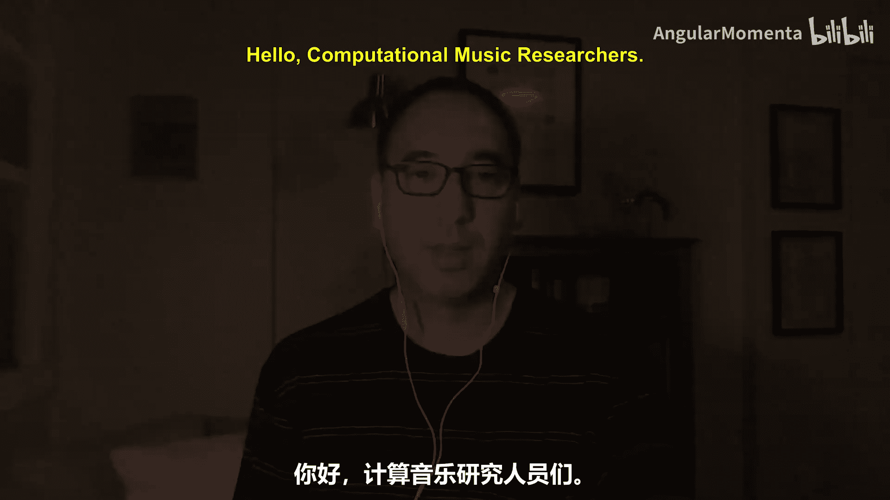
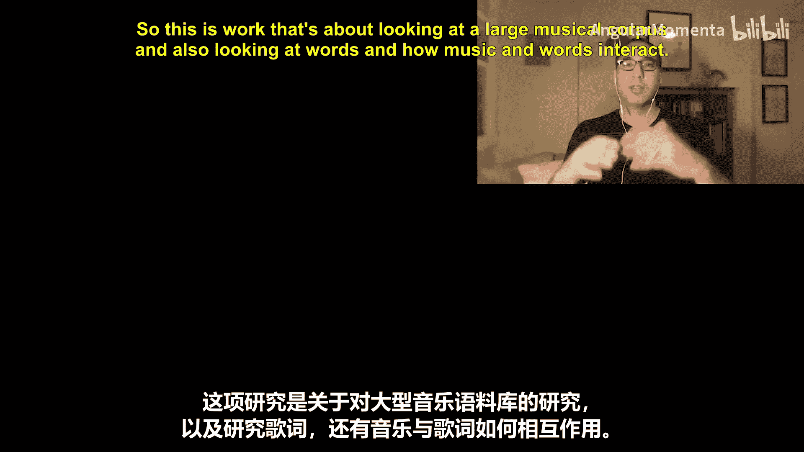
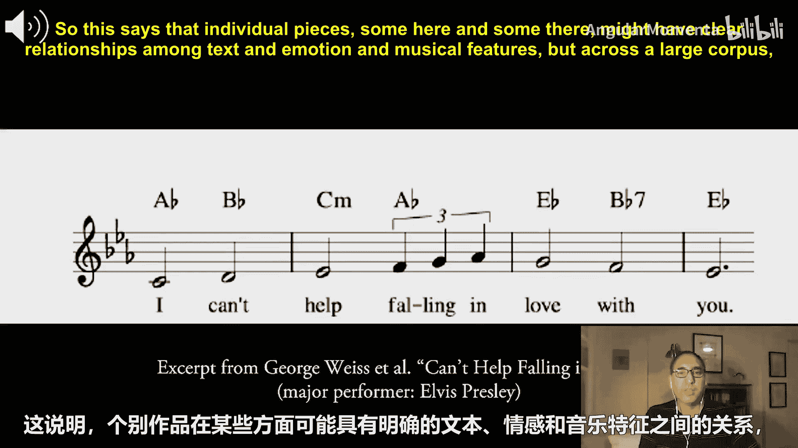
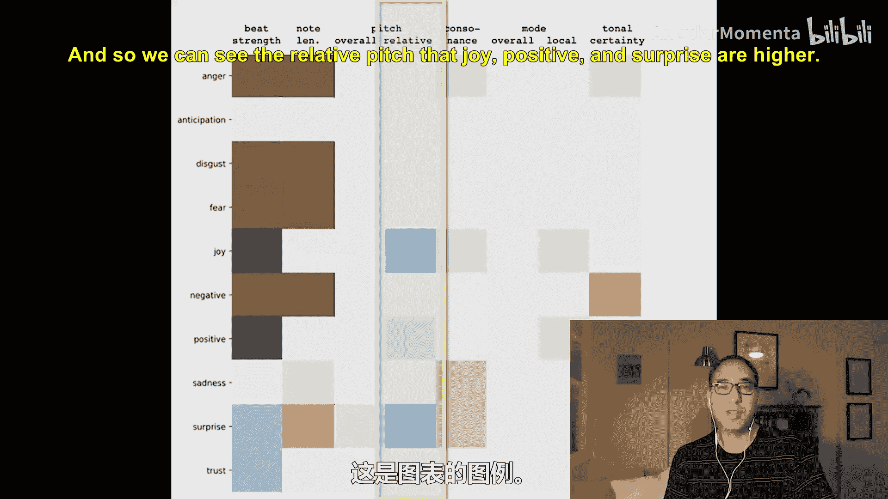
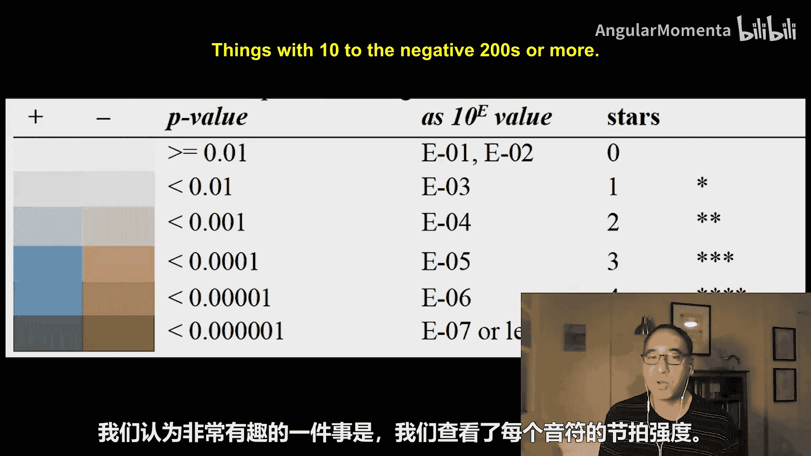
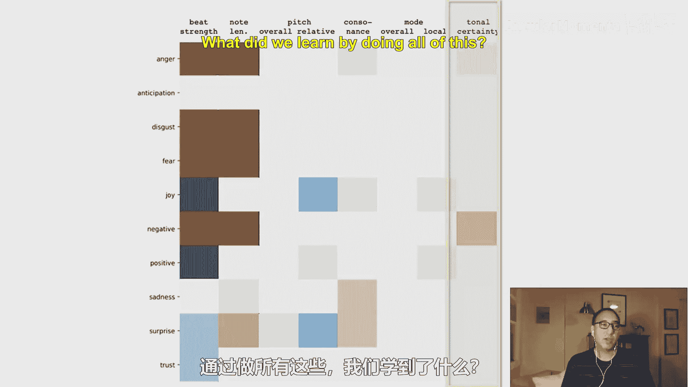
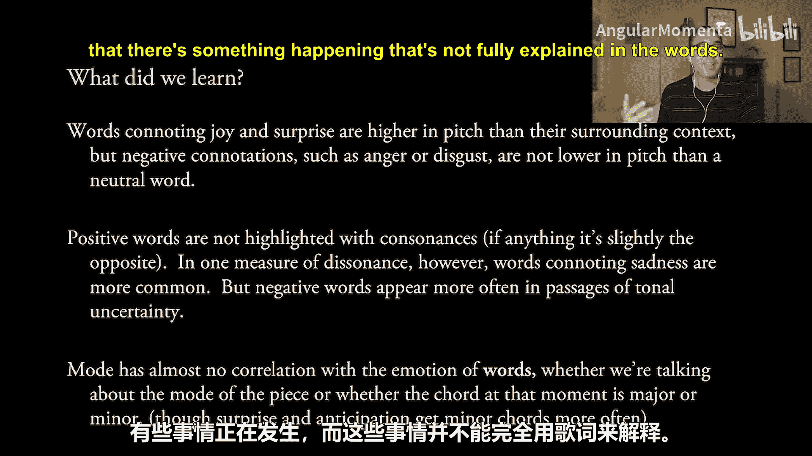
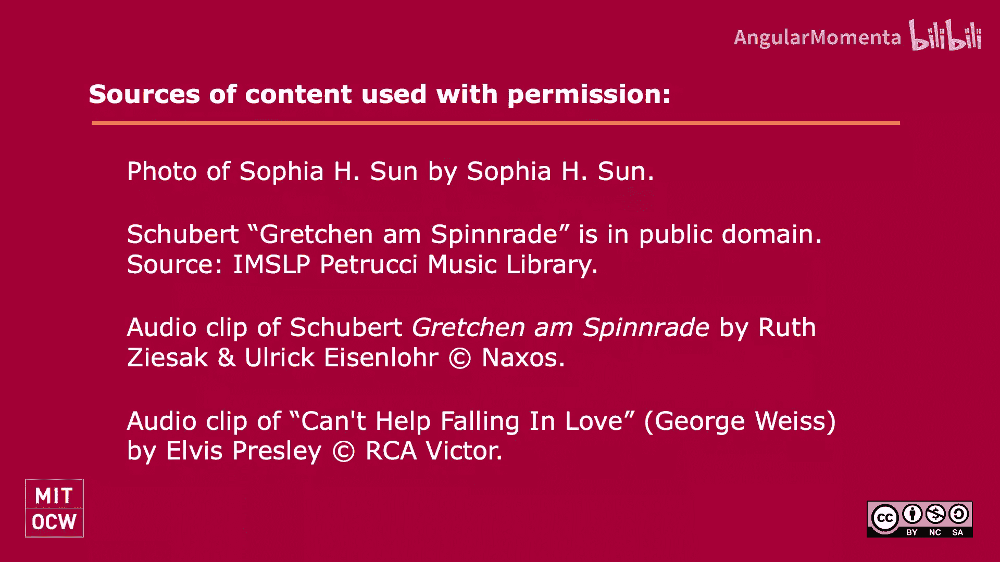

# 【麻省理工】计算音乐学与分析‌ ｜ MIT 21M.383 Computational Music Theory and Analysis,S 2023 p26 26 视频 12a：用音乐与文本描绘情感 -BV17xUmBDEUC_p26-

Hello， computational music researchers。

We're going to continue our study of corpora and what we can do with the corpus of music。

By talking about some research that I did with Sophia H Sun。

 who was a visiting student at M I T in 2016 to 2017 and graduated in 2018 from Wellesley College。

We've published our work as emotion painting， lyric。

 affect and musical relationships and a large le cheek corpus。

So this is work that's about looking at a large musical corpus and also looking at words and how music and words interact。

Words and musical moments are generally both felt to have intrinsic emotions。

 But while the emotional context of text is determined at least in part from the semantics。

 That is the meaning of individual words and sentences。

 the emotional content of individual musical parameters is far less well defined。

This lack of definition is especially acute in written musical scores that are separated from the oral and visual components of particular performances or recordings。

So a major question for music perception or the psychology of music is。

 do particular musical features such as consonance and dissonance。

 beat placement and pitch height when they're separated from their performative elements。

 do they still carry particular emotional meetings， such as accelerationhilar or sadness。😊。

It might not be possible to answer such a question directly。

 but we can approach the answer indirectly by asking。

 are there musical features that are used in conjunction with texts and are associated with particular sentiments or emotions with such regularity that we might believe that the musical features themselves are used to strengthen the effect of these affects and emotions or do they indeed carry that affect or emotion themselves。

The problem with making such connections with the traditional musical analysis is that there's no perfect correlation between any musical feature and any emotional state。

We might think， at least in western common practicet tradition。

 that words connoting joy would tend to be higher in pitch。Then。

The notes around them are the notes preceding it。And it's easy to find examples。

 to confirm this theory。In Schubert's Gretchen on Spidrod or Gretchen at the spinning wheel when it pi leads every single time the word Hers。

 which is the German for heart， appears， or laian， smile， or zalber magic， your cu kiss。😊。

It's always at the same pitch height or higher than the preceding note and always in the upper register for the singer。

🎼。🎼こいる。🎼我们。🎼是自车。So it might sound like this is an easy connection。

🎼But then a little bit of  Elvis enters into your head。🎼一天。🎼，🎼Following。🎼Oh。🎼喂。🎼下。

In this song by Elvis， originally written by George Weiss and others called Camp Help falling in love。

We always hear the words， love and darling。Below the previous note。

 even in an expression as magicalistic or the full of word painting as following。

 even that is set with a rising motion。So， this says that individual。

Pieces， some here and some there might have clear relationships among text and emotion and musical features。

But across a large corpus， the aggregated experience of listening to common practice or folk or popular music is far more muddled。

To clarify this， we can turn to corpus studies， especially computational analysis of large repertoies of musical encoded data sets whose sheer volume makes it impossible for human researchers to analyze all these pieces banly。

With computational methods for abstracting connections among music， text and in。

 we can find statistically significant trends in music affect relationships that stand out from a large corpus。

 even if the magnitude of the trend itself is quite small。😊。

Sophia's son and I used a repository of lead sheets that is melodies with lyrics and chord symbols。

There were about 1900 songs 1895， in total， that were in English language that the encodings seemed to be high quality and that there were no duplicates。

This is a repository called Wikiphonia that used to be freely available on the Internet。

 And unfortunately， their license expired and now is only available to those who had downloaded it beforehand。

In these 1900 songs， there's about 200000 notes。And a little bit less than that in terms of the words and 70000 chords。

 So this is a big repository to look at。We also used a second corpus。

 but this one not a musical corpus。This is an open。

 crowd source database of 14000 common English words that was made Mohammed and tourney of the National Research Council of Canada。

 And each of these words has been coded， according to the affects that they have。For instance， words。

With the affect of anticipation includes skewed or recreational or zeal holiness intimately haeder birthday。

 something I think we all anticipate or plan。😊，And we can also look at words that have that affect and that affect alone。

 so for instance， if we look at。Discusst， we see slime downung barf diarrhea， gratuitous heartward。

Things that。Only have this particular a。Together with a small list of what we call stop words。

 these are words that have no affect and appear too commonly， such as the and us。She， he。

 about 60 per cent of all the words in the songs could be classified。

 according to affect or not having an affect or the stopless neutral。And there were at least 2000。

Instances of each affect and some with over 12000 that appeared in this corpus。

 So there were in the repository。 There were 2853 songs that had anger in them。

Also in the corpus were 25000 words that were coded as being neutral。

And then of those plus stock words， there were about 12000 words that we can be pretty sure to be neutral and then123000 that can be believed to be neutral。

 and then 183000 is all of the comprehensive words that did not fill foot fit into one of these 10 affects。

Sn and I used Musicic 21 to automatically label every instance of the word in the dataset set alongside one value that we were measuring at the time。

 So， for instance， this is the song， Green sleeves also known of at Christmas as what child is this。

 and in this excerpt， every word except for the word aass was identified by the composer by the computer as being somewhere in the data set。

 But only two words in this excerpt had a particular effect that had been identified。

They identified love as joy and positive。And wrong as negative。

So then we looked at particular values that we could measure， for instance。

 the one that I talked about earlier about pitch height， So we're going to look for each word。

Look at the first syllable。 How many semitones above or below the previous note。

 Does that word appear， So my is two semitones or a whole step above a lasts。

 Love is two semitones above my。Going forward， wrong is four semitones below me。

With measurements like this， we can test the first theory。

Do positive words rise in pitch and negative words descend in pitch。Here is。

Our graph of the results for。For this particular measurement。

 what we call the relative pitch measurement。 And what we can do on the left are the 10 ethics or emotions that we are looking at anger。

 anticipation， disgust， fear， joy， negative positive sadness， surprise and trust。

 And we can look at words with that。Conlannotation compared to the neutral words that had been identified in the National Research Council。

 Canada data set。And we can see that， for instance。

 looking across at the top line to the highlighted。

To the highlighted figure that anger was a little bit higher。 Well there's a plus sign。

 So it was higher than the neutral thing。 But the 0。89 is the P value。 That is our confidence。

How often would such a value happen by chance and you subtract from 1， So 1 minus0。89。

 whatever it's about 10% chance it would happen by chance that all the words for anger would be higher and usually we don't think of p values that are below 。

95 or 95% chance or 5% chance of happened accidentally， we don't think of those as having meaning。

 In fact， when you do what we call a multiple comparison set where we're looking at a lot of things at once。

 we really want p values that are much better than 0050。01。001 and so on。And so in this chart。

 anger doesn't have a particular color on the NRC neutral set。 There's no。

No stitchly significant value there， nor does anticipation， disgust or fear。But joy。

 on the other hand， is labeled with a sort of a darker blue。

 meaning that this is statistically significant。 The three stars show how statistically significant。

 So the words with joy are higher than neutral words。😊。

Negative words didn't have any sort of P value， but positive words had a slight positive correlation。

 They were a little bit higher。 But if you go down， surprise was of strong thing。

 So words would surprise were higher than other words。We can look at other parts and， for instance。

 on the right side， this triangular chart， we can look at how each affect correlates with another affect。

 so we can see that surprise is slightly statistically。

 significantly higher than words about anger or slightly statistically significantly higher than words about negative。

The column just to the right of the yellow highlighted chart are the stop wordss compared to the A and and every single emotion word is higher in pitch than a stop words。

 You know，'s just think about when I say the。It's pretty low。

 We don't tend to put this kind of high emphasis on stop。

So I'm going to show some of the things that came up。Comparing these affects and mutual words。

 because this seems to be the the most fun and interesting part of the research。 So all of this。

 this whole chart will get。Reducuce to a single。Column in this chart。

And so we can see the relative pitch that joy， positive and surprise are higher。

Here is the key for the chart。 So I don't show how much higher or how much lowering pitch are how much more positive or negative。

 just the， just the direction in terms of the colors。 So blue colors tend to be higher in some way。

 and mine and brown colors are lower。And then the intensity of the shade shows the P value， so。

The first things are shaded happen。 Only 1 per cent chance that they are happening by chance。

 And then the next shade is 1/10th of 1 per cent。 them going down 100th to 1 per or 100th of 1%。

1 1000th of 1 per cent。 And you can see on the right as 10 to the negative 5， negative 6， negative 7。

 You'll see some of the charts were really showing things that are absolutely positively not by chance。

 things with 10 to the negative 200s or or more。

One of the things that we thought was really interesting。

 We looked at the beat strength of every note。 So we compared to the prevailing time signature。

 which is quite often for for。 And we were able to figure out what's on the beat and what's off the beat。

 And one of the things we can see， looking at the blue parts that words connoting joy and positive emotions are really much more common to happen on the beat。

 Similarlyly with surprise and trust。 But looking at things that happen off the beat or on weak beats。

 That's where you put the words or。😊，Anger。Or syncopate。

 disgust or fear or negative emotions tend to happen on weaker beats。Similarly。

 we can look at the length of notes that almost nothing has a positive correlation that let's say that is longer than you would expect。

 But these negative emotions， anger， disgust， fear and just the general， negative。

Tend to be on short attendance。🤧。So that we're really just sort of spitting out these short emotions。

Intriguingly， when we look at the overall pitch， the pitch of a note compared to the average pitch of the entire song。

 there's basically no correlation。We don't tend to sing。Happy things high and sat in slow。

Only a little bit with positive， happy joy， surprisingly things do we set them a little bit higher than what was happening before。

Did look at conssonments。 What notes。With what words are sep to notes that are part of a consnate chd。

 We remember these elite sheeps。 So we have the melody， the words and also the underlying chals。

 We can see some of these negative emotions， anger。

 but especially sadness and are are on more dissonant thing。😔，Notes than the dismaords。

 than the prevailing piece， but also somewhat surprising joy。

Maybe that's the way you emphasize joyful words or surprising words that you put them on slightly。

Suddenly， more dissonment words。Looked at two ways of classifying the mode of a piece。

 So major or minor。And。We looked at， do certain emotions appear more in songs that are in minor versus in major。

 And this is something that I at least have always been taught。

 And I think many of us have been taught that， you know， minor pieces are sad。

Maybe minor pieces are sad， but the words aren't any sadder than major mode pieces。

 There's no distinction between major and minor when we look at the whole piece。So instead。

 we used by the way， we will be looking later in the semester and how we can computationally measure the key of a piece when we get to Carol Kumbhusel's work。

So we thought maybe， you know， maybe it's not the whole piece。

 but maybe that these you sad emotions appear in a minor section or piece using a lot of minor chords within a larger piece。

 So we looked at the local mode， just the mode of the four measures on either side of I think those four measures on either side of a word。

 and there we found a very small correlation， but it was exactly the opposite we expected in a local section we used brown to represent minor in this case and blue to represent major joy and positive emotions tend to appear a little bit more in locally minor pieces。

What it might be is that there's not this connotation of sadness or negative or anger with minor。

 but about not knowing where you are。So we looked at the tonal certainty how。How clear is it。

 What key were in。 And here we found some correlations that were negative。 That is to say。

 anger and negative words tend to appear a little bit more in only uncertain passages。Now。

 this isn't necessarily a guide to composers for what to do。 but what composers have done。

 what people have done in the past。So what did we learn by doing all this？

Words connoting， joy and surprise are higher in pitch than their surrounding context。

 but negative connotations such as anger or disgust are not lower in pitch than a neutral word。

Positive words are not highlighted with consequences， If anything is slightly the opposite。

In one measure of dissonance， however， words promotingnoting sadness are more common。

 but negative words appear more often in passages of tonal uncertainty。Finally。

 mode has almost no correlation with the emotion of words。

 whether we're talking about the mode of the piece or whether the chord at that moment is a major reminder。

 though surprise in anticipation do get minor chords more of。It may be。That。This connection of minor。

 with sad。Is one of these cases of a purely musical connection。

 That is to say we have learned to hear minor music as sad， regardless of what the words are about。

And this is something that as a music historian， I know hasn't been true all throughout music's history。

 there were times when a pure major ch is considered harsh or a little bit sad。

 and that's not the case today， but。But maybe when people do consistently report in music psychology surveys that they hear sadness and minor pieces。

That there's something happening that's not fully explained in the words。

So there's always more research to happen。 And I just want to thank you for allowing me to share what Sophia's son and myself have found。

