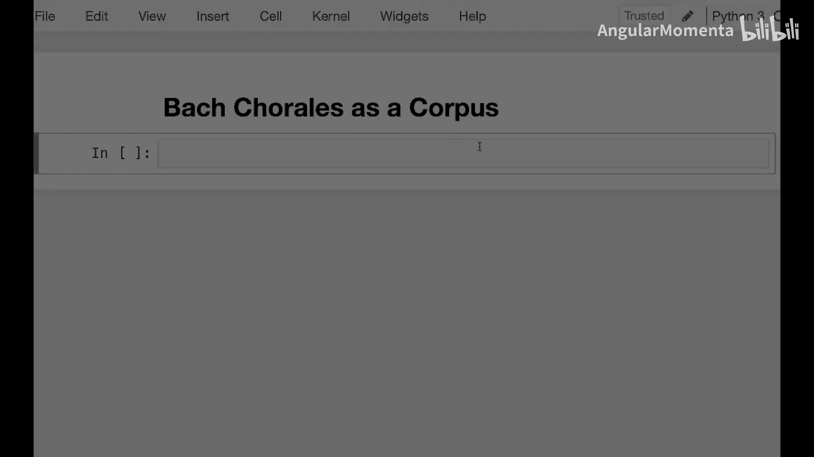
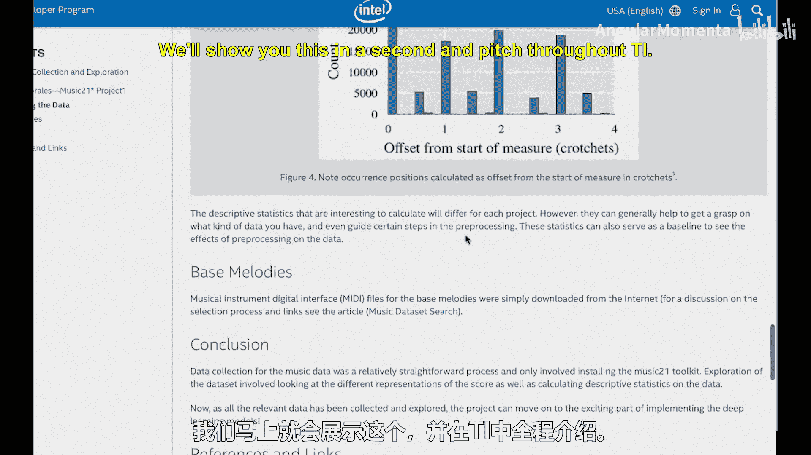
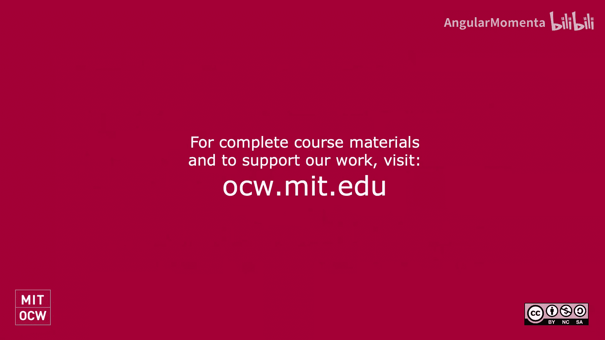

# 【麻省理工】计算音乐学与分析‌ ｜ MIT 21M.383 Computational Music Theory and Analysis,S 2023 p27 27 视频 12b：众赞歌作为语料库 -BV17xUmBDEUC_p27-

Hello。

Within the Music 21 corpus， there is another sub corpus， which is a pretty useful one。

 And that is the corpus of the complete crrals of J。 S。 Bach。

 I am really thankful to Margaret Greentree， who。😊。

Contributed all of these before her untimeimingly passing。So within Music 21。

 let's go ahead and import corpus because that's going to be pretty useful and。We can。

Have within the corpus， there's sign called corpus do corrals。And see that there。

 and there's a something called the corpus Cral iterator， which will go through this。

 And so we can say for corral in the corpus Kra iterator。Print。Corral dot metadata。

 That's the data about the data， the data about the piece。 And we can print its title。

 and it's going through。 And it's a little bit slow because it's actually parsing them and along the way as it's going。

 That'll take some time so you can go ahead and interrupt that while it's going， so。

Not every corral has four parts， beside we want to do if corral。Blenen Kraow。Al learn to spell it。

 parts not equals4 will continue。Then let's do this。 Let's print corral。Metterada。Title。

 and we'll say。That we just put a colon at the end。 And then for I in range。4our，0，1，2，3。

 right p equals corral dot parts I。Fch。I， and then the the length of。P dot。Flat thought notes。

 We chtenem be a little faster， but we'll have to do that， and we'll say。The end of that is。我し。

Ill put Thomasma space， something like that。And now we can go through oops。Or interrupt that。

I think it's probably useful too。Print a new line afterwards， and we can kind of see。

How the various parts are。 And you can imagine that you can go through this and play with it and have。

So interesting things on which parts have more notes and which parts have fewer notes and so on。

Some of the things that we could do with a complete corpus of crs are look at the types of motion where do climaxes appear。

 where can we。Find repeats what are the kinds of time signatures that appear in Cs。

 basically all the things that you guys did in problem set three。

 which is just wonderful or problem set yeah to talk about what you can do with the corpus of cre So this is the Cral corpus if you want to quickly go through and just find particular ones。

 you can say that the return。Type is。ItSomething else a file name。And this will allow you to。

Passed them in to the converter。If。1wa。Pin C。Real corral。😔，Guls corpus， parse。Cral。

And there are all the crras with 11 in the main。 So these are just some things that you could be working with。

 and you can even。This is a small enough number we can show each of them。

And I'll take a little bit of time， but we'll start getting to see。All the crs in a peace。

Our friends at Intelum have created a tutorial on how you can use the borals and work through the iterators and exploit the data and begin looking on emotion recognition and so on from the barals and even do artificial intelligence and plot various things。

 We'll show you this in a second and pitch throughout T。

Very short video。 Thanks for watching。

