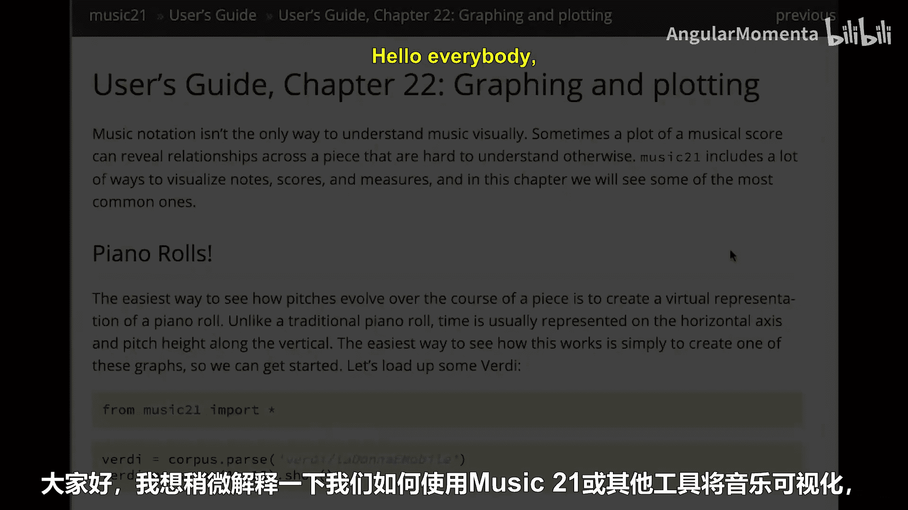
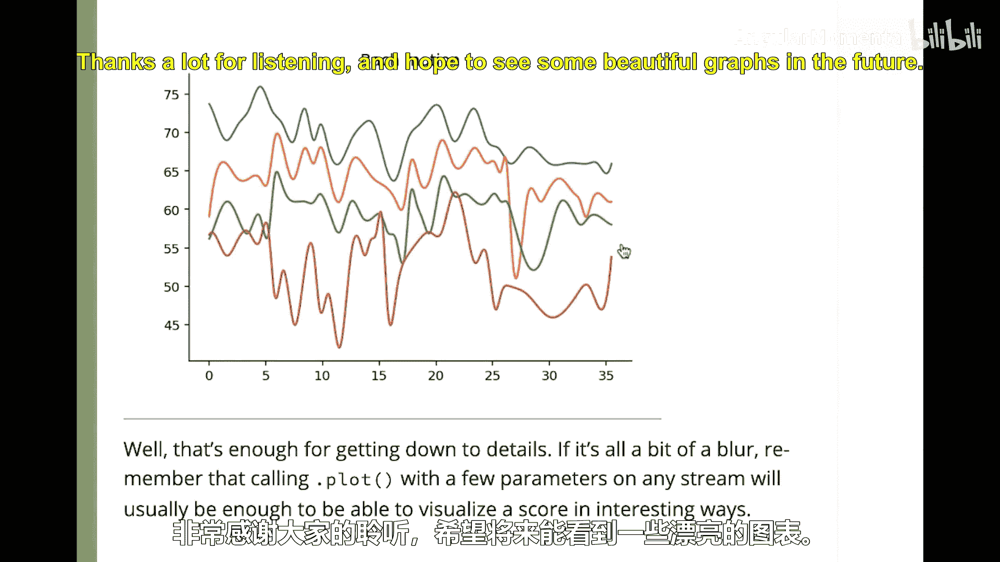
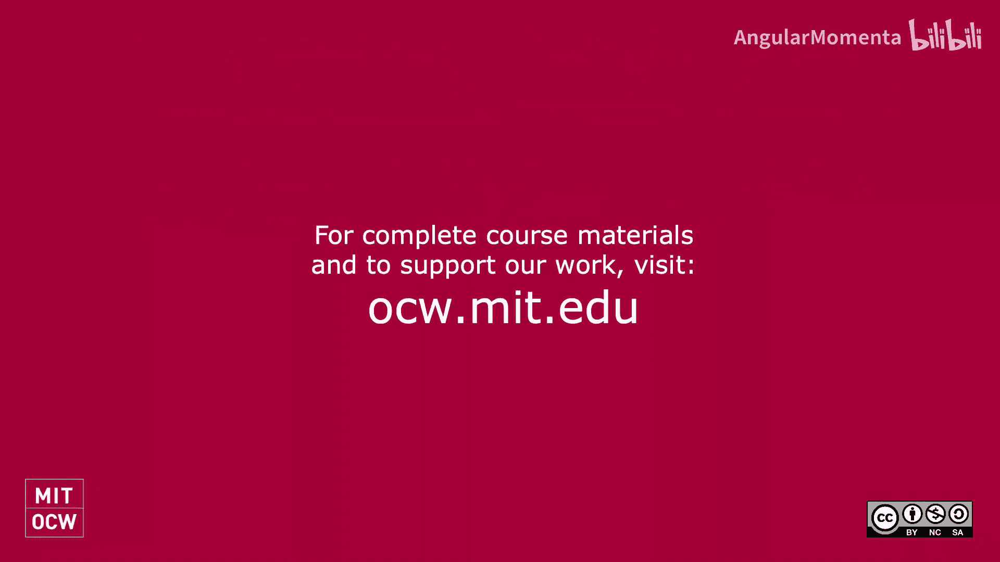

# 【麻省理工】计算音乐学与分析‌ ｜ MIT 21M.383 Computational Music Theory and Analysis,S 2023 p28 28 视频 12c：音乐21中的图表绘制 -BV17xUmBDEUC_p28-

Hello， everybody。 I want to explain a little bit and how we can visualize music using music 21 or other tools and how important it is to be able to see what is happening in a piece of music。

 rather than going through a Jupiter notebook， the user's guide to Music 21， Chapter 22。

 which there's a link pasted into the page that this is on。

Has a good introduction to some of the things that you can do with graphing and plotting。

We can go ahead and start by importing everything from Music 21。 We really only the corpus。

 And there is one piece by the Italian 19th century opera composer Giepti Verde。

 from his opera rigalletto called Ladonna Mobut， which we can load in using this corpus parse function and store its variable Verde。

 Let's just look at the first 10 measures。 and we can show it。Bom， bam， baom ba， on， baom， baom。

 baom， baom， on。 You probably may have heard this before。 So it's a little piano score version。

And so let's just get the vocal part。And if we go ahead and call on this excerpt。 oh， by the way。

 I don't know if we fully explain you can extract a measure range with these two numbers。

 This is inclusive unlike Python。 And so this will include measure 1 and measure 10。

 And these are the numbers， according to how a musician would think of them。 Okay。

 we can go and plot them。 And by default， it creates something usually call a piano will because it kind of looks like how you're going to punch the roles outside of things like this。

 you can go ahead if you know map plotlib or another plotting software and create these things on your own But there's a couple things that music 21 will take care of for you if I zoom in there it goes。

 and some of them。But there are some things that music of 21 will take care of for you。 For instance。

 the pitch will have octave marks just on the seas or wherever something is it will have correct flat signs or sharp signs and choose the right accidental for what's happening here。

 and things will be plotted by measure， even if the measures are difficult to deal with。

 for instance。Here， so。Here's the little example where we use some pretty weird accidentals。

 The only C really is a D double flat or so on。 And it will put out。 You can barely see it。

 but it will put double flat there。 And if your measures are different lights， it'll do it。

 So it's probably a decent thing to go ahead and call the mea 21 plot If you want to visualize something。

We can load on another piece。 This is Arnold Schenberg。

 early late 19th and early 20th century composer from Austria。

 who is considered one of the creators of a total music。

 It will load his piano piece Opus 19 and will load movement to。

 This is just another way of loading a specific movement from a piece and will excerpt measures  one through  four and show them。

 There's a couple little problems here。 we can kind of see this piece。 A lot of bump， b， b。Bump。

 bump， bumps in it。 And what we can do is in the plot command， we can give it other things。

 So we're going to do a scatter plot。 We're going to map quarter length to pitch。

 and we'll give it a title。 See the G and the B。 And if we zoom in here。We can really see。Oh yeah。

 we're doing a scatter plot and we're making it darker the more times things appear and we can see the quarter length log 2。

 so they're equally spaced between68 notes， eighth notes quarter and half note and see the various pitches here。

The other thing we can do is we can do a histogram pit of octaves and we'll hide littletics for anything that doesn't appear and put the number of pitches here and we can really see these two the G and the B showing up a lot。

 or we can just restrict it to specific pitch classes and see the pitch classes on G and B without the octaves still dominate on this piece。

You don't really need to install map plotlib anymore because it's now included Music 21。

 but you will want if you're using。If you're using Jupiter notebooks to put this magic command at the beginning。

 and that will allow you to view everything in lie。

You can go ahead and see what kinds of things are there， horizontal bars。

We can plot measure number and quarter length against a pitch and so on。

Gros pitches gra scatter plots。Counts of how often various pitch and note lengths appear。

We can we'll say how this happens later， but we can look at what the range of the pieces。

 how big how far apart it is in various places or what the keys that are being detected in various parts of the piece using Carol Componzo Schuckler's key analyses we can look at when various parts are playing and I believe this is how loud they are some silly 3D graphs which can be kind of helpful maybe but maybe not and it can also plot against dynamics and you'll kind of notice that says Mesoforte forte。

 Forte piano， Sono forteimo so that there's built in。Places for various dynamics。

 we can see what kinds of atlas qualities there are and so on。

 So what we can do is we can look at how various composers， such as Robert Schumman。

 a mid 19th century composer， how he uses his pitches in a particular string quartet。

 versus how Chopin uses his in one Mizerta。Then always important to go back。

 sorry it's all distorted for the video， and look at how the piece actually works。

In chapter 44 of the Mea 21 user guide completely optional。

 it'll tell you a little bit more on how you can customize plots with a title。

 change the size of figures。Change colors。And go ahead and。

Make other plots highlight particular data。And we move。Data， substitute other things in there。

Not too much else。 These are pretty advanced things going on， but。We can look it。

Offset versus cardinality。 Well， you know what cardinality is now。

 how many pitches are sounding at once。Notice this little nice pickup measures at the beginning。And。

Maybe you want to plot how a frequency in hurts goes against pitches， but show white and black keys。

Or in this case， we in black keys over tie。And you can use this to make some various other graphs that might not come from data。

 these are all kind of interesting things smoothing out how box motion works in a particular row。

There's a lot still to be done with plotting。 but this is a great way to start。

 I'm also going to put in a link to。Edward Tufts， were Tuftti。

 I'm not exactly sure visual display of quantitative information。

 which is a book that has absolutely shaped how I think of what are good ways of creating graphs。

 Why we want to create graphs。 and how do we make the data stand out and still be beautiful。

Thanks a lot for listening and hope to see some beautiful graphs in the future。

