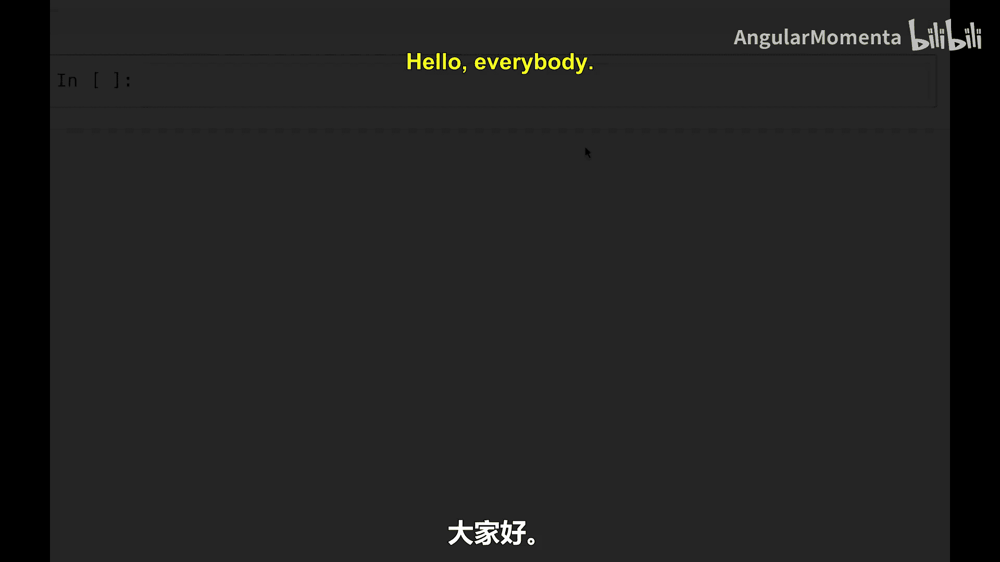
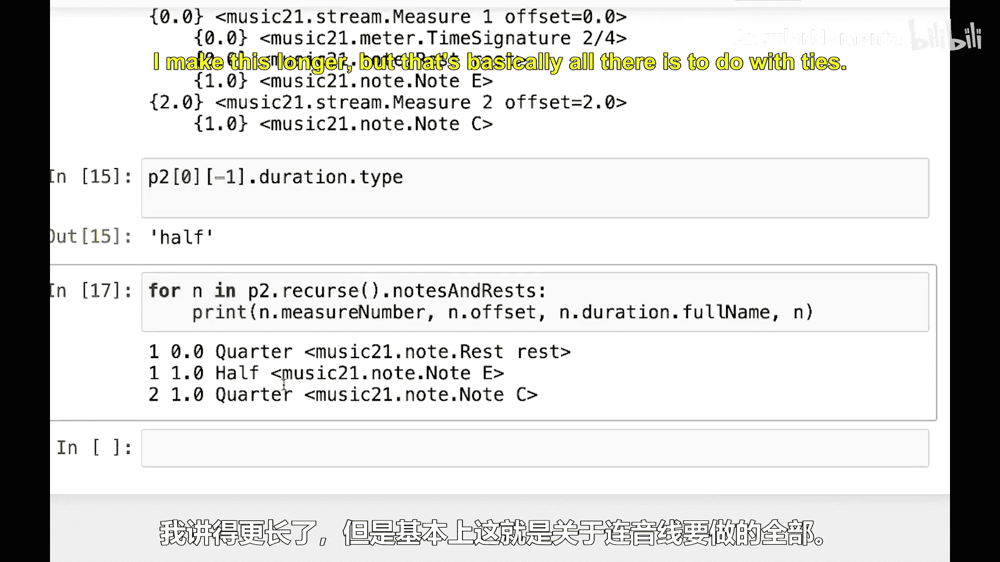
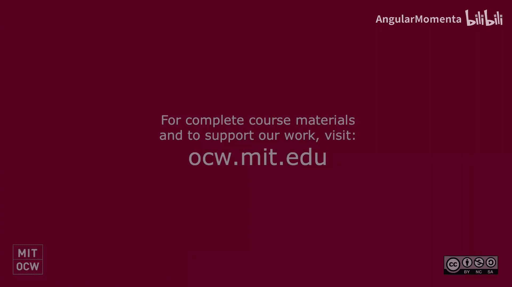

# 【麻省理工】计算音乐学与分析‌ ｜ MIT 21M.383 Computational Music Theory and Analysis,S 2023 p29 29 视频 12d：如何在 music21 中处理连音线 -BV17xUmBDEUC_p29-

Hello， everybody。 One of the great things about making these videos is that we can introduce small concepts that otherwise might fall through the cracks。

 So I want to introduce the concept of ties and how we represent them in Music 21 and how you might represent them in your own project。

 So let's go ahead and import from music 21 Note stream and the new tie module。😊。

And we can go ahead and create。Stream of a measure。 we'll call it panom。And let's create two notes。

And it doesn't really matter what you make them， just make sure that they're。

That they're at the same pitch， because otherwise， we can't tie them。Thats pretty good。😔。

And we'll say we'll create a time signature。That's why I usually eventually we'll import star， but。

好ello。2，4。And let's put M dot aend time signature， M dot aend， note 1。Actually。

 we could just put more than one thing in。And we'll show these two notes。

And now while that's doing that， we'll go ahead and get。

 And one's tie will be a new tie dot tie object。 and it willll be a start。

 and chooses tie will be a tie dot tie object。 and it will be stop。 And now where we show。

The measure we have what we should have written as a。Half note， right。

 But we can go ahead and let's create another measure。And here's， of course。

Where we would be more likely to do this and make a quarter rest， That's the default。

 But just to show it。And so we can， by the way， put objects in more than one stream。

 and so this is something that's going to happen。Sometimes we'll put the first note in。

And that we'll create M3 in the streamed up measure。And M3 dots。A pant。And2 Po。You know。

 I really do care about having all in measures。Sort of a peer。 And he is a streamed up heart。

We'll go ahead and put inside the stream。And2 and pen。And 3。And let's go ahead and show that。Great。

 so this shows kind of how ties might work。 Now， here's the thing。 If we do for an in。

Well P dot recurse dot notes， and we try to figure out。How many notes there are。Well。

 it looks like there's three of them。 But if we listen to this piece， obviously。

 we're just going to hear two notes。 So what can we do， Well， we can create a new part。

 We'll say P2 equal part dot strip ties。And now if we do for n in， well， actually。

 let's show this and we'll show it as a text file， we'll see here。That。We only have two notes now。

But in this next measure。This note， the sea only begins one quarter note in。So we've reduced。

 what we've done is we've taken this， this two E's that are tied。

 and we've replaced them with one half note。 In fact， we can look at this。That's our note， and。

Turation。It's a half note。When we stize we。Create things sometimes that don't really musically exist。

 We have a measure that has a tie signature of 2，4， has a quarter rest。

 and then it has a half note in it。 that really can't work。

 So you can't really do P2 dot show and expect something that that looks right because that that just wouldn't work。

 But instead。In terms of iterating for N in P2 dot， acur， we'll say dot notes and rests。

Reby says that， let's print and offset。And， Anne。And we can see that。

And we can even do measure and number ha， this would totally have safety time on problems at three wouldn have oops。

We'll go back。And do call these number equals one， measures are auto numbered。

And now when we go back。Here。😔，We can see the rest is， in measure 1。

Then no ease in measure  one at offset one， in fact， let's print。It's。

We should see the E' in measure 1 at offset 1 is half do。

 and the C is in measure 2 at offset  one is according。I'd make this longer， but。

That's basically all there is to do with ties。 Thanks for listeninging。

