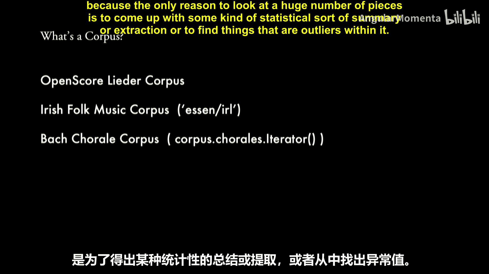
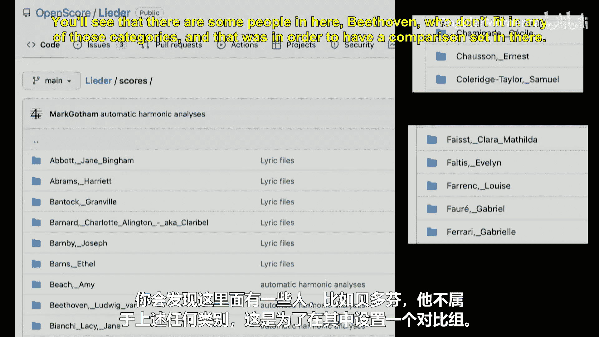
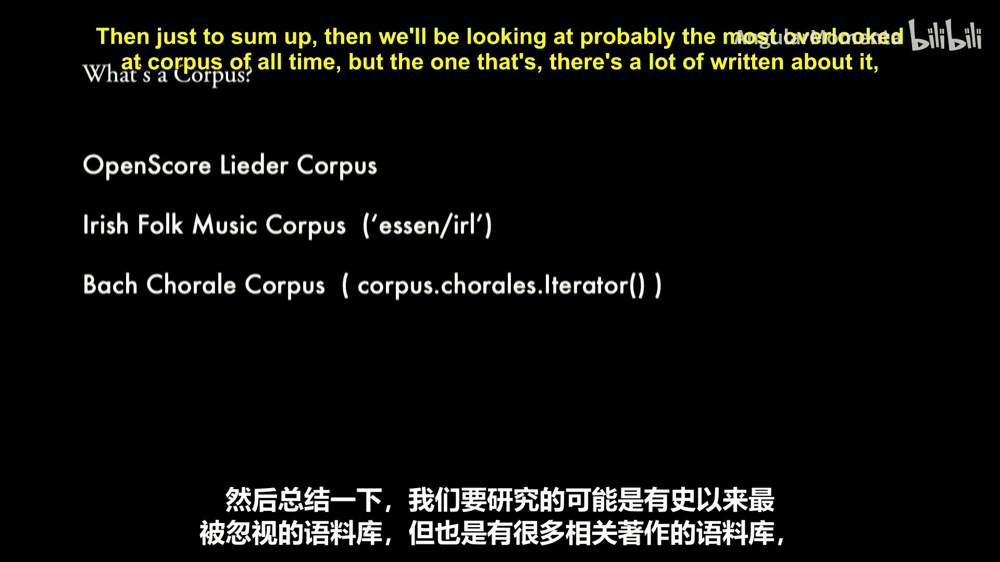
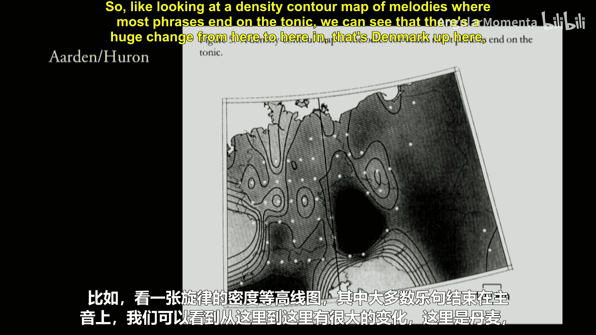
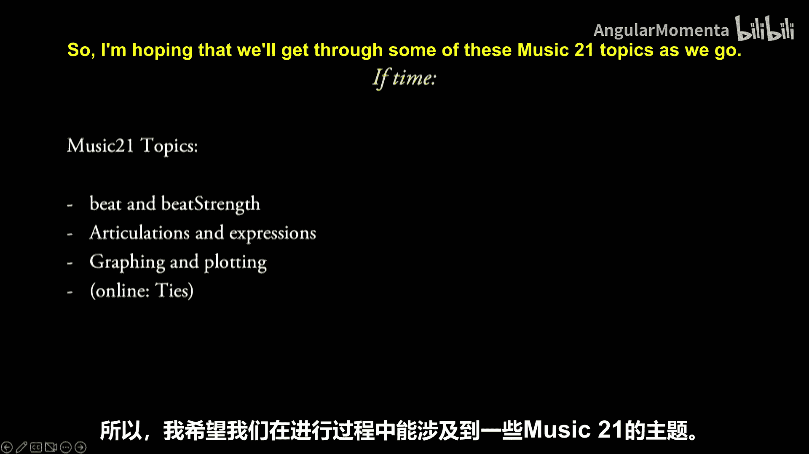
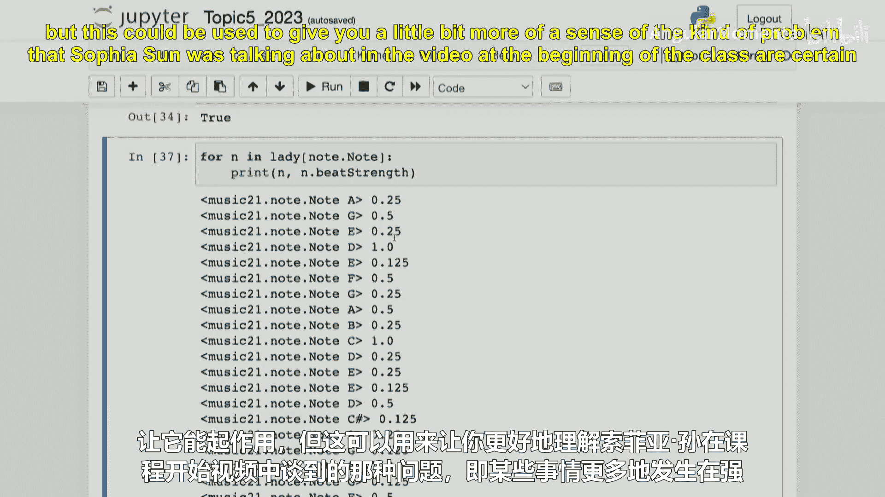
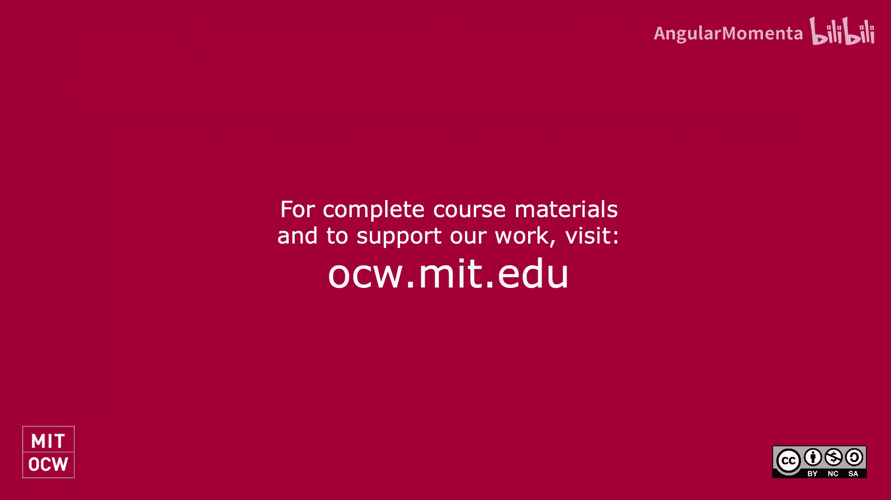

# 【麻省理工】计算音乐学与分析‌ ｜ MIT 21M.383 Computational Music Theory and Analysis,S 2023 p30 30 第13课视频：语料库研究与统计 -BV17xUmBDEUC_p30-

Today， it be a little bit boring for people on on watching later and stuff。

 because we're gonna mostly be flipping things around。

 So we're gonna to use this time for quite a lot of in class work。嗯。

And you might chair there and try to get things getting ready for later in having videos online for some of the new topics that are coming up。

Before we get to this is the fifth week of the semester， first。

 are there any questions so far on problem set four？Adam。

Opic you would want that to list at the same。嗯。Let me see。 Would I want。TheyNo。

 not necessarily what's part let's think through again， Opic O is just shout it out，octave P。其这是T。

Trestposition， good I inversion and C。One of those is very important that you test Well all of them is important that you test with different length sets。

 But what's one of the ones that might， might sometimes return true。If， if the two the。

 the two pitch sets are equivalent if you have this equivalence class。Carinality， yeah。

 so cardinality equivalentence， it's kind of a odd thing， isn't it because it's not？

It's kind of the backwards button isn isn't it， It should be like opted duplication or something because it is specifically not saying that things are equivalent if their cardinality is the same it is saying two things are equivalent if if there what do you want to。

 I suppose cardinality is is that if duplicates are removed good。 So so yeah。

 there will be cases where where two pit sets will have different lengths and and of things and be equivalent。

Oh， one important thing。 I'll do the one that I forgot to do。 That's on inversion。An inversion。Is。

One of these things probably like mode or something like that that we used way too often in music to mean too many related but different things。

 So I'm just gonna move that more to the center。So the two places that we've been talking about in version are。

In sort of this， do you remember this circle from C， C sharp s D flat spelling doesn't matter， D。

 I getting there about right， yep， E flat， E F now somehow life。Well。

 because my circle is more of an egg。You know， so on and。Sorry。

Blanlinkking on it's been a long time since I've written a circle of notes that is not the circle of fifths on the board。

 right， Okay， got that in order。 And we've thought about this sort of axis of inversion that you can have。

 Do you remember that。That can define ways that pitches can invert to each other。

 We also use inversion。 And so this is prime the primary one that Dmitri Tramco is talking about。

 We also use inversion， Deme sign we say called tonal inversion， which is to say。Yeah。

 we did this in class for a second， right？This can be inverted。To be。This。Even though。

So because here we go up a step， here we go down a step， here we go up another step。

 we go down a step， up a step， down a step。But even though the steps are different sizes， right。

 So F to G is， what kind of step。Whole step。 next one。 Who step。Half and this one。Half whole， whole。

 So， but， so in the。In the strictly andharonic context of inversion， they would not be the same。

 which is the context that Dmitri Tranchco is mostly talking about in the tonal context， they would。

 they would be the same， though， right， But then there's this third part。

 this third very common use of the word inversion in music that is not what we're talking about in any way on this problem said when John。

 do you know what that is。Cord inversion， chord inversion。 So， right， So if I have a chord。

 let's say a major。What is the base if I am in second inversion？E， great。

So you might have something like that。Now here， so that's the explanation part。

 That's the clarification part。 And now the the critical thinking thing。

Cord inversion in this sense has to do with what letter？Of optic。P。And there's another one。 So P。

 we could say that A， C sharp。E is the same as E C sharp。A， but there's something else we need。 Yeah。

 Oh， so we need that this O is equivalent to this O， that this octave is the same as this octave。

 I say everybody' shivering。 It's really cold in here today， isn't it， right。

Now maybe it's just me you were cold other people are cold and I'm like up here here， okay so。And。

Octave and permutation。嗯。If you have an augmented triad， there's an interesting here。

 Let's just keep playing。 We'll make a simpler augmented triad that you might have thought of before。

Then the different inversions have to do with。You can think of them as O and P。

 but specifically for the augmented triad， there's another letter that comes into play。

Let's get the sound of the augmented triad into our ears。What's a way that we can do， let's say。

 a first inversion。Of this。Augmentally triad。Yeah， just calling us。I。Let's see， yes。

 because we can invert。Around this point。 And what are the two intervals。From here to here。Theyre。

 They are the same。 Yes， but what are they。被告。Major third， and。And major 3。

 because we already said the same good。 Sorry， Sometimes I I。

 I forget that was prefaced with something that we that required me to use the C operator to。

 to map major third to major third， major third， right， Good。 So it can be inversion。

 There's another way you can think of it。 Yeah， Jason， transposition。 So if we go up。

 what do we have to go up。 A major third。 So C goes up to E。😊，E goes up a major third to。To。

G D G sharp。And then G Shark goes up a major third， to。C色。First， it goes up a major third two。

Be sharp。And then what other， what other letter are we thinking of。S， spelling so that the。

The what do you call the Eve。B sharp goes to C natural。

You can think of all of these different letters and different equivalence classes as quite often。

 depending on your context， different ways of getting to the same answer。

The hard part and the problem set， though， is sometimes figuring out if you're given multiple。

If you're given multiple of these letters together， you're saying you have the O and P set。

 Can you apply O。And then P， is that the same as applying P and then O。Sometimes it will be。

 sometimes it some of these combinations of letters， the order won't matter。

And some of the combinations of letters will open up new possibilities that chaining one and then the other will not be sufficient for。

Anybody。Far enough on the Pet to encounter any of those。

Some of you have some people have turned them in。Do you remember anything ones ever like that？即确主。

Yeah， I think。I often ouration。Octave imp permutation didn't matter which one。You did。Think that's。

Think that's correct。 Yeah， Yep， I I should be thinking。

 there's how many combinations of there's what what do he called there's and5 choose2， right。

 there's five factorial combinations。 but were just，2 to the fifth combinations with optic。

 but some a lot of them are never used。 You would never use， I don't know。Carton。

What's something you wouldn't use？Inversion without permutation quite often or something like that。

 yeah， great。Or inversion permutation without octave equivalents or something fantastic。

 I want to introduce you to another friend。 We're gonna have more as class goes on。

 these little one to two minute guest speakers。 And here is somebody who went through this class like you。

😊，次。Hi， I'm Sophia and I worked with Mike with Music 21 in like 2016， 2017。

 we wrote this paper called Emotion planningning。emotion painting。

 lyric affect musical relationship in a large scale， Lihi corpus。

 And an idea is there's this concept called word painting and classical music。

 where the music sort of reflects what the lyrics says。 So rise， you were saying like rise or fall。

 you was sing fall。 And then we want to see how prevalent that is in say， folk or popular music。

 We had this corpus of around 1900 songs of。😊，Foolk music were popular music。

 And then were able to analyze it with Music 21。 What we did is we used the natural language toolkit and analyzed the emotion conveyed by the lyrics and then looked at the corresponding notes in the music。

 We found a bunch of interesting things like。😊，More emotive words that convey an emotion are more likely to fall on strong beat strengths。

 like the first beat or like the third beat on beat， whereas。

Words that doesn't convey emotion like is and would fall on weaker beat strengths and also interesting things like words with strong negative emotions like anger。

 disgust or fear tend to fall on shorter notes。And that's what we did。

So we're going be moving on to the concept of corpus and corpoa a little bit and so what do we do and statistics because the only reason to look at a huge number of pieces is to come up with some kind of statistical sort of summary or extraction or to things that are outliers within it and even if you're thinking you know oh yeah。

 or to do deep learning stuff and those who have taken artificial intelligence and deep learning classes you'll know that at its heart。

 these are all just statistics right this is all just a whole bunch of numbers that are being trained and extracted from things。

啊。The corpus I was hoping for us to work with today。

 I haven't been able to get it working well enough to not crash and on my system。

 and that's my my bad for not having this up。 But I want to point out to you。

 we're gonna be talking about more。 It's a collection of I think 2000 encoded leads， art song。

 songs that are sung in concerts and things primarily by women and and black and other minority composers。

 you'll see that there are some people in here， Beethoven who are don't fit in any of those categories。

 and that was in order to have a comparison set in there。

I don't know。 I'll have to ask Mark Gotham， the great researcher who was doing this。 I think also。

 he had really hoped to get 2000 and had a certain day and found that he already had some beethoven lying around or something。

 But it's a really amazing corpus。 And I hope that we're gonna be able to work with it later in the year today being International Women's Day。

 I thought that would be a particularly good day to work with it。 But alas。

 things don't often hit our deadlines and。😊，We can。We'Go back to that later。啊。

The second one that we're going to be working with and the reason why you have your laptops out today that we're going to be working with together in class is part of this SN folk music data set。

 and we're going to be looking at the an Irish folk music corpus。

 There's a lot of Irish folk music corpoa online and we'll be looking at that then just。S up。

 Then we'll be looking at probably the most overlooked at corpus of all time。

 but the one that's there's a lot of written about it。 And that is Johan Sebastian B Corrals。

 the ones that you've already been working with a couple of them。

 We're gonna see what happens when we work with all of them。

One of the things I'm going be asking you to look at is one over the next by the next class。

 if you can， is to start reading an article by Brett Arin and David Huron。

 which is as you can kind of see from the from the quality of the of the scans。

 a little bit of an old article。 I think it's about 20 years old now。

 But it was one of the first ones to see what happens when you take musical features and compare them to geographic features。

 So like looking at a density contour map of melodies where most phrases end on the tonic。

 we can see that there's a huge change from here to here in that's Denmark up here。

 This is Germany right where the Alps began。 so we can see how how geographic features might change。

Yeah， might， might change how how music goes。 So I'm gonna blank that for a second。

 I'm gonna open up a Jupiter notebook， And we're also gonna unlock a few things along the way。

 So hoping that we'll get through some of these music 21 topics as we， as we go。

搜。We'll start by importing an article of something that we've already unlocked from Music 21。

 Import Corpus。And we'll call I， R L abbreviation for Ireland， Corpus。Pase will be safe。 S， N， E， S。

 S， E， N， folk song slash I， R， L。 See how close I can get this to me。

So I'm still looking at you oops。です。差不多。522。Great。So everybody give me a quick thumbs up if we're at this place。

Awesome， super。Okay。One of the things you can do， anything that you get from the corpus。

 just in case you ever need to look at it， oops， sorry。Have an old thing。Is look at where it is in。

On your hard drive。Okay， now somebody can hack my hard drive and so on。

What kind of thing would you expect I L to be， What kind of object。In it。Who votes for itt。Float。

String。To take。So来就。You think it's strange。 you don' what。Anyone what， what。

 what did usually are we working with in music 21 stream stream， great。

 What kind of stream do we think is。Score score would be most logical， right， In this case。

 we're working。 this is our first time working with something bigger than a score。

 something called an opus。 So a collection of scores。 And so what we can do is we can look at。😊。

How many scores are in here。 So this is a pretty small corpus。

 but big enough to start doing some statistics on。 so we can do。I like IL。 scoress0。s。And。Oh。

Good deterministic， it's still the same one that I thought it would be。And see this。

 one of the things you'll find， if you're really interested in in being efficient is instead of doing into0 what do you call square bracket 0 and most on music 21 scores。

 once you've done all your filteril streams。 Once you've done all your filtering。

 you can do dot first and dot last and all they are is O of one or that that they stop。

Finding all the scores once they found the first one。 So it's a little bit if you're into。

Algorithmic optimization， it can sometimes be quite a bit faster for very long notes。Okay。

 so what I want to know is。This is interesting。 It's in 3，4。Pick up。Good。

 it does some of the things that we expect。Tnal pieces from folk era to do if you begin with a dotted eighth。

A dotted quarter missing at the beginning or added to the pickup measure at the beginning。

You expect that at the very end， you also have that so that the pickup measure and the ending measure usually represent one。

 Oh is that okay， Yeah， good。StudSure， course， Always glad to。So。Do we get it？唔实。Okayでいや theも。

The piece looks a little bit different on yours。They're hugely terribly different。

 like now just a little bit different。Yeah， its。I mean， depending on your version。

Here's what it looked like a couple years ago。So it's still quite a bit smaller back then and things。

Okay。So。It's in3，4。Is that common for Irish folk music？

What would do you think who has heard Irish musicians play in the for Irish music？Not very many。

 Keep your hand up if you're also over 21。 No， just kidding because they do usually play one of the places you can hear quite often。

 Irish folk musicians play in Boston is in pubs and things。

 But so the rest so of people who have heard or of people who think they might know this and。😊。

What's， what's the key time signature that you think would be common， Adam 42，4，3y，6，8， John，6，8，6。

8 well。One， this is one of those cool questions where， where if you have the same answer。

 somebody else is still on to here because that starts building up consensus。

 Some give me a time signaturesure。 you， you don't expect to be the highest。

 the most commonly used time ssure。😊，Yeah， Jason，7， four， good， good， okay。

 so we have some hypotheses。😊，We're going to do is try to figure out what's the most commonly used time signature in this Irish folk thing。

 and always start with a hypothesis because the number of times I've seen people go ahead and publish things that don't。

Where they don't have a hypothesis。 and then they don't realize like， oh。

 I printed out the measure number divided by the number of notes， not you know。

 not the time signature。 therefore， you know，137 over 14000 probably wasn't the most common time signature。

 So let's start。 this was a question that came up at some point。

 can you use are anything in the normal Python library unlocked in this class。 Yes。

 so let's import the counter who's， who's seen counter not okay， some people。

 some people have it Count is just， it's a very cool little it's just a dictionary。

 but it starts off at0 when something's not there。 So you don't have to say when you're adding things up。

You can just， you know start from， from that。 So you can， you can。

 you can just start adding one to things。 So I kind of like that。 So would say for song in the Irish。

Corpus。We can do。We're gonna want to get the time signature。 So I want you to song dot something。Y。

Pull that up a little bit。And fill out。The rest or maybe song。

 maybe we don't even need the dot something。 I don't know。 Song is probably the next。

And we did put IRL scores first up there so you know he can test this on one。Lets。

 let's say we're only for simplicity's sake， we're only going to be counting the first time signature in each song and。

And that most of the songs in this collection， I think all of them are monophonic。

 So you're only have one part。What are some words you're typing？

Get element by class good get element by class or get。There's one，1 little table get。Ms plural。 Yeah。

 so unfortunately， there isn't a get first element。 great， anybody else。

Having other words that you're typing that you'd like everyone else to know。

Unless I tell you otherwise like the midterm or something。

 you're generally allowed to talk to people around you。Jill， what's the word that you've typed？

Im just select。Okay。Cool。这没事。Okay meter type。 Yeah， So you'll probably want to import meter。 Sorry。

 if I didn't do that， you can import anything that's unlocked always。 So from music 21， import meter。

 And what's the word that you said， meter。Dot。Time signature。 that， that one might be helpful。

Anybody else have any words that you've been typing？Fine， I'm going to type a word。

The one word is recurse。Anybody type that word？No。Or flatten。Anybody take that word？Im。

 I'm only asking for this， this line。 Sot I I'm just trying to figure out who has gotten a time signature out。

Okay， so some， some people have Vincent， what you， what you type to get your time suggestions。

 So rehearse thought。Okay， good。 recur。Dot get elements by class。And。

Maybebody help What's the next thing I'm going to type。Meter dot times signature。Great。

Anything else that I should be typing。On that。Is that is this correct。

 Will T S now be a meter do time signature。Okay， let's， let's try。

 let's try this on one song since I don't know if we have this at all。 So we'll call。

 we'll go back to the IL dot scores dot first。 And what we， what was that name of that song。

 a lady fair。 We'll call it lady。嗯。Equals IL scores at first， now we'll try this lady do recur。

 get elements by class。Meter dot time signature。Who votes This is gonna give me a time signature。

Who votes not。Okay。Not sure。But not a time signature。 You had your hand up on not a time signature。

Anybody else， Vanessa， you will kick him。It'sYeah， something that we'll get what。The上。Oops。

 do I not have。啊。Sorry， yes， that won't return anything if I don't put the if I don't put these brackets right。

 as I was trying to do it on a function。And。😔，Or oh， this comes up， by the way， in your in。

What in problem sets sometimes in answers， the order matters right I hadn't run the music 21 import meter yet just just something to keep in mind。

 always make sure when you're done， when you think your problem that's done。

 hit restart and run all and see if it gets to the end because you might have been solving a problem along the way and then have oh you know in order to solve。

Question 2， I imported sign from question 3， but then it's not ready when I run it。 So， yeah。

 so now that we have this， what is。Something called a recursive iterator。

 so it is not a time signature。How do I get the time signature。From this， if we have this。Anybody。

Kd of index index 0。Perfect， it's kind of like what we did here indexing0 on iterator over scores。

 But now we have something that's indexing over the time signature so。

We should be able to do this with， if I remember my parentheses。

I do get used to an IDE that fills in my parentheses for me， which I'm not using。

 and I can do index zero or I can do dot first。Either one。

This is a particular case where dot first will save you a lot of time because you're pretty sure the time signature should be at the beginning of the score。

 So once you hit one stop， don't go through the whole rest of the score looking for more time signatures if you only want the first one。

 Good。 So we have the time signature。Now， what we can do is this is something we haven't seen the ratio of a time signature。

 the three 4 sign is in its ratio string。 There's also a numerator do denominator。

 But this is the one that's pretty helpful。 and then。Meter counter。Raio。

 which I'd be doing now if I want to count them。Plus， equals one， good。And then at the very end。

 let's see our meter counter。So we had hypotheses of 3，4， and 6，8。 I put my money on 6，8。And whoops。

 what I forget。Oh IOL about scores。Thank you。IRL scores because the first thing there was metadata。

都程。So what's our winner，3，4， our runner up，4，4。And then then 6，8， at least 6，8 was on。

 those of us were 6，8， the 6，8 crew。 We， we did okay on there。 But yeah。

 I might have the difference between this being sung music versus fiddle music。 I don't know。

 We can try some of the other。Things in there， by the way， with a counter。

 you can also do things like meter counter dot most common。3 most common。

And see what they are in that order。啊，阔。So that's one of the things we can do with this corpus。Let's。

 let's jump over to the bach corpus for now for a little bit。 Are there questions about this。 I mean。

 that's just the tiniest little thing。 We can figure out all the questions that we had before with it。

 Oh， here， let's。Let's actually， let's do this。 Let's do with the type of experiment that。

That Sophia Sun was talking about with position on the beat or whatever。Let's look。

At where notes with accidentals appear。Are they most commonly。

Sort of in this little passing position in the middle of the bar。

Or are they more often contradicting right at the downbeat。Hypothesis。

Who votes for accidentals more in the middle of the bar？Good，7 and4 on the downbeat。Good。

 who's not participating？But didn't to let's one more time in the middle of the bar。Or donebe。

Couple good。 I don't know what the answer to this is。 Always just be thinking about these。

 these things。 So let's， let's do the same type of thing we can we'll create another counter and well we'll unlock another little thing for you。

 So we'll call this what。Accidental， we're not counting accidentals。

 So we maybe just accidental positions。And but maybe we don't even want to a counter。

 maybe maybe let's just do a list so we can run averages on it。Now we'll be fair to compare well。

 I don't know where in the measure it is， maybe we want to just say， we'll just look at the 21。

341 so that all of our measures are the same length。

 except for hopefully the pickup measure and the end measure are rounding errors。But maybe not。

You know， because they don't have the same length so what we can do。Is。Again。Copy and paste。

 probably if we're doing this more， we can get this and。Instead。We want to get look at every note。

So there's sign called notes on this。Or actually we'll do even better， we haven't imported note yet。

 right？From。Music 21， the import。Note。Because of a bad decision， I made a while back。

 dot notes also will get you chors。 If there are any chords in here and cordors。

 we will get too soon， they have to be dealt with separately。

 So we want to say dot recur dot get elements by class， note， dot note。

 But there's another way to do that。 Any remember what's the shortcut for recur。

 get elements by class。Yeah， good， so we'll put the bracket。For N in song。Note note。

 so that will get us every note there and how do we filter out ones without accidentals？

So try that yourself， try to figure out。Pretty sure that this is right for now， y。

 we've got a whole bunch of notes。We want to filter out ones without accidentals。

Why do we have a five space thing？It bother me。😔，Filter out。Accident。We're going to have some。

We might not get to the Bach example because I came up with this one and there's a neat little twist that I had forgotten about。

Go ahead and interrupt the class and let's。And ask that for everybody in a loud voice what do people think？

Accidentals in the key signature are we counting those？Excellent。有。No， okay， good。

 So we're going to have to do some。 That was the wrinkle that I thought of one of the ways you could do is you could say。

 shoot okay， we're just going to look at ones with C major so we can do it。

 but presumably sometimes you can filter down your corpus to get rid of some corner cases that might be a little bit too hard to deal with at least in the first run。

 but getting rid of everything but C major is probably not going to leave us with enough of a corpus so。

😊，Let's temporarily unlock。A second module from Music 21 Import key。And first， let's get the first。

Key signature for each thing。 so we can do。How do we get the first key signature in the piece？

Let's assume that for now it doesn't switch key signatures。是喜欢。Songductuck recurse parentheses。

 get elements。By class or。What's a simpler way？Square brackets。Key dot， I'll tell you。

 it's key signature。About first。So first， let's filter out everything。So， now。Let me。

 let me make a little introduction man。 I wish I could edit it this part。 So let's， let's go back。

 always work through one score。 So we have the lady score and we'll get。

KS equals was my lady fair lady？Key， I didn't。I didn't import key yet。From music 21。

Let's pause for a little bit and help help help get me get caught up and so that anybody watching this later can get caught up。

 Can you all come with me for a second and eyes。For a second。Thanks， can。

 can somebody tell me what I should be putting here。

 What I think we're mostly about this line together， so。Who have I not heard from very much。你叫我看。

So when doesn't work， but I try to like say if the。En I pitch the accident。And。

Can you see that you' exit of my step？And then end on name。And sorry and KS dot accidental by step。

En dot name。Good， it's a pretty good start。 I might change one thing on it。 Any else。

 Anyone have a suggestion of one thing to change on that。

So we're looking to see there is an accidental and there is an accident。Change name to step。

 So the difference between name and step accidental by step expects a step， C sharp。Name is。C sharp。

 C sharp step is set it up。Nobody knows。 Total mystery。 C， good step。I know you knew that。

 but just keep that going good so what's this logic if the note pitch has an accidental。

And there is an accidental there。Then what。Anybody you feel confident that they can code the next line of this。

 even if you didn't lie， have this。Then or even just logically， what do we have。

 What do we want to do now。They're the same。 Oh， We don't have one。Okay， if they're the same。

 we don't add one good。 If N dot pitch dot accidental and equals。KS dot accidental by step。

And do step。What is it something plus equals 0。 We won't do anything。 No。

 we can pass since we want to do something at this point。 What， how can we flip those。

How can we flip it so we can add this？Don't worry， we'll improve some of the redundancy in a second。

If it's like this， we don't want to do anything。 If it's not like this， what do we want to do。

Add one， so how can we save ourselves？I suppose we could put else something plus equals one。は。

I can do it。not， not equal。 If these are not equal。Then we can do that。That could work。

 What's another， another thing I can。Probably save some。Safe some redundancy。

Let's store these things that ACC equals n dot pitch dot accidental。K K， S X equals。This。

When you find yourself writing something twice in two lines， you will probably continue to write it。

And so， we can。Do this。 We might even be able to reduce this further because Python will allow you to compare none not equal to something else。

Good， does that cover all the cases。 We have an accidental。

 and we have the accidental in the key signature。 And， by the way， that was great。

 Thank you for getting us going on the right path。 And we have something that's and we have a key signature accidental。

 And so we have an accidental on the note。 We have a key signature accidental。

 And the two are not equal to each other。 So therefore。😊，We， we're going to add one to something。

 Well figure out what we're going to add something。 but we care about that note， right。

 Any other notes we care about。Yeah， notes where the key signature has them sharp or flatted。

 but then we natural then。 Okay， good， good。 And the problem with natural is。What。我死。Technically。

 it's not accidental。This is a thing that I did to speed up so that there would be one fewer object creation back in 2004。

 2005， when object creation was still something that was slow in Python。

 Do I regret not putting an accidental of natural on every single note now。 Yes， I do regret that。

 Here's a trick that I've started do a lot since I don't really care。

 We'll import pitch for a second。Is the 21 import。Pitch， and we'll just make one。G naturalural。

 and I'll put it in all caps because that means to me that I'm going to try as much as possible。

 never to mutate this。So one of the things we could do now is。Since none returns falsey。

 So therefore， we continue in the ore， we can say the accidental is this one or natural。

 and this one is or natural。Now we are always comparing apples to orange apples to apples。

So this is just a little programming trick， and in case you really care about the runtime。

 I only had to create one extra accidental object。I think that should work。So see some confusing。

 yeah。Why can't we just have up。If there's another object。Sorry。

 can you say a little bit loud both for me and others Yeah。

 once we have the accidental why do we need to have the or natural if we're comparing the not equals in the next line that not？

So for one of the reasons might be。Yeah， it's true。 We probably don't。Wait， no， no。

 then then we get to Matthew's case。 what case does this not cover。

I don't see a case that this doesn't cover。Great， so。Here's the case that it doesn't cover。 K S。

 again， is our D major thing， accidental by step of G。It's none， right？N equals note dot note。

Gi sharpp。Just our four， great next n equals note dot note G4， When I generate this。

 it's going to get an accidental because it needs something。

 So you're going to end up with n dot next end dot pitch dot accidental。嗯。Oops。

 dot pitch dot accidental equals pitch dot accidental。Natural。

 because it will actually have a natural sign。 and then。Then。Then this line up here。Next， and。

Dot pitch， dot accidental。错。Does it equal case accidental by step。Zi。😔，Oops， what I forget。

Did I import pitch， or did I。I never ran that。I take that， but I forgot to write。False。

Because this is a natural， an explicit accidental of natural， and this is a nun。

Not nonen like the ones that wear the habits and go around， but N O and E。So that's。

 that's the particular case。 Now， one of the things we never talked about is。Do pitch。

 How do accidentals compare First， we want to make sure。Does one accidental flat equals another。

Accidental。Ft。Yes， they do。So that's the reason why I put in these or net where they go。We natural。

So that I'm always comparing。Apples to apples。Great idea， Yeah。

IConfuse how the example did we want it to be false。Didn't we want it to be false？

Like in in the extra thing you just wrote。In the extra thing。Yeah that。Right。

 we want this one to be false because we're in， we're in D major， right， Gs accidental on G is none。

Right， so this is a nun， and this is a。Natural， but the note is still going to be a G natural。

 It's just one of them is represented with no accidental。

 and the other is represented with the accidental of natural。

So you're saying having the natural sign。So by putting the ore natural。 So I've defined this now。

 ACC equals next ands pitch dot accidental or natural。What's ACC now， it's natural。K。

 S key signatures accidental equals K S accidental。By step。Zi。😔，Or natural。K。

 S accidental is now also a natural。 ACC equals K。 S Acal is now true。

The notion that that you don't care about the difference between a G that has no accidental and a G that has an accidental of natural。

 right in this case。We do not。So。Does does I start to clarify things， Okay， here， here are some。

 here are some notes。 Let's， let's always go back to actual music。 That's how this， that's。

 that's why we're confused。 We haven't looked at some actual music in a little while。

 So we're in D major here。 We have two sharps。 Let's ignore the time signature for now。

 And now we have something like。ち这。How many many notes here contradict the key signature？

If we look at this。One， which one do do？The G sharp。But this hasn't。 what is the。

 the accidental on this note is probably。Nan。The accidental on this note。Is almost certainly natural。

And the keysings give me another color。The chaos。Of。And we go right here， the accidental by step。4G。

Is。None。So， in this case。These two would compare equal。But these two would not。

Not a very good instructor of software engineering today。 sorry about that。

 but I'll try to get better。 Any other questions。Okay we have about4 or five minutes。

 I'd love to try to get a little bit further in this。 So I'm gonna jump back。

 We have something I never did。Let's just。Let's just make it in the interest of time。

 we'll say we'll create a counter and just keep track of downbeat versus non downbeat。

So what we'll say is。If the accidental is not the same as the key signature accidental。Then we want。

 then it's an interesting note。 So then we want to know if it's on the downbeat or off the downbeat。

 What， what you all used to figure out if something was on the downbeat。What you say offset， right？

 So if the notes offset， and here is where recur and flat are gonna to be very different， right。

 Because recurss offset is with respect to。What。So measure。

 the measure and flattens offset is with respect to。What你是。It started。The start of the score Yep。

 start of the piece。 our score。 So yep， of whatever it is。 So this one we want this。Here。

 if the offset isn't 1。0， we can say accidental positions，Do that。For I don't know， downbeat。Plus。

 equals one。Else。Accidental。To， somehow。Not type properly， there we go。Dental positions。offbeat。

Cost equals1。Oh， the other thing that we might want to do is eventually normalize this for how many notes are on the downbeat versus how many notes are on the offbe。

 You all know about normalization， right， You want to figure out how much more likely is it note。

 but。But I can look at the time and see we're not going to be able to do all that， so。Yeah。

 so what's。I think this might work。So let's look at the accidental positions。

And I'm only looking at 3，4， ones。 You might be。Anybody get something like that， Hannah。

 you had some results？Oh， I did it a little differently， but I different output。 Yep， but what。

 what did it's， it's kinda great when we have two different people doing different ways。

 They have a slightly different output。 Did you find that。😊。

Something like this in your results or just average the average where it appears in your measure。

So I guess heres what I thought was like closer to the down。はたり。

You it was a little bit closer to the downbe， great。It know it's like closer to the middle。

 closer to the middle， fantastic。I'll give you one little thing as we do it that might be interesting going forward。

We not have time to implement this， but I will be unlocking this for you right now for and in。

Let's us look at Lady。Note dot note。Print and， and ends。Beat strength。I look at this a little bit。

 And this tells you here， do we have the。Think somewhere I have the score again。 Sorry。

 I wish I could split this here。 So the first D is on the downbeat。

 And then we're going to go up to F natural and the D C natural。 And when we look at this。Oops。Later。

😔，We can see we have the three pickup notes， and then we have sign on the downbeat。

 and then we have a bunch of offbeat things yep。Beat strength is just a really。

 really hacky thing I threw together in probably about the same amount of time as this thing is here that tries to measure as a number between epsilon and1。

 There is no beat strength of0。 but how strong。The position of the note within its measure is。

I cannot believe how many times I've seen it referenced in papers Now。

 I've used it in papers and things like that。 And I， you know。

 now the world knows that this was this。Terrible hack that could probably be done much， much。

 much better， as you will realize when you do beat strengths on triplets and things。

 because you can kind of see I'm doing something about the log2 of the proportion through the measure and therefore triplets won't work as well or anything。

 So I think we do something separate for 6，8。 so it works。

 But this could be used to give you a little bit more of a sense of the kind of problem that Sophia Sun was talking about in the video at the beginning of the class are certain things happen more on strong places versus others。

😊。

Okay， can you can you close what you're working on for just a second。

 And that's also the cu that I'm gonna let you go just so I can have some eyes and think。

 So youre the next problem set。 you're working on this one， but just don for one second。

 is going to be looking trying to find yourself an interesting corpus。

 whether or not you decide to end working on a corpus study at the end of the semester or not。

 It's probably good to know that we do not want to just continue working with the ba corrals and the Irish folk songs and the Chinese folk songs。

 these three datas are everywhere for the rest of our lives。 So we want to have that out。

 You're gonna be asked to do that and write up what you find about something and you're gonna be asked to do in teams of two。

 Your only condition that you cannot be on a team with somebody that you did the last group problem set with So find somebody who is not in that problem set and do that。

 And I wanted to give you some extra time for that。 Great。

 it's a little bit more on the Sopha son and my article online that you can watch today。😊。

OrIn the canvas or later， and thank you。そう。

