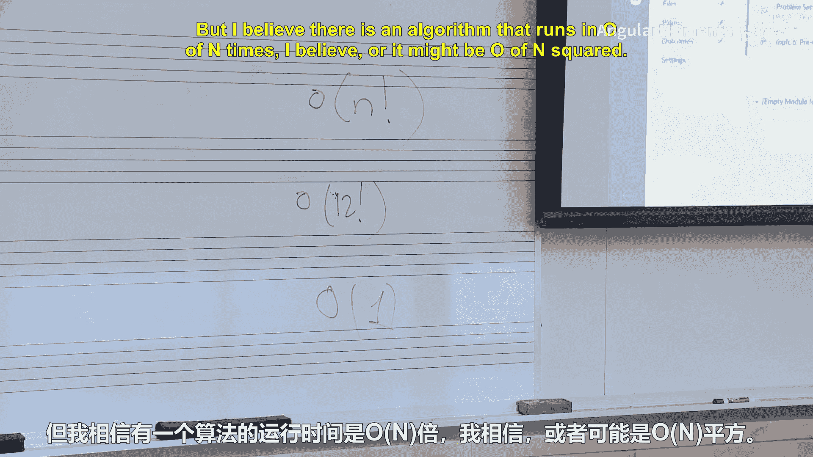
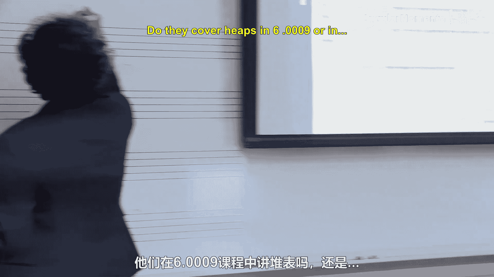
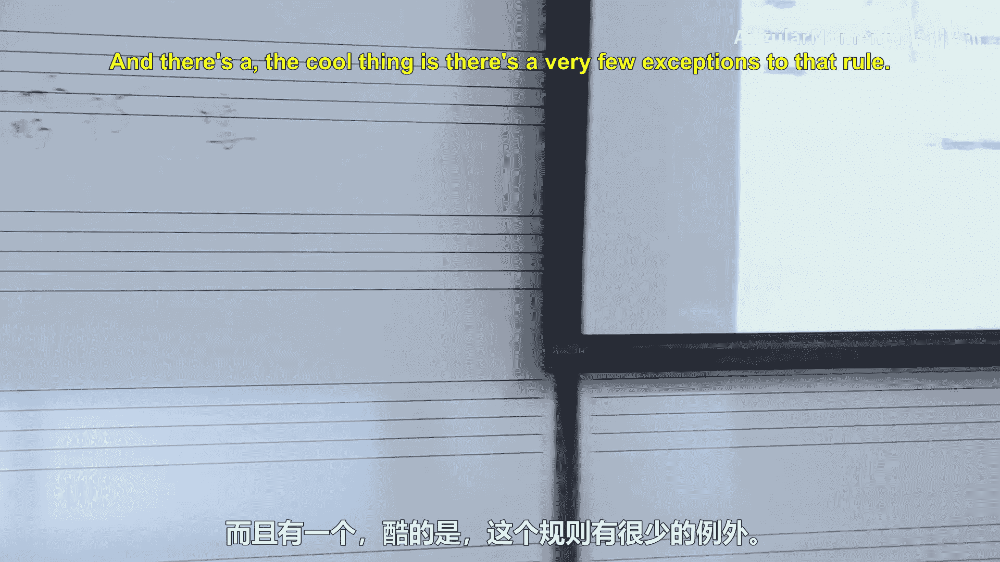
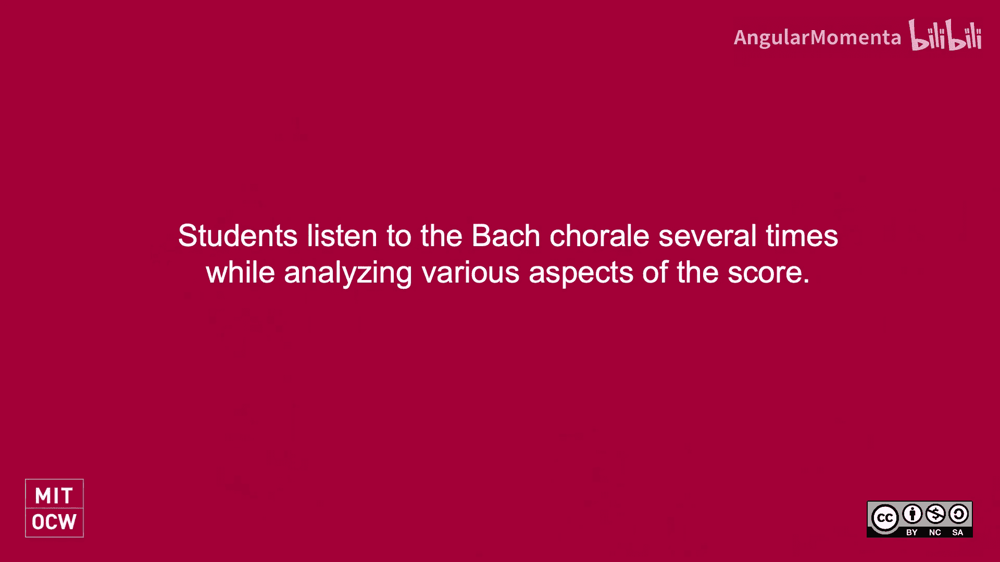
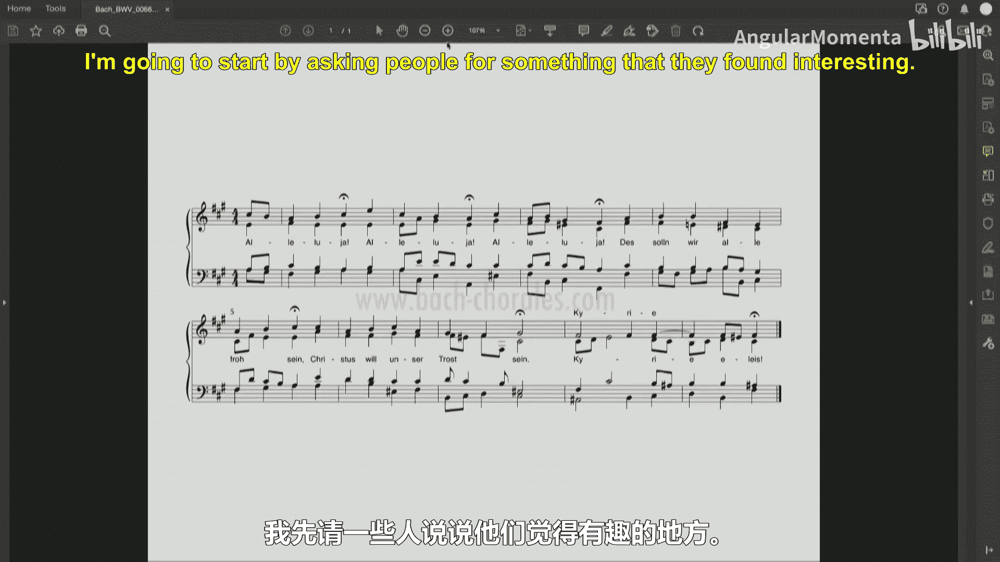
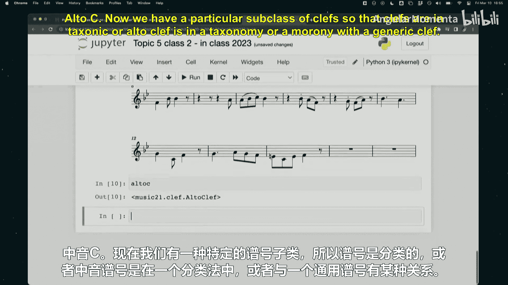
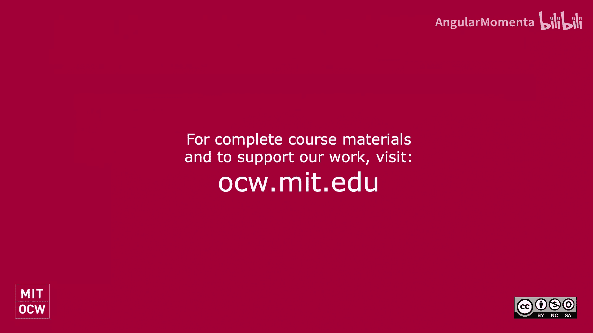

# 【麻省理工】计算音乐学与分析‌ ｜ MIT 21M.383 Computational Music Theory and Analysis,S 2023 p31 31 第14讲视频：语料库研究与统计学（下） -BV17xUmBDEUC_p31-

。Okay， any question problem set four just turned in。 a couple people have。

Have asked for and been granted small extensions on that。

 So I'm not going to be talking through the solution set today。

 but anything that came up that you found interesting， appalling。Strange Adam。 Yeah。

 for the T and the I， I use that O N factial algorithm。The O of N factorial algorithm。 How。

 how high can N get。脱离法。25。For what。So if I had 25 notes and I was trying to find optic or OBDC。

 it turns out what did be a second。Yep， so， so with the O， so you have an O of n factorial algorithm。

 which is usually one of the worst you'd ever be thinking about。

 except for N to the end and today dances worst， right， I can't remember。

 there's a types of things as a professional music person。

 you don't really have to think once you're thinking about things this bad you usually don't。 But。

But yeah，25 was the number that I was weirdly thinking that would constrain N。

 anybody have a different number that often comes up in music for the max， the N， Yeah。

12 with 12 pitch so。You can end up with an algorithm that is O of 12 factorial， which is。

Deeccently big， but not too bad。Which reduces to O of1。Very slow one。 but old one。

 So I don't think that that would be that bad。 I believe there isn't。

 There is an algorithm that runs in O and。

Time I believe yeah， or it it might be O of n squared。 I'll look back at it。

 So there is a way to go better。 but good good for this class again。

 we're not you're not going to be quizzed on your algorithmic complexity of your work， but。

It's always a good thing to be thinking about as we do things I。

I took the summer to look through all the places where I wasn't using heap tables。

 I don't know if anybody。Do they cover heaps in 609 or？

66 double0 6。 Okay， yeah， So the idea of an organization that allows you to any point get the smallest or the largest value。

 but not everything else is sorted。 And that can be a very useful tool quite often but good。

 but most of the things aren't going to be。 Any other questions are concerns that come up。

I'll be curious after class to figure out where 25 comes from put in 25 notes and then C actually of Yeah。

 yeah， so as long as you do your cardinality or your， what's the other one。Oh， yeah。

 what's what's theoctave。 Yeah， sorry。 I was hearing optic， but you were sayingoctave。

 which is correct。 As long as you've done something like that， you're an opt。The OPC。

 which is almost always a requirement for using T or I because the transposition operation in some the transposition inversion operations can in some cases not be well defined if especially if you're thinking of a chord。

 when you invert it does the order， the notes change。In a melody。

 the order obviously matters more good。Can you give some intuition for when inversion is useful and like in doing an assignment is just like perfect a red？

Yeah， yeah， so what is it useful one of the first reasons why it can be useful is a lot of composers have thought it's useful。

 including normal composers like Bach but 20th century composers like Arnold Schernberg or Car Huunch Stockhouseus and they've used inversion cemetery a lot the other thing is that things are inversions of each other。

Have the same interval structure， so if you're being playing with a piece and you're thinking about。

 oh how can I reuse those intervals， that can be a place that's done。I I think it's you know。

 you can Google online people singing happyapp birthday in inversion and stuff like that。

 So quite a number of people do hear it in special cases as an equivalentvalence class。

 As we we saw with the Gustav Hollst example where the sixth time through the cha theme。

 He decides to play upside down。 Do you remember that from the band thing that we have。

 So that that's one of the places that's there。😊，I think we've moved to a world that's different from even 25。

30 years ago， where was this notion that， oh， eventually。

 we're all going to hear inversions the way we hear transpositions。

 And I think that that's not something composers are asserting as much。 Great question。Other。

There's one case and I haven't run your I think sir that is interesting that almost all。over here。

 almost all musical。Structures that have the same built on the same numbers of intervals。Like。

Once you do reduce someoc equivalent and so on， such as， you know here we have a major。Third。

 especially if we don't care about spelling。 And here we have a minor third。And together。

 we have a perfect fifth。嗯。And here we have minor major perfect fifth， major triad， minor triad。

 most cases that chords that have the same。Interval content can be transposed or inverted to make each other。

 And there's a。

The cool thing is there's a very few exceptions to that rule the most famous one is。😊。

Any transposition。Or in version of this， we'll use pitch class numbers 01。3，7。So， that's。And。0ero。1。

4。差脖子一。46。0，1，4，6。 somebody while I'm getting a new pen， verify that those are。

Hosts have the same interval content。 Do they both have a semi tone somewhere。Yeah。

 between the zero and the one， right， do they both sorry。

 you do need that better pen before you do it。 Do they both have a whole step。Yeah。

 where's the whole step in the first one，1 to three。 yep， it's written this way with spelling things。

 So it's a little hard。 Do they both have a minor third。Do they both have a major third？Yes。

Thiss a little bit harder。 Yeah， so two things at four， there's the major third， a major third。

 Do they both have a perfect fourth。Yeah。And。Yeah， where's the perfect fourth in this。あ、それです。

This one's pretty easy， and here the perfect fourth is because we have octave equivalentvals。

We just move this one up and then we get a perfect fourth。And do they have a triome。ister。 Yeah。

 this one's pretty easy because there's a triton from the lowest to highest。

 And here it's between the first。At the last。This one's particularly interesting because any fournote chord will have6。

Intervals in it。 And if we think of how many。How many semitones， how many holds steps。

 how many minor thirds， major thirds， perfect fourths。

 tritones and everything else above that is just an a version of these。 They each have one。

 So these are size called the all interval tetracords。

And the fascinating thing is that you cannot invert one to make the other。

There's only a few things like this， and they're called Z related。

Nobody really knows what the Z stands for。 It's not a Russian propaganda thing or whatever。

 So they're Z related， and they always come in pairs。If we use a 16 tone system。

 then all the Z related things come in in triples。And somebody has worked out the math。

 if we use a 30 ton system， They all come groups of five and so。

 And one of these things that we that those of us in the music theory have never worked with a mathematician to figure out what the general pattern is of where Z related systems come。

 Okay， nice little side。 But kind of the fun things you can do if you're doing a little bit more pure math side less computation interest。

😊，That would be ambitious。That would be a final project that have a backup plan because do not do not bet your entire grade on being able to figure it out。

 But， but yeah， enumerating various things and。一。B。Great。

And a lot of people who are interested in posttal music will be interested in that good， okay。

Let's move。Off the computer we've gone from computer to math to let's go to pure music。

 I'm going to play in a second， but you can get started the corral I've passed out for you the class theme Corral。

 alleluja， alleluja， Corral， and your job。Talk with other people around this is first to spend。

Let's spend five minutes just doing whatever Roman numeral or other analysis you've been taught。

On this project。 And let's not all start at the beginning so that some of us can have some interesting comments about the end or something。

 but just。Pretty。5ive minutes until I give more instructions。And if you talk with each other。

 you'll make fewer mistakes。

Okay， let's bring it back for a second。Everybody。I'm gonna start by asking people for something that they found interesting。

 Let's， let's， let's， let's number guys， let's number our measures。 So 1， measure 1，2，3，4。

5，6，7，8，9。 Did I count that right。So I just so when you say if there's something interesting in a specific place that I want to know it。

we'll just， we'll jump around a little bit。 Jason， what do you find that's interesting。本那个。

very starting at the end of those first measures。I think it's 5，1，51。5，1，5。

1 the following one is basically5，1，5，1， but an abstract。Oh， so we have。

 so your interesting thing is that we have some sort of。

 I don't know what you call it modulating sequence。Modulating。Or repetition on different keys。

 This is the one I wanted to get rid of。Good。Let's see。Who hasn't been calling for while？Anngeica。

Its where did they chose the extra water？If you're looking at an a major， it's like equals two。

The majorjor 3。でそ。So were， we're starting in， in a major。

 and then it goes to the would you say it goes to a sharp minor。啊会叫嚟嗰翻。A major。

It goes between to six minutes。Thankて。So it goes between。

 it goes down a sixth and then what it was between a major third and。It's， or six。Oh。

 goes from a minor sixth chord to a major sixth chord。 something cool， great。

 super very interesting keep。😊，Going。W hasn't been called Jordan。Something interesting， I guess。

I was trying to figure out what the cord was I mentioned two。The last word。嗯哼。Yeah。

 I look at all that。Yeah。Who， who， who gave a label to a chor here。Okay， good。 let's。

 let's see Matthew， what what label did you give it，5 six of six，5， six of six。

 and for those who don't yet translating those numbers to symbols and head rethinking of something like。

Okay， I can over time， you do learn to hear the lower cases and the slashes and the things's what's in Roman numerals and what's in Arabic。

 Any could give a different thing for that。Yeah， I can question， but， just let me。

 Let's let's finish on this question。 is okay， Yeah， so like， I worked from the end。 So yeah。

 I just kind of assumed it was an F sharp miner like this was just like this。😊，56。

 So this was just in 5，6。 good。 So I think we're getting to next question。

 How many people noted a key change in the piece。Not everybody got far enough to do。 one person。

 two people。Presumably did or did not。 I mean， I got through like halfway through measure 3。

 That's fine。 That's fine。 Good and anybody not find key change。 So John， yep。

 so for those who for those who did think of a key change， where did you put the key change。Adam。

8 between measure 7 and 8，5，6，7 between here。key change get any other？Thanks， Jason。

 I didn't get that far， but it does feel like there is a huge change like between two and three。

Between 2 and 3。 great。 Where would we put it exactly。If you are buying Jason。If。

 if if you're going with Jason's， where would you put that the two of utter word。

Within the within second measure third and fourth beats。

 second measure between third and fourth beat just after the Fbota。

Anybody would place it another place？Anybody think that， you know。

 it might be ambiguous and we might be kind of floating between two keys for a while when we do certain key changes。

 Anyone ever think that there's a type of P chord that chord thing that begins with a P that some people use。

But yeah， John。Picickerty is， is a type of chord。 and it does apply to this piece。 Where。

 where do we see some that might be a pickery。Anybody pick ity third？AMa third in a minor context。

Yeah， the very last chor。 very last chord。 Yep， the word you were looking for is pivot。 Pi。 Yep。

 so we went with two different ones。 We got two different great P chords Yeah。

 so pivot chords are what some people use to say that， oh， you know。

 this is the moment when we're in two keys for a while。 And I remember asking my teacher。

 can there be a pivot region And one teacher said， no， now， you choose a chord and stick to it。

 And then another teacher said， no， no， of course， there could be so。😊，Good， any。

 any couple things for those who did do the end or get to the end。

 how many thought we were in a major at the end。How many thought we were an F shark major。

How many thought we were an F sharpt minor。Couple。How many thought we were in another key altogether。

Dlorean。 O， good。 That last one the only one that I wouldn't have like somebody who thought we were in F sharpp major。

Explain to the F sharprp minor people why they're wrong。Yeah， go ahead。

 well like the LD A sharps in the last two bars are indicator。

 but also I think we thought that that Ramada measures seven。Sounded like like a dominant pilot。

You a minor。And ended up resolving into F sharp major in the next quarter。

 which kind of persist for the next few。 Okay， good。 couple， couple things that I heard。

 that's always a very good way of not necessarily winning。

 but advancing an analysis arguing said it sounded like good。

 always always thinking what our ears do it， not just what's written on the paper。

 somebodybody who is an F sharp minor winner。What。Sory to convince the F sharp major people that they're wrong。

 Yeah， John quite bit seen。And stylizing things， keep keeping it still in short after minor。

So a stylization， but there doesn't change。好，这样 so。We can have a disagreement on this。

I'm not going to say at this moment which side I'm more on because I can see the validity of both sides。

I can't。 because I know the world of Bach。 I， I myself cannot really hear it as， oh。

 we're still an a major。 and we are ending on the sixth chord。

 and the sixth chords are very important。 But on the other hand。

 if I listen to a lot more contemporary popular music where6 is a perfectly valid chord to begin on and occasionally to end on seems you know。

 quite， quite possible。 Good。 So we just spent 30 minutes looking at one choral in particular。

And that's not something we're going to do very often in this class。

 But that is the normal way of analyzing music， right。So， what I。

Want to do is to bring up the concept of why， what we're doing with corpus analysis。

 which is what we're gonna be doing for most of the rest of the， of this unit。

 So I'll just put this up for a second。 And there's a。It's the way I can blink。This。Doess that work。

对。じ在不叫。So we often think you may have heard this in one of your literature classes about close reading。

You know where you're。Looking through and finding all of Mark Twain's metaphors or all of Jane Austen's foreshadowings and how many Greek rooted words are used in this sentence。

 this paragraph compared to the Latin words or the Anglosaxon ones and so。

 So close reading is the main type of literary analysis。Starting about。

It goes back to sort of the '80s， but really in the last 20 years。

 there's been a movement associated with the computer。Called distant reading。But。

Other people were doing this before。 but the term is connected to a literary critic named Franco Moreetti。

 And that's not going be on exam or anything。 But so the notion is the distant reading is something you do when you're not close enough to the text to really make these kinds of。

Precise arguments。 But you are far enough away that you can see not just one text。

 but multiple texts。So some of us who work on corpus studies have started in music。

 have started replacing these terms。with close listening。Which is conventional music analysis。

And distant listening。Which is corpus studies。啊。Whats。

What do you think some of the things that we can do with close reading or close listening， better。

 close analysis， whatever you want to call it， better than distant analysis。Yeah， in most analysis。

 we can look for specific phrases。Specific phrases or motifs，Anything else you think？And let's。

 let's think of sort of the world we're in today， not， not the world of 5000 years in the future。

 or maybe  five minutes depending on what happened at Open AI today。

 But you know where the computer can do many things they can't do。

What are some things that we're going to start losing？要。要。Makes distance distance。

Lening differently close to me because like in a corporate study。And。こす。Sure， so let's， let's。

 let's think of some of the things。Let's take at some of the things。 we'll go back to literature。

 So what are some of the things that humans are good at in picking out of literature that computers are still not very good at like more abstract。

 Like， we can be like， oh， this no vision like Shakespeare。

 Is this similar like we can like notice patterns that like our heart to。Yeah。

 condense it to like one formula function and be like， oh。

 this is a similar melody to like something that was used previously。that's a good one。Other things。

What about for you？嗯。Let's，'s， let's start with some one that that's hot in my head。

 But I really want to make sure we don't lose track of this。 Anyone have a piece of music they love。

Okay， also good， good， good。How did you fall in love with that piece of music。嗯。我。Listening to it。

Good， how many people have fallen in love with a piece of music via corpus studies。oo，ooh。

 this one has 47% of sharps。 And so let's， let's not forget that the reason why we make music and listen to it。

Is the enjoyment happens at the close level。嗯。The other thing I was thinking of the literature is this character。

 I'm already reading， crying in Hmart right now。 I don't know if anyone knows this memoir。

 but the one of the characters it is going through a very similar experience that I went through in my life。

 the family death。 and it was very deeply resonating。So， resonance。Outside your life。Or outside。

Not outside your life。 I can't really I outside my life outside the text。

 and we'll use text to mean both。Literature and music。So there are something。

 What are some things that， however， that distant listening or distant reading。

 that is to say having a computer look at 100 pieces might do better than close than close read。

 Let's first， first assume we have infinite time， then close reading 1000 pieces。

It can allow you more effectively when listening can you please guess who the proposalr was or what the time you。

Okay。So you could use。That yeah， distance for guessing。Zre or period。Or authorship。

You might be able to do that with the thousands scores， but that would take a long lot longer。

What are other things we want to solve， Yeah， of precrib any。

It's easy to say something sounds similar， but actually analyzing it gives you。Where super。

So it gives you words for describing gives。Words for describing similarity。And。

What else besides words for describing similarity， what are some other things that we like to get out of this class？

Yeah numbersumb， number statistics。So this， these are some of the reasons why I want to be thinking this。

 but。I think I， I'll just say because Im leave me a couple minutes behind where it' like to be that the most effective。

Way of working with any sort of new genre， new style， new anything。It's the start。

With close listening， close reading， start with the analysis that you've done now and try to do things by hand。

Before moving to the programming。How are we going to do distant listening。

 How are we going to do teach the computer to do this。

 Because there's something that didn't come up that the ambiguity and the the types of sort of， oh。

 I'm going to have to make a judgment call on this on where the modulation happened or is this really5。

6 of 6， or do we already jump directly to the new key。

 or is this thing that I'm labeling actually a chord at all。

 or is a whole bunch of passing tones that happen to look like a chord。

 These kinds of ambiguities are things that will。That I think。

 will come up when you're doing the close listening， close analysis。

And that you'll know you have to account for them in some way during the distant analysis。

 And sometimes accounting for them in some way is just leaving a footnote。

 saying theres this really complex problem。 But I only saw it twice in close listening to four pieces。

 so hopefully， we can ignore it as a rounding error。 but at least declaring them。

Then when you've done your corpus study。There's something really valuable about finding things that are interesting there。

 right， What's that piece that completely。Throws that outlier piece that' completely throws out and。

Going back。And listening to it maybe doesn't even have to be close listening。

 but actually just human listening so that we get what's the end result， Why， why we do any of this。

So we can get to the enjoyment， the point of trying to do one of my dream projects。 you。

 you have heard of I M S LP's huge sheet music score。 I want to find the most interesting。

 unusual piece by every minor composer。😊，That's on there。 That has the thing。

 The one piece that this one forgotten person that that she or he wrote that we。

 that we should actually be listening to。 Maybe exactly the one piece， this  one。

30 second excerpt that Groer wrote that。I don't know， and I'd love to know it。啊是。We're not there yet。

 not there yet， but maybe we can get there。Great。So。

Well the next thing you're going to be doing is trying to figure out what kinds of things we can do this kind of close analysis on。

 We did the Irish music corpus in class on on Wednesday， that was a pretty small corpus。

 60 pieces or something。 then online， I gave you tools for using the entire bach Corral corpus。

 So if you want to find anything super unusual in there。 that can be a good place。不。

Be boring if those are the only two ones。So your next problem set and it's up is problem set 5。

 And let me put this back up here。So， this one。Want to do is in groups of two， prepare 3 to 5 pages。

 short paper，3 pages is， except is totally fine。5 pages sometimes is， you know。

 might be something you want to do that tries to figure out。

Some corpus that's out there that's been active in the past 10 years， and。

Try to figure out how it works。 So and why it's out there and what its extent is。

 So what are the goals of the project， Who are the participants。

 How are the scores or other musical data encoded。 I think I've forgotten to put on here。

 What's actually in there， What's the project actually trying to do， This was。

 that's the goal of the project， But what piece are collected。

 What is the overall extent of the problem， There， What's it trying to solve and how much by doing this。

 and how much of the problem do you think could be reasonably solved in a limited timetable。

You don't have to do all of these except for the first one。 And we'll get to the last one。

 What are the strengths and weaknesses。And what could you do with the corpus。

 What questions relevant to this class could you answer。By having this。

Just like we did with the what questions could you answer with a whole collection of ba Corrals on was that piece at one or or three or something like that。

 you don't need to use the corpus to answer it。 they're not being asked to download and do the things。

 but Anyhow， you'll probably need to know a little bit about the kinds of music and the problems associated with the project and what they're trying to do。

 And my preference is that you focus on a corpus of musical scores。 sorry， it's too high up there。

 scores that can be readable by music 21 or something else。

 But if something really grabs you and you're like this this is the music I really like。

 and it's all audio or it's all images or something like that。 go ahead and do that。

 just the only two things I'm gonna say I am SLP and Wikipedia are out too obvious， right。

I've given some places that you can begin。Some of them。

 I was nice enough to give the links and other ones。 I'm like， man。

 And then some directories of projects。And。And how what you're going to be asked for， URLs。

 screenshots， how many， how deeply the questions you were answered。

So hope that you'll find this kind of fun。 It's due in a week。 I What I want to do is give you now。

10 minutes to find the person that you want to do this work with。

 the only caveat is you cannot have been in the same Pet to group。 That's just because， you know。

 when we do a lot of group work and you have group grades。

 I want to make sure that you're getting things from you And so we rotate that around and start talking about。

What potential types of things you've seen or you've done。

 this is a good time to Google and mess around on the internet in class with your professor's blessing。

Couple things going on here that just want to make sure that we get to。 We're doing these big topics。

 you know， Corpus studies， representation， intervals and stuff like that。 But then along the way。

 there's a bunch of little things that will make your life easier that， you know， like eventually。

 you'll need to know how to deal with clefts and stuff。

 so on make sure if you haven't been reading through parts of the Music 21 user guide that you。

That you continue to do that and that this is a place when you want to know something。

 there is the user's guide and the complete reference。

 the complete reference doesn't really distinguish between what is important and what isn't Where hopefullyve done a decent job explaining that you should have by now read through up to up to chapter 6 here。

 if you haven't most MIT students probably won't need to go through chapter 5 on recursion and lists of lists if you're in this。

 but we've skipped chords and sign called quartert5 for a bit。

 I think you can well we'll get to that later。 but definitely start reading through the music 21 object thing。

 what is a Music 21 object。 you'll see durations are not music 21 objects and not everything that's in music 21 is one。

And basically， the easiest definition is a music 21 object is something that can go into a stream。

 It knows how to position itself， and it has a duration and some other things。

 So want to go through this at some point just that when I'm giving an assignment everything's unlocked here。

 how you can give who， who has worked with ja dom manipulationibulation， like elements by class。

 So so quite a a number of people have tried to make music 21 to be a lot like the version of jascript that was around at the time in。

20 whenever it was 2006207。 So there's things like get element by I D。 get elements by group。

 group is equivalent in Music 21 to jascript class， the class， So multiple thing， the dot selector。

 So multiple things can be in the same group。 and。so on。

 and then there's a nice little discussion of the thing that that will probably drive you baffling baffled at some point。

 the active sight， which is telling you which stream is and we still haven't figured out who that one bug that we saw in class with the active site being wrong or the get context by classping。

So this chapter just goes through the basic things and it will tell you how to sort objects which will sometimes be useful。

 how to move two things are at the same place， and what sorting is。

The next chapter has a little bit of the details on how things work， how you can transpose a note。

 and how you can get back from the transpoposed note to its original note and so on， except your no。

Yeah， I think transpose is about to be unlocked for you right because you've just done all of this work。

And a bunch of other little things。 But that's kind of a little bit boring one， so。

Read through that read through the time signatures and beats and the keys and key signatures。

 this last one lets you do your first little algorithmic composition exercise where toward the very end。

 sorry， scrolling fast。Here we go where we can create a little melody， something like this and。

Automatically change it and have。I don't know why size this goes。嗯。

🎼Have a piece of music that I remember having to play a lot in junior high。🎼走啊。

So it's nice to make little algorithmic pieces before we write our first true algorithmic composition for which will problem set eight。

So those are some of the things that you've probably been looking at。

 also optionally might want to go through clefts， articulations and ornaments。

 And we'll do a little bit of that right now。 We're not going get time to get to intervals right now。

 Okay， so let's， but let's， let's play with a little bit。

 So if you have a second and you have your laptop out And if you have Jupiter able to be got up。

 sorry， I should have。should have said that five minutes ago， like always。You know。

 like the way the conductor says， I want you to play a little bit louder and。

 and make sure to specifically separate all the notes 32 measures after a， right， You know。

 the worst worst order。 Yeah， so sorry， sorry about that。

 That's just me vamping while we give us a chance to。Who。

 who cannot see a Jupiter notebook that's just or I suppose you， you can all see mine。

 So given the time with 10 minutes， let's do a little bit of。More work on。On things， you can。

 So I'm going to import corpus stream note meter。 and' going to look at。

A couple other little things in a piece by Joseph Hyyn。 So Corpus， Parse， I'm going assign it to Hyn。

 Hyn。Opus one， number one， movement one。So let's think give everybody a chance to do it and you can show it when you're ready。

This is the first string quartet that Hyyn ever published。Pretty young。

There was mostly an old man thought of as a sort of old man composer。

And start with our close listening for even just few seconds until while I grab the recording of this。

 what's interesting about the opening to anybody。It's all in unison。🎼，🎼Yeah。

Do we hear that's all in Newton？🎼，🎼。🎼I didn't give you the second page because I did it in the notebook。

 just remember， you can always show hide， show。Music XML dot PDF to get it or just。

To get the whole thing up。Okay， so it's all in unison at the beginning。

We're not going to do another thing like we did with trying to figure out what are the where are the notes outside the key and so on。

 But go ahead and tell me how many， how many notes are there in this piece。So when you've got it。

 I'm not gonna not going to call on the first person shout out。 So。

 but let's make just be sure we can still do something like that。So what。

 what is the question that we're trying to do， somebody。

How manyHow many notes are there in this piece。What to who have。Who hasnn't been called on very much。

 strategic， you haven't called on You pick on you too much。 what， what， what。

 what did you do on your thing。' I assume you started with hide dot something for okay， good。

And then index note build note and I can。No counter good。I equals 0， right， I plus equals one。

 And then I could。 So we use the。What kind of iteration does this do？Wecurse good。

Somebody get that number。 That's good。 I saw a lot of fours in the middle there。

What's another way we could do this？Somebody you have a different way。

How did not recurse that get bother。Hide in。Dot， recur。Dot get elements by class。Note dot note。

 and then。Like。Yeah， it's when you， it's when you forget to put that at the beginning that you really wish Python would more like jascript or Java where you could just do dot length at the end。

 But yep， good。 Any other ways that people did。Okay， enough， enough note counting。 by the way。

 you hope that。嗯。That this should when。Also， get something pretty similar。So flattening。

 it doesn't matter which order you're iterating through。

 you're still going to hit every single thing， right？Good。Okay， so let's grab theveola apart。

 I'm going to call it VL A equals and take the second to see if you can remember how to do that。

And what the question is gonna be， this will be one of the last second last thing。 get theveal apart。

 and let's change its clef to trouble cl， because。A little bit harder for us to read who are notvealists。

又回大科学。いやどうで、すね。NoYou might need to。From Music 21， Import Cl， I can't remember。権力？Yeah。嗯。

Haves everyone gotten the raise your hand if you've gotten theveola part out。

 even if you not get the cl good good。 Okay， so I'm gonna put in what I did to get that hide in dot parts。

Vola notice it's not case sensitive。 And Li just make sure I got the right one。

You also have done index。1，2，3，2， right， good。 So keep going on that。

So I'm gonna go through a couple ways I did it。 Viola， we can call it Alto clef。

 Hopefully its that calls what Viola。Clef do cl。Dot first。Hopefully， that's right。Or Viola。recurse。

ge elements by class Clef。Whatever， so。And do this。 And one。

 here's one of the ways that you could do that Ill， I'll just give the ease。

 the way that's probably not the best way。 But looking at the time， I'll explain the best way later。

 We can put it as a G2 clef。 We're gonna change it and。

Peace should be beginning with a bunch of B flats。And it still is。 So that's one way to do it。

 I want to just point out two things here。 Notice we did not change the stem directions of anything。

 So it looks a little bit weird。 It looks very weird when you go from trouble cl to base clef or something like that。

 The other thing is what do you call it Alto C。That now we。

 we have a particular subclass of clefts so that clefts are in taxonic or Altocleeft is in a taxonomy or mory with a generic cleft。

Ch。Altacl is another cl。 Great， So we might be having a problem。

 We might need to see if there's a way we can actually replace it with another clef。 Thank you。

 I did broke my promise your 20 seconds slate。 So thanks。 great class。😊。

