# 【麻省理工】计算音乐学与分析‌ ｜ MIT 21M.383 Computational Music Theory and Analysis,S 2023 p32 32 第15课视频：语料库编码与声部导引 -BV17xUmBDEUC_p32-

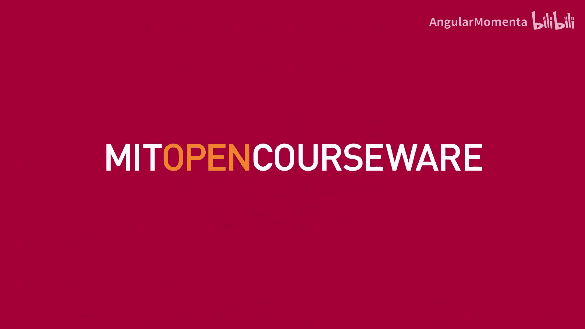

And you'll remember。Probably it's all gone because it's like what a week ago。

 Pet 4 was mostly about the topic of equience。Clasasse is equivalentvalence。In music。

What were some of the things that we were talking about back then。

 Because this is just going to keep coming up all semester。

 What are some things that we could say in some context that two notes or two pitches are different。

 but in another context， we might say they're equivalent to each other， yeah。Octaves， great。 Let's。

 let's just shoot out。Permutation。Carinality。Transposition。

 inversion and the one that's not part of the optic spelling。 good。

 just while I put some things on the board， shout out some more things we talked about in class that we didn't put on the problem set。

 What were some other things that we say things are the same， even though it might sound different。

Insnstrumentation。 Yeah， we suddenly say， hey， that note's a C。 And it's like， no。

 that note was on a， on a piano And this one was on a trumpet。 Good other things。And harmonics Yep。

 that goes with is a special class of。😊，Spelling good， good。

 but it's good to use that term anything else。So I said， it doesn't matter how long the note is。

 It's still a C。Right， yeah， so duration， when we're talking about notes， good， good。

 So I can't apparently lead a discussion and write things on the board。

 But I want to talk about two things that came up a lot。 One of them。

 I don't need notation for and one of them I do。 One of them much better。 be sharp。4，2， I don't know。

 It doesn't really matter， but it's F Sha 5。 you were asked to write a program to automatically generate the interval on Well。

 sorry， you were asked to write a program to automatically generate the interval of anything。

 And this was one of my hidden test cases that I think it's the only problem that over half maybe three quarters of the class。

 the problem came up with what's。Which one of these two notes is the problematic one。Take a guess。

 B sharp， good， good。 Now B sharp is a problematic note the way E sharpp is， right？

But it also has its own special， problematic things。 What， what's be sharp for。

 What notes does that sound like。C5， good。So。The issue that came up a lot is the only thing。 What。

 what should this interval be， Let's， let's think about that first。 What should the interval be。Yeah。

 diminished fifth。So let's think about the diminished fifth。Good。Yeah。

 what would be the interval if it was C5 to F sharpharp？5。Any不。ある。Augmented fourth， good。

 So the four and the five are changed around based on the number of distances in the step spacing。

 which you all did great on。But now we have a different problem。

 And so what came up a lot from various things， I saw a lot of D， D D D， D， D， D， D， D。

 Is that the right number， D， D， D，12。I think that might， that might not be enough D's。

 because the issue is that the B sharp is something that sounds in kind of octave 5。 but it's not。

 So always when you're thinking of， you know， how's your screwy prof going to try to screw you up。

 Think about these things that cross over the boundaries between octaves or sound like one thing。

 not the other。 a lot of， a lot of times， what happened was you needed to do something mod 12 at a certain point。

 add an offset depending on how your algorithm works。 and then mod 12 it again。

So this sort of double mod 12。 at this point， we're we're gonna be working for algorithms that get things right。

 We can work on efficient algorithms as sort of you know。

 more efficient ones as kind of a project later。 good。 the second one that came up。

 had to do with asking you this was done by hand to come up with a pitch set that was equivalent to the 1 I gave you using P permutation and T transposition。

 But without octave inversion or cardinality equivalentence。 And most of you were like。

 I don't even want to think about inversional you know， equivalent。

 So that's good in cardinality equivalentence， it just means that I gave you three notes。

 How many notes should you have。3， good， good。 So the hard part。 So this was a 4， E 5， C， sharp 4。

What I'd like you to do when you have a problem like this is go back to do it the old fashioned way。

 First， get out staff paper or use finale， you score whatever you're using and try to make sure that you're seeing what the notes are。

 So where's a forgo。Stop two， stop stop， okay， good a4。What's the next1， E5。So， okay， good。

 ghost slower puff， right， And then what's the next one。C sharp。4， right。Let'stop。

What's the common name we would call to this if this were a chord。majorA major。

Firstversion in first inversion。 Yeah， so oops， I got to justle this Otherwise blood red。 yes。

 first inversion， okay。So then what you need to do。

 you want to do is something that and it had to use both。

 Now I think I tried to say in such a way that even an MI T student wouldn't be allowed to say， well。

 you know， not arranging anything is not rearranging anything is a permutation and transposition by perfect unison is a transposition。

 but you needed to change them in some way。 So one of the things you could do So one of the things that happened a lot was that the octaves got changed。

 And so that ended up being about 40% of the error that we saw。

 So you can do is you could first re your mutute things。

 and probably the repermutation that I would do first is let's just put it in usending order。

 So that's probably the permutation you'd like to have your computer do anyhow。

And then let's just shift everything up。 One way you can do it。 Well， in this one， you。

 I was gonna to say， shift everything up a space or a line。 But the E is the problem。

 So let's just transpose up a major second。 What are we gonna get here。D sharpp。第一。F sharp， good。

 not because。Well， no， this one， we had implicitly because everything on this。

 we had spelling or and that's an S not a 5 spelling equivalentence。 So， yeah， so D sharpp 4。

 B4 and F sharpp 5。 So when you get that back， that's there。 Any other questions on problemm set 4。😊。

Hardest programming problem set so far。No，2 was hardest for some people。 And you would vote for one。

 No， okay， if， if one was the hardest， probably you're not here now， but sorry， I shouldn't。

 but yeah， So problem set 6 will be announcing today。 It is also a slight programming one。

 It's designed to give you a little bit of a break。 And you'll I'll talk about it in a bit。

 But it's more of a the only sort of participation grade type of problem set than trying to get the exact results。

 So we're gonna have a little bit of a break coming up for things。 somebody want to volunteer。

 what electronic corpora did you find online。😊，Adam， we didped Mupedia。 Great。 What's， what is it。

It's a dual database and search query data。Coolいななく。Yeah， we did ultimate guitar。 ultimate guitar。

 Great， Hows， hows that encoded。I mean， they started off with just like text ASI guitar tab and they kind of expanded and incorporated more advanced software Oh cool Yeah。

 I remember when it was a lot of ASCI guitar tabs， I think everybody had their own parser for the ultimate guitar at some point good Any else。

 Vanessa Vide game music database， fantastic， great great repository what were things mostly encoded for that almost everything was in mini files Why do you think that was。

😊，I think it's like generally a standard and it's relatively small file size as it's easier to like mass pop on a whole one。

It is also， that's probably how they were encoded in a lot of， especially the early video games。

 they were encoded。 So when you're ripping from or something like that。

 but definitely not encoding sharps and false good。 One last one。 jazz jazz database。

 fantastic What we encodings for that and every notes from the beginning what do you'll find is a lot of a lot of these data sets。

 they really have their own sort of one off make your own format I don't think that that one's a standard。

 but I've seen lots of these because that's how things to tend to go。

 Great We're gonna get to right back to representation in just a bit special guest Michael Good。

 who knows a little something about representations being the。😊，Of music， X， M。

 L and sort of founder and Bri Bell also from the dean's office and。

And so if if you guys can stick around for 10 minutes where I'd like to， before we do that。

 let's get sort of warmed up for probably the thing there on some people's mind， right。

 the downgraded midterm， which is now I'm calling a quiz because I'd like to divide this into two smaller。

 low lower stress things。 And that will be on Wednesday。 we'll start recording about 30。

40 minutes in。 I'm designing it to take 30 minutes if we take a little bit longer。 That's okay。

 It's not all about the rush。 But we will do one type of thing that is about sort of recall。 So the。

The， the the quiz will be not about your programming skills， but about the reading。 And we want。

 I want the quizzes to be more about the readings so that you keep thinking about ideas they're going to be doing in your projects as we keep going with further。

With further problem sets， each one of them will start having a little bit of what do we call it。

 sort of assign yourself， your own， your own problem and start it。 Okay， we got some sound going。

 We don't really need that。 But We can turn that down for a bit。 Who's done Kahoot before。Okay。

 who knew the M I T apparently let their cahoot subscription lapse at some time between the last time I'm in here。

 So I'm only able to do 10 players。 So can you all。

 can you all pair up and do in teams with the other。 I know。 I know I， I。

 I was trying to fill out the subscription form right behind class。 So can you team up 1，2，3，3，3，4，5。

6，7，8， Actually， you can be around team 9， or do you want to do with Michael， Okay。

 we might have one more thing to do it。😊，Okay， oh yeah。 Use any nickname you want。

 Just make it family safe。A built you want it to be building。Oh， you can decide if you want to be。O。

So this this is just to judge how much time you feel like you might need to spend reviewing the things。

Great， we have 1，2，3，4。 We have nickname， nickname 2， great。F， six。只。Okay。

 we'll do a little bit of the background music，Although， maybe。Okay。

 we have ain't anybody waiting on， two more people want to be loers， go on their own。Okay。

 now it's good， we're going to get started。Oh， we got winners， okay。Oh and okay， great super。

Here we go， so about 20 or 30 seconds on each one， there's 11 questions I think。13t questions， maybe。

Which is the following is a binary music representation。

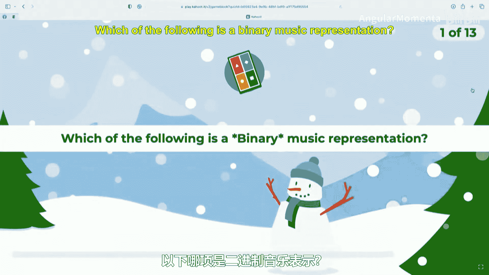

So this is your time if you haven't done this before， block in something。No points were wrong。Three。

 two。

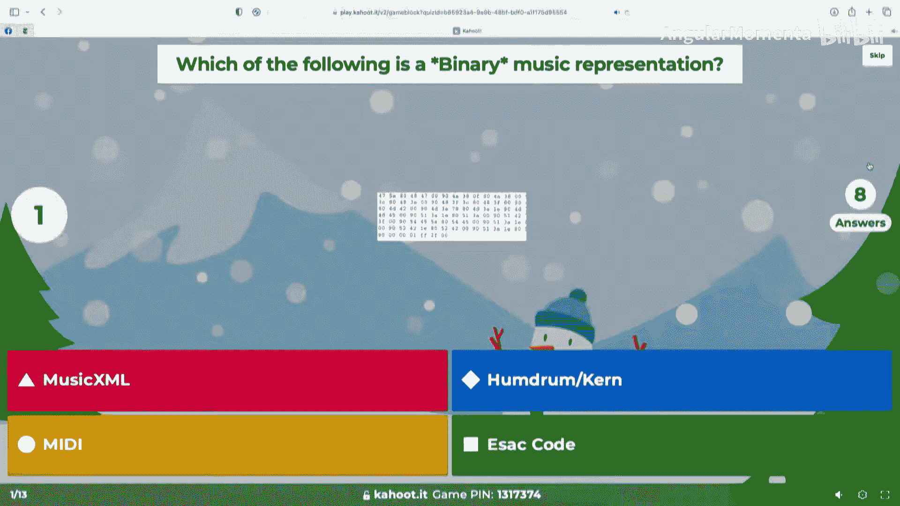

What do we have？Middi， Midi is the only one that is typically represented in binary code and not in text。

 Okay， okay， I know you， you would have thought I would have made the answer music X M L honor our guest。

 but we didn't You knew it wasn't X。 you knew it wasn't music X。

 M L because you studied that well enough good。Let's keep going。Okay， Nick。

Creative nicknames are up top。According to Cook， what is ironic about the timing of the rise and fall of comparative and computational musicology。

🎼。Hey， mostly we got it comparative musicology， which is kind of designed well for computers to at the time computers came up。

Okay， that's Nicholas Cook's comparative and computational musicology to review if that one wasn't obvious。

 We'll keep going。 Okay， we got much more on the board。

Who was not a composer whose music was discussed by Cook， Who was not in there。This is a hard one。

 this is not as hard as hope。Three seconds。Oh， most people got it vulgar， no。

 Ligay was the one with all the graphs showing when things come in and out and the hide one。

Hyn was used as the example for， for the German nationalist song。 He was the composer of the music。

 but not the lyrics。Okay。Oh， we got one fire。即 o。The music 21 iterator talking about my own stuff that returns offsets from the start of the part is。

🎼。🎼医两。🎼You。Now one more person。Two seconds。Hey， almost everybody got flatten。

 I know you know that somebody was trying to do the thoughts experiment that I like recurse better。

 I keep telling you it' recured。 But in this case， flatten is the better one。😊，Nos。Okay。So。

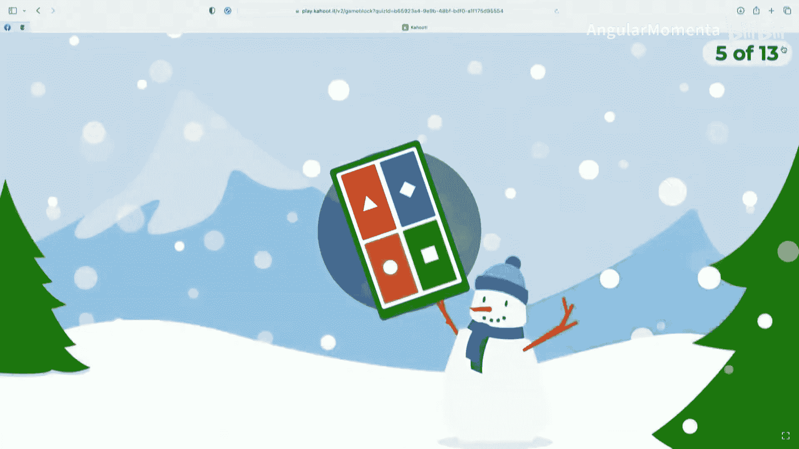

Who wrote about musical codes in the introduction toBeyond Midi。と本。No， say that。 I said that。

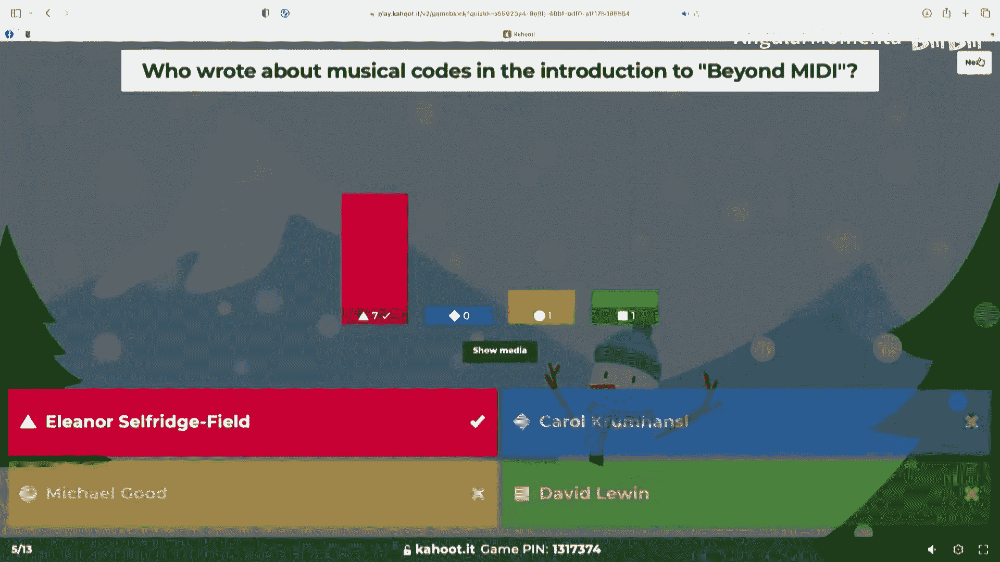

My， Michael Good does have an article in that book， But no， you don't know。

 That was the actually virtual score。 What I wrote before studying， okay。H， getting close。

Dmetrimasco can criticize me for all of these things about Music 21， except what this is hard。Okay。

🎼嗯。Oh no， the one thing he didn't criticize for is the worst feature on it。

 It is really hard to install， but somehow he already got it installed so he didn't care about that。

Okay。So that was the one that shook things up， the snowman。Here we go。 We're half over halfway there。

 This is an extra credit from an optional reading。 So don't worry， But take a guess on this。

 And Donald Bird created his extremes of music notation thing to show that notation， what。😊。

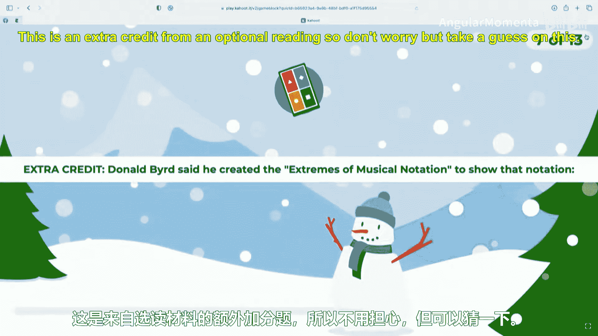

ですからね。Its all my right。

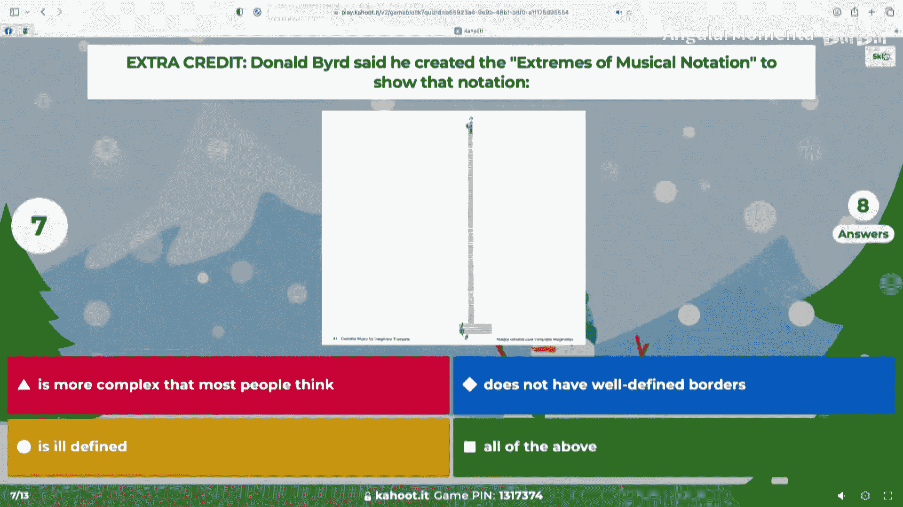

🎼，Yeah， good， good， good， okay， we don't need to discuss that。I if you didn't do the reading。

 it's really cool article if you haven't had a chance to look through it， some weird things in there。

Craig Sap's name， good guy， good guy。 We appeared in this class for his creation of what。嗯。Okay。

 what do you get yes？The illustration of the same passage of music in dozens of encodings also known。

 allowing you to translate from one encoding to another called the。Rostta Stone， yep。

We have he now runs the humdrum thing。 but was David here on here， nobody did this one。 And yeah。

I don't know the answer to the red。Does the yellow exist。Yes， I believe so somewhere。

IThis is from the reading for today。 So we'll see if we got today's reading。

 What does David Len call his unifying rule for species counterpoint。

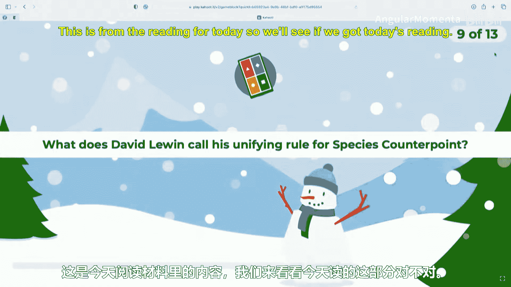

すごじさ。🎼や。🎼对。🎼。

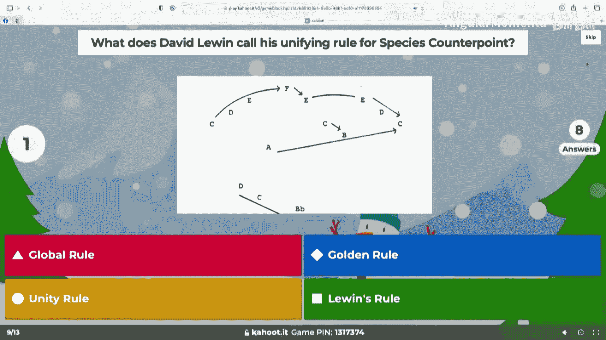

Okay， a lot of people well， those who said golden rule， by the way。

 I am going to misspeak and call it the golden rule a lot because I。Do that， but yep。

 we'll talk about it a little bit more at the end of class today。

Common or conventional music notation。 also C， W M A N。Consists of what。気す。Seven answers。🎼，🎼，Yeah。

 it's I know all of the above is almost always the right answer when you take a guess。

 but no in this case， it was just things that traditional Western music notation in some ways so that you can write down non-wester and you can encode as you all know。

 you can encode many things into the computer that are not that So great，' doing we're doing well。

Now。Okay， three more。

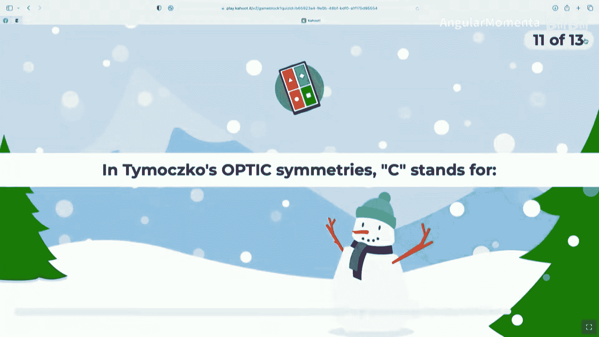

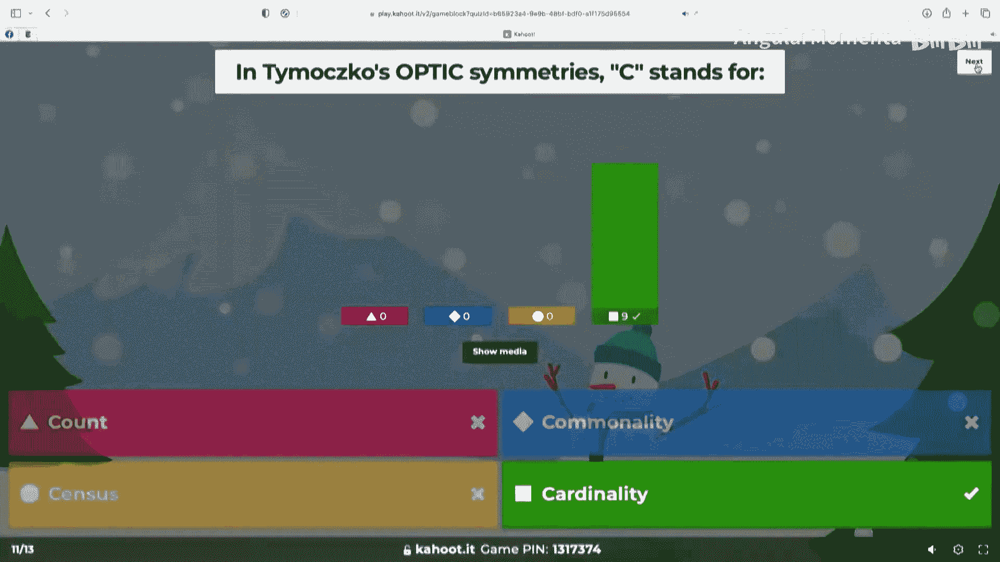

W wow。Nice。We don't need to do that anymore。Arden and Huurron showed how European folkong varied across。

Grous times， locations， functions。Hey， yep， almost got that。

 This was the article that showed the geographic information systems back when that was very。

 very hard to do。 we should be able to do this more easily with Google Maps and things。😊，O。

Before we do the last one， before we do the last one， just to note。

 the quiz will not be a bunch of these little factoid things。

 That's just all I can figure out to do on Kahoot。 It will be actually about conceptual issues and ability to apply these ideas。

 but。Sious。 Oh， it's about Sophias son and me。Showed connections between music and emotion using what types of musical scores。

嗯。🎼嗯是。🎼Oh， no， I know I do too many ba crrals and I do medieval music， but it was lead sheets。

 So yep， oh， yeah， you read great， so。😊，We have on the podium。Third place， nickname 3。

 Anybody want to claim their podium。 Nice done。 nickname 2。

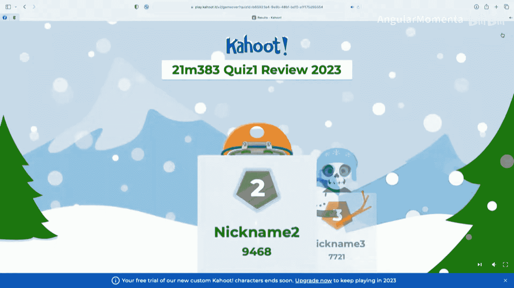

Yep， and at top。

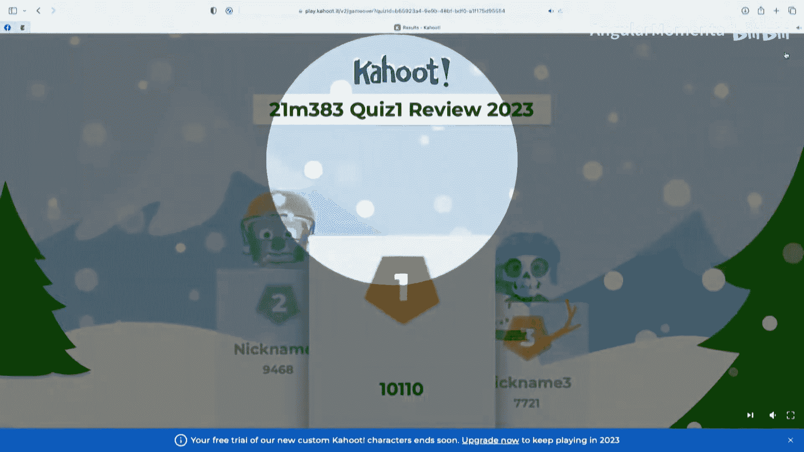

😀Yeah。I guess this shows that some people spend their time not thinking up creative names。

 but reading the articles。 congrats， everybody。 So we've been talking a lot about encodings and what you'll be doing over the course of the semester。

 sometimes， is working with these strange encodings。 And maybe as we're starting to get。😊，Well。

 let me say you've had some problem sets where I've given you questions and you've given answers。

 right？ And now you've given two problem sets that encoding one and this corpo one where you've been doing the research Def interesting problems。

 But I haven't been asking you to actually get an answer。

 You didn't need to make a corpus par parser for guitar ultimate guitar in order to answer any questions。

 we're getting to the end of the semester， will'll be bringing those two things colliding together and doing more on how you can come up with your own problems and come up with your own solutions。

 Michael， would you like to come up and talk for just a little bit。

 I'd like to introduce Michael Good， who's M I T grad and the inventor of music X M L up here's。😊。

感 here。You all have seen an interview with Michael， right So just wanted to。

 to talk the interviews a couple， couple years old now， I think we did it during Covid。 Yeah。

 so what's， what's been up and interesting in the world of。Anything with computer music。

 but especially， you know， music theory， encoding， anything that you've been finding or。

Oh I retired in January， so my mind has sort of gone out。the music notation area。

 I just that close to I mean some of the things that were these projects were really cool。

 the body percussion and coding stuff and I was like its pretty great do you feel like like now you've got to come out of retirement and find a way to put all these things into music XML？

So in the future， But what， what are some ways that somebody could get， you know。

 a particular musical project if they're interested in you know。

 nonwester music or something else and get， get such a standard sort of musical encoding as you've created。

 What， what kind of advice would you give for that。Well， yeah。

To develop a standard for a music representation。You need to have multiple people who are using it。

 right and you need to have。I think tools that support it so that becomes if it's not standard that becomes more of a you know less common repertoire that becomes more of a chicken and an egg problem so look for something that has at least two applications。

That are doing that type of music and see if you can do maybe one's an application you wrote and one's an application somebody else wrote and tried to put something in between。

 I mean， when I was starting music XML， a lot of people had tried to do a standard common in Western music notation format and I knew that if if it didn't work with either final or surveillancebelious because those are the two programs people cared about then it didn't work with at least one of those two programs I was just going give up。

 go home and find something else to do because nobody would care about music XML if it didn't work with one of those programs nowadays it would be Mucor or things like that。

So if you're trying to do a standard music representation。

 then you need to have a community of people who are using it and applications that use it。

 maybe more interesting is just to， you know， at this point is to come up with cool things that could be represented。

And and do some analysis there and try to figure out ways that these representations could be useful for the musicians who are doing these type of repertoires。

 So Michael was you did music when you were at MIT。 Oh what kinds of things Well。

 I was a trumpet player nowadays I s my wife and I met in the MIT Council Dan。

 she's an electrical engineer。 Yeah she's one of the 40 top engineers and analog devices。

 So she just was talking with race data at her company conference。A couple days ago。 So she's 6，1。

 I'm 6，3。 I'm class of 79。 She's class of 82， and she played Picolo。 I played trumpet。

 and I played trumpet in the band， the Orchestra Festival Jazz Ensemble Chamber Music Society。

 musical know， anything that needed to trumpet。 laptop ensemble。 There was laptops were not in。

I the coolest thing I did my thesis in the experimental music studio with Professor Barry Fko。

 which is now the media lab the groups that became part of the media lab and the coolest thing was we got to use VT52 terminals instead video terminals instead of the you know paper terminals that I was using for all my other classes so I got to use the coolest computer technology that I' had seen at that point in my computer music classes so that was awesome So Michael here's a question I haven't I don't think I've ever asked you so you did music while you were at MIT and you did other things and then。

😊，But music wasn't your primary sort of， you know， putting money in your in a bank for a bit you could ask a little bit about what that was。

 but what made you want to come back and do it， And is there anything for anybody who's not thinking of graduating this year or next year or whatever and doing music。

 but might follow a career like yours。Well， yeah， following a career like mine is kind of I mean。

 it's a whole different time now when I was doing my bachelor's thesis at the experimental music studio was on one of these alpha alphanumeric encodings。

 which is now called Scott It's actually still still shipped I think as part of sea sound and I was rewriting it from an earlier version called Sogo。

 but this was in 1979 So there was no MIdi right there was no computer music technology industry。

 Okay， New England Digital was doing some clavis， but you know that was one tiny company So there wasn't any。

Industry to go to for a job。 So I started to do usability work。 As for my grad school。

 I got my master's here， too， and I did usability work until 2000 when。

You could see that everything was going to-， this is when the web was coming up。

Everything was going to be moved this app over to the web from aguI and the first time I did that it was a lot of fun but doing it a thousand times was going to be really boring。

I looked at， you know， there was an opportunity to do a standard music notation format that was downloadable sheet music starting to happen。

 it was adjacentcent。Things， so there is obviously a demand for。

A standard computer music group because it was silly you could download the music and all you could do was use it in the player or print it out and it was like。

 he you able to share it back and forth between programs like HTML and Mi you know if you don't have a standards。

It's nothing for that type of common thing。That was the motivation to do it。

 you know that I wanted to use downloadable music in any application。

but I have the financial ability to do that because my we worked for analog devices is an electrical engineer and their company did really well and so if I totally failed。

 it didn't matter financially， so I mean， I was in an extremely lucky position there nowadays though。

You got each other all interested in music technology and there's all sorts I。To go through， I mean。

If I had had a class like this， I wouldn't have had a class like this because you didn't。

I have to spend all my time like building infrastructure now you can do the cool things on top of the you know the cool problems on top of it so find find cool problems that people are interested in。

I mean， if you want to make a career， if you're just studying。

 you know find a cool problem that you're interested in well that's I guess the starting point anyway。

 find a cool problem that you're interested in because if you're not interested in if you won't be able to make a living at。

 you'll just be terribly bored and then find if somebody else is interested in that or something adjacent。

One last question before I let you go if， if that's okay。You know， it's hard for us to think of。

 you know， that that you went from the essentially teletype era things you don't see things on screen。

 you have to type it onto。 And then it all comes out on paper and stuff and of what 30 Bs per second modems and things like that to。

 I mean， until two months ago when you retired， you were still totally on top of of like 99% as many percent of the new technologies as anybody can do and things。

 And someday， it's hard for us to think but these will seem as outrageous as a teletype or a horse and buggy and stuff。

 not just for music people， But how do we keep up， How do we keep up like you with all the changing technology。

If you're a tech person， I think you kind of do that。

I live in Silicon Valley you got to but stay with， you know what's going I mean I have this usability background so I was always interested in user interface technologies。

 but I mean I don't know anything about machine learning or outside of applications for it I mean in the music space and I'm excited to see what sound slice is doing for using machine learning for optical music recognition what audio shake is doing for source separation of audio which everybody tried to do and nobody they are the first ones who are able to do it and they're very clear about which problems they can handle and which problems they can why it's a good market and why it's supporting musicians So we were talking a little earlier about with generative music things sort of sum up what you're saying is make sure that there's a problem that you're trying to solve Yeah a problem that you're trying to solve that isn't putting musicians out of work。

Would be。Well， thanks， Michael， for I wish we could have had you earlier when we were specifically talking music XM L。

 but we can't go， you can't go six weeks into the semester without knowing music XM L。

 So even knowing you're coming now， it's still， it's so great。 So thanks。😊。

free feel free to movevonne， we're going to unlock intervals。

 We're going be moving on to the shortest topic of the semester。 That is a voice leading。

 You're going get just a little bit for me today。 You're gonna have the world's shortest。

 not the world's shortest， but a pretty short problem set。

 And then we'll talk about it a little bit after after the midterm on Wednesday， and that will be it。

 it's a very important topic， we're gonna keep working on it。

 It's why it deserves to have its own number。 But when we're talking about voicelea。

 We're generally talking about how we just need one staff with this。😊，How multiple。Parts are moving。

 at the same time。So。This would be pretty bad voice leading， maybe very dissonant。

 but something we're talking about， not what's happening here。

And not what's happening that one's hard to do here。But the combination of the two。

And why voicelea becomes a particularly interesting problem for computers is there's two general ways of of iterating and both both flatten and recur are in some ways。

 Well， no， sorry recur is sort of the you go through one part or one voice and you go through everything and you go through the other part and the other voice and you go through everything。

 and then you have something like flatten， which in the end。

Especially if everything is just quarter notes， you're going through one slice。

 going to the next and going to the next slice。So voice leading is a particular problem that requires you to be constantly moving back and forth between I'm moving according to voice or according to part。

 and I'm looking at what's happening at one time or another。

One of the classic applications for sort of starting off computational voice leading is to work on a topic called species counterpoint。

 Has anybody who has done species counterpoint in one of their classes。 Some instructors do it。

 Some don't。 not everybody has。 So there's， it's a。I think it's invented。

 It's an 18th century way of learning to write music like they wrote it in the 16th century。

So not 100% relevant to， to music composition today。

 but still sort of a fundamental skill like practicing your scales or something Mozart and Brahms practice species counterpoint every day sort of keep up their chops the earliest。

 the first species that we tend to call it is something is all in whole notes。

 Let me see if I can compose one while。😊，Were。Oh。How many notes I write，1，2，3，4，5，6，7，8，9， good。

Classic ones tend to be around 9 notes long。 And then against this。In first species。

 you're going to write one whole note for every。Note。With particular conditions。

 and some of these conditions will be horizontally constraining， like， for instance。Yeah。Now， this。

 that particular one don't。Do that。 Why not。Tritone， Yep。

 this case augmented fourth or diminished fifth， usually not allowed also。

 especially in this context。 Good。 So some of these things are going to be based on that on on one case。

 and some of them are going to be based on vertical things。 This would not be allowed。 Why not。Sorry。

 I need the two colors。What what somebody said， I just didn't hear。No， no。

 I think I heard it properly。seventhth， yeah， so in first species。

 the rule is all horizontal vertical intervals must be consonant and all vertical intervals must be consonant。

But then there are other strange， little rules。Like。😔，This is a constant interval。

This is a constantson interval。 And this is a constant I was going to do you read。

 This is a constantson interval。 All these intervals are consonant。 What's the problem。

Here with these two。For anybody who's done this。Yeah， so parallel5。 So what's the interval G to D。

Perfect fifth。E to B。Perfect fifth。So， two perfect fits in a row。

So I just want to give there for anybody who wants to。

 I don't have a formalized extra credit for this。 But if you can writing。

Software that can solve any given what we call the this is the part that's given to you。

 There's always one part that's given to you。 It's called the contous furmiace or the fixed song in Latin。

 And so you fixed， you can't change it。 And one of the classic things is to write nowadays and computers is to write software that can solve the other part that can give you the other part there。

 And that's one of the ones。 if you're interested in optimization and algorithmic things that this is one of the cases。

 the first cases in this class where it is easy to write something that will do it properly。

 But for a 20 note to 40 note 1 won't be able to generate it in the time that the universe before the heat death of the universe。

 So it's something where algorithmic complexity comes in。

 You are not going be given that assignment this year。You all have worked pretty hard， right。

 this class is， yeah， okay， So not doing that seems like a good thing。 But instead。

 we'rere gonna be asked what you're going to be asked to do over between now and next Friday is to come up and encode some of the basic features underlying how you might solve a problem like this。

 And specifically how you might avoid things like this。 there's one or two things on this。

 this is not again in everything correct problem set。 But looking quite down the road to the second。

 probably the second to last problem set in this class problem set 9 will this will be foundational knowledge on it。

 And that one， problem set 9， you're going to be given a piece and you're going be asked to remove all the passing tones and all the ornaments and leave it just with the block chords。

 And so being able to identify voicelea moments is pretty important。Okay， so let's unlock intervals。

 You've been working a lot on them。 so。Unlocking。Interval， let's go ahead and from Music 21。

 import corpus， which we'll use just at the very end if we have time， note， pitch。

 and the brand new interval module。That big enough。Bigger， better。Okay。

 we'll start with the worst worst variable name ever。 I equals。The interval module。

 So it's lowercase and the interval。Class in there。P5， let's start with a perfect fifth。

 These are all things that you've been doing。Within the interval module， by the way。

 there interval class is called chromatic interval， diatonic interval， generic interval。

 all these things。 But the interval class will let you do basically almost anything in there， great。

😊，So now you've created a P 5 interval。 You can get its name， which is very unhelpful。

 It just tells you what you just put in。But you can get its nice name with the capital and in the middle。

Perfect fifth。 So it's just a little bit more helpful。 Let's keep going。

 We can get its directed nice name。 So this is all in snake case or camel case。

 whatever you want to call it directed nice with a capital M name with a capital M and。

Get us sending perfect fifth。 So there's sometimes we care about what direction the interval is and size we don't in melodies。

 we care， don't care。Take your guess。When you talk about melodies。

 do we care which direction the interval is。Yes， when we're talking about the notes of a chord。

 Do we care。 No， not usually， right， because we're just talking about what things are great。

 So if we want to create a descending interval， we can create interval dot interval。P negative 5。

And get its directed Nice name。 You don't have to type all。Thankshs。

 I'll put this up later if you're not a fast typist， but you can do that。 also。

 because I can never remember which one we prefer。 you can do negative P 5。

 because I I don't know which one of those is actually better。Okay。

 so that's the most basic way of doing things。Try to get the intervals from pitches。First off。

 So let's create two pitches。 We'll create。Pitch， dot pitch。B3。P2 pitch dot。Pitch。C 5。

 so not little hard， but not too hard。 And you don't need to type the question marks where you get the interval interval dot interval。

In tuval between P1 and P2。 So you can， instead of putting in a string。

 you can give it two pitches or something。 And I'm gonna name this variable after what the name should be。

The interval between B3 and C 5， what should I call that somebody who hasn't already gotten ahead in the computer。

What does always try to do things in your head the first time。Mine or ninth， so I'll do lowercase M9。

I do like naming things according to their interval or according to what they're representing。

 it does hit my anal retentive。 like must be everything must be an order streak that when we do have something that should be a major third。

 it's capital M， But then I go capital should only be used for classes。 And， you know。

 but science we have to do that。 Okay， so we have， do we get that。 yep， minor 9。

 how many semitones in a minor 9。1313。13， so dot semitons will give you the number of semitons in interval。

 which is often quite helpful。Obviously， M9 dot name will give you。Dot name will' give you M 9。

 but M 9 dot simple name， also in a snake case。So when you're dealing with compound intervals。

 there is something called simple name that will be very helpful for working through。Thanks。ち true。

There's。Now， there's， there's some， some slight difference。 Let's。

 let's come up with another interval。 This one， I'll call P 8。

 and I'll just show so you can do some of these things here。

 We can also create an interval from notes， not just from pitches。

 That's probably a mistake in my taxonomy， Morronomy， whatever it is。

 but it's been there for a while。 So P 8 should be C 4 to C。Five， good。

The only difference why I'm creating octave， I should have just called it octave， right。

 is that sometimes that the octave simple name is perfect un P1， right。

 But sometimes we care about the difference between octaves and unisons in a way that we don't care about seconds and9s。

 So there is something called P8 dot semi simple name。

 I wish I had spent some more time coming up with it。

 which basically is exactly the same as a simple name。

 except that things there are multiples of octaves get squished down to an octave。

 So a double octave also becomes an octave in the semi simpleimple name， whereas。

The ninth semi simple name。Is。Minor second。 And I think there's also things。

 See if I still have all these in here。 semi， simple nice name。 Yeah， Okay。

 so there's there are all of these things in there。Great。

Let's stop typing so much and let's create some aliases， alias。

 What's capital I is the interval dot interval class。

 So now we can call I and get new interval and P equals the pitch dot pitch class。Not a pitch class。

 the class。Pitch inside the module， pitch。Is that able to be seen？Great。So now we can create like。

Minor third。Just like that， just a capital I parentheses。 and slow down。 Okay， slow down。Sit down。

 yes， a little bit， okay good。Great。Pause for a second on this。So far， so far， this is great。

 except for being able to get the interval from two pitches。

 which will probably be very helpful for you。 There's not too much you can do once you have an interval object。

 So let's start creating some things that right like， so。😊，Don't have to type all these things。

 but this is probably a nice one to do。 The interval of minor third is consonant。 Now。

 this is probably a mistaken term before I hit enter because all of these things are consonant in some of the world's traditions and some not in some of the other world's traditions。

 In fact， some of the early proposals of music 21 said， oh。

 and then you'll be able to have a context objects。

 which will be able to affect how these things are。 So if you're in 14th century Europe。

 this will be false。 And if you're in some part of you're giving southern southern Indian context it might be false depending on what the time is。

 and I've never actually fully implemented that。 So right now， unfortunately。

 this privilege is the Western sort of classical music context。

 What should this be if it's in a western classical music context。

 Minor thirds are consonant or dissonant consonant。Good， I program something right。Now。

 let's try something else， a major sixth， consonant or dissonant， consonant， good。And。Sorry。

 I'm just going to I'm typing a lot here。 you can probably assign things variables。

 the number of semitones in a major sixth。9。9ine good， now I'm going to create a diminishmin7。

I lowercase D7。And。Number of semitons in a diminished seventh。这。one guest guess， another guest，9。

So diminished7 is consonant。False， so one of the things built into the music 21 ontology that's different from So did Ritri Macchko's optic default ontology is that spelling matters。

This case。 So diminished 7 sounds the same as a major sixth。In isolation。

 but is's not considered consonant。That's important to know。 And I think， I think last year。

 there was a month that went by without somebody reporting this as a bug to the music 21 list。

 But most， most months， one to two people put that in。 not see that。 So it definitely means that。

 you know。You I don't know。 augmented7 is not consonant either。

 even though an augmented second7 is another way of saying。Octave， perfect octave， correct。

 super basically， anything in traditional theory， in traditional tonal theory。

 anything that is marked as diminished or augmented or doubly diminished or doubly augmented or whatever is considered dissonant。

Now， the。Weird one。That we can always debate is the perfect fourth。 Who thinks it's consonant。

Who thinks it's a dissonance？A lot of people not voting。 I'm glad for either way。 people voted。

 In this case， Music 21 regards it as not a consonant。 Perf fourths are generally。

 They're the one weird interval。 They're generally considered consonant when they are melodic。😊。

But dissonant when they're harmonic and above the base。So， it's。

Take take medieval music with me or sppiro。 You can figure out the whole history of how this happened and why it's in the one weird。

 double position。 But it's the only perfect thing that is not constantson in some circumstances。

 okay。What are some of the things you might do in the interval of class。 Well， let's start with。

 let's create the perfect fifth one， P 5。Hopefully have've created that good。 And what we can do is。

 let's say C 4， we'll discuss this equals P。C4。And now P5 can transpose pitch。C 4。

So you have a perfect fifth。Creating that as an interval object storing as P5。

 We can create a pitch object just because my aliaes C 4 store at C4。 Then P5 can transpose the C 4。

Transpose pitch on C4 and gets in a pitch object。 that's G4。Now， once you've done that。

If we look at C 4。That object is unchanged。So transposedse pitch creates a new pitch that is not that is not the same pitch。

 So if you wanted to do something useful with this， you would probably store it as G4 equals。This。

 and then you can do something with。With your new pitch， obviously。

 if you knew what the pitch was gonna be coming in and what the pitch was gonna be coming out。

 you wouldn't need to do this， right， you can just create your own damns G4， But。

 but this would work sort of in general。 If you do want to transpose in place And I don't think we've seen this in music 21。

 But youre going start seeing it all over the place。 There is a keyword only argument。

 That means you must take this as a keyword in place equals true。 So C 4 will now be transposed and。

Nothing will be returned。 We run it， but now C 4。Is a really terribly named variable， right。

 because C4 is now a G4。嗯。If you're ever doing a demo， youll remember when we took two notes。

 we inserted two notes or we removed them from the stream。

 and then everything was screwed up So I always， I'm gonna remember。

 learn from that experience and make C 4 equal C 4 right again。😊。

But sometimes we want to just have a generic P equals here。

 this time I'll write it out so that we can copy and paste this pitch do pitch C4。

And we still have P5。 Let's just do this for I in range 13。 We don actually need I。 You can。

 some people like to have underscores a dummy variable。 but I' just gonna for 13 times。

 let's take the pitch。And then。We can since we just done it， P5 transpose pitch。

 P in place equals true。So we create a C4。13 times， we're gonna go through。And transpose it。

So what is P now？S be short 10。So what it is。Oops， not see what we call P。F， double sharp 11。

Because if you noticed we were printing and then transposing a little little trick thing just。

 just to make sure that we're all following things。 Yeah， so by the way。

 this is one of the weird reasons why why I wanted you to work early on with weird octave numbers like 10 and 11 and negative2 and things like that。

 because quite often， it is simpler to do an operation like this。 like。

 let's all go around the circle of fits。 And then we'll just print the step of it and not care about the octave number。

 And then we in the end， we can bring it back down a bunch of octaves later。

 But sometimes you're gonna end up in there。 And sometimes you're going to end up in double sharp territory。

 triple sharp territory before， then transposing down back the other way or doing some other path。

 So so almost never is。Is you know F quadruple Shap 22 going to be a useful thing to think about musically。

 but sometimes it's a useful point in the mid in the midpoint of your work。 And by the way。

 that's how imaginary numbers came out first， that they were first used to solve， I believe。

quinttic equations in a way that made it very easy， even though they were in the intermediate stages。

 even though they were never the answer at the end。

 So think of quadruple sharps and octave 22s and stuff as like that。Okay。So a couple。

 couple things is C4 still C4。 yep， good。You can also transpose。But do the opposite way。

 And this is this is a real sign that Python allows the other languages。

 I haven't been able to do it in。 So instead of taking the interval and saying dot transpose pitch in the pitch。

 you can take the pitch and say， transpose that by the interval。 And that's sometimes pretty helpful。

 So music 21 object dot transpose by an interval class。 And if you don't care about efficiency。

 you can always put in just a string and it will create a interval for you。

And so transposing up and augmented 223rd gets you G sharpp 35。 Is that right。这什么O。By the way， okay。

 looking at the time， one or two last things， if you ever want。Something when you。

 when you're working with， this is the interval object again perfect fifth。

 There are things like specifyifier in here。 And you'll be able to do a， you know how to do D on a。

What do you call it on a object to see everything that's in it。

 But these are probably the most useful things You'll see。 So how many cents。

 how many hundreds of a semitone is it， And yes， you can do microtonnal intervals。

 If you care about such things， What's the chromatic interval， What's the complement。

 If you have a major sixth， The complement is a。it's minor 30。

 It's the thing that fills out the octave diatonic。 Is it a skip， Is it a step。

 Can we reverse the interval， All these things， So you'll find some of these things in here。

But the last thing I'm want to do is to think about this spelling， non spelllling thing。

 So implicit diatonic， we'll say， let's create the interval of four semitones。

So all I carry is that it's an interval for semitones。

 And here's where what do we call polyvalent polygamous， whatever， whatever we call the interval。

 it will take。 I that was a joke。 it will take an integer instead of a string。

 So we can say the int for。And if I just look at this i4 right now。It looks like， hey。

 it's just a cheap way of saying major third。But it's actually a little bit different from that。

 So if I take the pitch C double flat。So pitch C， double flat4。And I'd say I 4 transpose that pitch。

 So take C double flat 4 and take it up a major third。 I don't care about the accidental little。

 But What's the what's the step have to be if you're going up a third from C something。E。

 so it should be what is that E double flat4。Instead， you get a D4。

 So there's something where if you initiate an interval just by saying the number of semitons。

 you're telling that interval that。The diatonic interval， the minor major。

 the major third is implicit。 That is to say， when you want to know if it's a major third， Yeah。

 it will be a major third。 But I  for will say， no。

 feel free to change this to anything that is for semitons up that is logical and easy to use。

 So that's something that people will。See in there。

 whereas if we take the perfect fifth and see which we created it with the P 5 thing and see if it's an implicit diatonic。

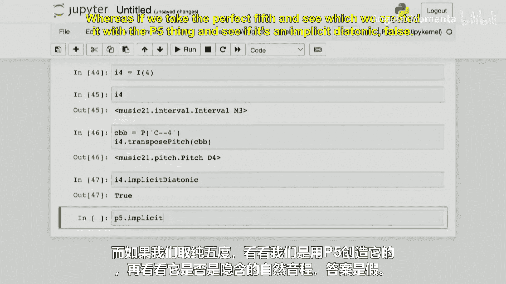

False。Perfect fifth will always take the one that we created with a string P 5 will always make sure that something is a P 5。

 I'm looking at the time。 So I won't demonstrate last thing。

 which is music 21 still has a restriction that it won't go above quadruple sharps or quadruple flats。

 So at that point， even the diatonic one will say us forget what I said。Let's make it work。

 and round things。Great。That's， that's all the time I have， if you transpose a whole score。

 you'll see that the key signature transpose with you， which can be kind of helpful。

 And I'll I'll post my。I'll post my what do you call it the， the thing where。

 where I have that demo to the class， right。

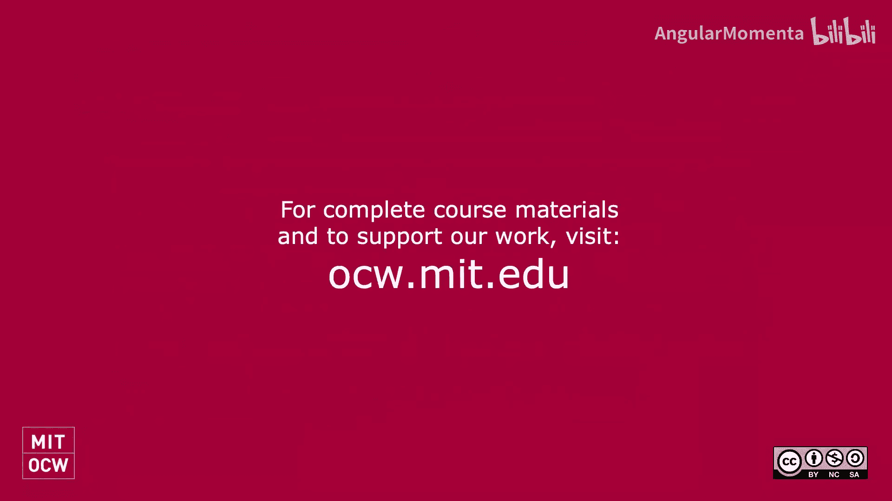