# 【麻省理工】计算音乐学与分析‌ ｜ MIT 21M.383 Computational Music Theory and Analysis,S 2023 p33 33 课程17视频：音乐认知入门 -BV17xUmBDEUC_p33-

Yeah， we just did the quiz。 And that's for people who are watching this later。

 That's not on the video。 We're going to do some introduction to music cognition。

 I don't think we're gonna have time， but we can also unlock voice leading if we do。 Now。

 I'm gonna put this down。Great， and I'm going to turn off these。 Oh it's okay。12 that。So okay， yeah。

 that's better。

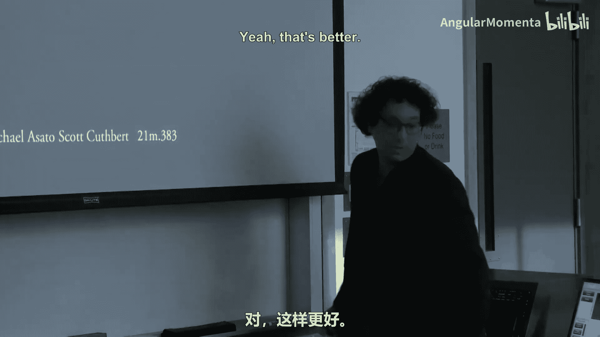

Great， so music cognition is one of these things that intersects with huge numbers of parts of music in general。

 music theory， with music history， with performance， with performance anxiety， All these things。

 But it also has a big impact on computational music， especially computational music theory。

 It sort of formed this field。 And it continues to be part of it。

 I just want to give a little introduction from。😊，Professor of music cognition at Northeastern Dun Street and also at Wesleyan。

 Psyche Louis， just a couple minutes while I also check to make sure I have the。Well。

 we'll see if the sounds still working。 Consider， for instance， this musical example。

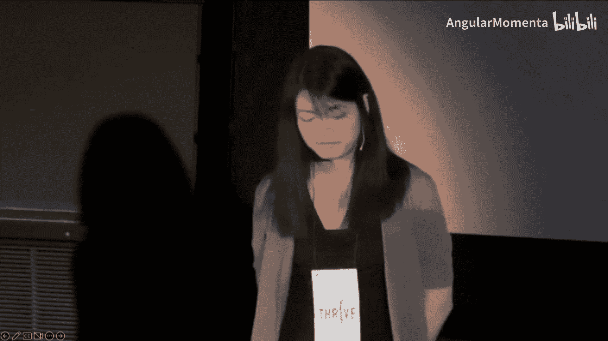

Alright， you might say that sounds nice and normal， kind of like saying， I took the tea here today。

えよ。What about this。Right， if you think that's not of normal， you can come talk to me afterwards。

 and we might sign you up for that tone deafness study we're doing。

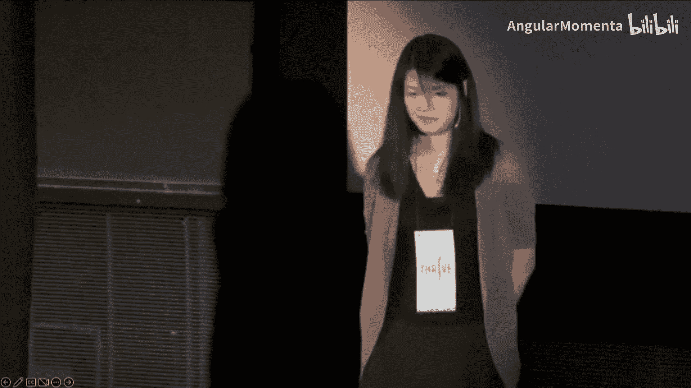

嗯。Now， so when you heard that last core， your brain doesnt double take， right。

 There's something about it that that's like saying I took the T here。 octopus。

 Nothing wrong with octopus， but it just doesn't fit the context of what happened before it。

 It doesn't fit the grammar。

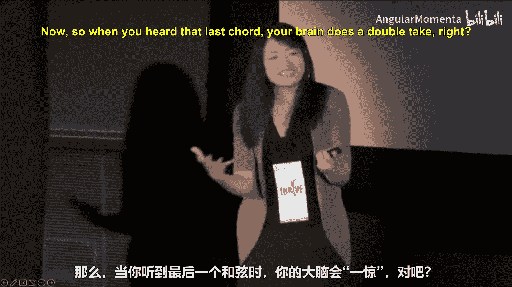

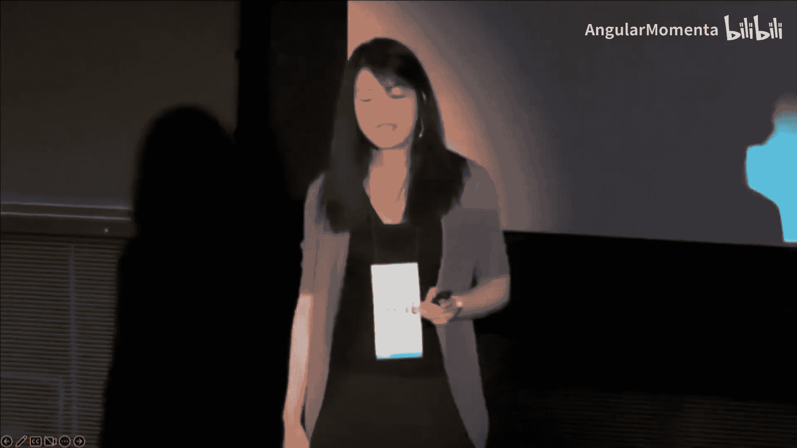

Now， this double take that your brain does can be measured using electrical potentials in the surface of the scalp。

 This is a picture of my mom and getting her brain potentials recorded。

 And she's got 64 electrodes on her cap there。 And what those do is make recordings like this。

 And so on the left I'm showing you a brain responses to expected and unexpected musical chords。😊。

And， and on the right， I'm showing you the the difference between expected and unexpected on the surface of the scalp。

 So there the bird's eye view of the scalp。 So right away。

 you can see that 200 milliseconds after the onset of the unexpected cord。

 your brain is doing its double taker saying， oh， that was unexpected。500 milliseconds。

 you get the brain saying， oh， how do I integrate that into what happened before。

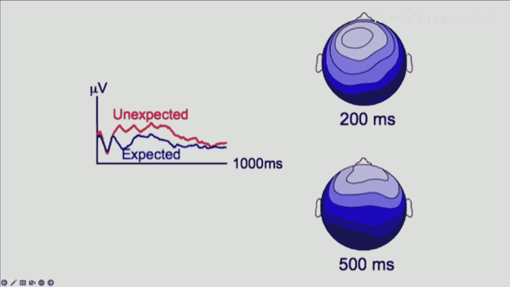

So this is telling us with millisecond accuracy that we know about music。

 There is something about our brains that is very sensitive to what's grammatical in Western music。

 So the question is， where does this knowledge come from， How do we come to know what we know。

So to answer that question， we again have to go all the way back to the ancient Greeks。

 Pythagoras found that if two strings are being played together。

 where one string is twice the length of the other。

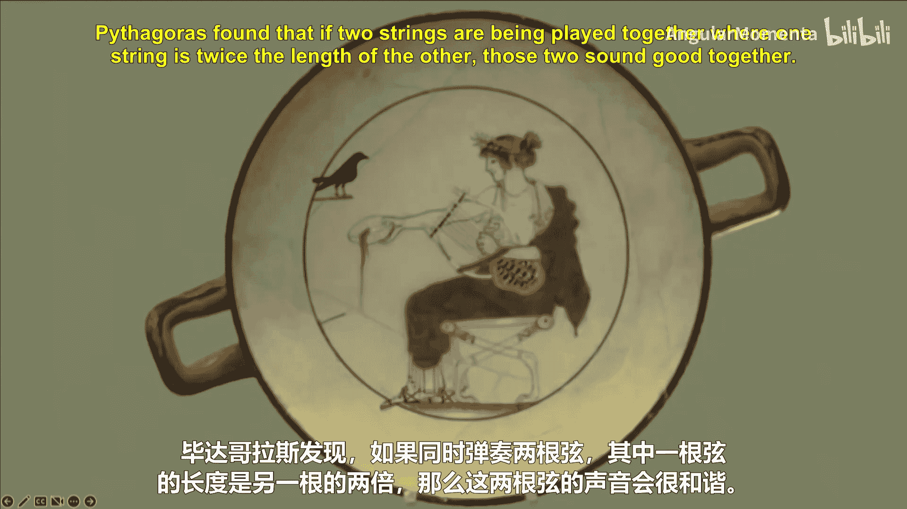

Those two sound good together。 They sound consonant。

 So this two to one frequency ratio is what supposedly brought us closer to the Greek gods。 In fact。

 the word symphony originally means vibrating in perfect harmony using these mathematical integer ratios。

 So this two to one frequency ratio is true of music all around the world。😊。

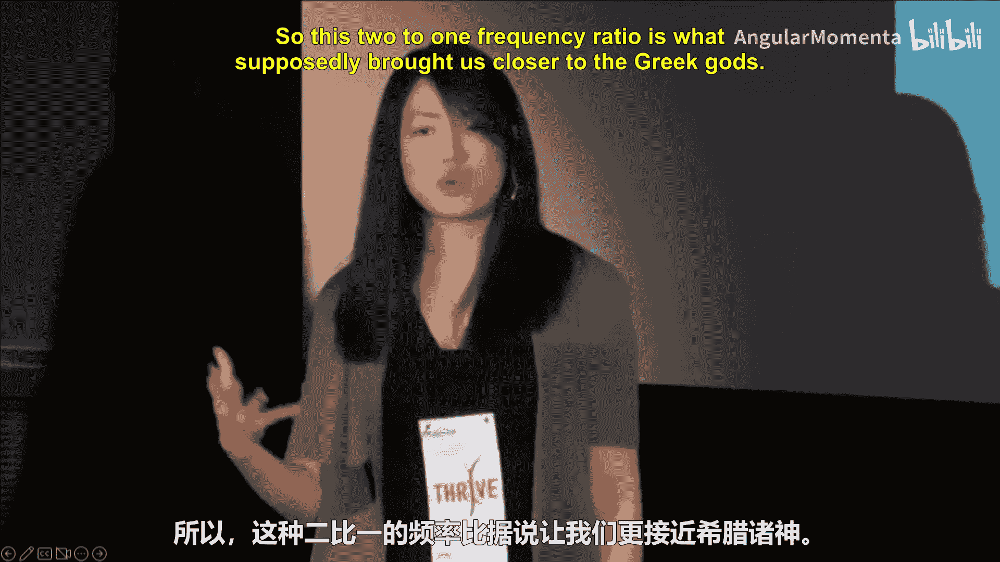

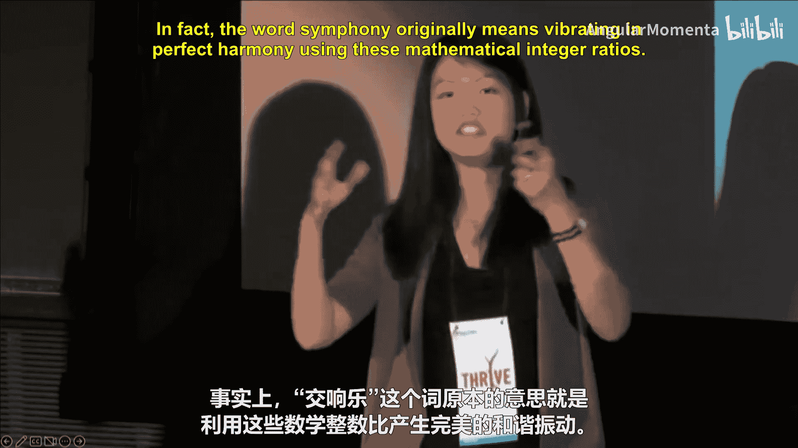

🎼Now， different cultures divide that 2 to one frequency ratio in different ways。 And our culture。

 the equal tempered Western chromatic scale， divides them in 12 steps。 So this is how it sounds。

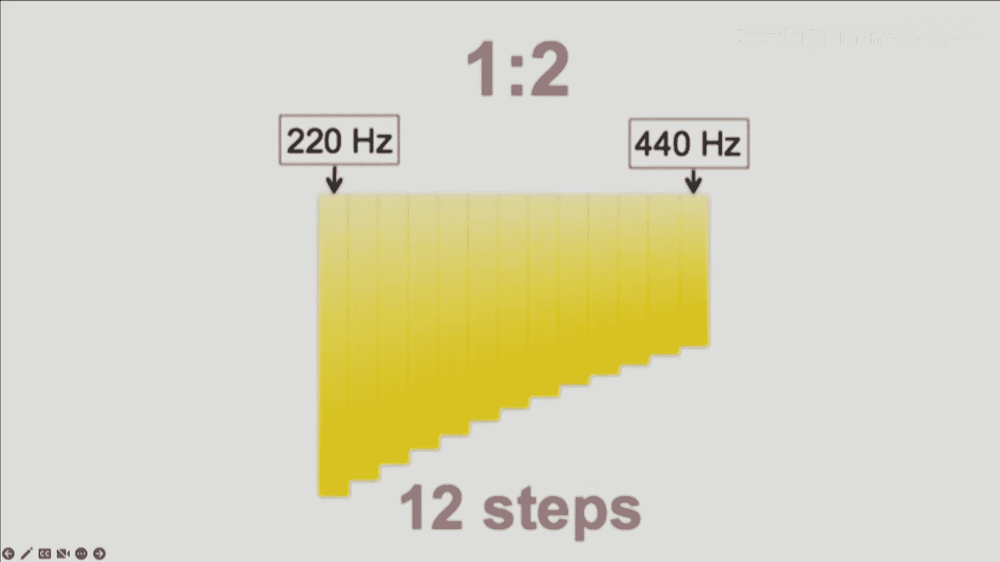

Okay， then these two guys came along and said， does it have to be this way， Why 2，2，1。

 Why not 3 to 1。So the bowl and Pi scale is based on a3 to one frequency ratio。 And within that。

 we've got 13 logarithmic divisions of that scale。 So you still got get some mathematical integer ratio。

 So the Greek gods are not offended here。😊。

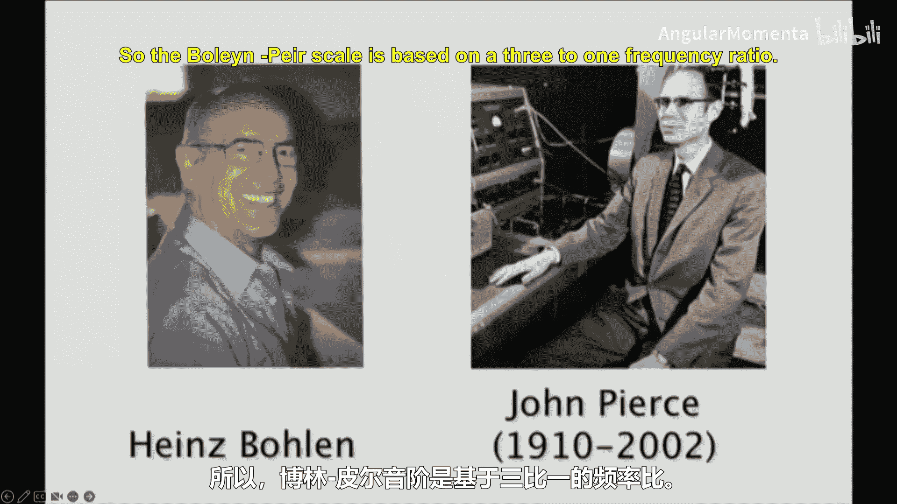

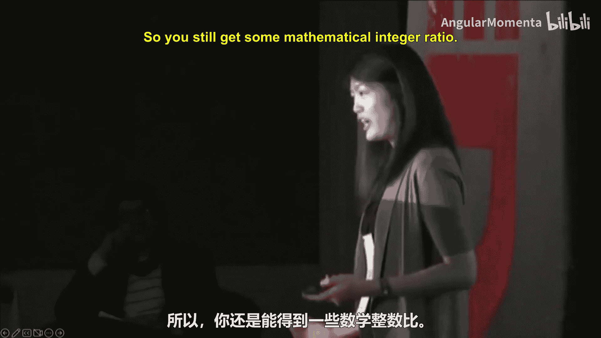

But what this sounds like is completely different from Western or other types of music。うん。

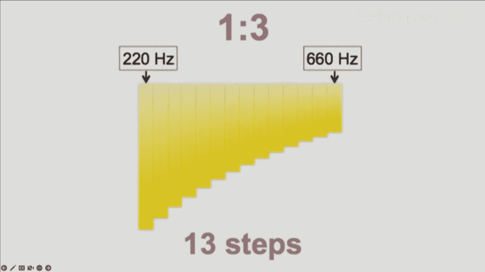

So this is a really powerful approach to find out what people know about music in the laboratory。

 So we can be pretty sure that people have never heard this music before。 But when they come in。

 then they can listen to this music for a while， and then we can measure how they come to know what they know。

😊。

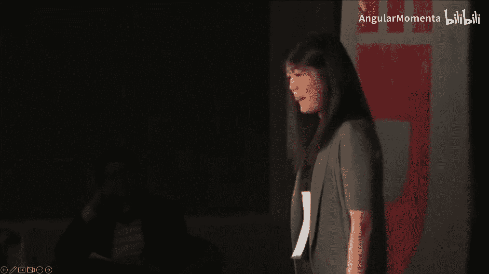

So I'm going to play you for about a minute， a snippet of a piece by Stephen Yi。

 It's called Reminiscences。 And it's written in the Bowl and Pier scale。 just so you get an idea。😊。

So this really is kind of an otherworldly new musical experience that we're entering here。

 And in our lab， what we wanted to do was figure out how people learn this new musical system。

 So we have these well controlled melodies that people listen to for about half an hour。😊。

So you listen to these things for half an hour。 and they're。

 they're defined using rules and principles or grammatical structures that we've defined ourselves。

 And then the question is， what can people learn from this new musical experience。

 First thing we found is that memory increases with repetition。 Turn out also。

 that preference increases with repetition。 So what we're seeing here is the beginning of musical taste。

 right， The more you listen to something， The more you begin to like it。😊。

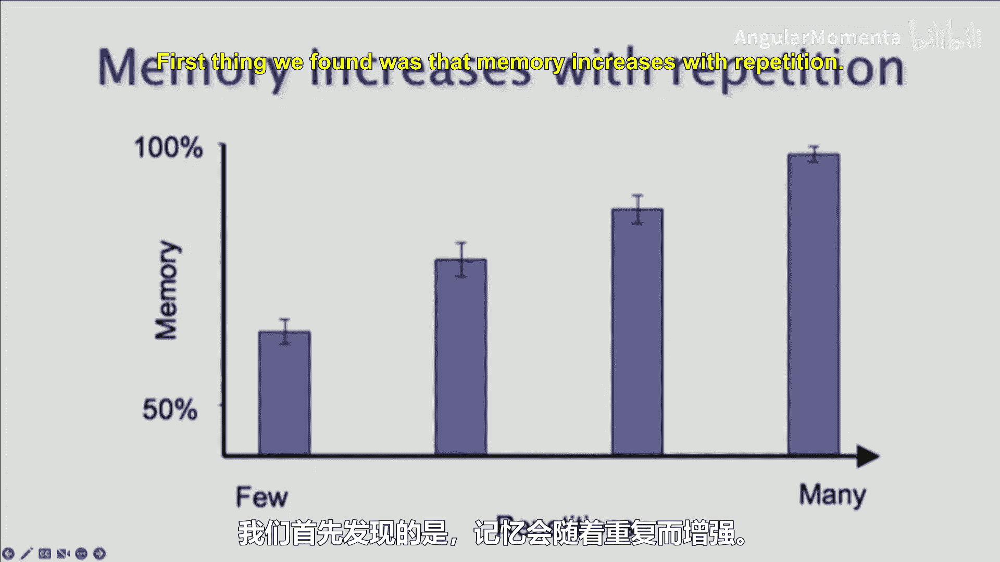

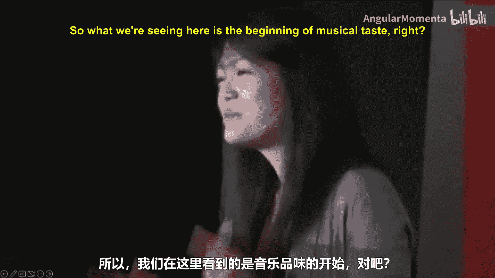

But what I'm interested in is how learning occurs。 And it turns out that learning does not occur with repetition。

 but with variability。 In other words， the more different ways you tell people something。

 the more people are able to infer the underlying structure of what you tell them and then to generalize those to new instances of the same grammar。

😊。

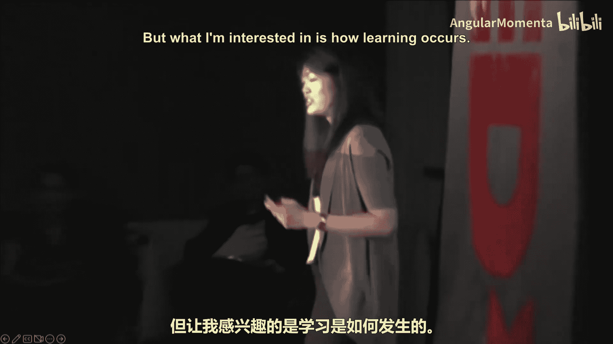

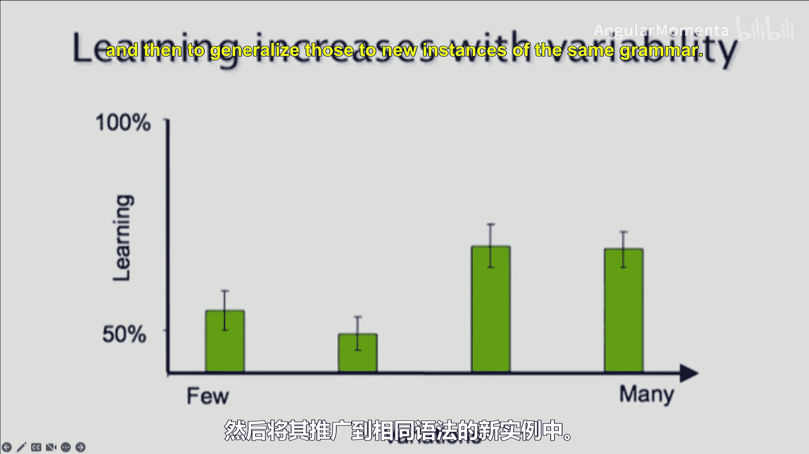

Now， our question becomes now。😊，And that's where I stop for here because we can look at that online。

 and I want you to just get as excited for our two guest speakers who are going to be talking on Zoom on Friday and after after break here on campus。

 So we're going to be talking primarily in the next couple of classes about the work。

 well first Cla Arthur is going to present her own work。

 and then we'll be talking about two major figures in music cognition。

 One is Carol Chusel and her landmark book cognitive foundations of musical pitch。

 which is all about how do we process pitch。 how do we think how do we put it into particular areas。

 And so that's pretty important for music cognition。

 But it's also formed her work on this form the basis for every computational almost every for I can't say the wrong things。

 for the most widely used key detection。😊。

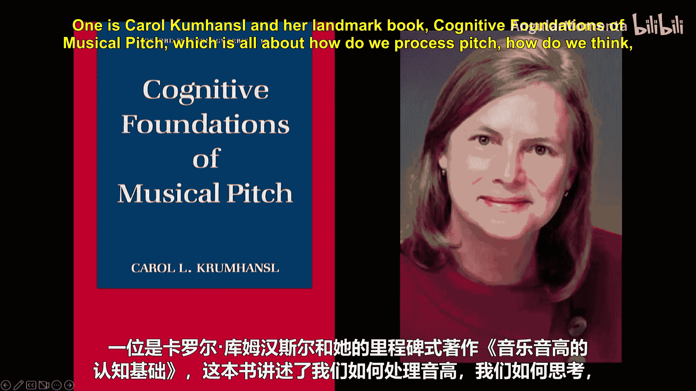

Key algorithm finding mechanisms。 So here， this is our favorite B W V 66。6。

 looking at different sizes of amount of memory that we have。 And we can see that。😊。

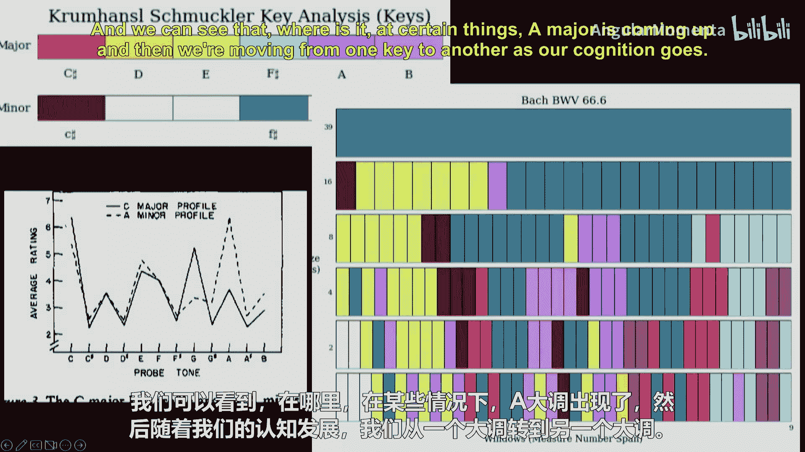

Whereas it at certain things， A majors coming up。 and。

 and then we're moving from one key to another as as our cognition goes。

 So we'll be looking into her work。The second major figure is David Huron。

 whose name might have appeared as a secondary author of one of the articles that you may have discussed on their midterm。

 and his landmark book， Sweet anticipation， Music and the P psychologyych of Expect you're going to have access to this book totally on the website in by Friday and but I feel like if there's one thing worth spending your money to own in sort of a physical copy coming out of this class。

 it's this book first off， it's not too expensive， It's like 22 bucks or something。

 but it's just amazing the types of things， and talks about his own work。

 but mostly it's a collection of sort of the greatest hits of music cognition also by others and so this is a particular experiment that I think really great Balinese musicians and American musicians were given。

A Balinese melody that was there。 And then they were betting on whether or not I believe it was the next note goes up or down after that。

 And you can see the Balinese musician。 And so this is how uncertain they are so lower is more certain。

 The Balinese musicians when they hear this traditional Balinese thing they're they're just going great they're。

 they're making money head over heels。 And then。Uncertainty goes up when it goes into a different direction because this was a crafted melody designed to do that。

 And so being able to check out things like that， we'll also be looking a little bit at rhythm and rhythmic uncertainty。

And the types of things that that music cognition might tell us for how to generate rhythms。

 So this is a， this is a particularly slightly complex graph， but。But it's actually。

 I think it's the simplest way to explain this diagram。 say you have。You have three notes。

Whatever three notes they are。Say that their total duration sum up to one。

And then you can figure out how much what percentage or what fraction of the duration each of the notes takes up。

 Oh gosh， let's see。 that's one half。 What's that。 That's three， eighth。 Thank you。

 And it's one eighth。And then you can place each of them between one and0 on this chart。

 and this triangular chart lets you show the proportion of each of three things at the same time。

And one of the things that comes out of this。 Oh， I did is that there's not one point where people perceive。

 So so there's one point where it should be exactly right。 So it's 312，1。

1 should be exactly here on the 25% access for one on the 25% access for another and the 50% for third one。

 So it should be right here and 3，1，4 I guess in this way，3，8s，18，4 eighths should be right here。

 And one of the things that cognitive studies has shown is that people perceive things a little bit differently。

 So this entire region of playing is perceived in this experiment as the 2，11， or 1 half，1 quarter。

1 quarter， whereas the region that was perceived as 3，1。

4 is actually does not include the mathematically correct3， eighths，1，8，4 eighths。

And so we'll look at experiments that try to charge the whole landscape of rhythmic perception。

 And you can imagine that that could also be useful if you're generating music when you generate patterns and you want people to hear them。

 and you don't want it to sound computer， you might do something else。 But by far。

 the title the title of the book is called sweetweet anticipation。 And by far。

 I think the most interesting for me part of this。😊，Is studying anticipation。

 expectation and surprise。 And so I was playing when you all walked in a piece by Peter Shiickley。

 PD D Q Bach， fake bach humorous。 And what I love is a little experiment here where we're going be playing something that breaks expectations。

 And you'll hear some laughter on the soundtrack that's probably also physical things are happening on stage that we can't see because it's just an audio version。

 But listen to what people find funny musically。😊，And how it has to do with the breaking of expectations。

 So you're gonna to be listening to a little thing。 This is about。

 we' going gonna start about 20 seconds before this figure。

 So there's going be a bunch of other things and。Maybe just look for a second yourself on what expectation might be broken here。

嗯。🎼，Here's the accompaniment in the wrong places。So there's a particular expectation for how。

How things might be going and stuff。Think。These are two guests。 They're both named Claire。

 They're in alphabetical order。 though Claire Arthur will be coming first coming from Georgia Tech and Claire Pelofi。

 coming from NYU's music and audioio research laboratory。

I'm bringing in guests in part because this is something I music cognition is something I think is really。

 really important， but it's probably the weakest topic for me as a teacher in this field。

 so you should be getting this information from people who do it much better than me。So。That's great。

 Who， we have 7 minutes left。 Who wants to program and unlock and who wants to go if early unlock。Go。

Okay， great。 have a great time。 Have a great break。 And I。

 I don't want to start a new topic in7 minutes either。 So have a good， sorry。

 I'll see you after break in person， but I'll see you all on Friday。 So thank you。😊。

