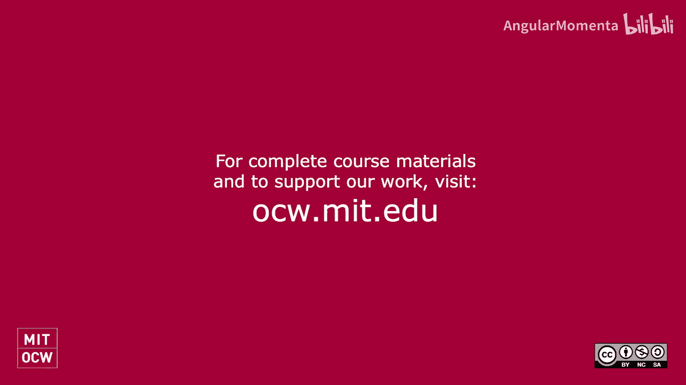

# 【麻省理工】计算音乐学与分析‌ ｜ MIT 21M.383 Computational Music Theory and Analysis,S 2023 p34 34 节课 18-21 视频：音乐认知嘉宾讲座内容简介 -BV17xUmBDEUC_p34-

Hello， OpenCourseW learners。This is Professor Cuthbert talking to you。

 and I just wanted to say a little bit about why the next two classes are not to be found on this site。

MIT and the music department was very fortunate to be able to hire a new professor in computational music that semester and one of the things that we value as a department is people's ability to be good teachers so as part of their interview。

 the candidates，Came and took over one of the classes to teach。

The content of the class and a little bit of their specialties too。

 and two of those classes that were used were this class 21 M383。Both of the candidates I can say。

 did amazing work， and I wish I could share them their videos with you。

 but we have a feeling that it's already stressful enough to be doing a job interview and to have your teaching being evaluated by people in the room and then to know that whatever things you did in an unfamiliar classroom with unfamiliar students would also be put out online is's just a little bit too much。

 So these to ask too much to ask。 So these videos are not available。 I want to say a little bit。

 though， what was in each of them。The first class was a continuation of a series on music。

 cognition and computation and how computers。Can aid the process of understanding how the brain processes music and also how historically。

 and I think in the future。Insights from music cognition have improved the things that we do on the computer。

 The most important example of this is Carol Crumbhusel's probe tone。Experiments in understanding。

Musical expectation in scales and keys。And these experiments。

 which help to understand how each note plays in。Our ability to understand what keywording at this point underlies quite a number of algorithms being used today day by computers to automatically detect the keys of compositions。

 And this includes Music 21's default analyze key method。

 And this is why the assignments on understanding key analysis。

Went hand in hand with the section on cognition。The lecture also covered and gave the opportunity to discuss some of the experiments reported by David Huron in his book。

 Sweet Anip， of which the students were assigned to do readings。

I would encourage as a substitute for the content of this lecture。

For you to look deeply at this book by。A prominent music cognition and expert。

 and also one of the breakthrough founders of our field of computational music theory and musicology。

 David Huron。Doing so， I think， would give a good sense of。

The majority of what was contained in the lecture。Beyond what the candidate spoke about her own particular expertise。

The second guest lecturer covered the topic of the history of algorithmic composition from its beginnings。

 even before the computer until today day。 And this lecturer covered。The main reading for this week。

 which is on the Iiliac suite。The one of the first pieces to be composed by computers using algorithms and to generate notes and continuing up till to day with advances in AI。

 such as the music transformer by Anna Hongong at Google and other other new developments。

 One of the reasons why it was so important to look at。

The music algorithmic music composition in sort of a broader historical scope is it's too easy to get hung up on the particular problem that we have today day where we're getting closer and closer to having the computer produce musical scores that sound like other compositions like by particular composers and to work on that problem without asking。

 well， why， Why should we care， Why do we want， of the computer to compose a new piece in the style of Johann Sebastian Bach。

😊，Unless by chance you've already heard every piece by Bach and you're just bored and you need more。

Which most of us haven't explored what's actually out there。Instead。

By looking back at the earliest history when having a computer actually write music at that level of sophistication was so far from being possible and looking at what people wanted to do with the computer。

It helps to answer questions。 How can the computer be used to。Come up with。

Ideas or take ideas that I have that will take too long for me to generate on my own and make that part more efficient。

 How can it be a tool to help me。Be a better human。Composer， or just better human。

So the class went through some of the earliest algorithmic compositions from Guido of Vreso。

 a monk living in the 11th century。Through Mozart's musical dice games up until the Iiliac Su and then beyond。

Some of what's covered in this class also appears in the various videos that accompany this class that weren't shown to students this year。

 but are available for you。And other aspects。Touch on the guest speaker's particular expertise。

 which was very valuable to be brought in。 Any else teaching this class would bring in her his own specialties that would be make that class different from mine。

 and nobody should teach this class exactly the same way I would teach it。Or have taught it。

So that gives a little bit of a nutshell。Of what's happening。

 the students then went on to write their own algorithms to generate compositions algorithmically and。

They did a very good job of avoiding the problem of trying to get the computer to do something。

That we already do better， that we are not interested really in the computer's output。And。

That we just would only want to listen to if we knew a human created。 And instead。

 they went beyond that and created pieces of music that were interesting in themselves and that no human would ever choose to write。

In addition to the two classes that job candidates covered。

Two other classes at around this time needed to be。

Removed and the contents pushed into other classes because MIT was in the process of。

Proposing to the full faculty。A new masters program， two new master's programs in in music。

 technology and computation。 And it happened that these proposals had to happen at the same time as this class。

 And so a little bit of time was lost on that。 I'm hoping that if you've been interested in this class and want to go forward。

 you might look into these programs， which I assume will be live at the time that these videos are released。

I think that this is all that I'm going to be able to provide。

 especially for the open courseware audience in this class。

 except at the very end where I have a little message for you that I recorded at the time。Thank you。

