# 【麻省理工】计算音乐学与分析‌ ｜ MIT 21M.383 Computational Music Theory and Analysis,S 2023 p35 35 视频 22a：和弦复习与13和弦：根音相关问题 -BV17xUmBDEUC_p35-

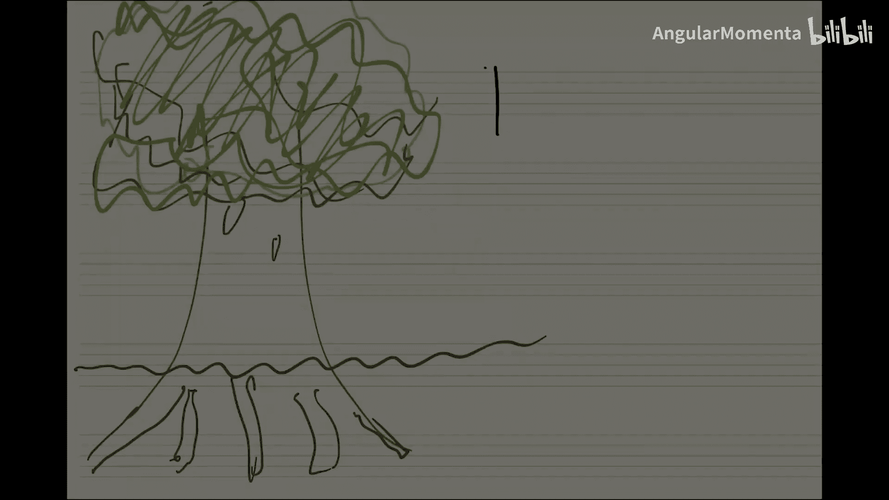

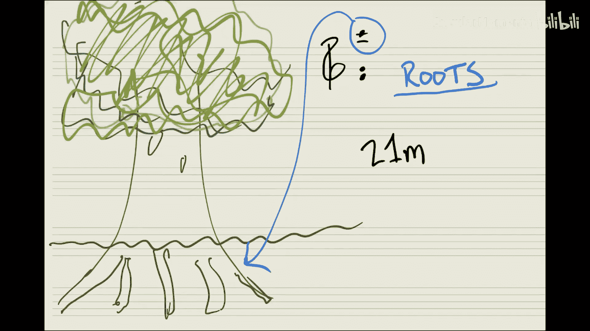

Hello everybody and congratulations on getting problem set 7 in this is Michael Cuthbert。

 and I'm going to unlock a new set of features on cords for you now that you have successfully implemented some of them yourself。

 so I'm going to go ahead and。Iport the chord module from Music 21 and we remember that with the chord module is the capital C chord class。

 so we'll say C major equals chord。 chord and we'll say C4 E4 G4 by the way when creating a chord we can do we can create it a couple different ways。

 we can put it as a list of strings， we can make it a single space separated string or if we really want to do this。

 if we want to be painful for ourselves but sometimes this I will do it， we'll create4 equals pitch。

Dot pitch。See4。E4 is pitch up pitch E4。The next one G4 is pitch up which t4。

 and then we can make C major equals。A list of those already created pitch objects。

 And depending on what context you're doing， one of these will be easier than others。

 we could also do it with a list of no objects， but I'm not going to demonstrate that now In any case。

 we have C major and we have this chord going on。 and that's all nice and fun Okay。Do that。

 So in within this chor one of the things we can do is we can get the root of it and takes a little bit of time。

 So I've made it a function call a method call on that so that seems to work and get the base of the same chord and that's the same thing here because the inversion is the inversion is0 great Now let's do。

See major6， not in the chord simple sense， but in the Roman numeral figured basic6 as in first inversion。

 we'll create chord。 chord， think through it before you copy down what I'm going to write， right E4。

 C5， oh let let's go and put an open position， see major6。Broot。It's still C， pace。It's still an E。

 but now oh is now an E because the inversion。Its one great， we can set the inversion here。And。

See that everything has moved up above the G and moved all the way up。 it's pretty far up there。

 so maybe you will do six do transpose。In place transpose down。

Let's say down to octaves in place equals true。And now we're here and I'm just realizing that this inversion thing should have returned to newcorord or something like that。

 so I'll put in to do see make inversion not return not。In place。

And just in case you're watching this video later and your inversion does something else that I fix that problem。

 Okay， so these are some of the things that we can do here notice let's go back to create our original first inversion chor great and。

Some of the other things we can do， those notes are pretty far apart so we can say image。

S closed equals C major6 in closed。Position。And now we see C matrix6 enclosed position still keeps that E in the base but figured out that hey。

 that C that G could move all the way down to octave 4 because C4 would be below E4 C5 only gets left there。

 So these are some of the things that we can be doing with with the kinds of things that we're doing with chords in our。

Most recent problem set。Here's a little interesting thing with roots that I had hoped to get to in class。

 but now we can talk about it's one of these strange moments in music。

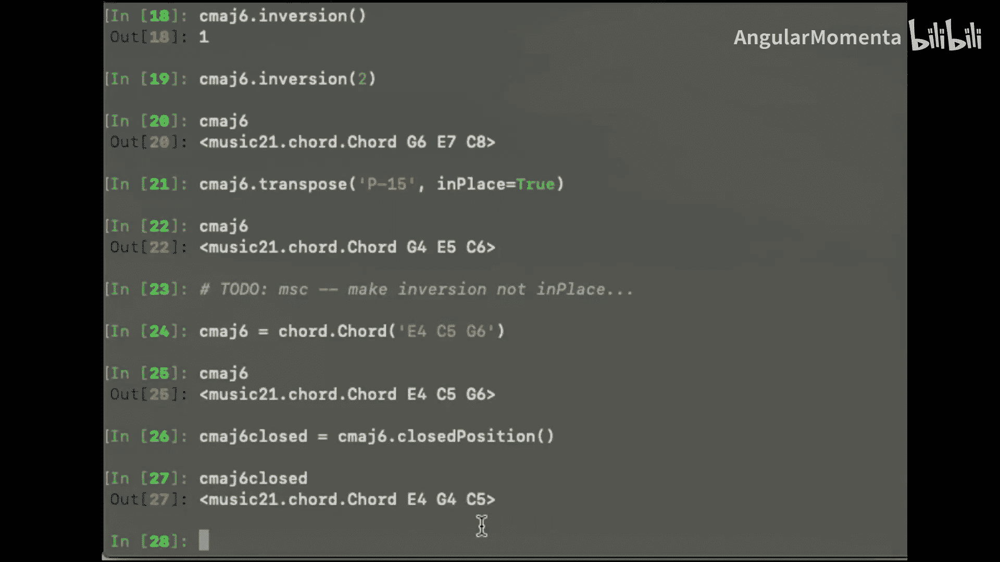

So one of the things that came up in our discussion was of course。

 finding the root and when you were working on finding the root， you know。

 on something like see major Triad。Okay， that's pretty easy。

 then you end up with a little bit harder is C major tried an open position and maybe even harder is。

 you know， let's do it in open position and an inversion and all of these。

 of course the root is going to be C， but how did we do this？

I haven't had a chance to go through everybody's assignments yet。

 but there's different possibilities， some of which are more efficient。

 some of which are less efficient， but basically whichever route you chose。

 it ends up usually trying to find some way to permute each of the notes so maybe we rewrite them all to be in the same octave。

 so tune and then we try various permutations， maybe we rotate below。

 so we take at the top note and move it down so down to here。

 and we have some sort of a template in mind， and that template says that when you have stacked thirds。

Then the lowest note is the root。 So here we don't have stack thirds。 What we have。

 We have a fourth and then a third above it， we would say6，4 in figured good base。

 but think of it this way。 And here we don't have it。 We have a third and a fourth above it。

 We call it 6，3 position。 and we don't have it。 So we go one more time and here we have。This。

 which we know is 3，3 or 5，3。 And this is our perfect solution。 And yaea， we're super happy。

 And the cool thing is that this kind of work works just as well with。😊，With seventhccords。

 so let's say we're doing。Here we're going to use some of the same notes。

 but will be a dominant seventh type。Wellow。Position in F major or something like that。

 and we can again start moving things into the same octave。

I always make little joint noises when I make chors。we can see milk， what do we have here。

 We have third， third second， so that doesn't work。 We'll take the top note。

 bring it down an octaves。Just a old enough that I want all my notes to be in blue today so we can do something like this andvoila。

 we have what do we have third， third， third， and we're all happy and so the root is C again。But。

What happens if we have a knife？I won't make it ninth chord。

 you can again put it into this particular position and wallock we have C9， whatever inversion sent。

And so on， but let's take a second and listen to a piece of music that is going to challenge some of our assumptions about what does a root mean。

 maybe go beyond what we've seen in our theory classes。

 but the type of things we have to consider as computational music analysis， analysts。

 whatever we are。

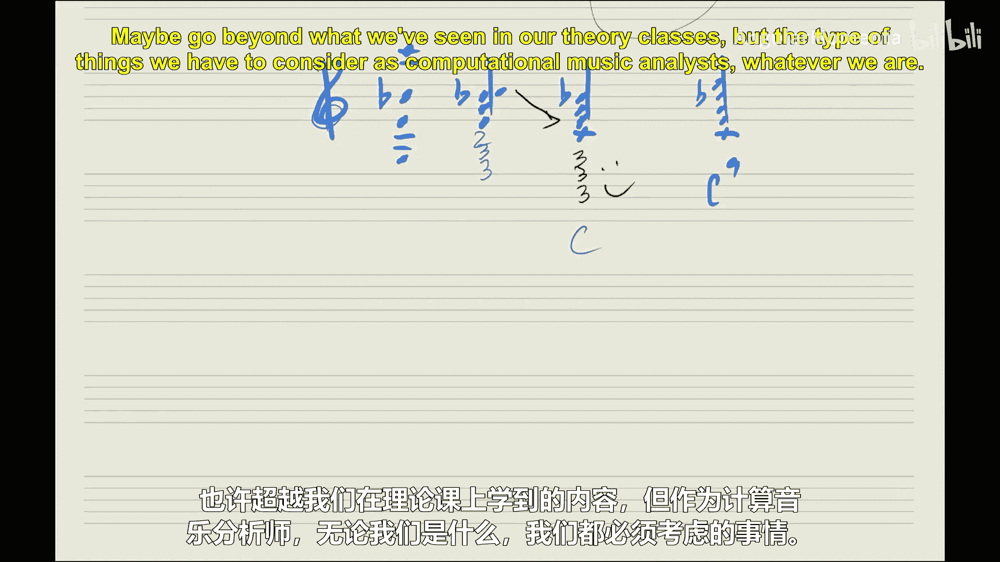

The piece we're going to discuss is by Benjamin Bri， it's his opera Peter Grimees from 1945。

We're going to be looking at one of the last scenes of the opera where the main character。

 Peter Grimees has become deranged and lost his mind and believes the accusations that have been made against him that he has been killing his assistance when really the most recent one has just died in a tragic mishap and the music that we're going to be listening to there's no singing。

 it's the music that accompanies him going out to sea to drown himself， so it's a very somber moment。

Want you to listen particularly， though， to the Arrpeggated chord played by the harp。

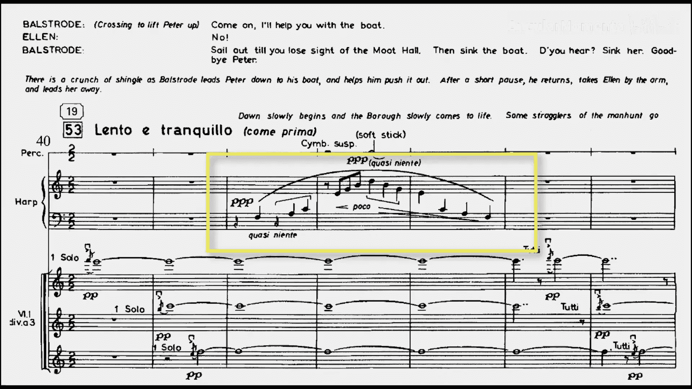

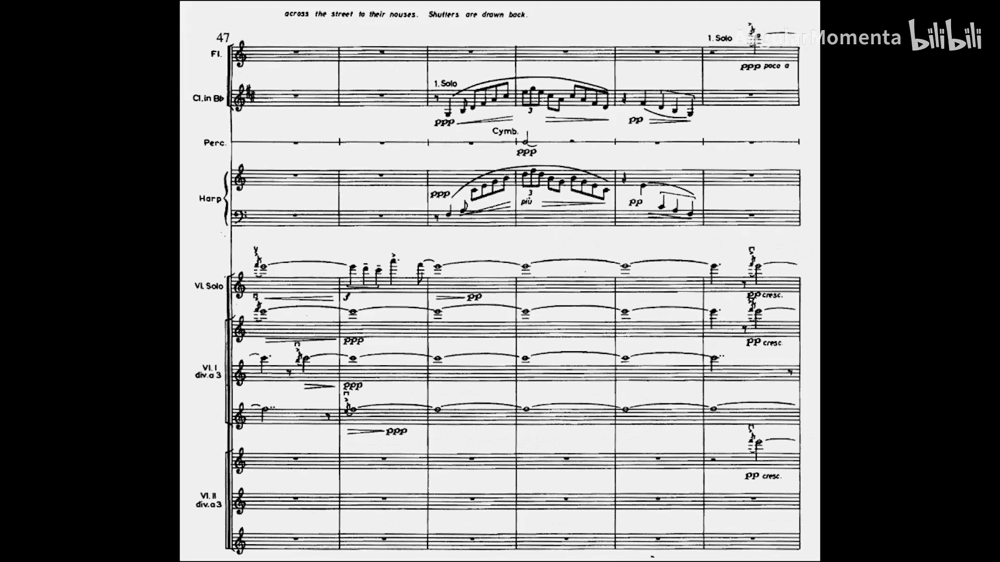

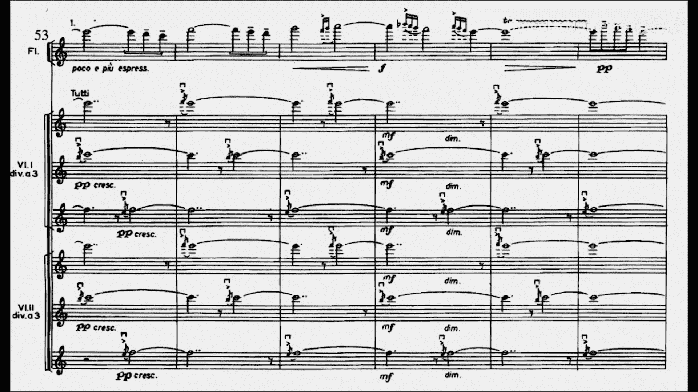

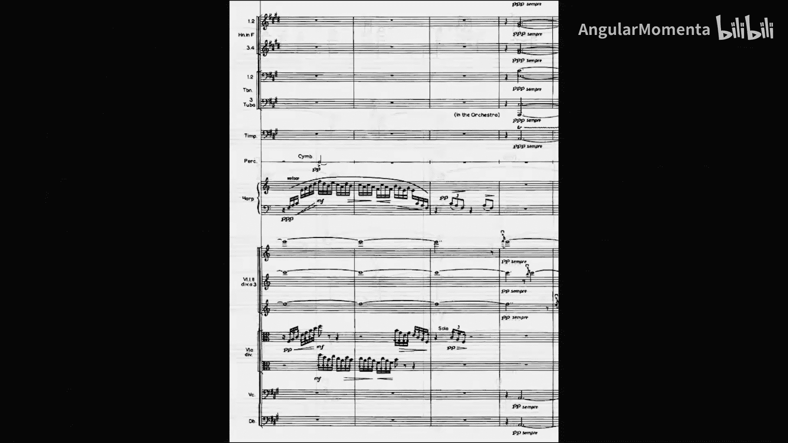

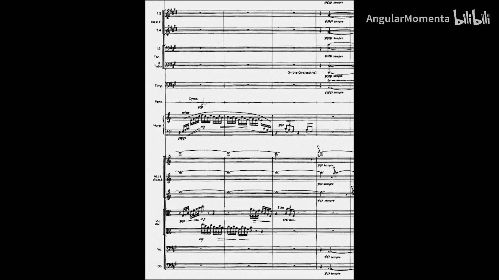

Let's look at that chor from the harp in detail。Starts in the base cl with FAAC containing up E， G。

 B D。And then coming back down。And when we put it into tble clef and stack everything up。

 we see that F， DG， et cea， we basically have a whole bunch of stack thirds。

I mean all the way up and so that's an F13 chord。 So we know the root because we see all of the stack thirds。

 but now let's take the root and we'll move it to the top。 so we'll start on A， C， E， G， B， D， F。

 and hey。That's also stack third， so our original chord could be an a13th chord in first inversion I don't know what the figured base symbol is for that。

 but then we can also take the A and put it to the top and see the ay C E G B DFA。

 that's also a stack of third。 So this is C 13 chord in second inversion。

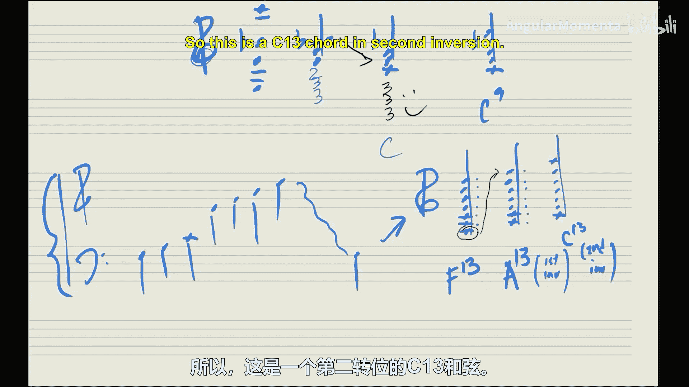

Okay， let's see what happens in Music 21 when we try to do something with this so we'll。

I'll importm everything very speechly the chord in this case， and let's create an F11 chord。And。

So we'll do it the same way as the。As we're doing with Peter Gre， so F3， A3， C4， E4， G4。

 B flat for we're leaving out that high D for now and we look at F11。Its root is the F3。

 it's in the version。We in root position great， let's take that B flat4 down to the lowest part。

 I'll put it in B flat 2。And now something like that。😔，And will we find the root of this。

 it's still an F and it's in the inversion where the 11th is in the base， which we all learned in。

 I know it didn't is fifth oops。I fifth inversion here， okay。

 so that's going along pretty well now let's create the F13 chord in inversion。

And we'll put same that B flat 2， F 3， A3， C4， E4， G4， and we'll add that D5 at the top and。

What used to happen when you called root in this point is it would crash until tell you you couldn't find the root this chord Eventually I found that to be kind of annoying that you had to code around a special case that you could have a 13th chord or something would crash so I've just decided that the root of a 13th chord is always whatever note is in the base so this case。

Now I put the Bf in the base， so now that's the root and thean version。Is always in group position。

 which is kind of， you know， that's also maybe a problematic thing that you can。Take the same notes。

 rearrange them and put them in different place， and the inversion stays the same。

 but the root changes。 So that's just a little thing on how 13th chords are a little bit different than every other chord and。

Why computational music eology and computational music theory is so much fun， Thanks， everybody。😊。

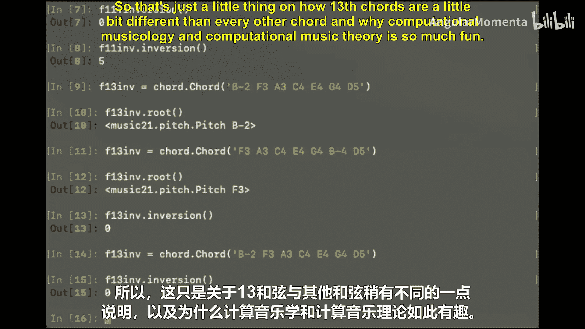

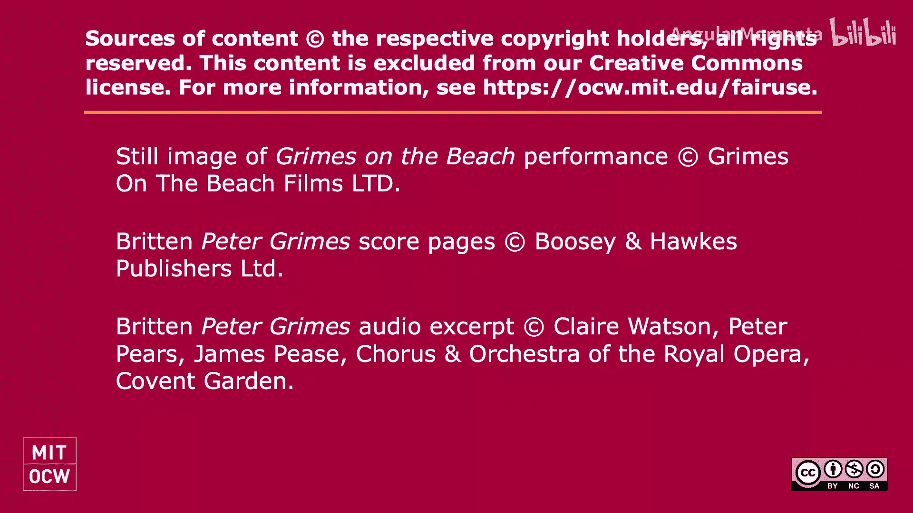