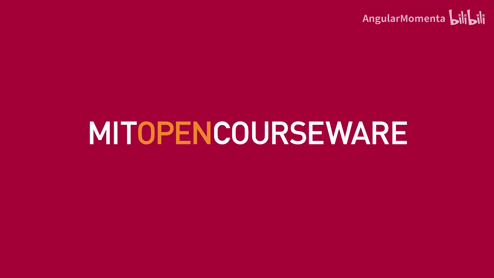
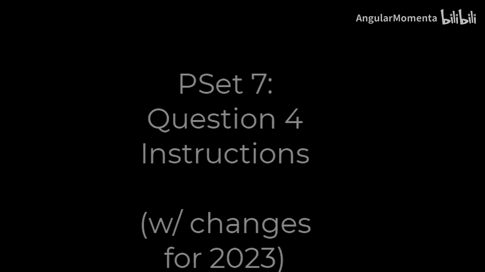
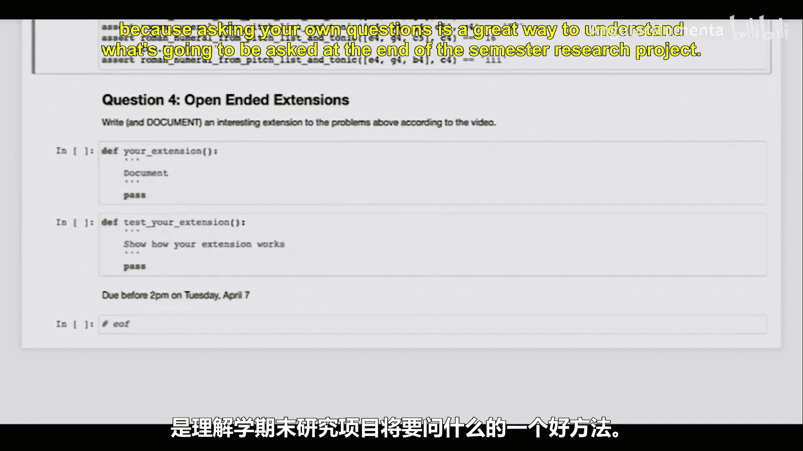
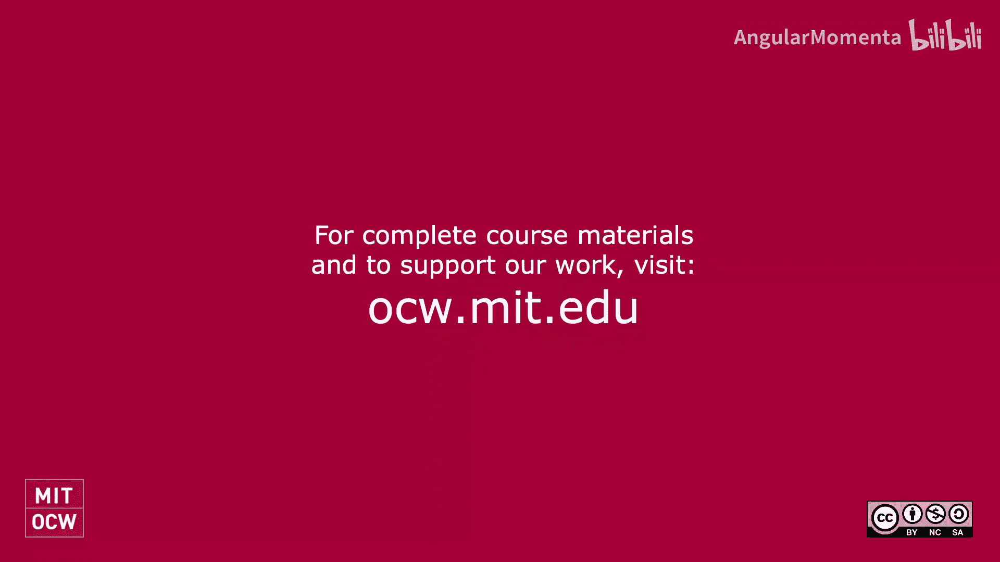

# 【麻省理工】计算音乐学与分析‌ ｜ MIT 21M.383 Computational Music Theory and Analysis,S 2023 p36 36 视频 22b：习题集 7-8：音阶、和弦与罗马数字的运用与创作 -BV17xUmBDEUC_p36-

Great， so up until now， you've been doing what I've asked you to do。 Now。

 it's time to put your imagination。On display， you've noticed that we've only been working with major try。

Are major scales and triads and all kinds of things like this。 But what else can we do。Well。

 we could be thinking about the other。Important scale， The miners。

And will remember is that the minor scales have not just one form， but at least three forms。

 the natural， the harmonic and the Lodic minor。 I want you to think for a second which one of these scales is most attuned to writing out the harmonies of Roman nus。

That's right。 It's the harmonic minor forms。 So that's what you're going to be most thinking about here。

Next whyhy do we have to restrict ourselves to troads。

 Why can't we do 7th chords or 9th chords or 11th chords or something else。

 so that we have to think about returning Roman nuals like 5，7 or 7， half diminish minutes，6，5 or 4。

4，2。While we're at it， Why do we think that？All chords have to be part of the scale that's being played。

 So why can't we return。Flat 3 in C major for the major triad beginning E flat G。

 B flat for those who have taken 302 or 303 and 304。

 What about secondary dominance or what about thinking about Neapolitan chords or augmented6 chords。

 Can you return a French 4，3 chord。And why are we sticking in the realm of music analysts chords like Gwin numerals。

 Why not think about the chords that people use very often。

 like jazz and pop chord symbols where you might have C M for C minor or C sust 4 for the particular sustained chord that appears there。

 If you know how to use jazz symbols， Why not use them。

 And if you've taken broke music or medieval and renaissance music。

 you might think about figured bass symbols。 So they're a whole new world unto themselves。

And this should just be the beginning of what your imagination can make。

So for your final part of this assignment， I want you to make an open ended extension。

 You're going to write and document very， very important document。

 An interesting extension to the problems above， according to what you've seen in the video。

 So go ahead and call your extension。 whatever you want and test your extension。

 Show me that you have really seen what your extension is supposed to do and what。What you can do。

you're going to do all this， don't spend too much time on this， but spend some time because。

Asking your own questions is a great way to understand what's going to be asked at the end of the semester。

 research Cro。

