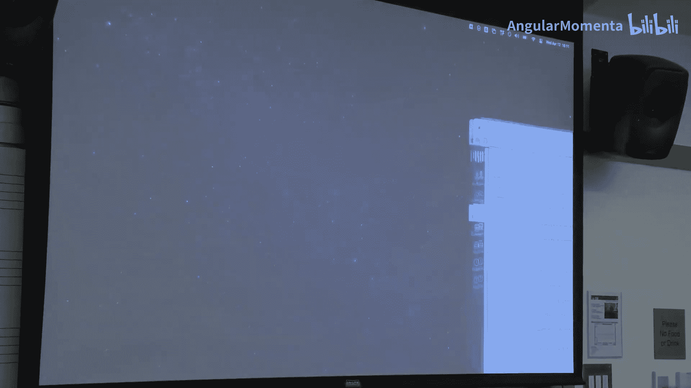
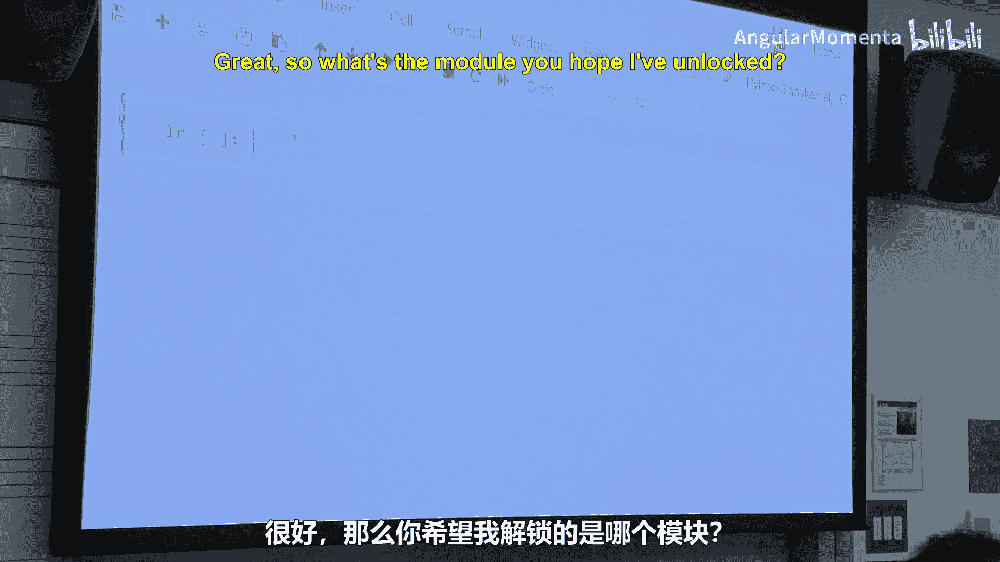
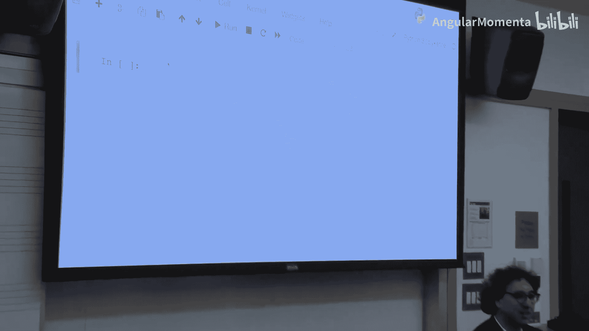
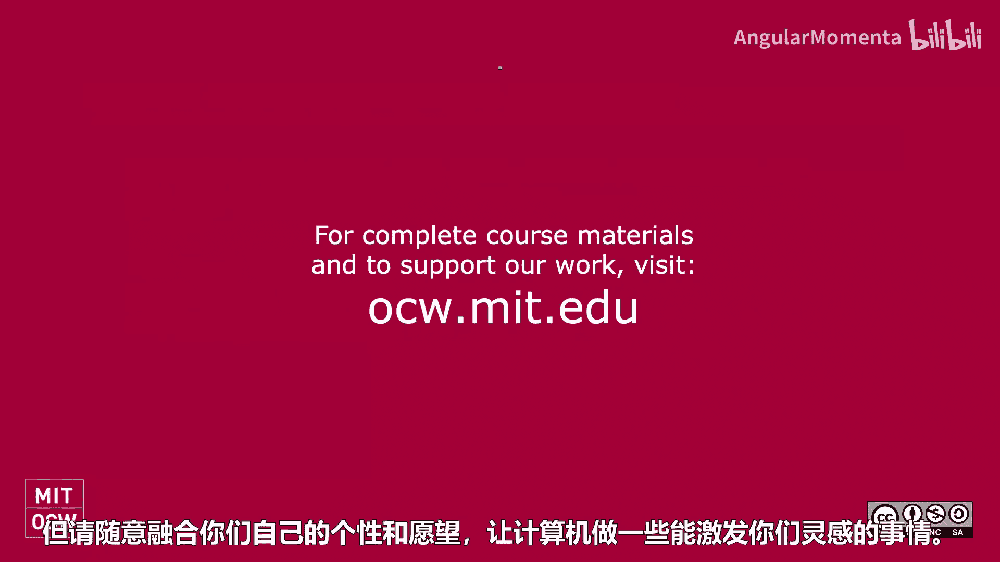

# 【麻省理工】计算音乐学与分析‌ ｜ MIT 21M.383 Computational Music Theory and Analysis,S 2023 p38 38 第23课：算法作曲 -BV17xUmBDEUC_p38-

Today， we're going to do two really important things that we， I really want to get through today。

 And the first one involves。The final project for the class。

 So what I'm gonna to ask you to do is to take a minute。

 And after I tell you what you're going to be doing。

 find a partner if we're not in even number you can do a part one group of three。

 but I prefer groups of two have tended to work a lot better that you're going to be willing to work on a project starting next week and start thinking about what you would like to do。

 it can be anything related to music theory and analysis in the symbolic domain。

 that is to say working with notes and scores not primarily working with audio or things like that。

 where you want to do that， take Orgozi's amazing classes where you can do great projects on audio。

And it can be it can be a research type problem。 You can try to solve a research problem。

 can it can be more of a business development， an entrepreneurship type problem trying to trying to build a product that does something interesting with music theory。

 or it can be a creative project。 I mentioned at the beginning of the semester。

 but I'll want to say it again。 the only restriction besides primarily symbolically based。

 is that if you are doing a creative project， I don't want to it to be based on deep learning AI。

 And the reason for that is as a safety for y'all。 I've allowed it in the past and it hasn't worked very well。

 And we'll get to we will do a lecture on AI later on topic on AI。

 and then I'll be able to explain a little bit more on what the constraint that tends to make those projects not work very well。

So has anybody already been thinking over the course of the semester of something that you're interested in。

 I'm not gonna to ask you to say it， but I'm just， just curious who's。

 who's been thinking a little bit， a little bit， a little bit。 Okay， so there's some， some over here。

 So let's take 10 minutes，5 minutes，5 minutes to find somebody that you'd like to work with。

 So let's all stand up。Okay， we'll get to。Well， well， let's， let's， no， actually， you。

 your your computers are mostly closed。 So let me just remind us a little bit of the perive topic for the week and talk about some of the things。

 Yes， yes， it's down。 Thank you。 Just shout。 when you get that。

 I didn't remember to turn the signal back on。 But yep， thank you。😊。

So we're going to talk about some of the other。Things that we that we were talking about last class with algorithmic composition。

 So first off， who now has been able to access the I X suite and recording。 Okay， great， super。 So。

 so we're in a better position there。😊，We talked about whether or not the Iiliac Suite was was sort of more written to create music that sounded like a human or whether it was created to do something very new。

 And what did we come to there as consensus。 Anyone want to throw that out。

Or what towards doing something new。 What's that 7030 towards doing something new。 Yeah， yeah。

 something like that， some， some percentage， some mixture of some parts of what they were trying to do really was about。

 hey， this is something humans do。 Let's see if we can computer do can do it。

 And then there was a moment like the one with the algorithmic putting of claps and。

 and of hitting the violins and stuff like that at different points。

 which was a little bit more computer。 We also talked about Markov chains。😊，In the last class。

 and we'll get a little bit later on into some of the more sophisticated statistical learning that people are doing today with with AI learning。

 But a lot of it is very， very similar。 It's just a lot faster or lot bit bigger than things。

 But I want to talk about some things。 And we'll get to get to that later。 Pre I didn't say。 so。😊。

There's two ways that we can distinguish algorithmic composition。

 One of them is whether it's deterministic or if it has a random chance in it。

 whether or not every time you play the piece or or run the piece。

 it will be a different piece or it'll be the same。 So I want to start by giving。

 I'm gonna go pretty egotistically with two pieces that I've written the first ones not even really a piece。

 but it's kind of little demonstration， it starts with a demo that you might have seen in a science class or physics class。

 where all the balls are moving at different lengths， but。They do kind of some interesting。

Optical illusion effects at various times。AMR。Is there supposed to be music back No， no music can。

🎼Okay， so I thought， what if， what if there was a musical equivalent of this。

 What if we could write a computer program that had 12 lines or 8 lines or something like that that all started in phase and then slowly got out of phase and came back together like the pendulum。

 And so this is a little bit what what I came up with。😊，H。🎼Yeah。🎼Yeah。🎼，🎼，🎼，🎼Yeah。🎼，🎼，🎼Yeah。🎼。🎼Yeah。

🎼，🎼Yeah。🎼，🎼，🎼，Yeah。Okay， can even follow my own score properly？怎么。So。

What's that like the double dot is 6。 Yeah， yeah， So sometimes when you。

 when you're making an algorithmic composition， maybe you want to， you know。

 think a little bit about the notation or maybe even better just to hear it without seeing the notation at all。

 So one of the questions is， what is if the computer is just setting it up so that each note comes in at a slightly different time from the previous one。

 What kinds of things does the composer have for her or his or their creativity。😊，Yeah。

 good Jason which， which pitch show up。 So pitching which pitch show up。 Good， good that could。

 in fact， let me。😊，Let me do it here is with instead of using。

 I think I use eight notes out of the octave， here is all 12 notes。あ。

That sounds a little bit more familiar， maybe a little bit closer。

Why might I not have wanted to use this as my main piece？

🎼It has something to do with the duration of the piece for me that that that ended up being a little bit too long。

 So， yeah， definitely what notes we use。🎼。We can even go to weird things that a human can' usually play on a piano。

So this is 19 tone division of theoctave。Let's you use a few more notes per octave。OhOh blanket。

 It stops， stops music。 good。 Yeah， 19 I don't think it would be 24 Yeah， sure it's a little di。

 but it's， it's kind of cool if anybody's interested in it 19 tone division of the octave has as two pretty cool properties。

 One is that it it has major and minor triads that are very。

 very close to acousically or major and minor thirds very close to acoustically correct。

 while also having perfect fourths and perfect fifths are pretty good。 So that's one reason。

 the other reason for it is a lot of 19 tone piano a lot of 19 tone music is written for two piano duets where you keep the five。

 Yeah， yeah， the five black keys， the same between each of the pianos and then you re the the white keys so that you have a separate note for。

😊，For， for each of them， is that right，5。7，7，7，14 and 5。 yeah， yeah。I can't remember。

 It's been a long time since I wrote for 19 to0 piano。

 They don't like reting our pianos for that very much。 But yeah。

 so it makes it a little bit more human there。Other other choices you can do。Instruments。

You can do how long it goes， how， whether it's gonna be slow or faster。 So these。

 these are some things we can do。 Okay， so let's。Then we'll get into non deterministic things。

 And so let's， let's code one up first。 So go and grab it before I get to particular pieces that are like that。

So let's try some of the things that we might do and see how aesthetically interesting it is。 oops。

 where that go。

So over here。Okay。look。I move this over as much as I can， okay。Great。

What's the module you hope I've unlocked。 It's not part of Music 21。

 It's part of Python in order to do nondeterministic composition。

Random， great， so let's import random。And for now， let's just import everything from music 21。

 Thats that yep， that's good。 You can see that good。Who has。

Who has worked with the random module before？那。Okay。

 there's basically everybody you know that random dot random。Gives you。BetweenBetween zero and one。

 yep。Oh， shoot。 that's not the same as， as I might have mistyped。 I I， I have it here。

 and it says it should be 0。23。Okay， okay， good， good， good。 We all know that random。

 So in a lot of languages， of course， you'll do， in order to get between 0 and 100。

 say you would just multiply by 10， we did pretty well on that。

 Play the lottery today just multiply by 100 Python also has this R int。😊，From 1 to 100。

 And this is one of the older modules in Python。 So it。

It has a little bit of inconsistency with the rest of Python in that。Well， this。

 if I do this three times on average， I should be able to see the inconsistency that it's an it includes the final number。

 right， So if you do range 1 to 100 in Python， your last one will be 99 in most languages。

 but this one will include that。Really useful。 This is might be all review for somebody is that you can。

You know， do random choice。 So if you have a list of things or any other algorithm。

 you can randomly choose one from that and。You can do a wade choice。In this， simply by。

Putting in something。Oops， I picked the wrong key putting in something a lot of times。

Now there's probably， if you're going to do this 10000 by 10，00。

 there's other more efficient algorithms you can do for this， right okay。

Questions on randomness outside of music。 By the way， there is also。

 there is a way that you can set it up so that it's random at first。

 But then you can reconstruct your randomness by doing it's called a deterministic seed。

 which I'll often do when I'm writing composition so that if there's something I really， really like。

 I can reconstruct up until the point I didn't like it。 okay。We're gonna， so let's write first off。

 what we call a random walk composition。 So we're just gonna start by doing something pretty stupid and try to make it better。

 So we're gonna randomly walk around the scale。 We'll start。

 Let's create something that's gonna be a useful helper function。😊，Which is， I'll call it multi show。

 You， you can skip the annotations while you're doing this。

 So what this does is just gonna take in a stream and show it。As。As both an image and MIi。 So if we。

 you know。Bock， we'll just do our favorite ba piece， just a demo， BW V66。6 multi show。Bock。

This I find helpful for。For any time I'm working with something Oh。

 stick for a lot longer when I'm projecting and the first time， but you get the score。And then below。

 that never looks right on the video。Yep， that's a piece we know okay。

So it's just a useful helpful of function。One of the。

One of the parts of the pitch that of pitches that I find really helpful for not being completely random here is this thing that would have been really helpful on that problem set where you had to determine the number of lines。

 the generic intervals between notes。 if you remember that。

 that something called diatonic note number， diatonic note number。

 And this is a concept that I couldn't that I was really， really surprised。

 I was like somebody mustn' have named this。 And it didn't didn't seem to have a name before。

 it's simply just like Midi has。I don't think I went over this in class right now that C 4。

 middle C is arbitrarily assigned to Mii number 60。Arbitrarily signed。

Middle C to diatonic note number。 That's middi 60，29。

 It's not Neither of these are completely arbitrary。 There's a reason for them。

 And the notion is that all Cs， C sharps， etc cetera， have diatonic note numb 29。 So C， sharp。

And that just tells you， see， double sharp。Yeah， okay， so on。LetSee， flat。Great。

And so this is helpful for writing diatonic music that you can just manipulate the diatonic note number of a note。

 And you don't have to worry making it。Sound a little bit better。 sorry。

 we should have a pentatonic note number also， because that。

 that's makes it even better to do something。 Okay， so what I'm gonna do is。

 and then we can just do end dot pitch。Datonic。Note no plus equals4。And move things around that way。

If you haven't seen it yet， one of the things in Music 21 that's not so good is that you'll often need to copy things。

 so we'll get to that in just a little bit， but I'm going to import copy and if you've never used this。

Copy and。Yops， copy a module。 copy， dot copy。So I did turn N into a G。 And so now it's a G。

 There's two things who， who is never， who is used to the copy module in in Python before。 No。

 not too many。 Okay， good so， so because for the most part， you might just want to do， you know。

 just create another note。 if you wanted to do that。 Don't need to type that。

 But you can also copy an existing one。 And what you'll use much more is a sign called deep copy。

And the difference， you can see that copying the note gives you a note。 That's G。

 deep copying gives it a note。 that's G。 The difference is that， well， here。Easier to。

 easier to show than tell， right， And C is note is going to be the copy of N。And we'll say， D。

Is the deep。My computer just rosero。 There we go。 D， C is the deep copy of N。The difference is。

 so we here， we'll just make sure that they're all here。 They're all， yep， three notes。

Difference is if we take n， it's pitch， diatonic。NoNot numb。And go up four more。That。

The copy of N also changes。Whereas the， the deep copy doesn't change。

 And so what some people might think of this as you use。

 you end up working with this with arrays in a lot of other languages and stuff that copy an array。

 you still have references to the internal pointers。 So anything that is itself an object。

 like end up pitch，And N see dot pitch。Will still be the same under a shallow or normal copy。

But with a deep copy。Theirre different。Dig copies pitch。

So find when you're when you're manipulating things and you you get to a particular point in the score and now you want to add something else that's a manipulation of what came before。

 you'll want to make a deep copy of it beforehand。 Does that makes sense。 cool， Are we Any questions。

 Yeah， what did you show with the last part。 So like the pitch is going be different by definition。

Oh， sure， sure。 I think it's a little bit hard because this is this part here。

 So when you make a shallow copy and you change some。

 and you change some nested structure within there， like a pitch or a duration， it will not be。

Theyre， they're all shared。 So， so what you do is sort of think of it as， I don't know。 what's。

 what's something else is not shown。 So N is a note and N has。

I wish I had said this before ID equals note。And dot pitch。Equals some sort of a pitch。

 not pitch object。And dot duration， I say is some kind of duration object。When you do a shallow copy。

And see。Will be N Cs I D equals Ns I D。And NCs pitch。Equals N C Ns pitch。

And so since I D is just a string。Or something like that。 Once it's copied over。

 they have no connection to each other。But。Since we've copied the pitch over and it's。

 it's a complex object When you change something on this， when this manipulates， this manipulates。

So but with a deep copy， what you do is DCc。 pitch。Oh， hold that。 First。

 let's do a deep copy of the pitch。 And so you keep going down and you make sure that nothing is connected between the two。

三边。So it's also slightlyly misleading right because there's nothing actually said and see that pitch is equal to end that pitch。

 in fact， like that's the whole point， like if it did that that would be an example of deep copy。No。

 it was because you're， you're referencing the same object in。 So when you say end up pitch。

 it's actually thinking in the computer。 Oh， that is the complex object。

It's being stored at some random memory location somewhere。 So it's still pointing to the same label。

 Yeah， so exactly for for people who know that kind of terminology， it's pointing to the same label。

 whereas this one goes to the label and copies everything and makes a new new pointer。

So though that ends up being pretty important。 And if anybody wants to make their final project。

 making music 21 faster， you could find places that we deep copy more than we have to。

 because that's sort of the slowest thing in that in what what's happening。 Okay。

 too much of an aside back to some music。 Great， So we'll get back to our random walk composition once I。

😊，Find where this went。J， here we go。Great， so we're gonna be copying things pretty soon。 But first。

 let's just create， we'll create a generic stream， which we rarely do nowadays。 It's nice。

 Maybe we want to make it a part or something， but generic stream will work pretty well。

 And let's say， for I in range 30。😊，Let's just append 30 random notes。Or no， let's， let's do。

 let's do this。 Now， let's start on see current。Well， just whats called cur。

 That's the current datomic note number when we're coding fast。

 we don't need my obsession with long variables， right， So we'll say note equals note dot note。

And pitch diatonic noteum equals the current one。That works pretty well， stream， append。Sorry。

 thank you。That's why I shouldn't do that。 Thank you。 Please always， just do that。

 I appreciate that big help。 And we'll just say we're gonna choose between going down a step。

 going up a step and so on。 So our first note will always be。😊，C， C4。 and now let's multi show that。

Pretty boring piece， but。We go， oh， this one went down this time。🎼Et cetera。

 anybody's more interesting， anyones go up。Everyone just hit play。Yeah， okay， so not a great piece。

 The easiest thing I could do to make it a little bit better。 By the way。

 would you mean make my number of notes I attached be what do you call a multiple of four， right。😊。

But okay， so let's let's move on to do some things that are a little bit more interesting。

 Maybe we could do something like this。's I'm going to copy and paste a lot on this so we can go ahead and just tweak what we're doing。

You， in fact， probably don't even need to copy and paste so you can just keep tweaking the same cell forever。

 So what's something we should do。To make this a little bit more interesting。Bhythm。Great。

 so let's have each note and dot duration dot something。 What do we want to do。And。Im thinking about。

Something for。 It wasn't for duration。 Okay， then hold it， hold it when we get to let's。

 let's finish the duration。 And then， then， yeah， then we'll get to the。전。quarter have duration。

 great， So random choice， what's， while I start typing this out。

 What goes after the induct duration dot quarter。Half。对。I don't remember。What is called。Unhelpful。

 It's called the type。The type quarter length， we'd have to say we could put it in as one，2 half。

 yep。1。Let's see if that makes it a little bit。Nice Sir。🎼う。It's actually already nicer。

Usually this doesn't help as much。🎼，🎼Okay。Next improvement。 I'm just gonna keep going on this。 Yeah。

 What's it， Yep， it can go up a third or down a third now。

Do we want to make it a weighed probability at all？

So how much more do we want it up a third is minus-2 because we're thinking in computer think。

 not in music theory think， so that would be unweighed。And。

How do we want to weigh this to make it feel more musical？

Higher way on stepwise motion higher way on stepwise。There's one negative one。One， one， let's。

Try that。嗯。Hi， that's my first step。🎼Bo， not， not so good。 Okay。

 so we still these some things that's， that's definite improvement。 Thank you。 another。

 another thing to improve。😊，Let's好き。Yeah， Jason decrease the weight on staying on the same note。

 Dec the weight on staying on the same note。 Okay， so what we can do is the easiest way when you're programming really fast in front of a class。

 do that。Is cut and paste。 Don't do this in your actual things you turn in。

 but cut and paste and just delete the。That's zero， is that good？Yeah。

 that's already looks a little bit better。 I want next， let's do another improvement on rhythm。这样。

🎼Thats that's they have a note starting on。Okay， good。

 so we want to try to weigh it somehow so that we have notes that start on the downbeat more。

Talk with your neighbor on how you might implement that。 Okay， let's， let's come back together。

 anybody。Okay， let's， let's jump in Well， well， and we'll try to programming together becauseuse we'll do this in class。

 Some I haven't heard from yet。 wanna give a suggestion。That's spoken。

Try to keep track of an offset and then。Based on the last。

So have a different probability based on the offset。 What。

 what offsets in currently with the default time signature 4，4。

 Why do we make that default a very hegemonic， But okay， what， what offsets represent the。

The downbeat。Any bacon。0。Zero definitely represents a downbeat， what other offsets？

So have we been creating measures， by the way， First off， let's look at that。

 So we've been kind of taking。Advantage of Music 21 or some， something creating measures for us。

 So our offsets， we start with 0， and then we're just appending。 So what's our next downbeat。4。Good。

 good。 And somebody else。 what's， what's our general formula we're going to find for。Dangbi。0 much。

Yeah， the呃。We can check if the， if the off， offset is mod 4 is 0， right， So let's。

 so we'll get to before we， before we do this， let's say， what's our current。Offset。

 so one of the things we can do is we can keep track of our current offset。 Now。

 we're going to wish we had 0。0。 Now， we're going to wish we had done this as quarter lengths。

 So I'm going to rewrite this as。Quarter length。Why。

 because it's easier to add quarter lengths than it is types， right？So 1，2，0。5， and we'll just say。

Q L equals。Random choice。Okay， so what we can do is。Well。

 now I'm just going to make sure that I still have a current thing and offset plus equals QL。

So I haven't done anything to adjust our probability yet。 just making sure that this works。 Yep。

 it still generates signs。 So how， how can we use this to implement the great suggestion that we want to have things that fit on the downbeat more often do something else。

 So we'll say。Is on downbeat。Equals curve offset。Present 0。You got to say。Wass。So we can say true。

 this is the easiest way if current offset odd0 equals 0 else false。You can do it。

 You can realize so that bullolean expression will be you know， reduced itself。

 But I like to be explicit when I'm thinking。So now we know if something is on the downbeat。

 What do we want to， How do we want to do it differently。Do need to。Brainstorm。Thanks， Adam。

 I wantan to want to hear from some some more voices， even though you're doing great and on。不要上。江。

The2ly chosen quarter。And if it's not under downbeat。You leave it as what it was before。

Let's try that。嗯。Oh yeah。 so we have a last QL， so we'll define QL outside of here will be pretty Pythonic。

Equals what we'll say our last one is0 was one。 We're actually not going to。Because we all。

 will always start on the downbeat。 Q L will be defined。

 But let's do good programming techniques and define it outside。 Good。 So if。Is on。If not。

 is on downbeat。Okay， let's see if that。Otherwise， we're just going to stay。

On whatever we were on before。Let's see。 we'll think it through first。 Will that oh do I get。

 Sheel will have an notified error。I think it。Oh， sorry。 Yep， that's why we do。

 That's why I was talking about defining it。 Good， Good catch， though。 Always don't know， crashed 7。

87s because of not defined errors。 That's a famous story。 Okay， so let's make。

 let's make sure that we're not gonna end up permanently like syncopated or something。 We start on。

The downbeat， and then we choose between， maybe I should put these in some sort of a logical order。

21，0。5。 We randomly choose between half note， quarter note and eighth note。

 And we're on the downbeat。 And so we're going to stay on that。For a bit。

 will we always end up back on a downbe at some point？We start on a down beat， we choose 2，1，0。5。

In this particular piece。Who votes yes， Who votes we might be permanently syncipated？啊。

Spend more time reading code， writing code。It looks like we like， yeah。

 because like it only switches the quarter length。If we're。NoOh， did I do that wrong？Do we want to。

Keep it。 We wanted to do I have a misplaced not？So that's what we wanted a little bit。 right， If we。

 if we're on the downbeat， we can change to a new rhythm if we're not， we can't。I think let's。

 let's run。 Let's generate this。被个是。Yeah， so what's the consequence of this somebody else？🎼し。

🎼It's the same thing。🎼No。🎼It's the same type of notes。 Every measure， you know。

 I'm gonna change that over for。 Oh， no， no， we can't to determine the length of the piece， right。

 So we might。 So we might have that。 Yeah， every measure will always have。The same type of thing。

 I mean， it's kind of nice for my a lot of my junior high aude books were like this， right。

 that you only switch rhythms。 But， but maybe， what's。

 what's one way that we can switch a little bit better more often， we could just say， I mean。

 we should rename our variables。 But maybe this will feel much more unified。

 We'll just do it on every two notess。😊，🎼嗯。Okay， that's not。 that's already becoming more。

 more unified。 So what， what are some things that we could hack into this。

We're done for a little bit。Whats some things that we can make it sound a little bit more human。

I many。We could add harmony。 Good。 We could add a random or appropriate， probably more appropriate。

 Yeah， Jason， we could allow it to occasionally break these rules by well probably by random chance。

 but so a certain random chance that would break the rules。 Yeah， one of the things here， I'm。

 I'm not gonna do this， but I gave a particular random chance that that something might go up in octave in another time when I did this。

 And。😊，There was some danger in allowing that。 This is a particular problem with muse score that if you overflow 2。

56， it jumps it's unsigned， which is kind of cool that that the worlds notation to wraps around。

 But yeah， but so I obviously was what was allowing this one random 7 is in octave。

 if you're adding to it to happen a little too often。 So that that can be a danger。 But it happens。

 Thanks I mean that，😊，Yeah， so those are some of the other things you could do。

 Maybe we want it sound a little less。 I'm going to start。Doing this。

 I just need to not make it full screen。 You can make it a little bit less human and make it do these weird microtones or not less human。

 but less sort of traditional， right， and where that go here here we can hear it these。

 unfortunately。So there there are ways that you can do some things that allow you to be more experimental if you want or less experimental。

 great。So we'll keep playing with that what you'll probably realize one of the things we're building up to。

 So you're given a problem set problem set 7，8， as I said， it's not in 7，8 time。

 that'd be two lopside。 It's in But what it is is it gives you some work with scales and with Roman numerals。

 and then there's two parts for you to do an open editing。

 One is we're going to be asking you in the first half to write a Roman numeral analyzer just four triads。

In major。And it's just gonna be for block chds。 I'll be。ll give you。 I'll give you three notes。

 You tell me what Roman numeral it is。 if you if you're a little bit behind if you sorry if you if it's been a while since you've done Roman numeral analysis or you feel a little bit weak on it。

 collaborate， talk with other people on that。 make sure that you're really clear what a diminished triad and all that things is。

 So grab somebody before you leave the room， and then there's a little open ended thing where I just ask you do something a little bit more。

 maybe you have something that works in minor， maybe you have it do seventh chords。

 Maybe you work in jazz and popular music， and you think Roman numerals。 Oh。

 that's only for classical music。 I'm gonna have it do chord symbols。

 C da and things like that instead。 So whatever you want， they'll be just a small part of it。

 I should have it open。 In fact， I think I no， I only have it with all the answers。 So never mind。

 and then the last part is。😊，I want。An algorithmic composition that you like。It could be multipart。

 It could be single part。 if it's interesting， it could be with chords， without chords。

 but just something where you've done some sort of interesting music theory。 I'll。

 I'll say that what we've given here is the quintessential D minus so far， try to go better than Na。

 maybe it's a D。 actually by this point， we're getting to。 we're getting a little bit better。

 Don't spend the entire semester on it。 This is not meant to be the gigantic project that you take forever on。

 the only restriction I'm giving is that I'd like it to be about a minute long。😊。

Not two minutes long， not 12 minutes long， because I have to。

 if everybody turns in a 10 minute composition， then I'll be listening to algorithmic compositions forever。

So if you can do that， that's gonna be that main part。

 Any questions about what we did with kind of playing around with algorithmic compositions today。

Okay。Then I'm going to be little egotistical for a second and。

 and talk about what of one of my first algorithmic compositions that got that。At some point。

 people were performing。 And it's a piece for this group called the Bang on the can All Star。

 which some of you might recognize the clarinetist is Evan Zaporan。

 So another professor who's here who does a lot of things。 And it was based on Markov chains。

 So the notion that what I wanted was some kind of a melody that was a little bit boring， a little。

 not boring， but， but just sort of undistinguished， except it had these weird bumps in it。

 Some things that sounded a little bit weird like this opening tritone。

And then some of these weird gestures ya it。 And so some things that you'd hear enough times they're like。

 okay， I know that that's what the piece is about。 And you try to see if in the this is。

 I can't remember when is from 2005， it was a little bit it was pre deepep learning and things。

 So just probability theory， whether or not the computer would the Markov chain would do something interesting things with this。

 And then one of the things I really wanted was some place like an old record player that would get stuck in in a loop and need to be judged out of it。

 So I have a few places where the same thing happens over and over and over again。

 If you're thinking about what we were talking about the end of last class about the probability of B given A。

 the next note， or we could say。And 2， given and1。This is what order Markov chain are we talking about here？

First order， right， based on what previous know， I used a bunch of different orders in this piece。

 depending on how random I wanted to be。 I wanted that when you got to that note a。

That the probability given a was very high that you would。Do another A。

 So I sort of weighed the probability。 So the probability of an A， given an A was， I don't know。

 something like 09 or something。 So the computer would get stuck in this particular groove at some points。

And。We'll see。What I would do at some points is just keep the melody。

 Just keep the notes and let the rhythms be out。 But if this is troubleble clef。

 that's an opening gesture of。B F。Comes back a lot， B， F。 And there's bah， bah， barriita。

 You'll hear that lot。 and then getting stuck into a groove again， da da da。You'll hear that。

And what I did was back the old days。 I just had it generate a whole bunch of melodies。

 And I kept the ones I wanted。 So I wanted to do my computer。Type of thing。

One last little thing is that I had this sort of。Progression that begins 1 beat per second。

 So 60 B PMm， then moves。There was a section of 1。5 beats per second，2，3，4。

 And then the final note is a dissonance that vibrates 5 beats per second。

 So that's kind of the little Easter egg in the piece。 And then I took the 1。

5 beats per second and moved it because that's what composers do。When I。

When when the piece was premiered， they'll never be happy with me at the printing office again。

 I gave every person in the audience a different set of program notes that began by saying the the opening of the pieces is rather straightforward。

 And then I wrote about 10 pages worth of program notes。

 and everyone got a mark off chain of the program notes。

 So it has something kind of looks like So I then it ended with always with a hint of order。

 no matter what they had。 So I'm just gonna to be indulgent and play a little bit of something I wrote a while back。

😊，嗯。Yeah。う。うん。Yeah。🎼The。🎼Yeah。And here's where I let the computers start taking over。Yeah。嗯。う。嗯。

그 그 뭐。嗯。🎼，🎼，🎼Yeah。🎼Yeah。I think I told the computer and multiply the intervals by two for more leapy。

🎼Yeah。🎼，🎼また。🎼The。🎼，🎼한 거。🎼Yeah。🎼，🎼，🎼道。🎼，🎼The。🎼们走吧。🎼Yeah。This is completely Markov chain here。🎼对。🎼我。

🎼Yeah。🎼The，🎼小。🎼在。🎼，🎼，🎼。🎼그。🎼，🎼，🎼。You can kind of hear where it's stuck again。🎼，🎼And。こ。Yeah。🎼操。🎼，🎼Yeah。

🎼Yeah。Anytime you see a two measure repeat， the timing didn't work。🎼Yeah。🎼The。🎼The。🎼The。🎼Yeah。🎼Okay。

🎼，🎼Yeah。🎼嗯。キスち。Yeah， thanks， everybody。 you don't need to write that much。

 Please don't write that much for your algorithmic composition。

 but feel free to have a mixture of your own personality and your own desires and let the computer do some things that kind of inspires you。

😊。

