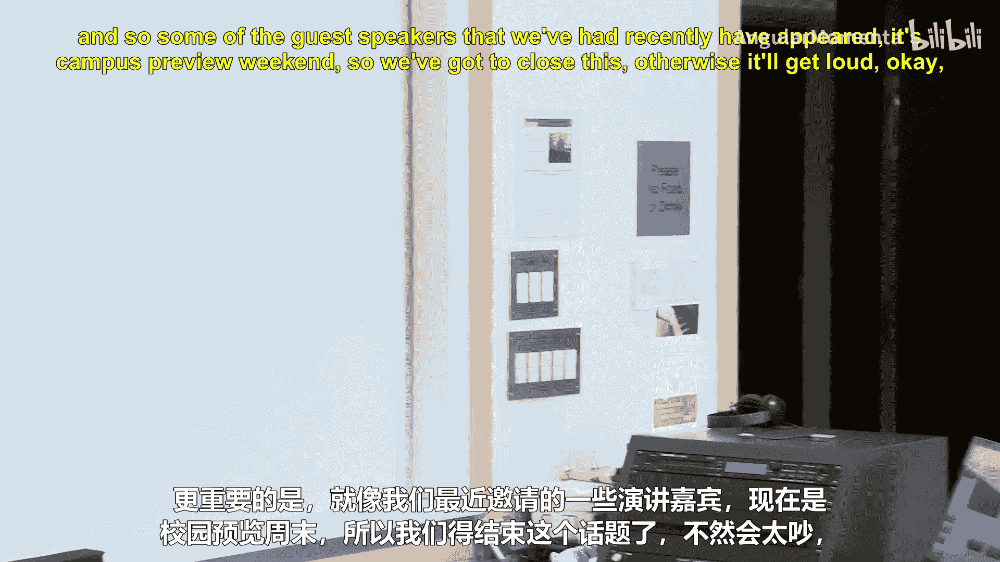
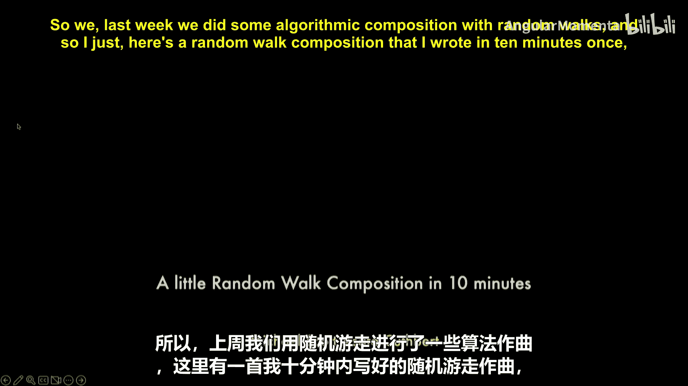
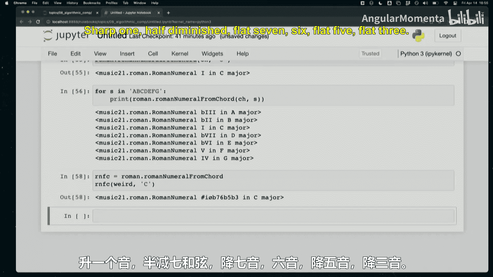
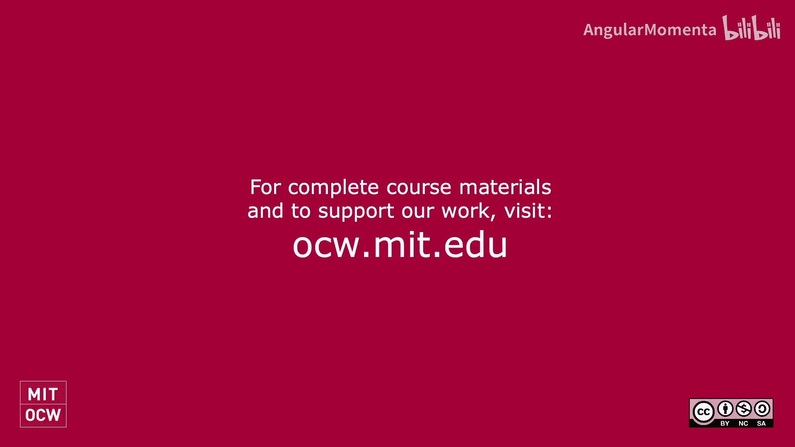

# 【麻省理工】计算音乐学与分析‌ ｜ MIT 21M.383 Computational Music Theory and Analysis,S 2023 p39 39 第24课 视频：算法作曲（二） -BV17xUmBDEUC_p39-

。Hi， everybody。 today， we're going to spend the bulk of our time making up for sort of for lost lab time。

 lost time coding and doing implementing some of the ideas that we have But first。

 we're going step back to just a little bit on the the quiz apologies for taking a while to get it back to you。

 But now you have it。 And the quiz is sort of the opposite right of the of the practical side。

 It's the more of the theoretical side。 So I wanted to talk about a couple aspects of that。

Somebody here， remind me put the screen back down。 Paul's not here today。 So please do that。

 Some of the practical aspects on the quiz space。First， why are authors in articles？Important， why。

 why am I really sensing that， you know， not just， you know what the three contexts are or what optic is。

 but really whose idea this is。 And there's really two reasons。 One， the field is small。

The field is small。 And if you're working in it and it's， it's young。

 like like not young as y'all or it's even older than than me。 But， but young。

 like almost everyone who has come up with the great ideas that have changed the field are still living and people you can meet。

The， but more importantly， and so some of the， some of the guest speakers that we've had recently have appeared Its campus preview weekend。

 So we gotta。

Close this。Otherwise， it'll get loud。 Okay， but some of the speakers that we've seen have actually already appeared in articles that we've been reading and things。

 So these are names that will keep popping up again。

 And when when David Huron talks about Carol Kmhusel。

 who was after the quiz you know that this is a name that oh。

 I've already read that the other first reason is that I don't know if you saw on one of our guest speakers on music cognition。

 a lot of times there were you these nice， pretty pictures of， I don't know。

 can I draw a light bulb or something like that。 And some idea and things And over in the corner。

 you， you would see like Devins。2019 or whatever， right。 And those are just ways。

There's industry shortcuts for how you can learn more about a particular topic。

 so I don't tend to talk with footnotes， maybe I should more Str in white 2004 and you know but but these are things that people do quite often and it's because。

 here's the worst thing about almost every article you'll read whether in science， engineering。

 humanities， arts。That。Like， I'm telling you to read these articles and things。

 But then the articles aren't actually written for you to read。 I mean， it's so ironic， right， why。

 why do we write and publish research For the most part。

 we're publishing research to talk to or to argue with or push back on or develop the theory of somebody else who's living。

 So these， these。Scholars tend to talk to each other quite a bit。

 And so what they're doing when they're putting these names down is really。

 there's there's a seat here today。 if you'd like and what they're really doing is trying to trying to argue against something that you might not already know。

 So when somebody's presenting an idea。 they're really saying， hey。

 I've got a better idea than this other person。 And so they're always going to be talking about names of other people。

 And sos just just kind of good to get that。 So that's something there。

 the other question I think that can come up in the context of these quizzes based primarily on the readings and these sort of abstract things is why are there so many darn old articles in this class。

 Why are you doing a lot of citations of things that are 10 years old，25 years old。

 And then you got the Iiliac suite。 What is that 7077 years old now。

What's the point of getting into it？So I've been teaching for a while。 and one of the。

 there's one lecture that I love the topic and I hope you'll love it too when we get to it。

 but I hate giving this lecture。 It's the lecture on practical AI。In。In music and why is that？

It's because the various techniques that I've been teaching have changed so often that they're not really relevant two years later。

So I'm， I'm gonna be， you know， thinking about， oh， okay， Nick this weekend。

 it's time to update everything from Tensorflowlow， which was so state of the art three years ago。

 And I wrote a whole lecture around it to for those who know this pie torch。😊。

Wwhich I'm using now and it really means that there's a lot of things that will be spending time in that class that if Pytorch ends up not being the super great thing that you're going to be using for the rest of your life because of GPT or whatever else that's coming out those types of information will get stale pretty fast。

 but the notion of things like equality and equivalence and how you can put equivalence classes。

 I hope will stay with you， even if you're not doing anything with music or even anything with computation。

 I hope there' are things that will stay with you for the rest of your life and that you it'll sort of change how you make an outlook on the world so。

That's a little bit why this class has a good amount of it。

 I figure if it's something that inspired me 15 years ago and it's still inspiring me today。

 has a good chance that it'll still be relevant， inspirational in 10，20，30 years from now。

 for those who did the work on the global rule。 somebody， somebody remind。😊。

Somebody remind us what the global rule is And what， first， where， where does it apply。

I want to take a guess。Mtthew， do you want to take a guess or call on somebody else？Counterpointint。

 great， super。So it's counterpoint rule。 and what's it trying to maximize encounterpoint。Soう。아。

Just trying to think。What's it trying to maximizeimizing in？你不算。That's it。 You want to try it。

I guess it's like trying to maximize like the musicalness or like how good it sounds。 Max musicality。

 absolutely great， super。😊，And it does this， ironically。

 trying to maximize musicality came down to giving a formula， right。

 or giving giving a set of formulas。 and where do we begin with the global rule。

start from the end and go backwards and look at specifically。Do you have what three possibilities？

For the last one。If you're going backwards。Now， you have two possibilities because you can't repeat notes in this context。

 So you can be trying here and here against some other。

T David Lewin would actually not be happy with me， he always did his counterpoints in Alto Clef。

We'll do it in in trouble and base。 So yeah， you're trying to figure out， okay， if we。Ended here。

 And the previous note is here。 What are the other notes that we can do。

 So we have traditional counter point rules。 But we also have this notion that。

Every note that appears in the line。Must at some point。Find what。Remember remember。😔。

Every everybody quiet because they all know this so easily or because it's a little little funggy。

 easy。发ggy。Okay， good。 That's good。 Good。 I prefer silence when foggy because then I know what to do next。

 So in order to get maximum musicality， who talked about。What begins its。He wants what kind of lines。

Sooth lines。 So we want smooth lines。 So if at some point you have a D here， a low D。

 and we're going to get to see what are the notes that we need to see after this。嗯。Just turn red。

What are the notes that we need to see after this？What's a note we need to see after after D。

What's that？E， good， good。 So if we have an E。Then what happens if we have another D after that？

What are we going to need after the D。That's a point。E， another E， good。So basically。

 whenever you have a note， you have to have after it， every note between here。

 not every every diatonic note， not right， not every crronatictic note。

 You're not going to need a D sharp at some point。 Every diatonic note between here and the final cadence note。

 And that's why it was a little bit easier to work backwards。 Now， why is this rule。

Why was this rule important for this class？问。This one。

 this one might be a silent because it's pretty easy because it's almost everything in this class。

Who can do it。那是。What kind of thing can apply this rule。Computer， okay， so that you can have an out。

 It can all be done。The ironic thing we're maximizing musicality through algorithms。嗯。Great。

 so that's about all I want on that。And people who who chose that problem。

 those tended to do pretty well。 Now， let's get to。Second。Equality。And equivalence。

And almost everybody chose to do this one。嗯。What's the name associated with this without looking down。

Dmitri is the first name。To Mochco， let's try to spell it together。 Give me a。T， give me a why。

 give me a。And。Give me up oh。一？随ぜ。Sa two two。Dmo Q， he'd like that。 No， Do Co， right。

 So it's this one's a little bit hard。 And I would not， you know， whatever， basically。

 one of the things I tried to do is I put in optic and whatever you put and see if Google could find the author on the first thing so that on the first page I。

 and。Yes， remember that， if you put in Wolfgang most mustard， it finds Mozart。

 So Google's pretty good at this。 But okay， so Dmitri Tomat Co's optic， almost everybody got O。😊。

Opttic octave。Ping。Tea。Ie。And see。Carnalally good。 I know this was like backing my hand。

 I just don't know how to spell the word optic。 And then most people thank you for including my little contribution of spelling on the list。

 A lot of people， great。 Now， so people did really， really great on that。

 Here are some of the things that though were a little bit harder。

 I think I might have thrown some people for a loop and I didn't try to， you know。

 Gr too hard on this， because I realized， I didn't do the greatest job on this in lecture。

 So the difference between equality and equience。 when you talk about sameness。

 Which one do you think were most likely talking about， But for equality。😊，Same equivalence。

We have more unequivalence。 yeah， I might not have done as well on this。 I think of。

Sameness as having more to do with equality in some sense and equience。

 meaning sort of can be grouped together。And we could say it can be grouped together in some logical connection or can be grouped together connected with some in some logical way。

 And the other thing that I think I probably falls a little bit on me because didn't come out as clearly is that what we're talking about same some people and you got full credit。

 if you did this talked about sort of the big picture。 This note is same in every conceivable way。

 So this piece is the same as this other piece and every conceivable way。

 And you know that's one way that we can think of sort of a grand scale of equality。

 A problem is that y'all are really smart and you all know how to conceive of things that can break that right。

 know， know， I hit play on on this recording and then I hit play on this recording again。

 But one of them happened 10 minutes later。 and one of them was played through on speakers that had had 10 minutes more。

😊，A and tear on them or something。 So， you know， you can always conceive the way it's different。

 So maybe that's not as good。 but， but we might think of equality of aspects of， of something。

 equality of aspects of you know that。I'm trying to think you all are sitting down。

 So I'm trying to think maybe maybe， maybe Jake is， you know， that we are not exactly the same。

 but I think we're approximately the same height。 Maybe we're the same height。 Let's say that we are。

 So we are same in heightness or something like that。 So two notes could be same in frequency。

 equal in frequency。 So that's。tendend to use equality for some sort of attribute of something that is identical or not cannot be distinguished from each other。

Whereas equivalence we tend to think of as things that we can group together。

 none of us are the same in in any， you know， in in any real deep， great way。

 but we all could be lumped under the equivalence class of MI I T21 M 3，83 students， right。

And it kind of tells you also that equivalence classes might be overlapping because some of you might be also MIT。

 you know，6042 students together， or you could be in something else so they could be overlapping。

Then the hardest part， I think， on this problem that snagged a bunch of people is where in what contexts equivalentence classes might。

You know， might be used and might not。 Well we might think of。🎼。As one cord arepeeated and。

As an as the same chord or， yeah， I guess I just use same in an equivalent sense。 So maybe。

 maybe maybe I'm less documented as an equivalent chord。Even though one of them。Was。Going up。

And the other one was going down。 So we might think that the permutation。

Doesn't matter in that particular class when we were talking about what chor did I appendiate。

And then later， we might say， well， you， direction is another equience class。

 Did it go up or did it go down。嗯。And context for when you might use one and when you might not use one。

 a lot of times the context that where equivalence classes come in。

 it's sort of a little kind of too obvious in a class called computational music theory and analysis。

 that equivalence classes tend to not come in very as often in performance， than in analysis。So。

 I think， you know， some more than one person wrote， you know。

 well that you can think of a performance where cardinality doesn't matter。

 and might have written something like， well， if you play that measure three times because that's what's written。

 I only play it once。 it's going matter for a performance less way。

 but we might not think of the cardinality as mattering if if we're trying to do a search on does this piece have any diminished triads。

 You know， we don't really care how many major triads and how many minorr， but in that case。

 we might just be lumping everything in under the type of triad equivalentvalence class and not counting how many。

The particular one， but， but we use these all the time in real life。

 So the example that kind of popped into my head today is。You know。

 if you if you're going to Taylor Swift， if you're going to be analyzing a Taylor Swift song。

And you're going to look at the harmonic structure of it。 Does it matter。Presumably， if， if。

 if you're listening to Taylor Swift's recording or if you're listening to a cover band。

 one that's trying to be faithful。For harmonic structure。Not really， right。

 You hope a good cover band is trying to sound like that trying to use the same harmonies。

 So we could come up with a cover band。Equivalence class。Cover。

 maybe we just call it the cover equivalence class， which applies if you're doing harmonic analysis。

Does it matter whether you're seeing Taylor Swift or cover band if you just paid $900 for front row tickets？

Yeah， it does。 So we can think of live performance as a place where cover equience doesn't exist。

 Now， we mostly talked about pitch equivalents。 So that's a big thing there。😊。

ThatSo that we might be thinking too much about pitch and not enough about duration equivalentvalence。

 not enough about bigger things。The other thing just to talk about is that often when we're talking about these pitch equivalences like octave or cardinality or things。

 we're not really thinking about the， the sort of。I don't know the scale of the piece。Right。

 we're not really thinking， does this piece have the same number of notes as this piece if we apply cardinality equivalents or something right。

 but we might be thinking about， does this chor。Have the same number of unique pitch classes if we're applying octave permutation。

 transposition and cardinality。So that level comes up quite a bit。

 I think there's one place where we have。Where we do tend to think of equivalence classes on a peace level。

Sometimes。That's when you have， you know。I don't know Beethovens。Third symphony in。no， E flat major。

 sorry， of course， this is， this isn't a music history class on on the history of Beethoven。

 but that we do tend to group pieces in classical music by key。

The other place where the immediately comes ahead where there might be equivalence classes of。

 of pieces is a DJ might have a beats per minute equivalence class where you want to group together all songs with the same B PM。

 so you can switch between them。 So think on that。 Any， any thoughts or questions on。And this。

And thank you to the person who gave me the opportunity to explore the permutation equivalence class on Happy birthday。

Okay。Last， last ones talk about the three contexts。 This one I。

Was a little bit harder if some people got， it was by Eleanor Suffrage Field and some people thought it was the decently similar about the same time in the semester article by Nicholas Cook and if you wrote that。

 you were getting some credit because you were really in the right ballpark。

So she talks about the three main contexts。 It talks about our。You can read them off。 We're。

 we're better setting them out。 first one。So symbolic is one is we， we'll get is there。

 but not one of her terms。 can that ends up being the problematic one。 But yeah， we'll keep that one。

Else， what's that？Graphical， yep。Graphical and what do we contrast graphical things with？Sound good。

And then。The logical is what she has。And so symbolic will be in there things。One of the。

 the things that came up a lot in the quiz was that people were immediately going to a higher level than what she was intending。

 So when you think about graphical。This is sort of a graphical context for representing music， right？

But in her mind， what is the graphical thing I just created here？You want take a guess。

Don't go too high。Circle line Circle and a line。 it say great， a circle and a line。

So by the time you move that to Profesor， you drew a quarter note with a stem down。Stand down。

On the third space。 And you know， with this context， you draw a C。

 you've already been moving to the logical domain。Similarly， when you hear a sound。

 say I can only represent sound right now， well， I can do it in the sound domain。

 but know in the graphic domain of sound。You don't necessarily yet hear， oh， I hear a C。

Maybe you can say， or I hear an A， maybe you can say， if you're an oscillator in your head。

 you can say， I hear something oscillating at 440 times per second。But then to move that to an A4。

 octa 4 is motion to the logical domain。So this， I don't think I was clear enough on。 And maybe。

 maybe Elor Suffoldge Field wasn't enough。 or we， we just need to read it a little bit more closely。

 And similarly， even things like instrument。 I hear an instrument。

You're already moving to the logical domain。 You might， if you。

 if your're a signal processor be saying， oh， I'm hearing a waveform where only the odd partial harmonics are present。

And then your memory bank is saying， oh， I'm hearing clarinet。Sauce，s。 also the odd， right。

 I don't teach that class。 Yeah， I think that's right， okay。

So because elements of the logical domain， we were。

 a lot of our answers were transferring to the sound or the graphical domain。

 The logical domain got sort of。Sort of pingled up with。The next higher domain here。

 the next more abstract thing， which in this case， I'm going call it the meaning。Domain。嗯。

We can call it the。Here。I'm going to actually try to write this without looking at menudic。Domain。

 which is sort of the study of the construction of meaning or the conceptualization of meaning。

 It's actually a pretty cool word。 If you don't know it。

 but I don't like it too much because my whole life， I've had。blow hearts， if I can say that word。

 who， who， who just miss who use Hermeneutic and throw it around everywhere。 Oh。

 I'm having a hermeneutic constructive meeting。 It's like， well， no， that's just what that means。

Lear learn your hemeneutic of hermeneutic。 So I'll often just call it the meaning domain。

 And so you might be， you know， that your logical sound domain， you've heard。

And your graphical domain， you saw a whole bunch of things on page and your logical domain said， oh。

 there's a whole bunch of randomly spaced toccato or even randomly spaced might be too， too far down。

 So at this level， you might say， oh， the title of the piece is Fireflies。

And this is a depiction of how the fireflies are coming in out。

 So there is a next level of domain to have there。嗯。

Difficulty is that there's this word semantic that came up a lot。Semantic。Sorry， I'm writing over it。

 but I'm writing there for particular reason。That。That Eleanor Suffrage Field kind of uses to imply this level of understanding。

That， that's sort of the greater meaning of things。 So it's a fourth context there。ButOver time。

It's kind of been migrated up in music information retrieval to be closer to the logical domain。

 So people will say， you know， oh， I don't want to， you know。

 I don't want to know exactly how you're going to draw it on the page。

 I want to know it semantically quartern C 5。Or something。 And so this term。

 I'm gonna try to avoid too much because it's being used in sort of two very different。Contexts。Here。

Okay， questions on this for more discussion。Okay， I know we want to get to some coding and get to some other things。

 But thanks for， thanks for sticking with all of this。 Oh， and。

 and there was one thing that came up and a really good answer that made me realize that I。

 I definitely didn't say this in class that she says most notation formats focus on one of these or represent music representations。

 focus on one of these things。 So， yeah， definitely the C D you know， focused on sound。 And the。😊。

You know， the， the PF of music focuses on graphics and things like that。 But the。

 the one way that that article has aged is that nowadays。

 we have so many formats that try to do encode two or more of these things together so that you might have music X。

 M L， which is encoding some。Pixel placements of notes also， and also encoding。

 you can do links to the to the waveform of something。

 And even going from C D to MP3 in modern formats。 Yes， it encodes the sound。

 They also encodes some of the metadata。 The year is proposed and things like that。

 And nowadays they can even be putting， you know， recommendations to other songs or something like that。

 Cool， okay。😊，Let's，'s let's come back because with want to make some things。

 We've been been in theory mode for too long。So we。Last class。

 we ended by doing some algorithmic composition with random walk。And so I just。

 here's a random walk composition that I wrote in 10 minutes once。

 and I just want to say one or two things on it。 Maybe you hate it， maybe you like it。

🎼，🎼Yeah。🎼The。🎼，🎼，🎼嗯ん。🎼，🎼呃，他。🎼。🎼拜。🎼，🎼By。So one of the things I did in my aesthetic on the piece。

 just to say a few little things on it is that I gave a large amount of gravity toward whatever note。

 which kind of transposed make it more dissonment。 whatever note。

 something started on when it went away。 it was really。

 really likely to get pulled back to where it came from。

 So that's why you'll see just a few things that kind of get perturbed out of way。

 And then as the piece goes on within each section， the gravity got weaker and weaker。

 And so that kind of let it have know kind of the opposite of a Luinian global rule that things got a little bit farther out as it went。

 The other thing that I couldn't believe when when I first was like， oh。

 I think this was be a good idea write the code generate and it sounded just a mess maybe still sound like a mess to you but putting in these staccato marks made all the difference for making it more of a。

Procussive piece so you can do things like that if you want your pieces to be a little bit more interesting。

 Yeah is there some form of articulation label that you could use what just color every node？嗯。

You could， yeah， in in monitoring， you would say yout dot dott。

 then you probably say stucco Sim stccato， similarly stucccato throughout。

 or probably you would just tell a performer， you know， if you're talking about actual humans。

 all notes smaller than whole notes are stucco Tsceimmo or something。

Is it possible to implement that in this graphical software？Or does the media play not breaking？Yeah。

 doesn't recognize when you， when you start talking to the thing you'll ever more expressive as it goes。

 Yeah， the Midi just ignores that for the most part。 I mean。

 maybe that's the great large language model thing to the the first。

 the first thing that takes a moer score is middi and give it all of the his rehearsal Marx all that stuff is like。

 oh， I must I must turn myself into fire and perform this in this way。 And yeah。

 maybe that would be kind of interesting thought of that。 Thanks for the idea。😊，Yeah， so。

 so we don't have that type of thing。 Besides when you're doing computation things。

 one one of the things is it's pretty cheap to， you know。In a loop。

 put staccatos on every single thing。Yeah， great， so anyhow I want to spend time on that just a little amus boost before getting to go ahead and open up Jupiter。

Give you a second or two， and。We got， were sort of have a bunch of little things that we haven't gotten to yet。

 I want to make sure that。That we can get to reminder that the problem set is sort of a Russian nesting doll of unlocking tools so that please pay very close attention on each of the questions on what tools have been unlocked。

 but if I'm telling you， well， you now have access to chd。 now you have access to Roman numeral。

 I should at least introduce these to you， right， I can't remember if I introduce chor very briefly or if。

Or if we didn't， maybe I don't think we did。Probably need some other things。

 I'm gonna import chord note pitch for now。So I'll go ahead and do that。I put the screen down， even。

 It's okay， okay。So what the hardest way that you can create a chord is let's say C equals note dot note C。

 I'm giving you the hardest way， so maybe you don't want to do this because I'm going give you the easier way in a bit。

 or if you just get behind。Note G oh， she should probably give them octave， shouldn't I C4， E4 G4？

And then we'll say C H for chord cha。 Remember that chord is a bad name for variable chord pitch chord dot chord lowercase chor indicates it is a。

Module， uppercase means class good。 And so we're getting object to that。 So we could do C， oops。

Apparently， there's a button for Google search。CEG。And do that。

The other thing that you can do and you can actually thank Dmitri Tamachiko for bugging me on Mike。

 why can't I just do this？That's more often how you're。

 how you're going to doing things when you're coding here。 But obviously。

 when you're doing something algorithmically。Quite often， you're gonna have notes。

 You can also start with pitches here。Some of the things to say chords。

 you can iterate over them for thing in CH print thing。And you get the notes。

And that each of the notes are there。 You can change the duration of one note in a chord and not the other。

 but that doesn't work to， to do well。 Let's create a second chord。Weird equals chord dot chord。

 Oh I don't know， E3， G5。啊。 what are we going to do， Let's put in D。7 C sharp。8。

 it's a pretty weird chord。Not know。 I'll put in a B 9 in there just because I know exactly what that will put in。

 This is the the function that you're going to wish you had access to on one of them。

 the root function。We'll kind of get that。 This one might not have a name。Common name。

 diminished minor knife cordord。Is that correct？We are dot show。不。That one went too high。 Okay。

 let's， let's， oh， because it's an E 3。 No， that actually might be correct because it has to fit it all into one staff when you do this。

 Maybe instead of E 3。Let's say E4，5。6 yeah。Octaves don't matter，5，5。6，6。 it'll sort it for us。Yeah。

 that looks a little bit better。 Eas， though， is。Close and weird， I guess I'll call it。

Equals weird dot closed position。Ys。Okay， and。So who remembers what closed position is from 301 or something like that。

这。It's， yeah， it's all within， within one octave。 There's actually two different things。 Some。

 some definitions allow the base note to be in a different octave and， and then the other。

 but the the top notes are all as close together as you can get。 Yeah， and's。

 that can be pretty useful for an analysis type of task， right。😊。

So we can let's we'll choose a different ba piece today。

 I'm sorry I'm not keeping up my promise to do a bit more than just bak。

 but does make things go a little bit faster。 this will say bach equals corpus。

 So I'm importing corpus。 Sorry I should be talking around corpus BW V269。

 This is gonna be one of our favorite ones coming up for a bit。6，2，6，9。

 Do I have the right template out。Preak。Great。And。So one of the things we can do is we can get。

 so what I call it Bach。Let's do Bch dot quadify。Dot show。Thank you。 We've encountered this。

 but we haven't really talked about it very much。 And I'm going to need to zoom out for a second。

 or you can do this on your own。Or maybe I'll just do this bach。Dot measures。

 So you remember this begins with pickup。 Yep，0 through 4 dot show。Quortify slow enough。

 so you probably shouldn't call it every single time B。But fact， as well'll make the one。

Part that's faster。 Go first bucked up measures 0 to 4 do quadify dot show。 You don't have to。

 am I going too fast today。Yes， I am。 Good。 Thank you for having the courage to nod。 Let me do it。

 So we're gonna do the same thing。And。I just want to make sure that we can kind of get。

 I can't really tell if that's a G， but it does look about。

 but that does look about an octave below that note， and I do know that that's a G。 and so yep。

 so it's taking at every moment what's sometimes called a salami slice。Which is to say。

 every time something changes， there is a new chord created。

 So we can see here that there's nothing that changes here。In between here and here。

 So this is a chord， This is a chord。 But here， this will need to be made into two chords in order to。

Deal with it。 And we can kind of see here。That this works。

 It's rather hard to figure out what chords these things are。 So what did we just learn。 Yeah。

 what's spend Io。It's a music X， M L format that。That is compressed music X， M L。 It's kind of nice。

 Is music X， M L all compressed， so。Music X， M L takes up a lot for notation format。

 not a lot for video format or something。 Not a lot for something in the sound domain。

 but a lot for something in the logical domain thinks but it compresses incredibly well。

 Any who who works on compression algorithms might find that interesting。

 So a lot of people compress their music X， M L。 Good question。 Okay， so what's something we can。

 we just learned that we can do to， to help make this a little bit easier to read。😊。

To figure out what chs are happening， Gi up。I to compress， yep， somebody wanna。

 what was the we used to compress the chors just like closed position good。 And so let's say。

CHF for codified is Bch。Dot here， we'll just make， we'll just do a little except 0 through 4 dot quadify。

And make sure that that's the same as before。I did type it right。 Yep， okay。

 so how am I going to do this。Actually， before I do that， let's just look at it in text。

 show dot text。Instrument，3，4， yep and we have all these chords。Within measures， so。

We want to put all of these chors into close position。

What's our favorite three letter word that we're going to start with，4，4， Great， So let's do this。4。

My cord。In。WhatWhat do we call that， We call that CHF or CHF dot something。

 whisper to your neighbor what the answer should be， and then we'll all shut it out。そうで、す。よ。

Who votes for the next， Who votes for the next thing being a colon。No。Nobody who votes for recur。

Who votes for flatten。Who works for something else？So I split we got a bracket。Ah， yeah。

 bracket on the chd class， which is equivalent to anyone remember？Re recurse and。

Get elements by class。 So， yeah， that would be really， really great。 The other thing， by the way。

 this is a case where flatten isn't going to be too bad either because we don't really care what order we're getting them。

 We're good。Put them all into closed position。So for my ch in this thing。

 we can do something like this。 we say close position。Oh， shoot。 But that returns a new thing。

 And we don't have a stream to put it in。 A lot of these things that that change streams and change chords and stuff like that has an in place。

Option。It also has something。Force octave。 and we'll say force octave equals 4。

 And that's something that's pretty useful。 That says， yeah。

 you're shrinking everything to be within one octave。

 Let's not have you do your own transpose function or sign after there。 Just put it all into 4。

So hopefully this works。Should that be running close position on my court not suit。 Oh， thank you。

 Thank you。 The This class is like like a running example of how two people coding code faster than two two people coding together code more code faster than than two people coding separately。

 maybe not 17 was probably too many， but yeah。😊，嗯。So they。

 I haven't ever figured out the time to fix this the tie algorithm when you do close position。

 because obviously， it's kind of cool that it finds that， oh， there's， there's a tie that was opened。

 but then this got moved to here saying， so great。 So now we have a certain number of chords here。

 They're happening here， what key do we think the piece is in now that we can see it more easily。😊。

G G major， good， good。 And so now we can start putting Roman numerals on things。

 What we call this in G major。The first one。我我。4，4，6，4 in first inversion。6。6ix， yep。6。

All first version，5 first in version。 now， then there's certain things that we have to be like，oo。

 but was that。We go all the way back up to here。No， okay， good。

 that what's hard to tell is if that was a passing tone or if that was which one of these two was the passing tone in that case。

 can you see my pointer， Yeah， which one of those two is the passing tone there， Great。

 so we can go there and we can do this here。 We'll get to how we can have the computer do all this for us in just a bit。

嗯。Questions or anything I should go a little bit more slowly。 Yeah， John， every before I notes and。

Why do we have some notes in the fifth off Because that's that's great。

 What says is it forced the lowest note to be an octave 4。And so since it can go up to an octave。嗯。

Yeah， so that's that's the the case where it's the highest here。

 It does mean if you do compositions where you're putting chs in closed positions and jumping them around。

 it can it can sound very jumpy so。That's one examples here。 create any。

Think else I should been going with us， let me。Okay， let's stir the chord class for a second。

Cordduct chord。Yops。Actually， I should be just during the。One of the chords。

So some of the things are are things that you've already seen because chords are music 21 object。

 Obviously， they have a duration。 you know how to deal with it。 They don't have a dot pitch object。

 They have attribute， They have a dot pitches， which gives you all the pitches there。

 but there's some kind of things can be tonic。 Can this chord be a tonic in some key。

What quars can be tonics。What kinds of chords， what equivalence class of chords？

Major chords and minor chords。 great， super so。That's some of the things。

 Does the chor contain a seventh， I think weird does， right， Do contains。7。True。

 but do we still have that first one？Yep， C， H contains7。

 So you'll find that there's all these slightly useful things in here。I don't know What see。

 is it an augmented trial。 Is an augmented sixth。 Is it a French augmented sixth。

 Is a half diminished augmented sixth， A lot of these things here。

 Is it transpositionally symmetrical as these things come up。Quite a bit。

 And you can put the same pitch more than once into a chord。

 So sometimes you want to remove the redundant pitches， redundant pitch classes， and so on。嗯。

Sometimes you might have weird chords that you want to respell。so on。

 so these are some of the things that are kind of useful in here， and。

If we want to talk about ontology errors here， C。 third gives you the third， C。

 fifth gives you the fifth and C。 base gives you a bound method of something。

 so that's something I I wish I could figure out how to change that these were done differently early on and it's a little too late。

 sometimes to change things just like it's a little too late to change how certain words in English are spelled。

ok。Cool， so that's the end of the introduction to chords。 unless there's people want to do something。

With this， okay them。What's that， Roman nus， We'll to Roman news in just， just a second。 So great。

 So we're definitely gonna get to Roman nums。 But first， a small。😊。

A small leftover from from our work on cognition and keys and the probe tone method by anyone know。

 if you know。The author。Hello what Carol Carol Cum Husel， great yep。Plophy was one of the people who。

 who referenced this。 Yeah， the proton method by Cru crumb Huel here Km Huel。

 And so we're gonna do is I'm gonna get us to， two pieces here。

You don't have to do this part if you don't。 you， you actually， at this point in the semester。

 you don't have to type anything that I'm typing unless it's helpful for you。

 Maybe in the first part is good。 So this is the a particular little jig。

We're going to be working with a lot of jigs in the next time that we do some coding together。

 So that's a nice little 9，8 jig a little bit unusual。 What key does it look like， it's in。Yeah。

 you't always have to， you can let， let people give this chance to， to do it。 Yeah D major here and。

And then we'll get a piece by the 20th century composer Arnold Schenberg。Senberg。Os。S E， H， O EN B。

 E， RG slash OP US 19 movement 6 all one word it was a little bit hard。

I wish I had another title that we can。Z。😔，It's a little piano piece。Great， and Adam what。

 heres at it。No one knows。Okay。Yeah， so this is， this is a rather ambiguous piece。 you know， just。

 just so you can get a tiny bit in your ear。 just the first couple chords。something。Wong on。

 there's a clef change that is missing。Yeah， I know there's something a little bit wrong in this encoding。

 Anyhow， a little bit ambiguous and biggest piece。 So what I want to do is let's get into unlocking some key analysis。

Thanks。So。What we can do is we， we call it jig， right， Yep， K1， our first key will be k。

Jig dot analyze lies， an lies key。So， that's。That's pretty good now。In addition to analyzing key。

 theres specific a number of people have implemented their own。Analysis things so。

You'll have to get this。 So we're going to run through a bunch of different methods， Chumb Hunt。

 key the standard key method。And simple。Key is something I put a guarantee to people using。

I using Music 21 that that will be whatever I think is giving the best results。

 And I'll try to keep improving it and get that。 Cumb Husel is exactly Carol Cm Husel's a probe tone method with the exact same things there which was learned we learned the different weights。

 the different amount How important the tonic is， how important the third is how important the fifth is in the key。

 How did she learn that。Proton， so that she was asking。Just， just getting people's。

 people's reaction to how far and out。 So it's based on cognition。

The SN one was based on labeled keys for the entire SN Folk song repertiory。

 which you we've used a couple times on things and come up in this class quite a bit。

 And so people use that database on the ones that were labeled in the key to learn not from not from people。

 but from what number of notes were in a piece that was labeled as in F。

 what number of things were labeled as an E and all of these weights， by the way， have these weird。

Numbers like， you know， the tonic 6。238。 then we get too much like pi2 pi or something。

 So these really long， complex。Complex numbers on， on things like that。 where Craig Sap。

 who's come up in this class a couple times for making the Rosetta Stone。

 thinks I think it was Craig Sap， who came up with a very simple。 He's like， no， we we can。

 we can just use 10101。5。 And I think everything in his waitinging is either 0 or 。5。 And he's like。

 it's much easier to remember， much easier to program。 And it works。He thought even better。 So we。

 we have all these in here。 So we'll do this。Here， you don't need to know Python F string formats。

 but I'm going to give 20 letters for the method and then we'll analyze using that method。Here。

 actually， we'll just do this。Key out oh。Make this a little bit easier。To read。 So we'll call。

Key out equals Jig dot analyze using the method。对不起。May， thank you。I put method in a string。

Sting of methodthodists。So when you put the jig into there。Everybody agrees。 It's D major。

That makes pretty good sense， right， You would not trust any algorithm that came up with a result other than D major for this entire piece。

 This is the whole piece， right， But let's see what happens when you give it Schenberg。

 So I'm going to just copy and paste。The copypy and paste method for coding quickly in class。

And they call S C，H， I think。And here we end up with quite a bit of distinctions。

Maybe E minor and a minor aren't too far apart， but we even have a major key in there。

 So depending on how you do your weighting， different things could be better。

 there's always the goal of trying to come up with a better key analysis team。

And the other main unsolved task in this domain is pieces aren't always just in one key。

 and I'm not talking about Charles eyes with multitonality and things talking about pieces change keys throughout the piece and sometimes it's easy。

 they change the key signature at that moment， but quite often pieces change keys without giving a key signature。

 Can you have a method that says well， it begins in E， and then it goes to a。

 then it goes to C major， and then it goes some other place。

 Can you detect where all those key changes are。So that's something that people have worked on it a little bit。

 but it's still an unsolved general problem。Anything。Any questions on these types of things。

By the way， you can， you can。 There's a bunch of other things you can use I analyzing like you can get the pitch range and stuff like that。

 but。啊。That works。Oh， and I'll just say on this last one， key out。t alternative。I can never al。

Alternate interpretations gives you a list of。So this is one the C major gives you a list from the next most likely to by far the least likely。

 In fact， let's do that on the jig。 We'll run the jig one more time。What do we call it K1。 Yeah。

 so K1 is the jig ski。And K1 to all。Tnet interpretations。Yep， so so if it's not in D major。

 it might be in B minor。 Yeah， it might be depending on what second section is very unlikely to be an A flat major。

Great。With the last 10 minutes， but I'm always happy to slow down questions come back。T。No有。Okay。So。

 great， so let's let's。Get what， what we all want， which is Roman numerals。

So go ahead and from Music 21， Iport Roman。And trying to find where I have this part。Bookken up。

Here we go， okay， within Roman。We can say R N equals Roman dot Roman numeral。

 What are the two parts of a Roman numeral the computer is going to need in order to。In order to。

 to figure out what pitches there are， sorry。The yeah。YWe'll call that the figure。

 the string representing things like 1，5 things and the key。 So we can do is if you had a key object。

 I think we still have one。K1， we can pass that in。And yet， that's4 in D major。 The other thing。

 what。What we'll often do when we're coding in class is I'll just。Give it a capital D for D major。

 Lowcus D would be D minor。 And that works just as well。 If you're actually writing a program。

 Unfortunately， one of the least optimized things is creating a new key object。

 It's about an order of magnitude slower than it should be in an idealized world。

 So it is helpful to reuse your key object。 If you're going keep using it over and over again。Okay。

 so。We have Roman numeral 4 in D major。Somebody this side of the room。

 whats what pitches are we going to be expecting through Romanuma 4 and D major。GB。

 you say that good， good。 So what we can do is。GBD。And。What octave should they be in？Do that。

 do that more gally so that we can get that。 You went。 matter It doesn't matter。 It doesn't matter。

 right。So there's this weird thing that happens that when we want to put a pitch onto， you know。

 onto a staff or something， we need to give it an octave， we need to sort of raify at that moment。

 but it doesn't matter， right。So。Here's the first question on， on this is what。

Kinds of where we say that。We have the same Roman numeral here as the same Roman numeral here。

 what kinds of equivalence classes are we talking about？If I say that， you know。

 well Romanman numeral 4 equals Roman numeral 4。Want to throw。

Through some equivalence classes on pitches or notes。

So me throw out an easy one just because we just said one。Octave， good， so that's definitely one。要给。

Permutation。 Yeah， doesn't really matter what order there。 there's。

 I'll come back with octave on on just just a little bit because there is the caveat。 But later。

 So everyone try to figure out caveat on that。 what else。Carinality， right mean is。I'll sp on that。

Yeahや。Because。This is one in C major。But so is this and so is this， and so is this。

 it doesn't really matter how many。Notes， we have good。Now。

 when we're just talking about Roman numeral like 4。

 what's the other thing that were that we're sort of in， in there for。What do you think about， Yeah。

 whether it's major minor。Whether it's major or minor， yep。So we have something on。

Let's try to think some of these things。Do we have the same blanket？Octave。Equivalence。

 the one that we've been thinking of that you've already coded。What's， was my caveat on octave。呀我见佢色。

Cord inversion。 Yeah， we have this， this different kind of inversion where。This is one。And this is。

One first inversion， one， was it 1， A，1 B， if you're British，1，6， if you're American， yep。Yeah。

 so we。We have， we have this unusual thing where， which is very usual for us as musicians or as people who have taken traditional class。

 but a little bit different for the demo for that， well， the octave of this doesn't matter in itself。

 This could be， you know， we can move this up to， sorry， like all over in the corner， G， E， G。C。

And it's still 1，6。 So there's something about the octave that doesn't matter。

 But there's sort of we don't have， we might say。A base。Pitch equivalentence。

 So we're always gonna be creating new equivalence classes on things。

 And so there's a very unusual equivalence class。 We also have a kind of limited transposition。

Equivalence class， right， that I can write。CEG and say it's one。But I can also write。D， F sharp A。

 and call it1。As long as I say that one is one in。C major and one is one and D major。

 so that there's kind of this abstraction out of that it's that transposition。

 it's measured according to distance from。What note。Not。

 not not a note like C or sign a conceptual note。Tnic， yeah。

 so we want to have things that are the difference from the tonic。

So I think this might actually be different on yours than on mine because I'm running the beta version that I haven't still got the bugs out so you can see Roman numeral。

Comes from some abstract class called harmmony， which also represents chord symbols。

 which I will not get to today。 And， and it comes from chord。 I think you're missing chord base。

 probably for most people。Or maybe notes okay， great。

Couldn't we have a very wood version Got that in。 Great， So with our Roman numeral。4。

 we can get back。 It figure is 4。 Well， that's， you know， not telling you too much。

 Let's get another one。 We'll call it R and1。Equals。Roman dot Roman numeral。Flat 2，6 in C major。

What's another word for flat 2，6。Remember flat major 26。

Don't worry if you don't know this because this is something that some people may know。

 but it's the next semester beyond the prere，It's traditionally taught the same week as Omin6 courtd。

 So everybody or the week before it， that's a type of It's named after an emperor or sorry no。

 it's not。 It's named after city， a Neapolitan chd。 So it's named not not Napoleon courtd。 Sorry。

 named after the city of Naples。 very， very cool chord。If we had two more minutes， I would play it。

 So here's something here。 It has a six at the end。 So what do we call it。What's the inversion。

First inversion。 So you can call inversion and put it as one。 See。

 it's a little bit strange that it has。Inversion takes some time to calculate on very complex chords。

 So it's method。 But we can get that it's Roman numeral alone。 This is a little bit wordy。

 I should have come up with thing is 2。And its front alteration， accidental。Who。Is a flat。So。

That it's a two with a flat in front of it。So。One of the things we can do。

 just looking at the last moment。 Let's we， what you'll probably be wanting is Roman dot。

Roman numeral from chd。 So given a chord and a key。What's the world meummeral。

 So we still have weird。 No， let's start with C， H。In C major。My CEG is still there。 Great。

 What would that be in here， let's just do this for。For S in。AB，C， D， E， FG。We'll print this。

Print the Roman numeral in。I'm using S for step。That make。That makes sense。

Some odd odd chords in there， right， But you can figure out these types of things here。

 And so we can get， we can even do Roman dot Roman numeral from chord。 I almost always。

 when I'm using this a lot， abbreate this。 So R N， R N F。F C equals that。 so I can just do it。

 Roman we from chord， weird。Oops， lets should give it a key。There we go。Sharp one。

 half diminished flat seven， six， flat5， flat three。

So Music 21 will try to find all these things for you。I've kept you over。

 so I'm not going to tell you how you can run this on every chor in a bach piece。

Put it as the dot lyric and then re show the piece。

 We'll leave that as an exercise for take home and。Might come into a class later。 So thanks。

 everybody。

