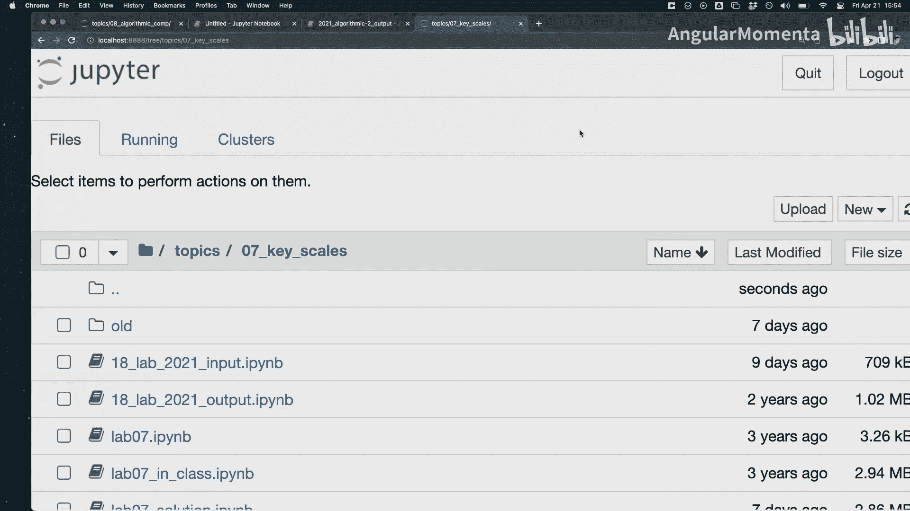
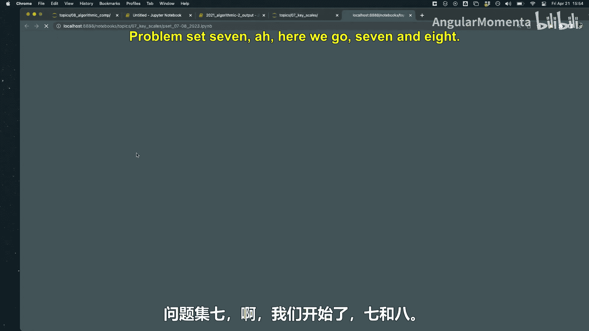
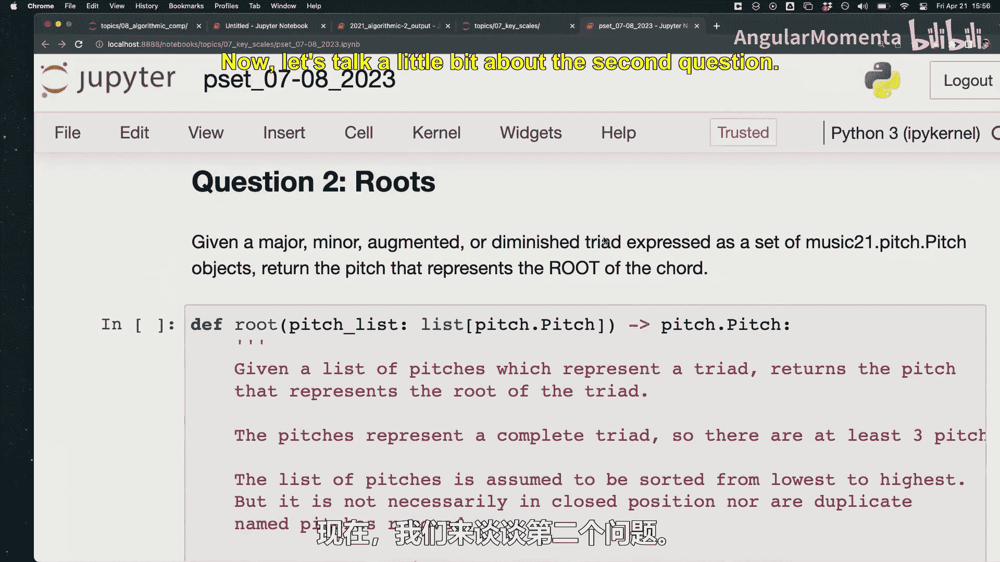
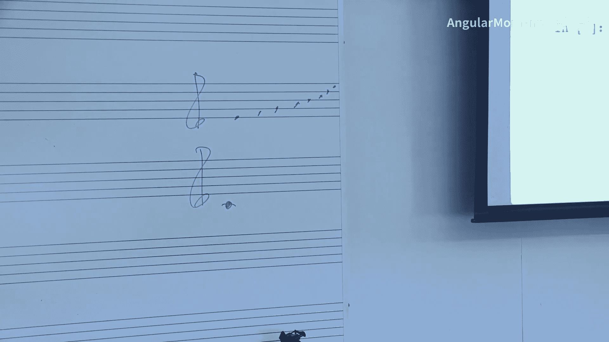
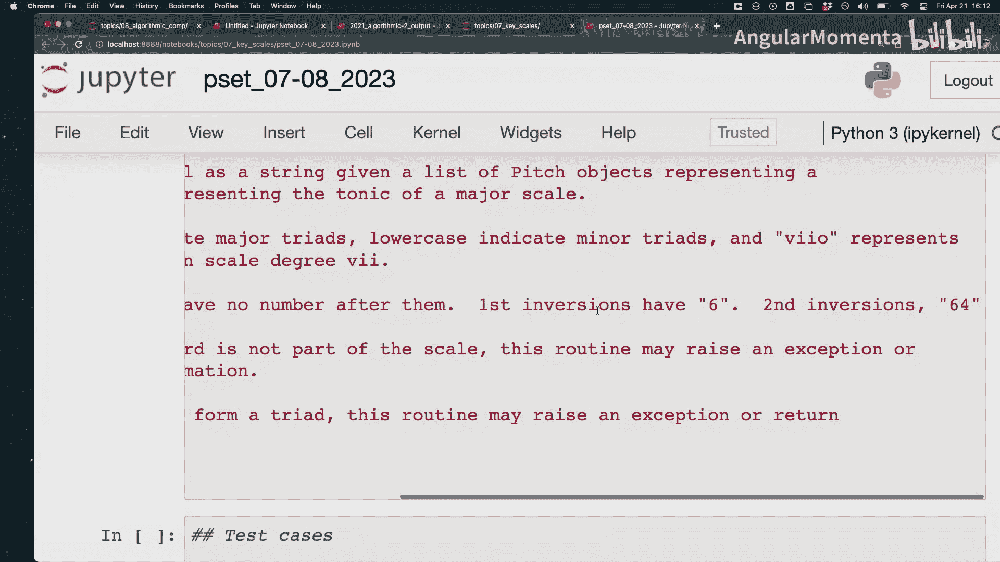
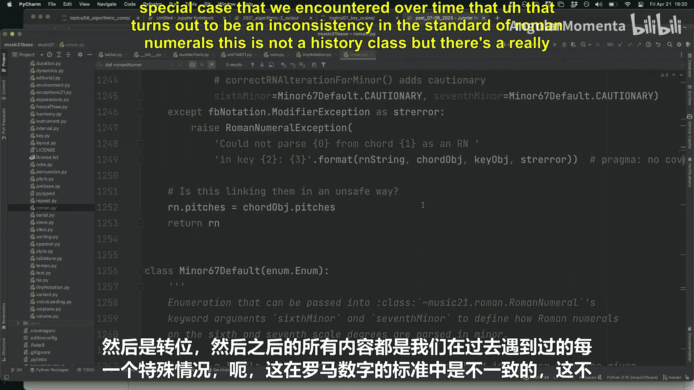
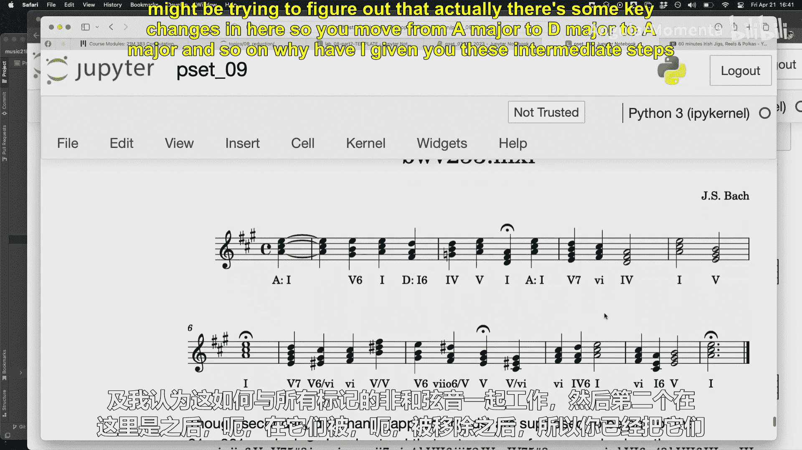
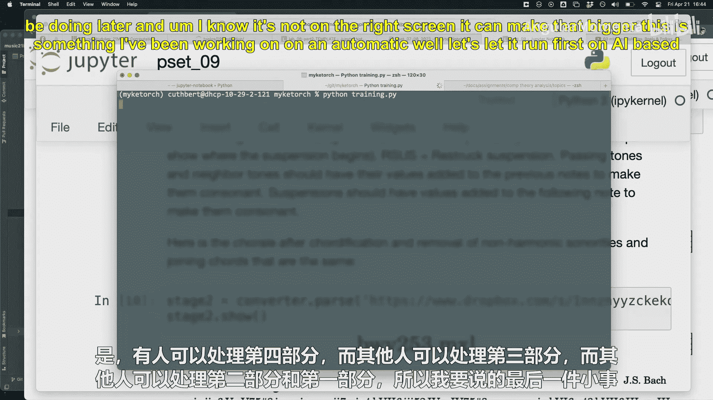

# 【麻省理工】计算音乐学与分析‌ ｜ MIT 21M.383 Computational Music Theory and Analysis,S 2023 p40 40 第25讲：算法作曲（三） -BV17xUmBDEUC_p40-

I want to wrap up a tiny bit of problem set 7。 but before we do。

 I'm going want us to jump ahead to the second part where I say algorithmic composition from Markov data。

 if you could get your。What do you call your Jupiter notebooks going。

 And now we're getting to the point in the semester where I'm just gonna say you can import everything from Music 21。

 But I will give you a few restrictions from time to time。 So I don't really。

Care what that you're doing。 And in the past， I've tried to have everyone download a pre preparedpared set。

 and it's always had problems。 So we're just going to do something that takes about three or four minutes of your processor time and get that started now。

 So this will probably take a second or two。 you're learning a new term corpus search jig。

 I can't remember if it's if it's important if this is capital or not。 but's I put on。

 And this will go through the music， So music 21 comes with about I can't remember what the numbers is something 14000 pieces。

 when you do it just so you could do it。 And this will get everything that calls itself jig。

 I don't know if there's any word that begins with jig that that is not a jig but you know this might be garbage in garbage out。

 I'm getting 327， depending on what version you're on。 you might be slightly higher。

 slightly lower won't influence。Is that too much great。So。Give me a quick。 Actually， the。

 the easiest thing I can tell is you got up or a snap of a finger when you， when you've got it。

 and then I can kind of hear。Okay， good。 All of our computers are slightly different speeds。

 But I think you can also start typing the next expressions while you're doing it。

 So Jigs is a sign called a metadata bundle。 That means it's a collection of everything whose metadata。

 whose titles， author， something match a particular search term you can look through。

 you can find things by key by by starting meter and things like that。

 But often searching by title or composer。's one of the first things。 And。😊。

What you can do is if we look at this as a very short introduction to this jigs is a 327 things。

 We can look at the first one with jigs 0， and we can get that it comes from some particular piece song 47 in a collection of Irish tunes called Is airs book1。

 So it's not a piece in order to get that we can say I'm going go J1。

 I'm equals jigs1 because jig0 has some funny things on it。

 and J jigs 1 dot parse calling it as a method and that will actually load it because otherwise loading 327 pieces would take a little too long。

 and then I can do show hopefully。A Spanish jig， It we get a Spanish jig on theirs？Okay， good。

 so what we're going to do is we're going just get every jig that is in G major。

 So I'm going call it because I have my verboose variable names。

 I'm going call it jigs in G with underscores you might just call JG， whatever you want。

 and I'll just say for。Let'll say J Meta。In jigs。So I remember this is a thing， I'll say J。Sorry。

 I'll go slower， I'll make this bigger right， slower and bigger always important。

I have a whole big screen， if I'm not using it。So a little bit better。

So I'll parse each one the metadata。So we'll say J， is that one parsed？

And now I'll do just kidding JK for jigs key equals J。Analyze the key。And here。

 just for now so we can all get caught up， I'm going to print them all。Just。Letting everybody。

And then I'm going to be grabbing in a second every piece that is in。That's in G major。Why。

 because it looks like there's a lot of jigsin G major， so it seems like a good thing to grab。Y。

We feel。Let's'll just keep snapping when when you when you're cut up。Okay， okay， good， good。 We have。

 We'll eventually synchronize on a rhythm for the things。 Okay， good。 Now also say is tonic。Name。

 I'll just be verbose。 again。 I keep jumping back and forth。 I that keys dotnic。

 which returns a pitch。Object。And a pitch object has a dot name。

And what we'll do is we'll get all the ones in G major or in G minor。 But no， actually。

 maybe we should， maybe we should do。Now， we'll just do。If tonic name equals G。

I don't think there's a lot in G minor Jigs in G。 append。Jy。

And that's where we're going to put this aside for a bit。

 but you can do the step when you're done because this will take a little a while to do。

 and then I'll move on to the next thing。So don' don't snap when it's done。

 S when you're done done programming this so that we have it for later， good good。O。Now， by the way。

 mine's running a lot faster than yours， not because MI T's bought me a fancy computer。

 but because when you parse something once in Music 21。

 it stores it as a cache somewhere on your hard drive。 And so it goes faster the second time。

 So if if you're feeling like， I need to upgrade my computer because mine was so much slower than his no。

 it's just。I may have， you know， like like they do on the cooking shows。

 I may have already baked this once this morning。Just make sure it works。 Okay， good。

Put that aside for a little bit。I want to open up， actually， I don't need to put that aside too much。

Your problem set  7， where that go。It is。啊。Sorry about that， y'all。It' a little bit more organized。

 right？

Problem set 7。 Oh here we go，7 and 8。

So I want to just talk through some of the things that you've just been working on a couple people have requested and been granted extra time for the last couple questions。

 so I'm not going to go through them and besides we all have different answers on the open ended ones。

 right。Actually， actually， we， yeah， we， no， we'll do this。 So the major scales1。

 how hard do we find this particular one。Easy hard little bit。

 What was the what do you think a test case that I'm going to run on that that you can already tell me if yeah。

 you're going to do something path like E flat flat。E flat flat。 What's Well major Yeah。

 I'm gonna probably chart with E sharpp major or， or even。Yeah。

 so's certain things like that to make sure or even a normal thing like F sharpp major。

 What am I gonna to be looking for， What's the leading tone in F sharpp major。E sharp， F natural。

 E double sharp， Who goes for E sharpp。F natural。E double sharp。 Yeah。

 I'm gonna be looking for E sharp because a major scale。

 one of the things about it is it uses every one of the。Lines and spaces。Once and only once。

Regard using some sort of sharp or flat。Great。Now let's talk a little bit second question。

 any any questions that you had on the roots， this is depending on how much you chose to do this by hand。

 which when we didn't combine the two problem sets。

 I'd like to use this one as something to do by hand。

You know， it gets quite a bit harder。 What'， what's some of the techniques that anybody remembers using on this。

Yeah嗯。We need to be0。そてって。Convert everything to 0 and 11。for now， great。

 and then so we have sort of the pitch class space， maybe I should so have a side。

必 안呢回啊。Oops。So you know， zero。One， is this what you're thinking of？To great。

 So that can be one part of it。 And then what do you what do we do， How are we going to use this。

 somebody else， Yeah， go ahead。addedSo if there's repeated notes， yes。

 so we're going to use the set operation good to remove things that are in there multiple times。

 what's the yeah， so for root。For the root of the court， does it matter？What's。

 what octave somethings in。No， so root is a kind of equivalence class that implies octave equivalence。

 right， Great， So we're gonna be using a set。 We're gonna be discarding octaves。No das， great。

What are other things that you did in this？Just want to spread it around yes。

 but I use the dionic numbers so use diatonic note numbers instead。Note。

Numbers so that you have something like and。I can't believe there's part a brain cell in my head that remembers this。

 So we had sign like 31，32，33，34， Great， the number C4 as 29 is pretty arbitrary。

 I just liked there's if you go to the media lab， they have a boze andor for imperial grand。

 one that has the extra keys down here。 And the lowest note on that one assigned to one。

 And just went up from there。 So C 4 ends up being 29。 Good。

 And so we can use that for certain parts。 Who used diatonic note numbers or something like that in their example in your answer23 who used something like pitch classes。

It good。Who use both？My implementation ends up using both of them。

 so I'm going to say both of these can be a right way to work。Good。

 now what are some other techniques that we did on rootness？一。Check for fifth， good。Check。4。fifth。

What's the best， which one of these do you think works better for checking for fifths？

you want to take a guess。I wouldn't want to say either of them because they're both like number base so you could have essentially like augmented da and solid Lake return the same。

Yeah， so it has a lot to do with whether we， we care about spelling equivalents or not， right。

 So we can always have， you know， a doubly augmented fourth sounds the same as a perfect fifth。

 but it repulses me because it is a dissonance， right， actually， I'm not repulsed by dissonance。

 but it is。And what do we have the problem if we're only looking at diatic note numbers。

Give me a fifth that might。I suppose that well， does it change the root， which fifth you find。

No good。 So we check for fifth。 Any check for any other intervals。I did the dumping in for two third。

 check for2，2 third in a row， two third。 So if you have one third。And you have two thirds。

I you might have something。 Yeah， you're right。 That was a very dumb thing to say that it was a dumb thing because I think it's a great way of doing it。

 So we have， if you can have two thirds， then presumably the bottom one。😊，Is a root。

 where's the problem come。じゃ。A major child or major Okay， great。 So minor third。Versus。Major third。

I want you to think in your head and then tell your neighbor yes or no on the counter3 on whether does a major third or minor third does this affect the root？

1，2。3。No， okay， so we might。 so we're not gonna do that for right now。

 but I'm gonna put this in the save for later pile because roots only one of the things we're gonna want to do Sa for later。

 But no， so it's not gonna to do。 What's an issue that might。Still have。

 but that's going to be important。With thisす。So you've gotten rid of octaves。

So let's say we're going to write everything in the same octave number for a second。

 Can I blank this for a second and yep。Okay。It's not supposed。 yeah， okay。

still have it over there if you need it。So if we're saying everything is in octave4。

 and I'm going to rewrite that F。A C， the F major triad F。A。C， right， is that going to work？Third。

Third。Yeah嗯。I mean， like yeah， if we use the like pitch class， then this upper C will be yeah， zero。

 which so you won't be able to find it just so it will be， yeah。

 where will it be if let's say we put everything off to four it' like。Only below it。

So what is this now。Still a major tri。 What do we recall this， by the way。First version。

 second inversion， second version，6，4。Numbering instead of I've just switched between two different systems that are kind of equivalences of each other。

 I switched from the calling this3，3 system。Which we use sometimes to the。Calling this。5。

 three system， which we use more often， where one system where you measure everything from the note below and one thing where you measure everything from the base。

Boy， isn't this like terrible in music that we do this？

Do you remember the first time that that somebody said to you something like， you know， oh。

 I was in an math major， and I was on scaled degree 2 on a 5，7 chord。

 And you actually mentally heard in your head。 I was on scale degree 2 in a Roman numeral 5 superscript 7 thing somebody figured out what part of our brain is doing this kind of translation on the fly that the exact same numbers are being translated in different ways I remember。

 So this is not one that we talk about very much。 This particular translation。

 but we do it quite a bit。 And I just did it maybe too fast。 So yeah，6。

4 or the other way you can do it is say it's a third stacked on top of a fourth。Right。

3 plus  four in music equals。6， yeah， yeah， okay so。This is also something we have to worry about。

 though was that a parentheses with a parentheses， how do we get around this problem？

I basically added 12 to the lowest。 I sorted and added 12 to the lowest now twice then checked。 Okay。

 so you you sort and then if this doesn't match 3，3。Then what you do， you。

 I bump the low snow up and octave。 you bump the blow snow up the octave。Great。

Will that always be enough。So what do you have to decide to do next so let's let's sometimes you'll will yeah I't go I took the initial coordinate and I within the whole court inoctave above so I guarantee that I will see a pattern that will be either major light or not。

Okay， so you take whatever notes you see and now I'm going to put it in first inversion， except。

There are chords beside C major Michael， so we'll put it in first inversion。ACF。It'Call that6，3。

Court。And if you just keep duplicating things。U。I that right。You will eventually， at some point。

 have this。3。5，3 stack， right， The stack of thirds。 There will be a 5，3 embedded in there。Does that。

Great hair。 or just。Fixing go super。These are all techniques that work really well here。

What are the techniques that will work？If you have sevenths。

Or if you might be given something that is not a triad at all。

How would you do this with seventh with anyone to do that as their extension。You did。

Which is the way I did it。worked off on like what I guess like first。

 I had a function that kind of produced the。The input to see whether or not they could。

A try as a seventh。 Okay， so first you， I'm just repeating for the bucket。 first。

 you had a function that we do sit as a triad or seventh to see if it worked with the previous thing then and then。

I kind of。There's I guess I combine both functions and so first I vary through a list。我ten做。

Like interval distances and then just for each。啱。Poential candidate having a root。

And then iterate through each potential candidate and see to check whether or not like the interval distances would the say。

It was like bigger。 So you you checked each one for each candidate as if the root。

 and then you checked to see if the interval distances matched something great super。

 There was a second hand for doing it， Yeah， Yeah， so increasingly great super。 This， by the way。

 it's not one of the great unsolved problems in algorithms。

 But I do not know if it has been proven what the most algorithmically efficient way of finding a root in in anything。

 especially when we have chords like， Here's one of our favorite in C major。😊。

We want to call that chord。嗯咩。Closeper。Dominant seventh chord。Should be four pitches。

 which one's missing？D， which is the what of the court。Fth of the ch。

 the fifth of the ch missing most common note in the chor to leave out， unless you're Chopin then。

He likes to leave out that one， leave out the third。Usually， you can't leave out the base。 Otherwise。

 you don't have a five， although there's a music theorist whoo Riman who would disagree with you on that。

 And， of course， you can't leave out the seventh。 Otherwise， you don't。Have that。 But yeah。

So how to deal with this and how to do these things is still something that we're working on。

 And I was giving a presentation a few months ago on how things were calculated。

 And in the middle of the presentation， I go， oh my gosh， that's not algorithmically efficient。

 And so somewhere in the music 21 thing， I quickly stitch to do。 remember how to make this faster。

 And I've forgotten how to make it faster。 So， so maybe we'll go back into that。Great。

Then the last topic- sorry， let's put that back and。So Roman numerals。some of the。

Differences between the Roman numerals and。And。I just finding the root。 Yeah， good ahead。

This is the ch that we give in native。啊。Once I had the scale， I found。

The court and solid what position in the scale right。

 so you created a scale based on the what was given。The tonic。 Yeah， I only give the tonic。

 I didn't give the key right because we're still working created a major scale based on the tonic。

 And you saw which position it was in。 That's， that's really a great， great way of doing it。

 What if it， I didn't give it in this， But what if I， it wasn't in the scale， How would you do that。

😊，Anyone know of things like flat 3 or flat 7。 Yeah， just match。

 Just match the step and then figure out the subtraction of the difference。 So great。

 so we can find a position in the scale。 if if you were wondering why question 1 was on major scales。

That's exactly one of the approaches I thought you could do。Anybody else？

Have a different methodology for this。Yeah， it wasn't this skill does your return there say this invalid。

 Yep， and it's invalid in this assignment， right， Was it not， yep。嗯。Good。Any other things to take？

All your information now was Jake right who， who brought in May  third Monday3。Yeah。

 now I think it's time to get that in。 how do you convert that。

What does this information tell us about the Roman numeral？Yeah， upper。 uppercase lower case good。

 or there's one other thing to。Put on。 what's， what's the Roman numeral that often takes special symbol。

じ。Diminished 7。 Yeah， so the seventh scale degree， quite often， the5 with the with the O。

 7 with the O after it， the diminished 7 good。嗯。Yeah， and then inversions。

 those become kind of the problem there。

So I want to give like a two minute peek on the code that you've now unlocked， sorry。

 there is a way to make this bigger。Nope， there we go。嗯。And。

Just to give a little bit of peek at Music 21s。Here go。Sorry， tiny bit too big， Tell me。Yeah， okay。

 that should be right size。Sorry， a lot of docs over time。Thinks Roman nual from chd。

So this is something。 So given a chord object and a key object。嗯。And then possibly a preference for。

 do we prefer secondary dominance， Can you have in major， Can you have a major chord on two。

 or is that the dominant of the dominant，5 of 5。And try to give an appropriate name。 So why。

 I don't know why my first one was， is so complicated。 I guess the back then I was just like， hey。

 I can do this。 Let's see if we can come up sign。 So if you have a chor。E， C， G， B flat。

 and then a few extra octave things just to throw， throw off in F major。 That should be a 5，6，5。

 Who remembers their inversions of 7 chords。 So reposition 5，7。Then first in version 5。Six，5。

 second version。5，4，3 and third inversion。5，4，2。 Some people also teach the tradition 2 and some people So 42 is the most commonly used one。

 I've seen some people have the less， the even more compact2 and some people， the more of aose，6，4，2。

Any baseball fans。I always think of double plays as， I mean， second inversion。

 that was because they always never mind， okay。So you can have certain certain things。

 And then one of the big issues is that people call Roman Roman numeral 6 and 7 in minor。

 according to different naming traditions。 So some people say that that the harmonic minor scale always dictates what the letter name is and some people say that that the that if you say it's diminished。

 like diminished 7， you already know it's been raised。 And you say it's major。

 you know it's been lowered and you don't need a sharp or flat in front of it。

 So there's a whole bunch of different conventions。 And unfortunately。

 that's something we haven't standardized for anyone who's had two different music theory teachers。

 you might have already encountered that。 Okay， so let's get down to the code。

To show some of the things that I found and maybe you'll come up with a better one who has taken a 302 or a class that has encountered augmented sixth courts。

 Yeah， so you know these these country codes， Italian， French， Swiss， some people call it。

 some people English， German don't need to worry about that for this class since we didn't have it but。

One of the other things that comes up a lot is that you need to be able to change certain。

 certain things that might come up。 So that's 5，7 chord is 7，5，3。Or 7，5。

31 if you want to call it and but we only call it 7 6，5 seventh chord first inversion is is 6，5，3。

 but we call it 6，5。 so you just need a bunch of substitution things and these aren't all of them because we just grab them from a lot of places to do make sure9 works。

That's always a nice thing to do。We find is the first thing you want to know is。

What's the root of the cordor and finding the root， as I said。

 is already an interesting algorithm and then figure out how many semitones is there between that root and whatever is the third and find out if it's on the basis of major or minor because that's going to determine upper case or lower case right。

 We'll skip anything that says if there isn't a key。Put that in， then。Created this。

Conceptual advice called a figure tuple， which is the notion of something like。If you had a cord。

With， I don't know。You might sorry， that is not a French vocal clef。Oh。You know， you might have。

Call that。Flat 5， flat 3。In some ways。That this one of these figures called this a figure tuple。

 which tells you。不。Thiip hazard。 How what's the。Thing over the base。

 It's just sometimes easier to keep track of how many semitons is it altered and what do we call it。

So。You might think that negative one always means flat。

 but there are some cases where that's implied by other parts of the thing。Then。

Correct the flat six to six in minor depending on people's spelling。

Then we end up trying to figure out all these things on how we can figure。

 how we can transpose the tonic so that we can。Deal with those things that are outside the scale。

 So like what we said， if you have a root that is not part of the scale。

 then we just really quickly construct a whole other scale down a semit or up a semitone。

 And so we can do all the other calculations and then just throw flats on everything afterwards。啊。

Probably guess what this does。Capitalize of its major， capital lower case year and then。

A lot of these things are slow。 so a lot of， if we've already seen this before， get it from the cash。

And then， something to turn。You know。1 to I 2 to I I 3 to you know。

 whatever convert a number from 1 to 3999 to a Roman numeral。 I don't know why I stopped at 33999。

And it's because I'm a historian。 and the numbers above 3999 were never standardized。

 no matter what your teachers tell you。 Then we try to figure out。

What kind figure it's going to be to try to get how what kind of inversion it's going to be。

 So what's the string for that， And that's where a lot of these was it6，4，3， becomes 6，4 and so on。

Then we'll try to think about， okay， so we take what's the prefix， is it flat to whatever？

Add to that the Roman letter。 I it 1，2，3，4，5，6，7， and then the inversion。

And then everything after that is every special case that we encountered over time that that turns out to。

Be an inconsistency in the standard of Roman numerals。

This is not a history class， but there's a really fascinating thing about wemanummers analysis and that it is a mashing together of two different incompatible analysis types that's over time got put together into one but that so that things like the uppercase and lowercase duplicating the function of putting the flat three on something and so what happens if you're in C major and then you see lowercase5 flat three。

So let's say you're in C major and you see lowercase 5， flat 3。 What do you think that should be。

G as the vase as the root y。Before indeed。What happens if I leave off the flat3？Same。Same。

 so is this a cautionary， you can add it or you can put it out。 But then there are other cases。

 What if I'm in C major and I put1，7。Versus one， flat7。Or。Butut the same thing with。5。

7 doesn't need the flat。5， flat 7， same thing。So there are all these inconsistencies in the world of Romanmanummeral analysis and it really begins to get exposed when you start doing things that we're going to be looking into right now。

 so we're going to get to the algorithmic composition in just a bit。

 but what I'd like to do for a second is which ones here。We'll go back into our favorite bach piece。

 because corpus， sorry， switching gears laptops open again。We did this once already， BWV 66。6 and。

We'll remember quadify。Corded， and willll say chord boch today。 chord boch equals bach do quadify。

And I remember this one as。Basically， an F sharp minor。 So we'll say FM equals key dot key。F sharp。

 lowercase， F sharp。And what we'll do on this is just for。So actually。

 snap us up when you've got this。Yeah， and also by the way。

 if I'm typoing this one I don't have a template for。 So if I typo definitely correct me on this。

 So for chord in C H， I often say I don't write the word chord because I don't want to lose access to my cordord module chord block ch do chord for each chor。

We'll say is R N equals Roman dot that Roman numeral from。Cord。C， H。

 and we're the key of F minor said you could just write the string FM there。

 but it'll be a lot slower。And then we'll say C， H。So actually， give a second on that。

 So you're gonna。Iterate for the recursed。 That's what square brackets mean all the chors in chord block get the chor out。

Get analyzed the Roman numeral from chd。 If I were really， really mean profit。

 I would say your next assignment is to reimple that。 But the you can see the gray hairs here。

 That's exactly from that from implementing that one。

 that and quadify are the two reasons getting old。 And now what we're gonna to do is we'll say the chords lyric。

We did this once， right？Cs lyric equals RN's figure。I think we did this， but we did it weather fast。

 so I want to make sure that。Oops， that's okay to do anything， right， because I。

Because I put it onto the thing。 I want corddbch do show， by apologies。

And you're going to realize there's one thing I didn't do that's going to make it look really funny。

 I forgot to put all of the chords in。Close position。at least it works pretty well。

So I'm going to scroll to the end， so around here。If you didn't get it all， don't worry。

Some some of you all have are to be thanked in the class。

 especially John and Adam for when I forget to put a notebook up that remind me and now all the previous notebooks are up。

 So if you miss anything， they'll be going up later。

 but you can see that there's some places where you see chords that look like chords that you've seen in your life。

4，5，6，1。And then。There are places again had five that looks pretty good。 Sorry。

 that autosafe thing knocks it down。And then chords 7，6，3。That's rather unusual。Flat6 augmented in 6。

4 position。 You all， you all remember how to resolve that chord， right。No， no。

 I've never heard of that chor in my life。 So this is a pretty dumb way of working with things。

 In fact， I'm just gonna go straight from this to the to the last part here then。

If you get to the top， you see a lot of figures that look pretty normal。 No， nothing after the three。

 you see 6， nothing，6， whatever。 These look a lot better。7， those。

 those are numbers you used to seeing。 The Arabic numerals used to seeing。

 But the Romans are way off。 Why are the these Romans so weird。

Because we're wearing to goeses and no， no why are the Roman numerals so weird。Remember this piece。

Good。It starts in pay。Starts in A， yeah， if we go back and。Now， we don' we don't have to。

 We remember how it goes right， It starts in a major。

So one of the things you can really start thinking about on your computer system is if you see a lot of3 flat 6。

 flat 6，3 flat 7，3，3， flat 7， and you're dealing with a classical piece of music。

 What have you probably gotten wrong。The key， specifically， you've put it in blank instead of blank。

 You've put it in。What kind of。Reelative minor instead of the relative major， good。

 What if you accidentally analyze the piece and major instead of minor。

 what would you be seeing a lot of instead for one to 5。Yeah， you'll see six minor。

 you'll see two minor and three。Six two yeah six， six， twos and threes。

 so that might tell you something about hey， you're in a different position。Great， so strange。

Ro strange Roman numerals probably means failure of key， strange figures。

What do these strange figures probably mean？Yeah isn't a very competitive。

Isn't a very compatible court， or it's a court that has embedded possibly what in it。

Nod nonchd tones。 Good。 Let's， let's everybody's favorites non chd tones。

 We'll go Hannah favorite noncod tone。😊，Does doesn't have to be your favorite just name one。don't。

 great。 So you'll， so that's great'cause you'll be listening up'cause we're gonna be doing so。😊。

D so diminished fifth is a chord tone when you say it that way。

 but it's not'ss or non harm nonharmonic tone is probably might be the term that you've heard in other things。

 When you say it that way， it might be part of a chord。

 but it might has to have function in order to do it。 So function be like and。Anticipation， yeah。

 where you， where you get to the， the cord， maybe you get to the tonic a little bit too early。

 Good anticipationip is a really good one。 Anyone else have a favorite one。要。Suspension， yeah。

 you hold the cord a the tone too long。 I mean， it's great。 don't， you know， obviously。

 it's wonderful， but too long for the harmonic analysis。 So let's， let's say when computationally。

 if， if your job is to get rid of non chord tones， What are you gonna do。

 How do you get rid of anticipation。😊，不。哦。Yeah， you just have the rest of the ch following。 great。

 How do you get rid of a suspension。Cut it shorter。 you cut it shorter。 Great， great。 So what's。

 what's another nonchone。 Nobody done the one that you the first one that most of us learn。

 These are more。Yeah。Step Y， see between two things， what what do we call that。Passing tone， yes。

 the passing tone， so great， why do you usually get rid of a passing tone？

Just cut it out and make the previous note longer， right， How do you identify。A passing tone。

It just looks like it， doesn't it， It's so easy on our neuralprocessors of our eyes。

 It just sounds like it。What kinds of things？What criteria do we need to know that signs are passing to？

This was the worst tense ever。Actually， the cleft doesn't matter。 Does it No， it's still passing。

 What， which one's the passing tone。Who votes for C。Who votes for D， Who votes for E。 Okay， good。

 lots lots of D's， especially on the side of the room。

 that I've privileged by making it much easier to see， right， Okay， sorry about that。

 I'm not gonna stay here very long。 So just squint for a little bit and feel free to shout out what what I'm doing for free closed captioning。

 Great， So what。😊，What kinds of， what kinds of things would you be putting if statements on if you were。

 you， you know， like， I'll just throw it in an neural net and'll learn。 But no。

 what if you had to program it， what， what would you be looking for。じゃ。Seconds， so we have to have。

A second， and then a second。 Do the seconds have to be。Ascending。

Do they can they be in opposite directions？No， why not。くす。Then you have a neighbor tone， yep， so2，2。

2， second， second equals passing tone， negative 2， negative2 equals passing tone。

2 negative 2 equals neighbor tone and negative 22 is neighbor tone。

 I know some of you are already trying to pass your elite code things and thinking， okay。

 what's the bit wide operation that's gonna make it。 So I don't have to put all four of those。 No。

 it's okay。 That's only four。 So you can， you can look find， find these in here。 So yeah。

 you might be doing that。 Then anything else that you think is important for saying that something is a passing tone。

So this format。Yeah making sure were surrounding it。Because this notes surrounding it are ch tones。

 Yeah， so these things have to fit into， into this。 And this is this is why I was saying that。

 you know， diminished fifth might be， might not be a non chd tone。

 if the surrounding chd is happens to be in minied triad。 And you might say， well。

 then all these might be ch tones because maybe the surrounding ch really is 4，7，6，3。

But probably not。 What do you， what do we， So， so now there'， there's two ways to look at this。

 We can do this on the individual voice level。 And so that's what we're or individual part level。

 If you're looking at C， that's what you're gonna to do before codifying。The other thing you can do。

 What do you think is happening here， You can't even really see。What's happening。

 But you can kind of see that we have 4，6， something weird happening。 and then 4。So we're going。

 something's happening here where we're going from the first inversion of a chord to the root position of the chord。

And these， there might be a lot of passing motion in there。

 So you might be able to identify these non chd tones at the chord level。

Or you might be working on the individual voice level。Which one do you think works better。

Individual voice level， hode level。Individual voice。Courts。对。And the answer， we don't really know。

I try to do both because some， some things are easier to get from one than the other。 So great。

 we've gone through and。We've done。Question outline one and most of outlined three on here。

 I jumped around because I realized that a different ordering was going to be better。

So we're going to sort of gone through3， A and B。And then I'll leave C And D for a little bit later。

What I want to do， since we have our jigs loaded up， I want to do a little bit of two。有。Scratch。

 we'll say take two if we're doing it。 No， we're not doing that level of editing。 But one。

1 last little thing。 Pro set 9， you're gonna be getting it a little bit。

 And what you're gonna to be doing in problem set 9 is this kind of ch tone identification and removal。

 So you're going be given various， you're going to be given various four part corrals。

 And what I want to see is instead of things like this that look really hilarious。😊。

Something pretty clear out and a nice sort of reduction of that。嗯。

One of the things you might start thinking about is that Roman numerals are a type of equivalence class on a set of pitches。

 That's not only about， well， it helps to say that this is the same ch。

 the same chal function in different keys。 It's also an equivalence class on。

On sort of the cloud of notes， including non non chord tones that we can。

 that we can say these two things are the same Roman numeral。

 even though one of them has filled in all the passing tones or neighbor tones。Suspensions。

 What do we get them all escapescape tones。 pretty hard one they're a bunch of other ones。 But yeah。

 so these are things that you're gonna be doing。 So I'll be giving it to you in just a little bit。

 So you want to be able to take something and make it quite a bit nicer。

 You're going to have help on this。 couple things that help you're gonna have at least a week。

 I'm thinking next Friday。 there's the danger between I don't want to give。

 I don't want to give too little time。 but I also don't want to go so late that you're can't have your full attention on the final projects。

 So what's what I'd like you to do is you're gonna be doing problems at 9 with your partner that you're working on the final project with and one other team。

So groups of four， the team of four， I think you're a natural group of four。

 So why don't you put them there。 what I I'd like to do is there are different steps along the process here。

 I'll just I'll pop up piece at 9 right now。 so you can see it while it's here。

 even though I'm doing some last second tweaks， depending on what we get through today。Cect。So。

Pet nine， you're going to be doing reduction and key analysis of tonal music。

And I want you to say note this， you need not get every chord right。 It need not work on every Cral。

 I'm asking for a decent amount of work toward a solution， not a complete solution in itself。 great。

 Okay， so you're not going to be doing that。So what you'd probably like to do is what you're going to do is I'm going to call vocabulary reduce on a score and you're going to give me either a score or a part depending on how you try to choose to represent it that is reduced one。

You have four people on your team。You probably do not want to implement。

 You definitely do not want to implement your entire solution inside this vocabulary。

 reduce programming in a Jupyter notebook。Take this， divide it up。

 and share it among your favorite collaborative coding tools。U。

I'm starting you with a crowd that's easier than the one we've been working on in class 66。6。

 And here are the four I'm going to test you on for 90% of your points。

 So I'm going to tell you that。Oops， this is why I'm still editing。You have。

Key analysis unlocked because we lost sort of four classes this year。

 So you'll be allowed to analyze the key using analysis things we're going to quantifyd。

Say this addd part ID as group is something that lets you figure out for each pitch in your coified score。

 what part it originally came from， which can be very useful for figuring out what to delete。And。

Yeah， we'll just show the first put it in actually I'll show different steps that might happen here。

 so what I've done is I've gone through one chor that if you load these things。

 or sorry one corral oops。O。Sorry， I forgot I have to restart and run all。Y， here we go。 So。

 here's the original corral that I'm asking you to work on。

And then unlocking something called implode， which you might find useful just for seeing a cr onto stands staves。

 It might not be too useful for you analytically and then。What I've done is giving you。

The first part of the answer， how and answer， how I think。

This might work with all the noncoord tones labeled。

And then second one here is after after they've been after they've been removed。

 So you have them all labeled。 Now you'll have all them removed。And then。

The last step you might be trying to figure out that actually， theres some key changes in here。

 So you move from a major to D major to a major and so on。

Why have I given you these intermediate steps if this is what you're trying to get to。

 it's because you have a larger team and so what I would like is that somebody can be working on part four while somebody else is working on part3 while somebody else is working on part two and part1。

So then what I'll say the last little thing is just to show a little preview of some of the things that we might be doing later。

I know it's not on the right screen。 It can make that bigger。 This is something I've been working on。

 on an automatic。Let's let it run first on AI based automatically trying to do labeling of Roman numerals based on sets of pitches and training data。

 what I've done is right now I'm only having it work with a few Roman numerals。

And。Always take a guess when you're trying to figure out what things are。

 these how many entries are there， one in each of these arrays，1，2，3，4，5，6，7，89，1， 11，12。

 So these are the pitch classes above the above the tonic thing so that one has I can't even reach up there。

So that one has the most entries in， you know， call that C， C， sharp， D， E flat， O E。

 that's quite a bit。F， F sharp， almost nothing G quite a bit。

 And so this is how many times you see that chord tone in everything that in our labeled training data was labeled1 and so on for for five。

 you see a lot of five， scale degree 5， scale degree 7 and scale degree2， kind of what you expect。

You put everything into a neural net that I'm still trying to make this a little bit better。

 a little bit better， run it， hopefully it's running。You can see run it through one time。

 it's starting to get 62% accurate， keep going up。Stays at 62，62，62， quite a long time。

 dumps up to 6，7，68。 Hopefully， it's going pretty well。 eventually gets 87，88，90 and so on。

 So it is possible to do this kind of thing with today's。Computational resources。

 kind of ending it around。Are we going to be able to get to 99 today？

How big is itSo that's why we gonna to get you in just a second。 So， so this， oh， of course。

 my computer can barely handle this while projecting。 I think I did 400。😊。

Well its tries to scroll down to the bottom。The danger is this data set took me years to get。

 and it took years to put in。 This is the complete piano Soats of Mozart。

 Bo complete piano Sos of Mozart， all labeled。And when I divided it up into half training， half test。

I still didn't have enough information for it to be able to get on。

 so I'm dividing it into 90% training， 10% test， and that seems to be about what's there。

The other thing was when I decided， oh this sounded like a fun project for over the holiday break。

 so I thought， you know I'd be able to present this on the first day of class or something I went in and the entire Roman numeral set could not be trusted because compared to the encoding of the things because people slightly disagreed on where measure 14 was or where measure 113 was or this edition had this part of the minueit the repeats were written out and they weren't so I was going through and when I was thoughtche the Roman numerals just look totally wrong to me or it would say Roman numeral placed after end of piece。

And so， again， it was about。I don't know。 It was about like like three hours a night for about three weeks。

 just， okay， well， let's realign this one。 Let's realign。 Now it was a little bit less than that。

 But about two weeks， maybe。 so this ends up being one of the dangers and why Im pushing。

 even though I think we're starting to get how many epochs do I do this time， I must have changed it。

 But we， we're getting pretty close。And it takes a very long time before the computers being able to get things up。

 So these are some of。The reasons why I'm going teach you some of these techniques。

 but then I'm going encourage you not to use them on your final projects。

 even though they they are kind of the coolest new thing going。Any questions。 Andm sorry。

 I'm not getting。 Oh， here we go。 Finally， we get to the done。And my computer is still so slow。

 Here's the mistakes that it was making。 Oh， this time it only got there。

 last time it got to all but all but one， correct。Yep， but 177 times it saw one。 It predicted it one。

 one time it saw it， and predicted 5。You can kind of imagine that 4 and 2 have some confusion for the computer and 5 and 7 also had some confusion。

6，6 and 4 have some confusion。 So then the the nice thing was actually going back the last time I did this and looking at every place that there was。

A confusion and saying， oh， about half the time， I agreed with the with the neural net and not with the professional encoder。

