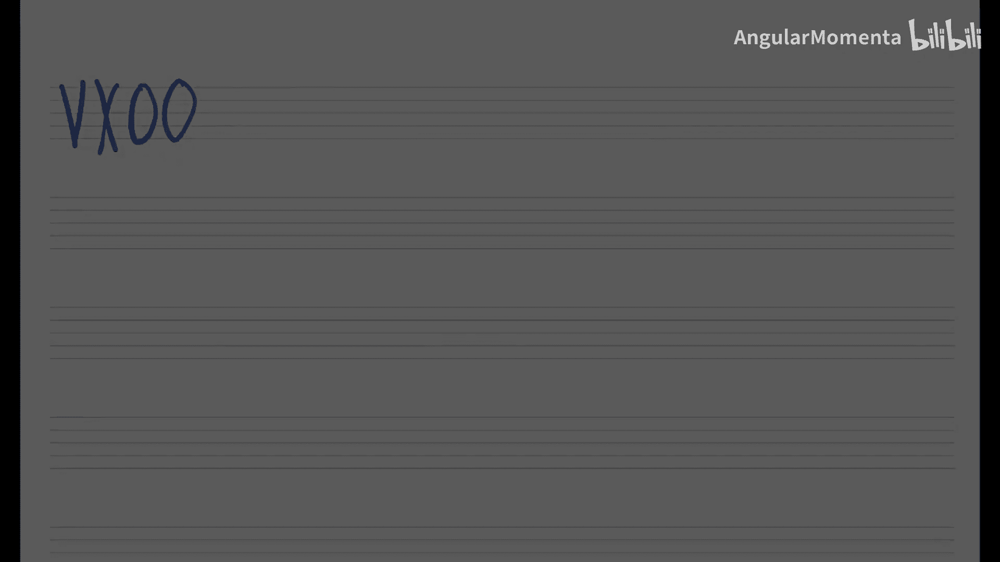
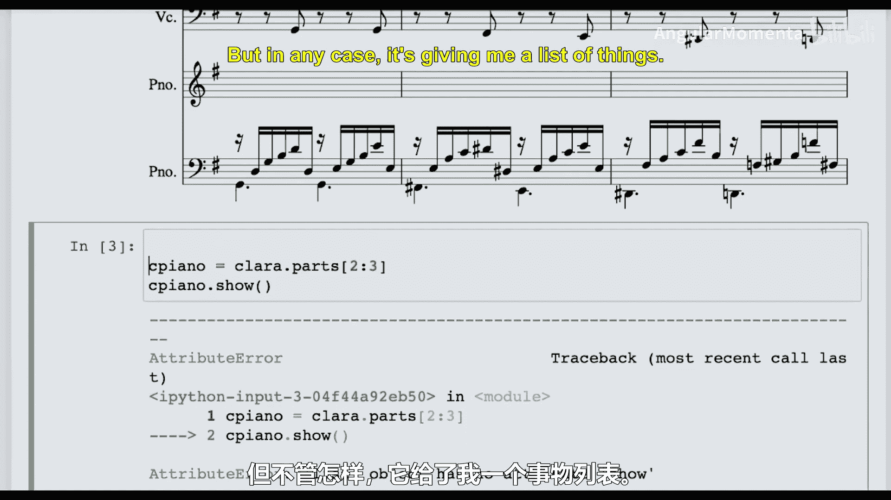
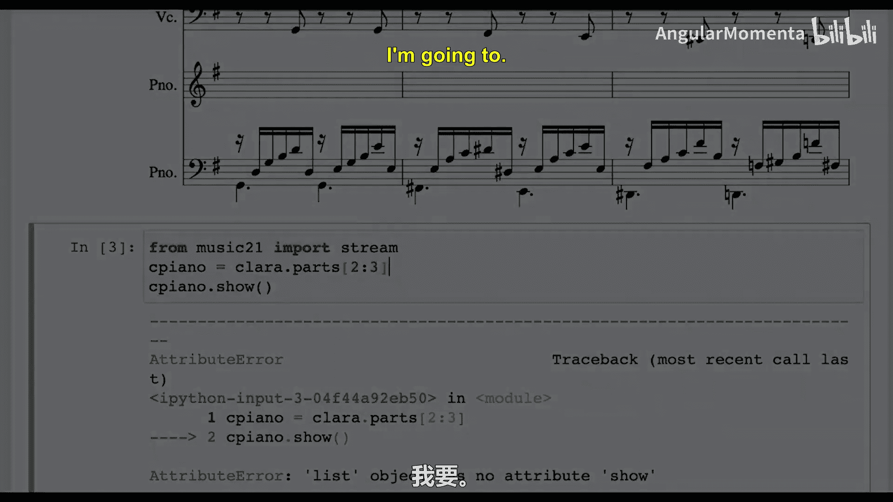
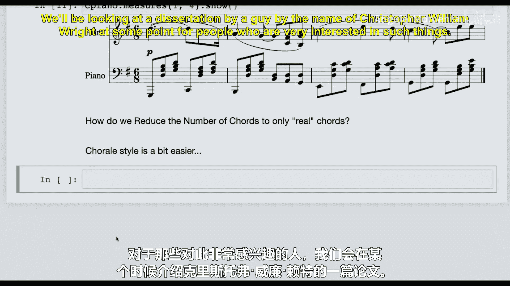
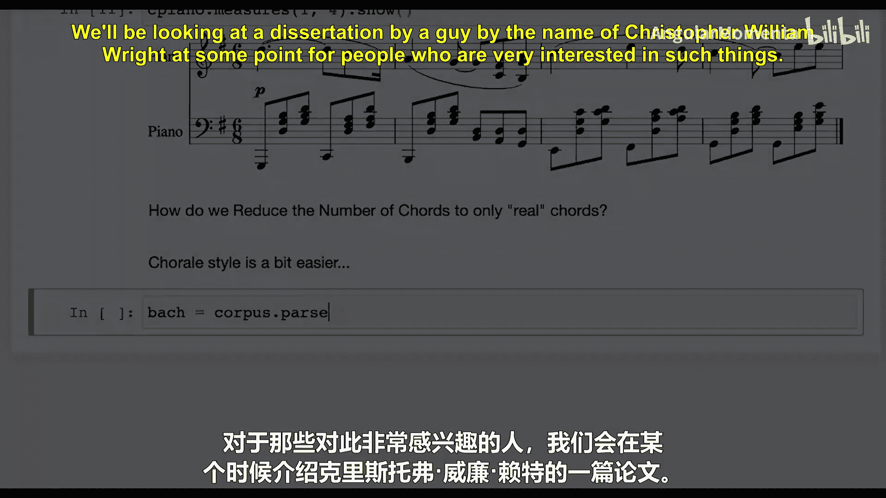
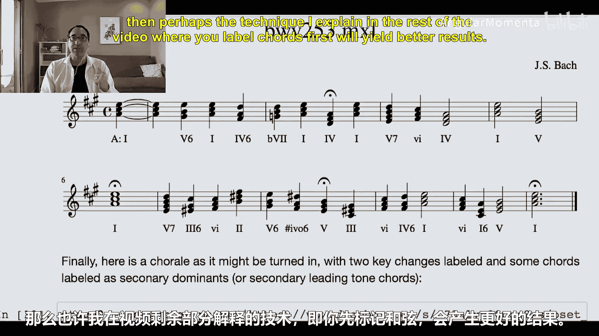
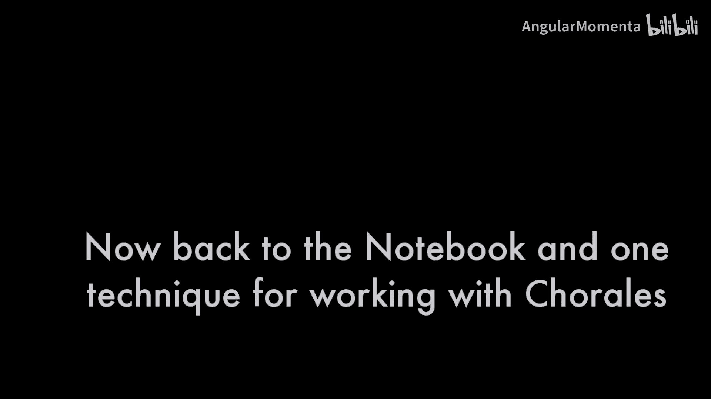
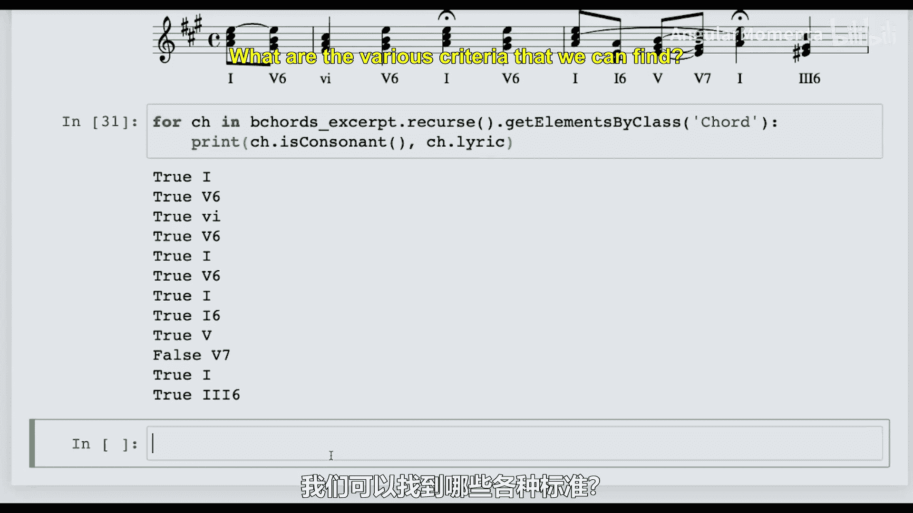
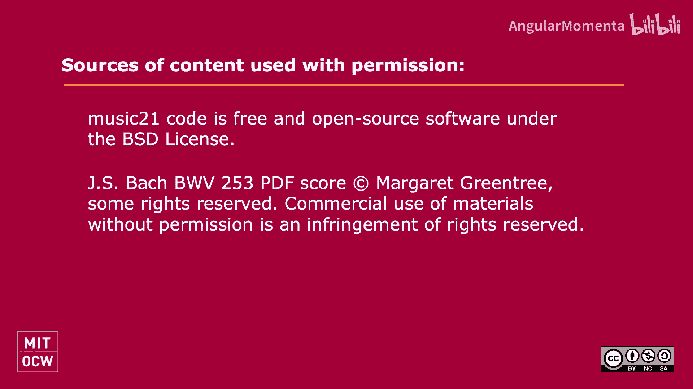

# 【麻省理工】计算音乐学与分析‌ ｜ MIT 21M.383 Computational Music Theory and Analysis,S 2023 p41 41 视频 26a：词汇精简 -BV17xUmBDEUC_p41-

Hello， everybody。 We're going to be talking today about something that sounds really esoteric。

 really confusing vocabulary reduction。How do we go to vocabulary reduction How do we reduce our vocabulary Are we talking about C spot run what does this mean It really is about something that we do every time we do analysis。

 whether we do music analysis or textual analysis or we're trying to think about you know what really happened on that last phone conversation I had with you know my partner or friend or something like that we're trying to reduce the number of complexities down to something smaller and more manageable and one of the places where we do vocabulary reduction quite a bit is in Roman numeral analysis we don't label everything a Roman numeral we tend to label the things depending on who your teacher was maybe sheer。

 he said we only label things that are really chords what does that mean？

When we're thinking about how we do this as humans。

We don't really have to think too much about how we do this。

 we just have to get better at doing this。But if we're going to train a computer system to be able to。

Tell us only the things that are really there to reduce the vocabulary of a score into something more manageable then we're going to have to understand this process quite a bit better。

 so that's what we're going to do today I'm going to move over to the Jupiter notebook and today I didn't have time to make every single thing a little bit you know really polished so you'll get kind of a sense of how I how I program how I make up assignments for us and how some of the wrong turns that happen along the way maybe it'll be useful so let's go over to Jupiter。

Okay， we're going to start by importing from Music 21， the corpus method。

 And let's load up a piece by Clara Schummand， her piano trio， slow movement。

 one of my favorite pieces。 And we've looked at this once in class before。

 it's going to take a little bit of time。 It's a little bit of slower thing you might need to wait here。

😊，Okay， it's a piano trio， but it begins with just the piano parts really lovely section。

 Let me find a YouTube video and place that in here。

And you can click on that or just Google it and find find it in there anyhow the next eight measures we looked at once in class and we can see it it's when the violin and the cello entered。

The piano switches to something else violences playing same melody， we looked at it because of those。

Those grace notes， I'm sure if we can highlight that there， there we go。🎼And they。

Yeah and they were a problem for some of our representations and COs Okay so let's just extract the piano part from here and you can see some of the mistakes that I've made with my own music 21 package that this happens I'm like oh I want to extract two parts。

🎼First off that should be two to four anyhow， but in any case it's given me a list of things so i've made two mistakes that's not giving me a stream it's given me a list I'm going okay now i'm going to do this again I'm going to import the stream we're going to。

Should create a new score now part for。Putting things in。

 and we're going to put in Kasa cannot type piano after all these seniors。 We're going to put in。

Part 2， which is the piano right hand， and we're going to also put in part1。

 which is the piano left hand。And。In order to make this run faster。

 we'll just take the first 16 measures。 I put measure 0 just out of habit in case there's a pick up measure。

 there isn't in this case。 So I could have really started with one。

 So now we're going to look at just that little excerpt。 just the piano part。

 All that to get rid of some empty rests。 But that's kind of okay here。Okay。

 so we're going to play with just creating the chords of this。

 And we'll remember the quadify function， which is kind of a fun part of Music 21。

 and we'll show it And because we're taking a troubled cl and a bass cl， but together in instruments。

 this is always a little bit wacky。 you kind of get used to counting MCce numbers of ledger lines when you are playing with quadify and。

There were times in my life when I could actually eyeball that first note and say， yep， that's a G。

 I got it。 But those times have passed。 So instead， we're going to recur。

 go through every single element in every measure and everything and get all the chords from that。

 C chords is now apart。 And we're going to take every one of those chords。

 which we call C and put it into closed position and say that it's going to be in octave 4。

 and in place equals 2。 We're going to replace the old chord And now we're going to show that the are the same thing。

 And now things look quite a bit better。😊，So， yep， there's a。IThink we compare it back up。

 we kind of look at same page。 Yeah， a little bit。 Yep， that's a D down there。 That's a G。 Okay， so。

 so it worked worked pretty well。Okay， we'll zoom back in again so that we can see quick。Now。

 what we're going to do is we want to label everything that's happening in this。 So first。

 we're going to analyze the key。 What key are we in， Where G major。 Y。

 you'll see that this is called the piano trio and G minor。 but this movement is in G major。 Great。

 so。We're going to iterate over every one of these chords again。

 and we're going to create a roman numeral for each of the chords。

 actually we're going to import the Roman。Package from Roman module from Music 21。

 And there's this cool thing that you wish you had in your last time you were programming your last problem set Romanman numeral from chords。

 So we're going to take the chord and say that we want the Roman numeral and G We're actually going create an object called G underscore major。

 which is a variable， which is the key of G object and the reason for this is otherwise we' would have to create a new key object for every chord and over time that becomes slow。

 So what we'll say is for original chords well give them the lyrics which are equal to the figure of the Roman numeral。

 So whatever the Roman numeral is will assign that to the lyric you can see it's not the fastest thing in the world。

 but now we can have it and we can look in。We can look at those odd chords in a little bit。

 You can go ahead and pause the video if you want to look at them in more detail。 Have a nice laugh。

But I'm just going to just get a quick excerpt。 The first four measures， that first line there。

 just so we can compare without having just to move our eyes up and down a lot， so。Now。

 we'll compare this to the original piano part with the left and the right hands。 and just see。

 do these chords look about right。 Okay， yep， see， there's that weird thing that that second chord isn't really a 6 bo chord？

 It's really that that low G is still sustaining。 And then is that a four chord or is that 54。

2 chord， It's going to be a little bit difficult because we want to make sure is that a poatura or is that a chord tone。

 It's a little bit difficult。In fact， this would be the challenge problem。

To be able to take something where we have Arpeggio's melodies things and do vocabulary reduction on。

A piano part like this。 This is still one of the big unsolved problems in the field and being able to make progress on how do we reduce the number of chords of Roman numerals of analytical things to only the quote unquote real chords on a complex score on a orchestral or a piano score is still。

😊，One thing that you could get young and A+ plus you could get complete published paper out of being able to do that。

For now we're going to and there are some great ways to do that we'll be looking at dissertation by a guy by the name of Christopher William Wright at some point for people who are very interested in such thing。

We're going to be applying the concepts of vocabulary reduction to bucks， four part corrals， because。

 this is music that tends to have。All of the harmonies changing very often and not having a lot of the arpeiation and things that we were just seeing。

You're going to be working in groups and I'll talk about the problem set later。

 but I want to say that there's two different approaches that you could be using and perhaps more to do this kind of segmentment。

What I'll be doing in the rest of the video is approach where you start by labeling。

Every vertical element。 And then you start removing ones that don't seem to actually be chords。

 This is a great way of working。Another way of working。

That resembles perhaps a little bit more closely how we as humans work is to start by identifying non harmonic tones。

And putting them all out in various places。 And then removing the vertical cords that are not real chors。

Perhaps by also using the various Roman numeral。Sections。To give you a sense。

I want to show a little bit one particular baral。 We'll look at the opening here of a four voice piece。

 And you can see moments that， oh， that looks like a passing tone。

 that looks like it's going to be a little bit。Yeah， just on its way。 someplace here。

 it looks like a neighbor tone。This might be a suspension to hear or this might be a restruct suspension and so on so we can do it by hand。

 but then how do we train the computer to do it， So that would be one type of question and then once you've trained a computer to identify these tones。

 you can create a version where you remove them and quaified。

After this comes an essential step of identifying where various key changes might be。

So regardless of whether you start with looking at finding passing tones， neighbor tones， and so on。

 or start by looking at every particular ch and removing。The end result ends up being the same。

 and your work can be judged by how well each various part had been identified through your process。

I would suggest if you're working and dividing up the tasks among people in your group that you start with the removal of various individual non harmonic tones。

If on the other hand， your group chooses to work。Where everybody is working together at each stage。

 Then perhaps the technique I explained in the rest of the video where you label courts first will。

Yield better results。

嗯。

But we can go and do something a little bit easier if we stick to corral style compositions。

 So we'll go back to our favorite Bch piece， Bwv 66。6。

 which is going to have its own problems in a little bit。 But we're going quad it。

 I'm guess going cut and pasting up here。 and we're going to again， once we quad everything。

 put it into closed position， put it into octave 4。 and again， replace all the chords in place。

 If you haven't seen how this technique works。 look at music 21 users guide Chapter 9 and chapterpter 10。

 we do that a lot there。 In fact， with this piece。 So you'll see see some new techniques and be able to do it a little bit more slowly。

😊，So this piece has the interesting characteristic that it ends in a different key than where it begins So if we look at the key of measures 0 to 2 using Carol Kmhusel's probe tone key analysis method。

 which is built into using 20 w and we see that it's an a major。

 but then if we look at the last seven measures4 through 10， we see it's an F sharpp minor。

So we're going to work on each of the two parts separately。

 So let's first look at measures0 to2 and get this excerpt as B chds underscore excerpt should probably called exc1。

 whatever， and we can look at those first two measures。And。

Let's use the same technique that we used with Cla Schumman to go through each chor and get a Roman numeral from it and then put the lyrics in so we can see it。

 We just have to change G major to。Aid major。Again， you can just put the string A there， but I。

Kind of prefer to do this。 So we'll do a major and a major and kind of change。

C chords to be chords excerpt and of course， a major is not the same as a major。

 so we'll go ahead and fix that。Put that in， and now will。Take this excerpt and show it。T to do。

And we could see Okay， it's quite a bit simpler。 We have the 1，5，6，6。Yeah， things like that。

 This is actually a really good time to remember。Think about references as we haven't really talked about this。

 So this is just the excerpt of just the two measures。 When we go back and look at all of the chords。

 one of the things you can see is that the figures do sustain back。To the that part， in other words。

 the chords in the excerpt are the exact same objects as the chords in the quadified part。

So what you change on one of them will change on the other。

 But if we go all the way back to the original bach part。And we show it。We'll see that。 hey。

 there's no lyrics anywhere， anything because there were no chords there。

 And we just can't sort of get back to that。 Anyhow。

 that was a little bit of a digress while we look at the Roman numerals here。

 these look like the kinds of Roman numerals I was taught。 So there's not too much。

 too much to do there。 So let's go back to the second bo excerpt。

 The one that's in F sharp minor and measures4 through 10。 So we'll go ahead and。

Jt measures for through tennin willll call that bach excerpt Bords， excerpt 2。

And measures for through1。 when we show this part， you're going to see that there's one problem with all of our。

Showing things。And that is to say that the the measure numbers are not going to be kept。

 but whatever。 Okay， so we're going to go ahead and create a key of F sharp minor and pause this for one second in the video to see that when we make a key our key object really important to make a lowercase F。

 if you want to show that something's minor。And I call it fet， by the way。

 because you can't obviously put F number sign pound sign to mean a sharp sign as a variable because it would just be a common。

 So we sometimes use。Borrow things from other languages， and so FIS fet is the German for F sharp。

Okay， so getting back here。Getting back here， we're just doing the same thing that we did before B chds excerpt 2。

 we're getting each of the chords， tune into row manmers。

 taking that row mans figure and make it into the lyrics， and now we're going to show that section。

And these measuring numbers are the thing I was talking about that I guess we have to add three to each one of them to get what it is eventually。

 you know， we'll be able to contribute back to open source projects like Muco and be able to fix this limitation。

 haven't had time to do that yet。 such a great project。Anyhow。

 so we can go look through and see that， okay， this time。

 there's a lot more interesting chords and some things that definitely we want to reduce the vocabulary of。

 because I don't think all of those chords actually exist。

 Let's just grab that last measure of the second system here， which is measure。8， and。

Look into that over here。 Yep， so there's an A sharp and then a B and a C sharp in the base。 Yep。

 that's definitely the right measure。 And you can see that that。

That chord quote unquote on the second eighth note， is almost certainly not a chord。

 That is a lead passing tone， right， And so that flat。Augmented chord6，6 or something。

 whatever that was， that's something we want to reduce in the vocabulary。So how can we do this？

We going give you one。Quick way that we can do this。

 Let's just excerpt measure 8 call M 8 and just get that one measure from the this is from the quaified version measure 8。

 and we can just show it。 make sure we got the right one。Always do this， by the way。

 The number of times that somebody has worked hours and hours and can't figure out the bug because it turns out that wasn't the right bug。

 That wasn't the right measure。 So， yeah， I'm going to pause the video for one second and go through those chords in some detail。

So sorry， I've cut off the soprano， but it's just a whole bunch of sharps。

 So we can see that the first chord of 1，6。 I mean， that's really from the base。 that's。

That's the chord that's happening。 It's either the chord on beat 1 or the cordd on beat 2。

 So the third beat， the baseline looks like it's doing some kind of a passing tone。

 and then it's moving up to that C sharp at the end。 So something is， is happening。 And but。Well。

 it's really unclear if anything except the first beat is something that wed want to keep as an actual court。

Especially looking at the alto line looks like it has both of those D's might be passing tones and the tenor also looks like it passing tones。

 So a lot of these cordal motions are things that are introducing interesting elements。

 but are they introducing new chords。So what we're going to do in the next section is let's just get a way of saying。

 which chords do we think。Have enough stability for us to label them。

 So we're going to look through each chor in measure 8。 In this case。

 I don't need to do recur because measure 8 only has a chords and tag signatures。

 maybe or something like that。 And I'm good at print whether or not the chor is consonant。

 That's a routine， a method that's on every chord object and then print the chord object itself。

 We can see that only that first1，6 chord is actually a consonant chord。Everything else is dissonant。

 according to the rules of total harmon。So what we could do is we could create a new stream and start putting all of the chords in。

 and then let's replace that back into our。Into our。Original。

 or we can start copying things and put them in。 But after thinking aloud at the keyboard for a little bit。

 I decided I was going to just go through and let's just remove all the chors that are not constantson。

 So every stream has a nice little。Remove functionality from it。 There are some problems， by the way。

 just like all。Python and many other languages， lists and arrays and stuff like that。

 that if you remove things while you're iterating over， there could be a problems。

 But here it's okay。 So we're going to remove every chord that's not consonant。

 And then we're going to get that first chord， the 1，6 chord。

 and we'll make the duration of that be a hold up。 So now when we look at measure 8， we see。Odly。

 that conssonant chd。Tah， and that's one of the forms of vocabulary reduction。

 that's going to be pretty common。So when we go back and look at the excerpt here for the first part。

We don't have nearly as much to remove。 So maybe we want to do the same type of thing。 Well， let's。

 let's just look at that first excerpt and see what things are consonant。

 What things are dissonant and here we do need the recur。

 So we're going to look at this first excerpt and see， wow， almost everything here is consonant。

 There's that one false。 Which ones it refer to What's it refer to。 Oh。

 let's just replace it in print figure instead， not figure， the lyrics。

 Instead and see that that one thing that is not consonant。There's a 5，7 chord。

 something that we might want to keep。 Where the something else that is consonant is a 3，6 chord。

 which we might want to remove and say， well， that's not a real chd。 In this case。

 it is because we're about to be modulating into another key。So。

We're going to be thinking about how can we do these things。

 what are the various criteria that we can find and how do we do this？

