# 【麻省理工】计算音乐学与分析‌ ｜ MIT 21M.383 Computational Music Theory and Analysis,S 2023 p42 42 第27课视频：特征提取与机器学习 -BV17xUmBDEUC_p42-

Okay， let's， let's get started right on time。 both to set a good precedent。

 And there's quite a bit to do today。 I will put that back down for one second。

 So Those who just got in can see。The agenda for today。

First first two things will just be like a minute or two and then we'll spend the rest of the time on you know what everybody thinks is the coolest thing in the world these days in computation。

 artificial intelligence and machine learning， but this is not a class in that willll spend most of our time on feature extraction。

 the necessary evil before doing great things with artificial intelligence and machine learning when you're dealing with data that's not already numbers I want to do a really quick discussion something on problems at 7。

8， I'm still listening to the composition， some of them are really。

 really cool they're they're all great that I've heard so far but some really went into it。

 but there was one thing that among people who attempted every problem ended up being consistent。

Say two things， one that a lot of people missed here was in。

 let's say you were in C major because I'll make life sort of easier。 I gave some chords that were。

Like。This。And what do we call this NC major？What's the Roman numeral。

 we're doing the Roman numeral exercise for a second。 what scale degree。Two， good。

 and what is the quality of the ch？Dimminished， great。

 So you don't have your poem set back for two reasons， One， the couple more songs I listen to。

 And also， so how would we write too diminished。Was circle。 Yeah。

 and then I noticed that my thing said， or if it's。Or if it's 7 diminished。Write this。

 and I did not say in general， if it's diminished， write this。

 so I think that some people seem to write specific code for making sure they only happened on seven。

 but two diminished happens quite often。How does it happen in C major。

 you're borrowing from C minor for a little bit？So， these borrowed chs。Either flat and natural。

 And then you end up with that D F A flat cord。 So that's where that comes in。

 But I want to make sure I'm gonna to go back because there was an ambiguity in the instructions。

 I want to make sure that everybody gets the little point back who made that who didn't put that in。

 Okay， so that was one of the two systematic issues。 and that came from an ambiguity for me。

 Here is the other one that came up a lot that I want to sort of address。Oh yeah。

 so we just went from C major。And we played。🎼That' too diminished。Sound。Then what about。This sound。

They wouldn't identify that cord by ear。Don just the， what's it。Augmented， great。Good， I was in。

Doing that borrowing from minor thing。 And I left my。Blue pen， which probably shows up better。

 I was borrowing from minor， and I started on the third scale degree。

 And so this was not part of your roaming numeral thing， but it came on the roots question。

What is the root of。That chord。嗯。No， it could。 We'll get to that。 That's where。

 where something happens。 Yep， exactly。 It's great。 great idea， John。😊，Delu now。We'll get。

 we'll get to it in just a second。 What is the root。Of that chord。不。Zi。Let's see if I can make one。

 we'll go back to our E flat。What is the root of that one？C flat。 Now。

 why is it And so just so we all have it in our ears again。3 chords，3 exact same sound。 But roots。

 the concept of root is something that comes from a triadtic sort of a spelling enabled thing。

 So where do we find the root， We talked about the algorithm last time。

What do we want to find a bunch of stacked。Third， good。 I heard it。 So it's tax third。

 So here we have a third followed by a third or third and a fifth。

 depending around how you're counting。 But here， what's this interval。D diminished fourth。 Yeah。

 a fourth of some sort。 So we have to move it up the octave。In order to get our stacked thirds。

And here we can move them both up in octave。In order to get our stack thirds。

 So the diminished the augmented triad is the one of the places where the。

 the concept of root has everything to do with spelling。

There's one other very common ch where the concept of root has everything to do spelling。

It's not a big smile， and it's not a triad。Just ahead diminish 7 diminish 7 chord。 Yeah， here。

 I'll just keep it in the light。 assuming that's good。 So， yeah， diminished 7 chord。

 Let's say we're in C minor。We're going to。Start 1 B。Would somebody shout out the next no。Di。To go F。

 and then。A flat。 Yeah， so7， do 7 with a root on B。

 but we can change this to move it up in octave and flip the end harmonic。And suddenly。

 we have third， third， third。And our root becomes。D。Weve got a lot more to get through today。

 so I will leave it to a test approved to yourself that we can keep doing this somehow and get all every one of the four notes as a。

As a diminished as having its own that note as a root。

 So each of the chord factors depend on how you spell。 And that's one of the reasons， by the way。

 this gets away for the computational side， but maybe a cool computational compositional tool。

 One of the reasons why a diminished7 chord is often a very useful way to modulate to remote keys because you just sort of start emphasizing a different note as your root。

😊，Okay。Any questions on this or on other things。 Well eager to get to feature extraction on this。

 there should be， there should be a notebook that says under today。2023 AI template link。How one。

Is it。It's a good， good， good。 So feel free to download that and put that where you are and and run it。

 It will install if your hard drive is almost completely full。

 it will install learning toolkit called orangerange。

 which also installs another machine learning toolkit calleds kit Learn。

 And I think they might be a little bit big。 might be whatever。 So make sure to run all first。

 and that will get you in a pretty decent shape。😊。

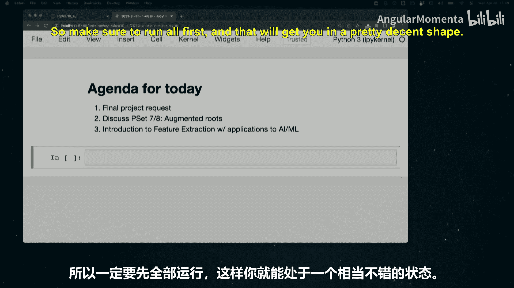

I'm going to get started on what we're talking about today is。Something called feature extraction。

 And so feature extraction is a conversion of elements。 In this case。

 musical elements into single numbers or lists， arrays， vectors， tensors。

 whatever you want call them of numbers。😊，It is the most boring thing I will teach in the class。

 And please don't correct me if you're like comfort。

 there's plenty of other boring things you've done。 But no， it's。

 it's really one of the most boring things of the world。 And here's a reason to hate it。

 It really sucks the lifeblood out of music。 Everything that you love about music is gonna be converted into a few numbers。

 It is text the life on。 It is the zombie of music world。 Adam's very exciting。 Yes， zombie invasion。

 but。😊，There's a lot of amazing things， as we know， happening in artificial intelligence。

 machine learning， deep learning algorithms， all these things。 And as far as I know。

 they all have one thing in common。 and that is， they work on collection， big collections of numbers。

😊，嗯。You know， there， there's， there's some ways that you can work with， you know。

 images that effectively are kind of like two or multidimensional arrayser numbers。 But basically。

 they're all gonna be numbers。 So， you know， when I， when I put some music notation on the board。

We're not going to be able to work with that， even an image of it， even a JPg。

 unless we convert it to pixels and convert it to numbers。 When you hear a sound， dot， or bo。

 something like that， you're going to have to convert that into numbers in some ways。So。

We're going to be just working on converting things to numbers。 So it's pretty simple。 and， but。

How to do it and what to extract and how to make your extractions is sort of the the deep art that takes a while。

 Now， I'll get to a little bit later some of the things that people are doing today where feature extraction is less or careful feature extraction is less important。

 And I'll tell you what those things tend to have in common。 And that is there。

 they work on much bigger data sets than than what we have。 So we're gonna get started on this。 Yep。

 that's my template here。 And we're gonna to start with why not we always start with our favorite Bach Kral。

 What's the number。66。6。Conjure up the BWV 66。6。And I'm going to show it， get back。Okay。Great， feel。

 So we're gonna do some manual feature extraction first。😊，We're going to convert this into numbers。

I'm going to extract two things from this number of parts and initial number of beats per measure。So。

 let's just do our。Sup you don't have to type this If you want number parts equals 4 Time signature numerator equals 4 there。

 I have done manual feature extraction and describing the piece as two numbers。

 They seem to look like 4，4， but I didn't ever just extract the denominator that just happens to be  coincidence to 4。

 So。😊，I don't know if we'd even call this feature extraction。 But you can see it's， it's pretty。

 you know， we were not talking about very， very much here。 So I'm going to。

Define an automatic feature extractor。 So we'll call it extract meter。And extract meter。

 you can save time by not putting these annotations。

 it takes in some sort of a stream I'm calling a score， even though it's not and it returns。

Two integers。 What do you think the two integers are going to be？If you're extracting the meter。

Newer and denominator are great super。 So we can say all the meters in the piece equals the score meter time signature recur。

And。The first one， we'll just get the first one， first meter， all meters。0。

And we'll return first meters。Nummerator。And first meters denominator。

I know I don't need the parentheses， but I just kind of got used to that。怎问。People。Get caught up。Now。

 by the way， how many times in does this little corral have？

Are we going overkill by getting the first one。To want and take a guess， you all know it by now。1。

So it has for the way music 21 counts 1，2，3，4。 They're all the same。

 But this is an error I make quite often that each of the parts has its own time signature。

 So this is sign to be careful on。 And now we'll get to the first sort of ethical dilemma of of feature extraction and machine learning of which there will be many and quite a number today。

 What happens if a score doesn't have any time signatures。Do we want this will this crash first off？

And if you think it will crash， tell me what the error that's probably gonna be returned。

Lets index out of range or index error。 Yep， that we're trying to get 0。

 So we can say something like。If not。All meters。 Now， so here's the ethical dilemma。

 I'm gonna to return 0 comma 0 as a special value that's also an integer topple of two integers that says I have no time signature because。

 you know， I' I've raised as a medieval musicologists。

 So I have Gregory enchant lying around and other meterless time pieces。

 But the other reason is that we sometimes in case of an error or an out of bound value。

 we return some sort of we call Sinel， some kind of special meaning number that says， you know。

 some sort of an error happened。 why， because you're going to someday have a gigantic data set。

 maybe you're going to be doing this up in the cloud somewhere or something。

 And you're going to have。😊，You're going to be letting it run overnight。

 consuming a huge amount of processor money， and eventually there's going to be some bad data in there that's going to crash your system。

And do you want to agree like， okay， I just let this run for 47 hours。

 And now I have to start all over again because of course I didn't save intermediary values because you know。

 I'm a theoretical person， not a practical programmer。

 but always say write write to disk every once in a while， but。So。

 so this type of thing helps to save you from a little bit of bad data。 What it also does， though。

 is it can swallow up systematic errors in your thought。 You know。

 I'm saying that that you didn't realize that。The one that I always get is I'm looking at the pitch of everything in the piece。

 I pitch of everything in there。 And then I forget that these structures called chds exist。

 which don't just have a pitch。 They have multiple。

 And so I could end up silently throwing out all of my data about chords rather than realizing I have a mental model problem in there。

 And this is some of the things that that can lead to AI that doesn't include all of us that programmers forget that women exist or that non-white people exist。

 And therefore， oh， that's data that's out of bounds。 So， you know。

 will go with a default response rather than learning know how to deal with facial recognition on things like that。

 so。Here， it's not such a big。 I don't think that we're， you know。

 that we're going to have a problem with systematically discriminating against Gregorian chant。 but。

 but it's these kinds of issues that lead to so many of the other ethical issues in。

 in artificial intelligence。Okay， with that aside， we've all cut up。 Let's see。

 did I somebody and everybody just save me time when I type something wrong。 check it。

 But let's see if that works，Extract meter ba。We have our first。

Our first automatic feature extractor is this topic so far as boring as I promised。😊，No， okay。

 somebody likes it。 Yeah， it's， it's trigger。 But let's， let's go with saying else。

 And we're gonna start with another ethical dilemma。 We're going to be working with Ryan's mammoth。

Collection， and I think。If you type Bing， you should get something that's not an error。Do you。

Because if you've run everything， you've already run corpus， parse， blooming meadows。Jig。

And let's see that。So apologies， we didn't get to the jig composition yet。

 I do plan to pick that up next week， but I figure that there's some other things that people need for their final projects more importantly than working with that。

 So you all see something like this。But we're gonna be back on jigs again today for a bit。 Now。

 Ryan's mammoth collection is a little bit of an ethical dilemma， and I'm trying to replace it。

 It is a collection of think something like 1079 fiddle tunes from the 19th century that has a bunch of jigs。

 horn pipes things that if you take Joe Morerays， C shanties and English folk music class and all those things you。

 you can learn more about them。😊，It also is a large collection of musical experiences of 19th century African Americans that has been sort of parodied and or appropriated into white minstrel shows。

 So I've tried to remove things that are offensive。

On first site from the collection titles and things like that but。But the deeper history。

 a lot of these songs has to do with a lot of appropriations。

 So I'm hoping to be able to get a collection to replace it at some point because， you know。

 it's not exactly everything I want to do with it。 But anyhow， So we have for for going through。

 we have the one jig Bloing Meadows jig。 And I gave you just a contrast。 a real R E E L。

 And you should already have the real。 I think already loaded。 So you don't need to type this。

 It's called the7th Ret， real。And。Hopefully， I got that。It looks a little bit different。

So what we're going to do today is try to build a system that can tell the difference between a jig and a reel。

Or jig。 And will to fit it into the remaining 52 minutes between a jig and a not jig。 The whole。

 all of music is divided into jigs and not jigs。 It's great。😊，Okay， so we we'll be looking。

 how would you， how would you define the difference， You can look down at your own。

 so I'll have to keep scrolling back and forth。If， if you're somebody who didn't know hadn't encountered a real or jig before。

 what is the。What would you say is an obvious difference？So Matthew，22，4 versus 6，8，2，4 versus 6，8。

 good。 Well， obviously true。one， I think what's that。

 I the sensor one the same signature to the same same one times temperature good yeah。rigue。

 it seems more syncated。hich one seems more sync， the jig， the jig a little bit more syncopated。

 especially things。 There's always things like this that are not technically rhythmically syncopated。

 but kind of feel a little bit。Did anything else？じゃ。关了。我在。s16。16th versus 8 notes。 Thank you。

 I'm gonna， put that in。 And I'm also gonna disable my， what do you call it， my notifications。

Supposed to happen。Autically， okay， yeah，16th versus 8 notes。

 We're actually going to possibly use that as， as something。

 So we're going to try to have a system that can do the difference。 You should have。

 if you type Ryan。 You should be， You should be getting something。

 I'm gonna really quickly just cut and paste what I did to get to Ryan and explain it。

 I first created a sign called Ryan M where I find everything in Ryan's Ma collection。

 And then what I've done。Is， here's another cut and paste 1059。 I think， yep。

 is that I've gone through everything in there and said， first off。

 I only want to look at the first 500 of them。 And then I'm looking without parsing if the name of the file has jig in it。

嗯。If it doesn't have jig in it。 And if you're over filele 100， continue。 So I。

 why did Ali you do all this stuff just so that I can get something that is approximately 50，50 jig。

 not jig。 So we end up with about 200 here， I can。We end up with 212 pieces。

 and I happen to know that 59% of them are jigs。 So that's pretty good。

 These are all what we call metadata entries。 So they haven't been parsed yet。O。

Great everybody with me。对。Great， I'm going to define a helper function that is。

How many ethical dilemmas are we doing today， This one's not ethical。

 but this one's sort of a research thing called I Jig。Which。

 which determines if something is a jig by。Looking at the file name。

And lower casing it and seeing if the word jig is in that。I've done this with rags before rag time。

 a really great piano genre， most Scott Joplin， the most famous person。

 And a lot of rags have rag in the title， Male leaf rag and so on。

 But then there's like the entertainer but， you know that which doesn't have the word rag in the title。

 So we're possibly。😊，Having what we call a bad ground truth。

The ground truth is the definition that is correct beforehand。 And so is this song a jig。

 I this not a jig。 This is probably not the greatest ground truth there。

 The other thing that will come up a lot， I that there is a some pieces that will be very hard to tell if they are。

 And two different intelligent people could disagree on something iss a jig。

 This comes up a lot in genre classification where people can't really decide。

 Is this country or is this rock， Is this funk， Is this hip hop。 Is this romantic， Is this classical。

So， you know， somebody once told me when they realized I came from a music history training musicology that they said the worst part about musicologists getting into this field is that they give us really crappy ground truths。

 You know， you all won't say what the right answer is。 And that's， I hope in ambiguity。

 we like as humans。 But anyhow。 So we'll， we'll have our is jig。 Let's，We'll actually see。

Is jig blooming， I think that was the one that is a jig and what was the other one real？Okay， so。

So with our garbage in， garbage out， terrible ground truth we。Seems to be working。 Okay。

 and I've happened to know127 of the things And theres jigs。

 So let's get our second feature extractor。 This one's gonna be pretty easy。

 We'll just get the number of sharps in the piece。 We started working on jigs in G。

 So we happen to know that there are a whole bunch of them。 So maybe we'll do this。

 And here we can just do again， a try， return the scores。😊，Key， key signature。The number of sharps。

If it's too flats， what's it going to return。Negative to yep。Right， so。

 and if there's no key signature， this one's actually not a terrible assumption， right。

 Something without a key signature probably has a key signature of no sharps or flats。No no。

 Maybe Maybe we should， in this case， analyze the key and do something like that。

 but good enough for a little bit。 So let's see the blooming。Hopefully this will return one。Oops。Oh。

 I know what I did。 This is why you should never do something like this。 except index error， we said。

And we didn't get an index error when we get， We got attribute error。 Yep。

 there is no sharps because I forgot to say that we want the first key signatures， Shas。

 You can also do the dot 0。Our bracket 0。 however you'd like that。

 And so let me try the get Shas again。Getting one and what's the answer for Buck？3， good。

 You can either do that by hand or make sure things work great。

 And let' we'll define one more feature extractor so that we can， oops。

We're actually making good time。 we'll do8 fraction based on based on the observation that there's more8 notes in some in one piece than the other。

 So we'll take in a stream dot score。 And this time we'll return a float。

 So usually you can return an int， which we call a continuous a discrete very answer or a float。

 which continuous variable。 So let's just do this。 We'll get the number of notes in the piece。

 Actually， you do this。 You give me， go ahead and try。

 try coding this for a little bit because we are a couple minutes ahead of time。 How do we get the。😊。

Returns the fractional I need to put this returns the fraction of notes in a score that are eighth notes。

Okay， so you can keep doing yours if you're stuck， I'm going to give what I do sign like。

Not the most efficient use of iterators I've done too。对不起？Where am I missing， it's somewhere in8s。

 right？Where is8。Thank you。Appreciate that。And。Go ahead and run your numb8s on blooming。

 on real and on bach and use your。Spidey sense to figure out if the， if your numbers。

Are pretty meaningful。 There's anything I can， I can get from this class to just use in all of your programming things as always。

Use your intuition to see if something like that， something is。Working right， wow， look at that。

The reel is incredibly low， hoops。Now I have too many eighth fraction。

 I should have done an eighth fraction， but whatever I'm。That actually feels too low for that reel。

 only 8%， but I guess there's a lot of 16th in there。Can give me a snap if you're ready to move on。

Hearing some snaps， not all will give another 10 seconds or so。So so far， we have。

 we have the first one that seems， you know， really to give at least in this one piece。

 a big distinction among the three。Types。Okay， now I'm going to wade into something that people don't always say。

 is this a feature extractor because it returns a number or something or is when you put them all together。

 Is that the feature extractor， I'm not sure， but I'll use this term。

 So the feature extractor is going to run all of our different little feature extractors。

 And in this case， I'm going to say it's going to return a couple of。

 and I'll tell you what these are in a bit。 But here I'll write this out here。 a string。2 ins afloat。

An int。 and an int。What are these going to be？They're going to be the file name。

 which is pure metadata just so we can look at things later。

 They're going to be the numerator and the denominator of the of the piece using our function we wrote extract meter。

 They're going to be， what's the only thing we've written that has a returns afloat as the answer。我在。

8th， yeah，8th fraction，8 proportion。 What are we gonna call it， the number of sharps。

And then that last one we'll get to。 that's going to be the ground truth。And。

It's doing too much to Jasonson。Stop doing。Trailing commas。 Okay， so the file name。

 you get this from a scores metadata object， which we haven't really talked about。 Its file path。

Split， I'm just gonna get the last bit， so I'm not showing my entire director retreat to everything。

 So I'll just get the last thing after the slash。 Those of you who know Python's path library。

 you can probably do better。The numerator and the denominator。Will extract。Meter from the score。

The8s will say， is the8th。Fraction of the score。Sharpps feature。Is get sharps。

 you can call them whatever you'd like and。Then the ground truth。Is it a jig or is it not。

But it has to be a number。 So we'll say integer of is Jig。You could also say。

 if you like this Python 1， if if digig else0， that' sometimes sometimes explicits a little bit nicer to see what that's gonna be。

 And then we want to return all that file name， numerator， denominator。8s， I should do quarters。

 I can spell quarter feature， and。Ground truth。 I'll let everybody get caught up while I debug my own system。

 whoa。Some fast typists in this class。Fixture extractor on Bach。 Let me just see。Feature。

Extractor on blooming。ABC file extension。 Y， yeah， a lot of these are all written is ABC files。

 Do we， we didn't really cover， No， we didn't cover ABC files because they're。

 they're tiny bit more complex than the easiest to encode handwritten things。

 but not not complex enough for as like music X L or something。Okay， so blooming metals J Since 6，8。

77% of its notes are eighth notes。 It's in one sharp。 And that last one indicates what， again。Yep。

 so the one in Kates。Jig， right， great， okay， so。We can I'm gonna do right now is I'm just gonna run this for a second。

 So how would I get everything so we can do。Metaadata。

I'm just doing this so we can kind of see how we do this in the Ryan thing。

 piece equals meta data entry dot parse， and then we'll print the feature extractor。On the piece。

And we can I see。Yep。Because of the way I did it， you'll see that at first there's not too many jigs and then。

Later on。There's。这ク。Okay。Now， if you scroll back up to the top of your so I'm going to have to get my blank template for a second。

 that's way smaller， there should be on the top of your template if you downloaded sign called right Ryan。

And you just need to change your path to someplace that you're going to be able to remember it。

 So change that unless you have a， unless you've created a cutthbrit user because it makes it easier for you to cut and paste my code。

 probably want to change that。 and then you can run。

 run this while I explain a little bit what it is。啊。O。It's right Ryan working for people when you。

Okay。Great。So， I'm going to。Have my oin version here。So the right Ryan command， W。

You don't have to do any。 This will be kind of fun because then you'll have right underscore score。

Ryan。Answer。Okay， I've seen more people waiting than typing for a little bit。

 so I'll just sort of explain what we do of some of these things。 if you work with files。

 you probably know them pretty well。This is really not necessarily the best way to do this。

 but I'm going open two files。 One of them is the file that we're going to use to train our classifier。

 the thing that is going to try to learn if something is a jig or not。

 The other one is the file we're going to do to try to test whether it can do it or not We're going hope that that we don't put the same data into both。

 So we're going to try to put some data in the testing， some data in the training。

 there's a number of different ways you can do this type of work size you put 90% in the testing in the training and 10% in the testing size you put 5050。

 which is what we're going to do Some of it has to do with how much data you have。

So what I'm going to do it maybe it'll be easier see I'm just going to separate do tab means everythings to be separated by tabs。

 So I'm going to first put a header line that says the names of the columns。

 These are just for us to read。 So we have a file name numerator denominator8s sharp and is Jig。

 And so we're going to write that to the top of it because a lot of the classifiers that work on tab data expect this to be the first line。

Now we're going hope that when running this system that it doesn't peak at the file name and we'll see because that its obviously file name would give it away。

 And then so the descriptions， what kind of data is this， the file name is a string。

 then we have discrete， as we said for an integer discrete， continuous discrete discrete。

 So we'll write that out again to each of the different things the the two files and then we have most third line which is mostly blank for all these things and the first one just says metadata that is to say don't peak at the file name do not use the file name to try to classify this。

 then normal information and then the class the thing that we're trying to figure out。And we really。

 really hope that the artificial intelligence thing does not peak at the class when it's trying to look。

 you can really really quickly create an incredible AI thing if you would allow it to peak and so we'll put that out。

 so that's just all headers and that's why I didn't want to spend too much time writing it。

Then what are we going to do？Same thing they were saying before。

 We're just going to get each piece in there。 And I've done enumerate for a reason so I can keep track of what the piece number is。

 And then we can extract。The piece， all the features from it。 and then we'll just write them out。

 in this case we're gonna to write them as a string because we can only write strings out to a text file。

 write each of the features out tab separated。Actually， we'll get， get ready to write it。

 We'll just put it into a string。 And then every other one we're gonna write to training and test。

 training and test。 Probably another way to do it would be to flip a coin each time and use a random number so you can see if things are going there。

 I'm not an expert on on this type of work。 But that's how that works。 I don't think。Yeah。

 I don't think I'm going to run it now because I should have been running it during this time of you know what I'm just going to put train data。

X and test data X so that while it's running， I have access to。To our baked one。

 so I can actually we can look at it， you know， magic features。

 So we switch out of Python and immediately look at the shell for a second。Train data。

 wherever you put your thing。And I can see。That。I've written out。

It's kind of weird that the tabs don't show up。 You would love to have something that would automatically put it out。

 But we have the file name， all our headers description of the data， the metadata here。

 And then yeah， we have our， all of our information written out。 So that's pretty good。

 Does finished。 that did finish。 Great。Okay。So now we've done our feature extraction。

 the feature extraction part of the lecture is done for a little bit。

 this is a small number of features。But I think that they're going to end up being halfway decent features because we thought about them a bit。

 and when the data is small， you want to think more about their features。

You installed something called O 3， but it's a little bit weird。 It comes as capital orange。 I just。

 I don't know why I don't like things capital。 So I always import orange as lowercase orange。Great。

We're going to load our training data and our test data。So first， training data， orange dot data。

 table。You can a lot of these things are they're going to be very similar in a super modern artificial intelligence sort framework like pie torch or or Tensorflow or something like this。

 similar idea， you want to load data in as a table， if it's too big to load under your all at once。

 then you know there's special techniques and stuff like that， but we'll load the training data in。

 and now when we look at it it just looks a little bit nicer。嗯。So， thank you。Where's our first。

 I don't know。45。Does that work， yeah。Okay， so that might be a little bit better because we can see we have our。

Our features here to for 12%。And three sharps。 And this one happens to be a jig， so。There。

And so the afterward is what the class is， great， and we'll do the exact same thing with the test data and we'll call it variable test data。

 so I'm just going to copy and paste。And hopefully the test data looks a lot like the training data。

Oh yeah， yeah， it looks a lot like the training data so you don't change the file path。😊。

You can can see how well it is，嗯。So now we're going to create some we call learners classifiers。

 things that can classify the data。 here's the first one and I think in some ways the most important classifier that you'll ever use and that is why dot I switch into Caml case okay I guess I'm in Caml case now。

Sign called orange dot classification。Do majority learner。And。What a majority learner is。

 is it's kind of the control or the placebo of your system to make sure that you don't get too excited by how good your system is working。

 What it does is it looks at the training data， which has 100， what maybe the training data， has。

 I don't know。 let's say it has 51 jigs。😊，And 49 non jigs。And it says。

I will always say that any piece that's ever shown to me is a jig。

 because then I will get over 50% right， or I will get the highest answer of doing anything。

 So if you are not beating your majority learner， you， then you're not doing any classs。

 So the majority classifier。😊，Hope y'all who have taken a machine learning class。 you。

 you get taught this。Or no。Yeah， okay， good， good some people， this will be totally。

Old story and not。 So we're going to。The majority learner is just sort of a generic thing。

 And now we have a classifier， which is one trained on our data。 So we're going to say that this。

The majority classifier will now know how to work with this particular data。

And then we'll use another one called Can nearest neighbors。 This is， this was， I don't know。

 maybe 20 years ago， the state of the art， of。Of machine learning。 It's a little bit out of date now。

 but it does work pretty well on small data sets and few classifiers。

 So not not nothing that it's going to get you super excited at a top tech firm。 But you know。

 still has still as its uses。 So we're gonna do the same exact same thing I put everything that I put from majority learner and then put it as K and and neighbors look at the K。

 which might be 4， might be 3， might be 5。 The nearest neighbors in multidimensional vector space to your one piece and try to learn where where in the space it goes。

😊，Snap， if you're cut。Snap if you're not now， if you need。Okay。Great。

 so I'm just gonna to keep track of how many correct the majority gets in a variable called match correct and how many correct the K nearest neighbor gets in a variable called K and N。

 correct and then total equals the length of the test data， not the training data。

 So now we're going be working on this and。Should have sign like this， by the way。

II lost like half an hour in repreparing this lecture on like why do I keep getting over 100%。

 always make sure to recle out your number correct as you recode or something or make sure to do it within your loop。

Good， so we have 106 things that we're going to be able to do now is for a loop。嗯。So。

We'll just do an enumeration of each row in the test data。

 so for I comma test row in enumerate test data。Okay。

 and then the majority learner is going to take a guess for each one。

 So majority's guest is going to be the majority classifier of the test row。

Which it's always going to guess the same thing。 I guess in this case。

 it's always going to guess jig because there's like four more jigs than there are non jigs and then。

Our classifier， aaneous neighbor classifier， will also take a guess。Can I classifier。

I know somebody's probably saying guess is not the right word， but you， it kind of works。

 and then we'll get the real。Is the test rows。Get class。 So as I said。

 the class is either one or zero， something like that。And。We can do print out something but。Print。

How about this， we'll just say baddge guess。KN N guess。And real。So， I'll。I'll start this running for。

 for a second， but we noticed we haven't put in anything on whether it got it right or not。

 but we can just look。At that， well， one of them guesses。

So you can see that the majority one for every single piece just puts out。Yep， it's always a jig。

 always a jig， always a jig。Ker's neighbor。Says， no， I't think this is a jig。

 And here's the correct answer， not a jig， not a jig， not a jig。

 And here Ka nearest neighbors learning that， oh， this one looks like a jig。So we'll。

I'll just modify this a tiny bit， and say。If majority guess equals real。Then majority， correct。

Add one。If K and N。Gues equals real。K N， correct。All sequence one， you'll probably。

 when you're trying to figure out how to do things， you'll use more classifiers。 There's a lot more。

 And so probably want to do this， you know， in some sort of a loop， but。Great。Good。😔。

So now we'll see how he did， how did majority do？Here I'll do this。Majority。Mdge， correct。

 I always like making things look nice for humans。Why am I anal enough to start already putting in some sort of a rounding thing to look。

 because I I do feel like when you see all those significant， all those digits， it's really。

 really hard to figure out how important the differences。 So the majority。

 this is what I happen to know that there's 59% of them are jigs。

 And so the majority learner got 59% of them right。And then we'll do the same thing for K andN。

Here I can cut and paste right。We all know how to do that， what are we looking up now？Great。

And we want to make sure that that's K&N， correct。So。

Are classifiers getting about 87% correct at this， just with these few little things now。

This is always the exciting moment。And then the hard part is almost always getting it from 87 to 95。

 And the next harder part is getting it from 95 to 97 and then going up and up and up from there。

So that's sort of the theoretical part aside I'm going to really quickly just go through some things that Music 21 has so this is you know。

That just make some of this a little bit easier。So there's。

 I know it's already imported since I imported star。

 but there's something called features and we can do is。Set equals a features data。

Class label equals is Jig。And then we'll do the same thing with a test set。So far。

 it's basically the same type of thing。And then I believe you have， if you type FS。

 you should have something there， I think I put paste of this。Features。

 these are built in feature extractor， and each one of them has an I D。 And no。

 I don't have these memorized。 but s about。I can't remember what these are。 M2。 You know what。

 I'm just going cut and paste because you already have this and put it here。You have a table。Fears。

 yes， that my hidden strike， thank you very much， appreciating that。And think that should work。

And so these are some features that have already been put in。 So one of them， I don't know。

 What's the range of the piece。 How far is it from the lowest note to the highest note。

 A lot of these come they're adapted from a really， really cool toolkit called J symbolic。

 part of JM IR by Cory McKay up in Canada and just port them over because they're they're kind of neat than some of them are ones that that I've written because I kind of think that they're a little valuable or or somebody on the music 21 team is written。

 So here we have a lot more features here。😊，And what we can do is we have our two data sets。

 So we'll say the training set， add feature extractors。

And add all those features extractors and then same thing for the test set。

This as said you don't need to be typing too much because I'm just going to go。Pretty fast。

 And what we'll do is let'm going。Cut and paste this because all we're doing is dividing things up into either the test or the training set。

 depending on if it's even or odd， and so we'll just add the data on here。

Some nice slow features that， and this will just generate all the headers for you， hoops， What I do。

Testing set is what I called it before。 Sorry， training and testing。 that makes sense。Nope。

Do I do something wrong。Change it up here。 There we go。 startinging all over， Hopefully。

 I don't have any numb corrects， great。And that's just doing all the feature extraction。

 kind of getting them in。 that's going to take a little bit of time。So we're going to switch。

Like they do in the cooking shows to the already baked version where it's all done。Okay。Oops。

Here we go。Where do we， Where do we go。Is it Yep， so the next couple things that you do。

 you want to process all your dating training set and write it out just like before process it and write it out。

 Why is it taking so much longer， Because we gave it a whole bunch of features and some of them take a long time to do like ones that have to do with variability between parts and parallel fifths finding if it's a multipart thing and so on。

But then the next row ends up being the exact same type of thing。 We just have the majority learner。

 We're gonna still use the K and N learner and。Then try to see how well it did。And。And keep looking。

And again， the majority learner is still 59%。 You hope that that doesn't change。

 And now using all of these extra features， we've gotten our number from 87% all the way up to 61%。

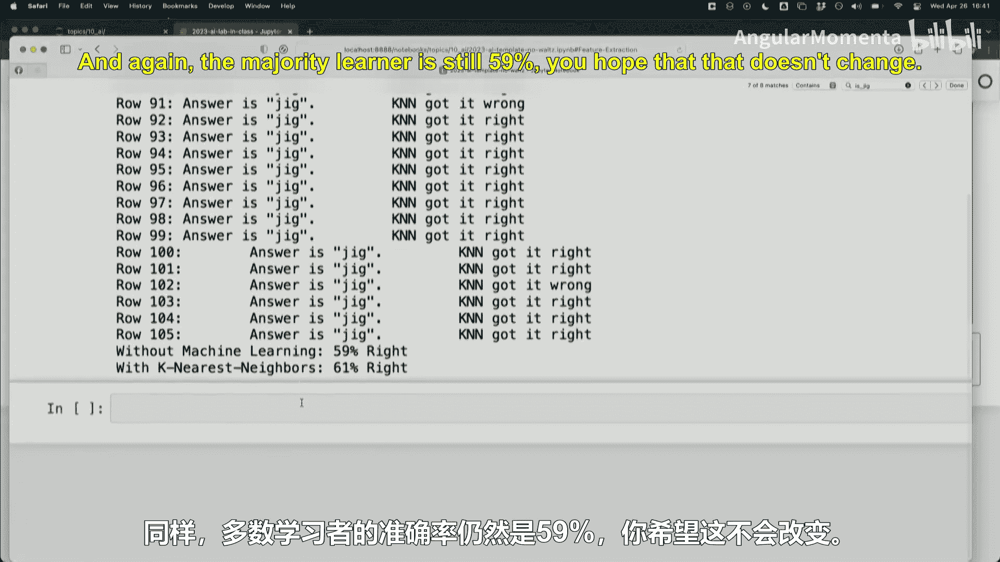

So sometimes just throwing more feature extractors at the problem is just going to have you wait longer at the computer。

 sometimes sometimes thinking really carefully about what you already think the data might look like is a pretty good thing。

 and especially if you're working with a small data set where it's not going to be able to do the kinds of deep neural network learning to keep going through enough to really build a model of the set as。

Some people say， you know that， look， the computers。

 the neural networks are getting getting better and better。

 and we just need to throw more data at it。 But imagine if you wanted to have a program that was automatically reading handwriting。

 And you gave the program， all these papers of handwriting and you just gave them an audio file of how it drops。

 how it sounds when it drops and try to do it， you're giving it kind of the wrong data to learn on。

 And so a lot of the extractors now， unless you're writing your own or unless you're using really musically sensitive ones。

 you're you can save the computer a lot of time by trying to trying to already say， you know， hey。

 let's process as a symbols ahead of time or something like that。 a lot of by the way。

 state of the art of symbolic music machine learning things are you all remember the piano role。

You know， where we put things like this to show length and stuff like that。 Yeah。

 well it's converting the entire musical score to a piano role， saving that as an image。

And then using image classifiers and image generators to generate pieces that look like the piano rolls and then translate them back。

 So I think I'm hoping that over the next decade or so we can do better and do some things that help。

Help these neural nets and classifiers work with data that's a little bit closer to the original numbers。

Okay。I have time for just a little， little fun thing with my favorite。Low feature extraction things。

 so let me just show a couple little things okay。Yeah， the importance first off。

 the importance of thinking about data sets and ground truths。 This is， you know。

 I think one of the first pieces that showed deep learning。

 the kind of for people in the no moment like chat GT has been in the last year happened。

 I think it was about 10 years ago when Al0 and Al go suddenly became the world's greatest go in chess players。

😊，And so a lot of people think， yeah well， this was with generalized knowledge。

 no rules being taught except for legal move or not。

 But one of the things to think about the difference between a lot of the things that they were being trained on and what you have is that Al0。

 the chess playing computer you， played what was it 700000 games or a million games or something like that。

 And at the end of every single game it played， it got perfect feedback on how it did。 you won。

 you lost you tied。 you won you lost you tied。 a lot of the things that we're interested in doing with music。

 like music recommendation or you know things like this， predicting what's the next great hit。

 First off， we can't we don't have that correct data。

 maybe what's the billboard chart or something like that。

 But for how good was this piece because it's gonna to be different every time it's gonna to take us three minutes to listen to if it's computer generating。

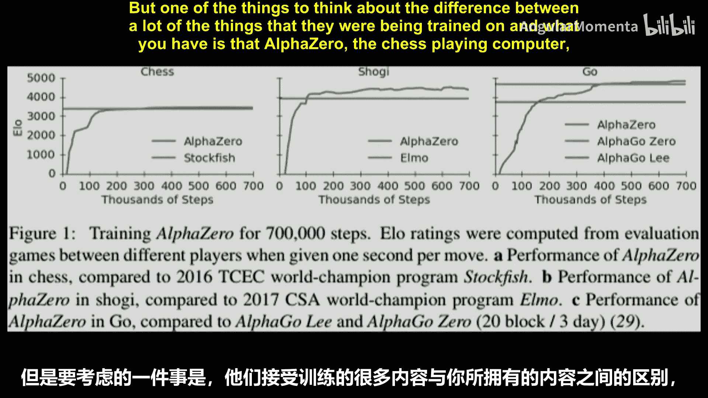

And then we're going to give it feedback that we might feel differently about that piece tomorrow。

 so we don't give perfect feedback。 and it takes a long time。

 So this is why one of the reasons I like working with some of the older things。 Okay， we'll go back。

 great。I don't think I， I presented this。 No， I present another place。

 So this is what will end for the last 10 minutes in talking about some of the interesting things that come out with features。

So how would you distinguish。Coral music from Bach， from Monteverde。So， I'll just。

We're doing a lot of buck in this class， but we'll get a little bit more into ear here sign B。

🎼这 is ba。And so then we'll switch to one of the other great composers about100 years before Bach。

 Claudium Monteeverde。And so some of you， this might be the first time youll hear him。

One second of the box again so we can get the back。Greatreick。

What's something you heard different between the two of them？

I' a bit more somber with more mobile minor keys Okay， with somber more minor keys。

 we can do a key de。嗯。I mean， Boch had sound like there were like more people singing。

 but it's hard to do Yeah， but it could be， it could be more people Fuller than good Yeah boers more。

Together were bunch various like。Once this father。Do buck more together， homophononic。

 maybe Monteeverde doing their own thing good。 One last one。What else。Okay。

 that's a pretty good place to start。I threw。Everything in all the kitchen sink of classifier feature extractors and got to see what a particular algorithm did that。

That。That seemed to work pretty， pretty well。 And the first， here's a little quiz。

 It's one of the few quizzes that elementary school students do better than adults at。

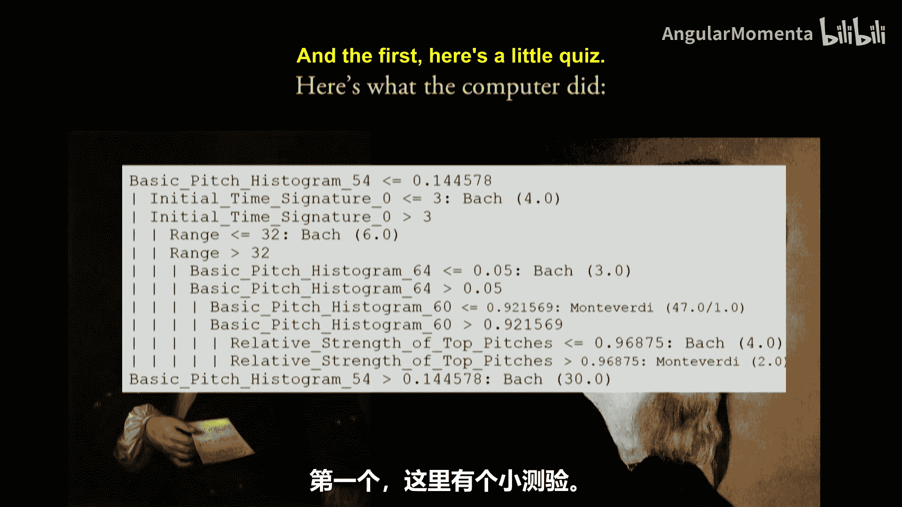

So let's see if we can figure this 7，8，02 is 3。1，0，6，5 is 2。 Okay， if you've seen it before。

 then don't answer。9，9，8 is 4。And 1773 is zero。If you're new to this。1。2。3。Three circles， one circle。

2 circles，1，2，3，4 circles and no circles。 So I pick it up to say that sometimes the computer is gonna be looking at things that are really。

 really far out in trying to figure out things。 So there's all these things that we could be looking at。

 I'll bet that the proportion of instruments that are electronic isn't going to help with Bach versus Monteverity。

 But one of the things I like about a particular classifier that is not close to the state of the art。

 It is not or to the getting the best results。 But this tree learner。😊。

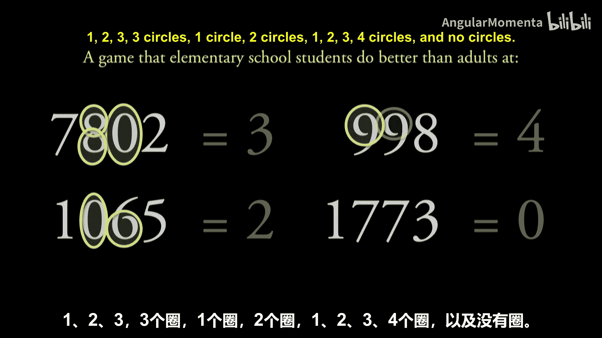

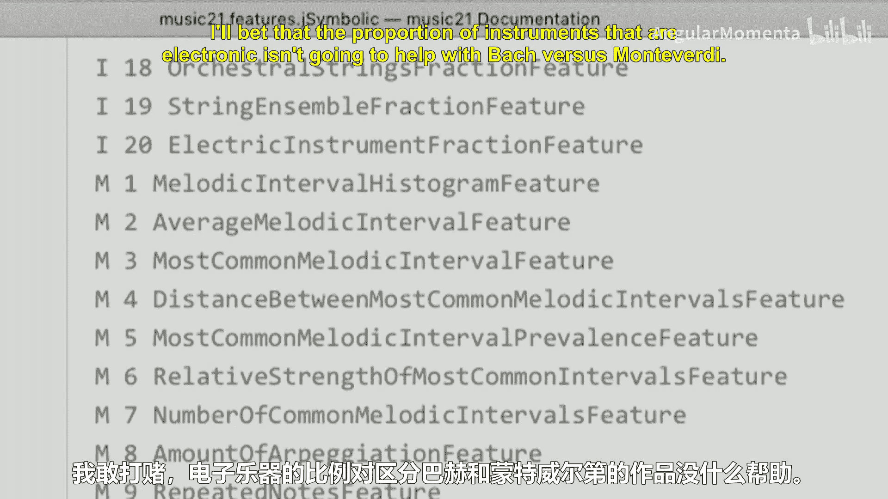

Can unlike being a black box， it can actually show what the path， So of a decision tree。

 branching tree it took to get there。 So here's how it can say。

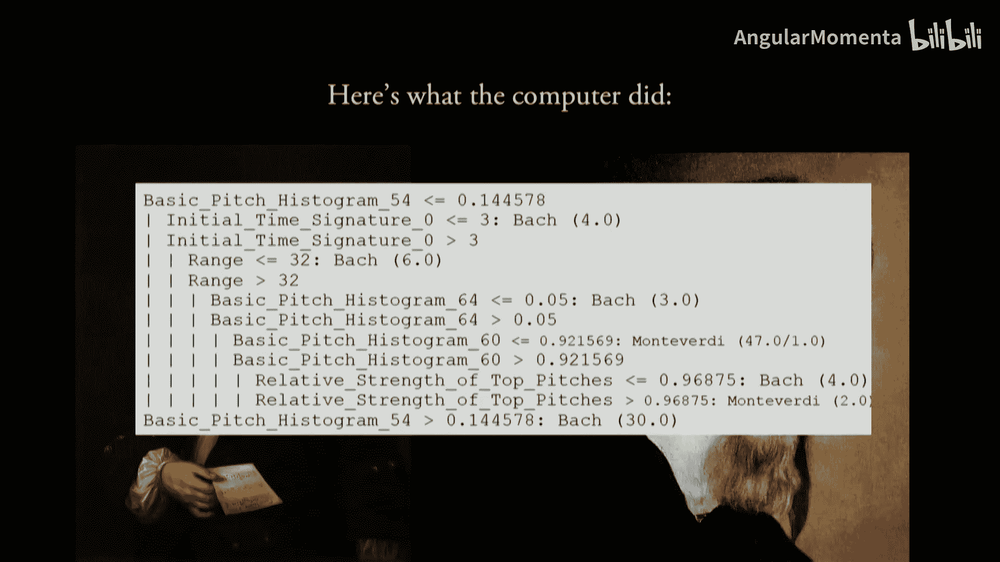

To begin。If the note F sharpp below middle C is used more than 14% of the time， the piece is by bach。

Otherwise。If the top number of the time signature is three or less， it is by bach。Otherwise。

I love this one。 If the distance between the highest note and the soprano and the lowest note of the base is less than two octaves and a minor 6。

 then it's by bach。 And then there's three more things。 we get to the final one。

 count the number of times each note is used。 Find the note is used the most often and the note is used the second most often。

 If the second most often used note is used less， the 97% as often as the most commonly used note。

 the piece is by bach。😊。

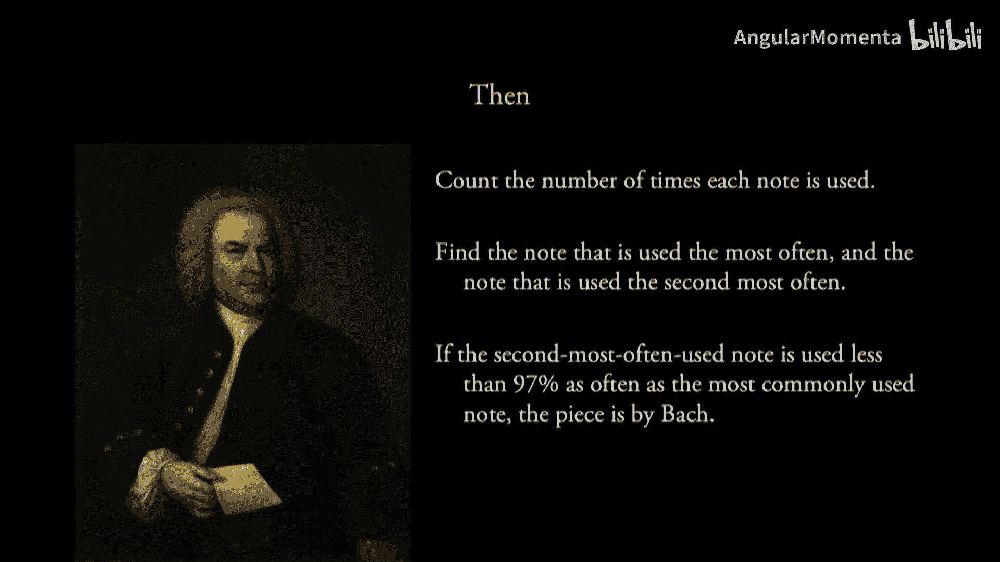

Otherwise， it's by Monteverity， and this worked with 99% accuracy。😊。

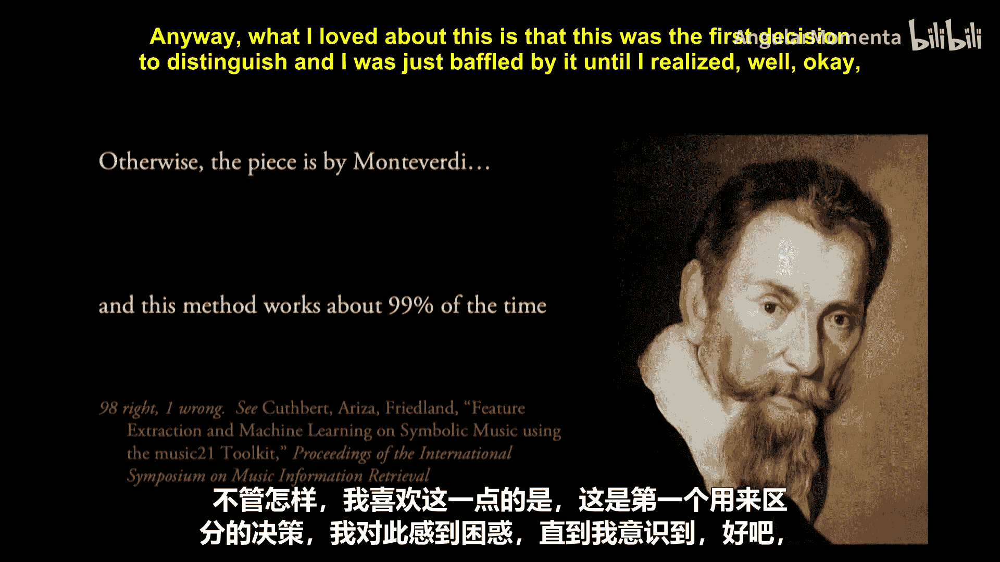

What I loved about this is I that this was the first decision to distinguish。

 and I was just baffled by it until I realized， well， okay。

 Bach has more pieces in sharp keys than Monteeverde is。 So okay， that would make sense。

 Monteverde was mostly hovering around， you know， no Shas or flats or one flat a。 But then， you know。

 it's minor and there's raised leading tones and stuff like that。 So why not， Well。

 the leading tone tends to get raised in the melody， which tends to be in a higher voice。😊。

The middle area tenor will only appear as F sharpp if the key signatures already F sharp。

 So it was a way of learning some things like this。

 And this particular one ended up being garbage in garbage out that Monteverdi doesn't using modern time signatures。

 And so when we the people who encoded this chose never to use24。

 always put it into44 because there also weren't bar lines， So you could decide how long。

 So this ended up being that the computer learned not the difference between Bch and Monteverde。

 but the difference between box editor， modern editor and Montevariti's modern editor。

 I have lost the reference but I have been told about an audio audio classifier that tried to classify by genre and it was doing very。

 very well until it turns out the different genres of music use different microphones in general。

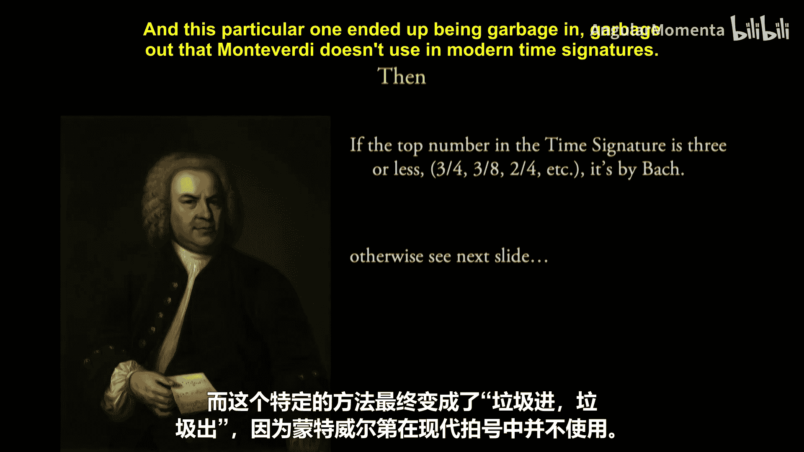

And it was picking up the difference between the microphones。

 So if you s country music on a hip hop microphone， it would classify as hip hop。

So all of these things， we need to be really careful about what's going on with potential for classification。

 And so this is where I kind of like this old school Imagine this is sort of a tree diagram of things going left and right。

 I guess if you turn it sideways。 these kind of old school feature classifiers a little bit just to check what's。

 what might be happening in the latest black box。😊。

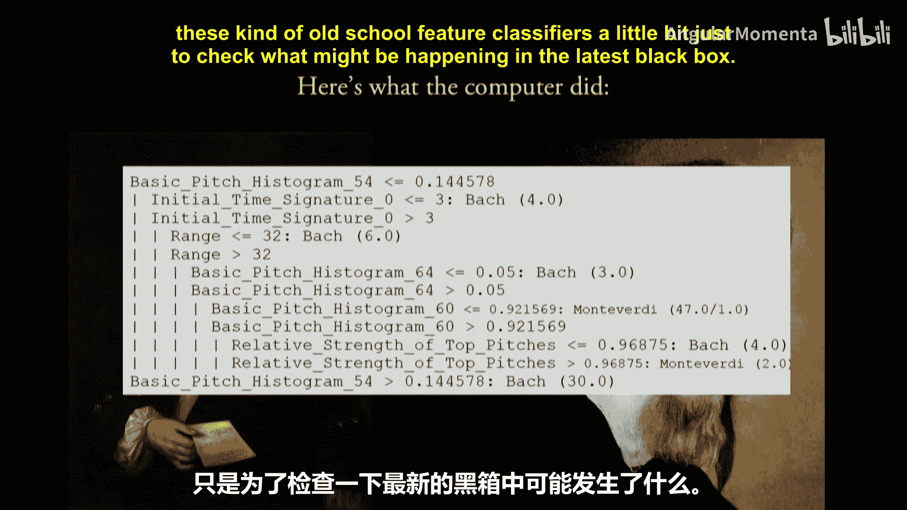

搜。You guys did a remarkable stamina。 You got through the zombie of music eating feature extraction。

 and I hope that some people will choose to find if you find this to be helpful in doing something in your final project。

 You now have some of the tools to do it on Friday well continue with searching and similarity and giving the first 15 minutes explaining what he's doing at MI T。

 He's a professor of computer science and what he's been doing with music on his work， so。😊。

Therell be a start， and then I'll continue with some other things。 Great， thanks。

