# 【麻省理工】计算音乐学与分析‌ ｜ MIT 21M.383 Computational Music Theory and Analysis,S 2023 p43 43 第28课视频：特征提取与机器学习（二） -BV17xUmBDEUC_p43-

My name is Kiki。 I'm visiting a scholar here at MI T。 I'm actually a assistant professor at。

Polytechnical University of Madrid， and my background is actually an engineering I aerospace engineer。

I did my PhD on numerical methods， but after my postdoc I decided to start doing things that really passionates me and that's how I end up doing something related with music so I'm relatively new in this field and today I'm going to show you an algorithm that I came up for pattern detection in music which is what I've been working on for the last year and a half more or less。

So as running example， I'm going to use the most recent song of the history， which is baby Sark。So。

I don't know if I can play it， yeah。At least is the most recent song of the history of YouTube。Yeah。

🎼嘟嘟， baby shark嘟嘟， baby， shark嘟嘟， baby shark。🎼pretty much like that or the song。 This is the melody。

 So what's the problem of pattern detection in music Okay。

 we would like to have a tool and automatic tool that help us identify over the score or over a corpus like the important musical ideas there no。

 So I'm highlighting here some fragments。😊，Have a looked first at the blue fragment over there there are three fragments。

 the occurrencers of them， all of them are exactly the same。

 they have the same node with the same pieces and same durations。

The only difference is that they occur at different moment of the score， but it seems logical。

 it seems reasonable to group them as the same musical idea and say that they represent same the same pattern no。

 we can call them we can put them a label blue pattern okay for the green one is a little trickier because the occurrence number two。

😊，And the occurrence number3 are exactly the same。 Okay， probably makes sense to group them together。

 O number one has a different durations for the notess。

And the occurrence number four is even trickier because。

They just serve with the rest that it's three notes also and thelyrics， no。

 but it's pretty different。 No so that's one of the main difficulties of the problem of pattern mining in music that even though objects that we want to group together because in our mind represent the same musical idea。

Over the table， they might look pretty different。 And there are two mechanisms involved here。

The first one is something that we have already studied， the transformations。

 so if we have a music fragment， if we applied a mathematical transformation over the notes there。

 we obtain other fragments that under some circumstances， our mind will process them as equivalent。😊。

And how to deal with this computationally from the point of view of pattern miningian algorithm。

 My approach was to use the concept of viewpoint。 I'm gonna show you an example of what is this about。

 But for the moment， it enough to know that it account it it have a double task。 know。

 on the first hand， it directly takes into account these transformations。

 You will see it in a minute。 and probably more important。

It simplifies the representation because one of the constants in this course in this classes is that music is something complex now it has like complex logical structures among the elements of the score and we find a way to simplify that representation would be helpful for from the computational point of view so the viewpoint representation is pretty simple it just I'm going to substitute a complex tune like this one by a single sequence of symbols。

 So actually here I'm showing three viewpoints representation the pitch viewpoint it's the sequence of these symbols。

83838385 it's a mid note。Then we have the duration and the onset time。

I'm going to highlight there are a fragment， so you can see the different viewpoints representation for that fragment。

 and it's nice that the idea of constructing the score by overlapping layers of information。

 No that's the idea。Formerally， a viewpoint is a mapping between the current event the current time slice and all the former ones into a symbol。

 usually an integral or float but could be others those that are derived right viewpoints。

And perhaps for your own particular music applications。

 you need to develop your own viewpoint representation。

And here is clearly highlighted how the transformations could be directly taken into account by using this technique。

 No， for instance， if you apply the octa transformation to that pattern there， that fragment。

 you obtain that one over there， which one， which by the。Interval viewpoint representation。

 we have the same symbol。 So for sure， any pattern mining algorithm that is trying to find this sequence。

We'll see that that one is the same。Is that enough to deal with the concept of the similararity in music。

 unfortunately not？So have a look at these two occurrences of the green pattern of baby sock。

There is no viewpoint representation that can take us from one to the other。

 So someone said at some point， okay， it would be nice to have a kind of measure。

 a mathematical tool that help us to evaluate how different two fragments are。😊。

Like the aim here is that， okay， if I use that matrix with this guy and this guy。

 I would expect a lower value than the one that I would obtain when taking this guy and this guy know。

 because they are more far。 no， they represent far ideas。 So in computer science。

 they use what is called the distance functions in a general scenario is that you can give to a function to objects to random objects。

 for instance， me myself and this computer， and it returns a non-negative real number evaluating the degree of dissimilarity between the two objects。

In the context of sequences， because we are using viewpoint representation。

 So now this fragment will be a sequence。 for instance， let's see。

 Let's think that I'm using the duration viewpoint。

So in the literature we have like plenty of distance functions。

 this was very a very trending topic in music information retrieval like 15 years ago more or less。

 there were many studies and papers trying to figure out which was the best distance function depending on the style。

The11th thing distance function perhaps is not the most advanced one。

 but is one of the simplest one and probably the most used one and it accounts for the number of substitutions。

 delations or insertions to go from one sequence to the other so。To go from the sequence 0。50。50。

5 to the sequence，0。50。52， we just need a single substitution。

 So the 11th distance function between the fragment 2 and fragment 4 is one。 Okay。

 probably the 11 distance function between this guy and this guy it's7 node 2 or 3， at least no。

So cool now we have like all the ingredients needed to understand the inputs and outputs of my algorithm。

 We have a corpus or a piece of music。 We have also the viewpoint representation that the user are going to choose and some parameters at the input the minimum support is the minimum number of repetitions that we required to a pattern to be considered frequent and to be included in the research list。

These two guys， the minimum length and maximum length are the parameters to control the length of the patterns that we want to mine and some parameters to control the degree of theimity from the former slide。

 And the result is yes， like the list of frequent patterns together with the position。

This is an example with the piece of the formula slide。Now I'm selecting the interval viewpoint。

And those parameters over there。 and this is an example of the output that we might obtain。

 So we have a yellow pattern that has four occurrencerencies and have a look at each of these fragments at most distance one。

From any of the rest， no。Taking the 11th St distance function。And we might have， for instance。

 also this guy， the purple pattern and this green one， which is of length4。So yeah in a real case。

 the pattern structure might be complex， as you see， because you have nested patterns。

 You have many overlap our lappings。 I won't go into the details on how I implemented the algorithm。

 There a brief overview I divide in four steps。 The one is the creation of initial database。

 a vertical database is called sometimes where I just take a sliding window of length minimum length。

 minimum length selected by the user。 And I just create a database of all the patterns together with the positions within the score。

 Then in the next step， I compare every pattern against all the rest。

 trying to see if they satisfies the distance constrain。 and in that case。

 I grouped them together into what I call metric patterns。

 which are like groups of fragments of music。 this state is safe to the the entries that doesn't reach the minimum support。

Like they don't have enough occurrences to be considered frequent。And finally。As here。

 I still have patterns of length equal to the minimum length， and we actually want longer patterns。

 so the last stage is overlapping different patterns to form longer ones。Okay， and。To finish this。

 I'm gonna show you some results。 This is the last slide。 I'm actually already using this。

 I started using collaborating with these research groups like 7 months ago。 This is。😊。

A research group from another University of Madrid。

 They got good amount of money of the European Union to study the Italian operas。

 They have a huge database with many features for its piece。 and in particular。

 they are interested in the emotion that the piece evoke。

 So here we are trying to find some correlations between the emotions and the pattern structure of the different pieces。

These two other projects are pretty similar。The number two。

 it's on a corpus of folk music from a very concrete region of Europe in around the Pyrenees。

 and the second one is the。A database of just solos。 So here we are building classifiers。

 like similar to what we did in the last class here。

 I'm showing like the number of patterns per style for the different styles in this corpus。

 but perhaps here， we can see a cool thing of the algorithm that it returns also the position of the patterns。

 not only the fact that a piece contain the pattern。 No， So here I'm plotting。

It's called cover this variable， but it's actually like the。

Probability function of encountering a pattern within a solo no。

 so I normalize the length of the other solos by style。

And the thin line is the apparatus for the solos。 We can see， for instance， that。

The concentration of patterns tends to be at the beginning and not in the end。

 this is intuitive because like the imp improvisors usually start。

 theyre so like in a more organized way， taking thematic material from the original melody。

 And then they start to do more crazy stuff， no。Then I'm also trying to build up a a pattern dictionary of in an Irish corpus。

 These are the five most frequent patterns in the subset of minor reals in the corpus that I'm working on。

 So I don't know for a performance that is interested in playing this music。

 Perhaps the takeaway of this is。😊，Okay， you might want to start studying this pattern now。

 because they appear quite often in the。In the corpus so better to first master them。

For the future with Michael， we want to study how the algorithm performs in a nice corpus of early music that he has and also we want to analyze some solos of Charlie Parker who was one of the most mathematical improviser of the history and also for the close future I would like to see if this still can be helpful for plagiaris detection I suspect that two pieces that are very similar also some similarities in their pattern structure。

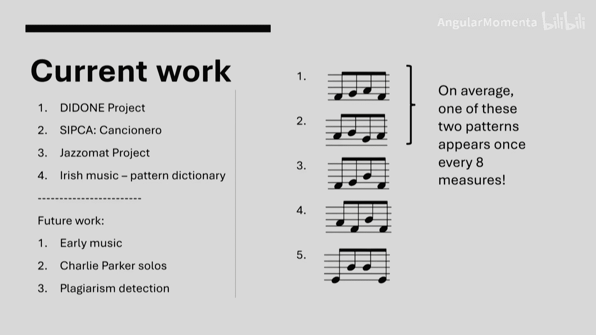

And that's all。 Thank you very much guys。😊，Any questions？By the way。

 just so you get a sense for your final things， that was 12 minutes， so a tiny bit longer than what。

cash as a maximum。Good。If any of you are interested in a particular thing of the algorithm。

 just drop me an E mail and we can talk about this， okay。Thank you。

So what I want to do is I want to immediately start by putting some of thoughts to work。

 So get with a partner next to you。 you can。You can do that if over here。

 we need a group of three or unless we wan to participate with a friend or。

 or jump over there or jump over with， yeah， with with the Jordan， if you do。And here are6 melodies。

 I'm gonna play。Each one of them， I'm gonna play a a bunch of times also。

 So I'll tell you which one I'm playing。 And you're going to， So。

 and you can talk during this or wait till just after playing。

 You're going tell me which melody is the。Is most or least similar to A。Okay。And this is at end。

This is B， and I want you to know， say why。This is C。

And I'm going to play A one more time to get it back into our heads。And now， D。Oh， and by the way。

 there isn't a right answer。Great。Now， e。And now a one more time before doing F。So this is pay again。

And now， F。That's F and EU simultaneously， which is very different now F。

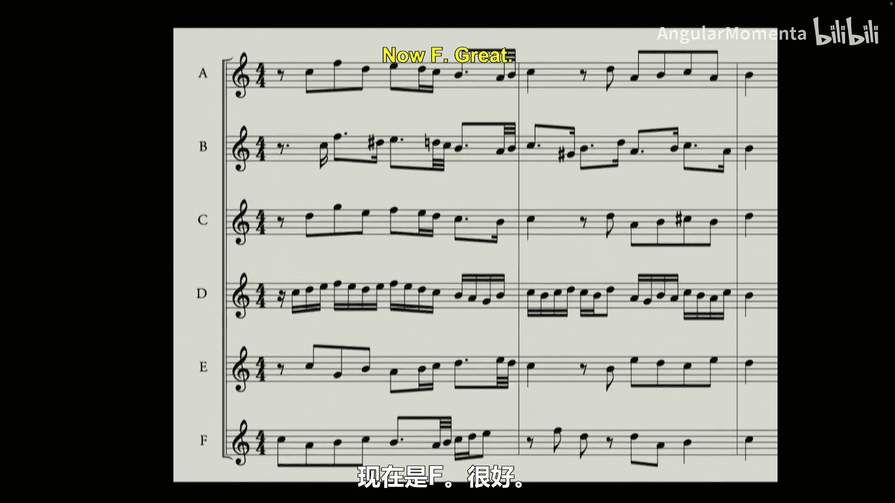

Great， talk amongst yourself。 I want a ranking from your groups So somebody write it down。I they own。

And I want to know why。 Okay， let's we it all back together。Let's bring it all， all back together。

So look at， look at your look at your list and will， willll count like normal human beings。

 whichever one is the top in your list is one， whichever one second to stuff and will will vote by fingers first off for the general ranking。

 So when if you hold up the number of fingers that。You know， if it's closest。

 it's pulled up one finger， if not to， you know， whatever And pull palm means。

 I have no idea what that is， okay。B。Oh， be's doing pretty， pretty well。 Okay。

 lot of chooses a couple of ones C。Okay， a little bit more variety。

 Hol them up so other people could see。 Also， yeah， look around the room。 It's not just for me。

 Great， great D。😊，Oh okay， we've got a variety， you no， whatever great E。Oh。

 still see some problemss things great and F。Okay。Oh， we have1，1，1，4。 good good What did you， you。

 you， you put example， What you guys， those who put F as 4， would you put as 5。😊，B， D， okay， D， good。

 good， great。 somebody who had， who had C above B。Justify your answer。Who who had C above B。

 there were a couple people。Yeah， go ahead Jake first。Yeah groups， yeah。

 was basically just theposition where speed like change a lot of the rhythm of it like B。

 I think fits the exact pitch a little better。But。Or a site from was a couple of places where it has some accidentals。

 but it changes the rhythm。Quite a bit where C is just the transposition。

 so a relative thing we waiteded transposition。Okay， good， good。

 I'm already hearing words that I'm liking stuff。 somebody who had it the other way around。

 justify your answer， who had it the other way around。😊，Who had a bunch of people like B above C。

Yeah， John。AndLet me for the kind like sound feel that a h because Loic windows are practically similar。

 to A and B is why we put the high relative C， and when we take transposition to the crown。

 only part of C's coming transpos， so it doesn't even feel like it's like a full transposition。Great。

 only part of its transpose。 Yeah， yeah， it kind of gets back on for a bit and then comes back off。

 Great。 Okay， who had， who had D， who had D1 or2， Any， I can't remember。Yeah。

 why do you have one or two。Because it basically has this sorry。

 it has all the same notes in the right position or basically Yeah， yeah。

 all you have to do is remove notes and then you get the same thing and I think with a few exceptions。

 but that never happened Okay， great， who had D very low。Yeah， go ahead。这。Sorry， can you speak a lot？

And。Who had？Did anybody have E above， above 4。Okay。We have E X of three and we put it there。

pattern includes wasn So so what do you say pattern the rhythm， the rhythmic pattern about good。

that's an embar。Is it an inversion now， No， would I do that。Yeah I can't， by the way。

 I can't remember where melody。 I， I think melody A comes from hereron book and then gives there's some。

 some search book。 and I should， I should have my notes better。

 And I'll try to make sure it gets annotated later that had three other melodies。

 I tried this in the past， And it was so obvious， everybody had the exact same ranking。

 I had to agree with them， But I think this is better for making some arguments。 Good， who。

 who had F anything but actually， somebody who gave F 5， Jonathan， why would you， did you give F 5。

 Yeah， Why didd you give it 5。😊，睇呢啲你几咧系。Any noticeable similarities。

 like after us it seemed closer to like E in terms of like it might have been inversion。

 but then not really， the hall of rhythm is also completely different。

Or it happens like it's fairly different， great。So。I'll just get a point and we'll get some， some。

Just what your ranking is， so save them from， Matthew， what was your alphabetical order， B DEF， okay。

 good。So。BC D EF。BC EDF， great？Great， that's it。Yeah。

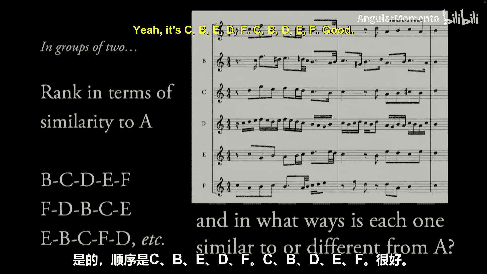

Good， anything， anything is this feels like you're not being represented under Hannah what your group have I think CBD E CB D E。

 F CBD E great， super。 Now what I want you to do， we're not gonna get through all of the exercises today。

 But I think this is the most important part。 I want you to do is think about what ways。

Start thinking， I'll give you a little bit of things。

 What are some ways you can make sure that your computer system that is going to classify things by similarity follows your intuition of what is similar and not somebody else's intuition for what is similar。

 So that's gonna be the main theme for the rest of this。

 we are intelligent people we are intelligent musicians。

 we are make these choices and yet we are making differences on how far and how similar they are。

 So in fact， I'm going Blake the screen and say the one the one take away from today's lecture。

 I hope and for all these things is that there is no right answer for the similarity between two melodies between the similarity between two pieces。

 there may be wrong answers。 I will not deny that that if if somebody said that that F was closer to I don't know。

The same thing with one note change or something， I would you know， think。

That that might be wrong that your program might be malfunctioned。 but there isn't a right answer。

 And a lot of it what different between good answers are what we think of as important when thinking similarity。

 There is a yearly competition， I think it's been suspended since， since Covid。

 So I don't know if it's restarted。 But for the algorithm that can that can classify songs as the most similar。

 And here is a place where I would say what are your ground truths。

 how do we trust that you have gotten it right， And are we just trying having to recreate the views。

 I won't say biases， but the views of the people who organize the the conference and you know。

 what's that going to do for us。Okay， so I want you to start thinking that。

And I will tell you what F is beforehand。F is one that a lot of computers programs。 In fact。

 what I like went aha during one of Kiki's algorithms I could， F is one that a number of algorithms。

 especially older ones， will classify as the most similar。Because what is F？

Unlike any of the other lines， F has every single note。And every single rhythm， if I did it right。

 I was doing it my head。 every single note and every single rhythm from a just order didn't matter。

A is the counter set function。 the unordered version， the， the P。 yeah。

 the permutation does not matter version of F。Or F is the perutation does not matter version of A。

 did I get it right， right？What's right， okay。So we're gonna go quickly through some things I think you've probably seen before some some ways of measuring distance。

 You all learned this in some point， the Euclidean distance between two points。

 Take the square root of the X terms， Take square root of the Y term。

 Add what different squared plus different squared square root， right。

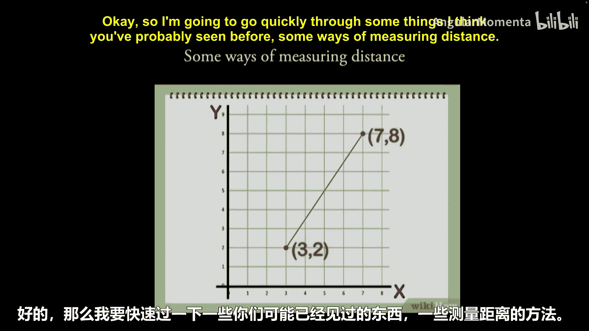

square root of x squared plus difference between x and difference between y。

So anyone seen this thing where the distance between these two points，3 comma 2 and 7 comma 8 is 10。

 Yeah taxiic cab distance， Manhattan distance， we'll go with we'll go with taxiic cab since not all of us have been to a Manhattan on had the joys of taking a taxi there。

 and stuff what， why this here， the distance was 10。Here it's a that's not a negative sign。

 That's approximate sign， approximately 7。2。Why is the distance greater here？

Somebody who's done this。Triangle inequality， talk English to me for a second。T talk， talk。

 talk like you're talking to the your cab driver and whos you're explaining to this。 No。

 cab drivers are really smart for talk， but who may not have heard the time of in inequality。 What。

 what is represented by the term Manhattan distance or trying of or taxi cab distance。

What's the notion。Intuition。Yeah， go along the axes。 go along the axes or that go along。 let's。

 let's get， get more literal。 Let's one of the things that we signs don't do so well is step back into the real world。

 What is the distance traveled What constrains the taxiab from not hitting distance of 7。

2 when said 10。 Yeah， straight up You can only go straight up and down the side。 You can only go on。

 Let's go even further back。 What in Manhattan。 If you don't want to get arrested。

 you can only drive on。Streets and the streets in Manhattan go。Yeah， there are orthogonal。

 There are these little lines。 So there are constrained in where you can go。

 So if there are constraints on your distance and the most common one is you can go up。Down。

 left or right。 Yeaht always do that in Manhattan。 But because of one ways。 But， you know。

 let's assume that we have certain constraints。 You can be brought down。 Good。

 I wanted to make sure that we all have that。And so that we can start thinking about。First off。

 that what operations are allowed determines the distance metric。

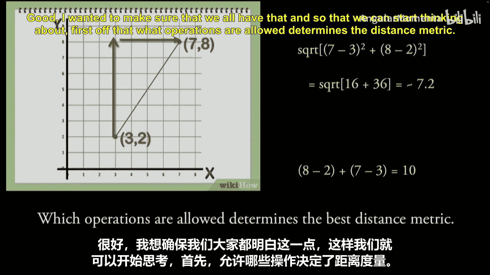

What operations are around determines how far the distance are。

 What are some operations we do in music。That's a question。 What。

 what operations do we allow and not allow Yeah， Adam， ats。

 We can look at midi difference between notes。 So therefore， we can take notes and bring them。

Her and lower， right， We can， we can raise and lower notes。 What are other things we can do。

What are some things you've ever done with a piece to make it a little bit different or interesting？

即。You can subdivide or combine notes。Maybe you can， maybe you can't， but yeah， quite often you can。

 this is a context where you can。Other， yeah， other you can change durations。 Great， super， super。

 how about this。 What is。Which of these two chords are closer to the first one。

 The first one is gonna to be C major。Versus。I there's a similarity problem。Second one was G。Major。

 the sorry， the the first court， the first one， it was G major。 second1， I went from C major to。

See augmented， great See augmented triad， so。Those are two things。

 Which one who votes that from going from C major to G major is closer。

Who votes that C major and C augmented are closer。3 people。 Okay， great。

 So a lot of it has to do with your thought about， you know， well，1，1 you the augmented。

 you're only changing one note and you're only changing by a half step。

 The minimum distance in our Manhattanized musical world of Mii and piano keyboards， right。

 That is their minimum distance is one half step there。 not for all music in the world。 Great。

 C major to G major， you're also just moving one。 If you think of something this way。

 you're moving one distance in what space。😊， so what's that word， circle a fifth space。

 C and G are about as close as you can get without being the identity。 C and F。

 probably the other way。 although I don't know， Maybe it's a one way circle of fifths。

 You only go around one direction or another， great。😊，Based on the time。

 I' not gonna go through all these other measurements of distance that people can do。

 Who has heard of Earth distance。 That is the amount of work that it takes to move  one mound of things over to another place and sometimes you optimizing。

 depending on how， how much it costs move distance and how much it costs to move material。

 You can end up with different results。

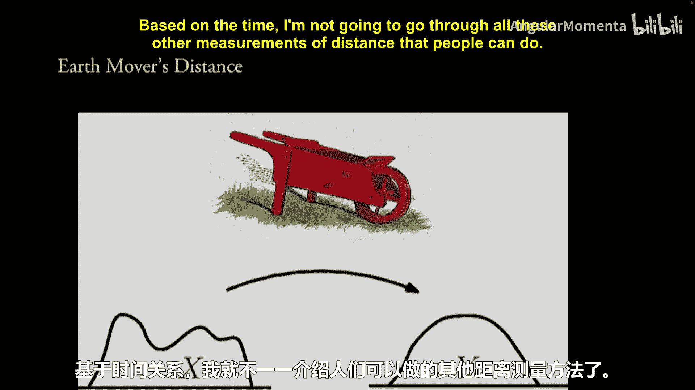

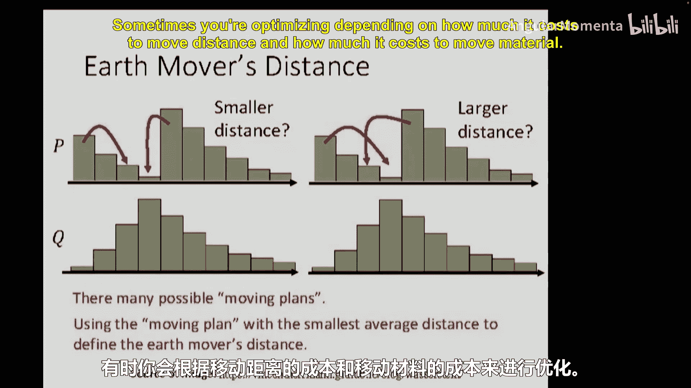

嗯。I always， this was one of the charts I think I showed earlier in the semester is here's one place where earth mover distance might be a good use of things。

Of distances。 And then Levinstein or edit Dis is what that was mentioned in。

 Do you use it in your work。Yep， so that's， that's what you're talking about。

 So the idea of how to change the word Hoai into Honda。And no， no international East Asian politics。

 please for a second。 And well you can think of every time。 okay， H and H are the same。

 So it has a cost of0。 or we can delete the H and start an O and have a cost of one。

 but we can kind of find the pattern of as we change。

 We're gonna insert a y after the H for substitute a U for an O。

 should be symmetrical the other way around different operations。 and is the same。 So that's good。

 D is the same。 So it doesn't cost anything。 So a cost function goes here。

 And so we're trying to find the minimum cost from going from one end to another。

 we don't have time to go through all of the algorithms for this。

 But Levinstein distance edit distance has a lot of good qualities that makes it useful for a lot of musical similarity tests。

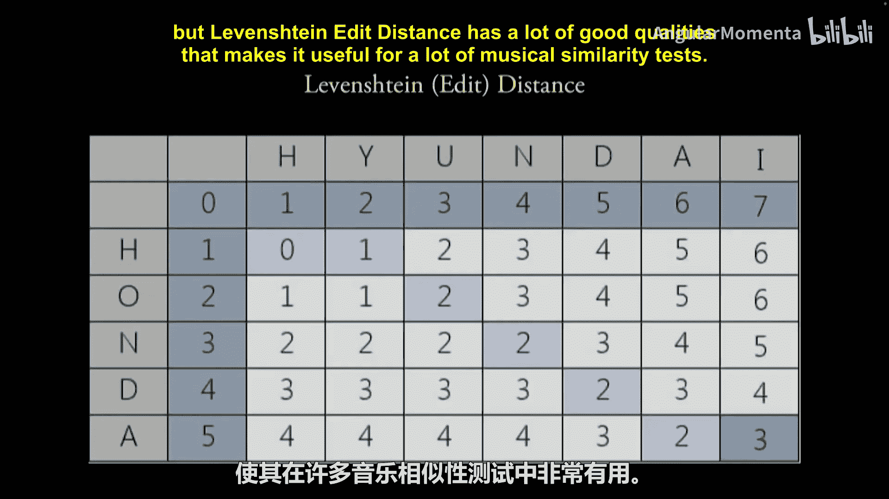

Just so that， you know， you can say your professor at least put the algorithm up on the head for a second。

 But more importantly， I think a lot of times， is thinking about the particular cost of things in a musical sp。

 in a musical world。 So， for instance。

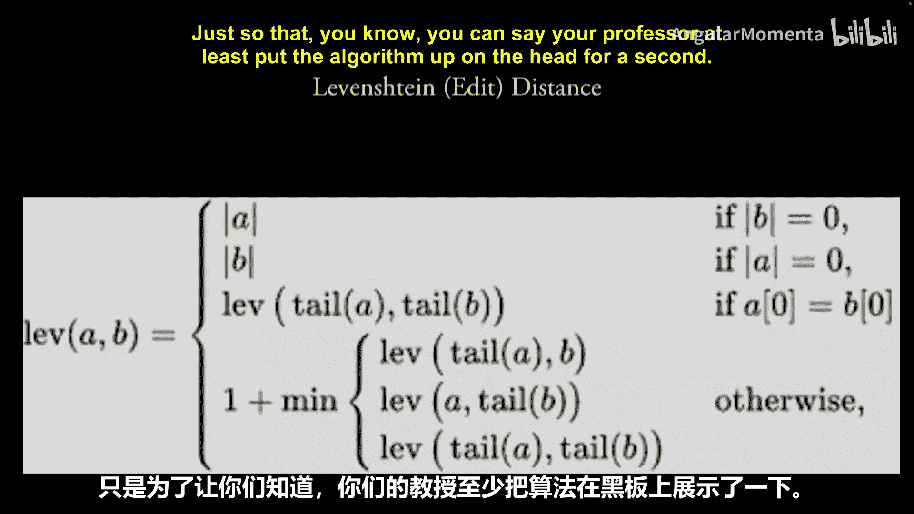

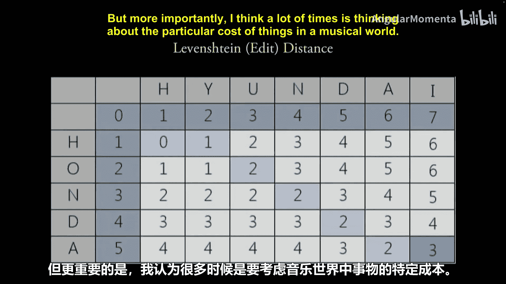

Is deleting what。We're trying to think about two pieces， two melodies。

 One of them deletes the first note。What would you call the cost on that， maybe， maybe one。But then。

If it doesn't make up。The rhythm， the total rhythm later and everything from here on is gonna be off。

 And it's one line within an orchestral piece。 That might be a higher cost。

 Maybe some and the classic debate is whether changing a note。

 Is that the same or changing a letter in something like this。 I this the same。

 does this cost one or does this cost， well， one way you can change a letter is you delete it and then you add a new letter back with a cost of two。

 these are， these are things that come up quite a bit in similarity search。

And just really want to say that it comes up a lot in music。

 Don't borrow your distance metric from somebody else。

 Different ones might be used for different situations。 So the distance between dog and Goel。Well。

 we can substitute D for G。 It know， Maybe or maybe we add other things。

 but I'm gonna assert that in different some situations， the distance might be 2。Between dog and Gto。

 what we do is we use the substitute closely related pet function for a cost of one。

 So dog becomes cat and then translate English to Spanish might cost one。

And if you think about large language learning models and things。

You might want to have functions like this。 And， in fact。This is not a digital humanities text class。

 but if it were and were doing computation， we' definitely be talking about an algorithm called Word tove。

 which was one of the earlier successful algorithms for trying to predict what words are similar to other words。

 words of synonyms so you can create a kind of cost function for that is for this word is a synonym for this one that has been substituted that is lower than than this sentence is different from this one because it's using a completely different concept。

嗯。I'll skip that。So when we're thinking about these distances and these weird。

Things like substitute dog for cat on low cost。 Sub cat for gotto at low cost。

What's the term that we spent a lot of time， maybe even too much time for it felt like at the time talking about earlier in this semester that helps to think about things that are not the same。

 but might be closely related to each other。Equivalence， equivalence or equivalence classes。 Yes。

 so one of the things you might want to do is define what equivalence classes it could be。 I mean， I。

 I think last other times， I've given the exact same melody up in octave。

 And everybody immediately said， oh， that is basically the same thing。

 So everybody was very quickly putting in an O equivalence class things。😊。

So I wanted to make sure that we had that， and。Yeah， and so once you have these， these distances。

 we tend to go through。 and this is， if you're in a biology class。

 you'll spend a lot of computational biology， a lot of time on this sequence andment。

 a kind of distance metric where you're trying to find the minimum distance between two things that you believe might represent the same type of thing。

 or you might say。It's innocent till proven guilty。

 We'll first try to see if they can be changed into another thing at a low cost and then discard once we realize the cost cannot be minimized。

 I will say that algorithms that can be short circuited that you can prove at a certain point。

 you can't do better than this cost will save speed up。 a lot of your run times because once。

 you know， you might say，You know， that there's no way that this could be more could be。

Better than 20%。 or it could be。 Yeah， there's no way that this could possibly be better than 90% similar to this。

 So I'm gonna stop looking at the rest of the piece or whatever you're cutoff。

One of the classic things for sequence alignment is trying to find this is Google's data set they released at the height of Brittanney Spears popularityity of all the number of searches that they believed were trying to find the top left one。

 Brittanney Spears， I'm sorry really， really impressed that that the number of correct spellings。

 of a hard name to spell outweighs the rest anyhow。 that's what And the people who are。

 who are really， really good at this and like any time I'm trying to figure out a similarity sequence alignment or similarity task that I don't know is to look at the people who are trying to align base pairs in biology or trying to align genes。

So that because they have many， many。Many， many options。Okay。

 so I'm just gonna keep pounding this term in in as many different ways I can do all the things that we're just working with Hoai。

 Honda， Brittanney Spears， genes。 Those are all strings。

 But we work on notes and and clefs and things like notes and stuff。 But things like that。

 So how do we get them in。😊。

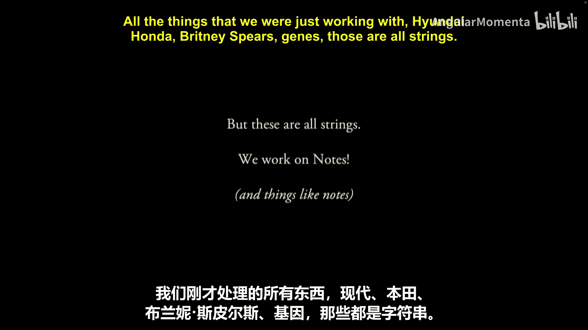

So this is great to get this from two different people。 Sam thing。 We use things called hashes。

 which are very similar to the concept of viewpoints to the rescue so that try to convert things note hash a note。

 we might say that here are equivalence classes， all notes， their names with octave。

 And so we might hash a stream by just joining all the hash notes for all the notes in there。😊。

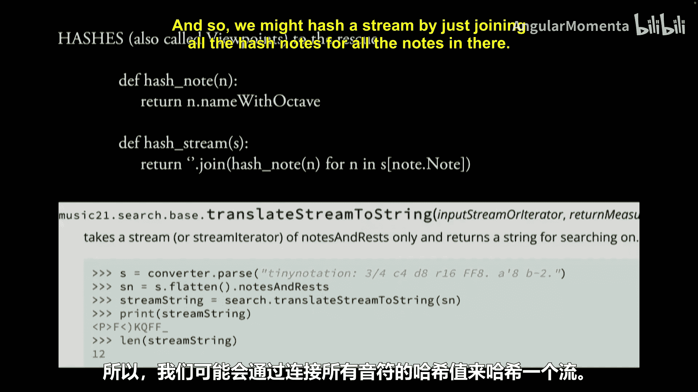

You will find in music 21， if you're working on it。

 there's a bunch of tools for this already in music 21 do search。

 a module that we have not talked about now， and we will not talk about again。

 But if you're doing a lot of searching。 It's probably worth reading the reading the module reference for it。

 I think that there might be a user's guide。 but I can't remember if I finish it if it just trails off after a few words。

 So we might take string， a string convert it to a string that's hard to say very fast。

 And translate it。 And we might have some sort of hash function that tries to make everything into into an ASII character。

Though there's no reason that everything needs to be turned into a string like name with octave。

In a lot of ways， strings are just a rays of ints。If you know， we' talk about that， the。

know that a is it lowercase A。Is generally represented internally， as anyone remember， remember。

What's that。9997 or 96， I can't remember。96， yep， in capital A is that one，6065。 Okay。

 so some people， some people know these。 I used to have them all top of head。

 So all the letters you're doing have a particular representation and。Back in the bad。

 bad days of the 60s and 70s， different computers would'd have different representations with this。

 And then we all agreed on the same representation for letters。

 And then we remembered that there are other things in the other characters in the world。

 that looks too much like an A。 I don't I do it。Gin or something or an alpha beta， things like that。

 And， and， then for a while， we had a big problem that they weren't all converting to same thing。

 Anyhow， digression aside。Maybe we'll get to the point where we can start converting things besides MIi numbers and notes into something more standardized because right now。

 the MIi numbers is basically the only standardized notes， which is probably why Midi keeps。

Being used for a lot of computational projects。So the hard part is always finding out what numbers we should use to represent a note。

So we're going to convert name with octave and we want to make a string。

 and then we want to make it a number， and then we want to have a whole bunch of numbers。

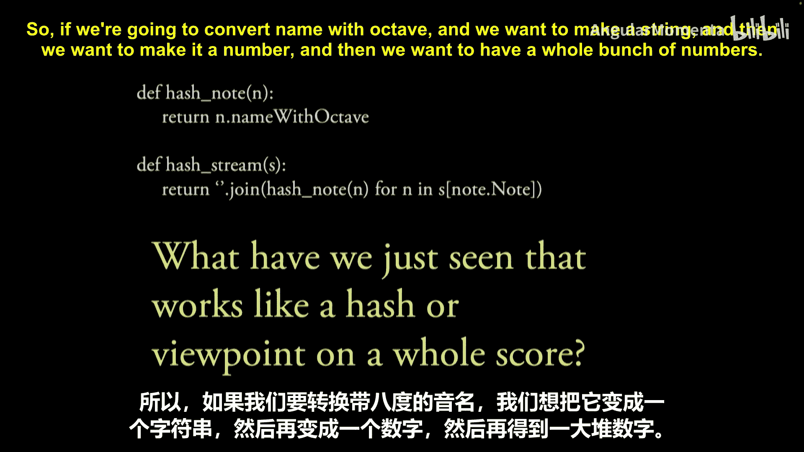

What have we just recently seen。That looks like a tool to take a score or a part or something and works like a hash or viewpoint that tries to convert it to a bunch of numbers。

I'mNot asking you to think too far back。But farther back than today。

' getting feature representation extracting features， getting a feature representation。 Yeah。

 so feature extraction and this kind of viewpoint searching are very go hand in hand with each other。

 So if you're， it's partially why once， you know， once you finish up a search function。

 You're just gonna want to probably try to see if AI or machine learning can do it better because you have everything ready to go for it。

 But sometimes what we extract is different from others。

 I want to give a little bit of a caution that。😊，Great， back then， course 6。

 you had to do a little final final project called the U A P。

 And we thought that making these viewpoints， making a hatching system for music 21 for comparisons would be a nice would be a nice senior project。

 And then we both realized that no， it's a lot bigger than we thought in a lot more complex than we thought。

 And so it needed to be an M N。 Emily Z was great at creating this and great we hated a really great M N project。

 and。😊。

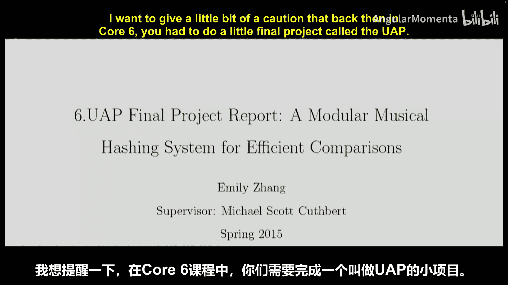

Then we realized， no， this， this really needs to be a PhD project。 We did not continue on。

 You can work。 There are so many difficult parts of hash algorithms because you want to think about things like。

然会 not get to诶。Going all the way back to the beginning。嗯。

How can we create a viewpoint or something that。Allows D not to be totally。

 totally different for anybody who didn't put D as the last of all possible results。What kinds of。

Actuallyley， what kinds of numbers would we need to represent a piece on to make D not the worst。

And to really make sure that F isn't the best。So that's gonna be our last 5，6 minutes of class。

 I want you to talk5 minutes of y'all talking with each other and 5 minutes of y'all talk and talking to me。

 So what kinds of。What kinds of feature extraction， What kind of hash function。

 What kind of viewpoints， These are all slightly different concepts。

 but they're all in the same area。 What kinds of equivalence classes will you need in order to make。

This happened。嗰系。Okay， I hear， I hear words continuing， but less frequently。

 Let's talk about what are some of the ways that that people thought to create a strategy。

That doesn't make D and F about the same。Yeah， got look at the sequence of local maximum and minimum local maximum and minimum。

 Okay， I think I know what you talk about， but let's give me a little example。 What。

 let's talk about a， What do you， what do you So you could maybe argue that the C is the local minimum。

 And then the F is higher than both of its neighbors。 So it's a maximum。 And then the D is a minimum。

 the E is a maximum And then the D and C after that are not really anything until you hit the A on the 16th note。

😊，Cool， so yeah， we're just looking at every time the direction changes of the pitches。 Great。

 and compare that。 So at beginning A has D F，D， E。 Here we have D， FD。😊，It's tiny a bit different。

 D F， but then going down to a little bit different， But it's at least giving some numbers we have。

 Yeah， just。

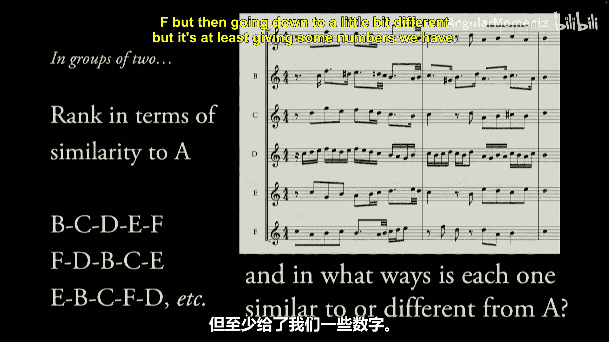

always， the question is， does， does your current streak end when you hit arrest。Or not。

 And maybe it depends on how long the rest is。 So good other， other strategies。A of。

 I will look at where offsets are the same and then check that their notes are the same or not。

 Great， So we're going to look at offsets that are the same and see if notes are the same or not。

That works really well。 And what I'd love to do if。

 if this were what do he called the the generalized adversarial problem set。

 the G problem set where one，1 team has to solve the problem。

 The other team has to keep giving them things that break that。 I think it was a great idea。

 And I think it would work in general， but I could generate something like。😊。

Where all I insert is let's insert a 64th rest at the beginning and then put all random notes and you're gonna end up with and then maybe we'll put one note that's the same at the end。

 And you could end up with 100% of the notes on the same offset are the same。

 I think I think would really work in the real world。

 But but we might want to always think about something like that too。 great great idea。

 John then first ofs So you're gonna builds up on what But of course you like take a look at the notes and kind like kind like set kind of like cross over to like a set of Ds and So both those would still like show up like relatively high。

 and then I like compare the offsets， which but still keep D relatively high。

Super we're talking about offsets。 Are we're talking about what kind of offsets。

Like we in the guess like within the two measures Yeah， where' in the two measures。

 where' in the measure， we sometimes want to do global offset from the beginning of the measure。

 but then you can't identify similar phrases。 or all it takes is put a repeat。

 put the first four measures repeat at once。 and suddenly the whole rest of the piece is different。

 So yeah， that's great。s similar a little duration is， I guess。 if you just start at 1 people。

0 and go all the way through the piece。 like any time the two pieces on the same。 you add the score。

 So like the F that they both have on beat 2 would be like a quarter point because the F the F that they both have on B 2 would be a quarter point because shared duration is only for that 6 Gotcha。

 So we look at shared great。I like that a lot。 Did anybody try to come up with equivalentence。 Yo。

 yeah。 The contour ends up being a kind of a new equivalence class that we hadn't talked about。

 which kind of works out in thinking that everything that doesn't change directions is a kind of passing tone。

 even though not in the proper music theory term。 And so can kind of be ignored。By the way， I。

 the 1 I use quite often is I'm just gonna look on downbeats or strong or unbeats and ignore everything else。

 And that would works pretty well for a lot of。Lo things。

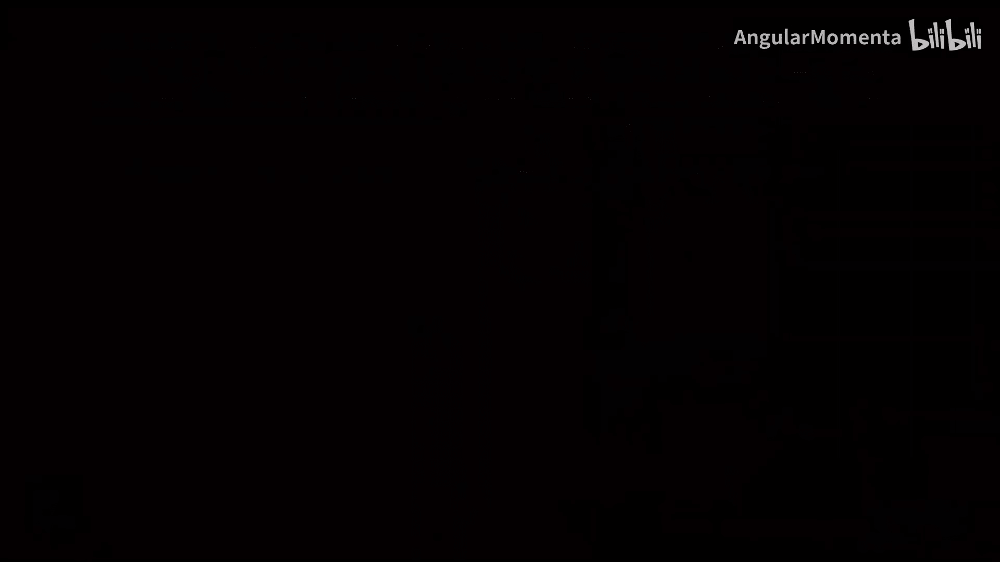

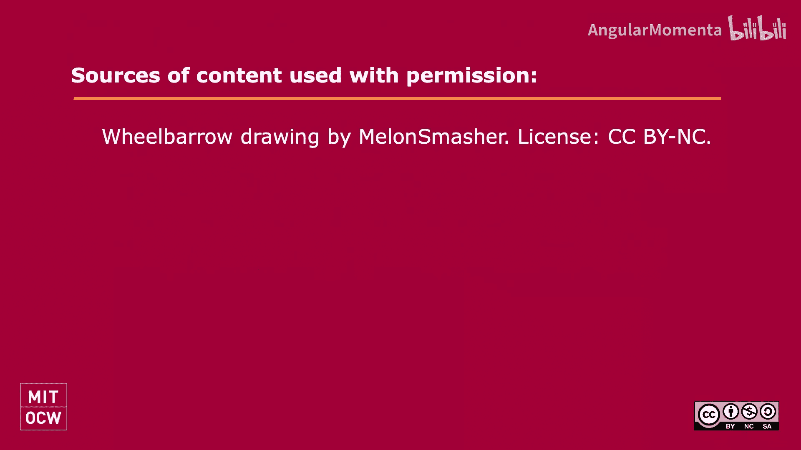