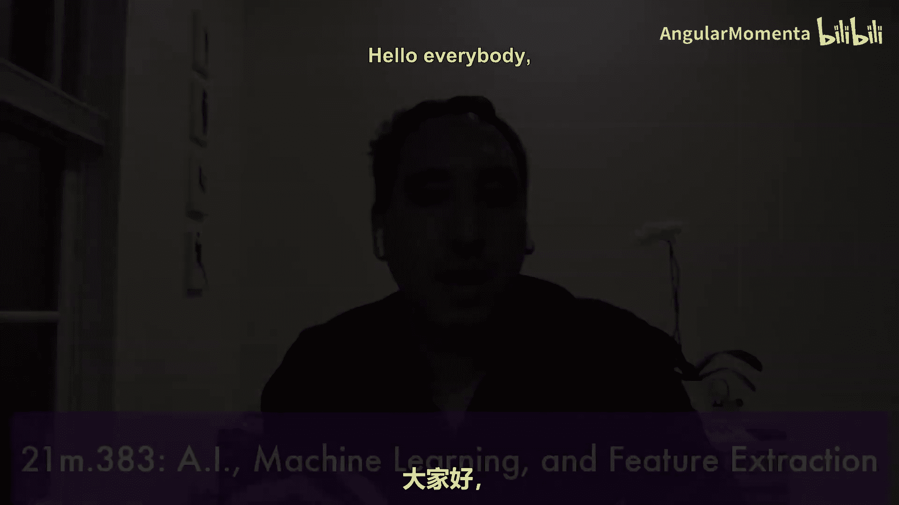
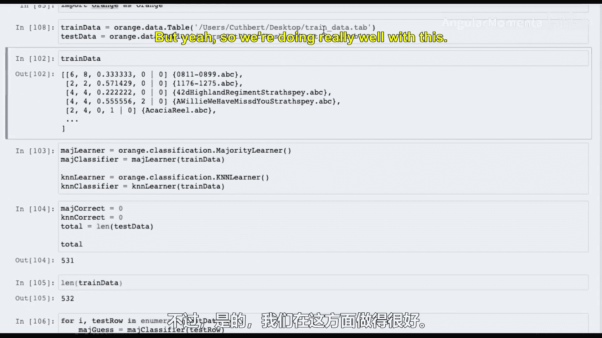
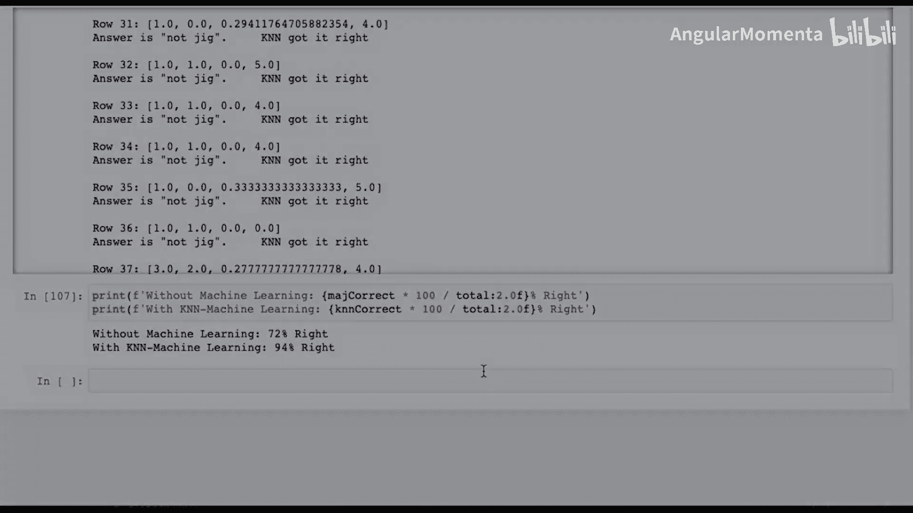
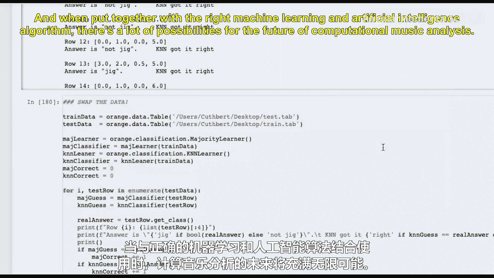

# 【麻省理工】计算音乐学与分析‌ ｜ MIT 21M.383 Computational Music Theory and Analysis,S 2023 p44 44 视频 29a：特征提取与机器学习（三）：人工智能 -BV17xUmBDEUC_p44-

Hello everybody， we're going to be looking today at how we can use machine learning and artificial intelligence in order to learn more about musical behavior and music theory and just music in general。

Our first task is going to be， how do we transform music into formats that computers can learn from because a score alone is not。

Something that can be used for artificial intelligence。

 and so our first task is going to be understanding how feature extraction。

 the conversion of musical scores into intelligent numerical data。How feature extraction is。

Able to make machine learning possible。So go ahead and load up Jupiter Note and follow along as we do some work with Music 21 first separate from the Music 21 Ma learning toolkit and then with Music 21 features in order to。

Learn more about some。Gres and other ways of classifying these。So go ahead and start Jupiter Note。

 and we're going to create the first step， which is to understand what features are。

 So I'll and why we might want to extract them。So what is a feature。

 That's the first thing we're going to work on。 Feature is something really， really， really basic。

 Let's say that we have a piece。 We'll load from music 21 corpus。 Our favorite bach corral。

 So you don't even need to know what comes up from this corpus parse Bach。BWV 66。6。

And just to remind ourselves how it goes， here's the buck。So， great。 Let's go ahead and。

To choosehoose a feature from the this from this， let's do the parts feature and we'll call it nu parts equals4。

And let's do the T signature。Nummerator feature。Equals4。T， we've now。Extracted manually。

Two features from this crel。Feature extraction is the conversion of musical elements or any elements。

 but musical feature extraction is a conversion of musical elements into single numbers or lists。

 rays， vectors of numbers。😊，It is thus the most boring thing in the world， as you've just seen。

It is just a bunch of numbers。Feature extraction sucks out the life blood of music。

 It takes everything that's beautiful in music and turns it into a bunch of numbers。

 It is the life sucker。 It is the zombie of the musical world。😊，But。

But there are tons of amazing machine learning and artificial intelligence and deep learning algorithms of the world。

 As far as I know， they all have one thing in common。

 They only work on collections of single numbers， or vectors of numbers。😊。

I'm not a machine learning expert， so maybe there are algorithms that work on two or multidiional array of numbers。

 that would be amazing for machine vision or what we do。But nothing。

 as far as I know in the artificial intelligence world， works on things like。This notation， or。

🎼这是怎么问。🎼だ个分。🎼て？Sound。So if we're going to work on doing artificial intelligence or predictions or anything super amazing on music notation。

 at least at present， we need to convert music to numbers。So that's what feature extraction is。

Basic feature extraction is pretty simple。So in this case。

 let's just extract automatically the meter from this piece。

 So we'll write something that does it will' import from the typing module because we like to do things like this turn。

Python， which is a weak typed language into slightly stronger types so that we can。

Understand a little bit better。 what's going to go on。 So we'll also import from Music 21。

 the M and stream modules。 Now， let's write something called extract。Extract me。

 which takes in a variable score， which is a stream dot stream object。

 Maybe it should be a stream dot score object。 but let's keep it flexible。

And it returns a couple of two integers。And we'll say here， it returns a two tuple of the numerator。

And the denominator。Of the first time signature。Sick。A sure found in a score。Returns 0， comm 0。Y。

The score has no later。Why do we return 0 comm 0 if there's no meter In feature extraction。

 It's generally assumed that we want to return out of bound number rather than raising exception if there's a mistake。

And the reason is， you'd hate to be running extract mere on hundreds or thousands of pieces。

 And you're always getting 4 comma 4 or3 comma 4 or 6a 8。 or' even saying wacky like 11 comma 32。

 And it's all working successfully。 only to have your entire feature extraction。

 artificial intelligence pipeline fail。 If there's one piece that doesn't have a time signature。

 Like， let's say it's Gregorian chant or some kind of transnce meditation。

So that's why we're going to be putting returning0 comma 0。On the other hand。

 maybe it's a bad assumption， and we should raise exceptions when something's not right。

 And then we should fix our work rather than the hiding errors。But we'll get to that in just a bit。

First， meter。 But first， let's see how we do this。 So let's just remind ourselves we can take from anything get elements by class。

 meter dot time signature。And if we do not have the any， the first meter will return。Zero comma 0。

And otherwise will return the first meters new and the first meters。De nomin later。

We're kind of hiding an error in our encoding， I that the right thing to do。

 And I think this is something that when we're talking about it and I would love to talk to anybody directly about about ethics and morality and sort of who artificial intelligence is working for because I think there are often important considerations of artificial intelligence with moral and ethical consequences。

 when we hide things that it can't do。 And so I want you。

 if you're going to be somebody who's going to be working with artificial intelligence and the rest of your life and technology to think about such things。

 maybe we shouldn't be hiding our error so much。Okay。

 so we have this extract meter to get back to this sops。

Doesn't matter if you put a parentheses around a tuple when you return it。 But if you start with one。

 you have to do the other。 Okay， so let's take this bo corral and let's run extract meter。

On the buck。2。0 comma 0。 Oh， I know why， because we forgot to do re curse。

You know flat would do just as well， but recurs a little bit faster。 And oh， by the way， saying。

 I didn't mention you might have。Seeing that we're sending in the class actual class meter hi signature。

 we could also put in the strain time signature doesn't matter either way there。But。

This actually doesn't get us the first meter。 This gets us all the meters。

 And so if there are no meters。That says if there's not single one we that， we'll call first meter。

The first of all meters， so of course， it's number zero。Now， thats should be there now。

Extractt meter Bach， F returns 4 4。So why would we want to extract the meter as two numbers as part of feature extraction。

We might do it as part of a series of features in order to make a prediction about a piece。

 Let's say we wanted to predict if a piece of music is a waltz or not。So we might first think。

 is this a？Or is this aaltz？Is this a waltz？So what makes something a waltz？ Well。

 it probably has something to do with a meter。 We fortunately already have a meter extraction from our type signature for the piece。

 And now we can use this to try to figure out if something is a waltz or not。

So we would assume that the prevailing time signature in a piece and the opening time signature in a piece。

 if it's a walt would be 3，4， and therefore our extraction should be 3 comma 4。

That is the worst assumption ever。The most famous waltz of all time。

 Johan's trouss blue Dany Walaltz， which just heard。Doesn't start in  three，4。

 it starts with a slow introduction in6，8 time。I happen to have a random waltz on my computer。

 It's Johans Struss's waltz called on the Blue Danube。It's not in the Music 21 corpus。

 but it's instead on my hard drive， on my desktop。 So I'll need to import the converter module for Music 21。

I mean， it's just a wrapper around loading things and stuff。 And now。

 instead of using corpus dot parse， I'll use converter dot parse。

 I'll give the full file name to file path to my。To my waltz。It's a music XmL file。Oh great。

 So the guy who's making this recording just goes online grabs our random music XmL copy of the blue Danubbe from the internet。

And this version skips the introduction completely。 So it has 3，4 when it should have gotten 6，8。

 So it's going to get the right answer but for all the wrong reasons。

Have you written the expression gico garbage in equals garbage out。Let's not do that in our own work。

 What we're learning from in this tutorial。 Let's instead make the world of artificial intelligence a better place and always check whether our training data is correct。

 whether this is actually a score of the blue Danubbe， rather than just the main thing of it。

 Let's check things like this before we use it。Great。So it's in 34。

 so our extractmeter function is going to return 3，4。 Let's try that。Tips。Sorry。

 don't give the answer。 Give the question。 There we go。

 So now we have our first feature that might help identify a waltz。 It's time signature。Now。

 let's do something a little bit more advanced。 And let's， let's look at this piece and see。

 iss there anything that seems to happen pretty often。 Well。

 it looks like the last beat beat 3 of the piece or offset 2 is more often higher than offset  one。

 I don't know if that's true。 but that looks like something that's a possibility。

 So will create sort of a more sophisticated feature extractor， which。

Returns the proportion of all the measures where beat 3 is above beat 1。 First。

 we'll make the assumption that beat 1 is always at offset 0 and beat 3 is at offset 2。

 These aren't very good assumptions， but maybe together with searching for meter， theyll， two。

 we'll make a good case for whether something is a wts or not。 So here we go。

 if we're going to we're going eventually write something proportion proportion of beat 3。

Above beat 1， which' is going to take a score stream， stream。

 it's going to return a float because it's a proportion and I'll just say pass now。

 because in order to write this， of course， we're going to need something that figures out for any given measure。

 if beat 3 is above。Beat。1。For a single measure， for one measure。

So we'll take an M which will be a streamed up measure， and this is going to return true or false。

Ohoops。Scar return。True or false。 Someday we have an incredible production crew that's going to edit out all these mistakes。

 but I don't have that yet。 So will you say that the measures notes are get all the elements by class note。

 And that returns this stream iterator for now， I'm going say。

 recast that stream iterator is another stream。 you can do this with any of the get something by something classes in music 21。

 Great， So within this is now a stream of just nothing but notes。

 And so I can say the first notes are those notes that appear at。😊，On offset zero。

And if there is no note there， return false。Great， now we'll check B3 notes are those notes。that。

Are at offset2 and that began at offset 2。 so that should work pretty well。

 And if there's no note that satisfies that condition。We we're going to return false again。

But what if there is more than one note at the beginning of the measure。Or at B3。

So we have to make sure that the first note is the first of the beat three notes。

And the beat3 note is the first of the beat3 notes。The third， the first。

 Now we'll go ahead and say if the first notes pitch is lower and we're going measure the pitch by pitch space or a midi number is less than the beat 3 notes。

P space will return false， otherwise we return true。Great。我。Let's be good。

 We'll make this a second thing we'll。Could。😔，Cut and paste that there。 Meanwhile。

 we're going to add。Let's write a little test on this。 so we have blue， let's get measure0。M0。

Actually， it's measure  one。 So blue dot measure1。 and we'll see。Is B 3。Above peak 1， oops。

a little bit thing does doesn't know， but apart here， puts zero down。 line' I'll say elements。

 but I'll set。 you all knew that to you're just quite I' not say anything。

 So this ups up fight is facing us up for。 So this is why we test things great。

Is beat 3 above beat1 in measure。Puan。Actually is。Oh， I know what it is。 We have a reverse of a sign。

 If this pitch is greater than or。Equal， then we returned false， actually， if it's， yep。

That equal sign there。And now that's working measure 2 should be true。

 also measure 3 should be false， let's make sure that works。Yep。And false， great。

 so that seems to be working。Here's the irony， actually。

 except for the fact that our label would be completely wrong。

 having every single thing that should be false， be true and true be false probably wouldn't change our answers very much。

But who knows， we call this is beat3 above beat 1 and one measure。It better do what it says。 Okay。

 great。 Now we're going to get the proportion that is the proportion of measuress in this piece where B3 is above B1 So will。

Keep track of the total number of measures equals 0， the total。 we'll call them wtz like measures。

 those where beat 3 is above beat 1， we'll call it 0。For every measure in the score recur。

K elements by class measure。嗯。As a reason why we'll use get elementss by class measure instead of measure 0。

1，2，3。 So mostly to do with the fact that sometimes there's two measure 3s or they're missing measure 11 or something like that there's measure 5。

 A and 5， B， if there's a first ending or something like that。 Anyhow。 So we for every measure。

 we increment the total number of measures by one。 And now we look at one measure。

And we say if that's true， then there's total waltz like。Measures plus equals1。

And we're going to return the total。Wal like。Measures divided by the total measures。

 we're coding pretty fast， so we'll just put as a to do later。What if there are no total measures。

 always make sure that we don't do a diversion by 0 measure error。 But that can be a later thing。

 So let's check this proportion of beat 3 above。Beat lime on the blue Danube。Proach source so。26%。

not really true seems a little bit low。F two down。Well， we'll check that waiter。

 Princes outs stop Though that bad。And BWVs sorry， Buck。🤢，Cl this time。

 it's actually even a little bit more。Interesting， okay， so in any case。

 this is a feature weve just defined。 This particular feature figures out how often beat 3 is above beat 1。

Crarick。What we can do now is。Pace are。Individual features。

 let's create something that does chains a whole bunch of features together。 Well。

 not this whole bunch of features will get。4 features， so we'll say。Our feature extract。

Dor will take in a score。And it's going to return a tuple。Of a string， an int， an int a float。

 and a pull the in。Okay。What the heck， What are these things going to be So first。

What we're going to do is we're to take him score and we're going to。

But we're going say the file name。Of the score is going to be that first string。

 And you can get the file name from any music 21 score by getting his file path。

 which is a pathlib and getting the name， which gets rid of all the  directories and stuff。 Great。

 So we'll get the file name of something。 and we'll get the。Next thing。

 we're going to get these two ins， which are going to be the meter。 so we'll say the meter feature。

Is where I get that from extract。Extract meter on that score。Next， we're going to get this float。

 which is going to be the beat3 feature。So we'll get the beat three feature。

Is the proportion proportion why do I keep doing this？😔，Beat three above， beat one for that score。

 great， super oops， I can hip， shifter。Then。We want to get。

The bullolean what we're going to do is if we're training a data set。

 we're going to know whether or not something is a waltz。

So we'll say that bullolean is going to be true or false on whether something is a waltz and so we could say is waltz。

Equals。If true， if Walaltz is in the file name。Or if lowercasevoltz isnt the file name。Black man。So。

 then。We know the file name。Nummerator and denominator。

A float of the proportion B 3 and whether not sign it waltz。

 This last particular thing we' sometimes call this instead of is waltz or saying we'll use generic term ground truth。

 We'll also see it called the class。 So whether it belongs to the waltz class or not。

 So we can call it waltz or non waltz or true false， something like that。 Now。

 we want to return all these things as a tuple。 So tuples are created。

With a comma or with a parentheses。 So we use the parentheses， the file name， the meter features。

 first argument， which is the numerator meter features。Second argument， which is the denominator。

 the beat3 feature。And then the ground truth。So let's see， we'll run this feature。

Let's call extractor， let's call it。Snap it properly。

 pull out the feature structureor on the blue denubbe and。I still didn't spell it right。 Why do I。

Copy and paste。That we go。Oh， we can see blue Denty walttz。Let's in three， four。

26% has this be proportion and true， it is aaltz。Let's run our feature， extract。Tour on BW Han Po。

We' see， file name 4，4，35， false， great。So eventually we would want to have a computer system that can distinguish between。

One up between a waltz and not by learning all this information。Unfortunately。

I don't have enough waltzs in my data set to do this。 So we're going to move to the next best thing。

 We're going to get a jig。 So let's go ahead and and grab a particular jig。

 We have all of these jigs in this。In this data set。

 which is really useful for people to know it's called Ws。Math。Collection。

It's the 19th century thing you can look it up it's very famous。Hi。

 I wanted to jump in for a second and say something about this collection。

 I'm planning on not using it again soon， since I made this video。

 I've realized that within Ryan's Mammoth collection。

 There is a lot of what are called minstrel songs。 that is songs that were performed in the style of Negro melodies。

 but by by white performers often in black face and with texts which are not included in this collection。

 Thank goodness， but with text that denigrated black Americans and black experience。

 So I'm going to try to change this example as soon as I can。 and my apologies for。😔。

What I didn't know then and what I know now and what I plan to continue to do to make computational musicology a more welcoming place。

So we're going to be looking at the Bing Meadows chiig。 So let's just below that blooming。

What was the corpus parse。Bluing Meadow jig， don't eat the ABC。You can leave it in however you want。

 let's look at this。In case you haven't seen a jig in a while。

 It's kind of helpful for understanding。Sajag。St we speak a 6，8 and got these violin bow marks。

 We could use that as a feature extractor。 if it has violin markings， it's more likely to be a jig。

 if it doesn't， it's less likely， lots of bach pieces of violin bow marks。

 the bach violin party does， they're not all jigs。 but， you know， So it's not to be perfect。

 but all these things kind of help。 But maybe that meter extractor 6。

8 is going to be a little bit helpful。So I happen to know that this little piece is a jig。

 kind of nice short piece， but there's a whole bunch of things。

 So we're going to get from Ryan's Mamoth collection and we'll use a different thing that we've used to for instance of corpus parse。

 we're going to search everything for Ryan， I think everything in there is as part of this Ryan's Math collection and we'll see that within Ryan。

 there's going to be quite a number of pieces。1063， you'll see the first time you use corpus search。

 you may take some time， but you can you can use。After the after you do it once。

 it's often quite a bit faster， super fasth。There we go Okay。

 so we're going to have use that beat three feature Why not I mean we already have a feature and we're going to use that meters feature。

 but let's use one more thing。 I've heard that jigs tend to come in a few。In a few keys。

 a few key signatures， I mean， one flat， one sharp。 You know， they don't didn't come in five flats。

 That's kind of a hard thing for violin， so。Let's go ahead and create a sharp extractor。

 so we'll call it let's call get Shas。Because。We'll just remind ourselves that a feature extractor is nothing more than。

Something that takes in。A score， some other piece of data and returns the numbers。 in this case。

 an integer。 we'll just put a tri thing。 We'll return the score。 We're going go through it。Recur。

Yet all the elements that you pl all this time by class， key signature。

Get the first one and return the number of sharps。 Remember， if it's two flats。

 Shas will be negative too。 And in case we can't find it might be an index error。

Because there's zero row。You can always in your own code that you don't turn in and you don't put sign there。

 you can just say， accept all errors。Return zero。Let's double check this。Do we call it yeah blooming？

Yeah sharps。Blulooming。It's one。Let's remind ourselves blue Dan should also be one。Great。

 and that ba piece should be three。Super， okay， so that seems to work a little bit。 Now。

 let's write our feature extractor。Or our multi feature extractor。

 Never really sure if our if feature extractor just refers to a sign that gets one feature。

 like gets sharps。 or' sign that gets a whole bunch of features。 People aren't really clear on that。

 So we're gonna return again。 the string。 It's gonna to be the file name two integers for the meered new and denominative。

 pretty important。 Float for that kind of silly beat 3 thing。 But we'll add one more integer on。

Whether or not， yeah， on the number of sharps。 And instead of returning a bullan at the end。

 we're going to switch this last little thing to returning an integer for whether or not something is a jig。

 the ground truth and。It's because most of the machine learning toolkits really。

Like working with the number。 So might as well make our ground shoot a number， make a file name。

 the file path。A again passed before。 you don't really need that there。

 but it's gonna to be really helpful for figuring out why something's working or what particular pieces are wrong or right hoping I still had per up or shot in my somewhere in my clipboard。

 but okay， so with proportion B3 above V1， I always hit shift inger to early Shas feature is' gonna be get Shas from score add our ground truth。

 this gives me says it's gonna be an integer。 So we'll say int jig in file name or j in file name。

Two things den note one Python int on true int on true returns1 int on false returns 0， in fact， of。

In earlier versuss a Python， true and false were just kind of aasees for one in sea row。

 thankfulfully， that's a little bit better。 The other thing is， again， this。

 what we've learned about garbage in garbage out， I don't actually know if every single thing in this collection that has a word jig is title is a jig。

And I definitely don't know that there's every piece in this collection that isn't a jig。

Or that is a jig has jig in the title。 or that， yeah。

 that there might be jigs that don't have jig in the title just as。

Most rags in ragtime and Scott Joplin have rag in their title， Maple leafaf rag and so on。

 But some of them don't。 The entertainer is a rag。 It doesn't have rag in his title。

 So so our ground truth isn't exactly the world's gospel truth。

 this is something that that people neglect all the time in machine learning。

 they keep training the computer to replicate truths that aren't necessarily true。

And you'll see this all over the place， was just working with a master's student on a project where we' were trying to train optical music recognition to produce the exact ground truth that we had found encoded。

The thing is， the ground truth had lots of errors， too。 So that's a sign to know。 Anyhow。

 getting back to what are we going to return， take a second and see if you can figure this out based on what we've said the return value is and what we've defined here。

Great， so we're going to return a file name meter。Peture。0ro。Eter feature。1， beat 3。Peature， sharps。

 feature。And the ground cheer。Great。Okay， so now we just need to iterate over everything。

 I want to show something when you iterate over a corpus search object。

 there's a thing called a metadata bundle。 that is to say you haven't actually parsed 1063 pieces。

 It just knows about the existence of 1063 pieces。 So when we say for bundle。In Ryan。

We can print the bundle。And we could see that we have all of these different。Intriries for pieces。

So what we'll go ahead and do is instead of getting， but not actual pieces。

 so to get the pieces we can say piece parsed equals bundle， actually we call it to bundle。

 say metadata entry。Since Altwa in metadata entry in Ryan entry。

Peace parsse is the metadata entry dot parse。 That's going to take some time。

Then we're going to print out the feature extraction。On the piece parsed。You're good at。

Learn to use this little button in a second，cause it's the stop button because it is gonna to take some time if you hit run。

 but you' have to do it in a little bit。 Oops， feature extractor。 used to call feature abstract but。

That， and。Extract meter， exact meter。 extract meter。 Here we go。

 So we're going to put this back here and let's go ahead and run this。Oops。Oh my goodness。

 I cannot spell anything today。 Okay， here we go。 Let's go ahead and running this。

 It shows that Admiral's horn pipepe is， I don't know this piece， but it's in 2，2。

Really seldom as beat 3 It was offset to higher than offset 1。 Wow， that is really， really low。

 and it's in one sharp。 Okay， good， flats two were， and it is 0。 It is not a jig。 It is a horn pipe。

I know we all know these differences between reels and hornpipes and jigs and all these things。

 well maybe some of us caught our pirates say， okay， we can see here Bannocks Obarley meal jig。

 which is in 68， has this feature It's in two sharps and there's a one here。

 so is a jig so that works pretty well and we can scroll all the way through wow。

 there's a lot of pieces。 Okay， great and some of them are jigs， some of them are not。Okay， so now。

We've extracted all this data。 If we put all of this into some sort of file somewhere。

 we will have it all done。 So I'm going to take a two second break and show how we move from。

Feature extraction to machine learning。What of the most important things we're going to be thinking about when we think about machine learning is that we're going to be training the computer on a certain set of data。

 train our algorithms， Train our neural networks or whatever artificial intelligence and machine learning algorithm we choose to use on some portion of the data。

 And then we want to see how good is the computer doing。

 So we're going to hold out some portion of the data to be our test to see， well。

 if the training data is somewhat like the test data。 but the computer seed the training data。

 And it hasn't seen the test data。 how well does。It learned from the training data in order to make identifications in the test data。

 and there are lots of different ways of doing this。 Please take a machine learning class。

 take an artificial intelligence class so you can learn about one hold out cross validation or one1th hold out lots of different ways that we can do this better than what we're going to do。

 But instead for now to make things very simple for those who for whom this is going to be your first introduction to artificial intelligence and machine learning。

 what we're going to do is we're going to divide all of our training data into two parts。

 all of our data into half of it as a test data and half of it as a training data。

 And I'm just going to go through and almost always do everything in up this one to test this one training。

 this one test this one training。 It's just going to make things easier。

But there are better ways to do it。Not for now， let's get to some artificial intelligence and machine learning。

Okay， let's go ahead and open up to files for writing。 I'm going to call them。They're on my desktop。

 now， you know， my secret secret path， we'll call it train data do tab。

 We're going open this for writing and we'll call it。As training。

If you're not familiar with Python file handles， please take a second to look this up because。

Otherwise， this won't make much sense， but essentially， we're going to have。

Two files so we're going to be able to write two。Going back and forth。1 versus the other。

 There's going to be better ways of doing this， but。This is all we're going to do it first。 Okay。

 we're going to need to say for a lot of。Various algorithms。

 we're going to need to be able to say what our column names are。

 So we'll say our columns are going to be a series of tab separated values。

 That's what these dot tab files are going to be series of tab separated values that join these titles。

 file name。I'm worried or， doesn't matter what these are called。Tom inmateor。Be three proportion。

 I'm not going make myself type that again。 And we'll say is jig at the end for a ground truth。

 Fastic。 Okay， those are columns。 And first thing we'mre going to do is write to each or different。😊。

Filees。Write our columns with a line break at the end。

Their testing is going to write columns with a line break at the end。Great。

 now we want to describe what kind of value， What kind of value will a machine learning tool expect to get from file name。

 Stray， numerator， integer， beat 3， float， things like that。 So we'll say our descriptions。

Are going to be。 And these are pretty standard formats， but they're not Python。 So look at this。

 it's not STR。 It's string。 and we'll say that our integers are discrete data with a I， not discrete。

 like indicreet but。Okay， I won't make a joke， but discrete like integer values。

 but beat 3 data can be continuous。 It can be 1。2，1。21， so on。

 And then another discrete data for the number sharps。 And then for is Jig， it's also it's 01。

 So it's going to be discrete data fantastic。😊，We're going to write these。To these files。

 the descriptions also boom， O。Great。This we also tend to put these meta variables in and they say if anything is special。

 if anything is unlike the rest well。The ones that are special is the first thing string is just a meta data that is to say it。

Just means something so that we can more easily diagnose problems and look things up later。

 we don't actually need it。 we're not going to study the file name and then。

These are just normal things， numericalmer denominator beat3。Number sharps。 And then at the very end。

 the final thing is our class。 The thing that' we're trying to learn。 we're trying to learn。

Does this information？98。11112 describe a jig or not the class of objects that is a jig。Great。

 so these are meta variabless， and we're going to。Right。Them to， again， hour。So do I saw that now？

Be to write that to our training， and。To our testing。Great。Here， I can kind of。Do this anyhow。

 we can cat。De file， this is these magic things of stuff you can do in Jupiter that you can't ignore normal Python。

 but it'll see。Train data。Tab， yep， we could kind of see。What we've written out there。 Okay， great。

 now we're going to take this and we're going to write more things to it。

 We're going to write to these。Into these two files， information about from our feature extractions。

 So we're going to go back for。Each piece inry enumerate Ryan and enumerate says our first thing goes into peace and we'll call it I actually we'll not call it piece。

 we'll call it met data entry， great。I will say piece parsed is our metadata。Intri。Porse。Great。

 and our features。R。Her featured extractor on Pe parse。Peace parsed。

 And now we're going to create make a string out of that Peter string equals tab separated version of the string value of each。

Element for the element in。Features， okay， and I we you call it at。Fantastic。And if I is even。

Now I odd， we'll write it to the training data。With new line。And。Otherwise。

 we'll read it to the testing data。With a new lie。Great， hopefully I didn't type anything wrong。

 We'll find out a second。Great， it seems to be working， it's slow。

One of the things I'm going to eventually learn is that everything slower when I'm screen recording。

 So we could see that。Yep， there's a bunch of things in here。 What important one， can we get a jig。

 Could it has a one at the end， if it's a jig 0 at the end， if it's something else。These juigs are 6。

8，0， look， there's a jig。 begins to 9，8。 So maybe it's 8。 That's more important。 I don' know。

 We'll see if the computer can figure this out。 We don't need to look at all 1000 entries。

 Jupiter does a nice way of not putting that all together。 Okay， great。

 So now we have something that we can feed into an artificial intelligence classification program。

 So we don't have one。 So we're going to write one of our own。 So we're going to say neural network。

Just kidding。 No， that's up what this classes is about。 That's other classes。

 We're gonna install one。 So go ahead and install orange 3， which is a really great pass package。 Oh。

 hey， I already have installed。 Yours probably takes a little bit longer than that。 crate， super。😊。

So now I have orange three names， it stuff kind of funny。So I always。

 because I've been using it for a long time， I just import it。 It's not orange 3。

 I just call it orange， grape。Now what we're going to do is we're going to load in our training data。

From an orange data table based on that information。So or train。Data dot tab。Oh I。

Weverted myself to using camel case。 Thanks， I probably shouldn't。 but I'm not going to rewrite。

Everything now， it doesn't look like much， but I have a lot in my sleeve。 Okay， so we're gonna。

Load those two。 Great。 We can look at train data a little bit。 Yep， whole bunch of stuff。 These are。

 I think， Mattpl Lib。Ih type things。 Okay， great。 So what we want to do is create a bunch of learners。

 things that can classify and understand data and try to make guesses about things。

 Our first learner is kind of like the placebo of learners。 It's called the majority learner。

 And there's other ways of doing this。 But we'll use this one。 And the majority learner is。😊。

Is is pretty cool。 It just looks at the data。 It it looks at what we put in the training data。

 and it says， you know what， There's about three times as many things that are not jigs as there are jigs。

 So I can get three out of four， right If I just learn to always vote with majority。

 I don't know anything about music， but I'll just say。😊，I'll always say that's not a jig。

 And you know what， I'll usually be right。 So never classify things according to， hey。

 is this right or wrong， You know， did did it get it right more than half the time， No。

 classify how you're doing against did it do， did it do better than the majority learner， right。嗯。

You're going to now， if you don't know what says we're going to learn what and。

A key nearest neighbors is Cananed learner classification。Houpification， K and， N。L in there。

And this is a pretty standard artificial intelligence learning algorithm and so I've not going to say too much about that。

 so we have we create a kind of learner thing and our classifier is a learner that's been that's going to work on a particular set of data。

 our training data。Okay， good。 so would'd create a learner， create a classifier。

 Hat actually learned anything to get， but it's going to be ready for for doing we that， okay。

Now we're going to check how often does the majority learner get things。

 how many times does it get it correct and how many times does the Caner neighbors learner get things correct？

And how many total things are there。We get that as it floats， still thinking too much how to。

Think like Hyython2。So how many test statuss there are。Go I'd see， 532 in the test data。

The training data does not need to be exactly the same size or even close the same size as the test data。

 but in this case there， great， so now we're going to iterate through each of the rows。Of， of our。

Test data， not our training data。So we're going to know what row number we are on I。

 and then test row。 and then the majority learner is going to make a guess based on the data in the test row。

 wherever the majority learner is really stupid。 So it's guess is always going to be。 It's not a jig。

Then Canous neighbor is going to make a guess。 And we' hope that Can neighbor is making a guess based on some intelligence that it has or。

Fake intelligence， I mean， it's called artificial intelligence for a reason。

We get to see in this case what the actual answer is with the class， whether it's a jig or not。

 so that's our real answer。So we know this， but canier snipers not allowed to look at this。

We really hope the computers not peaking otherwise， Go artificial intelligence is kind of screwed。

 Okay， we'll just print out some test data that the row。I is。

A little bit of the information about our set。 That should be good。

 Good will'll print out that the answer to Ro I is。Jake。😔，I。We'll answer。I think that works else。

 not check。And。And then we'll put a tab， We'll say， can your neighbor got it。Right or wrong。

 right if Canan ends， if the Can nearest neighbor's guess is the same as the real answer。Else。不。

That's some pretty tough stuff。Orth think can't even get that right， good， okay。

We'll put the brake line after that， if the majority guests。If the majority guessed right。Then。

 the majority。Correct。Acro。If。Canner Stas。Guess is right。So we're just checking at this point how。

 how good is this。 Carious the neighbors correct。 It is going to be one bigger。Craig。

So we'll try and let that run， oops。Clowns are very nice。 oops， the excuse saying up。U。Hoops。

There we go。 I have to cast this as a list， because。Wheres it， this data can't be sliced。

 but lists can't。Okay， so going on。 You know， I probably need to reset my data。

 So let's go ahead and do that。 It's going to be printing cool。 Not Jig。 Canio Snipers got it wrong。

Not Jig。 Kate， I say it's got it right。 Good， good。 So hey， we see so a lot have got it right。

 I like that。 I like that。 Okay， here's the moment of truth。Without machine learning。

Theres the majority learner， majority cracked。Always put things into。

Into print percentages always round your percentages deciding sign reasonable。

 Nobody wants to see all those dangling digits。 Okay， so it got that number right and。We'll say。We。

J and An machine learning。We got the canon。Correct， how old do we do。Without machine learning。

 got it 77% right。 K nearest neighbors got it 95% right。W。Okay， that's pretty awesome。

 That's a lot better than I thought when I。When I thought I would do this， by the way。

 one of the things we can do， you， you probably want to keep track of your。

One of your data and don't， don't do this。 But we'll just go and check。

 Does it make a difference if we swap the training and the test data。Yops。That training data。

 training data。Do we get a fluke？And we can go ahead and Brian。72 and 94。 So， yeah。

 still pretty good。 Doesn't matter which one we do。 I'm going to switch that back。

 Ca I will totallyily。Make that mistake。 But yeah， so we're doing really well with this。

 So this is how you can do artificial intelligence with machine learning。

But that's been a little bit hard。Fortunately， Music 21 has some tools to make a lot of these things even easier here。

 so Music 21 feature extraction will be the last topic that we'm going to talk about today。

So we can go ahead and import from Music 21， the features module。Great。

 so within the features module， there are things called data sets。 So let's create training set。

It will be a data set。With a class label of。Is chiig。We call them ground truth or whatever。

 and we'll create an identical one for our test set。Customstme cell。Great。

 so these are just things that are ready to。Add。Two important things， a set of data that is streams。

 so a whole bunch of streams will be added to both the training and the test set and also a set of feature extractors。

I'm not going to explain today how to write new featured extractors in the way Music 21 expects some。

 but they're basically pretty similar to what we've just been writing with functions。

 except they're kind of expected to be classes。But。

We don't really have to because Music 21 has a whole bunch of feature extractors。

 Some of them come from this amazing toolkit called J symbolymbolic or the reinterpretations of Cory McKay's J symbolmbolic toolkit。

 which is in Java and they have numbers like D1 is the overall dynamic range features。

 not all of them have been implemented。 I are instrument features。

 you can probably see that the percentage of all notes being played by electric guitars。

 If you know something about jigs is probably not going to be very helpful to。

To classifying whether or not something is a jig。 But maybe the average melodic interval will tell you something like that。

 or how often there are melodic thirds or melodic fifths or maybe you。

 other things might tell science So these are melody features， pitch features and so on。

 there's rhythm features。 that's going to be pretty important where do we have R 31 initial time signature feature are 32 compound or simple meter features。

 And so on。 So we could add a bunch of these features in。

 And we remember the names and within the music 21 documentation。

 there will be certain things that will tell you you know a triple meter features set one。

 if the numerator of the initial time signatures 3 or0 otherwise。

 And this shows you how how it can work。 So we can give a particular piece。 and it will。

Tell us that Bwv6。6 is 0， not in triple meter， okay。We've already。Done something really。

 really great。 And so I will tell you that if we use this very similar feature extractors。

 the ones we did before， we're going to get the same。The same results。

 But one of the other things we can do is we can just use a whole bunch of pretty random ones。

 So we'll get these features by。ID。And these are a bunch of features that I used to classify various pieces of。

I think it was 16th，15th century amus，16th century amusing。

 So they're not exactly super tuned for what we're going to do。

 A lot of them are melodic features and so on。 let you see。 scroll all over。

 See which ones haven't done pitch features， pitch feature 8。Chad。La them feature。Picture。

 kind of see what they are。I'm already going to tell you， No surprise。

 these aren't going to work nearly as well as the ones we just made。

 note density feature isn't going to help us very much。

 I would have thought range might have told us cion at a jig， but maybe it's not。

 Some people will tell you， hey， just throw lots of feature extractors in it can hurt。

 It kind of can't。 But because we often don't have enough data to make use of all these features。

But let's give it a shot， we're going to add these feature extractors。

To our training set and to our testing set。Okay， so our training set and testing set any is now ready to go where any stream we add to these sets。

 we're going to going to have these feature structures added to them。

 So we'll say is for I add meta data entry in enumerate。Oh。Ryan， again。He sparsed equals met datata。

 entry。Go horsese。If I is。Od， then。Training or test will be we'll set so we only have to write length once'll set our training or test set will be the training set in this case。

 Otherwise our training or test will be our testing set。Gui。File name is the piece parsed file path。

name。😔，Is Jig， same thing we were doing before？Here we're not going to music 2 once small enough if it doesn't need us to cast this to an integer that'll figure out what to do that's all okay。

We' sayy what row are we， Is this a jig and what's its file Ma， That's easy part。

 And then whatever data set we're working with， training or test， we're going to add the data。转住。

Here's a stream， our score。 what we call it class value。 What is， what is the right answer。

Whether or not this is a jig， and then the identification for this will be the file name。Boom。

 it's gonna go through。 It has 1000 of these to run。

 So I'm not going to wait for all of it to happen。 I'm going stop for a second。

 because we don't have all that time in the world。 That's part of the reason why we also don't want to do everything。

 but our that small training set。 We're gonna process。

 and we're gonna take that training set and write it out to。Train2 dot1。No， we're not。

You should do that because you have time to wait， but nobody wants to do that。

 we'll do the same thing with the testing set process and the testing set。

We're going to write that to test2 dot ta。I'm not doing that right now because like they do in those old cooking shows。

 I've already done all this and I'm going to load it from what I've already done。

You know what I mean the old cooking shows where they put。

 they put the turkey raw turkey in the oven and then they just immediately go to the other oven and the turkey Sony do sorry。

 you know you all can read by mind right， that's that's what？That's what you pay me to do。

 Make you read my mind， not actually teach。That's fantastic， okay。ain't all enough。

 I'll make this slide up， so I don't。So I don't make any typos。It's on my desktop。Test2 do tab。

 That's why。Okay， so again， we're going to do everything as before。

 why do everything as before when you can't just copy it and list to。

Because now we've already written everything out for。Yeah， this。

 this whole process and right thing takes care of everything we did before where we wheres that。

 where we had to define， we had to open our datas。 We had to define our columns。

 We had to write that out， define our descriptions， write out， only meta things。

 extract write our feature extractors， do all that stuff。Of these little。

Process and then write did all that for us。 So now we're， we're actually back onto。

Feature extraction is done。Let's do machine learning。

 Anybody who tells you that the machine learning is the only hard part in that feature extraction is easy stuff is lying to you or is doesn't know what they're talking about or whatever because。

Feature extraction and doing it right is really， really hard。 Okay。

 so we're going to cop basically copying， paste everything that。That we did before。Toolds。

 something like that。Great， we' gonna run this again。And then， we're going to。

Print cur we think afterwards。就。Right， and that's going to go through and。

It's going to print a couple things。What we doing。Oh， has to。

 We've given a lot more things to train on。 So a lot more data。

 These are much bigger files because of all the different feature extractors。 So it takes a while。

 you can see in all this time， it's just。Donned one w。And two rows， are we going to wait for。

You know， I think it's like an hour and a half。 And I ran this at like  two in the morning。

 Are we going to wait an hour and a half。 Bo， we can all do that。 No。

 I mean I hit stop for a second on the recording。 and then I'm going to load up our results。Okay。

 here are the results I got。Again， our majority learner got 77% right。

 and are Canadian nearest neighbors super intelligent artificial intelligence。

Only got 4 per cent better。 I mean， I don't even know if that meets the margin of error in a political poll or something。

 So all that extra time。Didn't actually improve anything。

What's important is always to choose your feature extractors well。

 the fact that I didn't include that one simple extractor about the time signature made all the difference in the world。

 I think。Okay， I just want to show that there's you can。

You can print all of the different features onto various charts and zoom in and stuff like that if people want to do that。

 but that'll be something for another time。This is what is available to you now。

 maybe not this kind of low level one but。Using these feature extractors。

 simple ones like sharps and meter and what was that percentage of compound time， range features。

 things like that， in order to classify pieces is incredibly powerful and when put together with the right machine learning and artificial intelligence algorithm。

 there's a lot of possibilities for the future of computational music analysis。

This lectures run pretty darn long， so。I'm going to say for a second。

Little supplement on what are some of the things that I have learned through using computational artificial intelligence。

 What are some of the projects other people have done and why the world stated of the art， black box。

 deep learning or other sophisticated algorithms might not always be the best ones that we want to use when we're doing artificial intelligence and machine learning。

Techniques on musical scores。 but we'll leave that for another time。 Thank you so much for listening。

 Go ahead and play around with some data sets。😊，You've learned how to use Corpus search to be able to find various pieces。

 There's a music 21。 I think chapter user guide chapter and tutorial on how to do more interesting things with that。

 There's the paper written with Chris Arerisa and Lisa Friedland on using feature extractors with music 21。

 And there's also some other music 21 feature extractionor papers that were written with M I T undergraduate euroops on how we can use feature extraction to go beyond what we can do with Mitdi to really look at the nuance of musical scores in feature extraction。

 I'll be sending all those around。 The meantime， please。😊。

Go back through the most interesting parts of this lecture to you。

 hit pause and play around with your own data sets。Good luck。In applying this to future projects。

