# 【麻省理工】计算音乐学与分析‌ ｜ MIT 21M.383 Computational Music Theory and Analysis,S 2023 p45 45 课 30 视频：数学与统计音乐学 -BV17xUmBDEUC_p45-

Okay， so today， we're just gonna go through some topics and。Well stop me when when you are。

 I want to first thing I'll do is just talk a little bit about some of the things in my research and some of them are connected with a topic that's lingering in the back of this class that but that's not really explicit。

 And that is the second adjacent field of statistical and pure math sort of computational or musicology research that is not directly computational。

 So we'll do a little bit with that you'll find on on the canvas site。

 there's a very cool I think it's like nine page。 It's really short。

 it has lots of pictures article that I'd like to take some time to read。 But Leon Hackleford。

 who wrote a whole book on mathematics and music， which is very cool。

 but I find the most cool thing about that is the final chapter。

 how not to mixed math and music and the ways people have mixed math and music and got things really。

😊，Be wrong。 So might bring that up a little bit more。

 So I'll do a little bit with some statistical and math things that relate to my own research， too。

Okay， so I， I'm trained as actually， let me turn off this light。 somehow。 Yep。

 second I'm trained as a medieval music historian。 So I really， really got into medieval music。

 You'll hear little clips of it。😊，Here and there， and。And that was， you know。

 really what I wanted to do when I programmed on the side to make some spending money and things like that。

 When I got into medieval music， I thought I'd be looking at things the really beautiful like this all the time。

 These are people playing a little crank organ gudy type thing and stuff。

 And there's these beautiful， beautiful music manuscripts。

 This is from the early 14th century called the the novel of Fovell， the horse named Fovell。

 the Romanmanda Fovell。 And they're all really， really gorgeous or there's the the original Carminina Barrana。

 that that Kar Orf based his music off of。 So this is what music notation once looked like。😊。

And then you， gorgeous books in the shape of a heart。

Or so I started focusing on the 14th century in Italy， where we have this one really amazing book。

 This called the Scory a looppi Codex has these beautiful pictures of all the musicians who are。

 who are in there。 And it's great。 I think it's valued at around $35 million or something like that。

 So I thought I'd be working on this。 Well， it turns out， people have been doing。

 medieval music research for， I don't know， hundreds of years。 And guess what they've all studied。😊。

They're really pretty books。 So if you wanted to go into this in the you know， around 1998，2000。

 whenever I really got it started about 25 years ago， here's what's left for us to study。ふ。

Little things like that。 You can kind of see the music here and stuff like that。

 Or this is one of the ones I've been looking at some worms， eat them。

 ravages of time or other little indignities that music is wrapped up to keep people's sewage payment records。

 you have to pay somebody to clean out your chamber pots and you want to make sure somebody's paid their bill And so。

 you know， you wrap it in a piece of worthless music and you do that。

 when you're wrapping music on top of other documents。

 sometimes the documents smaller than the music。 So no problem。

 you trim the music and then it fits there。 And some people， you know。

 there there's nothing important on the left side of a score， right， I mean。

 just clefs time signatures key signatures。 you know， you know， nothing like that。

 they used a lot of clefts back then。 And then sometimes you wanted things to look really nice。

 So you would wipe off wash off or scrape off。😊。

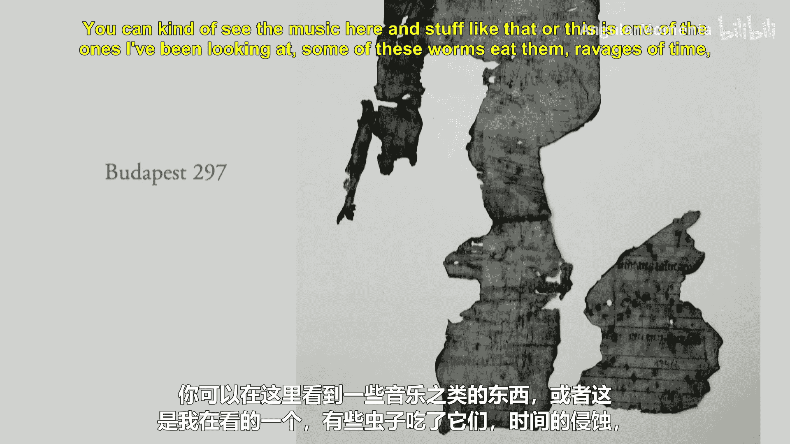

All the music that was there so that， you know， your cover looked a little nicer。

 And then once you' scraped everything off， it's all parchment andveellum and stuff。

 then you can reuse it for， in this case， church land holdingings in Florence。😊。

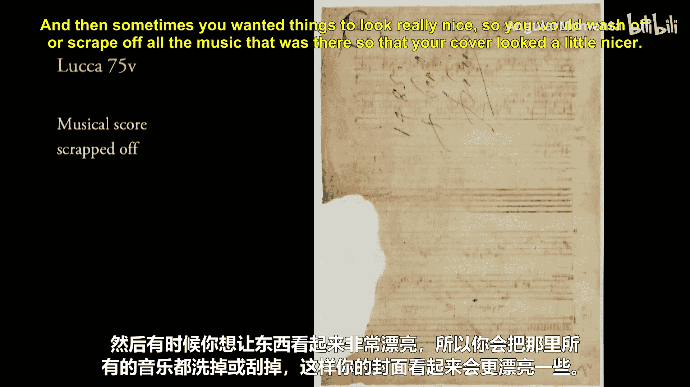

嗯。And then there's these little straps that you find sometimes that you weren't even sure our music。

 But， oh， those kinda look like quarter note stamps。

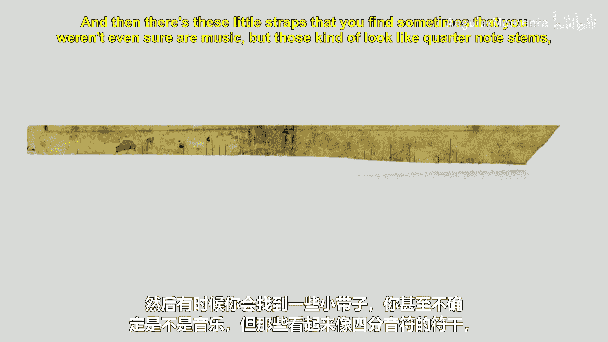

Coord sense and stuff like that。 So， and this is what was left for me。

 So I became sort of a music fragment scholar。 And my things are all on fragments of polyphonic music in the 14th century。

So I wanted to look at these things。 And you know how to move forward。 one of the things back then。

 with no computers， I just spend a lot of time。 So one of the things they were really good about then is that they like who was told that in a music class。

 when you write a quarter note。😊，That's a very bad one。 When you write a quarter note。

 it stem should be exactly an octave long。 And so therefore it's kind of exactly like this。

 I don't know if people are still taught that。 Well， they were very good at that。

 So you can kind of figure out based on the heights of the stems what notes must have been cut off there and where they are and you just stare for hours and hours and hours of other books until eventually you find one where every one of the stems lines up。

 I had to squish this by about 10% to get it。 but things like that。 or for something like this。

 you just there's three parts， wrote the parts separately back then kind of like know iterating through the recured method and not the flattened method。

 And so part 1， part 2， part 3。 And so you try to try every combination of clef and time signature and key signature until you finally find where things line up then use your knowledge of music theory from the 14th century to fill in the missing part。

And eventually， your friends record the piece for you。🎼，🎼里头。When when the notes get big。

 it's what we actually know。So anyhow， those some of the things。

 and then first place where computers really started coming in was about when we started getting nice color photographs before everything was black and white photocopies and stuff。

 And I with some other people and some other people independent for me all came up about the same time with a technique that that if you measured the colors of the overwriting and the colors of the underwritingwriting。

 the ink would probably be different。 So you could remove one and bring the other up。

 And so we had these various computer techniques for getting rid of the overwriting and getting to the music underneath。

But。Everything after this。Was still going be done by hand。

 So I started thinking about ways to use statistics and computers to do various things。

 So about this time， started creating music 21。 And if you ever wonder why there's some things they are obscure。

 Music 21s sole purpose was to try to identify music fragments like that。

 and everything else that this class sort of come about has just been sort of a side side project。

 so。While I was building that， I switched into sort of a statistical mode。

 So we'll get back to music 21 in a bit。 But first。

 want to think about some of the things that were coming up with all these fragments。

 And I was trying to figure out what they were。 And that meant I would need to find another piece that was like that。

 But the odds that another piece would exist that matched up with the music I was told were really。

 really low。 In fact， a very famous article by somebody who was very famous and my field。

 Nino Peropta， the oral and written traditions of music said that the surviving music from the Middle Ages is the tip of the iceberg。

 And that metaphor ended up being quoted and reused in a whole bunch of other articles that you don't need to see here。

 But So this became sort of what everybody knew。 So if you're thinking about music from you know。

600 years ago。 And you think about all the things you've lost。😊。

In your 20 years of life or however long。What percentage of things would have survived from 600 years ago。

would be lost， would be lost， about 90%，99%。99。9%， these are all numbers that I've found。

 People said。 And then somebody said basically everything。 So I。

 I have to convert everything to a number。 That's pretty close to basically everything for me。嗯。

I'm gonna skip over that。 We don't have all the time in the world。

 So I started to think about some statistical methodologies that could， that could help in this。

 And one of the things that we have in some cases is this is a table of contents for a book of music from the 14th century where the book doesn't exist。

 But the table of contents does。 So I started looking at， okay。

 here's all the pieces that do not exist。

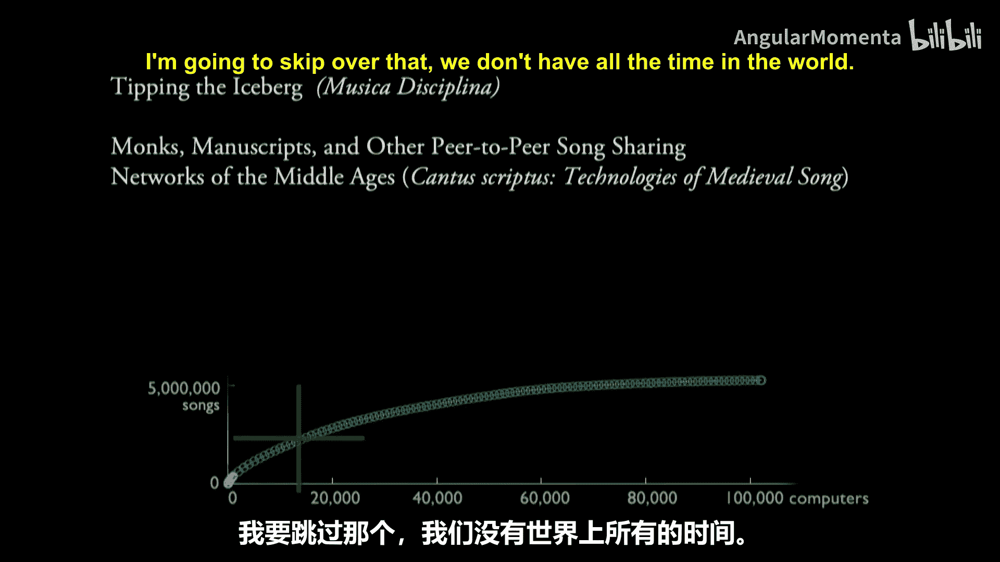

And then here's all the pieces that do exist。And started to look at the ratios。

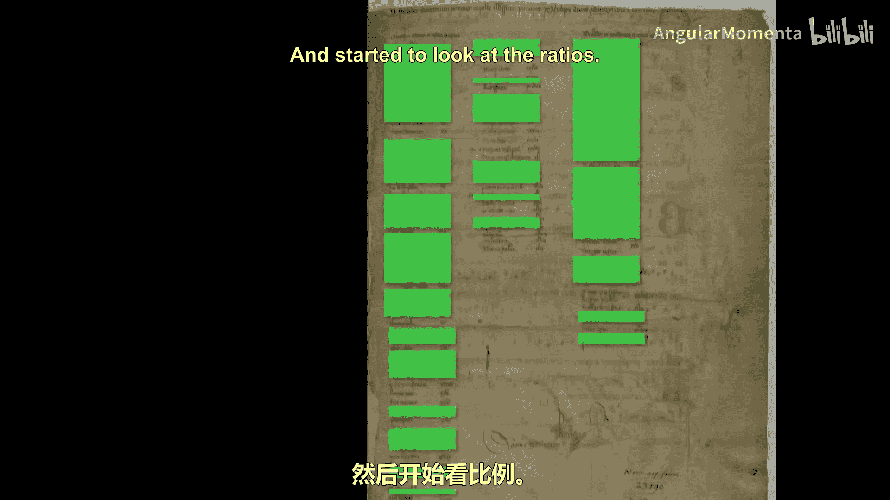

And in this particular manuscript， it looks like about 68% of them survive。 So that was。

 that was the first thing that maybe the 99。9999 number didn't exist。

 And then I looked at there's a poet bunch of poetry manuscript。

 So this is one from about the time of Dante or Chaucer by not very good poet named Prozai。

 But one of the things that makes him a bad poet that's really good is that when he gets into something when he's talking about a feast。

 he will list for the next 50 lines， everything they possibly ate。 And when it gets to a concert。

 he lists with the Viola called Vi Kz de May。 We played our mayday songs。 We just had Mayday。

 So these are the mayday songs like the rose that never changes its color。

 Jim sweet sweet taste and so on。 And these all look like names of songs。

 And so we can look at for each one of them do we have a song by that name or do we not。😊。

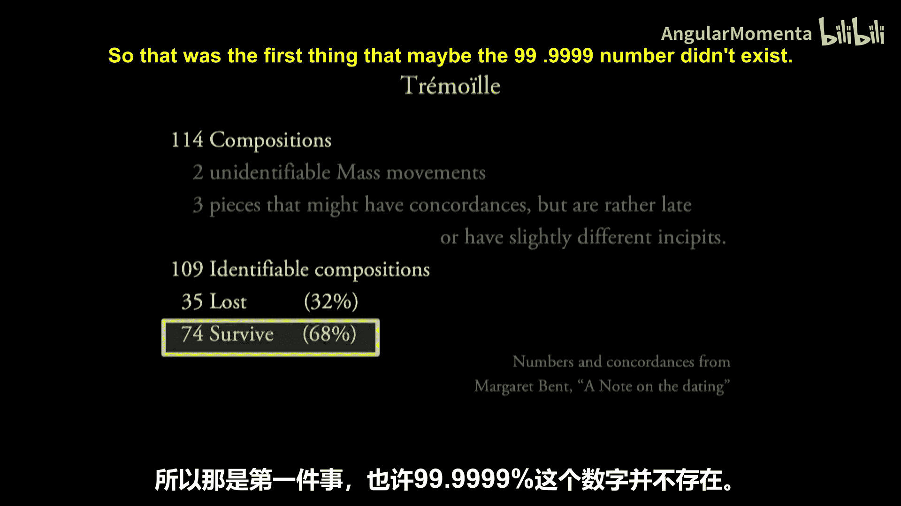

And so we have how many are known， how many are unknown， and we eventually。

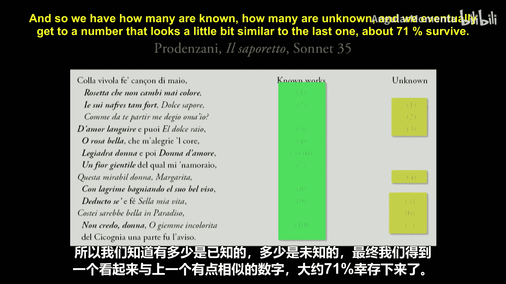

Get to a number that looks a little bit similar to the last one。 About 71% survive。

So I was kind of going through this the chronology is a little bit wrong。

 I I had to justify this later。 But first， I was thinking about how animal biologists。

 ecologists count animals。 Has anyone taken a a biology class or something where you do population estimates。

Yeah so one of the ways that you can do it is you you want to know how many deer are enforced， right。

 So you go and you capture as many deer as you can in a month and a half。

 you come back smelling pretty bad。 And so， but every time you find a deer。

 you tag its ear or some way， in some way that you can identify this is a deer that I saw。

 and you come back several months later or whatever。 And then you count deer again。

And the percentage of deer that that were tagged And the first time give you some sense of。

 or the inverse of it gives you some sense of how big the population is。

 If you tag 100 deer the first time and you come back later and you only find。

 and you capture 100 more deer and you only capture C  two of them are tagged， you know。

 there's a huge population of deer out there。Similarly。

 if you captured 100 deer and next time you captured 100 deer，98 of them are tagged。

 you probably saw most of them。 So started thinking about， well。

 if a piece appears in one manuscript， we'll tag that piece。

 and then we'll see how often it appears in another manuscript。

So I started coming up with formulas to do this type of thing。

 And I realized that that there's an equation that tells us the number of missing pieces。

 All you have to do is you take the number of pieces you originally had。

 and you multiply by the probability that any piece would be missing。 Tell me if I'm wrong。

 You're the M T students。 It equals the total number of missing pieces。 And it's a super great。

 super simple formula， except that it's a formula with three unknowns。

 We don't know any of these three numbers。But。We can kind of figure out some of these things。

 So we can look at， well what's the probability that a given piece would be in a manuscript。

 Now we'll start with the assumption that every piece is sort of selected randomly。

 So we start with how many pieces are there in a manuscripts just like collect know like a box set of。

 of lots of tos。 How many pieces are there in that manuscript。 We'll call that R sub I。

 And you divide it by the total number of pieces that were originally copied。

 So we know how many pieces are in a manuscript because we can count that that survives。

 But we don't know that。 So we just move our unknown to another place。

So we can also figure out what's the probability a piece is not in a given manuscript。 What's the。

 what's the formula， Just see if you're awake。 If this is the fun formula， it's in the manuscript。

 What do we do。1， minus is good， good。 We're on same page。 They're great。

 So what's the probability that it's not in two manuscripts。You just take the first probability。

 and you multiply the second one in the assumption that these are independent。

 And so try to keep ones from different places， whatever。 So then。

What's the probability that any given piece is not in any of the were at that point。

85 surviving manuscripts。Well。You just have something like this。

And that gives us takes there are two unknowns。 It gives us the probability that a piece is missing。

So we can go back。To our original equation。And。Plug that in。And all of these have n as a denominator。

 So now we've at least reduced our giant。 We've reduced our， of our master。

 our main equation into two unknowns。 So we're getting a little bit better。😊，Then， he thought。

How many pieces were missing？Well， the number of pieces that were missing is the number of pieces that originally were minus the number of pieces that survive。

So。We can count the number of pieces that survive。 It takes a long time， actually。

 to figure out every single thing because people count differently， but we can kind of。

Reduce this entire equation to one equation， one unknown。And at this point， I was thinking。

 Ive must have screwed up something really， really bad。 I have a music degree。

 I don't have a stats degree。 This seems like a pretty fundamental equation to have。

 And it turns out people had been talking about equations like this a lot in the 60s or so。

 But back then， it was all about。What's the way that you solve an equation like this with 85 you know。

 it's it's a 85th power equation or something like that。 You know。

 And so all of it was on the high math that I don't understand that can get you something to this。

 this answer。 But this is my first computational thing。 It's in a language called pearl。

 where if you know it， you're lying about your age。 It was the big。

 it was the language that built the Internet in the 90s things。

 And the one of the things you can do is you can look at。😊。

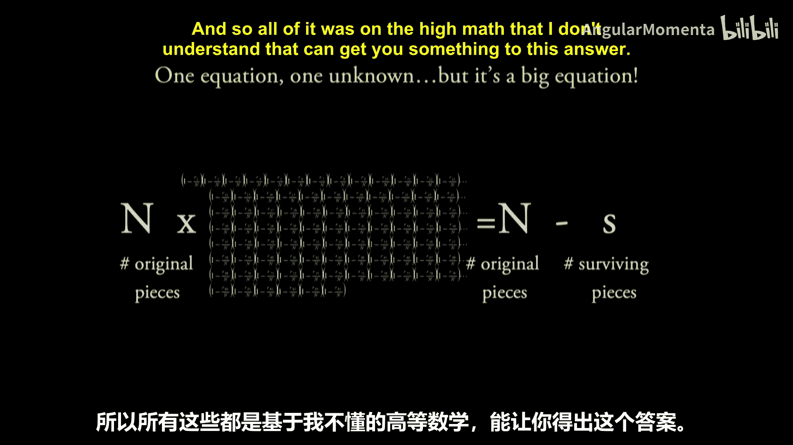

Guess various numbers and look at the error between the left side of the equation and the right side of the equation until you find the number that comes closest to balancing it。

 So you just kind of try everything and you multiply everything out。

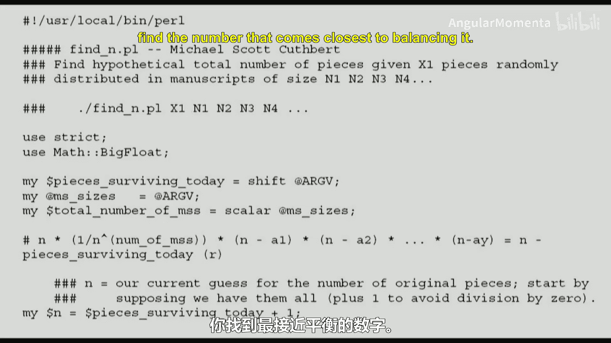

And since this isn't really a class about that， but it turned into。

Saying that the percentage of missing pieces varied by genre by type of piece。

 it was the interesting part is that the the mass， the music written for sacred services survives has more missing than the ones for every sort of dancing and lovemaking and all that stuff。

 And I think that's because over time， nobody could read this music。

 So the only reason somebody would keep it around is for the text。 And you。

 if you're running a church， you already have lots of copies of the text of the mass， but。😊。

The song about， you know， we all went off into the woods each one is a pair。

 And we all came back as three。 you know， that， that's people still keep around。

 So those sort of body songs have the least missing。

So it turns out that our best estimates now are that about 25。Pcent of the pieces， maybe 50%。

 I don't know。 Maybe 60。 Maybe I'm off by a little bit， maybe you。

 by a logarithmic order of magnitude or something。 but we can actually really say something about medieval music。

Based on the fact that much of it survives。And I was very。

 very scared that somehow I had made a math error and stuff until there was just a math dissertation at Yale that verified all the work and stuffm。

😰，Finally， finally not worried。 I'm gonna have to do a retraction of one of my biggest papers。

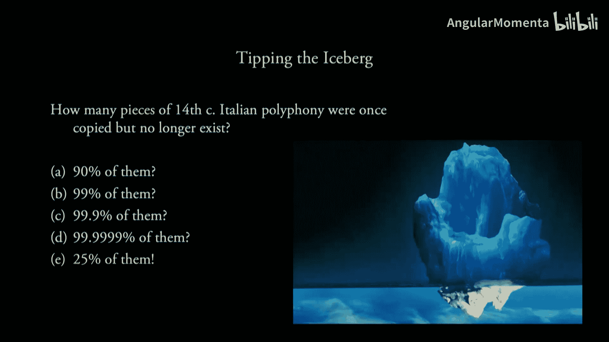

Okay， so now we're gonna get back to these little scores。

 And once I had sort of convinced myself that a good chunk of the time， three/ quarters of the time。

 I was like， we're going to be able to figure out what music is on here because it's going to be in some other piece we already have。

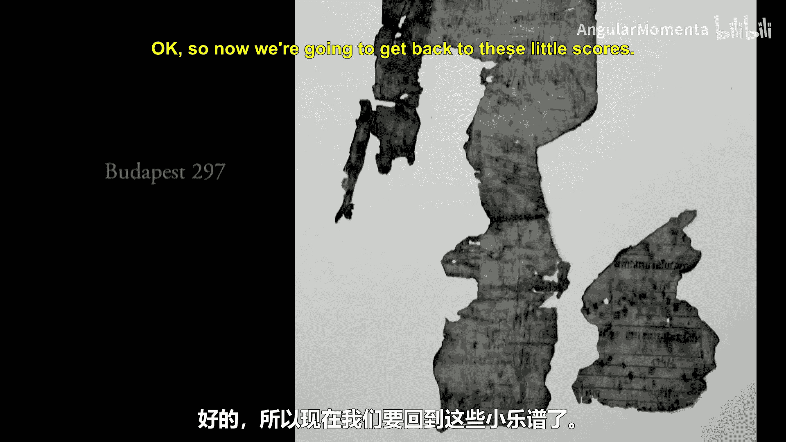

So there's this collection that I mostly use。 It's called Pophonic music。 The 14th century。

 We have it over in the Lewis music Library。 It's beautiful。 It's expensive。

 And things comes in these gorgeous green volumes。 And there's a lot of them。

 All the music from the 14th century。 it's about。😊，20， it's 25 volumes in this series。

 And then there's been some others since there。 So this gives you a sense of what it is and。Now。

 MI I T was able。 I'm gonna skip some of these。 M I T was able to help me get some of this into。

 into a computer。 So we'll get onto that in a little bit。

 But what what if you want to do if you want to find if any of these pieces has a match in another thing。

 Because somebody's written down a lot of these little fragments or they've put all the pieces in。

 And I wanted to see not just where any of these little fragments there。 But at this point。

 are any pieces quoting or copying from or plagiarizing from anybody else's music。

So what you have to do is you take all the songs and you compare each one of them and by end， right。

 Sorry， that's not enough。 We' gonna zoom out a little bit。And。There we go。 Yeah。

 So it's something like that。 That's actually just comparing each of the volumes。

 We actually want to compare each of these volumes has about 1 hundred and 50 pieces。

 So you have to do the square of the number of pieces divide by two， because it's symmetrical。

 And so you have about 3。1 million comparisons。 And that's the reason why nobody had done this before。

 I'm actually really lucky。 our best estimates， which I don't know。

 is that 14th century music is about 10%。😊，Of the size of 15th century music。

 And every successive century is about tenfold more music。

 So I have algorithms that I've devised that I think will also work for the 15th century。

 And maybe if I ever had a huge research budget， I could do the 16th。

 But it's going be up to y'all to figure out what's the algorithm that can compare every piece of known music to every other piece。

😊。

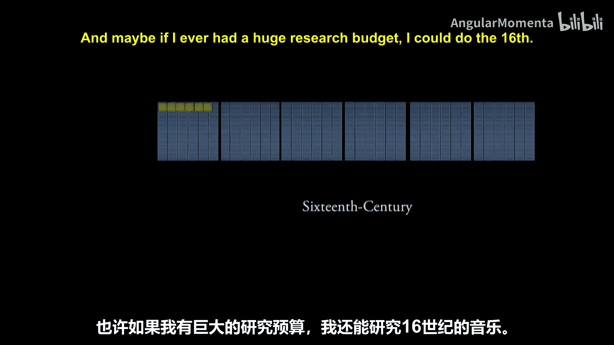

And get that。 And that's why I care a lot about similar。Similarity。So sorry， I got ahead of myself。

So with， with a great scholar Catherine Groau created the Eronic Medidieval Music score Arch project or Msap。

 which slides a little bit out of date。 But back then， it had about 1。

3 million notes or close to like 1。8 million。😊。

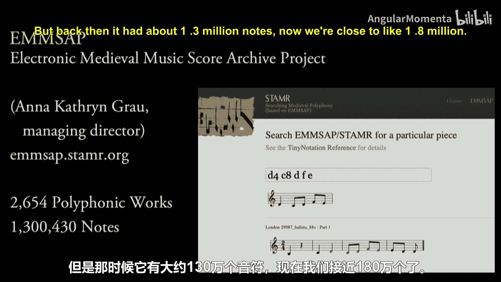

And of course， you know this one， right？So what you do is you take all the。

 take all the music and you take music 21， and then it does something like this。 And， you know。

 that's how， that's how it looks when you do run the matches。😊。

Now you all know that this is what you do to， to get funding for your project。

 And that's not actually how it works， right， only in CS S I。 No。

 the way it actually works is you go and you take your scans that you've done and how do you get them scanned。

 You spent all day putting them on a scanner and then。😊。

Inter every one of these pieces into mostly Mu course ofbelius finale， whatever is。

 And then we exported everything as music X， M L。 Some people like there's a specific output for music musicology called M E I。

 which is pretty similar。 But I use music X M L。 And so then we have here's the music X M L for the first three first four notes of this one piece called sorry。

 I'll just go back called Onkin Nehu， which is completely only one copy of it in the world。

Then wrote some programs， Python Music 21， things just to take every 31 note little segment。

 I't why I ended up with 31。And just automatically chop it up so that there's。These little segments。

 things。 And ideally， you would chop it up。 You would slide your window over one note at a time。

 But theres a trade off between getting the best similarity。

 And then and also not having your database explode with internal quotations。

 So we did this and had it go through everything here。

And then once we had chopped up the pieces into these little 31 note segments。

 then we did what keep was talking about a viewpoint or a hash or an encoding system to try to reduce the complexity of it。

 So the complexity， the system that I used， you're gonna kind of laugh at if a note was the same duration as the previous。

 It got the ASCI letter， AB，C， D， E， FG。😊，I dropped sharps and flats because different copies of the same piece in the Middle Ages sometimes write it as B flat。

 Sometimes they don't write a flat。 You're just supposed to hear that， well， obviously。

 there was a augmented fourth。 I'm gonna sing that flat。 So they don't always put that in。

 So we get rid of accidentals。 And then if the notes longer than the previous note。

Then we use H through N。 And if it's shorter， then it's O through U。

 So P is a B that is shorter than the previous note。

 Let me just go through and put everything in like that。

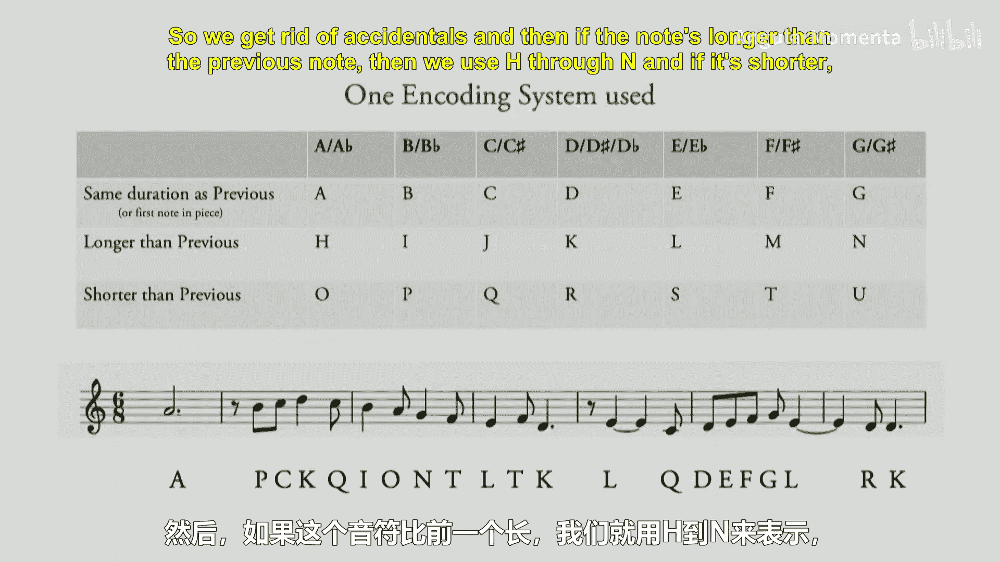

The first I always just assume it's the same。So we take all of these things and put it into a giant database。

 It's not that big。 It's about 1 hundred88000 of these little segments at that time。

And so this is the segment for the opening of Onka Nephew。It's kind of。

 I always think it's kind of unceremoniously stored there like the arc at the end of the Indiana Jones film。

 you've ever seen it。 just can't really tell where it is。

So then we have to compare every one of these  hundred88000 sequences against every other one。

 So we take the first one。The oncan ne few melody and just some random other one。

And we can figure out what are all the things we have to do in Earth mover。

11 time or some other distancing in order to transform the first one to the second one。

 So you have to。Well， you insert a whole bunch of things。 and then some the same delete， whatever。

 And the end， you get a ratio from 0 to 1 of how similar they are。

 I always like to store float store integers in databases。 It saves a lot of space。

 So I just multiplyied by 10000。 So I get a number between 0 and 10000 to store These ones are 17% similar。

 These are actually a surprisingly bad amount of similarity。 Rdom pieces tend to be more similar。

But so this is not a match， right， nobody's going to say that those two lines are the same piece。

 slightly different。But that's okay because we do it 188000 by 188000 times or 35 billion divide by 2 since a symmetrical 16 billion。

18 billion， right， Yeah， but then I went through and stored every single time。

 There was something that was more than 50% similar。

So there's two Is and the ratio of how similar they are。

 And over 50% similar ended up with 814000 things。 I'm never gonna look at those。

 There's just way too many。 So I started going to at around 65% similar。

 I started to suspect these tended to be pieces by the same composer or quite often。

 if we knew or I suspected they would be or something like that。 at 70% similar。 You're like， wow。

 these aren't the same piece。 but they， they're a lot like it。 But definitely over 80% similar。

 They're always the same piece。 And how can something be the same piece and be 20% off。

 It could just be that they were sliced at different points。 So they're the exact same thing。

 But the first third of one segment is in some other one。

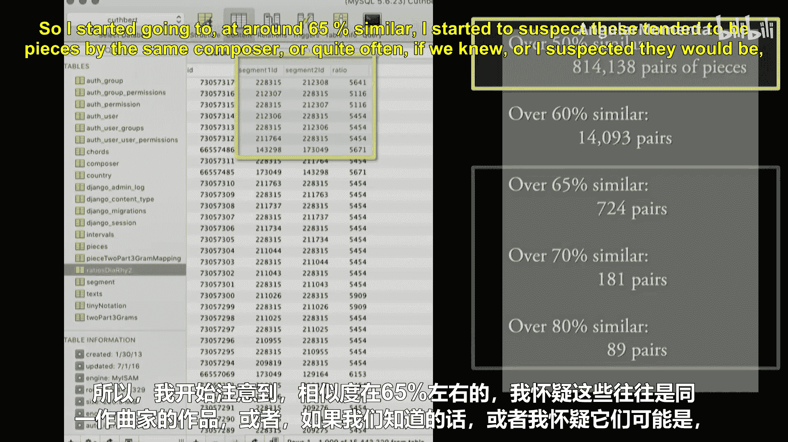

Okay， so this is what the actual workflow looks like。

 I used to use eclipse and just running through all these pieces。 And occasionally， it finds a match。

 And it puts it up。 And I get to see， okay， does that look like that or yeah。

 that one kind of looks like that one。😊，🎼And sometimes we already knew them。

 The computer does not read what pieces we already knew were quoted。

 But we ended up with some interesting things。 This is a piece by a guy named Johannes Taconia。

 This is unpublished yet。 don't put it all over everywhere。 a guy named the name of Johannes Jaconia。

 one of the most important composes around 1400。 And one of his pieces。

 It's part of the mass Paramonnipot Ttem。 And it turns out that a big chunk of it was taken from an unknown sort of an anonymous never recorded by anybody German song。

Here we are， if you've never been。彼是。So we can find that there was a lot more copying than we ever expected。

 This is one of my favorites。 Here's a French piece an Italian piece。

 Nobody ever suspected they had anything in common because whoever。

 and I don't know which direction the copying happen。

 Whoever did the copying did a good chance of covering their tracks。

 the colored parts represent the same music。 Okay， and then。😊，Down here。

 stole something from up there。 and then up here， we stole something from over there and so on。

 So it's just two that are pastices of each other。And then if this were a musicology class。

 people would actually care about which one this。

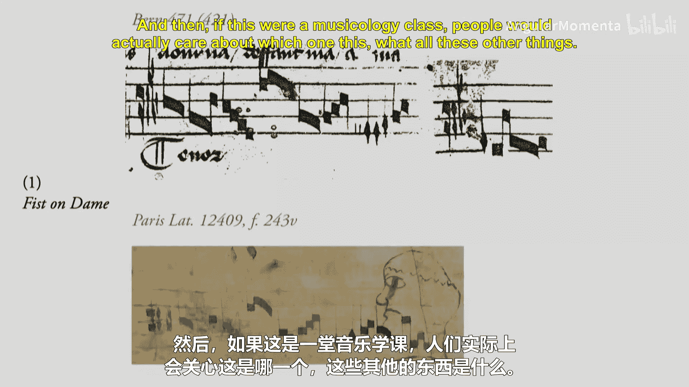

What all these other things。 But eventually， we got to start reading these erased pieces and figuring out where they came from。

So。That's the big reason why I created Music 21 and why you will find that there are lots of weird little things that are only useful for music。

 for medieval music hidden around deep inside the various libraries and stuff。

So that's what I do when I'm not enjoying being in your company。 Any questions。

Or anything you want to see again。There are， by the way。

 lots of places do want historians who can do this type of work。

 So if you're all interested humanities in general， but you're like， but， you know。

 I also want to program and stuff。 People are， are dying for things like that， yeah。

So like what made you want to expand your？放心。You all your predecessors， people for about 10。

15 years before you from here at MI T。 It just felt like， you know。

 people wanted to do interesting things with composition with analysis。

 everybody wanted to solve their firsty theory homework by computer。

 and why not if you can program the computer to do it。 And it's not， complete black box AI。

 you're probably teaching yourself how to do it better。 Also， So it was it was things like that。

 And over time， I've taken out a lot of the most egregious that only a person working on 14th century Italy would would want to do this and put this in a separate project。

 So theres no longer an automatic change medieval notation into modern notation tool。

 You have to install that separately。 But yeah， I just just felt like I was having too much fun。

 And other people wanted to share in it。 that meant eventually。

ox would have to happen and then a very generous funding organization called the Seaver Institute selected Music 21 to be one of MIT's representative project for their funding organization for three years and that allowed me to do a little bit more than one person can do at their desk and now the thing that helps me do more than one person can do at the desk is community of a lot of people who keep adding to it and doing cool things with lots of things。

Other cues。Why is it called music  course 21 I wanted something that that would connected itself to MI I T in some way。

 but wasn't M I T music because your trademark office would probably get against me。 And also。

 I was a second year professor without tenure。 So I might have been denied tenure and needed to be able to take it with me if I went someplace else。

 But yeah， so then somebody later was like， oh， it's the thing for the 21st century。

 I said I I actually never thought of that connotation。

 If I had there's no way I would have called it 21 because that sounds very a arrogant and be a little obsolete in 2006 but you're already the 21st century。

 It's perfect for 1980 or something。What was it called before meeting。

It was called P music first for pearl music when I was writing it in pearl。

 and then the fact then as soon as the intro to C S class switched from your older language scheme to Python。

 I was like， well if all MIT is gonna move to a new language at the same time， then you know。

 it'll be easier for me to learn a new language than to have the rest of my life teach my students how to program in pearl I'm very glad I did。

😊，The other thing is the work on it。 I sort of began in 2004， but work really began around 2006。

 And at the time， I predicted that it would have a 20 year lifespan that it would be sort of。

5 or six years of of getting。People to notice it and start using it。

7 or 8 years of it being the main thing out there and 5 to 7 years of， you know。

 the decline while something else better came out。 And I'm still looking for that sign better。

 You guys can do that。 It's about there's， there' are things we've learned from using it that I think are。

 have have made realize that there's some pretty poor design decisions such as having to copy everything all the time and things like that。

 And so。I would， you know， I'd really love it if somebody else would。

 would create something new and better。 So whoever's here or watching it， have my blessing to try to。

😊，Try to knock this off its shelf。 And maybe the new thing will have a lot of machine learning built in or something to be able to do better analysis。

But Python's been enduring a lot longer than I thought it would be。 I mean。

 it's sort of been 15 years as， as a major language。 and it seems to be still growing。

 So that probably will stop。Ju is next。 Julia is next。

 That's people have been saying that about Julian R there is a Julia port of Music 21。

 If you like that。 I don't know how， how good it works。 So that's a perfect transition。 Oh。

 we can we we can keep going more to second topic。 So this one get out your laptops。

 We're gonna have because I couldn't have scripted a better transition to。😊，Okay。

 so now more grab bag。 And these are more requested from previous years than anything， sorry。

 can't stand all that dust。Oops， did pushing all this shut it down，Here we go。Okay。

So here are some of the things。 Go ahead and go to this website。 M21 Sand 2。

 If you leave off the two， you get to use a three year old version of this。

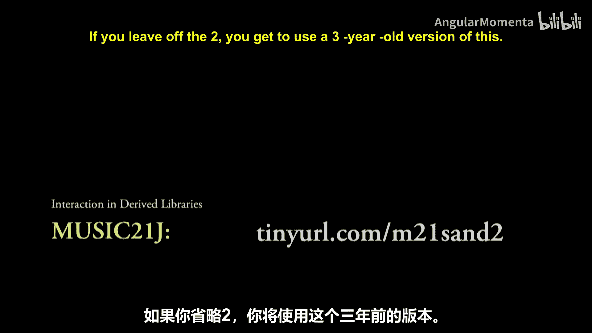

You should be seeing something that looks a bit like this when you get there。

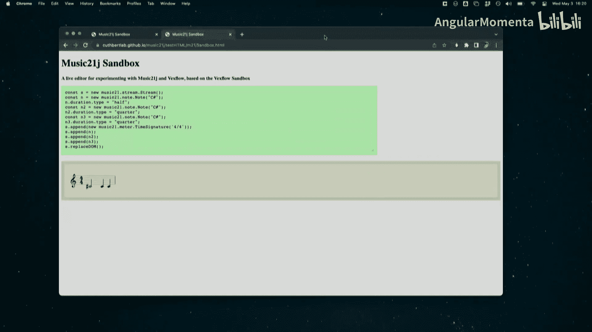

21 M，21 M2，1， Sams 2。M2，1， sand。To sandbox， the place where you play around。

So the thing I've always hated most about Music 21 is that you can't see anything。That's two things。

 You can't see anything。 You can't hear anything unless you， you know。

 we didn't even have Jupiter notebooks or something back then。 So we didn't have that。 And number3。

 it's so hard to install。 That's getting easier， but still。

 So I thought that something where people can start playing with it immediately online would work so I've been working on。

Sort of in parallel for the past or six years， there's a Typescript or JavaScriptscript port who who has done JavaScript here in some ways okay。

 a little bit more than half things。 So the big difference in if you're new to JavaScript is that you're going to put new in front of any time you want to instantiate something。

 and I've imported music 21 without importing all of the things。

 So you're going to have to type that quite a bit。But what's kind of nice is you can go through。

Change a note and immediately see the stream there or octave。

 things like that or put everything down。What happens if we put everything down here。

 doesnn't it automatically give me the good cluff。 Now， it's， did I put in， Okay， well。

 we can put in a proper cluff。 so we'llend to the stream a new music 21 dot cleft do。base clef。

And now we can see our notes again。 And by default， if you click the thing。By default。🎼。🎼There we go。

 Okay， well， I've lost all my changes， but you can kind of see。

 And so some of the things you can do would create interactive little systems where you're scrolling things up and down。

 where you're hearing everything。 But it's still absolutely a work in progress。 So if you do analyze。

K。You get analyzed。 it's not a function。 So there's still a lot of things missing there。

 but there's something really nice to being able to manipulate with scores in a browser stuff。

 the alternatives that people are doing right now tend to be about actually using HTMLML elements to represent notes now that you have custom elements。

 And that lets you use your browsers built in get elements by class and all these things to move around a score and in theory。

 it should be substantially faster。Than this， or at least more powerful。if anybody wants to。

 you can play around with， with any of this for a little bit， can。Make this。Dotted quarter。

What I hate is duration dot dots equals one， and nothing's gonna happen until I get rid of this analyze。

 Think here。 yep， play the round。 give it a 7，8。7 eight time signature。 and then。Here， let's。

 let's do this。 Let's create。P equals dream dot。Part oops。

I'm totally in like just being in this class with you all， I can't not be in Python mode。

 so I'm just going to keep typing Python and then correcting it to JavaScript until it runs。

 but we can do something like4 let I equals zero。I is less than4， I plus plus， and then。Oh。

 this pains me as a Python。As a Python person to not have indented code， but。Actually。

 do we have to call that a measure。Music 21 J is a lot more strict about such things。To dive。😔，H。

What I do wrong？It's so hard to tell without indentations， but there's。

This editor doesn't allow me to hit tabab to indent things。Sure always make your life easier。

Get rid of。ThatSo you can see everything on one page。Anybody know what I'm mistyping here。

 I have a fully baked version over here somewhere。OnAnother tab。Here。

 we'll go over to the fully baked one that already works。So you can kind of。Play around with it。

 just saying。First note each of each measure will be a random number and as we go through。

We'll just change them。 and if I make any changes here。

 it will automatically give me a new random number。I thoughtt I had it。Of this。

They have to copy and paste。What I think happens is。🎼There we go。You can do overlapping things。🎼うん。🎼。

🎼Anyhow， so it to be kind of fun for a live coding environment if you don't care about the quality of the music coming if you don't color about the quality of the sound because it's not really optimized for sound quality。

 but you could put it out through other things。

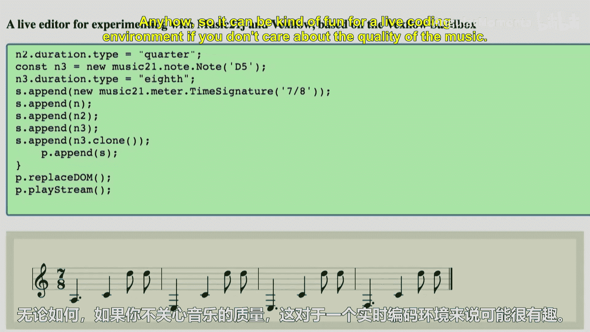

Let's grab back topic number one， how to do interactive， How to you do interactive programming stuff。

 You can do everything。 Sorry， John， you just came back in。

 and I'm gonna just say look you're the only one。 has anyone else taken interactive music systems。

 you are okay， So yeah， yeah， so you can put everything into you guys basically use Kivi right as as your toolkit。

 So there are things you can do on the on the Python side that connect up music 21 to things to get better sounding interactive things。

😊，I often find sometimes just the easiest little thing can be all you need。Okay。

 it close these things because otherwise， it will eventually just start playing again。

And we have just enough time， I think， for one more topic。

 and then I might finally keep my promise and let you all go a little bit earlier。Okay。

 so the last thing I want to talk about a little bit is music visualization。

 And we're listen to a piece of music by a contemporary Estonian composer Arvo Pert。

 And I'm gonna ask you afterwards。 to say something about the structure or the form of this piece and how it works musically。

 First， it's a piece for choir。 And so it has a text。 It's actually high， high medieval today。

 It's based onian chant of its sung in German translation。

manuelaunt and the German text is gonna be slightly important for that。

 So it's about a two minute piece and long time of the year for doing it， but。😊。

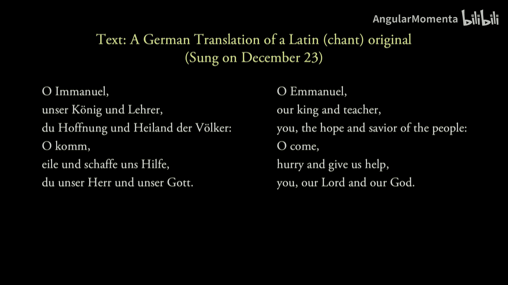

Get that。Here we go。

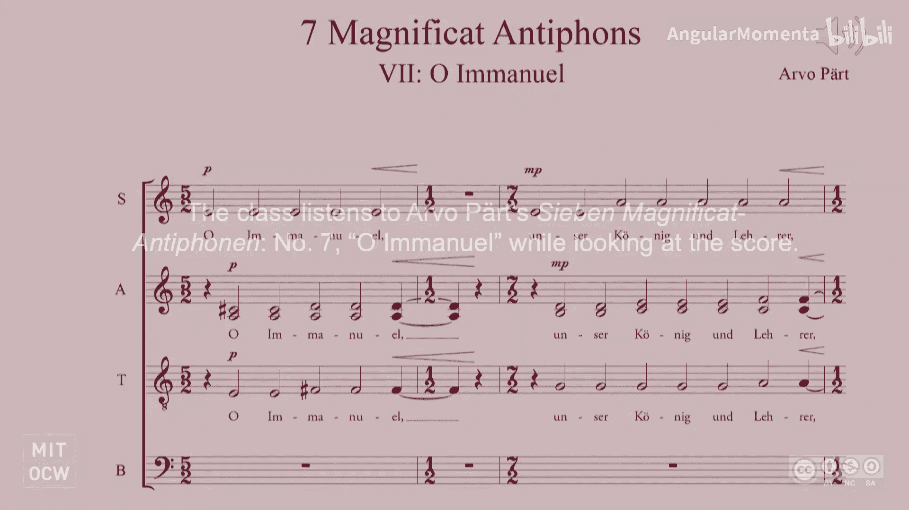

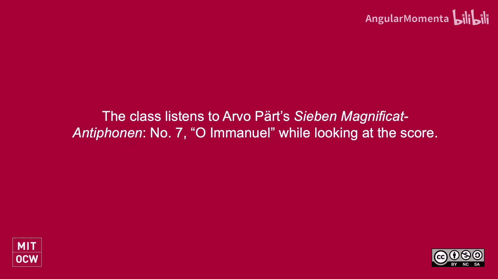

1988， I think。Was was one of my favorites。Anybody catch anything about the structure。

 You have seen the entire score every single note so we can get something。

Ieasures always switch between one and region two。Measures always switch between 1，2 and 3，2，1，2。

 and 3，2。How many sections did the piece have？So three second。Nice， that's actually correct。

 How many people knew that and how many people were like me when they heard this like once。

 twice three times and didn't fully catch the structure obviously， yeah so。Fantastic， fantastic。

 usually。 so yeah，s some things and。😊，What voices most what two voices were most melodically active。

Yeah， middle two， I think。Good ear。Good ear。 This， this， y'all are。

 are really getting you we should have been doing more music analysis in class because you're getting a lot of things I thought were gonna be extremely hard。

 And some， at least throughout the room， we've had correct answers。

 But I wantna spend a little bit of time on music visual， by the way。

 there are a few at almost exactly， there's one measure of 5，2。😊。

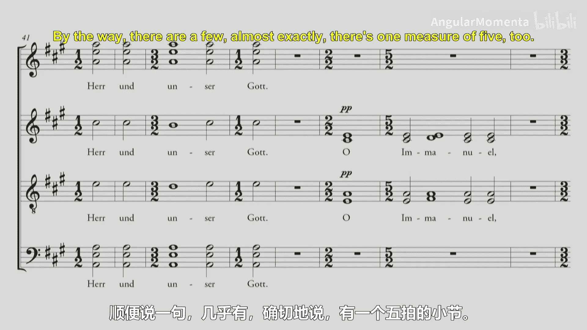

But yeah， there's a couple other things。 But yep， so。Are we up there。 Yeah， go ahead and download。

 There is the M X， the X M L file， Music XM L file of this piece on canvas。 And take a minute。 It's。

 it's under copyright， but I'm gonna assert a claim of fair use for us to be able to analyze with it。

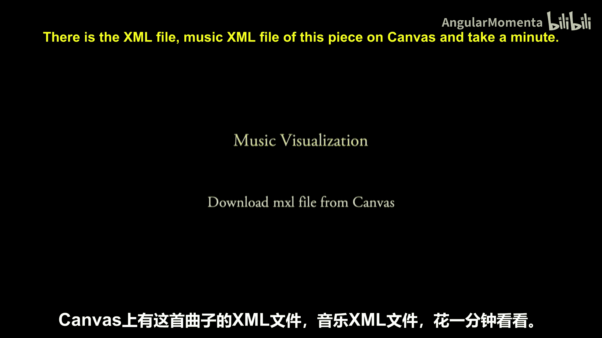

So should show you just the first page if you're in Jupiter。And。More than that， if you're not。

So this some of these things might be helpful for。What we're doing， so a little bit more。

We're going to be going through the various。Ways of visualizing。

I don't think we've maybe I've done a tiny bit of visualization。

 but mostly just on slides I don't think I've shown。We're feeling in a good place to move on now。

 okay。So， you know， we can do all the things that。That we normally would do。

 We can get the key of the piece， which I believe changes。Quite a bit。

 I think if we do measures1 through 20 analyze key， we get something very different。 No， we don't。

It's okay， interesting。Just the key signature changes。

But now we'll get into some visualization things。 So the easiest thing that you can do with this stream is to do something called plot。

 and plot just gives you。Any whatever you sort of a standard ready made。Whoops。

That's why I never do this here。 sort of ready made。Image， sorry， it doesn't zoom the image in。

 but you on here， but you might be able to see something like that。

 And so you can see a relationship of the。Various parts colored in different colors and which ones are singing what。

So here the three part， the threefold relationships sorry I'm going to have to zoom this out tiny bit so we can see this again。

The three part three section relationship to the piece becomes very clear。 right。

 You can see that something happens at the beginning。This increase up here。Up until a certain point。

 and then a lot of things change。So what measure？Does the third section begin on？Yeah。

 somewhere around there so you can 45， I think some the 46 44， 45。

 so you can kind of see something substantial changes and here's what Jason pointed out right that the inner voices in the second and third section。

Are the ones that are。Very， very active。So where does the second section begin？Measure 13。To measure。

45。 So let's， let's get this。 sec 2 equals Arvo dot measures， let's say，14 to 45，44， we'll say。

Sec 2 dot plot。Think， think the default is piano world because that's what most people want。

 So we can look at section 2。And we'll say sex3 measures what 45 to 76。Section 3 equals Arvo dot。

Measures。45 to 76。we can plot that。And there's a lot of similarities here。Between section 2。

And Section 3。末つ。What's the biggest difference musically that you can tell from these charts between section 2。

In section 3， you'll probably want to go all the way back up to your bigger role。Over here。

 this sites been mostly quiet。Over the section2 top。Section 2 and section 3 are almost identical。

 but section 2 is up， good。CanWe figure out about how much up it is。Look at the key on the side。

 Yeah， the E to the A and the E to an A。 So it's about about a fifth off in a lot of things except for。

On the extremes。 But what about the。Notes in between。These moving parts。Were they。off。

What's the relationship there？那通个。Yeah， about， exactly octave up， so we have things moving now。

I'll open up the score one more time， I know why I wanted the score open so I could keep going back to this。

Here we go。So I'll put this in front for a second。So now I I've lost my my train train thought。

How easy is it to see which parts are static and which parts are in motion in this？

Quite a bit harder。 So what kind of motion is happening。

 we've identified that's the inner voices that are in motion。What's the pattern？

Now go back to your visualization and see if you can。Figur it out。In any of the inner voices。

Maybe it's easier if you just look at one of the sections so you can zoom in a little bit more。T调呢。

えって。かし。They， they move in parallel first。 Yeah， and its good。 And within any given voice， what's the。

What's it doing？This is playing， Mary had a little lamb up， up up up。

 I it jumping around a huge octave。And then coming back down， Adam，s same。

 They're just playing the same note。 not all of them are playing the same note。

 These ones are playing the same note， right， But what what's， what are the other voices doing these。

In her voices。Does it go all the way up and then all the way。 Yeah， maybe send repeat。

Theyre repeating what， what do they do， What， what's the pattern， Yeah， step wise， step wise， good。

 It's all step wise， which is a hard part about the piano role。 right。

 You would want a diatonic piano role at some point。 I think we have that somewhere and。

It's all step wise， and。It's even more than that。 Yeah。

 gosh Sp it Ne tones around a certain pitch top around the。

They're all neighbor tunes around a certain pitch。 Yeah， so you can kind of top 1 I can't reach。

 So we'll do。 the middle 1 is， I guess around E。 And is it。Is there a pattern that you。

 do three ups and then a down and then。What is it。Up then down， up， then down， up and down。

 So you could almost have a formula with this。 In fact， the。

One of the other Python based music packages， which is more about creating algorithmically geneable music。

 is called Arrvo。Based on Arvo Pert's ability to do this。 So you can。

 you can download install Arrvo and it makes it much easier than Music 21 does to generate。

 here's a motif。 Now， spin it out over a certain amount of time while doing something else。 So yeah。

 so we have this thing going up and down and up and down and things like that。By the way。

 some of the other interesting things about the piece that we're not going to visualize music 21 are when does it change notes on any。

Multi syllable accented German word， which I think。Sort of interesting here。

 So the accent always gets the gets the whole note。

 and it's always the opposite of whatever it was before。And then you can kind of see， well。

 in section 2， all of the voices kind of play at once and they all rest at once。But in section 3。

 the top and the bottom ones only come in in certain times。

 And the visualization of this helped me in figuring out， well， when are those times。

 And it turns out， also very strictly generated。That it is just。Every other word。Do hope。They do。

 that's two words， woundund hiinland， we don't sing。Next。Two words， dear Volker， we sing， oh， come。

 we don't。 And there's one exception to it。No， sorry。 There isn't an exception on this one。

 There's some someplace else is an exception on things。

 but I think probably set up so that just the number of words makes it so that God stands alone at the end without accompanying it。

 So interesting piece。 Now， let's do a tiny bit more analysis on it。

There's a plot that I could call this a cook plot cook。

 because I saw this in now in the reading for Nicholas Cook article on Compal and Comp music。

Computational and comparative musicology。 But I first saw this in a book by somebody named Emily Dolan。

 So I call it a dolan graph， even though and it shows you who is singing where at what point which parts are performing and。

Do you remember this from the cook a slightly different graph that he had。

 a slightly different shape size， but same type of thing？What's being depicted here？Take a guess。

 What's that dynamics。 Yeah， So it's a sort of who's playing when and what are the dynamics。

 And if you zoom in really closely， you can see that Soprano is always singing a tiny bit before the other parts。

 But yeah， so the piece just sort of builds up to about two thirds point。😊。

Then drops off and just very quiet everything after that。嗯。So there's quite often。

 I think for people who can read music notation， graphs and plotting。

 visualization isn't too much of a help。 But for getting a sense of the form of a large piece very quickly。

 these these tools can be very， very helpful we can kind of see what。

 what notes does he use the most， Well， obviously those that are going to be。That。

 that the sustained notes are going to come quite a bit， but we can see。

That of the various pitch classes， basically。There's a reason why it was。Coming out as a major。

As our analysis。Is A definitely winning E。See sharp。But almost， I guess every。

 surprisingly for a piece that sounds so consonant in many ways。

 every pitch class is represented at least once there。啊。

You see which I have a whole bunch of ones are maybe a little bit less interesting but。

We can look at the。Certain pitches。Use different quarter different notes more so we can plot a scatter plot。

 And then what we haven't seen yet is the second and third element here is。Quarter length。

Versus pitch。I think there's other things you can do。 You can plot around with octave and stuff。

 So these are plot gives you a ready made， Take a score and get some kind of analysis。

 There's two slightly lower level things if you want to if you're thinking of doing visualization in there one the graph。

 which is underlying the plot， which is the what you're trying to do and what data you want to extract。

 So its sort of a feature extraction again。 And what do you want to put on each axis。

 So there's axes that are defined that you can， I don't know。 We can do let's plot。

Pitch against dynamic。You know what， yeah， dynamics。That work。You know what。

 who puts pitch on the X axis， willll put pitch on the Y axis versus dynamics。 Sw that around。

That's why I's having so trouble。So you can see that the。Oops。

That the lowest notes in the pieces only appear on the quietest things and kind of also look at thisterraced。

Initial motion of the piece as the notes were going up and and both going up in pitch and getting higher in volume。

 and then the very highest volumes are scattered all all throughout。

 but everything down here shifted up a little bit just as we saw。

IThink the best thing to do would be now that we've thought about the piece。

 thought about its structure， listen to it one more time。

Maybe with we'll listen to it with the piano role。And see if。See if we can。It was not that one。

 the big one。And see if we can hear the various parts of the piece just as well as we could on。

With the score。Words are harder to tell， there's no plot for that。

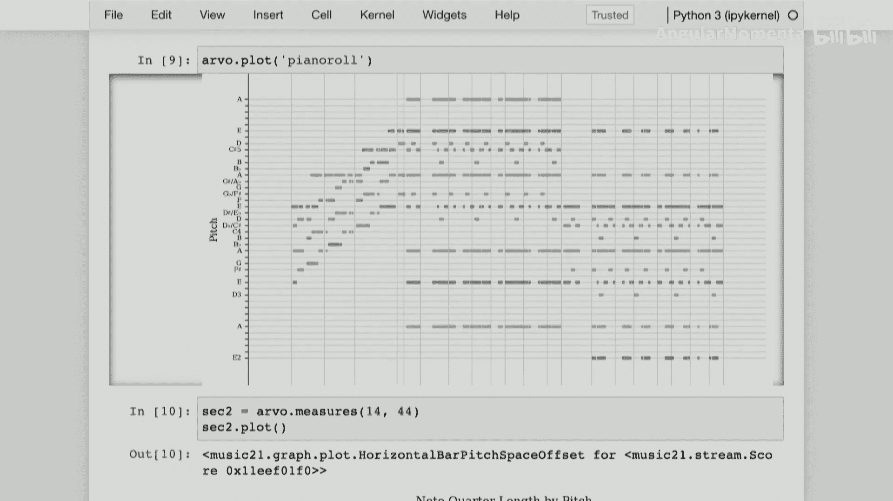

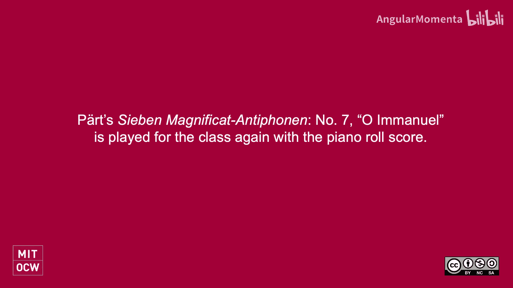

Your mostly colorblind professor just realized that I used a version of the plot that does colors not based on the part。

 but just as a way of being able to see which pitches are which。 So I'm apologized。

 I made a mistake and said， you can tell the lines by color。 but I have to strain to see color。

 So so sorry about that。 but I did just while listening to it， make one observation。

 this interesting line that the E is the very first thing that you hear。

 And it just after a little absence comes back。 And it's one of the few lines that's so prominent throughout there。

 So maybe maybe E is the true sort of。Root point to this piece。Well， thanks。

 everybody for going through Grab bag。 If you， I have more topics that are interest to me。

 but anything that's interest to you， let me know。

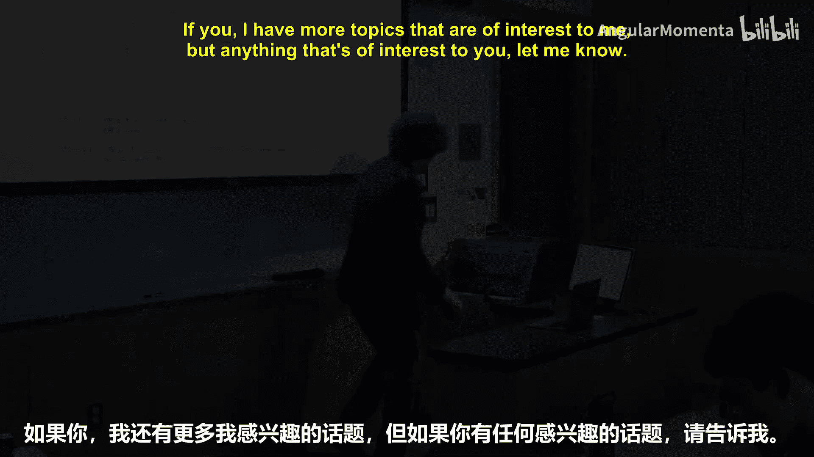

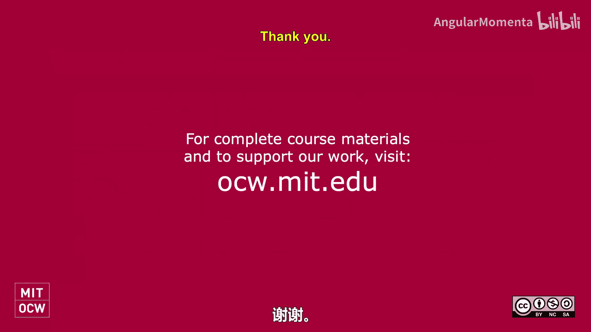