# 【麻省理工】计算音乐学与分析‌ ｜ MIT 21M.383 Computational Music Theory and Analysis,S 2023 p46 46 第31课 视频：音乐可视化与光学音乐识别 -BV17xUmBDEUC_p46-

I didn't get any new topics that people wanted throughout the day。

 So I'm gonna go through some topics that people have asked about earlier in this semester。

 and I think are kind of fun。 And there's sort of the most fun things that from my perspective。

 maybe I have a six sense of fun that that we didn't fully cover。

 So one of the first things I wanted to talk about is a cool little two part what do you call this a fable moral moral story that has a little conclusion in the end。

 And something called gap fill。 I'm pretty sure I've talked about this a couple times in different places。

 But I'm pretty sure I did not do this this semester。 Did I know， good， good。😊，Okay。

 because there have three points in the semester where this could have gone。

 One is anytime we first started talking about David Huron's work。

 And this is one of the very cool papers。 he's the second author， Paul Vaughon Hppple。

 a very very well established scholar and music perception and cognition did this study around fall published in fall 200。

 So it's about 25，25 years since they did this。 And it's one of these really cool things that got me into this field。

 So when I heard about this， It was like this is why I want to use computers to do things。

 So is anybody ever you all have some encounter with species counterpoint because you did you read the David Lun article on an interesting global rule for counterpoint。

 So it's dealing with sort of 16th century musical style and how we can recreate it。

 And one of the rules that I was taught when I learned。😊。

Spies counterpoint is that if you take a big leap and you go up， you've created a gap。

 And the most natural thing for your musical line to do is to go down after that， fill in the gap。

 gapap fill。 Some people spell it is one word， somebody hyphen some of the space that doesn't I don't really care。

 G fill。 Similarlyly， you leap down a lot。And you should go up。

And so I immediately looked at a piece by Giovanni Pesttrina。

 one of the most important composers in this period that species counterpoint is based on around 1550。

1570 or so。 this is part of one of these masses。 And here's a score。 And you see it。

 but I've also kind of colored things in that green notes are upward leaps that need a downward。

Thinkhing after it。 So things。 And then the blue notes， a downward leap that needs an upward motion。

 And all around here， it's all stepwise so we can go any direction that it wants。

 So gap fill exists then。Then and every time there's gap filled fulfilled every time it works。

 there's a little pink or peach dot。 And every time there's not， there's a big yellow dot。

 And you can see there are no yellow dots up there。 So this is what this sounds like。

Let do that one more time so you can hear it。

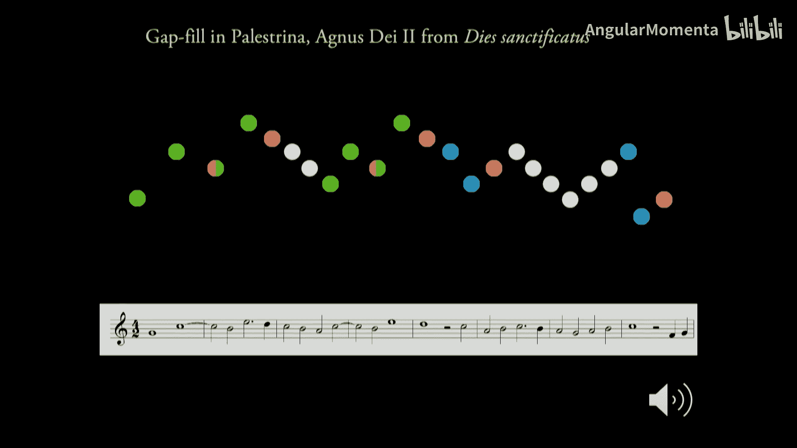

🎼。I just had to add the last note。 Otherwise， itd be kind of out there。

 So gapap fill seems to be a thing。 Composrs do this。But。The really cool thing that the Hpo。

 Von Hpppo and Huron did was that they realized that there's two things happening when you leap up a lot。

 One is you've， you've created a big leap， right， The other is that you're higher in your voice range。

😊，So。If， if I'm down here and I leap up and then I leap up， then I leap up Even。

 you guys gonna go to bet eventually I've got to come down， right， Yeah。

 you can't really go up forever。 And so what they were wondering is。

 does it have to do the fact that eventually when you get really high， the only place to go is down。

 especially if you're talking about vocal music or， well， I mean， even on a piano， eventually。

 you got to come down。 So they looked at。What the median。

 what the average pitch across a whole piece was and marked it as specific and then thought that。

 hey， there's， there's four kinds of leaps。 And can there's ones that。

Start at or above the median and go even higher。 That's why I was to read this。 And I went。 Yeah。

 up there。 Then there's ones that start below the median and go above it。

 There's ones that start below and reach the median。

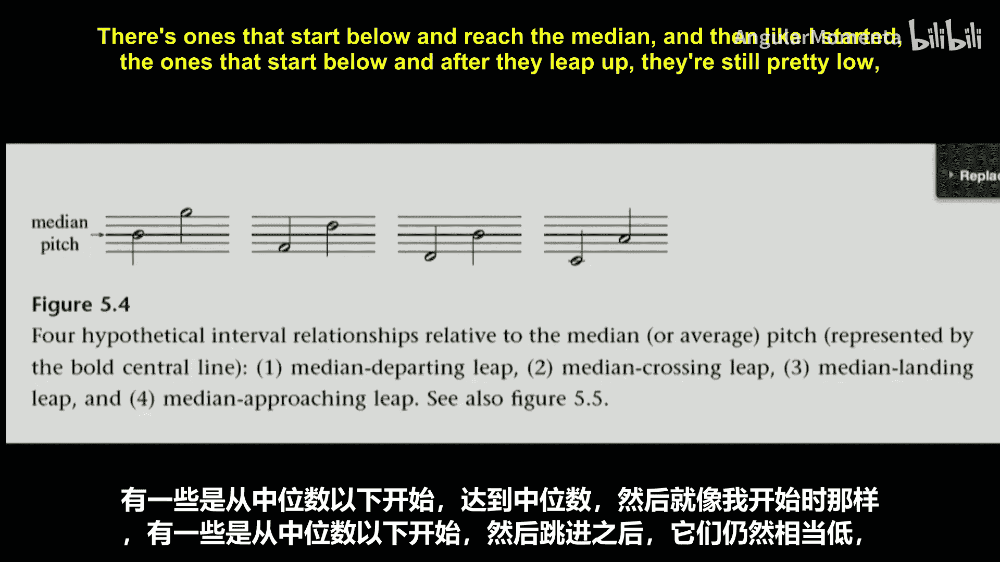

And then like， I started the ones that start below。 And after they leap up， they're still pretty low。

 So they're still below the median。And that。There might be something besides Gatfil that explains things。

 for instance。Let's say you bought two domestic continental US flight。First， you flow。

From San Francisco to New York City。Now you have another flight。Just take a guess。 You've gone from。

 of up and down。 We'll say west to east。 You've gone from west to a big thing on the east。

 And now you board， let's say， a random flight after this。 It's it's pre 9，11。

 You can just board random flight。 So， you all don't remember that world So what is。

 what direction do you think you're likely to go。 You， you're not in the international section。

 West or east。😊，West， West， why？Because there's so many more options of going west from New York than there are。

From。Yeah， then there are east。 I guess but that's， that's a little too far for Portland。 I mean。

 but yeah， you can kind of get the picture。 And so if you're。

If you're already above the median， you have a lot more choices going down than up。

 And what they predicted。Was that。A lot of these things would happen。Even by chance that if you went。

If you jumped up up above from a normal note and and you big a big jump up。

 you're probably above the median。 and you're gonna gap fill just by the concept of regression to the mean。

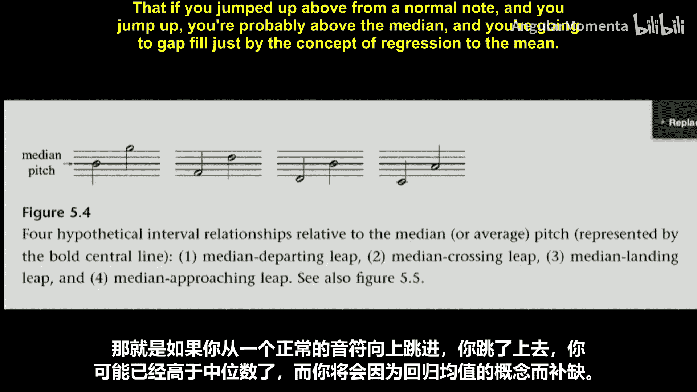

And so， I went， and。Took the exact same piece from Palestinian。

 I guess I've been doing the same thing I did with ABC D。

 E F for a long time of just taking pieces and scrambling。 Do remember。

 But when you were doing the similarity 1， I just scrambled all the notes。

 So here's the exact same melody scrambled。😊。

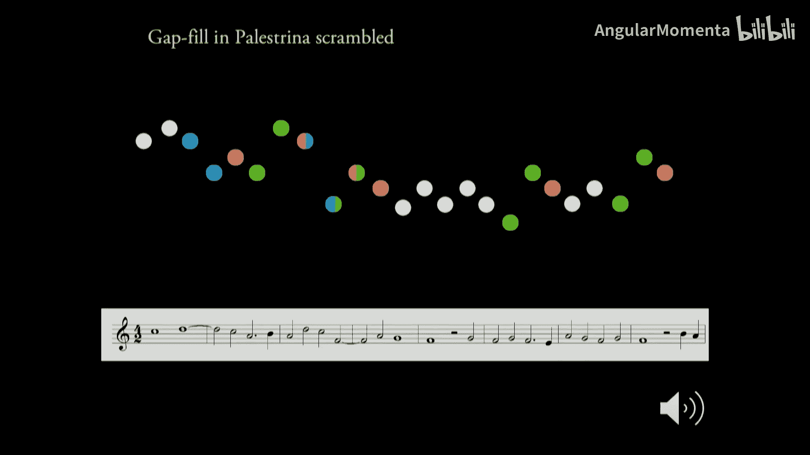

。

And again， everything that that demands by the theory of gap fill motion in the opposite direction than where it just came。

 I've marked with a green or blue。 and I've marked with peach when it works。

 I've marked with a big yellow dot when it doesn't。 And in this scrambled。

 And this was the first random run。 I did。 I didn't run it a whole bunch of times until I got one that worked。

 It works perfectly。So they what they argued was that this concept of gap fill as something universal in music could actually just be explained by regression to the mean。

 And I thought this is really， really cool。😊，The thing I noticed looking at this article for the first time。

 you， in the mid。

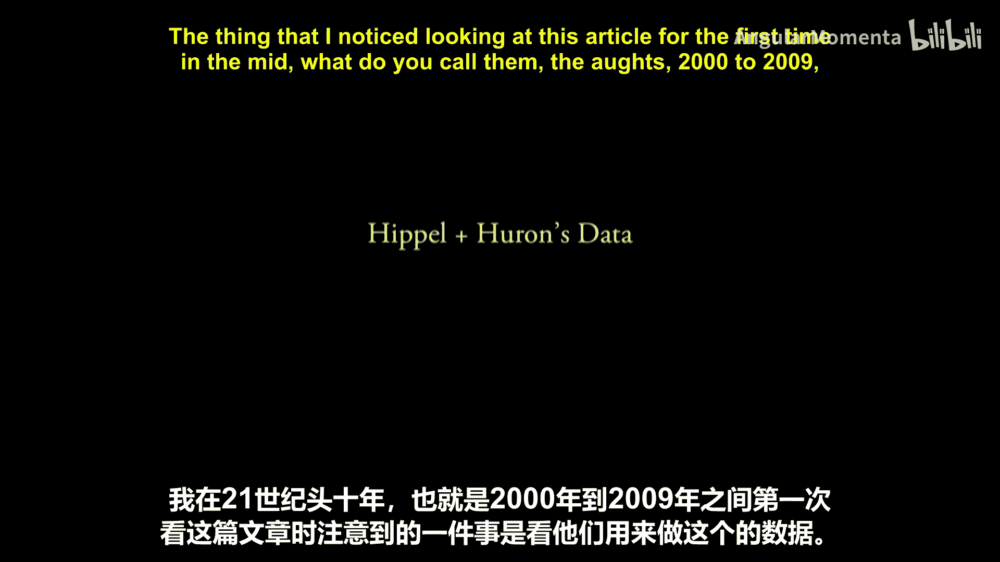

What do he called them the Os，2000 to 2009， Something was looking at the data that they had to do this。

 And so they had some songs leader by Schubbert。 They had European folk songs。

 Where do you think that came from， anybody。European folk songs and Chinese folk songs。

 That's always， that's the S in dataset。 So they had this data been around for a while。

 And they had some other things South African and Ojibwe Native American folk songs。

And you can kind of see when。When you're going all the。

 you're already high and you go even higher than the odds are， you're going to。Turn down when you。

You're gonna come back down， right。 And so that's very statistical significant。

 And when you start in a normal range and end in a high range， you're still probably gonna go down。

 And they saw that lot。 This is not just down。 This is other direction。

 But I'll assume for a second that everything is leaping up。

 But then when you get right to the median you kind of see that you go about 50。

50 in either direction。 And when you， when you start low， and you go up， but you're still low。

That more often than not， you just continue going up。

 There is no gap fill or or it's kind of reverse gap fill or some， something like that。 So I'm。

 you know， somebody developing music 21。 And I I kind of look at these numbers。

 for are probably from like 1998 signing out，2010，2012。 I'm teaching here， doing this sort of stuff。

 And I look at their sample size。 they have， you know。

6086 examples of something like this and 101 of something else because it took a long time to encode music than it still takes a long time。

 But we've gotten things better。 There's more data sets out there。 So I thought about running it for。

😊。

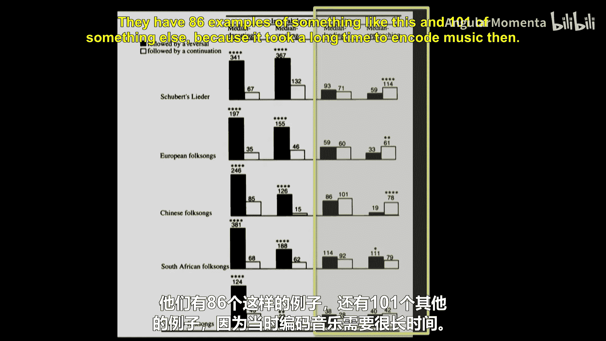

Think it was originally to think of as a problem set for this class to， to， you know。

 let's validate von Hppple and Huron's work。 But it turned it a little bit more。

 and it turned into a paper that my friend， Mark， who's probably going to watch this at some point。

 We do still need to finish publishing it。 We've presented it many times。

 but not published species or species on various rules for species counterpoint that don't seem to actually exist in the literature because。

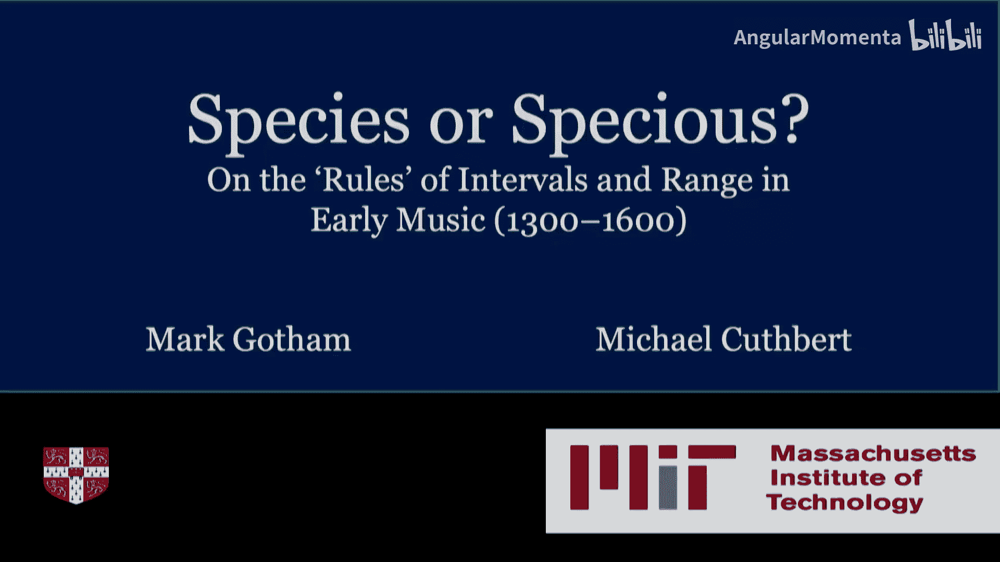

When we ran the same thing， you can see， we have a lot more data examples。

 And when we looked at the Chinese folk songs， we also saw the same thing that Van Hipppo and Huron did that there is a lot more evidence for R to the mean。

 regression to the mean than there is for Ga fill。😊，And when we looked at the European SN data set。

 we still saw the same thing and all these things。 So I got to do the nice validation study that I thought would do。

 and I thought would make a nice assignment for us all and everything。

 until I looked at music before Bach， the music of the era that we do species counterpoint on why we have species counterpoint exercises。

 And it turned out there that for these weird pieces where you're jumping up above the mean or something like that。

 that gap fill happens more often than regression to the mean。😊。

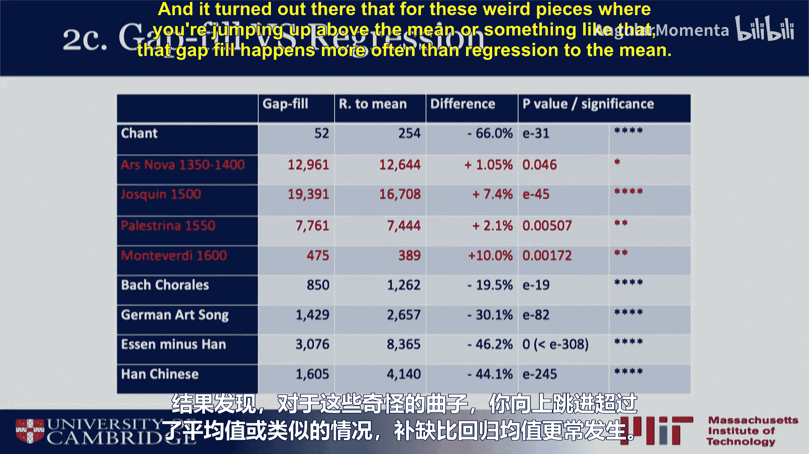

And so for these like low going to here。 And then you would expect regression to mean you should still go up。

 there did seem to be a period where people were actually doing gap fill。

 So that was was pretty was pretty neat。 And so it's just so that sometimes and you get a new data set。

 you should be reexami existing theories。But von Hppple and Huron did cover their butts。 at the end。

 they said that their conclusion。 and I agree with them completely。 So， so they are actually。

 and I are actually in agreement on this， that their conclusion applied only to the sample vocal repertoies that they were looking at the other repertoies contain an excess of post skip reversals。

 Gat fill。 given the centuries of Western composers who have been taught to write Gat fill。

 it seems inevitable that some of them have actually done it in their compositions。

 And now we can kind of see what era composers were actually doing it。

 though I think it's kind of interesting that the era that started teaching how to write music with Gat fill is closer to this period to Bach Mozart and everything talking about how music of that past worked So they weren't actually doing it in their own music。

 but they had observed something。😊。

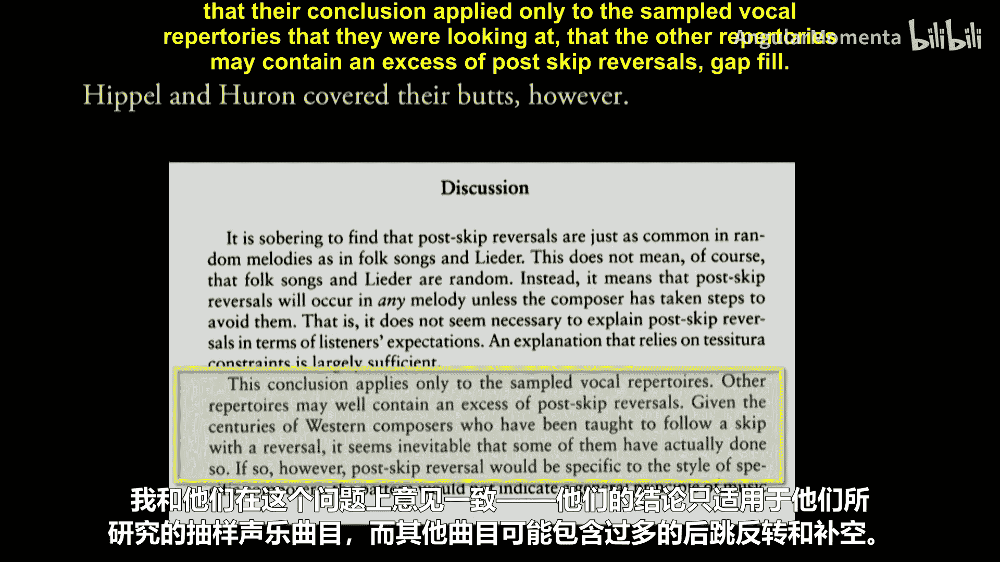

The past， and just shows for the 10 millionth time when we think we're smarter than people of the past werere quite often wrong。

Questions on Gap fill or this kind of work or。Or discussion points。 I that to be a question。酷哎。

Do it against。Somewhat sorry interesting。 Yeah， can you talk a little bit through the numbers Like what Yeah。

 what exactly is like how do you measure significance exactly。Yeah， I can' I can't remember。

 this is why I needs a little bit time to come back to this。 this。

 I think it was the scholars T test。 Do you know that is what the significance。

 basically how far is this difference between these two things how far is it compared to random chance。

 So one of the things that it doesn't work。 This isn't a statistics class and I am not a professional statistician。

 but one of the ways that you can often test something is if you're null hypothesis if your hypothesis going into experiment is that know that gap fill doesn't exist that there shouldn't be a difference between gap fill and a random motion or motion toward toward the media regression should say regression to media。

 I suppose than to mean， but we don't know that。So one of the things is that significance go the amount of difference between two hypotheses necessary to say that something is highly significant。

Goes up the the amount of difference in percentage goes down a lot as the number of observations goes way。

 way up。 And one of the places I saw this on was on the article I wrote with Sophia Sun on the lyrics emphasis you know。

 like various， are there high notes on anticipation or surprise。 when you when we're talking about。

 oh， anticipation is higher than discussed， we're talking about on average。

 I think those two were about one semitone。The difference between F and F sharp。

 this is not a huge difference。 But when you get， you know，80000。

 or that one was allowed 10000 observations。1 semitonone starts becoming pretty significant。

 So that's one of the ways that sometimes you can if you look at。

 if you're just looking at like 10 pieces， you might see that six of them do this And four of them do the other thing。

 that's probably not gonna be a significant difference because if you flip a coin 10 times you might get six heads and four tails or something。

 Yeah， the numbers for gap fill and regression I guess the median。

 those are instances where this happens in the pieces of that。 Yes， sometimes can it do both。

 I guess like it starts above above median。 it will technically be both that it just goes down Yes。

 you can， but some of them are one or the。Right， and， and so the ones that cross over。

 I think it's only the ones that reach to the。Meedian or that don't reach it that end up having being in the observation set。

 because all the rest should always be the。Should always be the same。

 They should be the same the whether that is to say， if you start。

If you start middle or start middle high and go really high and then you go even higher。 Well。

 then you've broken gap fill and broken regression into the mean。 And if you go down。

 then you fulfilled gap fill and regression to the mean。

 So you haven't learned anything about your hypothesis。 So I think these were only very， various。

 these particular cases where the two hypotheses would result in different directions predicted。Yeah。

 great question。 great question。 Now we're getting on。 I just need to。Give more time anything。

Other things。This isn't a statistics class。 So I'm not gonna go into thing like this。

 but theyre one of the one of the mistakes that people who dabble in statistics but whose main work is on medieval music music theory programming。

 all these other things we often get wrong is something called a multiple comparison test。

 And that is to say， the more， if I did looked at， you，7000 reperories。

 And I'm only reporting the top 10 or the 10 best or something like that。

 then my significance level needs to be much， much， much higher and sort of general rules， if is if。

I was whos heard of like P value point05 or 5%。 Yeah， as sort of a standard thing。

 So if you look at five different things in you know，5 different hypotheses。

 start with a P value instead of  point05， divide that by 5 is point01。

 And so this was a criticism on some of the。Some earlier work that I did where I was looking at， you。

 what is it？10 different。10 different emotions or sentiments that can be compared with 9 other ones。

 So I'm doing 90 comparisons for each attribute。 So I should be whatever point05 divided by 90 is somewhere somewhere around 。

001。 We just looked at the number of zeros compared to the number of of hypotheses。Yeah， so。

 so look out for things where people are reporting P。

046 as significant because it's lower than  point05， but not， not very much。 But on the other hand。

 when you get something like E to the negative 45， you have 45 zeros before some digit that I don't even care what the digit is。

 It's 45 zeros。 And that's what's important。 that ends up being。

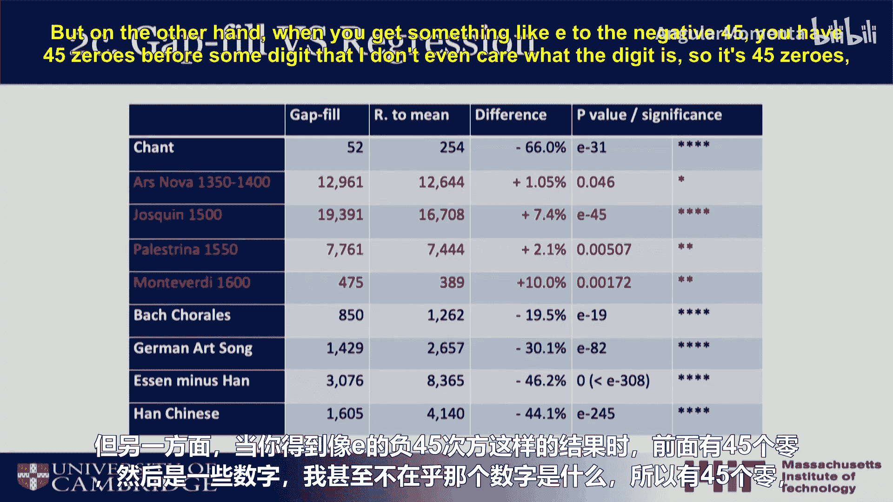

Pretty good。 I like that the European folk song， we can actually do even better than。😊，Then。

 you know， they were giving2，2 stars for， for their work because they only had this many observations。

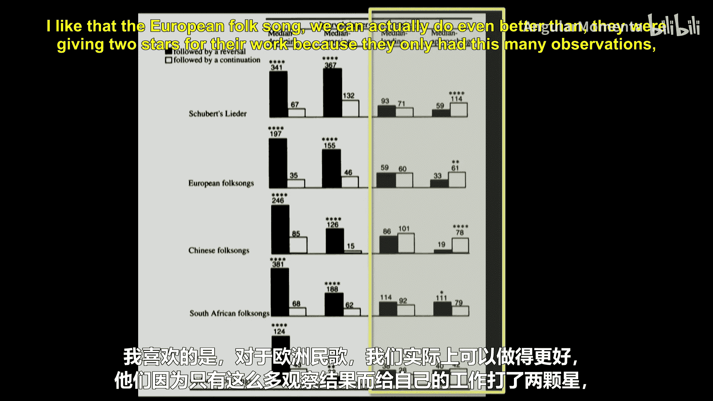

But now we can give them a lot more observations and say， yeah， this is absolutely right。

 once you get in in 64 B numbers， once you get more than 308 zeros， it just gets rounded to 0。

 which ends up being a lot of zero division errors， cool。😊。

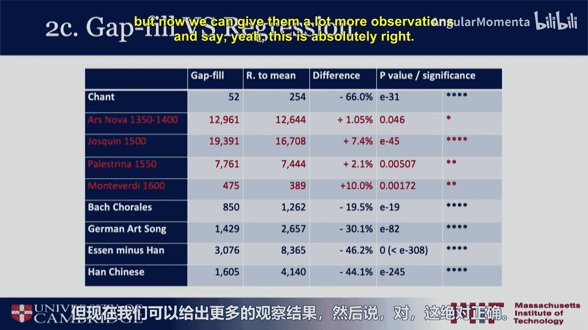

Now I'm gonna move on to the second。Second topic。 a little bit briefly。

 And it's something I feel I rightly should feel apologetic for。

 We're moving into an era where where we where people here in New England and Boston at MI I T in the United States are recognizing finally that Western Europe is not the only place that does music or culture。

 I know big， big， big shock。 So why has this class been primarily about Western music。 In fact。

 we can start looking at other music as part of music theory。

 So there was just earlier this semester。 I think I emailed it to somebody might have been Vincent。

 even who just came came in maybe a new book that just came out。

s things like 600 pages all on computational approaches to Indian art music thats say。

Music that's that's sort of in the high tradition that is not folk music or modern popular music。

 And if you think about， or Bollywood or something like that， if you think about。

 if you can write 600 pages on Indian art music， you can probably write 600 pages on computational approaches to any of those things。

 too。And I'm really looking forward to seeing what my colleagues down in South Asia are doing。

 But one of the things that comes up here。 no I didn't highlight this is that most my training。

 my personal blinders。 Ill say bias although maybe it is also that has been that I was always interested in musical scores。

 And now there's large parts of music theory that are interested in things that are not score based。

 And most of the rest of the world's music is not primarily score based。

 just as shockingly most most Western music today is not primarily score based。 I mean， it is really。

 really great when you go see your favorite heavy metal band。

 and they're all page turning for each other。 no， that doesn't happen。 Were， you know。

 we're much more of an oral culture today。 So， yeah， so says basically that there are no。😊。

ize tools yet， such as hum drum or music 21 for Indian art music scores。

 and that still we gonna need collections and scores。

 whatever is if we're going to be using these tools。

 And I want us to always be trying to break out of the chicken and egg problem that I've done this semester with we'll do another book。

 I really， my apology to you all， everybody is that I wanted to deemphasize more of those things。

 And music 21 version 9 has a bunch of other substitute scores that are designed for us to be using。

 and it's just has continued to be too buggy to recommend for us all to use in this class。

 not the scores。 the surrounding code。 So we don't want the chicken and egg problem that well we don't study this music because there aren't enough scores in there。

 Well， why don't we encode a whole bunch of scores。 Well， if we did that。

 there's no software to analyze it。Right， so these are some of the problems that are there。

So they're absolutely right that these tools， the authors of this book。

 editors that these tools don't yet exist， but。We wanted to those of us who are building music 21 first and many of us in scores。

 We just never got there。 This is one of the slides。

 I know I haven't changed my font in a long time from the original funding presentation to get funding to take music 21 from a little hobby Europe project and to make it a bigger one。

 And we talked about these are probably things doesn't exactly work like this。 But。

 these were the types of things Music 21 was going to be able to do。

 Gene intervals specific chromatic is step you all have worked with this by now。But then I thought。

 well， you should be able to apply a context to any object and transform how that object works so you could apply 13th century France I didn't even make this consistent in the。

 this is all pseudocode in 13th century France， this major third would not be called a consonance。

 only perfect intervals。 That's why they're called perfect were consonances。 In fact。

 this lower note wouldn't even exist。 There is no a flat back then。 So we could do that。

 And then we could apply other things like 20th century harmony。

 apply octonic scale and count the number of notes in this and we get three instead of two。

 And that one we can kind of do。 But I did think about， oh。

 wouldn't be great to be able to take this interval。

 which we started with calling it major third and can convertver it into the Indiansfra and get7 shruti as the interval that these types of things should be able。

To be done。 And a lot of the basic design decisions。

 Some of the things are over complicated in what you're trying to do were in order to enable more of these things or that。

We can apply in in the Okinawan pentatonic scale and say that a flat to C is a step。

 It is not a skip。 Its a leap because there is no note between those。

Or one of the last things in there that， you know， one of the things music 21 will be able to answer。

 I suppose I never put a timeline on that。 So maybe I'm still telling the truth， You know。

 is that West African cultures often hear the same rhythmic pattern and as having different strong beats。

  different parts of the bell pattern。 what can we learn from analyzing more music to try to figure out what clues give different sense of。

 of strong beat among different listeners。 So these are。All ideas that。

Computational music theory should be able to do。So we wanted to get there originally。

 a whole field has wanted to get there to be able to do some of these things。

 but we're not there yet to really have cross cultural symbolic music analysis， but。

I want to keep trying。 I'm gonna be spending。This is a summer coming up for me。

 I'm going to be trying。 this has really inspired me to make sure that at least one more of these things are possible。

So that's， that's one more。 The second of three things I wanted to talk about today。

 discussion ideas。 Any know of anything Very cool happening in this sort of world。😊。

Oh I meant to talk about there is a project Tos that is specifically a music theory toolkit for looking at music throughout the world。

 It's a little bit older。 It's one of these things that you need to find your Java virtual machine to work properly on。

 but it's very cool set of tools for for analyzing。

 especially scales and scale usage throughout the world。 that doesn't that doesn't rely on saying。

 oh， well， that note's kind of like an A and that note's a C sharp but 20 cents high。

 no those are notes， these are not alterations on some you know plattonic correct note that just happens to be the Western scale。

 So I think any conceptual system for non-wester music needs to start with anything that is fundamental in that system is a fundamental object that maybe we can translate them to other systems objects like Western music。

But。First， the manipulation should happen in the space that people are actually conceiving。

I know it's very bobbly luxury today for me。I don't want you to have to do too much more work while you're doing many other things。

 So I'm going talk about the last really cool area that I think there's still so much for music theory to be doing in order to get us more scores。

 And that is improving optical music recognition。 So optical music recognition process of changing a musical score into something that a computer can understand a symbolic score。

 And this is done was my name bigger on this。 I think we said that is not supposed to happen。

 I think there was something。 I think it was in an auto shrink mode。 sorry about that。 Sorry， Mara。

 doing amazing things out there。 at Duolingo。😊。

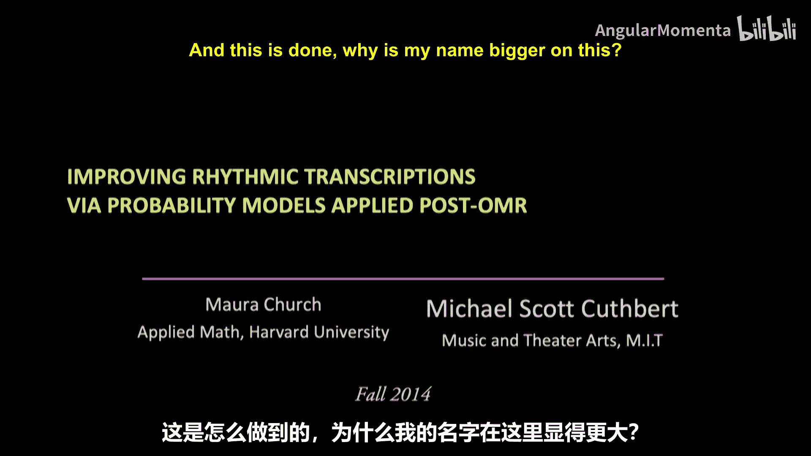

Okay， what are the opportunities is， And this is from a presentation。 I'm reusing slides。

 I don't update them every year because from 2014， that。

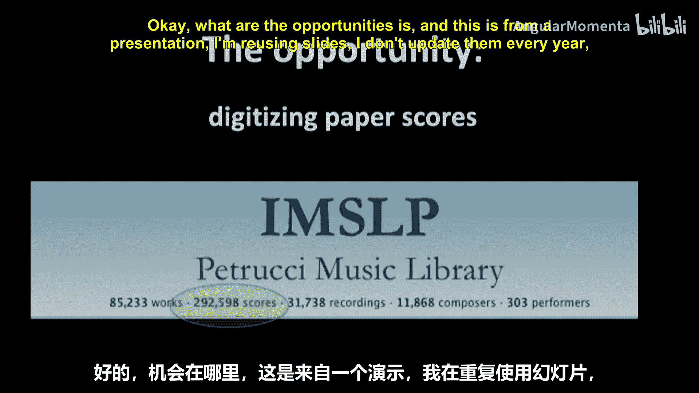

嗯。That back when I M S L P had about 300000 scores。 I think it's over double that now。

 And so we'd love to be able to convert all of them into music。 So I always， you know。

 might as will start with Ia K andn music by Wolfgang Amidadeus Mozart， late 19th century。😊。

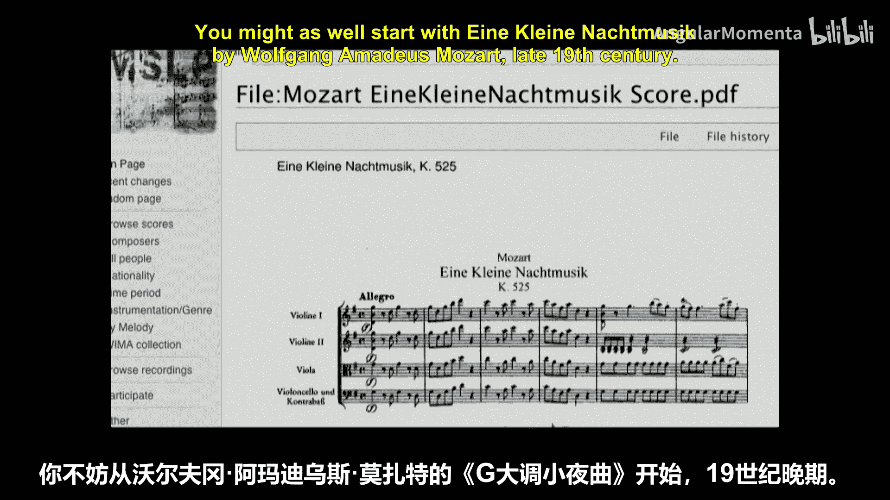

And so if we want to convert it over， this is use from the state of the art in 2014。

 It's gotten better， but not huge amount better。 So this is the original score of， of one part。

 And this is what the optical music recognition score came up with。 So you can see oops， we've lost。

 lost some notes here。 somehow we have another rest here。 and a whole bunch of dots at the top。

 And on the other hand， you know， a lot of it looks kind of kind of right。 But。😊。

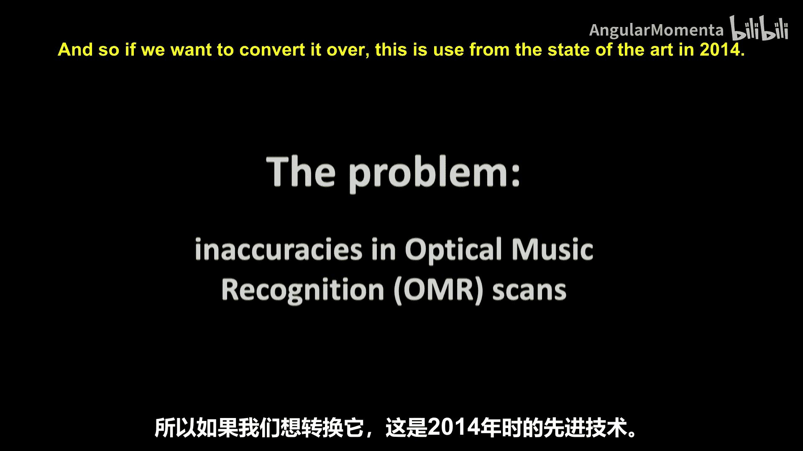

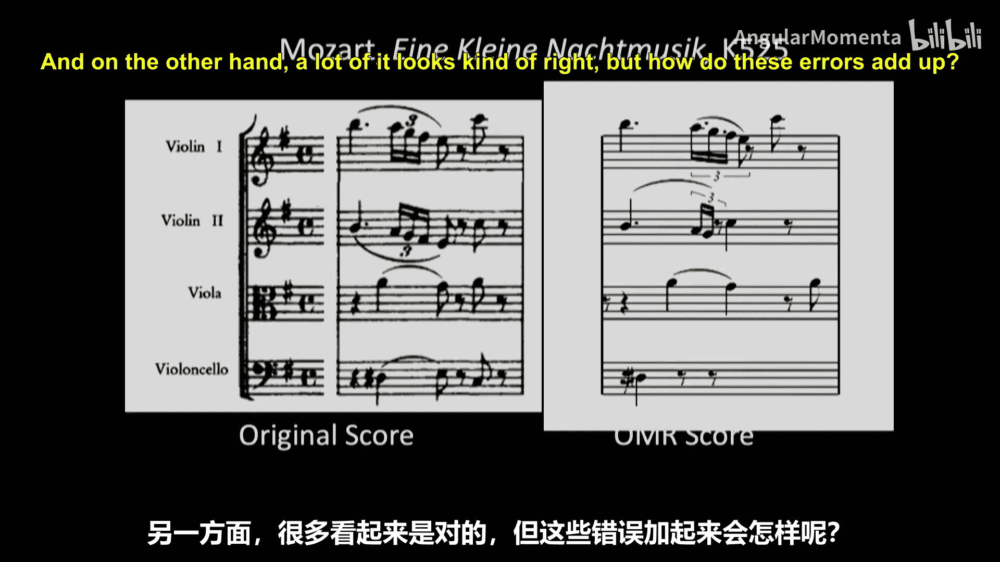

How do these errors add up， especially rhythmic errors？And misidentified part names。

 clefts can lead to big differences in perception。 So I'm just gonna remind us for the first couple bars of what I kind music Not music should sound like this is。

 actually， shouldn't sound like this。 This is an un， unretouched finale performance from music X。

 M L。Okay y， you recognize it， so I don't need to play more。

 let's listen to a little bit of what happens when you play back the state of the art optical music recognition。

🎼。🎼The。🎼。🎼，🎼Yeah。🎼我我。

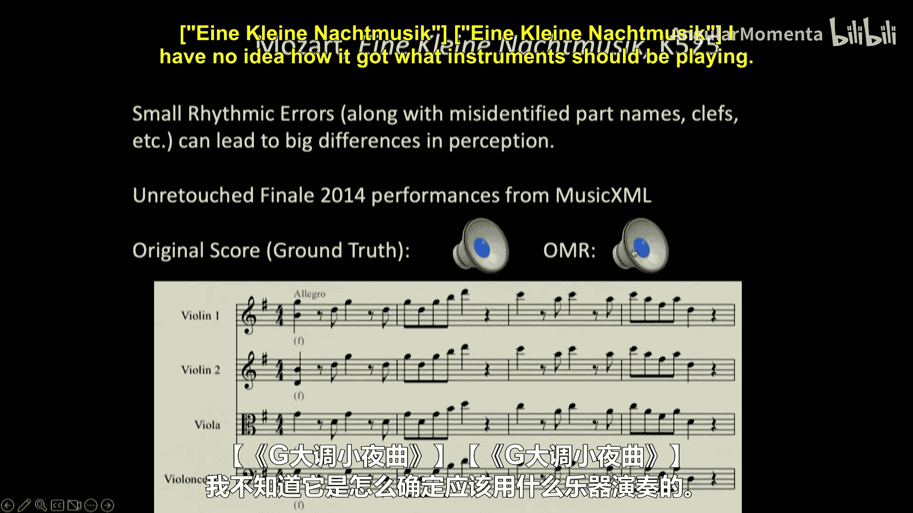

🎼哦不国。😊，🎼，🎼I have no idea how it what instruments should be playing。Anyhow。

So one of the things I've been talking about， especially since our sound to score lecture。

 we didn't really do image to score lecture is how music theory knowledge can work with inaccuracies and O M R。

 Fortunately， some other people have been thinking about it。 This is one。

I should be citing my sources。 I can't remember。 like where it came from one pipeline for how scanned music can end up as a music encoded data file staff line to identification。

 object location， so on。 But just like we saw in the sound of core things。

 musical semantics and musical knowledge can be used to go back and forth in sort of a two way pipeline。

 And that was the idea that almost everybody knew。 But。

 but very few musical semantics have been brought in to。To what we're doing。

Here' are some things that errors that music theory can fix。 You might have a pitch out of context。

 And I want to figure out what we have misread。Probably that was intended to be a sharp。

 and now it's been bred as a natural。Instrument or clef misidentification。 I mean。

 this is something that you don't need very much programming to figure out something's wrong。

The correction isn't necessarily the easiest thing。

 Should it be change that to a tuba or change the cleft to to a treble clef， Not sure。

 but we can definitely point that out if we have music theory knowledge to point something in。

And then metricical inconsistencies is what we focused on。

 because metricical insistencies have a really， really nice thing that pitch inconsistencies don't。

 There'， there's no answer key to whether you do it right or wrong。

 But there is a check sum to see if you've probably got it right or probably got it wrong。

 And that is the time signature。😊，When everything that you've recognized does not add up to the time signature。

 maybe it's a pickup bar。 maybe it's some of other weird things。 But most of the time。

 you've gotten something wrong， right。So do you want to talk about。

The rhythm replacement and what we're doing all has begins with the assumption that context will give you an idea of the correct rhythm。

So here's that measure that was screwed up。 And here it becomes very obvious that we have a dot that's been added。

Given this context。But now we're going to come up with a different conclusion。Same middle measure。

But now what's wrong is almost is very， very likely that we've lost a flag on the first eighth note。

So we have the assumption that the context will give an idea about the correct rhythm。

 and that requires a certain amount of rhythmic repetition and metrical stability throughout a piece or across parts。

 There's some 20th century music John Kays Pierrez with Crawford Seger Gregorian chant that can't do it。

 But most the music doesn't behave like that。 Most music works like Iac Kn music。

 So we're just stripping out all of the melody。 And just giving the computer a score that looks kind of like this would be a separate problem if there's a note deleted to try to figure out what pitch put in。

 but we're trying to figure out， well， at least what rhythm is。 So this is Ia Klen music。

 the opening with just the rhythm。😊。

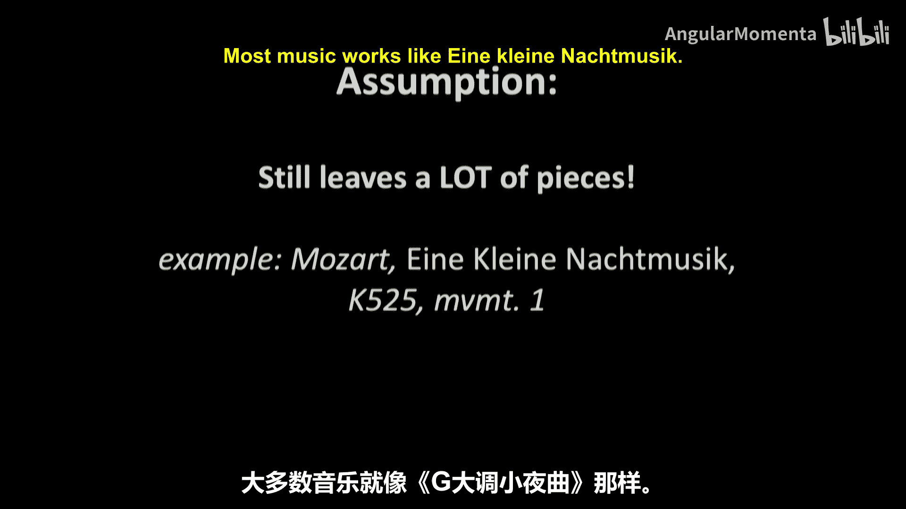

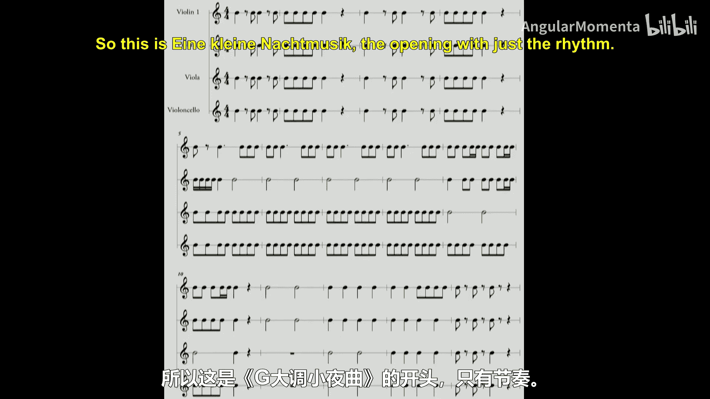

The first thing we looked at was distance that the probability measure offers a solution based on its location in the score。

 something called distance probability。 So distance can be part wise or horizontal vertical or horizontal。

 What do I mean by vertical probability measure。 So we're just to look at this third measure at the top of unlock music where there's an added。

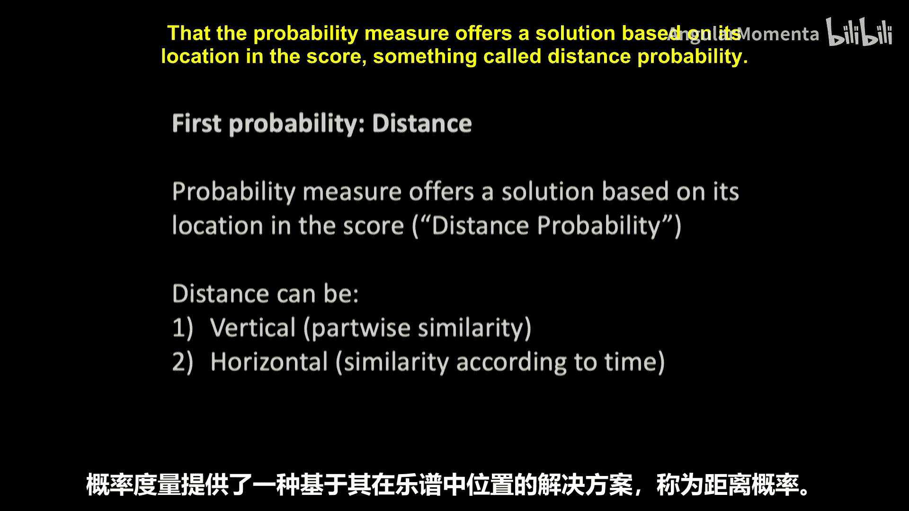

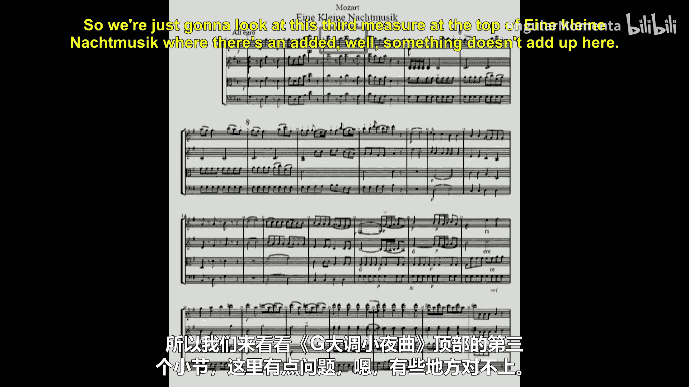

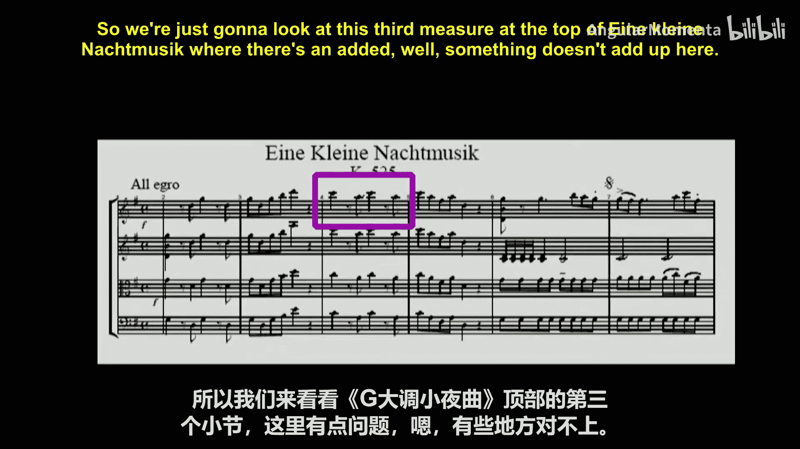

Well， there's there something doesn't add up here。 The computer doesn't yet know what you all know that there's a dot that's been added dotted eighthth note。

 but it could be anything， right。So yeah， there it is much。

So one of the things to do is to look at the rhythms in all the other parts at the same time。

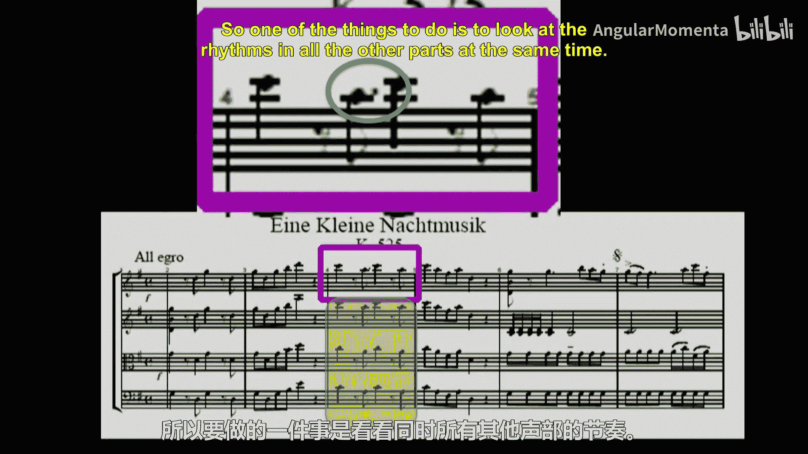

What we can do is build a histogram of for the violin how often across the whole piece。 Now， again。

 this is being built based on the incorrect， possibly incorrect O OMR。 So you're learning from。

 you know， from error approveded scores to build other error probe scores， perhaps。

 but you hope that。That this is actually just a little bit close to reality。 So the violin mostly。

 violin  one mostly has the same rhythm or has closest the same rhythm， Violin 2 and the cello。

 But for the most part， doing its own thing。When we look compared to theveola， you can see， hey。

 when theveola is wrong，80% of the time， if that measures like the other measures。

 the the cello might have the same rhythm。

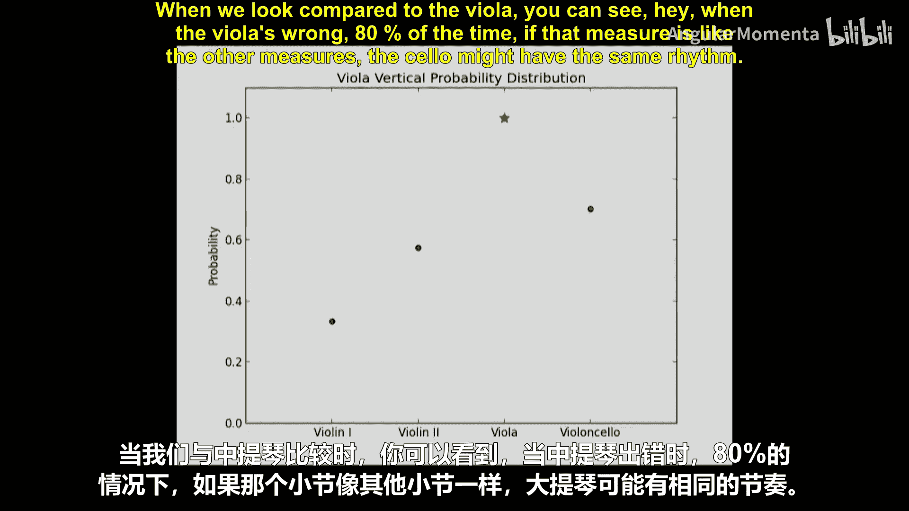

So that gives the probability based on horizontal， a vertical。

 And then the other thing you can do is look left and look right to see if that same rhythm is somewhere over there。

 In this case， it's not because it should have been。

 but there's another mistake in the first measure。

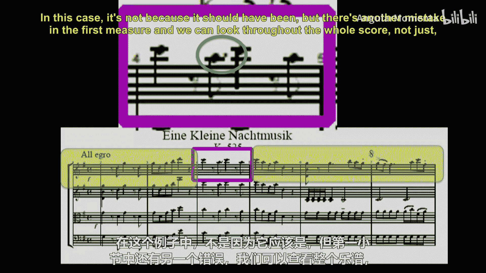

And we can look throughout the whole score， not just。

What's cool about the horizontal thing is that scores tend to be wider than they are tall。

 there would more measures than there are parts。 So you have more things to do。 And we can look。

 I'll skip over the violin。 think it's more interesting to look at the cello。 that obviously。

 each measure is always exactly identical to itself。

 So you have a one probability of one it's gonna be。

 But then you can kind of see in a lot of the classical things。

 the the most often similar measure is two measures on either side。

 not one because of this sort of four bar structure。 And。😊。

The other thing I learned from this is anybody know Sonata form。Yeah， yeah exposition， development。

 recapitulation。 At some point later， the music comes back。

 And so you can kind of see this temporary spike in that if you can't get it right。

 look 97 measures later and you might also get it right So the computer can learn just from the scores。

 what all the probabilities for this particular piece are and hopefully apply them put it in。

 So now we know what measures， what the probability of any measure having the same rhythm would be ahead of time。

 But then we need to look second probability。 What's the probability that that measure that each other measure might have the solution based on how often certain errors happen。

 And here's a chart that I think we need to keep looking at and keep judging。

 But it was the only one that I knew of at the time where somebody looked at what the probability that something that any given musical object would be recognized。

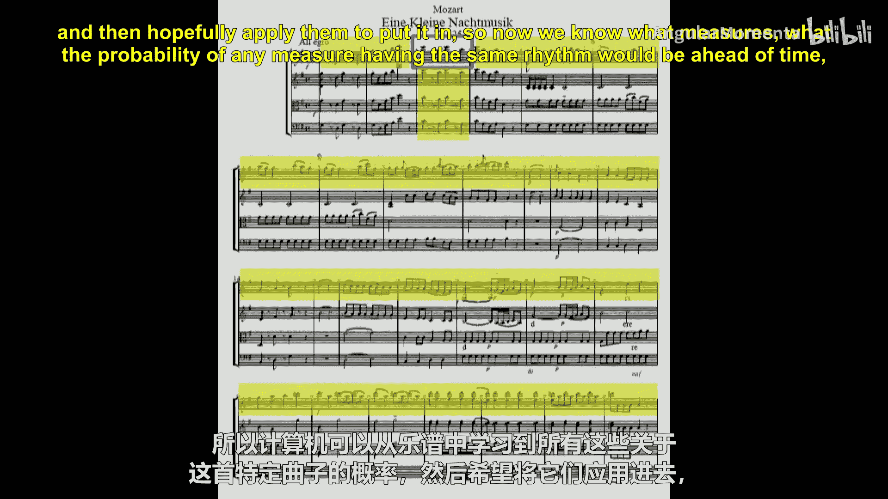

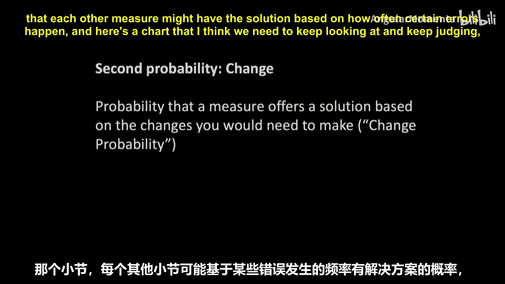

Release and 97%，99%， some of them， I't believe anything that says 100。00。 That means not enough data。

 right， But， you know， a lot of things so we can look at。

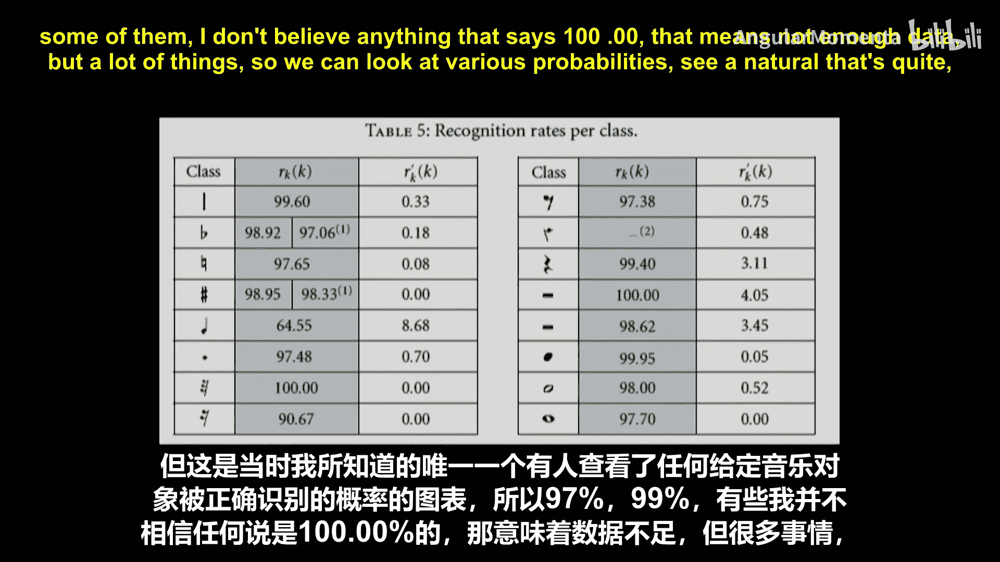

Var。Proba the un natural is that's quite， quite， quite low。

So then this is where there should have been some gigantic formula with regressions。

 But it turns out all you need to do is find the probability that of each measure being the same。

 find the probability that it would how， how many changes you would have to make and multiply those two probability and take the max。

 So and yeah， it is that simple。嗯。So the workflow normally take P D F， turn it into music XMl。

 We kind of stuck ourselves in the middle， take run it through one more time I would love to be able to send it all the way back into the OMR pipeline and say。

 no， reject that。 Now rerun the recognition with this being a possibility， but didn't get to that。

 then had a whole bunch of scores where we had not not as many as I would like。

 but we had scanned optical music recognition， Music Xl， and we had the correctly encoded one。

 and we can look at the number of differences before run through the model and then look at the new number of differences。

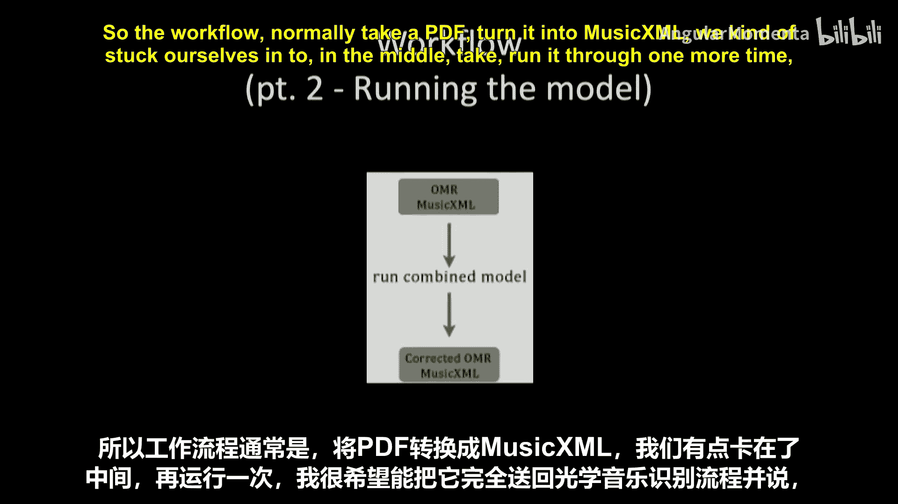

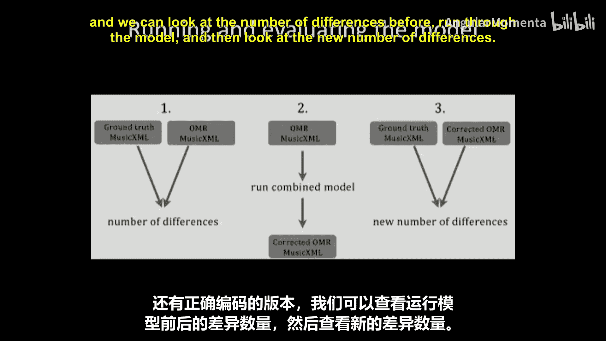

All of this code is in Music 21 in case you want to use it to improve things。

 how everything works and。The music we looked at， again， too many canonical composers。啊。The average。

 about 19% decrease in error， which made us very happy in a field where usually you're trying to improve by 1% at a time where something got。

 and more Church earned the best grad student paper award， which was great because you。😊。

Was't technically qualified because she was still an undergrad。 But yeah。

 so it worked worked pretty well here。 And some of the pieces got as high as 36% error reduction。

 So what happens。

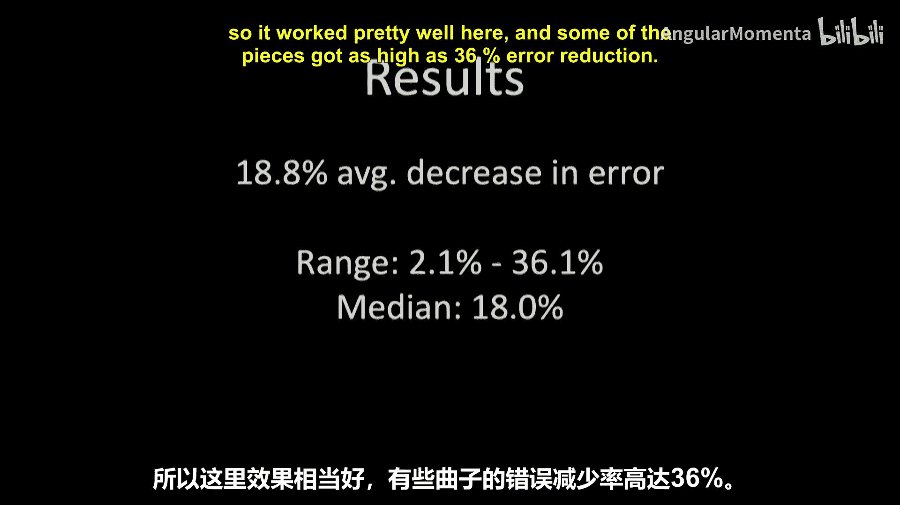

You have all original score。 We've marked。 what's the errors。

 We correct that and then post correction。 It's correct。 if we got the same rhythm。

 not if we not necessarily the right pitch because we didn't work any time on that。

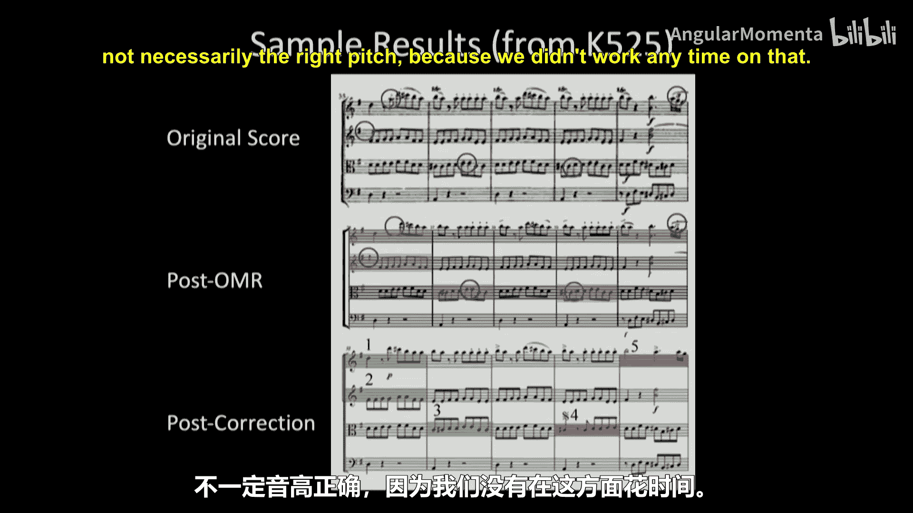

So these are all the places to be looking at。Here's what the optical music recognition software got wrong。

And。The correction。 So we've got， in this case，3 out of 5 corrected。

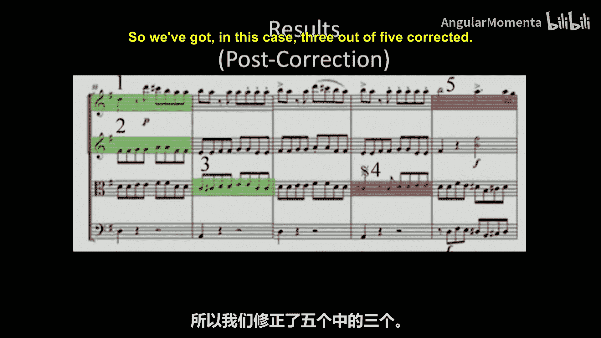

I see them all there。But the what， what really came out of this work for me that seemed very important was that we are evaluating the quality of our work a little bit wrong。

 So there's。That we need to be looking at optical music recognition that allows for musical semantics to go back and forth into things。

 That was a possible implementation for how you can make it faster to do things， but。

So there's proposals for judging how good optical music recognition software is。

That you feed in a bunch of scores and you see how， you know， how well does it do。

 But some of the standard scores being used are ones that if we had to run our software through would run terribly on。

 So this is one of the ones that you should be able to recognize。

 But this particular score has no mo repetition。 I mean， I I've never even played it。

 Let me me play it to here how unusual that score is。응。

So it doesn't really behave like a normal score。 And there's even things like。If。

 if I my optical music recognition saw that C sharp when it just recognized this key signature。

 I would say you probably got it wrong。 That's probably a C natural。

Or you've got your key signature wrong because there's no reason why you would write a sha there immediately。

And there are other things that are in the test beds I still think we need to do。

 like being able to recognize properly this measure。 And I get that it's trying to test。

 can you recognize a whole bunch of rests。 But if I saw this from regular regular piece of music。

 I would say those are probably notes in here， right。

 because there's no reason to not just write every measure like this。And then other things。

 if you get really smart， you could， okay， well， that's a pedal mark。 And that's a clef mark。

 I don't know a single alto clefph instrument that uses one staff and has petals。

 So I would send it back and say， you' got to change one of these things in your recognition。😊。

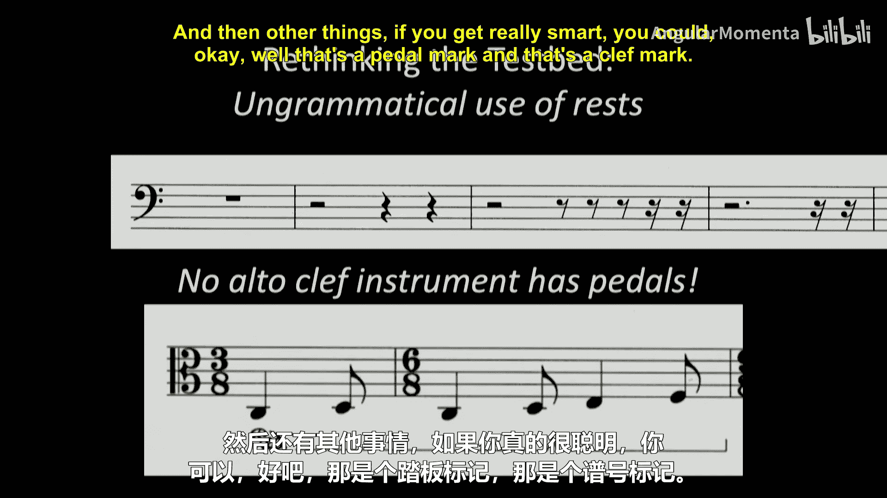

嗯。So I think in our quest to try to give simple tests that can be run very quickly。

 we're ending up optimizing our models for things that don't resemble the music that most of us learn。

Yes， so there's still a ton of work to be done on music theory and semantics in optical music recognition choices。

 And this is something that's getting a little bit harder now with the rise of most people who are trying to work in this field now。

 obviously want to use machine learning， artificial intelligence and deep learning models which will be great once we get more ground truths encoded and we can do things right now。

 that's the hardest part of having more things lined up so that the computer can learn。

 but it's going to be harder and harder as long as we're just using black boxes to be able to。😊。

To get this in， into there， I think。You all have actually met the world's expert in doing this。

 his name is Gus Xia。He。Ha here when we moved to another place。 Yeah。

 so there are people who are trying to figure out a way to add not just。

 not just in optical music recognition， but in any sort of artificial intelligence working with scores。

 how that we can， we can still use these big， deep learning models， but still。

 but incorporate music theory into that。 So that's the big challenge for our time。

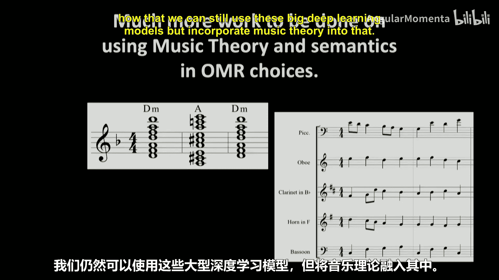

Questions on this。 Yeah， what do you think the state of。Yeah。

 so what do I think this the are of using end and deep learning for optical music recognition。

 I think it is a place with great potential。 It is not nearly as good yet as the things you can buy smart score。

 Sha by the things there。 But it， you know， it has a lot of potential and one of the things most of the work that I've seen on it is missing are the skills that you guys have here。

 I saw。 Okay， I'm gonna forget， you're gonna gonna tell me you put this back up in a second。

 I need a couple extra lines。 I， I actually saw a model where。😊，It was using generated scores。

 which are a little bit different because they're always the same。

 So you've taken output from finale or muse score or something。

 you create a image file and then you know exactly where every note is because you wrote it and everything。

 So you can generate a million ground truths and stuff like that。 And so it was， you know。

 running through a whole bunch of scores and。Things。

And this particular one had a particular reinforcement learning problem that it。

Successfully identified where all the notes were and where all the staff lines were。

 I was getting incredibly， incredibly good， but could not break around 80% on then recognizing what the note was。

 Why， because they are trained it on this is A， This is D。 This is G。 This is F。 This is B flat。

 This is B flat。😊，This is E。Actually， let'll make it even。Even even better。Put that there。

That's an E。Sure。So these are all being recognized？Yeah。 thank you。 Yep， thank you very much。

But now imagine you're the poor computer that's having to predict。Okay， A， I got it right。D。

 I got it right。 Oh' sorry。 I didn't mean that G， nor that。Ge， I got it right。I think that's F。

Because it's only looking at， sorry， camera and people on this side。

 because it's only looking at this amount of data。Whereas。It needs some way to know that's sharp。

 Yeah， this， this one could probably get right B flat。 And then again， it was saying。

 I think that's G flat。I think that's C。 And I think that's D。

Because the training data had prioritized troubleclo。And once it's here。

 has no way of getting back to here。 what should the computer be trying to predict。On this basis。

You take a guess based on the amount of information you're trying to get the computer， what would be。

In essentially， an incredibly good prediction model。 Yeah。

 maybe just have it predict like which line or space。 Yeah， whats， yeah， I see a quarter note on。😊。

Space。3。I see。A 16th note， unlined5。And then when you put all that together。

 then to have a separate detector trying to detect all the clefs。 or it can be the same one。

 These things are pretty smart。 But yeah， and trying to do that。 And then only afterwards。

 connect those two data to other things。 So that was that was really nice that that was about。

 I think about four years ago that that this was shown to me as sort of the state of the art。

 I think that they've gotten better since then， but there're still if if this kind of mistakes were still being made four years ago。

 I imagine that there's still many stumbling blocks that you can put in for。

 And I think a team from here now with the knowledge that we have could you know。

 in a yearlong project produce a real state of the art tool。

 Yeah the best like language large language models that use like attention based so in this case。

 it' actually my fix this problem because it really。

 stuff at the beginning of the measure and ignore that A G。😊，Yeah。

 some of you who are also taking Ina Gozi's interactive music systems had a lecture from one of the experts Anna Huang who is an expert in the attention models and the sort of things where you sort of have a memory and thinking back about what's important earlier in the data。

 and so I think that her work and that's over at Google Project Magentta。

 I think that that could have a lot of impact on the field。And there's other people naming。

 naming a few people doesn't mean that these are the only people doing great things is just once people who I。

Seem to know， but none of these people are are working particularly on the optical music recognition problem。

 So， again， we need to someday have 21 M3，84， where we have a whole semester to just take our projects and do something bigger。

 but we don't have something like that yet。Because that would be a great group project like well and do all this。

Any other。这。不意思。Are there any classes that I know like that。 No， right now， And Paul， are you senior。

 your junior， There may be by the time you leave or M N。

 We are looking at creating more classes on our artificial intelligence and music and。

 and these kinds of problems。Yeah， so there's there's probably。 but definitely。 well。

 it was if you're junior。 Yeah， we're already too late。 right we're in the second semester。

 It's just been so cold。 I still feel don't feel like it's spring end of semester there。 But yeah。

 there should be more。 And， and there are other schools that offer some these things and various workshops that you could go to on size techniques。

 But we're all， we're all still learning。 We're all still trying to create the musical equivalent for those who have done machine learning know the handwritten to。

 to， to， to data set， the classified thing， which everybody does as their first artificial intelligence thing to here's all the different ways to has been written。

 Now， here's a new number。 What is it。😊，We we still need that data set for optical music recognition。

 Here are 10000 quarter notes on space 3。From all different things， and now can your system do that？

Cool。Think else。Well， I'm going to give you time to either work on your projects or stay here or take advantage of the fact that。

 you know finally I didn't make it use up every inch my time。

 So just this is the end for my teaching in this class。

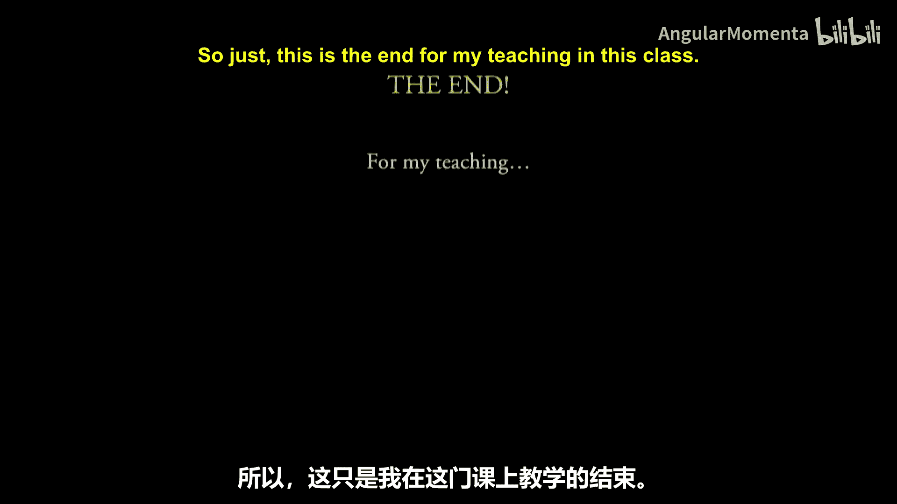

And next week， I'm excited because I get to learn a lot new。 I've been learning from y' all。

 but I'll get to learn a lot more。 So I'm looking forward to that。

 I'll have office hours as soon as I'm done here and look forward to projects。 So thanks。😊，Yes。Oh。

 that's nice。 That's nice。Thank you。

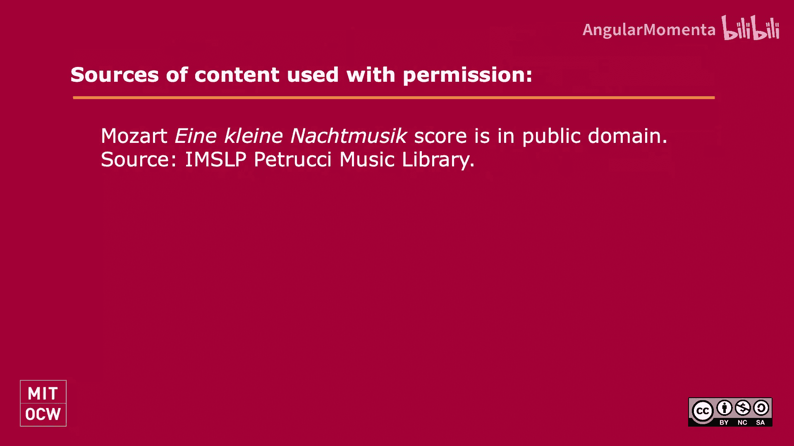