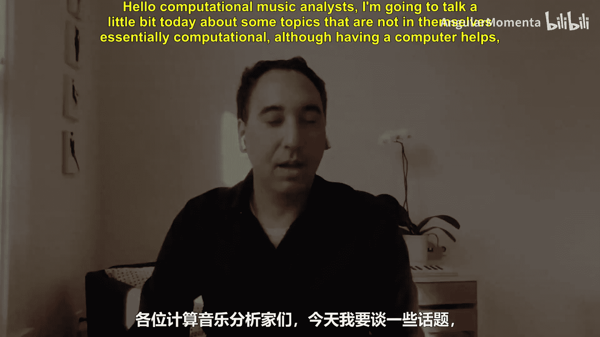
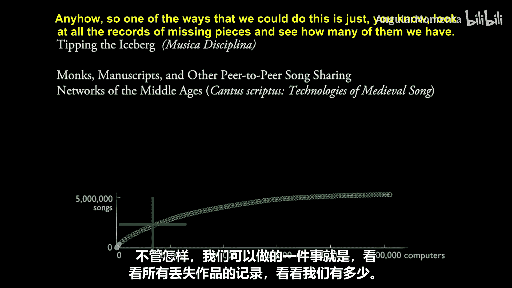
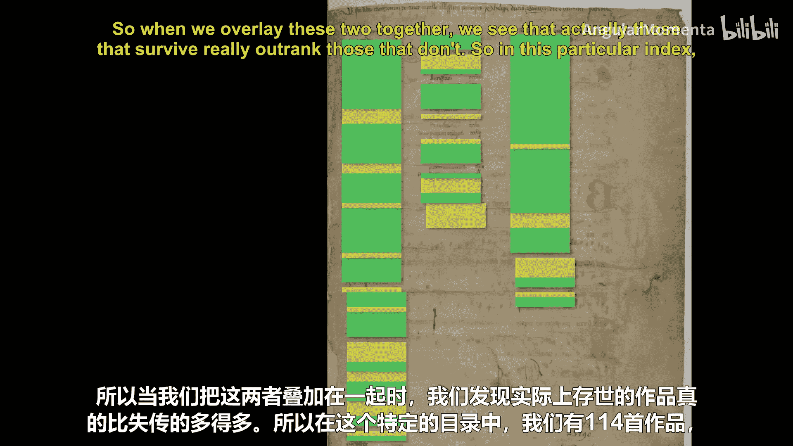
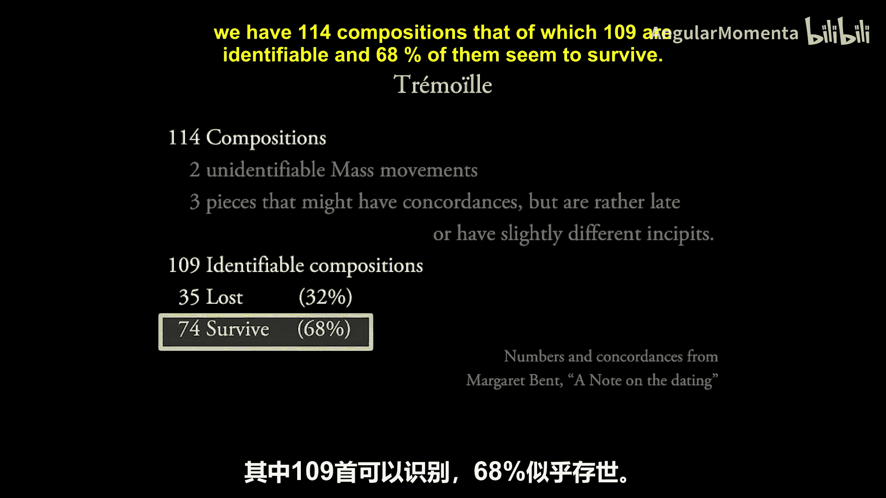
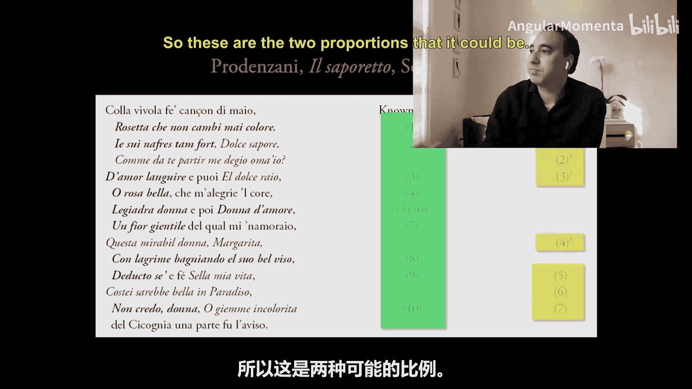
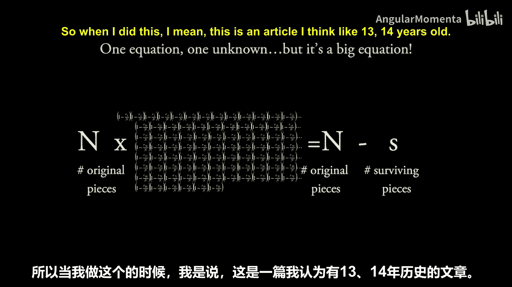
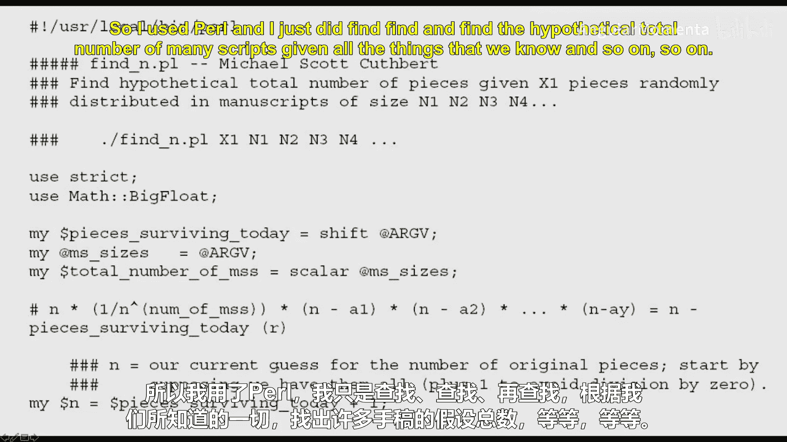
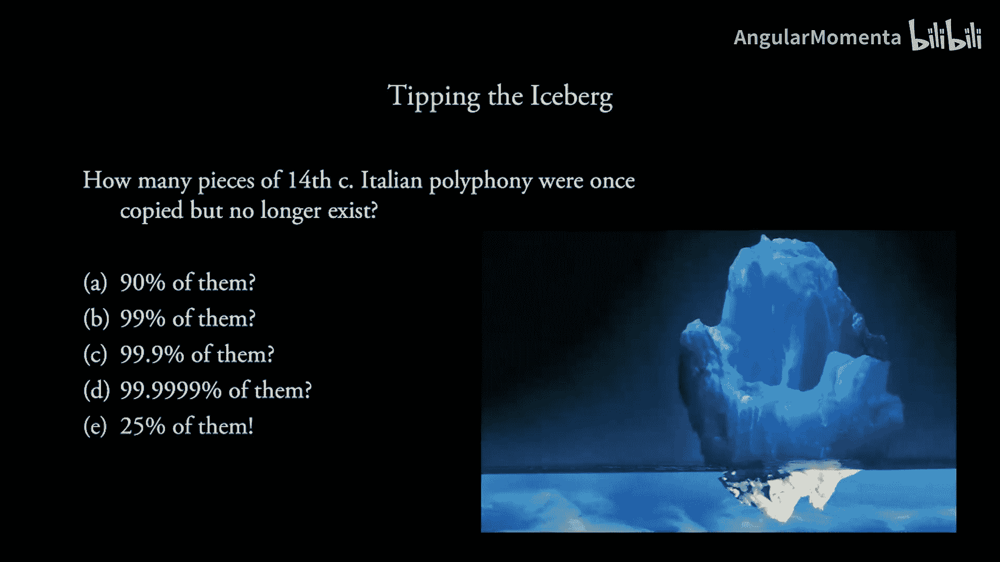
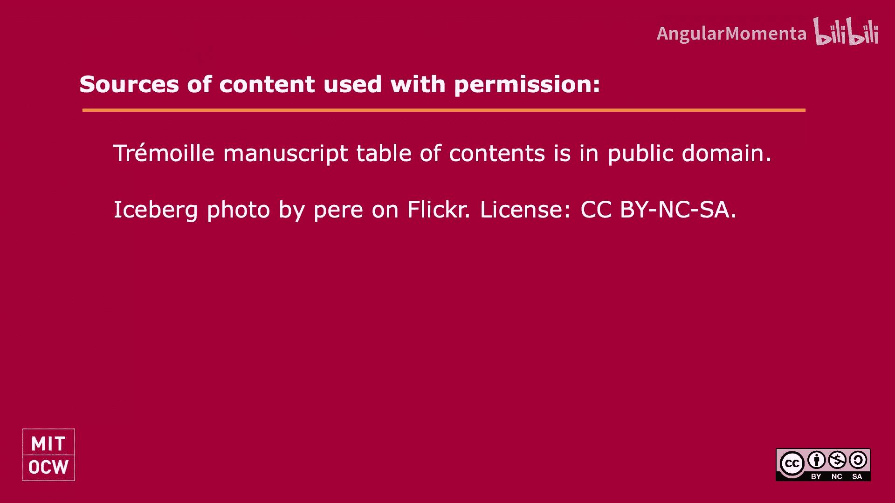

# 【麻省理工】计算音乐学与分析‌ ｜ MIT 21M.383 Computational Music Theory and Analysis,S 2023 p47 47 视频 32a：冰山一角 -BV17xUmBDEUC_p47-

Hello， computational music analysts， I'm going to talk a little bit today about。

Some topics that are not in themselves， essentially computational， although。Having a computer helps。

 but are really about the intersection of mathematical and quantitative thinking with music analysis。

 music theory and musicology， the study of music history。

And these are some of the things that I've done in my own research that I hope will make you think about some ways that data analysis can go beyond the score and tell us something more about the history of music。

When I'm not doing computational music analysis， my other job is as a medieval music researcher。

 and one of the certainties I was always taught about medieval music is that we've lost。Most of it。

 weve lost so much of it。 And I mean， it's， it's just incredible how much we have。 In fact。

 most people always said that the。The music that survives is just the tip of the iceberg。

 it was first said by a very important medieval musicologist Nino Perrota。

 but this term was picked up from on by dozens of other people and so。

When we think about what's lost， it could be the number of manuscripts that's lost or it could be things that were lost because they were never written down and we've forgotten them。

 but if we want to think about even the things that were once written down on songs that were once written down the pieces that were once written down。

 how many of them do we no longer have any copy of at all， what is the tip of the iceberg is it。90%。

 that's what a lot of people say， you know， the visible part of the iceberg is， is it 99% lost？99。

9% loss or is one person said basically everything， so I'll call that 99。9999%。

My friend and former teacher， Sean Gallagher once asked me， hey， would there be any way you know。

 you're a math guy to prove this to show that it's true and you know I immediately said no you know there's no way we could do this then I thought a little bit more and realized there are people who look at you know how things get lost to stuff later on I found this great article on what happens in peer to peer song sharing when you start disconnecting lots of computers from the network has happened during the crackdown on napters and things like that and they showed that as you go from if you have a 100。

000 computers on a network， you might have 5 million songs。

 but if the network gets down to you know maybe 10，000 or 15000 computers。

 you only lose about half the song so that was kind of interesting to me that was a little bit counterintuitive that you。

Could really lose a lot of nodes on a network and not lose a lot of the content there and I kind of thought。

 well， you know。Computers might be something like。Meieval manuscripts that we lose a bunch。

 but maybe we still have the songs， so I wrote two articles about this topic first is what I'm really going to be talking about now it's an article called Tippping the Iberg in a journal called Muuska Decoa and another it's a little bit harder to find it's called Monks Manuscripts and other Peerto Peer Song sharinging Networks of the Middle Ages it's in a great book that the University of Pennsylvania helped publish called Contuscriptip2 Techologies of Medidieval song like the idea of Technology。

Existing。Throughout history anyhow， so one of the ways that we could do this is just you know look at all the records of missing pieces and see how many of them we have and that's kind of sarcastic but there are things that exist in the world like this there's a。

Maannuscript is's actually only。I think two or four pages survive now that was。

Owned by the Duchess of Chomoy， so it's often called the Tramoy manuscript it's in。

It's in the National Library of Paris now， and if you look at this manuscript。

What we only have a couple pages of it， but we have the entire index。

 the table of contents that tells you what the names of the pieces are and what page they would have been on in the original manuscript so we can look at well。

 we don't have this manuscript， but how many of these pieces do we have we have we lost so we can see that I've marked here。

 these are all the pieces that。We're pretty sure we don't have copies of。

And here's all the pieces that we're pretty sure we do have copies of。

There's some pieces that we can't really be sure they're parts of。

Meiedieval music traditions like the mass that have these somewhat generic names like crraedto or something kind of like if we saw oh we lost symphony well you know who symphony things like that so when we overlay these two together we see that actually those that survive really outrank those that don't so in this particular index we have 114 compositions that of which 109 are identifiable and 68% of them seem to survive。

Or another thing that I looked at was this collection of sonnets by。

Kind of cool but second tier Italian poet named proani and one of the things that makes a lot of people think he's second tier is he throws in a lot of his songs just lists of things list of all the food they eat list of all the dances they dance that day and in this particular case a list of all the songs that were sung that's begins at the top kind of kind of nice for where we're about to be in the year with the violin realola or something they made all the may songs like Rosetta Kion Kbi Ma Klolo。

 the rose that never changes its colors， just see A Tommfor Dlce Saul etc ce。

 etc cea and we can basically figure out which ones of these things are titles of songs and then we can see how many of them we know so Roseta Kion Kbi my Kloor is a song that survives so is just sweet off Tomfor。

But some of them， like toward the bottom， Cosai Sare Be Bda in Paradial， we don't know that song。

 so we can look over and again， we can see how many of them survive。How many of them don't survive。

 And then these other four。Where we can argue about that there's songs with similar titles。

 are they just being misquoted or are they same or is this really a song， things like that so？

These are the two proportions that it could be， so depending on what we look at。

 there's somewhere between 16 and 17 compositions and three to seven of them are lost and 10 to 12 survive so that's about 59 to 75% of the songs here survive。

If we look at all of the sonnets in this collection by Prozai。

 there's 59 identifiable compositions and 40 of them survive， so that's 71%。

So here's two pieces of evidence， both from textual sources to try to see how much vibes or how much doesn't。

But can， can we do better。One of the things I thought of was that there are people who spend a lot of time trying to count things that are difficult to count because you can't sort of capture them all they are the animal population biologists they are people who go out and they can't capture every deer in a forest So what do they do they。

They might go out。 here's one way that they do it。 They might go out at certain point and go and。

Capture， you know， all the deer they can capture in a couple days you know。

 maybe it's let's say it's 1010 deer and they go and they tag the deer in some way or something somehow somehow they you know。

 so they can recognize the same deer again then maybe。You know。

 they let a month go by or something not too long， but more enough time that animals can move around and stuff。

 and then they go out and they capture deer for a day again and let's say， you know。

 they capture 10 deer again。The point is the second time they do a capture。

 this called capture recapture methods， the second time they do it， they look to see。

How many of the deer that we captured the second time do we also capture the first time。

If you think about it， if you go into a forest and you know， you。

 you walked around pretty randomly or something and you。

All of the deer ornighd out of the 10 deer that you captured the first time。

 you see the same ones the second time， you might think。Wow。

We'ep seeing almost all the deer in the forest。On the other hand。

 let's say you capture 10 deer and none of them that you captured the second time had the tax'd be like。

 wow， okay， I know I've seen 20 deer here， but law of averages suggests there's a lot more than 20 deer and in fact。

 there's。There's formulas let people do with this type of thing。

So I tried to figure out what would be the equivalent in music and。I started to think， you know。

 let's go and look at some equations we might make if we had the number of pieces。

 if we knew the number of pieces that originally existed。

 and we multiplied by the probability that any given piece would be missing。

We would know the total number of missing pieces。That's fantastic That is a very hard equation it's very hard to argue against。

 but it's completely useless right， we don't know the number of pieces originally。

 we don't know the probability that any given piece would be missing and therefore we don't know how many missing pieces are so one equation three unknowns。

 we don't know any of them。But。We can think through some of the things here i'm going to go through a quicker version of this。

 but I have elsewhere well I have in my article a little bit deeper version that talks about all the on。

The assumptions that could be in play， but let's start with how can we figure out the probability that we're missing a given piece well。

It's just one model。And its's kind of a bad assumption， maybe to start with， but here's one model。

There's just medieval scribes had。baaskkeets of pieces you just all the pieces they knew them all their head there's something like that and they kind of randomly chose ones that they were going to write down Well then the probability that a given piece would be in a particular manuscript is approximately the proportion of all of the pieces in the manuscript there's if our subi is the number of pieces in the manuscript and n is the total number of pieces originally copied。

 then we would know the probability that a piece would be in a given manuscript or songbook。

It's not exactly that number because you don't do duplication but but it's pretty close it's actually the people have argued against me that you know like well you have to correct for that error but you only have to correct for the probability of duplication if if the number of pieces in that manuscript is close some major percentage of the total number pieces richly copied so that's already kind of getting anyhow。

 so this is the probability the given piece would be in a given manuscript from here。

We can work out what's the probability， the pieces not in a given manuscript。

 and we just subtract that from one。 great， so that's that's pretty good。

Now let's say you have two independent manuscripts they're being copied in different places。

 you know， different people， whatever something like that。

 what would be the probability that the piece would not be in。Any of these two manuscripts and so。

 and you just multiplied the probability that wouldn't be in one manuscript。And not in the other。

 and so R sub1 and R sub2， they're going to depend on how many pieces are in the manuscript。

 but this would be the probability that some piece existing or not in would not be in any of two manuscripts。

So there's about 85 surviving medieval manuscripts in the period I'm most interested in sort of Italy from 1370 to 1420。

Just after the black Death and during the time of the Great Paapal schism。

 so there's about 85 of these manuscripts， so what's the probability that any given piece would not be in any of the 85 surviving manuscripts？

And it looks something like this。嗯。So。This is something， you know。

 that's it's a it's a big long number， but you can see that right at the very end， this。

 whatever this works out to is equal to the probability that a piece would be missing because if a piece is not in any of the surviving manuscripts。

 then。It's missing to us today， so this is kind of great we know all these R numbers because they're simply the number of pieces in a manuscript today。

 not originally saying so we can take this and we can go back to our original equation with three unknowns。

And。Substituted into for that p of m place so we can see that now we have one equation and two unknowns it's still a pretty。

Punkking equation but that's good one equation two unknowns still too many unknowns right we need two equations at least if we're going to do two unknowns。

 but we can look at this last answer， this am what are the total number of missing pieces Well the total number of missing pieces is just the number of pieces that originally existed which we don't know。

Binus the number of pieces that survive， which we do know if we have a pretty good catalog of everything that survives today。

 then we can figure that out。So now we go back and we see that we have actually just one equation and one unknown。

It's a pretty big equation in fact a lot of the literature that I was reading from the 60s and 70s 80s was about okay you can't possibly solve an equation this dimensionality exactly so here's all the sophisticated math that we can do to。

To try to try to approximate it， but in fact nowadays it's pretty simple what we can do is we can try different numbers for n the number of original pieces starting from you know one more than the numbers fiveing pieces or something。

 try all these numbers into here until the left side and the right side approximately balance。

And we can do that with computers so when I did this， I mean it's this is article I think like。

1314 years old， it's before before Python was big so I used pearl and I just did find find and find a hypothetical total number of many scripts given all the things that we know so on。

 so on and。

We're able for each of four different。genres， these are different types of music。

 We're able to figure out what percentage of the pieces are probably missing These are you know。

 I'm there's error bars on this is rough guesses， but we can see that the percentage of missing pieces。

 maybe in only one。The only one of the genres is it predicted to be more than the number of total number of pieces or know than the number of surviving pieces and in fact。

 for some of these genres we predict that， hey， we have almost everything there。嗯。So。

One of the things we could look at instead of saying how many pieces will once copy。

 but no longer exist。We can take that total number and say，Wow。Maybe we have all but 25% of them。

Now there were a lot of assumptions that went into that that scribes are collecting things randomly and so on and so forth and that you know that there's not pieces that are more popular than each other and so on and so in the article that I wrote there's ways that you can compensate for this and ways that we can test for instance we can hold out 10% of the manuscripts at random and then say not just how many pieces would would we expect to you would we expect were lost but if we gained 10 more manuscripts。

 how many more pieces would we expect to have that we didn't know already and then we can look at okay I'll put those 10 manuscripts back and wallila I think I can't remember off the top of my head right now you know one of those things I publish it so I don't have to remember but I think that the percentage of pieces that were lost。

 I think it was you know within 10% of something or so these models were pretty pretty good。

So we can use this mathematical thinking and just a little bit of programming to answer questions that were thought to be completely unanswerable in history。

Thanks。

