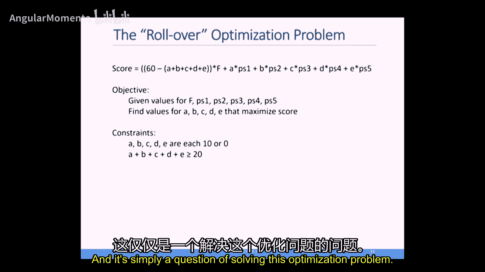

# 002：优化问题


## 概述
在本节课中，我们将要学习优化问题的两种主要求解方法：贪心算法和动态规划。我们将通过背包问题的例子，探讨这两种方法的优缺点、实现方式以及适用场景。

---

## 贪心算法的优缺点
上一节我们介绍了贪心算法的基本思想。本节中我们来看看它的优缺点。

**优点**：
*   实现简单。
*   运行速度快，时间复杂度为 **O(n log n)**。

**缺点**：
*   不能保证找到最优解。
*   通常无法得知所得解与最优解的差距。

---

## 暴力搜索算法
为了找到最优解，我们可以使用暴力搜索算法。其基本思想是枚举所有可能的物品组合，剔除总重量超过背包容量的组合，然后从剩余组合中选择价值最高的。

以下是实现暴力搜索的一种方法：使用搜索树。

### 搜索树
搜索树是一种特殊形式的图。我们从根节点开始，考虑列表中的第一个物品。左分支代表“选择该物品”，右分支代表“不选择该物品”。然后对剩余物品递归地应用此过程，直到考虑完所有物品。叶子节点代表一个完整的决策序列。最后，我们在所有满足重量约束的叶子节点中，选择价值最高的一个。

### 计算复杂度
该算法的时间复杂度取决于生成的节点总数。对于 n 个物品，树有 n 层。第 i 层的节点数为 **2^i**。因此，总节点数为 **∑_{i=0}^{n} 2^i = 2^{n+1} - 1**，即 **O(2^n)**，是指数级的。虽然我们可以通过提前终止（当背包已超重时）来优化，但这通常无法改变最坏情况下的时间复杂度。

---

## 暴力搜索的实现与测试
以下是使用递归实现的暴力搜索算法核心代码：

```python
def maxVal(toConsider, avail):
    if toConsider == [] or avail == 0:
        result = (0, ())
    elif toConsider[0].getCost() > avail:
        result = maxVal(toConsider[1:], avail)
    else:
        nextItem = toConsider[0]
        withVal, withToTake = maxVal(toConsider[1:], avail - nextItem.getCost())
        withVal += nextItem.getValue()
        withoutVal, withoutToTake = maxVal(toConsider[1:], avail)
        if withVal > withoutVal:
            result = (withVal, withToTake + (nextItem,))
        else:
            result = (withoutVal, withoutToTake)
    return result
```

该算法通过递归遍历决策树，并始终记录当前找到的最佳解。测试表明，对于小型菜单，它能快速找到比贪心算法更优的解。

---

## 动态规划：解决指数复杂度的关键
当物品数量增多时，暴力搜索的指数级复杂度使其变得不可行。动态规划是解决此问题的关键技术。

为了理解动态规划，我们先看一个更简单的例子：斐波那契数列。

### 斐波那契数列的递归问题
斐波那契数列的递归定义如下：
```
fib(0) = 1
fib(1) = 1
fib(n) = fib(n-1) + fib(n-2)
```
直接递归计算会导致大量重复计算，效率极低。

### 备忘录法
动态规划的核心思想是**备忘录法**：存储已计算过的子问题的解，避免重复计算。以下是使用备忘录优化的斐波那契算法：

```python
def fastFib(n, memo={}):
    if n == 0 or n == 1:
        return 1
    try:
        return memo[n]
    except KeyError:
        result = fastFib(n-1, memo) + fastFib(n-2, memo)
        memo[n] = result
        return result
```
此方法将时间复杂度从指数级降低到近似线性级，带来了巨大的性能提升。

### 动态规划的适用条件
动态规划适用于具有以下两个性质的问题：
1.  **最优子结构**：全局最优解可以通过组合其子问题的最优解得到。
2.  **重叠子问题**：在求解过程中，相同的子问题会被多次计算。

### 背包问题的动态规划
背包问题是否满足这两个条件？
*   **最优子结构**：满足。当前问题的解依赖于“选择当前物品”和“不选择当前物品”这两个子问题的解。
*   **重叠子问题**：满足。在决策树中，不同的选择路径可能到达相同的“状态”——即相同的“剩余容量”和“待考虑物品列表”。此时面临的是完全相同的子问题。

因此，我们可以用动态规划优化背包问题。只需在原有的 `maxVal` 函数中加入一个备忘录参数，其键为 `(len(toConsider), avail)` 元组，值为在该状态下能获得的最大价值。这样，当遇到相同状态时，可以直接查表返回结果，无需重复计算。

动态规划版本的背包算法调用次数远小于朴素递归版本，对于许多实际问题，它能在可接受的时间内找到精确最优解。

---




## 总结
本节课中我们一起学习了优化问题的求解。
*   贪心算法简单快速，但不能保证最优。
*   暴力搜索能保证找到最优解，但具有指数级复杂度，仅适用于小规模问题。
*   动态规划通过利用“最优子结构”和“重叠子问题”性质，存储并复用子问题的解，能极大地提升效率，是解决许多组合优化问题的强大工具。
理解计算复杂度的实际表现有时非常微妙，一个理论上是指数级的问题，在实践中通过巧妙的算法（如动态规划）可能变得非常高效。