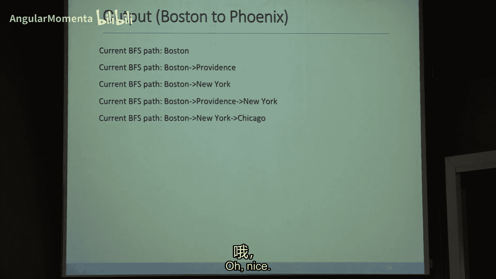

# 003：图论模型 🗺️


以下内容采用知识共享许可协议提供。您的支持将帮助麻省理工学院开放课程持续提供高质量的免费教育资源。如需捐款或查看数百门麻省理工学院课程的其他材料，请访问 ocw.mit.edu。

欢迎回来。

在过去的几节课中，我们一直在研究优化模型。其核心思想是：如何找到一种方法来优化一个目标函数（可以是最大化或最小化），同时满足一组约束条件。我们看到，Goodrich教授向你们展示了一种自然产生的方法，即通过观察决策树，在树中寻找路径，以确定如何优化该模型。

今天，我们将把这些树推广到另一大类模型，称为图论模型或图模型。我们将利用这些模型来探讨如何在其上进行优化。

提醒一下，今天的阅读材料中有大量有用的信息。当然，这些内容也会包含在可供下载的幻灯片中。

让我们花点时间重新梳理一下。我们究竟在做什么？总的来说，我们正在尝试构建计算模型。这意味着什么？就像我们可以进行物理实验、社会实验，或者对物理系统和社会系统进行建模，以收集数据、分析数据或进行预测一样，我们也希望用计算的方式做同样的事情。我们希望构建代码模型，然后运行这些模型来预测效果，并可能通过实际的物理实验进行测试。

我们已经看到，例如，如何将“选择吃什么”这样一个非正式问题转化为一个优化问题。在这个例子中，它是一个被称为“背包问题”的变体。我们还看到了如何编写代码来解决它。你已经看到了两种不同的通用方法：贪心算法（试图在每个阶段做最好的选择）和动态规划（一种优雅的解决方案，用于寻找更好的优化方法）。

现在，我们将扩展模型类别，开始讨论图。

## 什么是图？

一个显而易见的问题是：什么是图？图由两个元素或组件构成。

1.  **节点**，有时也称为顶点。这些节点通常关联着一些信息，可能简单到只是一个名字，也可能更复杂。例如，一个节点可能代表一个学生记录，包含成绩。一个图可以用来整合一个班级的所有成绩。
2.  **边**，有时也称为弧。边连接一对节点。我们将看到两种构建图的方式。

第一种是简单的**无向边**。边连接两个节点，允许信息在两者之间双向共享。

在某些情况下，我们会使用**有向图**，有时称为 digraph。在这种情况下，边具有方向，从源节点指向目标节点，或者有时从父节点指向子节点。此时，信息只能从源节点流向子节点。注意，在我画的这个例子里，看起来两个节点之间只有一条单向边。实际上，我可以有从源到目标的边，也可以有另一条从目标返回源的边。我们稍后会看到一些例子。

最后，边可以仅仅是连接。但在某些情况下，我们会在边上附加信息，例如**权重**。权重可以表示从源节点到目标节点需要付出的“代价”。我们将看到，我们需要思考如何遍历这个图，例如，找到从一个地方到另一个地方的路径，并最小化经过边的总成本，或者简单地找到图中两个节点之间的连接。

所以，图由顶点（节点）和边（弧）组成。

## 为什么图有用？

我们将会看到，并且你可能已经猜到，实体之间存在许多非常有用的关系。

*   **欧洲度假**：我可能想知道从巴黎到伦敦有哪些可能的铁路路线。我可以把城市看作节点，铁路连接看作边，然后询问：首先，能否从巴黎到伦敦？其次，最快或最便宜的方式是什么？
*   **药物发现**：将复杂分子建模为内部各部分之间的关系，然后提出诸如“将这个分子转化为另一个分子需要多少能量”之类的问题，并思考如何将其视为图问题。
*   **家族关系**：家谱。在大多数家庭中，它确实是树状结构，而不是图。家谱是关系的一个绝佳展示，因为边是有方向的：父母有孩子，孩子又有孩子。树是图的一种特殊情况。

树是一种特殊的有向图。树的特性是：任何一对节点之间如果连通，则只有一条路径相连。没有环路，无法从一个节点出发经过一系列节点再回到该节点。Goodrich教授曾用决策树来讨论解决背包问题，决策树是寻找解决方案的一种好方法。

在计算机科学中，我们通常使用“澳大利亚树”——它们是倒置的。根在顶部，叶在底部，因为我们希望从树的起点（通常称为根）开始遍历。

总之，树是表示特定类型图的一种有用方式。

## 图的应用场景

如果你仔细想想，世界上充满了许多基于关系的网络，这些关系都可以用图来捕捉。你一直在使用它们，有些人现在就在使用。

*   **计算机网络**：你想从你的机器发送电子邮件给你在斯坦福的朋友。这需要通过一系列链路进行路由。网络由一系列路由器组成，需要算法来确定最佳传输路径。
*   **交通网络**：节点可以是城市，边可以是连接它们的道路。问题可以是：能否到达圣何塞？到达圣何塞的最佳方式是什么？
*   **金融网络**：资金流动，很容易用图建模。
*   **公用事业网络**：下水道、水、电力等任何分配内容的网络。你想用图来建模这些网络中的流量，例如，在管道（边）具有不同容量（权重）的情况下，如何最大化水的分配。
*   **政治网络、犯罪网络、社交网络**：图可以捕捉有趣的关系。

例如，有一个网站分析《绿野仙踪》。节点的大小反映了角色共享对话的场景数量（多萝西是最大的节点）。边代表共享的对话，显示谁和谁交谈。此外，他们还进行了另一种分析（称为最小割/最大流问题），试图识别图中哪些集群内部交互很多，但与其他集群交互很少。你可以看到一些有趣的分组：堪萨斯州的所有人、甘达和芒奇金人等等。你还可以注意到，这本书可能被误命名了，因为巫师实际上与其他角色的互动并不多。

## 图的推理与分析

图不仅捕捉了这些连接网络中的关系，还支持推理。以下是一些推理方式：

1.  **连通性**：给定一个图，是否存在两个元素之间的边序列？能否从 A 到达 B？使用哪些边序列？
2.  **最短路径**：能否找到成本最低的路径（也称为最短路径）？例如，从巴黎到伦敦，我可能希望用时最少，需要选择哪些路线？
3.  **图划分问题**：到目前为止我展示的例子中，并非所有节点都相互连接。可能存在一组相互连接的元素，以及另一个没有连接关系的组件。能否找到这些组件？这被称为图划分问题，即如何将图分离成连通元素的集合。
4.  **最小割/最大流问题**：是否存在一种有效的方法来分离出高度连接的元素（即内部交互很多但与其他部分交互很少的子图）？

## 图的动机：导航

我每天都使用图论。如果你通勤，你可能也会用到。我用它来计算如何从我在列克星敦的家到剑桥的办公室。我使用一个名为 Waze 的好系统，它内部就使用了图论。

我是如何到达办公室的？我将使用有向图来建模道路系统。街道可以是单行道，所以我可能只有一个方向。我的节点或顶点将是交叉点（我可以做出选择的地方）或终点。边就是点之间的连接，即可行驶的道路。每条边都有一个权重。

这里我有一些选择：
*   **预期时间**：从源节点到目标节点的预期时间。Waze 可能使用这个。
*   **距离**：两点之间的距离。虽然这与时间有关，但并不直接，因为它取决于交通状况。
*   **平均速度**：源节点和目标节点之间的平均行驶速度。一旦我有了图，我就可以解决一个优化问题：找到从家到办公室权重最短的路径。

像 Waze 这样的商业系统使用第一个选项。我和妻子对通勤有争论，她坚信第二个选项（最短距离）。而我实际上喜欢第三个选项，因为当我开车时，只要感觉在前进，我就喜欢。所以即使我可能蜿蜒穿过剑桥的后街，只要我开得快，我就感觉在到达目的地。

## 历史背景：柯尼斯堡七桥问题

思考系统导航实际上给了我们一点历史背景，因为图论的第一个有记载的应用正是这个问题。

18 世纪初的柯尼斯堡七桥问题。柯尼斯堡是一个由岛屿和河流组成的城市，有七座桥连接这些岛屿。提出的问题是：是否可能进行一次散步，恰好穿过每座桥一次？

伟大的瑞士数学家莱昂哈德·欧拉解决了这个问题。他是这样做的：将每个岛屿视为一个节点，每座桥视为一条无向边。通过这样做，他抽象掉了无关的细节（岛屿大小、桥的长度等）。然后问题转化为：在这个图中，是否能找到一条路径，恰好经过每条边一次？欧拉证明，答案是否定的。

我们将使用图来思考这类问题。事实上，我将要展示的例子是最短路径问题。

## 构建图

现在，让我们开始构建图，然后思考如何使用它们。

我们将从构造图开始，然后展示如何在其上构建搜索算法。

### 定义节点

构建图有很多选择。对于地图，一种构建图的方法是使用经纬度。但正如我们已经看到的，我们希望从图中抽象出一些东西。因此，一个自然的选择是：将图中的节点表示为对象。我们将使用类来实现。

以下是节点的定义。它非常简单。我假设目前节点中存储的唯一信息只是一个名称（字符串）。

```python
class Node(object):
    def __init__(self, name):
        self.name = name
    def getName(self):
        return self.name
    def __str__(self):
        return self.name
```

这让我可以创建任意多的节点。

### 定义边

边连接两个节点。同样，我可以相当直接地构造一个类。

```python
class Edge(object):
    def __init__(self, src, dest):
        self.src = src
        self.dest = dest
    def getSource(self):
        return self.src
    def getDestination(self):
        return self.dest
    def __str__(self):
        return self.src.getName() + '->' + self.dest.getName()
```

这里做了一个重要的假设：传入的 `src` 和 `dest` 参数是节点对象本身，而不是名称。边内部将设置变量指向这些节点对象。打印边时，会显示源节点名称、箭头和目标节点名称。

### 定义有向图

现在需要决定如何表示图。我们将从有向图开始。

一种方法是可以创建一个大的矩阵，称为**邻接矩阵**。行是所有源节点，列是所有目标节点。如果源节点和目标节点之间有边，就在相应位置放 1，否则放 0。注意，因为有向图不是对称的，所以从 S 到 D 可能有 1，但从 D 到 S 可能没有，除非有双向边。这是一种合理但不一定最方便或高效的方式，特别是当图中边很少时，矩阵会很大且大部分是零。

因此，我将使用另一种方法：**邻接表**。其思想是：对于图中的每个节点，关联一个目标节点列表。即，对于一个节点，列出通过单条边可以到达的所有地方。

以下是实现：

```python
class Digraph(object):
    def __init__(self):
        self.edges = {}
    def addNode(self, node):
        if node in self.edges:
            raise ValueError('Duplicate node')
        else:
            self.edges[node] = []
    def addEdge(self, edge):
        src = edge.getSource()
        dest = edge.getDestination()
        if not (src in self.edges and dest in self.edges):
            raise ValueError('Node not in graph')
        self.edges[src].append(dest)
    def childrenOf(self, node):
        return self.edges[node]
    def hasNode(self, node):
        return node in self.edges
    def getNode(self, name):
        for n in self.edges:
            if n.getName() == name:
                return n
        raise NameError(name)
    def __str__(self):
        result = ''
        for src in self.edges:
            for dest in self.edges[src]:
                result = result + src.getName() + '->' + dest.getName() + '\n'
        return result[:-1]
```

初始化图时，将 `edges` 设置为空字典。添加节点时，以该节点为键，值为空列表。添加边时，获取边的源节点和目标节点，确保它们都在图中，然后将目标节点追加到源节点对应的列表中。这样，节点表示为字典中的键，边表示为与键关联的列表中的目标节点值。

其他方法包括：获取节点的所有子节点、检查节点是否在图中、通过名称获取节点对象，以及打印图的所有链接。

### 定义无向图

假设我想要一个无向图。我可以将其作为有向图的子类。实际上，我只需要重写 `addEdge` 方法。

```python
class Graph(Digraph):
    def addEdge(self, edge):
        Digraph.addEdge(self, edge)
        rev = Edge(edge.getDestination(), edge.getSource())
        Digraph.addEdge(self, rev)
```

在无向图中，边可以双向工作。因此，给定一条要添加到图中的边，我使用有向图类的方法添加一条从源到目标的边，然后创建另一条方向相反的边（目标变为源，源变为目标），并将其添加到图中。这样就很方便，因为无向图中边没有方向性，我可以双向移动。

为什么选择让无向图作为有向图的子类，而不是反过来？因为如果客户端代码能正确使用基类（有向图）的实例，那么当使用子类（无向图）的实例替代时，也应该能正确工作。反之则不一定成立。因此，让无向图作为有向图的子类更容易。此外，这样只需更改添加边的含义，其他所有方法都能继承。

## 搜索图：最短路径问题

现在我们可以构建图了。接下来，我想在图上进行搜索。我将从经典的图优化问题开始：找到最佳路径。即，从一个节点到另一个节点的最短路径。

最初，“最短路径”指的是步数最少的序列。路径具有以下属性：第一条边的源是起点，最后一条边的目标是终点。对于中间的任意边，如果我从源经过第一条边到达节点一，那么下一条边的源就是节点一。这只是一个链，表示我可以从这里到这里再到那里，一路走完。我想找到从源到目的地所需的最少步数。

最终，如果边上有权重，我想解决的优化问题是：找到权重最短的路径，即到达目的地所需付出的最少“工作量”。如果我们能解决其中一个，我们就能相当直接地解决另一个。

我们已经见过最短路径问题的例子：寻路导航、设计通信网络（希望消息尽快到达朋友那里，而不是绕地球很多圈）、许多生物学问题也涉及此类问题。

### 示例：城市导航图

这是一个城市间的小型导航问题，可以看作是航班路线图。其邻接表表示如下：
*   波士顿：可到达普罗维登斯、纽约。
*   普罗维登斯：可到达波士顿、纽约。
*   纽约：只能到达芝加哥。
*   芝加哥：可到达丹佛或凤凰城。
*   丹佛：可到达凤凰城或纽约。
*   洛杉矶：只能返回波士顿。
*   凤凰城：没有出口。

构建此图的代码如下：

```python
def buildCityGraph(graphType):
    g = graphType()
    for name in ('Boston', 'Providence', 'New York', 'Chicago',
                 'Denver', 'Phoenix', 'Los Angeles'):
        g.addNode(Node(name))
    g.addEdge(Edge(g.getNode('Boston'), g.getNode('Providence')))
    g.addEdge(Edge(g.getNode('Boston'), g.getNode('New York')))
    g.addEdge(Edge(g.getNode('Providence'), g.getNode('Boston')))
    g.addEdge(Edge(g.getNode('Providence'), g.getNode('New York')))
    g.addEdge(Edge(g.getNode('New York'), g.getNode('Chicago')))
    g.addEdge(Edge(g.getNode('Chicago'), g.getNode('Denver')))
    g.addEdge(Edge(g.getNode('Chicago'), g.getNode('Phoenix')))
    g.addEdge(Edge(g.getNode('Denver'), g.getNode('Phoenix')))
    g.addEdge(Edge(g.getNode('Denver'), g.getNode('New York')))
    g.addEdge(Edge(g.getNode('Los Angeles'), g.getNode('Boston')))
    return g
```

### 深度优先搜索

我将展示两种解决此问题的技术。第一种称为**深度优先搜索**。它类似于 Goodrich 教授展示的在搜索树中采用最左、最深的方法。这里的一个技巧是，因为处理的是图而不是树，可能存在环路。因此，我需要记录路径中的节点，并且永远不会回到已经在路径中的节点，以避免无限循环。

第二个要点是，我将利用一个你以前见过的问题：这实际上是**分治法**的一个版本。如果我想找到从源节点到目标节点的路径，并且我能找到从源到某个中间节点的路径，以及从中间节点到目标的路径，那么组合起来显然就是一条完整的路径。因此，我可以递归地将这个问题分解为更简单的搜索问题。

深度优先搜索的思想是：从源节点开始，以某种顺序（例如，它们被放入系统的顺序）查看离开该节点的所有边。然后跟随第一条边，检查是否到达目标位置。如果是，则完成。如果不是，则跟随从该节点出发的第一条边。如此循环，直到找到目标节点或用尽所有选项。

让我展示一个例子。假设我有一个简单的搜索树。从源节点开始，沿着第一条路径深入，检查是否到达目标。如果没有，则从当前节点选择第一条路径继续深入。如此反复，直到无法继续，然后回溯到上一个节点，尝试其他未探索的边，继续深入搜索。这就是“深度优先”的含义——尽可能深地探索图。

以下是深度优先搜索的代码实现：

```python
def shortestPath(graph, start, end, path=[], shortest=None, toPrint=False):
    path = path + [start]
    if toPrint:
        print('Current DFS path:', printPath(path))
    if start == end:
        return path
    for node in graph.childrenOf(start):
        if node not in path:
            if shortest is None or len(path) < len(shortest):
                newPath = shortestPath(graph, node, end, path, shortest, toPrint)
                if newPath is not None:
                    shortest = newPath
        elif toPrint:
            print('Already visited', node)
    return shortest

def DFS(graph, start, end, toPrint=False):
    return shortestPath(graph, start, end, [], None, toPrint)
```

`shortestPath` 函数递归地探索路径。它维护当前路径 `path` 和目前找到的最短路径 `shortest`。对于当前节点的每个子节点，如果该子节点不在当前路径中（避免环路），并且尚未找到更短的路径，则递归调用自身进行探索。最终返回找到的最短路径。`DFS` 函数是一个包装器，用于初始化调用。

让我们测试一下。尝试从波士顿到芝加哥。代码会打印出探索过程。从波士顿开始，首先尝试波士顿 -> 普罗维登斯，然后从普罗维登斯尝试，等等。如果遇到环路（例如，纽约 -> 芝加哥 -> 丹佛 -> 纽约），它会检测到芝加哥已经在路径中，从而避免循环。最终，它会探索所有可能的路径并返回最短的路径（如果存在）。

深度优先搜索会找到一个解决方案，但它不一定是最短路径，因为它可能先找到一条长路径。为了找到最短路径，它必须探索所有可能的路径，然后进行比较。

### 广度优先搜索

第二种技术是**广度优先搜索**。听起来几乎一样，但顺序不同。同样从初始节点开始，查看离开该节点的所有边。跟随第一条边，检查是否到达目标。如果没有，则跟随下一条边，依此类推。

与深度优先尽可能深入不同，广度优先是：在深入探索任何一条路径之前，先探索所有长度为 1 的路径。然后探索所有长度为 2 的路径，依此类推。因此，一旦找到解决方案，就可以停止，因为知道它是最短的。任何其他路径都会比这个解决方案长。

广度优先搜索需要跟踪待探索的路径队列。以下是代码实现：

```python
def BFS(graph, start, end, toPrint=False):
    initPath = [start]
    pathQueue = [initPath]
    while len(pathQueue) != 0:
        tmpPath = pathQueue.pop(0)
        if toPrint:
            print('Current BFS path:', printPath(tmpPath))
        lastNode = tmpPath[-1]
        if lastNode == end:
            return tmpPath
        for nextNode in graph.childrenOf(lastNode):
            if nextNode not in tmpPath:
                newPath = tmpPath + [nextNode]
                pathQueue.append(newPath)
    return None
```

`BFS` 函数使用队列 `pathQueue` 来存储待探索的路径。初始时，队列只包含起点路径。只要队列不为空且未找到解决方案，就弹出队列中最旧的路径（先进先出），获取该路径的最后一个节点。如果该节点是目标，则返回此路径。否则，对于该节点的每个子节点，如果子节点不在当前路径中，则创建一条新路径（将子节点添加到原路径末尾），并将其加入队列末尾。这样，队列始终按路径长度排序（先探索短路径）。如果遍历完所有可能路径仍未找到目标，则返回 `None`。

让我们看一个例子。从波士顿到凤凰城。初始队列只有 `[Boston]`。弹出它，从波士顿可以到达普罗维登斯和纽约，所以将 `[Boston, Providence]` 和 `[Boston, New York]` 加入队列。然后弹出 `[Boston, Providence]`，从普罗维登斯可以到达纽约（但纽约已在路径中？不，这是新路径），所以加入 `[Boston, Providence, New York]`。如此继续，总是先探索所有长度为 2 的路径，然后是长度为 3 的路径，直到找到目标。一旦找到，即可返回，因为那是最短路径。

### 加权最短路径



那么加权最短路径呢？正如数学家所说，我们将其留作读者的简单练习。这有点不公平。其思想是：假设边上有权重，而不仅仅是步数。例如，飞往洛杉矶比从波士顿飞往纽约要长。我想做的是同样的优化，但现在是最小化边上的权重之和，而不是边的数量。

正如你可能猜到的，深度优先搜索很容易修改来实现这一点。成本现在将是权重的总和。同样，我必须搜索所有可能的选项，直到找到解决方案。不幸的是，广度优先搜索不容易修改，因为最短加权路径可能比最小边数路径包含更多的边，必须考虑如何调整算法来实现。

## 总结


本节课中，我们一起学习了一种新的模型：图。图是表示网络的绝佳方式，是实体及其之间关系的集合。存在许多优秀的图优化问题，我们刚刚展示了其中两个例子（深度优先搜索和广度优先搜索）。随着课程的深入，我们将看到更多图的应用示例。