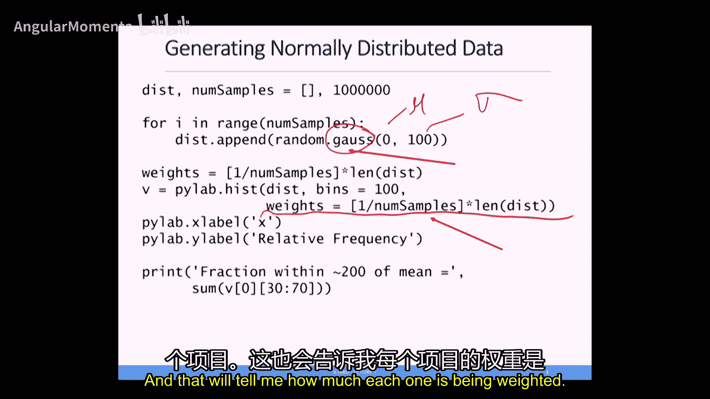
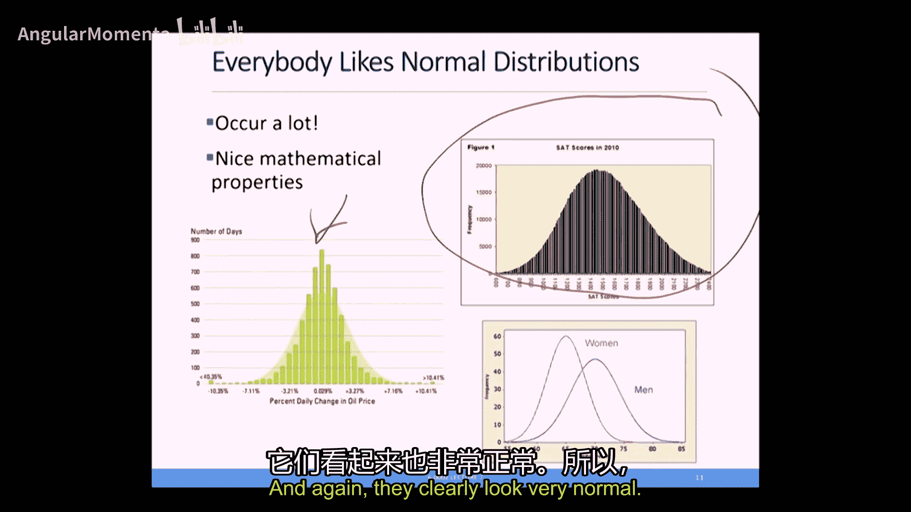
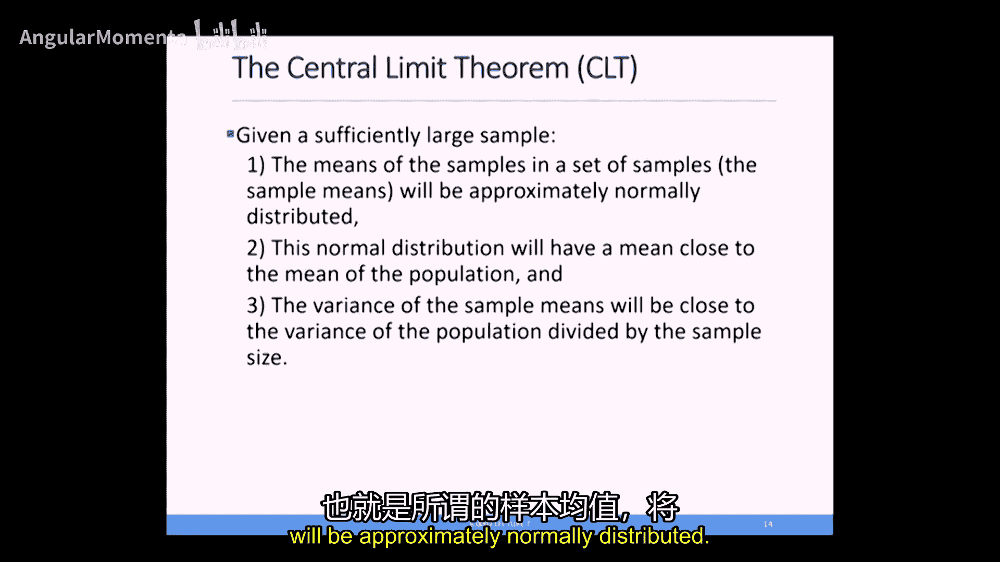
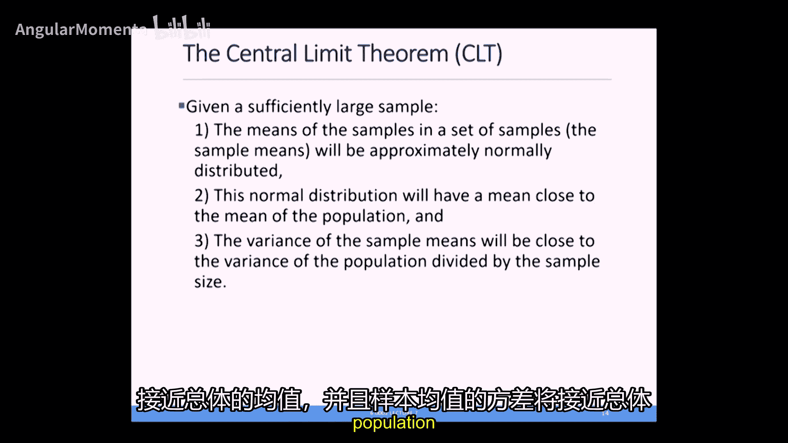
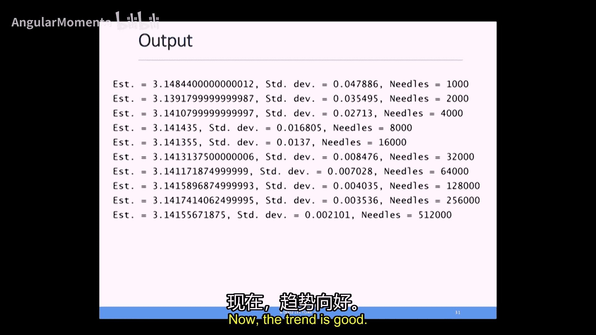
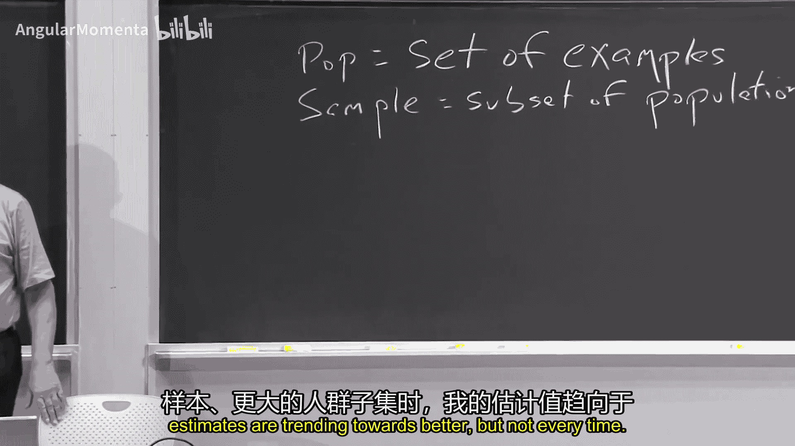
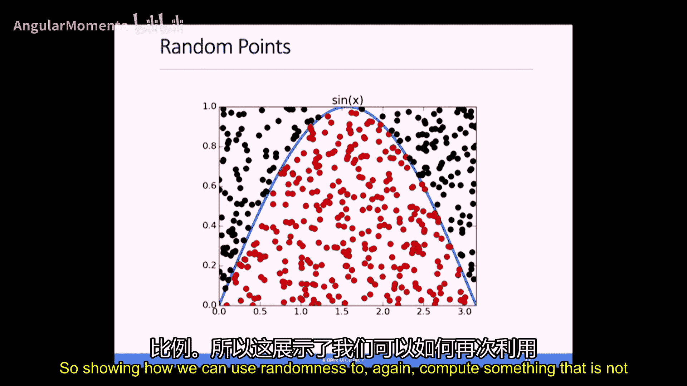
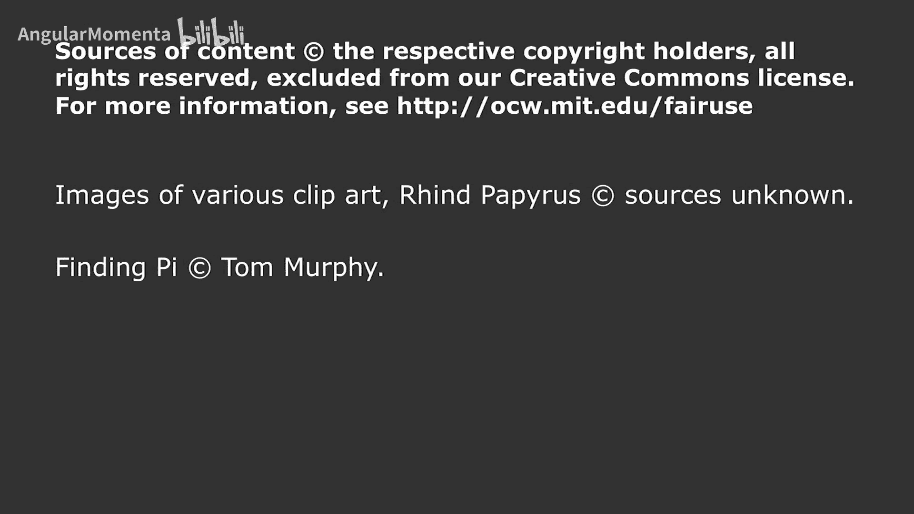

# 007：置信区间 📊


在本节课中，我们将要学习置信区间、正态分布以及中心极限定理。我们将通过代码示例和公式来理解这些核心概念，并探讨如何利用随机模拟（蒙特卡洛方法）来估算像圆周率π这样的确定值。

## 正态分布与高斯函数



上一节我们介绍了经验法则及其假设。本节中，我们来看看其中一个关键假设：误差服从正态分布，也称为高斯分布。


正态分布的概率密度函数（PDF）由以下公式定义：

**公式：** `f(x) = (1 / (σ * sqrt(2π))) * exp(-((x - μ)^2) / (2 * σ^2))`

其中，`μ` 是均值，`σ` 是标准差。

在Python中，我们可以使用 `random.gauss(mu, sigma)` 函数从指定均值和标准差的正态分布中生成随机值。以下代码生成了一个近似正态分布并绘制其直方图：

```python
import random, pylab

# 生成10000个服从均值为0、标准差为100的正态分布的随机值
vals = []
for i in range(10000):
    vals.append(random.gauss(0, 100))

# 绘制直方图，y轴显示频率而非计数
pylab.hist(vals, bins=100, weights=[1.0/len(vals)]*len(vals))
pylab.title('正态分布示例')
pylab.xlabel('值')
pylab.ylabel('频率')
pylab.show()
```

通过调整权重参数，我们可以让y轴显示每个区间内数值出现的频率（分数），从而更直观地验证经验法则，例如观察有多少比例的值落在均值附近两个标准差的范围内。

## 理解概率密度函数（PDF）

我们之前看到，PDF曲线下的面积代表概率。对于正态分布的PDF，y轴上的值本身不是概率，而是概率密度。要计算某个区间内的概率，需要计算该区间下曲线围成的面积，即进行积分。

SciPy库提供了数值积分工具。以下是使用 `scipy.integrate.quad` 函数计算正态分布在特定区间内概率的示例：

```python
import scipy.integrate



def gaussian(x, mu, sigma):
    # 正态分布PDF的实现
    factor1 = (1.0/(sigma*((2*pylab.pi)**0.5)))
    factor2 = pylab.e**-(((x-mu)**2)/(2*sigma**2))
    return factor1*factor2

def check_empirical(num_trials):
    # 检查经验法则对于不同均值和标准差的正态分布是否成立
    for t in range(num_trials):
        mu = random.randint(-10, 10)
        sigma = random.randint(1, 10)
        # 计算落在1个、1.96个、3个标准差范围内的概率
        for num_std in (1, 1.96, 3):
            # 对PDF进行积分
            area = scipy.integrate.quad(gaussian, mu-num_std*sigma,
                                        mu+num_std*sigma,
                                        (mu, sigma))[0]
            print(f'均值={mu}, 标准差={sigma}, {num_std}个标准差内的面积 = {area:.3f}')
```


运行此代码会验证，对于任何正态分布，大约68%的数据落在1个标准差内，95%落在1.96个标准差内，99.7%落在3个标准差内，这与经验法则一致。




## 中心极限定理（CLT）🔁




并非所有数据都服从正态分布（例如轮盘赌的单次结果）。然而，当我们考虑样本均值（而非单个数据点）时，中心极限定理开始发挥作用。

中心极限定理指出，对于一个足够大的样本量：
1.  样本均值的分布将近似于正态分布。
2.  该分布的均值将接近总体均值。
3.  该分布的方差将接近总体方差除以样本量。

**公式：** 样本均值分布的方差 ≈ 总体方差 / 样本量

这意味着，无论原始总体分布形状如何（如均匀分布、二项分布），只要样本量足够大，其样本均值的分布就会趋近于正态分布。这解释了为什么即使轮盘赌单次结果不服从正态分布，我们仍能对其长期平均回报应用经验法则和置信区间。

## 蒙特卡洛模拟与估算π 🎯

随机性不仅可以用于分析随机过程，还能通过蒙特卡洛模拟估算确定值，例如圆周率π。

布丰投针实验的思路是：在一个边长为2的正方形内内切一个半径为1的圆。正方形的面积是4，圆的面积是π。如果随机向正方形内投掷大量“针”（点），那么落在圆内的点的比例应等于圆的面积与正方形面积之比。

**公式推导：**
1.  点落在圆内的概率 P = (圆的面积) / (正方形的面积) = π / 4
2.  因此，π = 4 * P ≈ 4 * (落在圆内的点数 / 总投掷点数)

以下是该模拟的Python实现：

```python
import random, math

def throw_needles(num_needles):
    """
    模拟投掷num_needles根针，返回π的估计值。
    """
    in_circle = 0
    for _ in range(num_needles):
        x = random.random() * 2 - 1  # 生成[-1, 1)之间的x坐标
        y = random.random() * 2 - 1  # 生成[-1, 1)之间的y坐标
        if (x**2 + y**2) <= 1:       # 检查点是否在单位圆内
            in_circle += 1
    # 针落在正方形内，总数为num_needles
    return 4 * (in_circle / num_needles)

def estimate_pi(precision, num_trials):
    """
    持续增加投掷次数，直到估计值的标准差满足精度要求。
    """
    num_needles = 1000
    std_dev = precision  # 初始化为一个大于精度的值以进入循环
    while std_dev > precision / 1.96:  # 使用1.96对应95%置信度
        estimates = []
        for _ in range(num_trials):
            pi_guess = throw_needles(num_needles)
            estimates.append(pi_guess)
        std_dev = np.std(estimates)
        cur_estimate = sum(estimates)/len(estimates)
        print(f'针数={num_needles:6d}, 估计π={cur_estimate:.5f}, 标准差={std_dev:.5f}')
        num_needles *= 2  # 加倍投掷次数以提高精度
    return cur_estimate
```

运行此模拟，随着投掷次数增加，π的估计值会越来越接近真实值，并且估计值的标准差（不确定性）会越来越小，从而让我们能以更高的置信度确定估计值的范围。

## 重要警示：统计有效性与模型正确性 ⚠️



模拟给出的置信区间只能告诉我们**基于当前模型和代码**，结果的可重复性如何。它不能保证模型或代码本身是正确的。



例如，如果在计算π的公式中错误地将4写成了2（`return 2 * (in_circle / num_needles)`），模拟仍然会运行，并给出一个非常“精确”（标准差很小）但完全错误的π估计值（约1.57）。

因此，统计工具（如置信区间）告诉我们的是：如果重复实验，结果的变化范围。但它们无法检测系统错误（模型错误或代码错误）。我们必须通过合理性检查（例如，知道π应该大约为3.14）或其他验证方法来确保模拟的准确性。

## 总结

本节课中我们一起学习了：
1.  **正态分布（高斯分布）** 及其概率密度函数，它是应用经验法则的基础。
2.  **中心极限定理** 的强大之处：即使原始数据不服从正态分布，样本均值的分布也会随着样本量增大而趋近于正态分布，这使得我们可以对许多问题的均值进行统计推断。
3.  **蒙特卡洛模拟** 作为一种利用随机性解决确定性问题（如估算π、计算积分）的通用且强大的技术。
4.  一个关键洞见：**统计有效性（结果是否精确且可重复）不等于模型正确性**。模拟结果必须结合领域知识和合理性检查进行批判性评估。





这些概念是计算思维和数据科学中理解不确定性、进行推断和设计模拟实验的基石。