# 008：抽样与标准误差 📊

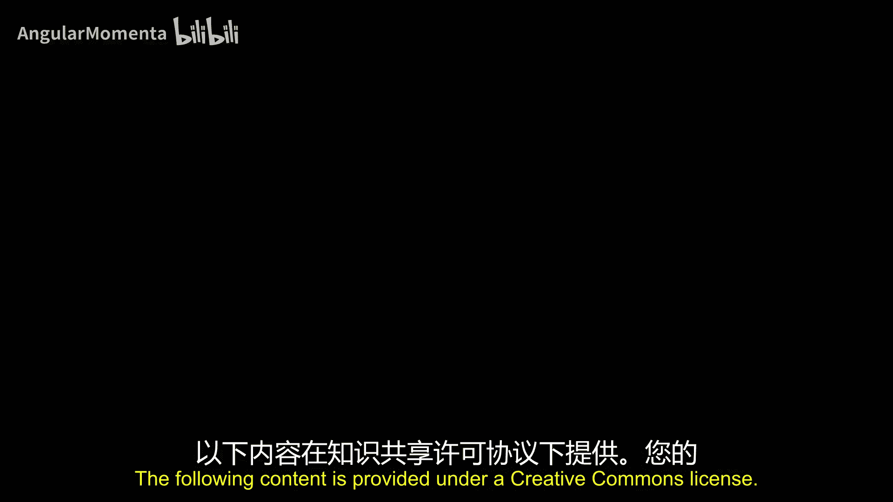


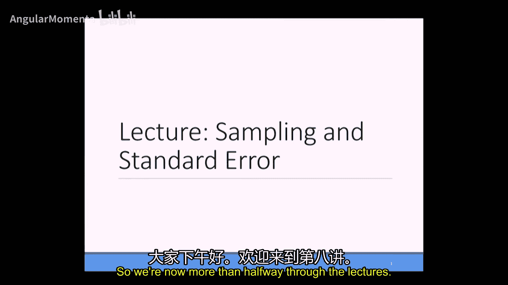

在本节课中，我们将要学习抽样与标准误差的核心概念。我们将探讨如何通过单个样本来推断整个总体的特征，并理解标准误差在构建置信区间中的关键作用。

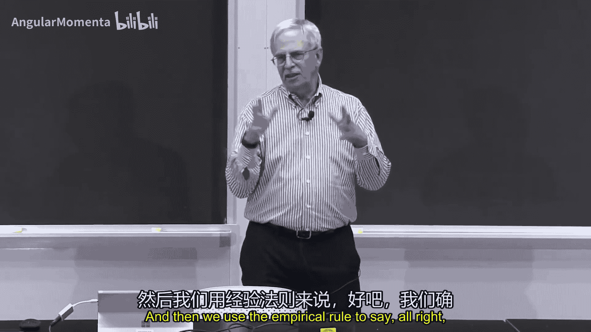

## 概述

以下内容在知识共享许可下提供。您的支持将帮助麻省理工学院开放课程持续提供高质量的免费教育资源。要捐款或查看来自数百门麻省理工学院课程的更多材料，请访问 ocw.mit.edu。

大家好，欢迎来到第8讲。我们现在已经完成了超过一半的课程。今天的主题是抽样。

## 推断统计学回顾

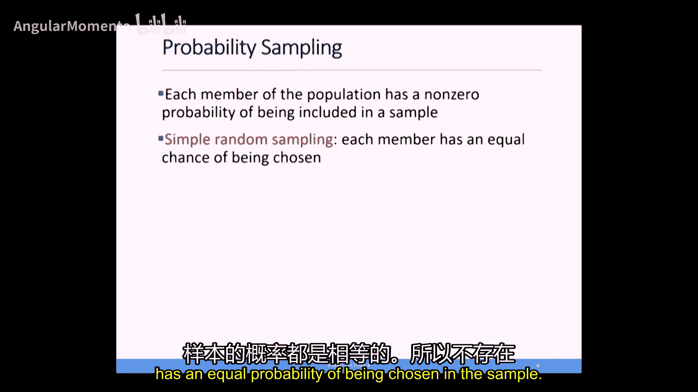

我想首先提醒大家关于推断统计学的整个概念。我们通过检查从总体中抽取的一个或多个随机样本来对总体进行推断。在前两节课中，我们使用了蒙特卡洛模拟。正如我们在尝试求π值时看到的，关键思想是我们可以生成大量随机样本，然后用它们来计算置信区间。接着我们使用经验法则来说明，我们有充分的理由相信，在95%的运行此模拟的情况下，我们的答案将介于此处和此处之间。


当我们在进行模拟时，这一切都很好。但是，当你必须对真实事物进行抽样时会发生什么？例如，你进行一个实验并获得一些数据点，并且很难一遍又一遍地重复实验。想想政治民意调查。这里有一个有趣的民意调查。这些是如何创建的？不是通过模拟。他们没有运行1000次民意调查然后计算置信区间。他们只进行了一次民意调查，在本例中调查了10835人。然而，他们声称有一个置信区间，这就是那个误差范围。显然，他们需要那个大的置信区间。那么这是如何做到的呢？

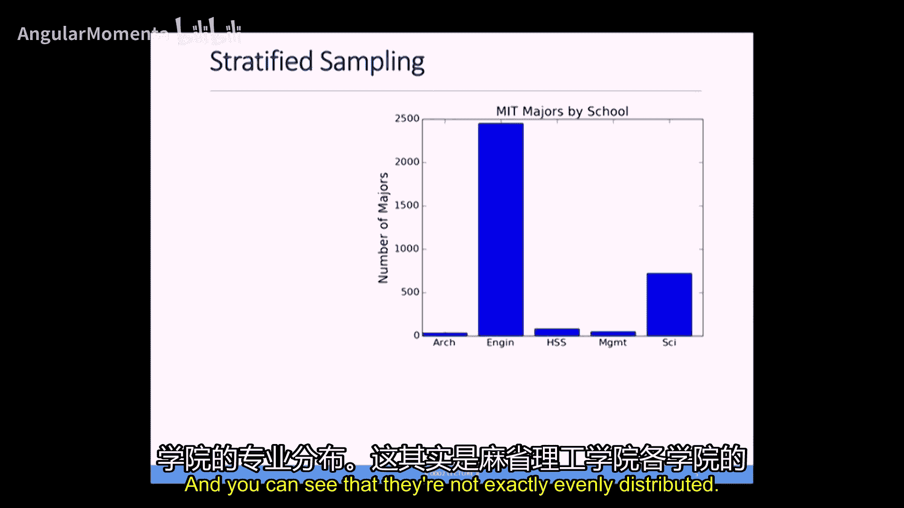

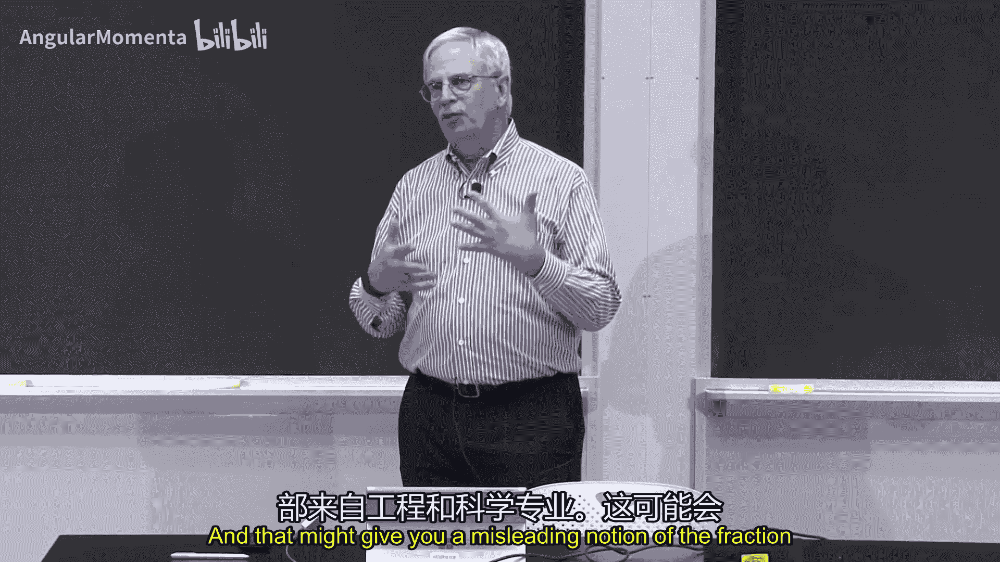

## 概率抽样

退一步讲，让我们谈谈当你不进行模拟时如何进行抽样。你想做所谓的**概率抽样**，其中总体中的每个成员都有非零的概率被包含在样本中。粗略地说有两种类型。我们将把所有时间都花在一种叫做**简单随机抽样**的方法上。这里的关键思想是，总体中的每个成员都有**相等的概率**被选入样本。

**代码示例：**
```python
import random
# 从总体序列中抽取k个不重复的随机样本
sample = random.sample(population, k)
```

这样就没有偏差。但这并不总是合适的。我想花点时间谈谈原因。假设我们想调查麻省理工学院的学生，以了解他们中有多少比例是书呆子（顺便说一句，我认为这是一种赞美）。假设我们考虑随机抽取100名学生。我们可以在校园里四处走动，随机选择100人。如果其中12%是书呆子，我们会说12%的麻省理工学院本科生是书呆子，如果是98%，等等。问题是，让我们按学院看看专业分布。这是麻省理工学院各学院的专业分布，你可以看到它们分布并不均匀。因此，如果你四处走动，只是随机抽取100名学生，他们全部来自工程和科学学院的概率相当高。这可能会让你对麻省理工学院学生中书呆子的比例产生误导性的看法。或者可能不会。

## 分层抽样

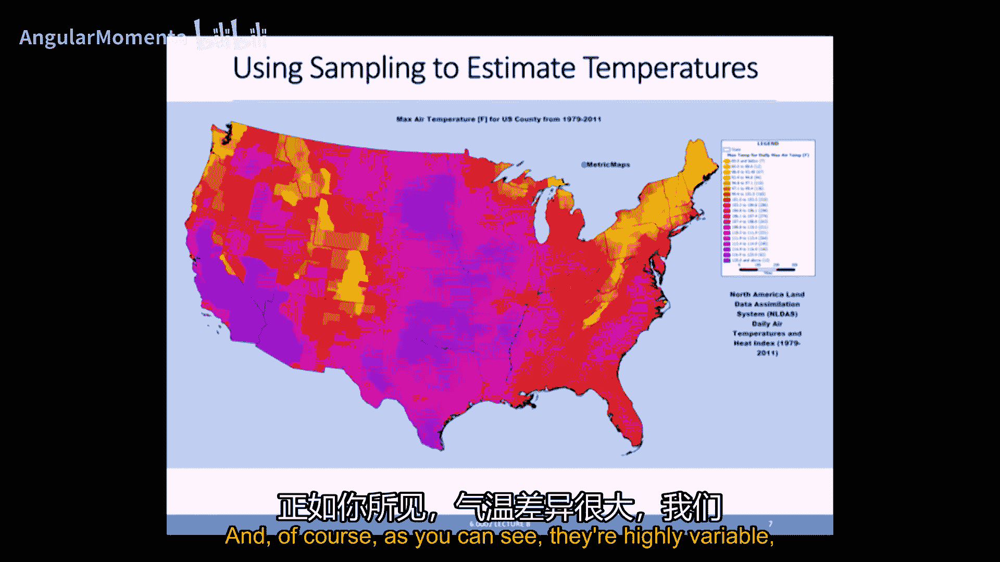


在这种情况下，我们会做一种叫做**分层抽样**的方法。我们将总体划分为子组，然后从每个子组中抽取简单随机样本，并且我们按子组在总体中的大小比例进行抽样。我们当然希望从工程学院抽取的学生比从建筑学院抽取的多。但我们可能希望确保样本中有建筑学院的学生。顺便说一下，大多数政治民意调查都是这样做的。它们是分层的。他们说，我们想得到这么多农村人，这么多城市人，这么多少数族裔，等等。事实上，最近的选举民意调查之所以出错，很可能是因为他们在分层方面做得不好（至少回顾起来是这样）。

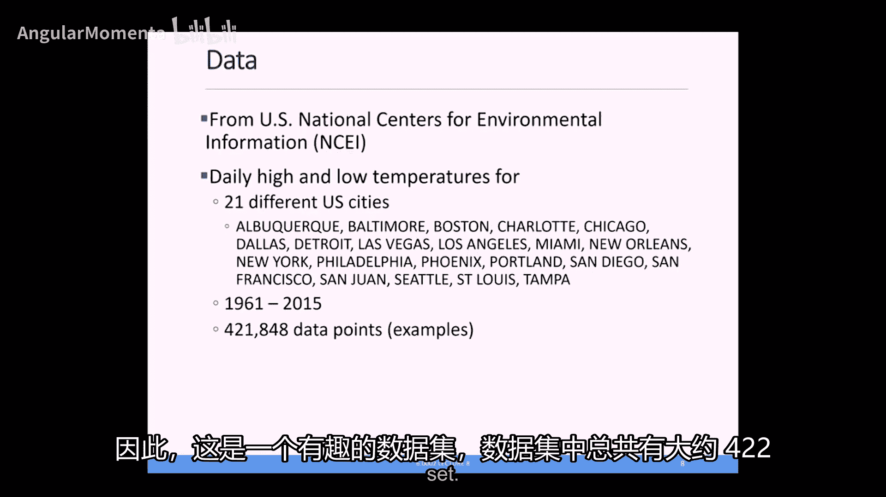

当我们有想要确保被代表的小群体（子组）时，我们使用分层抽样，并且我们希望按他们在总体中的大小比例来代表他们。这也可以用来减少所需的样本量。如果我们想确保样本中有建筑学院的学生，我们一开始就需要抽取超过100人。但如果我们进行分层，我们可以抽取更少的样本。如果操作得当，效果很好，但操作得当可能很棘手。在这里，我们将坚持使用简单随机样本。

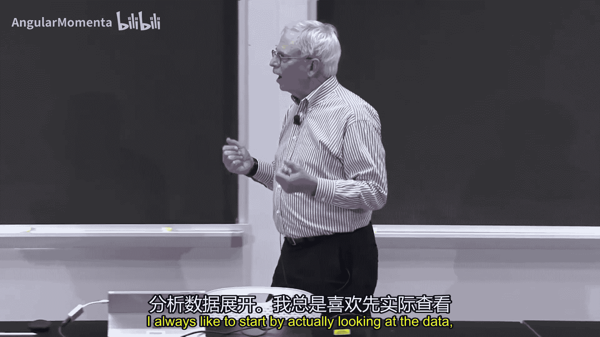

## 示例：温度数据

让我们看一个例子。这是一张美国温度地图。因此，我们今天的运行示例将是通过抽样来获取有关平均温度的信息。当然，正如你所见，温度变化很大，我们生活在一个较凉爽的地区。

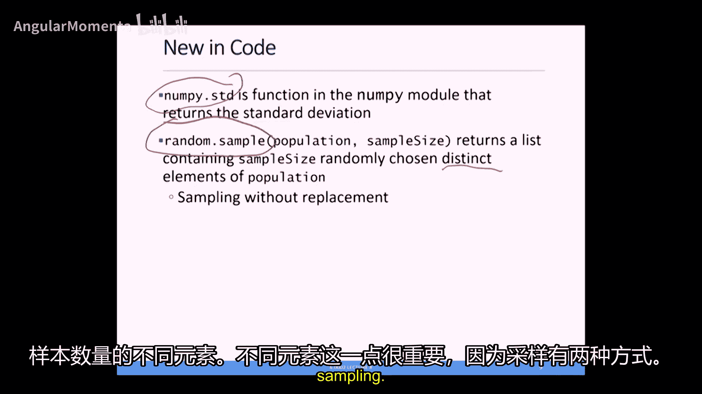


我们将要使用的数据是真实数据，它来自我为课程上传的zip文件，数据源自美国环境信息中心。它包含了从1961年到2015年每天21个不同美国城市的每日最高和最低温度。所以这是一个有趣的数据集，总共有大约422，000个数据点。这是一个相当大的数据集，玩起来很有趣。

## 探索数据

好的，我们现在正处于课程的一部分，包括今天在内的接下来的一系列讲座将是关于数据科学以及如何分析数据。我总是喜欢先实际查看数据，不是查看所有421，000个样本，而是绘制一个图表来大致了解数据的样子。

我不会带你浏览生成这个图表的代码，但我想指出其中有两样东西我们可能以前没见过。简单来说，我将使用 `numpy.std` 来获取标准差，而不是用我自己的代码。以及 `random.sample` 来从总体中抽取简单随机样本。`random.sample` 接受两个参数。第一个是某种值序列，第二个是一个整数，告诉你需要多少个样本。它返回一个包含 `sample_size` 个随机选择的、**不重复**元素的列表。不重复元素很重要，因为人们进行抽样的方式有两种。

你可以进行**无放回抽样**，这就是这里所做的。你抽取一个样本，然后它就从总体中移除了，所以你下次不会抽到它。或者你可以进行**有放回抽样**，这允许你多次抽取相同的样本。我们将在学期后期看到，有时我们更倾向于有放回抽样是有充分理由的。但通常，我们进行无放回抽样。这就是我们在这里要做的。所以我们不会多次得到4月3日的波士顿温度，至少不是同一年。

好的，这是代码生成的直方图。如果你想，现在可以自己运行它，或者稍后运行。这是它的样子：每日最高温度。平均值是16.3摄氏度。我大概知道那是什么感觉。正如你所见，这是一个有趣的分布。它不是正态分布。但是，它也不是那么远。左边有一些低温的尾巴。它就是它本来的样子，不是正态分布。我们稍后会看到这其实并不重要。

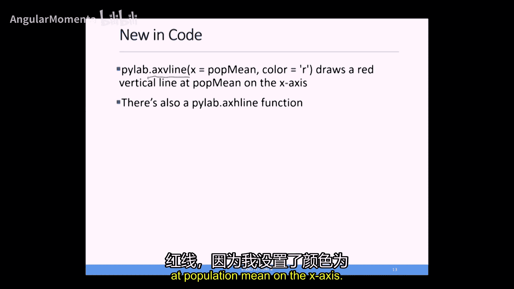

好的，这让我有了一些感觉。接下来我要获取一些统计数据。我们知道平均值是16.3，标准差大约是9.4度。所以，如果你看它，你可以相信这一点。


## 单个随机样本

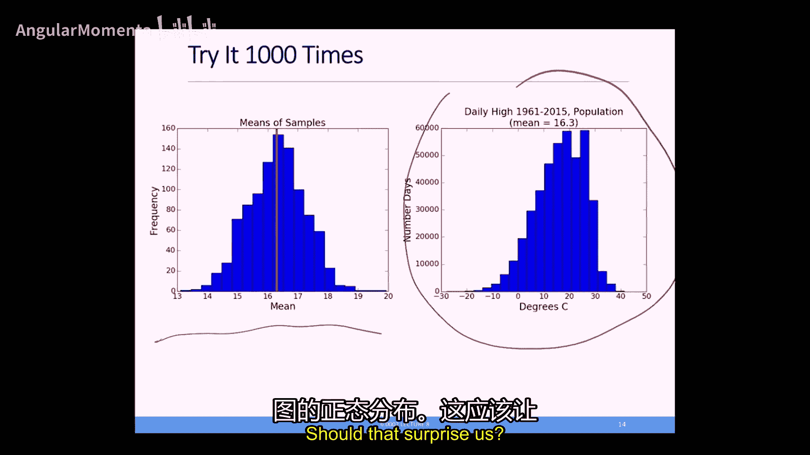


这是一个大小为100的随机样本的直方图。看起来相当不同，正如你可能预期的那样。它的标准差是10.4，平均值是17.07。所以，尽管图形看起来有点不同，但平均值和标准差实际上非常相似。如果我们看总体平均值和样本平均值（我会尽量小心使用这些术语），它们并不相同，但在同一范围内。两个标准差也是如此。

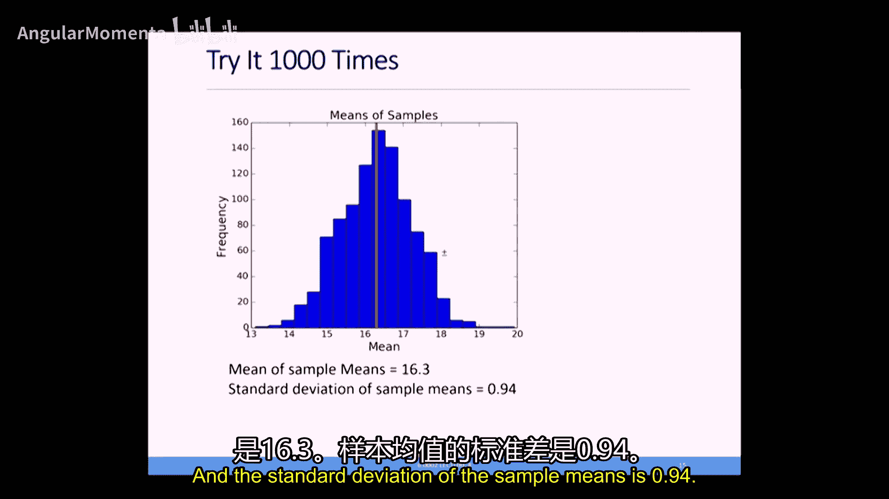


这就提出了一个问题。我们是运气好？还是我们应该期待的事情？如果我们抽取100个随机样本，我们是否应该期望它们与整个总体相对应？答案是，有时是，有时不是。这是我今天想探讨的问题之一。

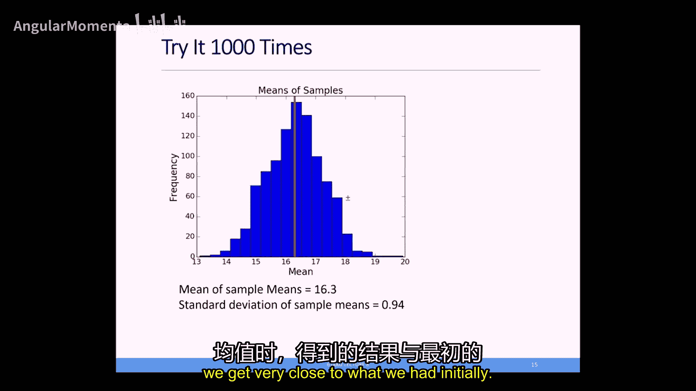


## 多次抽样实验

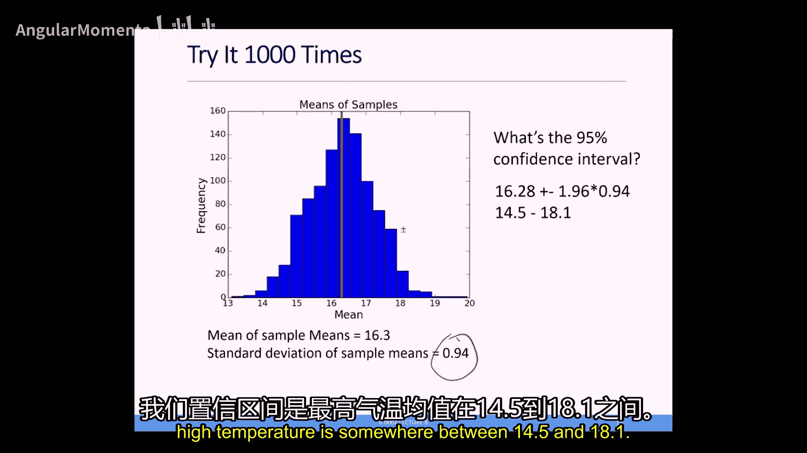

查看这是否是侥幸的一种方法是尝试一千次。我们可以抽取1000个大小为100的样本，并绘制结果。同样，我不会讲解代码。那段代码中也有一些我们以前没见过的东西，那就是 `ax.vline` 绘图命令，`v` 代表垂直。在这种情况下，它会在x轴的总体平均值处画一条红线，因为我指定了颜色是红色。所以只是一条垂直线。如果我们想画一条水平线，我们使用 `ax.hline`。只是向你展示几个有用的函数。

如果我们尝试一千次，结果是这样的。这里我们看到我们最初得到的结果，和我之前展示的图片一样。这是我们查看100个样本的平均值时得到的结果。左边的图看起来更像正态分布，而右边的则不然。这应该让我们惊讶吗？还是我们有理由预期会发生这种情况？答案是什么？有人告诉我为什么我们应该预期它。因为中心极限定理，对吧？这正是中心极限定理向我们保证会发生的事情。

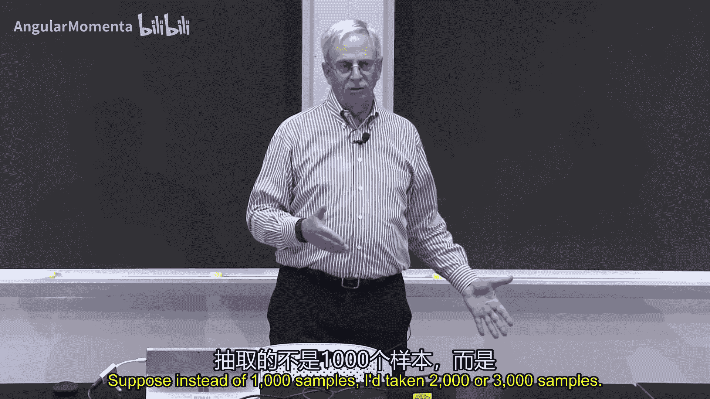

果然，它非常接近正态分布。这是一件好事。现在，如果我们看它，我们可以看到样本平均值的平均值是16.3，样本平均值的标准差是0.94。

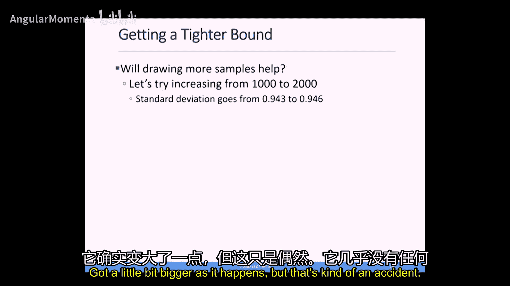

## 置信区间

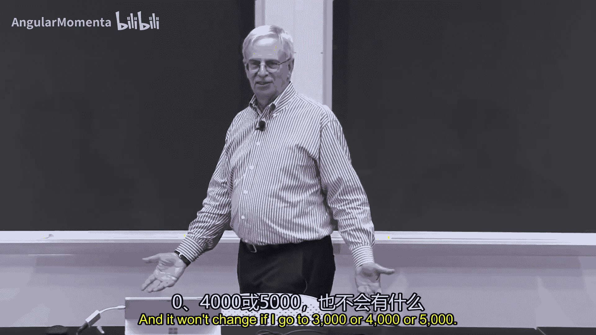

所以如果我们回到我们在这里看到的情况，我们实际上看到，当我们运行一千次并查看平均值时，我们得到的结果非常接近我们最初得到的结果。所以，确实，这不是侥幸，而是我们通常可以期待的事情。

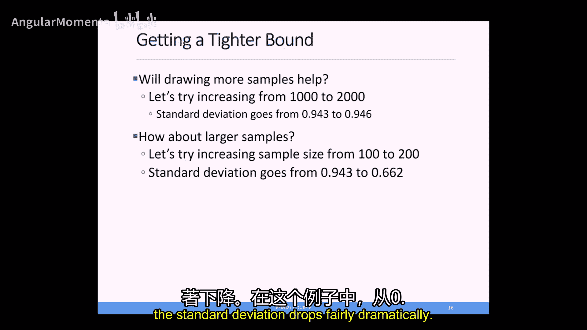

那么这里的95%置信区间是多少？它将是16.28加减1.96乘以0.94（样本平均值的标准差）。它告诉我们置信区间是平均最高温度在14.5到18.1之间。嗯，这实际上是一个相当大的范围，对吧？大到足以决定你是否需要穿毛衣。好消息是它包含了总体平均值。这很好。但坏消息是，它相当宽。


## 如何获得更紧的界限？

假设我们想要一个更紧的界限。我说，好吧，中心极限定理确实会告诉我，平均值的平均值会给我一个对实际总体平均值的好估计，但我想要一个更紧的界限。我能做什么？让我们想想我们可以尝试的几件事。嗯，我们可以考虑的一件事是抽取更多的样本。假设我抽取了2000或3000个样本，而不是1000个样本。我们可以问，那会给我一个更小的标准差吗？对于你们中没有提前看过的人，你们怎么想？谁认为它会给你一个更小的标准差？谁认为不会？其余的人要么提前看过了，要么拒绝思考。我更愿意相信你们提前看过了。

我们可以运行实验。你可以查看代码，你会看到有一个常量1000，你可以很容易地把它改成2000。结果，标准差几乎没有变化。实际上变得稍微大了一点，但这有点偶然。它基本上没有改变。如果我改成3000或4000或500，它会波动，但不会有太大帮助。所以，我们可以看到更频繁地做这件事不会有帮助。

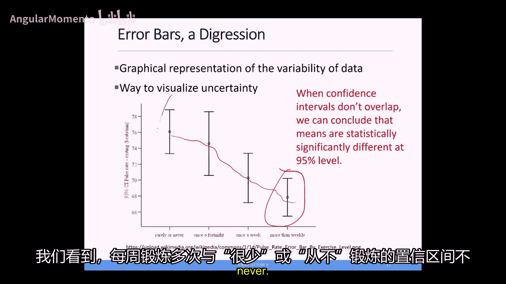

假设我们抽取更大的样本。那会有帮助吗？谁认为会有帮助？谁认为不会？好的，我们可以再次运行实验。我运行了实验。我把样本大小从100改成了200。同样，如果你想，你可以运行这个。如果你运行它，你会得到一个结果，可能不完全一样，但非常相似。确实，当我增加样本的大小而不是样本的数量时，标准差显著下降。在这种情况下，从0.94降到0.66。所以，这是一件好事。

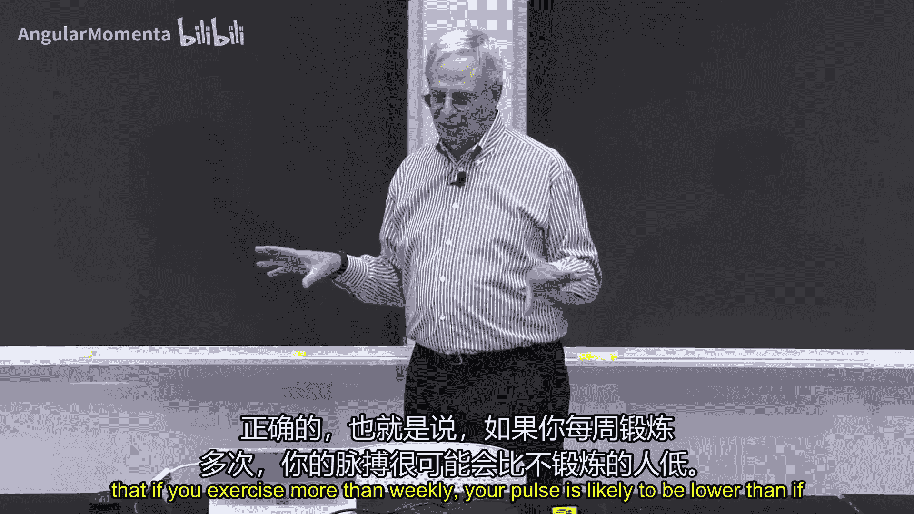

## 可视化变异性：误差条

现在我想在我们回到这个问题之前稍微离题一下，看看如何可视化这一点。因为这是你在写论文等时会想用到的技术。我们如何可视化数据的变异性？通常使用一种叫做**误差条**的东西来完成。你们都见过这些东西。这是我从文献中选取的一个例子。这是绘制脉搏率与运动量或运动频率的关系。在这里你可以看到，肯定有一个下降的趋势，表明你运动得越多，你的平均静息脉搏就越低。这可能值得了解。这些误差条为我们提供了不同子群体的95%置信区间。在这里我们可以看到，其中一些是重叠的。所以，是的，每两周一次（对于不说英语的人来说是两周一次）确实比很少或从不运动要低一点，但置信区间非常大。所以也许我们真的不应该非常确信它实际上会有帮助。我们可以说的是，如果置信区间不重叠，我们可以得出结论，平均值实际上在统计上存在显著差异。在这种情况下，是在95%的水平上。所以在这里我们看到，每周超过一次与很少或从不运动没有重叠。由此我们可以得出结论，这在统计上是真实的，如果你每周运动超过一次，你的脉搏可能比不运动时要低。

如果置信区间重叠，你不能断定没有统计上的显著差异。可能仍然有。你可以使用其他测试来找出是否存在。当它们不重叠时，是件好事，我们可以得出强有力的结论。当它们重叠时，我们需要进一步调查。

## 温度数据的误差条

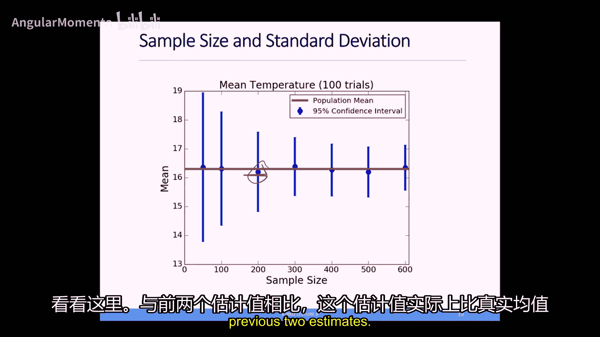

好的，让我们看看我们温度的误差条。同样，我们可以使用 `plt.errorbar` 来绘制它们。它接受两个值，通常是x轴和y轴。但它还接受另一个相同长度的列表或序列，即y轴误差。在这里，我只说1.96乘以标准差。这些变量从哪里来，你可以通过查看代码来了解。然后我可以说我想要的格式，用一个“o”来显示平均值，然后是一个标签。`fmt` 代表格式。`errorbar` 有不同的关键字参数，与 `plot` 不同。你会发现，像直方图、条形图、散点图等，它们都有不同的可用关键字参数。所以你必须分别查找每一个。但除此之外，代码中的其他一切对你来说都应该非常熟悉。

当我运行代码时，我得到这个。我在这里绘制的是平均值相对于样本大小的关系图，带有误差条。在这种情况下是100次试验。所以你可以看到，随着样本量变大，误差条变小。对平均值的估计不一定变得更好。事实上，我们可以看这里。相对于真实平均值，这实际上是一个比前两个估计更差的估计。但我们可以对它更有信心。周一我们在估计π时看到了同样的事情，掉落更多的针并不一定会给我们更准确的估计，但它让我们对我们的估计更有信心。同样的事情也发生在这里。我们可以看到，稳步地，我们可以获得越来越多的信心。

## 大样本的优势

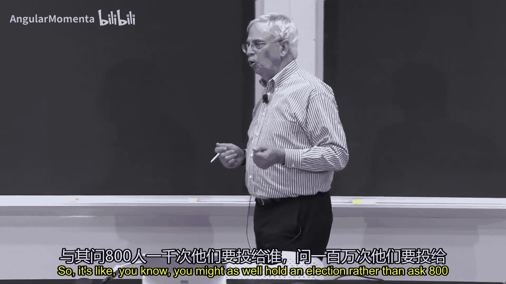

所以，更大的样本似乎更好。这是一件好事。从样本量50到样本量600，置信区间（我应该说是标准差，幻灯片上有个错误）减小了，正如你所看到的。这里的置信区间（应为标准差）从略低于14到几乎19，而另一个大约是从15.5到17。好的，有什么问题吗？嗯，我们现在看的是100个样本，每个样本大小为600。所以我们总共看了600，000个例子。这给我们带来了什么？绝对没有。整个总体只包含大约422，000个样本。我们还不如查看整个数据集，而不是抽取其中的一部分。所以这就像，你知道，你不如直接举行选举，而不是问800个人一百万次他们会投票给谁。

好的，所以当然，这很好，但它没有给我们带来任何新信息。假设我们只做一次。假设我们只抽取一个样本，就像我们在政治民意调查中看到的那样。我们能从中得出什么结论？答案实际上有点令人惊讶。从一个样本中，我们可以在真正的数学意义上得出多少结论。再次，这要感谢我们的老朋友，中心极限定理。

## 中心极限定理与标准误差

如果你回想一下这个定理，它有三个部分。到目前为止，我们利用了前两个。我们利用了平均值将呈正态分布这一事实，这样我们就可以使用经验法则来获得置信区间。以及样本平均值的平均值将接近总体平均值这一事实。现在我想使用它的第三部分，即样本平均值的方差将接近总体方差除以样本大小。我们将用它来计算一种叫做**标准误差**的东西。正式名称是平均值的标准误差，人们通常只称之为标准误差。我会不一致地称呼它，有时叫这个，有时叫那个。

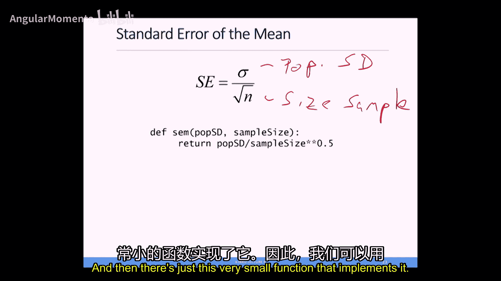

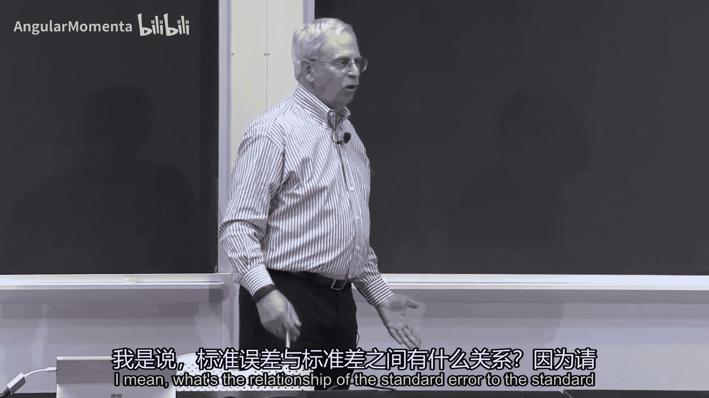

这是一个极其简单的公式。标准误差等于σ（其中σ是总体标准差）除以n的平方根（n是样本大小）。然后有一个非常小的函数来实现它。

**公式：**
```
标准误差 (SE) = σ / sqrt(n)
```

**代码示例：**
```python
import math
def sem(popSD, sampleSize):
    return popSD / math.sqrt(sampleSize)
```

所以我们可以计算这个叫做平均值的标准误差的东西，方法非常简单。我们可以计算它。但它有效吗？我说的“有效”是什么意思？我的意思是，标准误差与标准差有什么关系？因为记住，我们的目标是理解标准差，这样我们就可以使用经验法则。

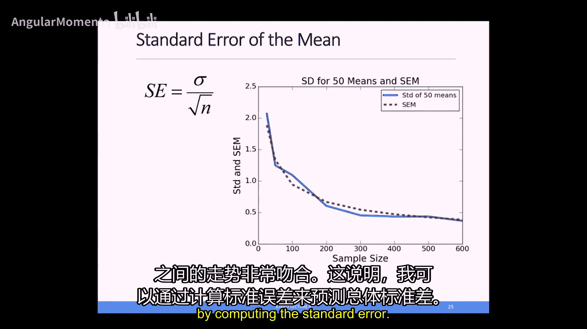

## 测试标准误差

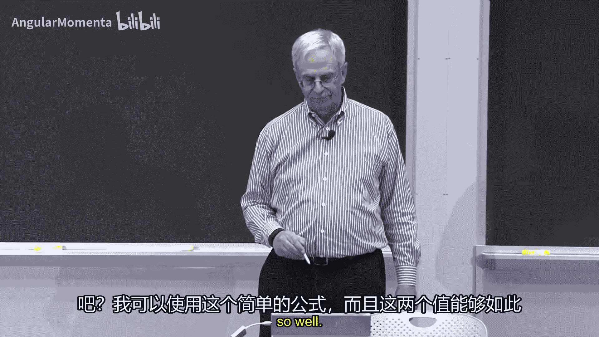

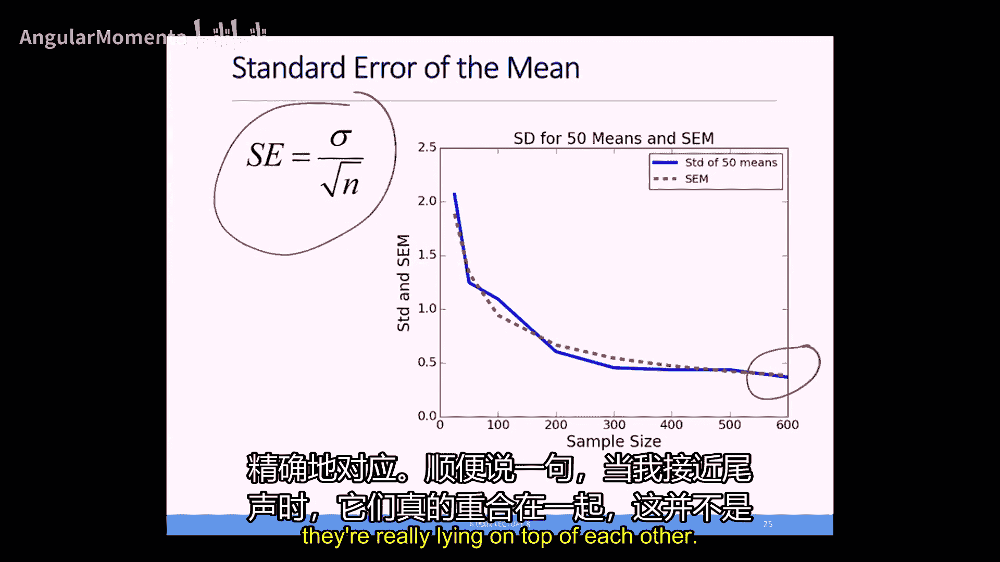

让我们测试一下平均值的标准误差。这里有一段稍长的代码。我将查看一系列不同的样本大小，从25到600，每个大小进行50次试验。`getHighs` 只是一个返回温度的函数。我将获取整个总体的标准差。然后是平均值的标准误差和样本标准差。然后我将遍历并运行它。所以对于每个样本大小，我将附加平均值的标准误差。记住，这使用了总体标准差和样本大小。所以我会计算所有的SEM。然后我也会计算所有的实际标准差。然后我们将生成一些图，实际上是一个图。

让我们看看那个图是什么样子。非常引人注目。我们看到蓝色的实线是50个平均值的标准差。红色的虚线是平均值的标准误差。我们可以非常明显地看到，它们确实相互跟踪得很好。这表明，我可以通过计算标准误差来预测标准差会是多少。这真的很有用。因为现在我有一个样本，我计算它的标准误差，我得到的结果与我如果抽取50个样本并查看那50个样本的标准差所得到的结果非常相似。

## 标准误差与标准差的区别


好的，那么，每个人都理解标准差和标准误差之间的区别吗？不，好吧。那么我们如何计算标准差？我们必须查看许多样本，在本例中是50个。我们计算这50个样本中有多少变异。对于标准误差，我们查看一个样本，我们计算这个叫做标准误差的东西，然后我们论证我们得到了大致相同的数字，就好像我们抽取了50个或100个样本并计算了标准差一样。所以，如果我的唯一目的是获取标准差，我可以避免抽取所有50个样本。我可以只抽取一个样本，然后使用平均值的标准误差。

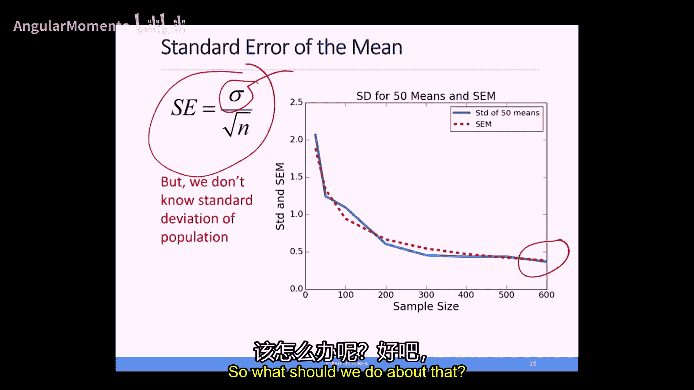

回到我的温度例子，我不必查看很多样本，我只需要查看一个。我可以得到一个有意义的置信区间。好的。

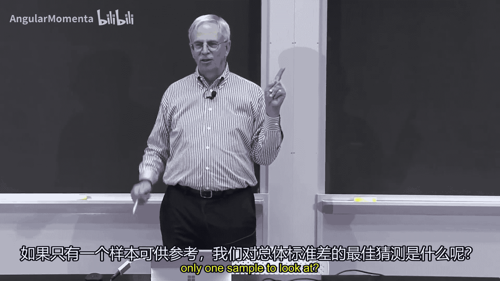

## 一个难题

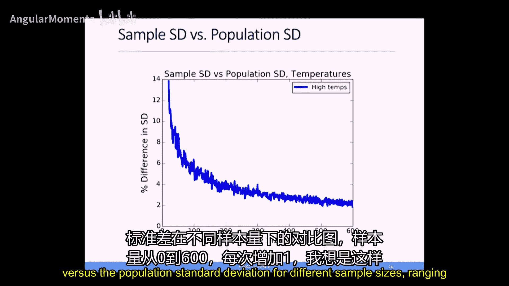

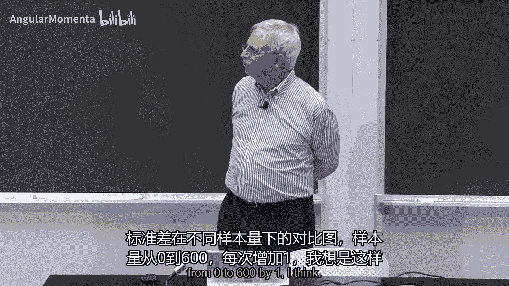

有一个问题。注意，标准误差的公式包含了总体的标准差，而不是样本的标准差。嗯，这有点令人沮丧。因为如果不查看整个总体，我怎么能得到总体的标准差呢？而如果我打算查看整个总体，那么抽样的意义何在？所以，我们遇到了一个难题。我们有一个非常好的近似值，但它使用了一个我们不知道的值。那么我们应该怎么做呢？

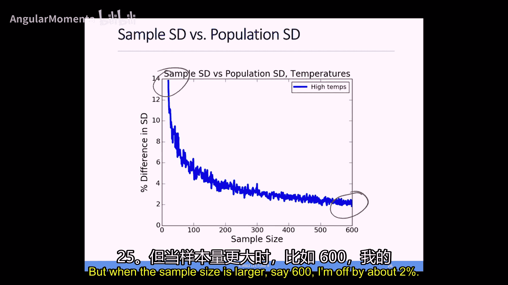

## 使用样本标准差

嗯，唯一显而易见的事情可以尝试的是什么？如果我们只有一个样本来查看，我们对总体标准差的最佳猜测是什么？有人告诉我你会用什么。样本的标准差是我所拥有的一切。那么，让我们问一个问题，这有多好？好得惊人。

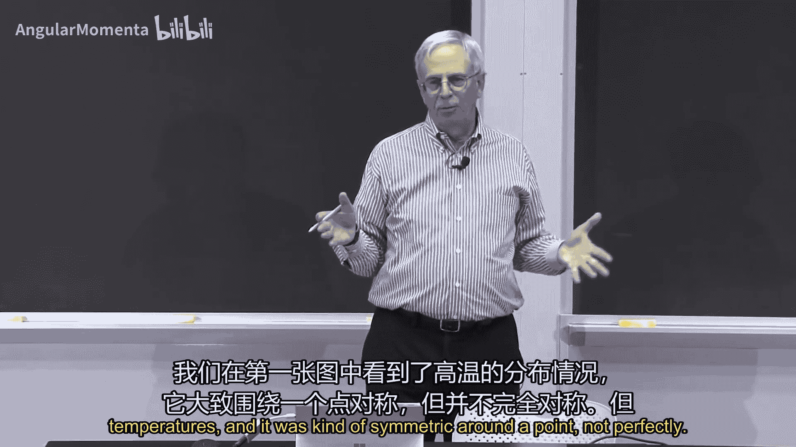

所以我查看了我们这里的温度例子。我绘制了样本标准差与总体标准差的关系图，针对不同的样本大小，范围从0到600，我想是步长为1。所以你可以在这里看到，当样本量很小时，我偏差很大。这里我偏差了14%，我想那是25。但是当样本量较大时，比如600，我偏差了大约2%。

## 样本量、偏度与总体大小

所以我们看到，至少对于这个温度数据集，如果样本量足够大，样本标准差是总体标准差的一个相当好的近似值。现在我们应该问一个问题，这有什么用？嗯，正如我所说，一旦样本达到合理的大小，我们在这里看到，合理的大小可能在500左右，它就变成了一个很好的近似值。但是，这只是针对这个例子吗？它碰巧适用于美国的高温，并不意味着它总是正确的。所以至少有两件事我们应该考虑，以回答这个问题：什么时候这会成立，什么时候不成立，什么时候它不会成立？一个是，总体的分布是否重要？所以在这里，我们在第一张图中看到了高温的分布，它大致围绕一个点对称，但不完全对称。

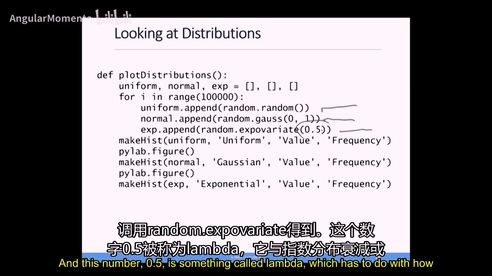

但并非所有事物都是这样的，对吧？所以我们应该说，假设我们有一个不同的分布。那会改变这个结论吗？另一件我们应该问的事情是，假设我们有一个不同大小的总体。假设我有2000万个温度，而不是40万个温度。我需要超过600个样本才能使两者大致相同吗？让我们探讨这两个问题。

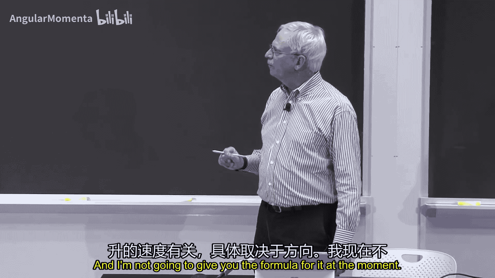

首先，让我们看看分布，我们将看三种常见的分布：均匀分布、正态分布和指数分布。我们将分别查看它们，每个有100，000个点。我们知道可以通过调用 `random.random` 来生成均匀分布，它给出0到1之间实数的均匀分布。我们知道可以通过调用 `random.gauss` 来生成正态分布。在本例中，我查看的是均值为0、标准差为1的情况。但正如我们在上一讲中看到的，形状将与这些值无关。最后是指数分布，我们通过调用 `random.expovariate` 获得。这个数字0.5是所谓的λ，它与指数衰减或上升的速度有关。我暂时不给你它的公式，但我们会看图片。

我们将绘制这些分布的离散近似图。这是它们的样子。非常不同，对吧？我们看过均匀分布和高斯分布。这里我们看到一个指数分布，它基本上会衰减并渐近趋向于0，但永远不会完全达到。正如你所见，它肯定不是围绕平均值对称的。

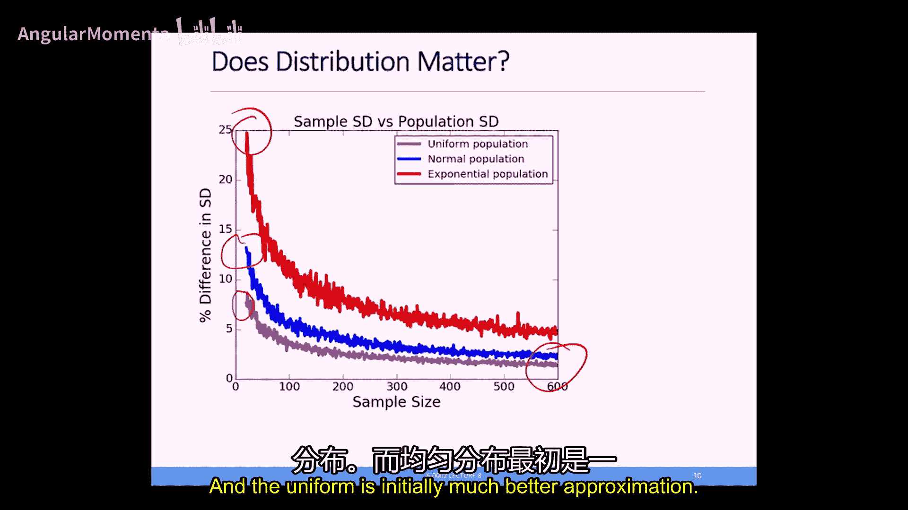

## 不同分布下的实验

好的，让我们看看如果我们对这三个分布（每个有100，000个点示例）运行实验会发生什么，并查看不同的样本大小。我们实际上看到，标准差与总体标准差（应为样本标准差与总体标准差）之间的差异并不相同。在这里，这个看起来有点像我们之前看到的。但指数分布的那个确实非常不同。你知道，它的最坏情况在25这里。正态分布大约是14。这并不太令人惊讶，因为我们的温度分布在我们查看时大致呈正态分布。而均匀分布最初是更好的近似值。


造成这种情况的原因与这些分布中一种叫做**偏度**的基本差异有关。偏度是概率分布不对称性的度量。我们在这里可以看到，偏度确实很重要。偏度越大，你需要越多样本来获得良好的近似值。所以如果总体分布非常偏斜，非常不对称，你需要很多样本来弄清楚发生了什么。如果它非常均匀，例如均匀总体，你需要的样本就少得多。好的，这是一件重要的事情。当我们决定需要多少样本时，我们需要对总体中的偏度有一些估计。

## 总体大小的影响

那么大小呢？大小重要吗？令人惊讶的是，至少我第一次看到这个时很惊讶，答案是否定的。如果我们看这个，我只是看均匀分布，但我们会看到所有三个分布都一样。它基本上不重要。相当惊人，对吧？如果你有更大的总体，你不需要更多的样本。这真的几乎是违反直觉的，认为你不需要更多的样本来了解1亿人或1亿人的情况。这就是为什么当我们看，比如说，政治民意调查时，它们实际上小得惊人。他们只调查了1000人，就声称他们代表了马萨诸塞州。这是个好消息。

## 总结：从单个样本估计总体平均值

所以，给定一个样本来估计总体的平均值，我们根据对总体偏度的某种估计来选择样本大小。这很重要，因为如果我们弄错了，我们可能会选择一个太小的样本大小。从某种意义上说，你总是希望选择能给你准确答案的最小样本大小，因为小样本比大样本更经济。我一直在谈论民意调查，但在实验中也是如此。你知道，当你在实验室进行实验时，你需要收集多少数据？这将再次取决于数据的偏度，这将帮助你决定。

一旦你知道了大小？你从总体中选择一个随机样本。然后你计算该样本的平均值和标准差。然后使用该样本的标准差来估计标准误差。我想强调，你在这里得到的是对标准误差的估计，而不是标准误差本身，后者需要你知道总体标准差。但如果你选择的样本大小合适，这将是一个很好的估计。然后，一旦我们完成了这一步，我们就使用估计的标准误差围绕样本平均值生成置信区间。我们就完成了。

## 独立样本的重要性

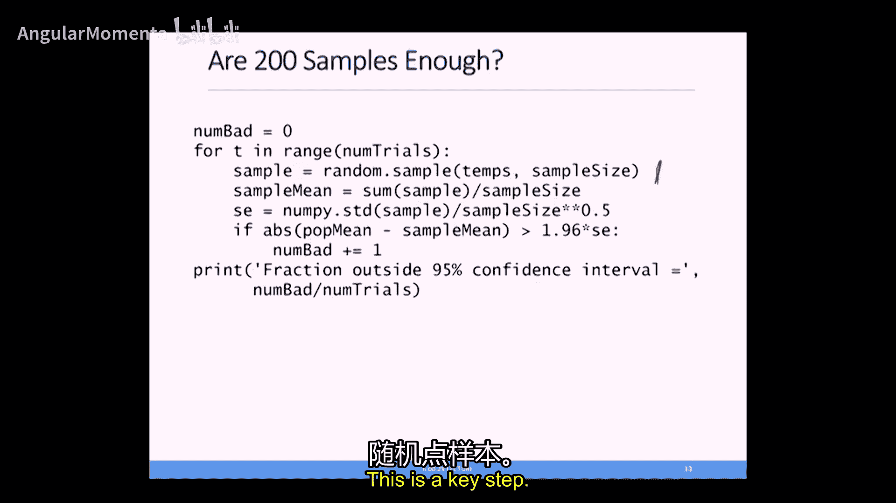

现在，这效果很好。我们选择独立的随机样本。正如我们之前所见，如果你不选择独立样本，效果就不会那么好。再次，这是一个问题，如果你假设在一个选举中，每个州都独立于其他每个州，你会得到错误的答案，因为它们并不独立。

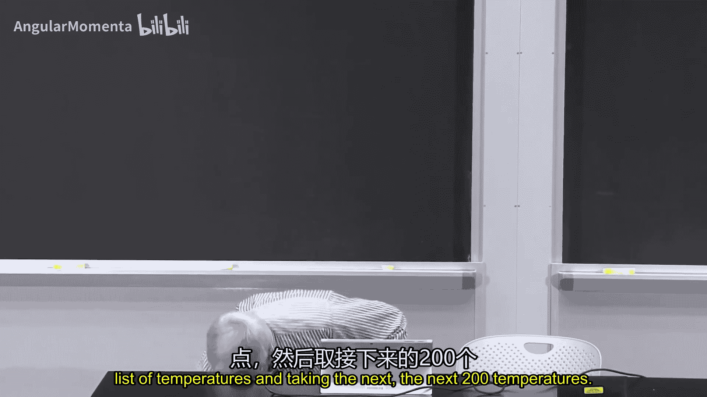

## 回到温度示例

让我们回到我们的温度例子。提出一个简单的问题：200个样本足够吗？我不知道为什么我选了200。我选了。所以我们在这里做一个实验。这类似于我们周一看到的一个实验。所以我从犯的错误次数开始。对于在试验次数范围内，样本将是温度的 `random.sample`，大小为样本大小。这是一个关键步骤。我第一次做这个时搞错了。我没有做这个非常简单的事情，而是做了一个更复杂的事情，只是在我的温度列表中选择某个点，然后取接下来的200个温度。为什么，为什么那会给我错误的答案？因为它是按城市组织的。所以如果我碰巧选择了凤凰城的第一天，所有200个温度都是凤凰城的。这对全国整体温度来说不是一个很好的近似。但这个会有效。我使用 `random.sample`。然后我会得到样本平均值。然后我通过取这个来计算我对标准误差的估计。然后如果总体平均值减去样本平均值的绝对值大于1.96个标准误差，我会说我搞错了。它在区间之外。然后在最后，我将查看落在95%置信区间之外的分数。我希望它打印出什么？

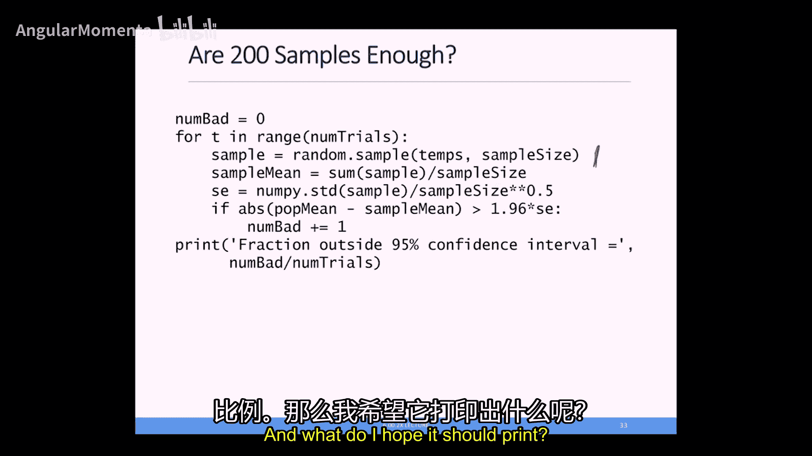

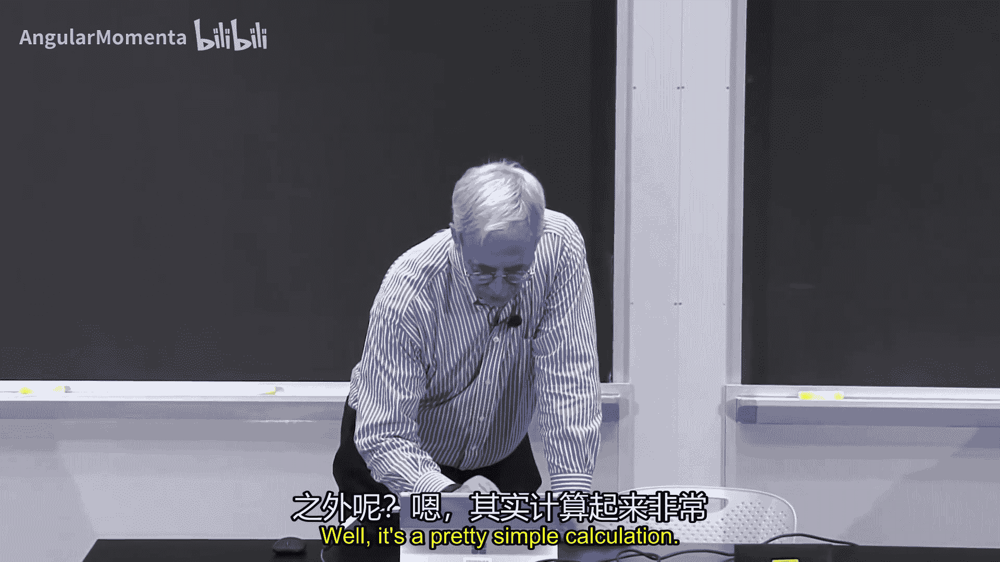

## 验证置信区间

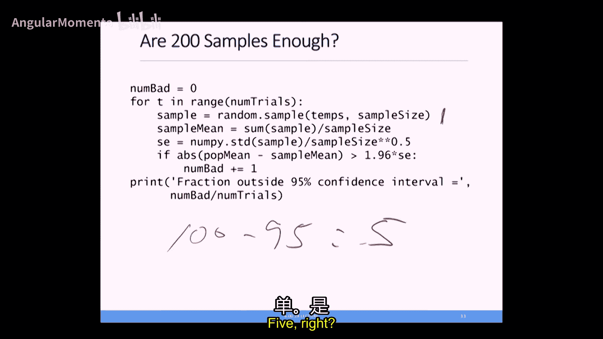

当我运行这个时，完美的答案应该是什么？应该有多少比例落在这个区间之外？嗯，这是一个相当简单的计算。5，对吧？因为如果它们都在里面，那么我的区间就太保守了，对吧？我希望5%的测试落在95%置信区间之外。如果我想要更少，那么我会看三个标准差而不是1.96，那么我预计不到1%会落在外面。所以当我们做这类事情时，这是我们总是要记住的。如果你的答案太好，你就搞错了。不应该太差，但也不应该太好。这就是概率的全部意义。如果你每次都正确预测选举，那么你的数学就错了。


好的，当我们运行这个时，我们得到了这个可爱的答案：落在95%置信区间之外的分数是0.0511。这正好是，嗯，接近你想要的。几乎正好是5%。如果我多次运行它，我会得到稍微不同的数字，但它们都在那个范围内，表明在这里，它确实有效。

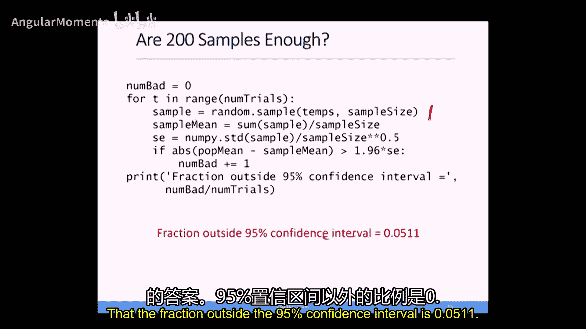

## 结论

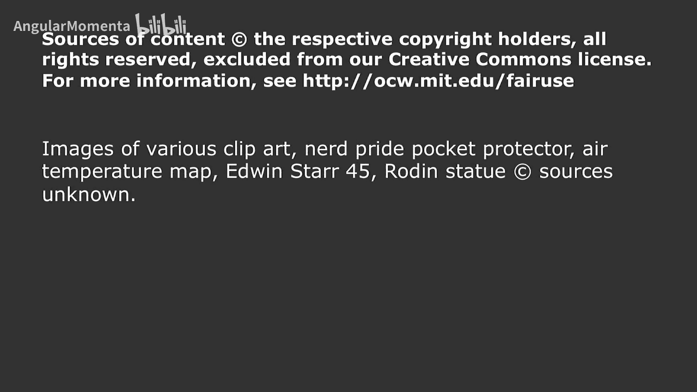

好的，这就是我想说的。标准误差的概念非常重要。当我与其他部门讨论6.0002应该涵盖什么内容时，几乎每个人都同意的一件事是我们应该谈论标准误差。所以现在我希望我已经让每个人都满意了。下周我们将开始讨论将曲线拟合到实验数据。好的，非常感谢。