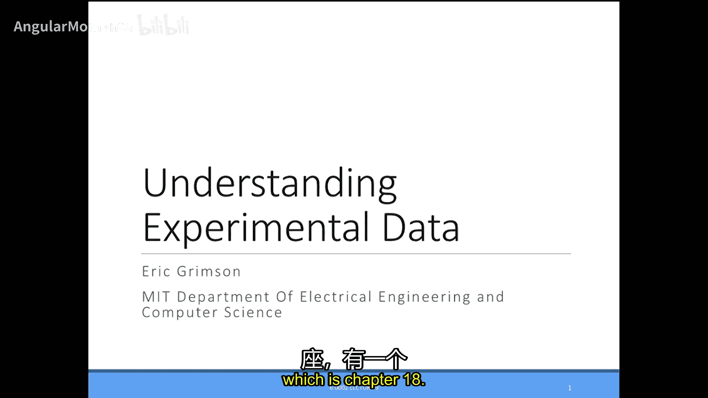
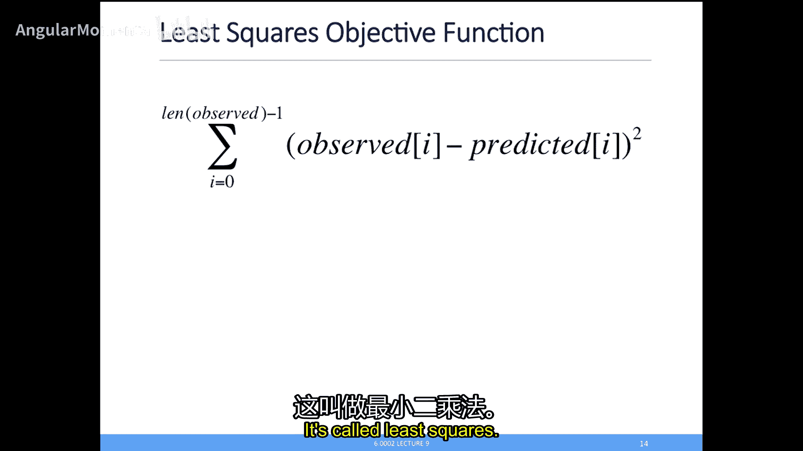
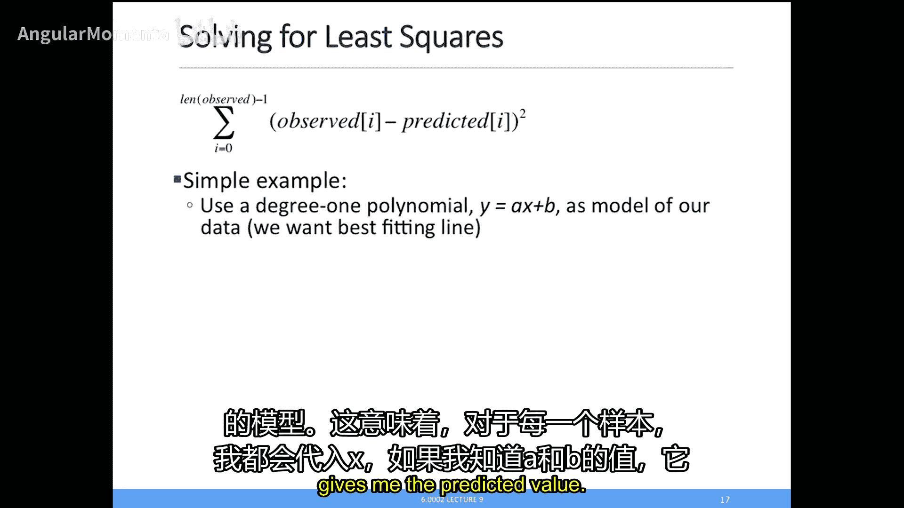
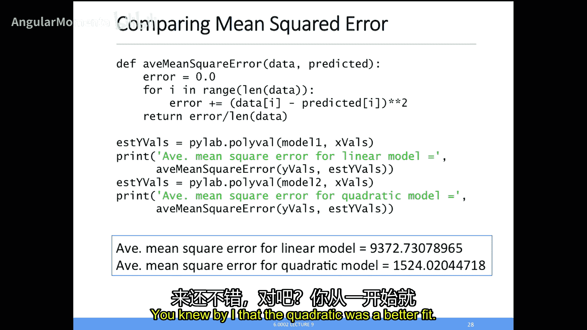
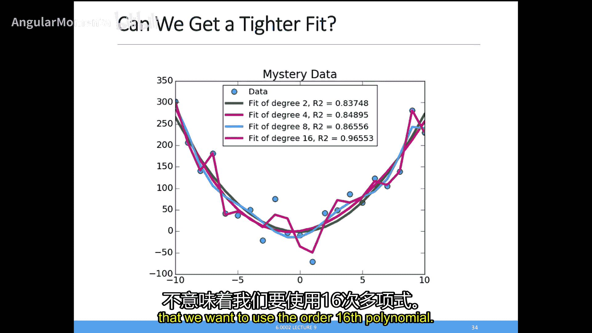

# 009：理解实验数据





在本节课中，我们将要学习如何处理和分析从实验中收集的数据。我们将从一个简单的物理实验——测量弹簧的胡克定律——开始，探讨如何利用计算工具来拟合数据、评估模型，并理解数据背后的含义。我们将介绍线性回归、最小二乘法以及衡量模型拟合优度的决定系数（R²）。

---

## 课程概述

我们生活在一个数据密集的世界。无论是科学家、工程师、社会科学家还是金融从业者，处理数据都变得越来越重要。本节课程将聚焦于如何使用软件处理和解读数据，特别是来自实验的数据。我们将学习如何编写代码来操作数据，并理解软件分析结果的可靠性。

上一节我们介绍了数据分析的重要性，本节中我们来看看如何具体处理实验数据，特别是如何为数据找到合适的数学模型。

---

## 胡克定律与弹簧常数

首先，我们以一个物理实验为例：测量弹簧。许多弹簧（称为线性弹簧）遵循胡克定律。该定律指出，使弹簧压缩或拉伸一定距离所需的力与该距离成线性关系。

**胡克定律公式**：
`F = -k * x`
其中：
*   `F` 是施加的力。
*   `k` 是弹簧常数（衡量弹簧的刚度）。
*   `x` 是位移（压缩或拉伸的距离）。
*   负号表示力的方向与位移方向相反。

例如，一个弹簧常数为 35000 N/m 的摩托车减震弹簧，要将其压缩 1 厘米（0.01 米），所需的力为：
`F = 35000 * 0.01 = 350` 牛顿。

根据 `F = m * a`（力 = 质量 × 加速度），并假设加速度为重力加速度 9.8 m/s²，我们可以计算出所需的质量：
`m = F / a = 350 / 9.8 ≈ 35.7` 公斤。

---

## 实验数据收集与可视化

在现实中，我们通过实验来测定弹簧常数。标准方法是：悬挂弹簧，逐次添加已知质量的重物，测量弹簧每次的伸长量，从而得到一组（质量，位移）数据点。

假设我们得到以下实验数据：

| 质量 (kg) | 位移 (m) |
| :--- | :--- |
| 0.0 | 0.0 |
| 0.1 | 0.006 |
| 0.2 | 0.011 |
| ... | ... |

我们将质量作为自变量（X轴），位移作为因变量（Y轴）进行绘图。理想情况下，数据点应排列成一条直线，其斜率与弹簧常数相关。

以下是读取和绘制数据的Python代码示例：

```python
import numpy as np
import matplotlib.pyplot as plt

def get_data(file_name):
    data_file = open(file_name, 'r')
    distances = []
    masses = []
    data_file.readline() # 忽略标题行
    for line in data_file:
        d, m = line.split(',')
        distances.append(float(d))
        masses.append(float(m))
    data_file.close()
    return np.array(masses), np.array(distances)

def plot_data(input_file):
    masses, distances = get_data(input_file)
    distances = distances * 9.81 * 1000 # 将质量转换为力（牛顿），位移转换为毫米
    plt.plot(masses, distances, 'bo', label='Measured displacements')
    plt.title('Measured Displacement of Spring')
    plt.xlabel('Force (Newtons)')
    plt.ylabel('Distance (millimeters)')
    plt.show()

# 使用示例
plot_data('spring_data.csv')
```

绘制出的数据点可能并不完美地落在一条直线上，这是由于测量中存在噪声。

---

## 线性回归与曲线拟合




为了从有噪声的数据中找到最佳拟合线，我们使用**线性回归**方法。其核心思想是找到一条直线，使得所有数据点到这条直线的**垂直距离的平方和**最小。这称为**最小二乘法**。

我们选择垂直距离（Y方向误差）是因为我们关心的是根据自变量（X）预测因变量（Y）的准确性。

**目标函数（误差函数）**：
`Error = Σ (observed_yᵢ - predicted_yᵢ)²`
其中 `predicted_yᵢ = a * xᵢ + b`，`a` 和 `b` 是直线的斜率和截距。

最小化这个误差函数的过程就是线性回归。对于更高阶的多项式拟合（如抛物线），原理是相同的，只是在更高维的参数空间中寻找最优解。



幸运的是，我们无需自己实现复杂的优化算法。Python 的 NumPy 库提供了 `polyfit` 函数。

以下是使用 `polyfit` 进行线性拟合并计算弹簧常数的代码：

```python
def fit_data(input_file):
    masses, distances = get_data(input_file)
    distances = distances * 9.81 * 1000 # 转换为力和毫米
    plt.plot(masses, distances, 'bo', label='Measured points')

    # 使用 polyfit 进行1阶（线性）拟合
    a, b = np.polyfit(masses, distances, 1) # 返回斜率和截距
    predicted_distances = a * masses + b
    plt.plot(masses, predicted_distances, 'r', label='Linear fit')

    plt.title('Measured Displacement of Spring with Linear Fit')
    plt.xlabel('Force (Newtons)')
    plt.ylabel('Distance (millimeters)')
    plt.legend()
    plt.show()

    # 斜率 a = Δ距离 / Δ力，弹簧常数 k ≈ 1/a (注意单位转换和符号)
    k = -1 / (a / 1000) # 将毫米转换回米
    print(f"Estimated spring constant: {k:.2f} N/m")
    return a, b
```


运行此代码，我们可以得到拟合直线和估算的弹簧常数。

---

## 评估模型拟合优度

仅仅得到一条拟合曲线是不够的，我们需要评估它拟合得好不好。对于不同模型（例如直线和抛物线），我们如何客观比较？

**1. 比较均方误差 (MSE)**
一个直观的方法是计算模型预测值与实际观测值之间的**均方误差**。误差越小，拟合越好。

```python
def mse(observed, predicted):
    """计算均方误差"""
    error = observed - predicted
    return np.mean(error ** 2)

# 计算线性模型和二次模型的MSE
mse_linear = mse(distances, predicted_linear)
mse_quadratic = mse(distances, predicted_quadratic)
print(f"MSE Linear: {mse_linear:.2f}, MSE Quadratic: {mse_quadratic:.2f}")
```

**2. 决定系数 (R²)**
均方误差的绝对值缺乏明确的解释尺度。一个更通用的指标是**决定系数 R²**。它衡量模型能够解释数据中多少比例的变化。

**R² 公式**：
`R² = 1 - (Σ(observed_yᵢ - predicted_yᵢ)²) / (Σ(observed_yᵢ - mean(observed_y))²)`

*   **分子**：模型的残差平方和（未解释的误差）。
*   **分母**：数据自身的总方差（总变化量）。
*   **R² 的取值范围**：0 到 1。
    *   `R² = 1`：模型完美拟合数据，解释了全部方差。
    *   `R² = 0`：模型完全不解释数据方差，预测能力等同于直接用均值预测。
    *   `R²` 越接近 1，模型拟合度越好。

```python
def r_squared(observed, predicted):
    """计算决定系数 R²"""
    error = observed - predicted
    sse = np.sum(error ** 2) # 残差平方和
    mean_obs = np.mean(observed)
    sst = np.sum((observed - mean_obs) ** 2) # 总方差
    return 1 - (sse / sst)

# 计算不同模型的 R²
r2_linear = r_squared(distances, predicted_linear)
r2_quadratic = r_squared(distances, predicted_quadratic)
print(f"R² Linear: {r2_linear:.3f}, R² Quadratic: {r2_quadratic:.3f}")
```

例如，对于一个数据集，线性拟合的 R² 可能只有 0.05，而二次拟合的 R² 可能达到 0.84，这清楚地表明二次模型是更好的选择。




---

## 过拟合问题

既然更高阶的多项式似乎能带来更小的误差和更高的 R²，我们是否应该使用尽可能高阶的模型？例如，用一个 16 次多项式去拟合数据，R² 可能高达 0.97。

以下是尝试不同阶数多项式拟合的代码框架：

```python
def test_fits(masses, distances, degrees):
    """测试不同阶数多项式的拟合效果"""
    plt.plot(masses, distances, 'bo', label='Measured')
    for d in degrees:
        # 拟合多项式
        model = np.polyfit(masses, distances, d)
        # 使用 polyval 计算预测值
        predicted = np.polyval(model, masses)
        # 计算 R²
        r2 = r_squared(distances, predicted)
        # 绘制曲线
        plt.plot(masses, predicted, label=f'Degree {d} (R²={r2:.3f})')
        print(f"Degree {d}: R² = {r2:.3f}")
    plt.legend()
    plt.show()

# 测试 1, 2, 4, 8, 16 阶多项式
test_fits(masses, distances, [1, 2, 4, 8, 16])
```

结果可能显示，16 次多项式的 R² 最高。然而，这通常会导致**过拟合**。过拟合模型不仅捕捉了数据背后的真实规律，也“学习”了数据中的随机噪声。这样的模型在训练数据上表现极好，但对新数据的预测能力会很差，因为它不具有泛化性。

就像父母常说的：看起来好的东西，不一定真的就好。一个 R² 接近 1 的复杂模型，未必是我们想要的最佳模型。如何识别和避免过拟合，是我们下节课要探讨的核心问题。

---

## 课程总结

本节课中我们一起学习了如何处理实验数据：
1.  我们回顾了胡克定律，并将其作为分析弹簧数据的理论基础。
2.  我们学习了如何收集数据并将其可视化，观察其中的噪声。
3.  我们引入了**线性回归**和**最小二乘法**的核心思想，即通过最小化预测误差的平方和来寻找最佳拟合曲线。
4.  我们利用 Python 的 `polyfit` 函数轻松实现了线性及多项式拟合。
5.  为了评估和比较不同模型的拟合质量，我们介绍了**均方误差 (MSE)** 和更重要的**决定系数 (R²)**。
6.  最后，我们通过一个例子引出了**过拟合**的概念，即复杂模型在训练集上表现完美却可能丧失预测新数据能力的问题，为下一讲的内容埋下伏笔。




记住，数据分析不仅仅是找到一条穿过数据点的曲线，更重要的是理解模型的意义、评估其可靠性，并确保其能用于有效的预测。