# 010：理解实验数据（续）


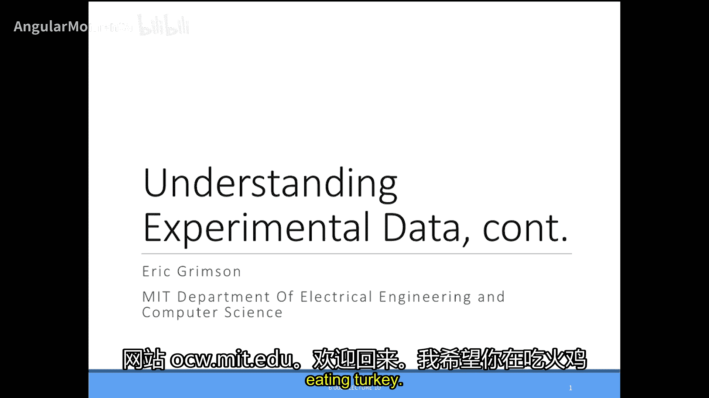


在本节课中，我们将继续学习如何理解实验数据，特别是如何验证我们为数据拟合的模型是否真正有效。我们将探讨过拟合的概念，并学习如何使用交叉验证等技术来评估模型的预测能力，从而选择出既简单又能准确解释和预测数据的模型。

上一节我们介绍了如何使用线性回归为数据拟合模型，并引入了决定系数 R² 来衡量模型对训练数据的拟合优度。本节中，我们将深入探讨一个关键问题：一个在训练数据上表现极佳的模型，是否真的能很好地预测新数据？

## 模型验证与过拟合

我们从一个例子开始。假设我们有一些来自二次函数 `y = 3x²` 并添加了高斯噪声的数据。我们尝试用不同阶数的多项式去拟合它。

以下是拟合模型的代码示例：
```python
import numpy as np
# 假设 xVals 和 yVals 是数据
model1 = np.polyfit(xVals, yVals, 1) # 一阶（线性）拟合
model2 = np.polyfit(xVals, yVals, 2) # 二阶（二次）拟合
model16 = np.polyfit(xVals, yVals, 16) # 十六阶拟合
```

当我们计算这些模型在训练数据上的 R² 值时，可能会发现十六阶多项式的 R² 值非常接近 1，看起来是“最佳”拟合。然而，我们知道数据本质上来自一个二次函数。这个十六阶模型虽然完美地捕捉了训练数据中的噪声，但它可能无法很好地泛化到新数据上。这种现象被称为**过拟合**。

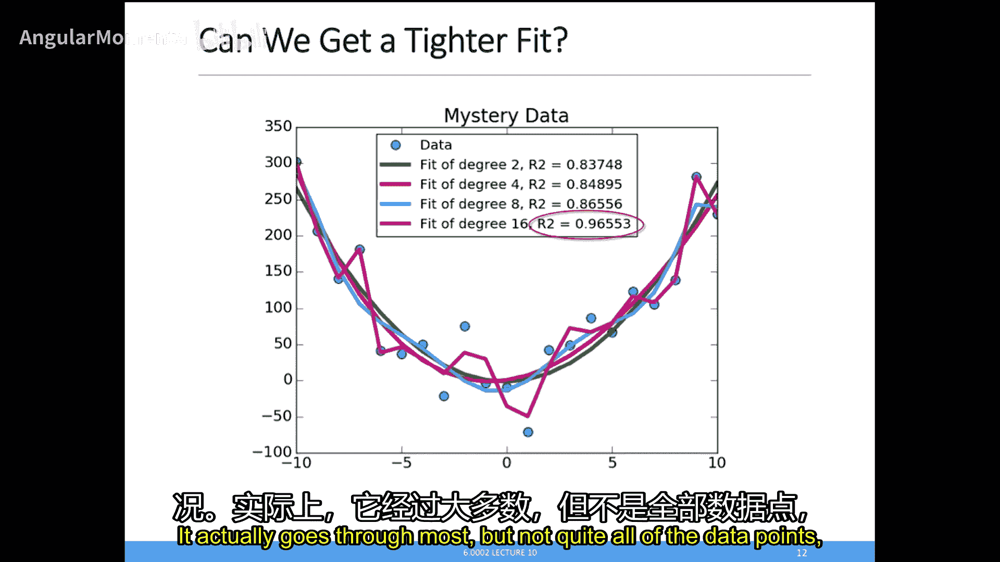

为了检测过拟合，我们不能仅仅依赖训练数据。我们需要评估模型在**未见过的数据**上的表现。这就是**验证**或**交叉验证**的核心思想。


## 实施交叉验证

交叉验证的基本方法是：将数据分为两部分，一部分用于**训练**模型，另一部分用于**测试**模型。通过比较模型在测试集上的表现，我们可以更好地判断其泛化能力。

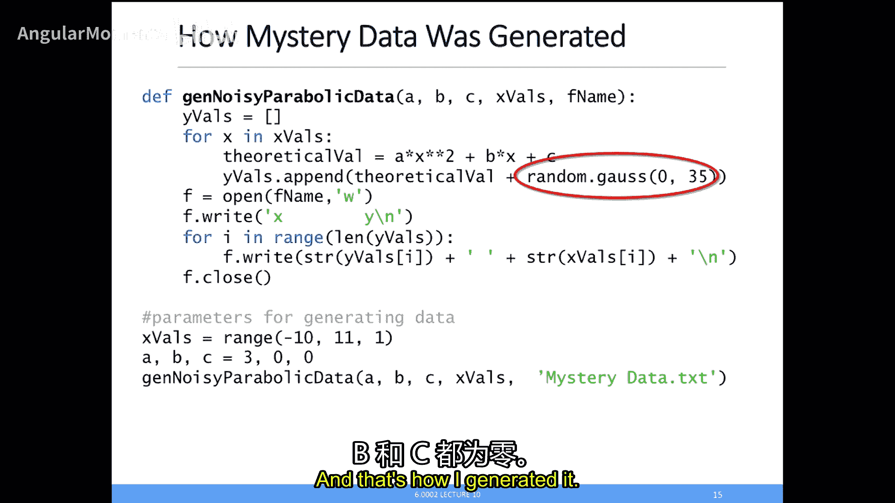


以下是使用一个数据集训练，用另一个独立数据集测试的示例：
```python
# models1 是在数据集1上训练得到的模型列表
# xVals2, yVals2 是独立的数据集2
testFits(models1, degrees, xVals2, yVals2)
```

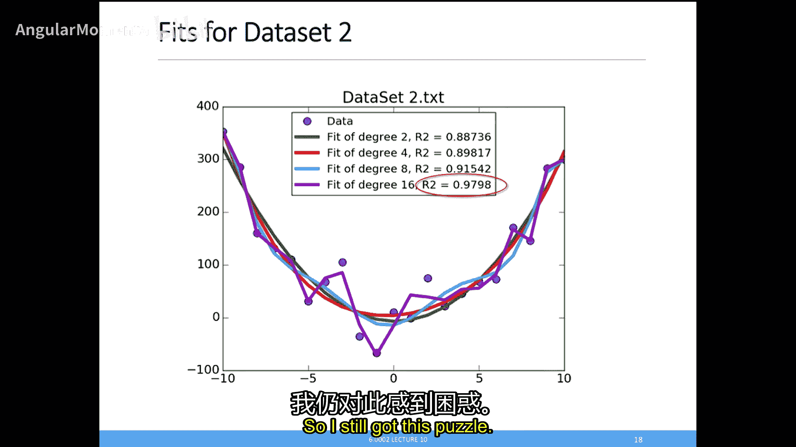

当我们对之前的二次数据实施交叉验证时，结果非常清晰：二次和四次模型在测试集上依然保持较高的 R² 值（例如 0.86），而十六阶模型的 R² 值则急剧下降（例如降至 0.7）。这表明十六阶模型严重过拟合了训练数据中的噪声，泛化能力很差。

## 为什么过拟合会发生？


过拟合发生在模型过于复杂（即拥有太多自由度或参数）时。在完美数据中，多余的参数系数会变为零。但在存在噪声的真实数据中，这些多余的参数会开始“拟合”噪声，而不是底层的数据生成规律。

考虑一个简单的例子：数据点 (0,0), (1,1), (2,2), (3,3.1) 基本在一条直线上，但第三个点有轻微噪声。
*   用一阶（线性）模型拟合，得到 `y ≈ x`，对新数据点 (20,20) 的预测很好。
*   用二阶（二次）模型拟合，由于噪声影响，模型会引入微小的二次项。当用这个模型去预测远端的点 (20,20) 时，可能会产生巨大误差。

这个例子说明，即使是很小的噪声，在过于复杂的模型中也可能导致对新数据的预测性能大幅下降。

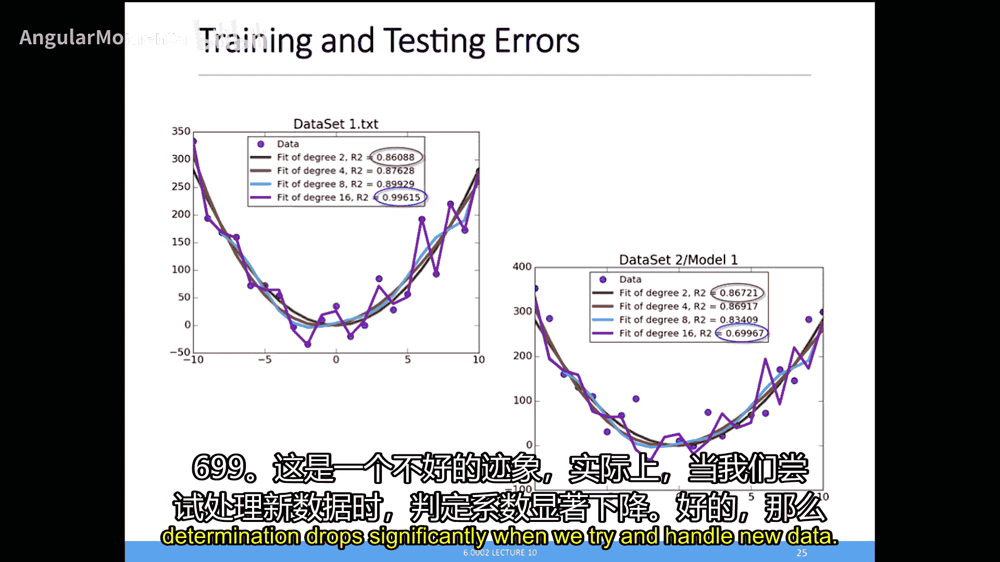

## 寻找最佳模型复杂度


因此，我们的目标是找到模型复杂度的“甜蜜点”：
*   模型需要足够复杂，以捕捉数据中的真实规律（避免**欠拟合**）。
*   模型又不能过于复杂，以免拟合数据中的随机噪声（避免**过拟合**）。

正如爱因斯坦所说：“万事万物都应尽可能简洁，但不能过于简单。”

如果没有像胡克定律那样的理论指导，我们可以使用系统性的交叉验证方法来选择模型。

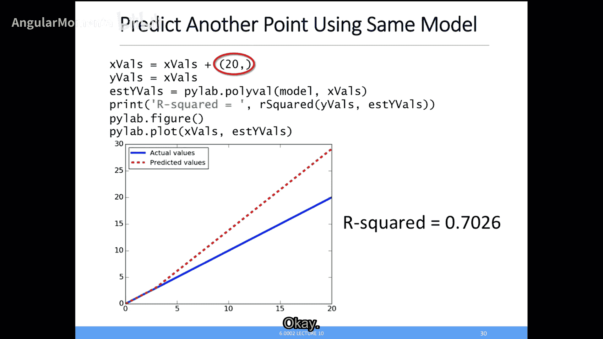


以下是几种常见的交叉验证技术：

*   **留一法交叉验证**：适用于数据集较小的情况。每次留出一个数据点作为测试集，用其余所有数据训练模型，并对留出的点进行预测。重复此过程直至每个数据点都被留出一次，最后平均所有预测误差。
*   **K折交叉验证**：将数据随机分为K个大小相似的子集。依次将其中一个子集作为测试集，其余K-1个子集作为训练集。重复K次，最后平均结果。
*   **重复随机抽样**：进行多次试验（如10次或100次）。在每次试验中，随机将一定比例（如20%）的数据划分为测试集，其余作为训练集。最后计算模型在所有试验中测试性能的平均值和标准差。

## 实例：美国日均高温趋势建模

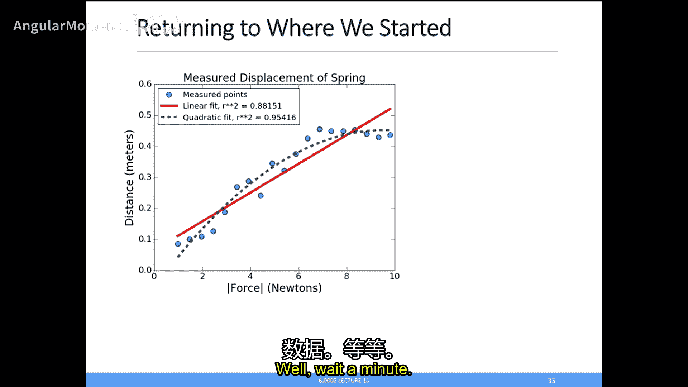

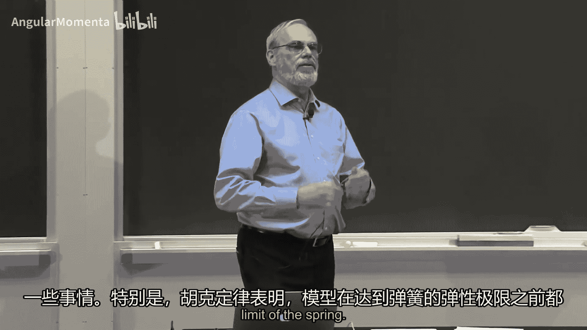

让我们通过一个实际例子来应用交叉验证。我们的目标是分析1961年至2015年间美国日均最高温度的变化趋势，并为其拟合一个模型。

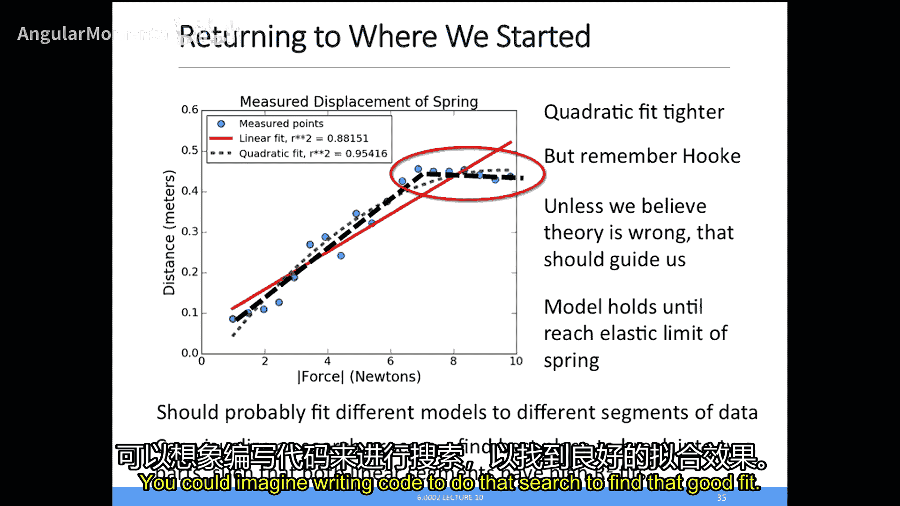

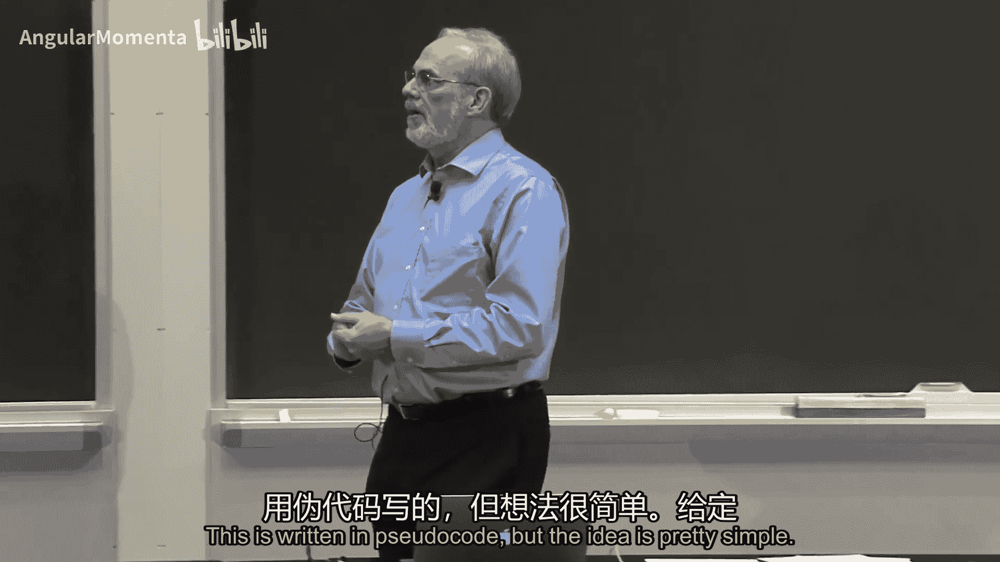

我们尝试用不同阶数的多项式（线性、二次、三次、四次）进行拟合，并使用重复随机抽样的交叉验证来评估它们。

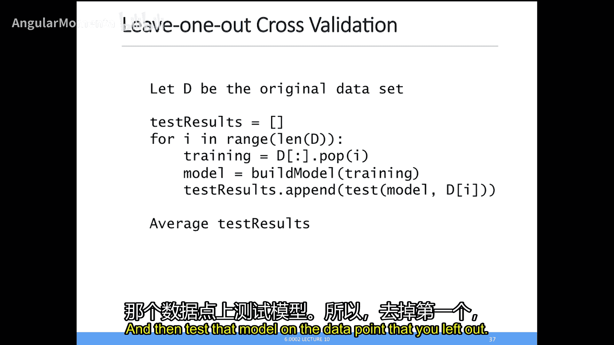


以下是交叉验证的核心代码逻辑：
```python
def cross_validate(xVals, yVals, degrees, numTrials=10, testFraction=0.5):
    results = {degree: [] for degree in degrees}
    n = len(xVals)
    for _ in range(numTrials):
        # 随机划分训练集和测试集
        testIndices = np.random.choice(range(n), size=int(n*testFraction), replace=False)
        trainMask = np.ones(n, dtype=bool)
        trainMask[testIndices] = False
        xTrain, yTrain = xVals[trainMask], yVals[trainMask]
        xTest, yTest = xVals[testMask], yVals[testMask]

        for degree in degrees:
            model = np.polyfit(xTrain, yTrain, degree)
            predicted = np.polyval(model, xTest)
            r2 = rSquared(yTest, predicted)
            results[degree].append(r2)
    # 计算每个阶数对应的平均R²和标准差
    return {d: (np.mean(results[d]), np.std(results[d])) for d in degrees}
```

运行交叉验证后，我们可能会得到类似以下的结果（数值为示例）：
*   线性模型：平均 R² = 0.85，标准差 = 0.05
*   二次模型：平均 R² = 0.83，标准差 = 0.08
*   三次模型：平均 R² = 0.82，标准差 = 0.12
*   四次模型：平均 R² = 0.80，标准差 = 0.15

分析结论：线性模型不仅平均 R² 值最高，而且其标准差最小，说明在不同随机划分下性能最稳定。根据“尽可能简洁”的原则，线性模型是该数据集的合适选择。

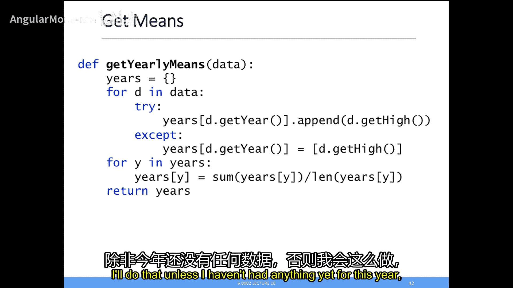


**为什么需要多次试验？** 因为单次随机划分可能具有偶然性。多次试验可以让我们获得性能的统计分布，从而做出更可靠的判断。

## 回到起点：胡克定律的启示

有时，数据本身会提示我们需要更复杂的模型。回顾胡克定律实验中弹簧位移与重物的数据，二次拟合的 R² 可能比线性拟合略高。但物理学理论告诉我们，在弹簧弹性限度内，这应该是一个线性关系。

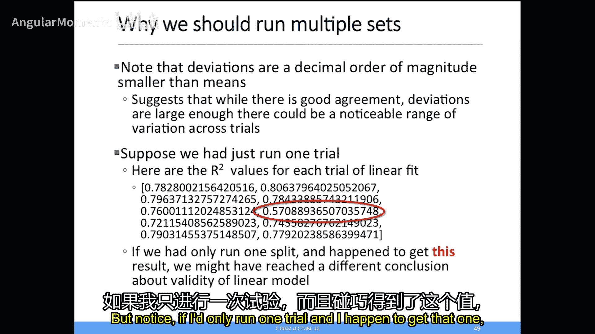

观察数据图，我们发现数据点在后段明显偏离了直线。这很可能是因为施加的重量超过了弹簧的弹性限度。在这种情况下，更合理的模型可能是在某个点将数据分段，分别用两条不同的直线进行拟合。这说明了领域知识在模型选择中的重要性。


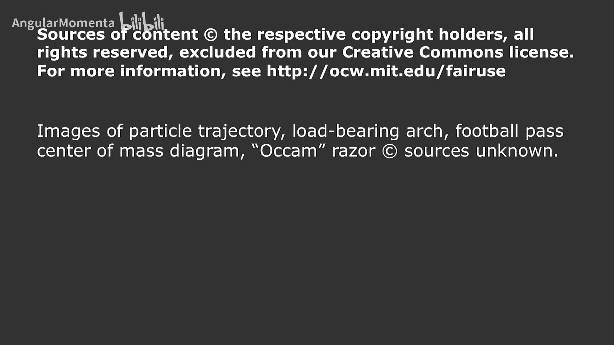

本节课中我们一起学习了如何验证数据拟合模型。我们认识到，仅凭训练数据上的高 R² 值不足以证明模型的有效性，因为可能存在过拟合。通过使用交叉验证技术（如留一法、K折或重复随机抽样），在独立的测试集上评估模型，我们可以更好地判断模型的泛化能力。最终目标是遵循“奥卡姆剃刀”原则，选择那个足够简单（以避免过拟合）又能充分解释数据（以避免欠拟合）的模型，从而确保模型既能解释现象，又能准确预测新情况。