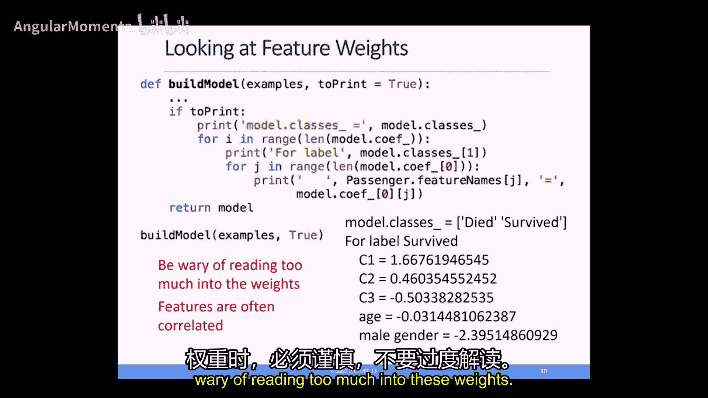

# 013：分类


## 概述
在本节课中，我们将要学习机器学习中的分类问题。分类是监督学习的一种，其目标是预测与特征向量相关联的离散标签。我们将介绍两种主要的分类方法：K近邻算法和逻辑回归，并通过泰坦尼克号乘客生存预测的实例来演示它们的应用。

## 分类简介
上一节我们介绍了无监督学习，本节中我们来看看监督学习。监督学习通常可以分为两类：回归和分类。

*   **回归**：目标是预测与特征向量相关联的某个实数值。例如，我们之前学习的曲线拟合和线性回归就属于此类。
*   **分类**：目标是预测一个离散值，通常称为标签。例如，预测一个人是否会对药物产生不良反应，或者预测课程成绩等级（A、B、C、D）。

## K近邻分类法
一种简单且常用的分类方法是K近邻算法。

### 基本原理
K近邻算法的学习过程非常简单：只需记住所有的训练数据。当需要预测一个新样本的标签时，就在训练数据中找到与该样本最相似的K个“邻居”，然后根据这K个邻居的标签进行投票，将得票最多的标签作为预测结果。

**核心公式/代码概念**：
*   **最近邻**：`预测标签 = 最近的一个训练样本的标签`
*   **K近邻**：`预测标签 = K个最近训练样本中出现次数最多的标签`

### 示例：动物分类
假设我们有一个小型数据集，包含一些动物及其特征（如是否有鳞片、是否产卵等），以及它们是否为爬行动物的标签。我们想预测斑马、蟒蛇和短吻鳄是否为爬行动物。

1.  **最近邻（K=1）**：
    *   斑马的最近邻居是孔雀鱼（非爬行动物） -> 预测斑马为非爬行动物。（正确）
    *   蟒蛇的最近邻居是眼镜蛇（爬行动物） -> 预测蟒蛇为爬行动物。（正确）
    *   短吻鳄的最近邻居是鸡（非爬行动物） -> 预测短吻鳄为非爬行动物。（错误）

2.  **K近邻（例如K=3）**：
    *   考虑短吻鳄的三个最近邻居：鸡、眼镜蛇和响尾蛇。投票结果：2票爬行动物，1票非爬行动物 -> 预测短吻鳄为爬行动物。（正确）

这个例子说明了K近邻比最近邻更鲁棒，可以减少单个噪声数据点的影响。

### 如何选择K值
选择K值是一个重要步骤。K值过小（如K=1）容易受噪声影响；K值过大则可能使预测被多数类主导，特别是在类别不平衡的数据集中。

以下是选择K值的常用方法：
*   **交叉验证**：将训练数据进一步划分为训练子集和验证子集。尝试不同的K值，在验证子集上评估性能，选择表现最好的K值。

### K近邻的优缺点
**优点**：
*   学习速度快（只需存储数据）。
*   无需复杂数学，易于理解和解释。

**缺点**：
*   内存消耗大（需要存储所有训练数据）。
*   预测速度慢（需要计算新样本与所有训练样本的距离）。
*   无法提供关于数据生成过程的信息（没有显式模型）。

## 分类器评估指标
在评估分类器性能时，不能仅仅依赖准确率，尤其是在类别不平衡的数据集中。例如，在泰坦尼克号数据中，62%的乘客遇难。如果总是预测“遇难”，准确率也有62%，但这毫无意义。

因此，我们需要使用更细致的评估指标：

*   **灵敏度**：正确识别出的正例（如“遇难”）占所有真实正例的比例。`灵敏度 = TP / (TP + FN)`
*   **特异度**：正确识别出的负例（如“幸存”）占所有真实负例的比例。`特异度 = TN / (TN + FP)`
*   **阳性预测值**：预测为正例的样本中，真实为正例的比例。`PPV = TP / (TP + FP)`
*   **阴性预测值**：预测为负例的样本中，真实为负例的比例。`NPV = TN / (TN + FN)`

> **注意**：在不同领域，这些指标可能有不同名称，如“召回率”常指灵敏度，“精确率”常指阳性预测值。

选择侧重哪个指标取决于具体应用。例如，在疾病筛查中，我们可能更关注灵敏度（不希望漏诊）；而在高风险手术决策中，可能更关注特异度（不希望误诊）。

## 模型测试方法
为了可靠地评估模型性能，我们需要使用恰当的测试方法。

以下是两种常见的测试方法：
*   **留一法交叉验证**：适用于小数据集。每次使用N-1个样本训练，用剩下的1个样本测试，重复N次后取平均结果。
*   **重复随机子采样**：适用于大数据集。多次随机将数据按比例（如80%训练，20%测试）划分，进行训练和测试，最后取平均结果。

## 实例：泰坦尼克号生存预测
我们将使用泰坦尼克号乘客数据（包含舱位等级、年龄、性别等特征）来预测乘客是否幸存。

### 应用K近邻算法
我们使用K近邻算法（设定K=3）进行预测，并采用留一法和重复随机子采样进行评估。结果显示，两种测试方法得到的各项评估指标相近，且预测效果明显优于总是预测“遇难”的基线模型。

### 逻辑回归分类法
现在，我们来看另一种更常用的分类方法——逻辑回归。它在某些方面类似于线性回归，但专门用于预测概率。

#### 基本原理
逻辑回归为每个特征计算一个**权重**。
*   **正权重**意味着该特征与预测结果（如“幸存”）呈正相关。
*   **负权重**意味着该特征与预测结果呈负相关。
*   **权重的绝对值大小**反映了相关性的强弱。

通过优化过程从训练数据中学习这些权重。预测时，将特征值与对应权重结合，通过一个特定的函数（逻辑函数）输出一个介于0和1之间的概率值。通常，设定一个阈值（如0.5）将概率转换为类别标签。

#### 在Python中实现
我们可以使用`scikit-learn`库快速实现逻辑回归。

**核心代码概念**：
```python
from sklearn.linear_model import LogisticRegression

# 1. 准备数据
features = [e.getFeatures() for e in trainingSet] # 特征向量列表
labels = [e.getLabel() for e in trainingSet]       # 对应标签列表

# 2. 创建并训练模型
model = LogisticRegression().fit(features, labels)

# 3. 查看模型学到的权重
print(model.coef_)

# 4. 进行预测
test_features = [e.getFeatures() for e in testSet]
probabilities = model.predict_proba(test_features)
# probabilities 给出了每个样本属于各个类别的概率
```

#### 逻辑回归结果分析
在泰坦尼克号数据上应用逻辑回归，其性能略优于K近邻。

更重要的是，逻辑回归模型提供了可解释的权重：
*   **舱位等级**：一等舱权重为正且较大，二等舱为正但较小，三等舱为负。这表明财富与生存概率正相关。
*   **年龄**：权重为负，表明年龄越大，生存概率可能越低。
*   **性别**（男性）：权重为非常大的负值，表明男性乘客的生存概率显著较低。

这些权重帮助我们理解哪些因素对预测结果影响最大。**但需要注意**：如果特征之间存在相关性，对权重的解释需要谨慎，我们将在后续课程中讨论这个问题。

## 总结
本节课中我们一起学习了监督学习中的分类问题。
*   我们介绍了**K近邻算法**，它是一种基于记忆的简单分类方法，通过寻找最近邻进行投票决策。
*   我们探讨了如何评估分类器性能，引入了**灵敏度、特异度**等比单纯准确率更有效的指标。
*   我们学习了**逻辑回归**，它是一种通过为特征分配权重来预测概率的模型，不仅能进行分类，还能提供关于特征重要性的见解。
*   我们以**泰坦尼克号乘客生存预测**为例，实践了这两种方法，并比较了它们的优劣。




理解这些基本的分类方法及其评估方式，是构建更复杂机器学习模型的重要基础。