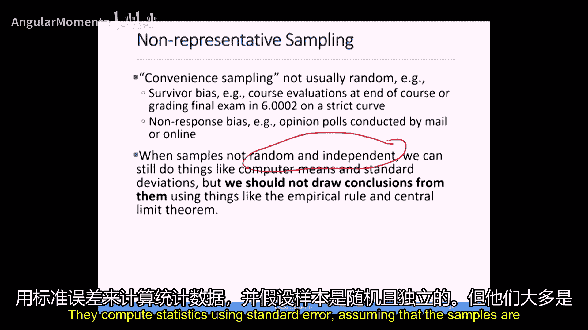

# 014：分类与统计

## 概述
在本节课中，我们将继续探讨机器学习模型的分析，特别是逻辑回归模型权重的解读，并引入评估分类器性能的重要工具——受试者工作特征曲线。随后，我们将转向一个关键主题：如何识别并避免在数据分析和统计推断中常见的谬误与陷阱。

## 逻辑回归模型分析

上一节我们比较了K近邻算法与逻辑回归在泰坦尼克数据集上的表现。本节中，我们来看看如何通过研究逻辑回归模型本身来获取洞见。

逻辑回归模型为每个特征分配了一个权重。这些权重的大小和符号可以解释该特征对预测结果的影响方向与相对强度。

以下是使用逻辑回归（默认L2正则化）在泰坦尼克数据上得到的特征权重示例（以预测“幸存”类别为例）：
*   **头等舱**：权重为 **1.6**。这是一个较强的正权重，表明乘坐头等舱对幸存有积极影响。
*   **二等舱**：权重为 **0.46**。这也是一个正权重，但强度远低于头等舱。
*   **三等舱**：权重为 **-0.92**。这是一个负权重，表明乘坐三等舱降低了幸存概率。
*   **年龄**：权重为 **-0.04**。这是一个非常小的负权重，表明年龄增长略微降低了幸存概率。
*   **男性**：权重为 **-2.62**。这是一个较大的负权重，表明男性乘客的幸存概率显著较低。

**核心注意事项**：虽然上述解读在机器学习报告中很常见，但必须谨慎对待。一个主要问题是特征之间可能存在相关性，这会影响权重的独立解读。

### 特征相关性的影响

以船舱等级为例，三个特征（头等舱、二等舱、三等舱）并非独立，因为每个乘客必然属于且仅属于一个等级（`C1 + C2 + C3 = 1`）。这引出一个问题：是“头等舱具有保护作用”，还是“二等/三等舱具有风险”？

为了验证，我们可以进行一个实验：从特征集中移除“头等舱”（`C1`）这个特征，仅保留“二等舱”（`C2`）和“三等舱”（`C3`）作为特征。

实验结果表明，模型的预测准确率几乎没有变化。然而，特征权重发生了显著改变：
*   **二等舱**：权重变为 **-1.07**。
*   **三等舱**：权重变为 **-1.59**。

现在，两个特征都表现为较强的负权重。年龄和性别的权重仅略有变化。

**结论**：当特征之间存在相关性时，不能孤立地解释单个特征的权重。通常，权重的符号（正/负）相对可靠，但其具体数值的大小解释需要格外小心。

### 调整分类阈值

逻辑回归中有一个关键参数 `P`（阈值），默认设为 `0.5`。它决定了当模型预测的幸存概率大于等于 `P` 时，我们才判定为“幸存”。我们可以调整这个阈值。

例如，将 `P` 设为极端的 `0.1` 或 `0.9` 会产生什么影响？这主要会改变分类结果的**敏感度**（召回率）和**特异度**。

*   当 `P = 0.9` 时，模型只有在非常确信的情况下才会预测“幸存”。这会导致**特异度**很高（预测幸存的人确实很可能幸存了），但**敏感度**很低（很多真正的幸存者被预测为死亡）。由于数据集中死亡人数本就占多数，整体准确率可能仍然不低，但这掩盖了模型在识别幸存者方面的失败。
*   反之，`P = 0.1` 会提高敏感度，但会降低特异度，产生更多假阳性。

选择哪个 `P` 值取决于实际应用场景的成本权衡（例如，在保险风险评估中，过于保守可能导致无法签发任何保单）。

## 受试者工作特征曲线

由于阈值 `P` 的选择具有主观性，我们希望有一个不依赖于特定阈值的评估指标。这就是**受试者工作特征曲线**（ROC曲线）的作用。

ROC曲线的绘制方法如下：
1.  使用训练集构建一个逻辑回归模型。
2.  在测试集上，让 `P` 值从 `0` 到 `1` 连续变化。
3.  对于每个 `P` 值，计算模型在测试集上的**敏感度**和 **`1 - 特异度`**（即假阳性率）。
4.  以 `1 - 特异度` 为横轴，敏感度为纵轴，绘制所有点形成的曲线。

曲线下方面积称为 **AUC**（Area Under the Curve）。AUC值提供了一个整体评估：
*   **完美分类器**的ROC曲线会紧贴左上角（敏感度=1，假阳性率=0），AUC = 1。
*   **随机猜测分类器**的ROC曲线是一条从(0,0)到(1,1)的对角线，AUC = 0.5。
*   一个好的分类器的ROC曲线应位于对角线上方，AUC值介于0.5和1之间。AUC越大，分类器整体性能越好。

ROC曲线和AUC使我们能够评估分类器的性能，而无需事先指定分类阈值。

## 统计数据的陷阱与谬误

现在，我们转换话题，探讨在数据呈现和统计推断中如何被误导，以及如何避免这些陷阱。

### 数据不等于统计量

安斯库姆四重奏是一个经典示例，它由四组不同的(x, y)数据对组成。

令人惊讶的是，这四组数据拥有几乎完全相同的统计摘要：
*   x的均值相同
*   y的均值相同
*   x的方差相同
*   y的方差相同
*   线性回归方程都是 **y = 0.5x + 3**

然而，当我们将这四组数据绘制成散点图时，它们呈现出截然不同的模式：

**启示**：统计摘要（均值、方差等）无法替代对数据本身的直观审视。在分析数据时，第一步应该是进行可视化，以发现数据中可能隐藏的真实结构。

### 误导性的图表

图表也可能产生误导。常见的伎俩包括扭曲坐标轴。

**示例一：成绩对比图**
*   如果Y轴范围被刻意设置为`3.9`到`4.05`，男女成绩的微小差异在图上会显得非常巨大。
*   一个诚实的图表应该将Y轴基线设为`0`，并覆盖合理的成绩范围（如`0`到`5`），这样才能真实反映差异的大小。

**示例二：福利与就业人数对比图**
*   一张著名的新闻图表显示了“接受福利的人数”远超“全职工作的人数”，视觉对比强烈。
*   问题在于：Y轴未从0开始，放大了差异。更重要的是，两组数据的定义不可比：
    *   “接受福利的人数”统计的是**家庭中至少有一人领取福利**的**所有家庭成员**。
    *   “全职工作的人数”统计的是**个人**。
    *   因此，一个有一人工作、一人领福利的四口之家，会被算作4个福利人口和1个工作人口，严重扭曲了对比。

**启示**：阅读图表时，务必检查坐标轴的刻度和标签。同时，要质疑被比较的事物是否真正具有可比性，避免“苹果与橘子”的比较。

### 垃圾进，垃圾出

这个原则指出，如果输入的数据质量低劣（有错误、有偏差），那么无论采用多么精妙的统计分析方法，得出的结论也必然是无效的。

**历史案例**：1840年美国人口普查数据曾被用来声称“自由黑人的精神错乱率高于奴隶”，以此支持奴隶制。后来人们发现，这些数据充满了系统性错误，并非随机误差。对错误数据进行“正确”的统计分析，得出的结论是危险且具有误导性的。

**启示**：在应用任何统计技术之前，首先要评估数据本身的质量和收集过程。分析坏数据比不做分析更糟糕。

### 幸存者偏差

这是一种由于只关注“幸存”下来的样本而导致的认知谬误。

**经典案例**：二战期间，盟军分析返航飞机上的弹孔分布，以决定加固飞机的哪个部位。他们发现机翼和机身中弹最多，因此建议加固这些部位。然而，统计学家亚伯拉罕·瓦尔德指出，他们应该分析的是**未能返航的飞机**。那些飞机很可能是因为被击中引擎或油箱等关键部位而坠毁的。返航飞机上的弹孔分布恰恰显示了这些部位**被击中后仍能存活**。因此，真正需要加固的可能是弹孔较少的引擎部位。

**现代示例**：
*   **课程评价**：已退课的学生（可能最不满意）不会被调查，导致结果存在偏差。
*   **产品调查**：只有愿意花时间填写问卷的用户才会被统计，他们的意见可能无法代表沉默的大多数。

**启示**：样本的获取方式至关重要。许多统计定理（如中心极限定理、标准误差计算）都建立在样本是**随机且独立**的假设之上。如果样本是通过“方便抽样”获得的（如只调查容易联系到的人），那么基于这些样本的统计推断就可能是无效的。在解读任何基于调查或抽样的研究时，必须了解其抽样方法。

## 总结
本节课我们一起学习了如何深入解读逻辑回归模型，并引入了ROC曲线和AUC作为评估分类器性能的稳健工具。随后，我们探讨了在数据分析和统计中常见的几种陷阱：过度依赖统计摘要而忽视数据本身、被误导性图表欺骗、对低质量数据进行分析以及因抽样偏差（如幸存者偏差）得出错误结论。掌握这些知识不仅能帮助我们更好地构建和评估模型，也能让我们成为更清醒、更具批判性的数据消费者。