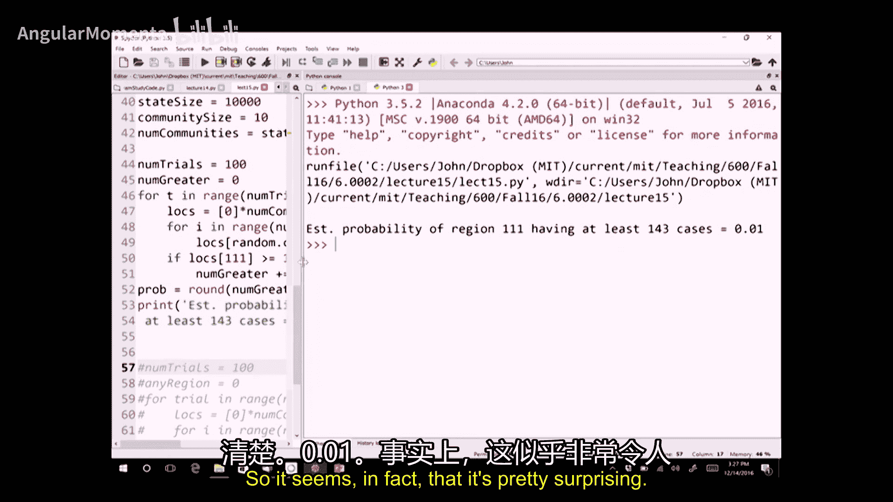
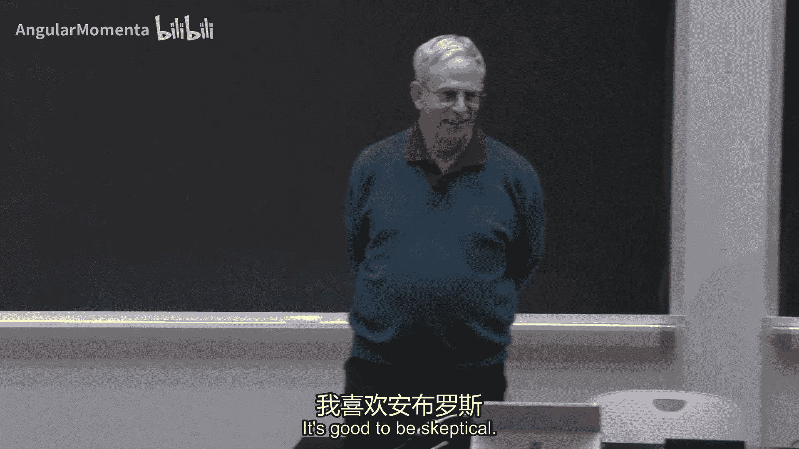
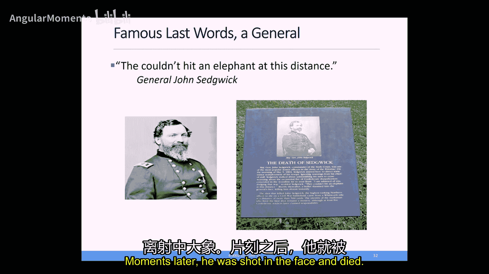

# 015：统计学总结与课程回顾 📊


在本节课中，我们将总结常见的统计学谬误，并回顾整个课程的核心内容。我们将学习如何批判性地看待数据呈现，避免常见的统计陷阱，并重温本学期所学的计算思维与数据科学的关键概念。

## 统计学谬误与陷阱

上一节我们介绍了数据建模与呈现，本节中我们来看看在解读和呈现数据时常见的统计学谬误。

### 坐标轴截断与数据呈现

在解读图表时，需要注意坐标轴的起始点。有时，为了强调变化，Y轴可能不从0开始，这可能会夸大趋势。然而，在某些情况下（如体温变化），将Y轴扩展到不合理的范围（如0到200华氏度）反而会掩盖真实变化。关键在于，截断坐标轴不应是为了欺骗，也不应过度扩展以消除有意义的差异。

### 波动与趋势的混淆

时间序列数据中总是存在波动。重要的是选择与所研究现象一致的时间尺度来观察趋势。例如，气候变化是长期现象，观察短期波动（如一个寒冷的冬天）并不能得出关于气候趋势的结论。必须区分随机波动和长期趋势。

### 樱桃采摘（选择性使用数据）

“樱桃采摘”是指从大量数据中只挑选支持特定观点的数据点，而忽略其他数据。例如，在关于北极冰盖的数据中，通过精心选择两个特定日期的数据点，可以“证明”冰盖没有变化、急剧减少或任何其他趋势。这是一种误导性的做法。

以下是樱桃采摘的几个特征：
*   只选取支持预设结论的数据点。
*   忽略整体数据趋势。
*   可能导致完全相反的结论。

### 缺乏背景的数字

单独的数字没有意义，必须结合背景来解读。例如，“仅0.2%的枪支用于暴力犯罪”这个数字，在拥有3亿支枪支的美国背景下，意味着每年仍有约60万起涉枪暴力犯罪。同样，判断“猪流感导致159人死亡”是否严重，需要与每年约3.6万人死于季节性流感这个背景进行比较。

### 百分比变化的误导性

谈论百分比变化时，必须知道基数（分母）。例如，“翘课使挂科概率增加50%”听起来很严重，但如果基数概率是0.5%（增加到0.75%），其实际影响远小于从50%增加到75%。在评估医疗风险等信息时，这一点尤为重要。

### 多重假设检验与得州神枪手谬误

当检查大量区域或假设，并只报告其中最极端的结果时，可能会错误地将随机波动视为显著模式。例如，一位律师将州划分为1000个区域，发现其中一个区域癌症病例异常高，并声称发现了癌症集群。然而，模拟显示，在随机分布的情况下，**至少有一个**区域出现“异常高”病例的概率其实很大。这种先开枪后画靶的做法，就是得州神枪手谬误。

**核心概念模拟代码（错误版本 - 检查特定区域）：**
```python
# 此代码错误地计算了特定区域出现极端值的概率，而非至少一个区域出现的概率。
num_regions = 1000
cases_per_region_per_year = 36
years = 3
threshold = 143
num_trials = 100
count_specific_region = 0

for _ in range(num_trials):
    regions = [0] * num_regions
    # 随机分配病例
    for _ in range(years * cases_per_region_per_year * num_regions):
        regions[random.randint(0, num_regions-1)] += 1
    # 检查特定区域（如111号）
    if regions[110] >= threshold: # 索引从0开始
        count_specific_region += 1

prob_specific = count_specific_region / num_trials
print(f"特定区域概率: {prob_specific}")
```




**核心概念模拟代码（正确版本 - 检查任何区域）：**
```python
# 此代码正确地计算了至少一个区域出现极端值的概率。
num_regions = 1000
cases_per_region_per_year = 36
years = 3
threshold = 143
num_trials = 100
count_any_region = 0

for _ in range(num_trials):
    regions = [0] * num_regions
    # 随机分配病例
    for _ in range(years * cases_per_region_per_year * num_regions):
        regions[random.randint(0, num_regions-1)] += 1
    # 检查是否有任何一个区域超过阈值
    if any(cases >= threshold for cases in regions):
        count_any_region += 1

prob_any = count_any_region / num_trials
print(f"至少一个区域概率: {prob_any}")
```

### 总结：对数据保持审慎


从数据中得出结论时，保持怀疑态度是必要的。统计谬误多种多样。需要记住，**怀疑**（skepticism）是理性审视，而**否认**（denial）是拒绝证据，二者有本质区别。



## 课程回顾 🎓

现在，让我们回顾一下在整个《计算思维与数据科学导论》课程中学到的核心内容。

### 课程目标与技术主题

本课程围绕三大技术主题展开：
1.  **优化问题**：许多重要问题都可以转化为在约束条件下最大化或最小化目标函数。关键在于问题的表述，求解常借助现有库完成。
2.  **随机性思维**：世界充满不确定性，需要用概率来思考。随机性不仅是建模工具，也是解决确定性问题的强大计算技术（如蒙特卡洛模拟）。
3.  **世界建模**：模型是对现实的抽象。我们学习了确定性模型（如图论）、基于随机性的统计模型（如模拟、抽样），以及基于机器学习的模型。

### 编程能力提升

课程强调通过编程实践来学习。我们不仅介绍了一些Python新特性，更重要的是培养了使用现有库（如绘图、机器学习、数值计算库）解决问题的能力，这是在现实世界中构建项目的关键。

### 核心知识点细览

以下是各单元的核心要点：

**关于优化问题：**
*   贪心算法通常高效，但不保证最优解（如K均值聚类）。
*   许多优化问题是指数级复杂的，但动态规划常能提供精确的快速解。
*   备忘录化（缓存计算结果）是一种用空间换时间的通用编程技巧。
*   背包问题、图问题、曲线拟合、聚类、逻辑回归等都可表述为优化问题。

**关于随机性思维与建模：**
*   蒙特卡洛模拟是强大的工具。
*   模型的结果需要可信度评估，通常通过**置信区间**和**置信水平**来描述。
*   我们学习了中心极限定理、经验法则和各种分布，特别是正态（高斯）分布。
*   在机器学习部分，我们涵盖了：
    *   **无监督学习**：聚类（层次聚类、K均值）。
    *   **监督学习**：分类（K近邻、逻辑回归）。

**关于数据呈现：**
*   学习了如何创建和解读图表。
*   讨论了数据呈现的良好实践与常见陷阱。

### 后续学习与应用

完成本课程后，大家已经具备了编写程序解决实际问题的能力。无论是分析实验数据还是构建模型，请不要畏惧动手编程。

如果你对计算科学感兴趣，可以考虑以下后续路径：
*   **相关课程**：6.009（计算机科学基础）、6.005（软件工程）、6.006（算法导论）、6.034（人工智能）、6.036（机器学习导论）。
*   **本科生研究**：运用所学知识参与研究项目。
*   **专业选择**：考虑辅修或主修计算机科学。

预测未来是困难的，历史上许多关于计算机发展的预言都被证明是错误的。但可以肯定的是，计算能力将继续深入影响各个领域。保持学习，勇于实践，才是关键。

---




本节课中我们一起学习了如何识别和避免常见的统计学谬误，如樱桃采摘、缺乏背景的数字和多重假设检验等。同时，我们也全面回顾了本课程在优化、随机性思维、建模和编程方面的核心内容。希望大家能将这份计算思维与数据科学的工具箱，应用于未来的学习、研究和解决实际问题之中。课程到此结束，感谢大家的参与和努力！