# 【2024】【精译⚡TinyML和高性能大模型推理】麻省理工学院•6.5940 p01 Lecture 1 - Introduction (MIT 6.5940, Fall 2024, Zoom Recording) [BV1c8wNe1ErX_p1]

Welcome to tiny ML and Eff deep learninging computinguting 2024 and'm Professor Song Han very glad to teach this class again this is the third time we offer this class we're going to learn efficient deep learning computing how to make neural networks run faster。

 train with faster and inference faster。I remember two years ago when we first opened this course。

 only 30 students last year it was。90 this year is more than 200。

 so welcome all I'm very glad to have you all here and hopefully we'll have a very fruitful semester altogether。

So this is a brief introduction of myself， I graduated from Jinghua University and got my PhD from Stanford with professor Bill Dady。

 I worked on model compression and efficientffient deep learning computing during my PhD。

 published a deep compression paper which set the foundation for modern neural network acceleration compression and published a paper called Effient inference Engine which is actually a top five excited paper in 50 years of ESSAP。

During my PhDI co founded a startup called DI T for Eicient Air chip。

 which was a later acquired by zings and later zings is acquired by AMD。

 that's a very popular story in Cicon Valley。So in this course we will teach some of the how to make sure the research is very fundamental。

 not only fundamental， but also practical。So I joined MIT about six years ago。

 a very exciting journey we've been working on from tiny ML to large language model。

 acceleration and compression。One of the most exciting paper we did in the past few years is the AWQ for large language model quantization。

 which got the best paper what M and also is having already more than six minute downloads in an hugging phase。

 So if you want to deploy large language model， make it four times smaller than AWQ is the technique to go。

 And we will learn that in this lecture。 you're going to implement that not only implement that。

 but also deployed a large language model locally on your laptop。Which is will be pretty exciting。

So at MIT I also focused on a startup called OmniM working on efficient independent computing model optimizations。

 so in this lecture we'll learn all the secret sources from those two startups so those five homework will be very very helpful if you learn the mastery the model。

So we very carefully created five assignments by five homeworks， they're all hands on homeworks。

 so we try to for you guys use the minimum effort to learn the most amount of knowledge。

 the best to utilize our time， so please do those homework very well。Yeah。

 we'll have five labs and each TA will be responsible for one of them and we have office hours every Tuesday and Thursday and feel free to come to our office and can help you with any questions you may have。

Okay， let's start by motivating why do we need efficient different computing。

 so let's see the supply and demand for air computing。

So in this chart shows throughout different years， the model size of large language model in red versus the GPU memory in green。

We can see the large language model size grow from 0。05 billion parameters。

 the initial transformer in 2018， 2017， 2018 to about 1。5 billion parameter in GT2， roughly in 2019。

 2020。And recently， there's even tri parameter models being trained in the world right is growing super fast。

 even much faster than the amount of GPU memories that is available I in the single GPU right which is showing showing green。

 So this big gap。Gap is getting larger actually with recent years。

I mean if you see the supply and demand curve that is driving up with the price right making deep learning super expensive to train super expensive to serve right So we are going to learn techniques to bridge the gap using efficient model compression techniques so that we can improve the utilization of the hardware and also reduce the models size。

 memory requirement， computation requirement to bridge this gap。

So rather than I train a model and directly run inference on the top。

 we now can train a model compress it before deploying the compresses model for inference。

So in recent years， the amount of publications in model compression and acceleration and compressrised the sparse model is。

Getting a lot faster number of publications is increasing very fast in recent years。

 and we are going to learn these techniques， how do we utilize compression and scarrsity to accelerate neural network inference？

So。In this lecture， we are going to start with three sections from vision to language to multiple modalities to understand the computation demand。

Of this AI workload and see where we are。Among the frontier， so let's start with vision tasks。

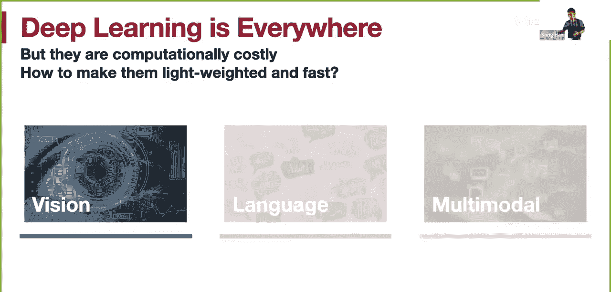

So talking about computer， we have to mention imageNe and also Alexnett right so Alex Na。

 this is actually the image net。

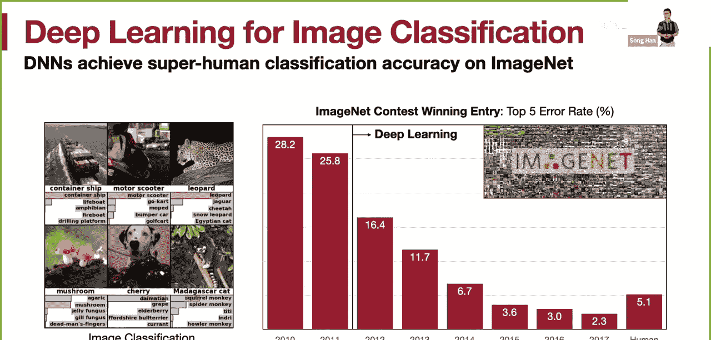

error rate which is decreasing across the years， and if you can see carefully in 2012 that the year where we have the biggest improvement。

 that is actually the year when I started my PhD at Stanford where Alex and I just came and just so amazingly blown away a lot of the traditional techniques and later throughout the years。

 the accuracy is just decreasing and decreasing even surpassing the human performance。

 which is the last bar。So it is really the big data and compute and algorithms that is driving up the performance of these workloads。

But that is no free lunch， as we can see in this figure， the axis is the max。

 the amount of computation， we are going to learn what is the Mac in detail in the next lecture and the y axis is the accuracy we can see a trend。

 the higher accuracy you want actually the larger the amount of compute that needs to be to run the inference right and the larger the circle means the larger the model size。

 which means the accuracy doesn't come as a free lunch。But you need through a lot of memory。

 a lot of compute to achieve such accuracy。And what we are going to learn in this lecture is to push the front here okay to reduce the amount of computation。

 but doesn't sacrifice the accuracy or even increase the accuracy we can drastically reduce the amount of max okay to the left corner to the left corner and then maintain even entire accuracy by neural architecture search techniques which we are going to learn in a few months。

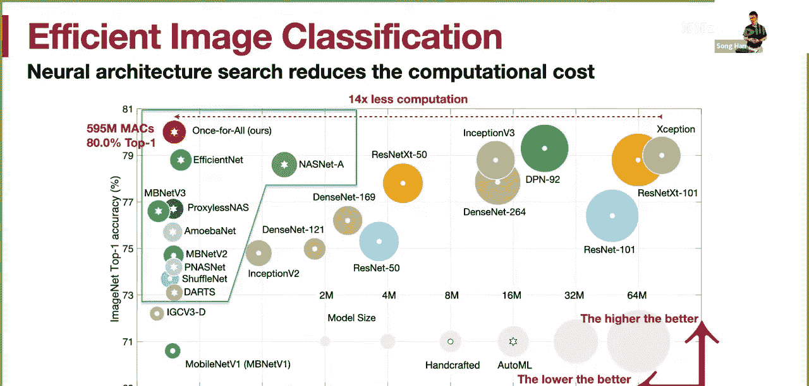

And such amazing efficient AI techniques enable running these deep neural networkss locally on the edge。

 for example， running on the phone， we can tag our photos， for example， summer， the trips。

 dining different locations， lakes， cliff geyers right and also can do people recognition locally on the phone on the right hand side is our from our lab to do on device holds estimation everything is running locally。

 you don't have to worry about the data get transmitted to the cloud。

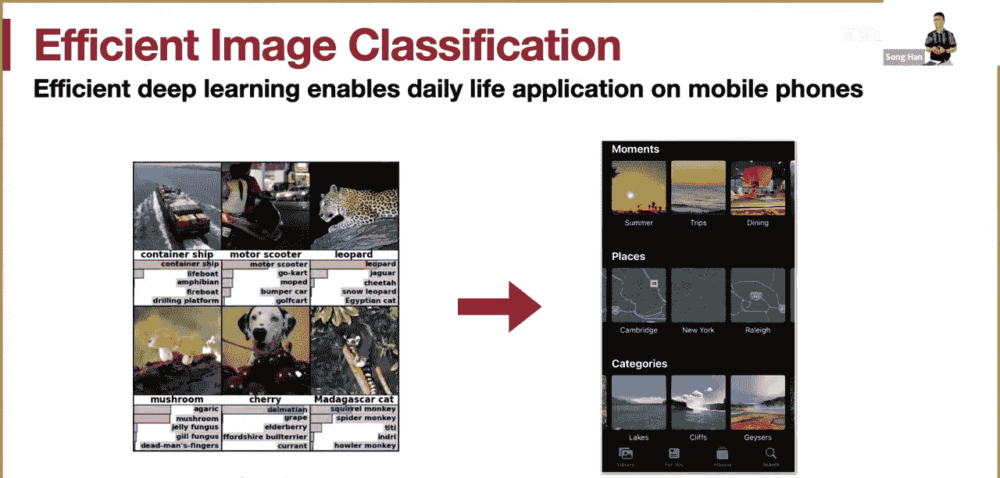

And we are going to learn those techniques。Not only on mobile phones。

 but we can even shrink the model such that we can deploy them on IoT devices。

 even smaller microcontrollers that is only a couple of dollars， they are much smaller， much cheaper。

 but in the meantime it's more challenging because we have to make sure the model is small enough so that it can fit microcontroller and the inference library is efficient enough so that it can run different workload not only classification。

 but also detection like phase and mask detection and person detection this product was done during COVID so we are showing this demo using a microcontroller with only $256 kilobyte of memory we can detect phases with mask or without a mask。

Not only on device inference， but also we are going to teach on device training。

So AI systems need to continuously adapt to new data collected from the sensors okay。

We want to process this new data locally on device so that we can have better privacy。

 lower the cost， enable customization， and also enable lifelong learning。

But trading is much more expensive than your and why is that？

We have to store those intermediate activations， we have to calculate the gradient。

 we have to do the back prop， etc cetera， right so it's even harder to fit for edge hardware。

In this lecture， we are going to also learn those on device training techniques that can drastically reduce the amount of memory。

For example， in this project called onD training under 256 kilobyte of memory published two years ago。

 we can reduce the training costs from a few hundred megabytes to only 141 kilobyte。

 but three orders of magnitude saving by using quantization and wire skating sparkrse update and tiny training engine and we are going to dive deeper into such topic in about two months。

And为。

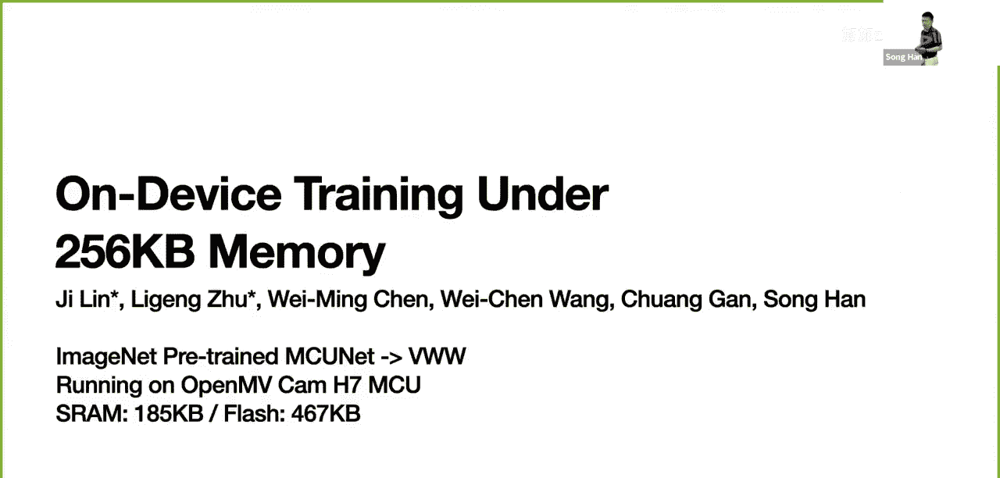

That technique， we can have a demo here of on device training under 256 kilobyte of memory is running on the openM cam microcontroller right here。

 we attach two buttons with it to input the class and we have a green class indicating there's no person。

 we have a red class red button indicating there is person。

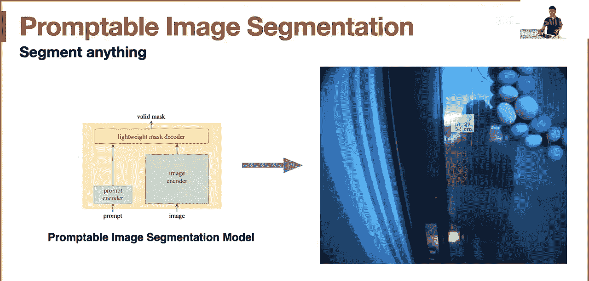

等于你说嘞。The model is didn't have any training for these two classes so its the classification result is wrong。

 you can see the top right corner see there' is a red or green showing on the top right corner of the screen。

Before printinging， it cannot recognize this language person versus no person。

And then we apply on device training to press the button。Green for no person。 right for person。

To manually import few labels。And the back publication is done locally on the device。

And we had to do a couple of iterations。And then let's see the classification result。

No person in red， no person in green。And classify them perfectly。And there's no wF。

 there's no internet， everything that just done locally on this microcontroller。好。Rightice one here。

 is the data like is the image repeated。individualula repeat it repeats the。

But that's why we are showing later using a real world setting。

 the last in a real world setting where it's showing is's not overfe。

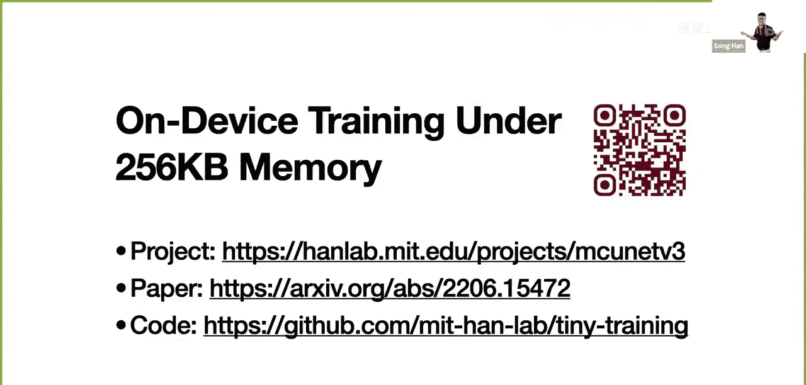

Profitable image segmentation， right， So let's talk about another interesting stuff segment。

 anything。 right， So this is demo from Nada where can。Have a prompt do。

 and then you can segment whatever you're looking at， for example here。

 looking at the person and the person will be segmented。

But this is very computationally heavy previously people store those features， extract the features。

 store them offline and then only run the ahead。

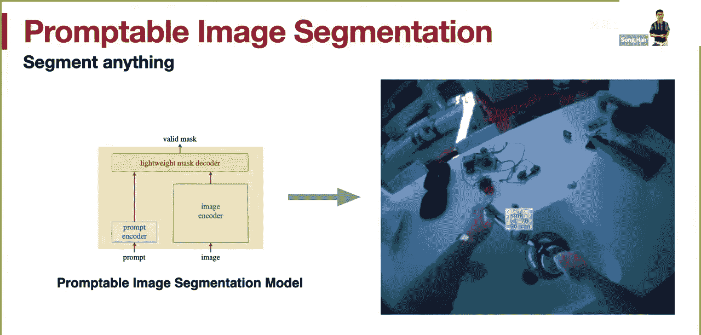

On the browser。But one technique we'll introduce in this lecture efficient VIT can actually reduce。

You improved the throughput by 48 times more than an order of magnitude faster with even higher accuracy on this chart。

48 times speed up able 100 GPU so here is showing before the acceleration and after the acceleration so before the acceleration on the first row the model is running at only 11 images per second and after using efficient VIT Sam we can accelerate it to 182 images per second。

So zero hardware and investment， just using existing hardware by making the model much more efficient。

 we can make the quality matchsh exactly with the baseline model。

 but make it run a lot faster and this is done by Zo Yang who made this project even before joining MIT。

 which is pretty amazing project。So no so far we introduced the discriminative models。

 so as the algorithm advancement people design these generative models that can not only recognize images but also generate new images right so these are several examples like tieddy bears。

 a bowl of soup， a photo of astronaut riding a horse on the Mars。

So diffusion models can create realistic images from actual language description and we are going to learn how diffusion models work。

 in order to accelerate it， we want to first understand how diffusion model works。

But such amazing property comment very comes at a very heavy computational cost。

So the training stable infffusion cost  600，006A 100s， 150K GPO hours， which is pretty expensive。

And this is a figure generated by Mu Yang showing that this image or video generation model is actually much more expensive。

 like three times more expensive， just running a single step of the dipution model on a 1k to generate a 1k by 1k image。

Not to mention the videos， which is the red bar， 5。

6 billion parameter model to generate a video not even 1k， but it's just 400 or 480 by 720。

Genrate 49 frames， just a few seconds with a single diffusion step， it takes nine times more flops。

 so it's very expensive to run these image or video generation models okay。And also。

 as the resolution grows， the amount of compute also grows collaboratively with the resolution。

So that's a big problem we want to solve。We've did a couple of projects we're going to introduce in this lecture。

 such as the gang compression， we can reduce the computation by 21 to nine times。

And this is before compression after compression， turning a horse into a zebra。Previously。

 it's running about 12 frames per second。 Now you can run 40 frames per second。

 we are going to introduce techniques to achieve that。And also using this any cost again technique。

 for example， previously， we want to do photo editing， for example， make the lady smile。

 and it takes quite a while。Or make her look younger。

 We can just turn the sliding bar to the right first projecting the image to the hidden space。

It takes quite a while what we did and we're going to introduce is first train this once for all network。

 just a super network that contain many different sub networks。

 so during the editing phase we can use a smaller sub network running at low cost for fast prototyping。

And finally， when we are satisfied with the result， we can run the large sub network only once。

 and as a result， you can see it can make her smile almost instantly。Or make her look younger。

 we can slide the second bar to the right。Change the hair color is almost instant。 Okay。

 by running this using this one for technique， we can derive many different subnet very quickly。Okay。

 and using this one for a technique， we can reduce the computation showing this yellow bar from 100%。

 78%， 50%， 30%， even 19%， but we can hardly tell the quality。

 what the quality is still while maintained despite that we are reducing the max by up to five times。

This is not a technique we are going to introduce later in the later part of this lecture to accelerate image generation when we are doing the photo editing。

 so here we are doing image in painting so what is in painting and all painting in painting is basically saying that we have a part of the image say the black part in the rectangle we want to add a horse to that photograph of a horse and the grassland and initially stable diffusion takes like 1。

855 X costing 369 milliseconds and after the compression acceleration we can make it around。

 only 514 gigam X at a 95 milliseconds。But similar on the right hand side to generate add a coconut tree to the image。

 we can accelerate it by 4。8 times。Since previous methods， you need to generate all the pixels。

 even though you're only editing a part of that。But with the S method， we can do spars update。

 update where you only update the pixels， only generate pixels that needs to be updated and the roof the remaining pixels remains the same。

We are also going to introduce how to accelerate image generation by parallel processing。

So with four GPUs， okay， can we generate even larger images even faster？

Originally with one GPU and takes about 12 seconds right a natural thought would be if we have four GPUs。

 can we use like three， three seconds， four times faster。Unfortunately。

 naively doing this will introduce。The artifact with a duplication using four GPUs is actually generated four distinct images。

The reason is that these four GPUs didn't communicate with each other， and as a result。

 they each generated an independent image。But communication will lead to the networking latency right and the way we deal with that is to overlap the computation with the networking such that we can use a sta step to communicate the stale input。

To the next step， we are going to learn that in detail in the later part of this lecture。

 this is just for motivation and as a result we can generate on the right column。

 the image that is three times faster， but the quality is very well maintained。

Also people are interested customize image customization right create personalized images based on user specified input for example。

 we want to generate something like Songhan riding a horse。

 but it doesn't look like me riding a horse right its very generic。

So we are going to introduce techniques like fast composer， which is from Guang Xan。

A training free method that can blend different people together。 Like here， we can have Jan。

 Lady Gata sing together。And this efficient image generation has a lot of applications。

 this is just mo to why we need to learn these techniques like on the iPad we can kind draw a picture and then after a while you see it takes several seconds we want it to be faster and to immediately render a very good looking image and we hope such method can run locally on the edge device。

Not only image generation but also 3D generation that's also a very hot topic can require a lot of compute。

 so this is diffusion models creating 3D objects from a reference the image so the first row is the reference image and the later rows are the generated a 3D object based on just one image。

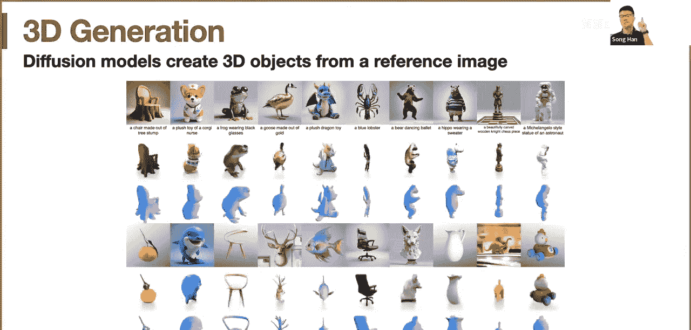

And this is using text to prompt， using natural language as an input and create the 3D objects。你。

And also video generation that's adding another degree of freedom， they are pretty big。

It's even harder task requiring much lighter model size。And this is from last year and this year。

 Sora is there， so it's pretty exciting and just give a text a prompt a stylish woman walking down the Tokyo Street and then is generating higher resolution photo realistic videos from natural language description。

 but again this is consuming a huge amount of compute。

That we are going to learn techniques to bring down such computation。

And so far we talk a lot about 2D vision， right， but in reality， 3D vision is also very exciting。

 like autonomous driving， self driving cars， they have not only camera sensors。

 but also neither are sensors that collect those point cloud and to understand this 3D world。

Unfortunately， that would require a lot of compute here is showing the whole trunk of workstation in the back of the seat。

 you don't want that to heat the whole cars and they're uncomfortable。

 so we want to make self driving more efficient to fit everything in a smaller GPU。

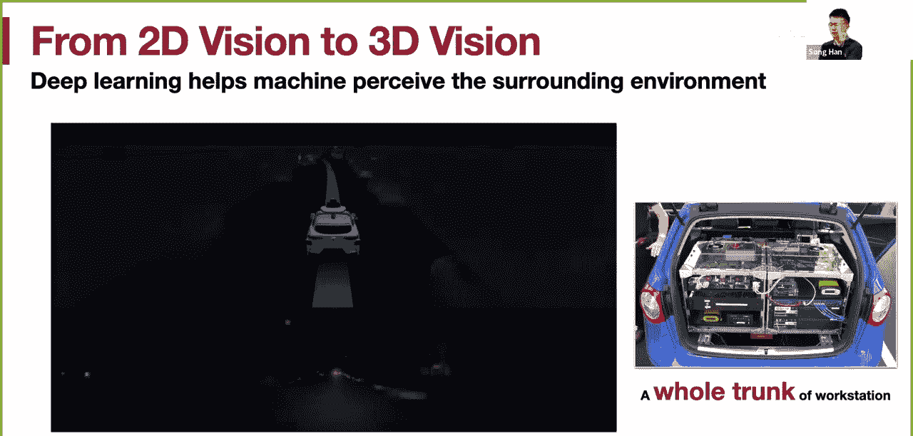

So this is what we did fast light on that to accelerate 3D perception with algorithm and system co design previously it runs only five frames per second and after the optimizations we're going to learn in this lecture about 3D point cloud acceleration。

 it can run 47 frames per second。

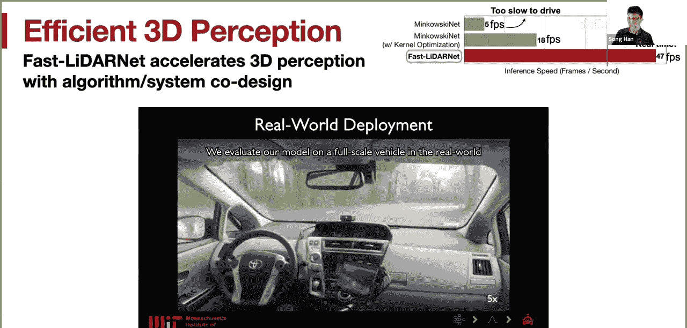

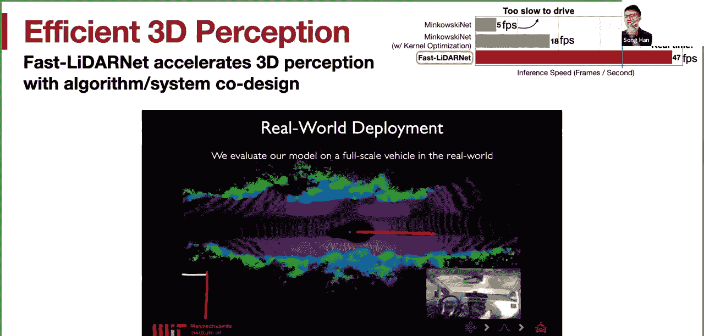

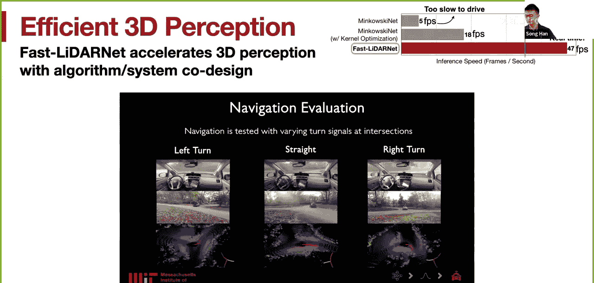

This is another project we are going to introduce from Zhu Xan from our group。

 he's now going to be a assistant professor at UCST very soon， so this project is called BV Fusion。

 but combine not only just one sensor but also combining multiple sensors very efficiently here we are showing six cameras in the front in the back front left。

 front right six cameras and also one LiDAR sensor on the top。

And we want to combine these features tofuse multiple sensors to do the segmentation and also detection detection means finding the bonding box。

 3D bonding box of the cars， the pedestrians and everything and on the right hand side and showing the BEV map segmentation BV means the bird eye view there's no map is's completely mapless mapless in the new city you can run such algorithms to find the lanes by the divable area by the pedestrian walkway。

 etc。On the top right corner is showing that this algorithm is runnable and address OrI。

 which is a mobile GPU for self driving tasks。Okay。

 so that is the first part about the amazing progress of computer vision and the implication for computing。

 right why do we need efficient computing and these applications although amazing they they come at a high cost of computational resource。

And now let's switch gear to the second part and talk about the advancement of natural language processing。

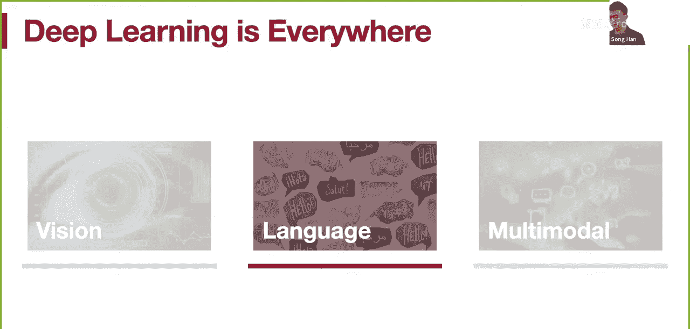

So this is the second year when after ChinaGBT， it is very computationally heavy。

 actually when ChinaGBT just came to the world， usually is's at a capacity and prevent users from have a cap of 50 messages every three hours etc。

 we are experiencing exceptionally high demand please hang tight and we work skating our systems。

 those are the bottlenecks。

But they're really helping us， for example， Co pilotlo can make very meaningful coding suggestions based on the context。

 we just give it some prompt， some comment， and then it's going to automatically generate the code very quickly。

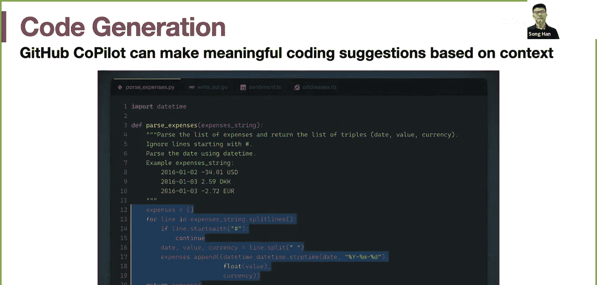

And also new room machine translation to bridge the language barrier usingOP techniques。

So we're going to introduce technique to bring down the model size and also reduce maintain the blue store which is the quality。

 so here we are reducing the model size from 1 176 mebytes to only nine mebytes if it is only like nine MBbytes is very easy to fit on your phone。

And recently， with the announcement of large language model， new capabilities begins to emerge。

 for example， zero short learning and also few short learning So what is zero short learning it can the model can predict the answer given only a description of the task there's no gradient no training given it a new task you just tell it what is the task and then it's going to give you the answer。

 say translate from English to French when we are not training a separate model or English to French or English to Chinese。

 just the same model using different prompt to describe the task and zero short means there's no example and directly translate from cheese to French right and also the large language model have the capability called a few short learning so we just see a few example we just give it fitted it with a few examples of the task。

As part of the prompt engineering say translate to English to French and then we are going to give it three examples and then finally give the result to translate cheese right so again there's no gradient there's no fine tuning I just use design the prompt smartly the model is capable of doing such zero short or few short learning。

This seems very exciting capability， however， like we can expect， this comes at a very high cost。

So this is the few shot， one shot or zero shot learning accuracy so。To achieve higher accuracy。

 the model size has to grow very fast from 13 B to 175 billion parameter。

 every small percentage of accuracy improvement comes at a high cost of much larger model size and requiring more GPU resources to serve such models you see that the curve is very flat means every small percentage of accuracy improvement comes at a very high cost。

Bch language model also have another very interesting emergent capability。

 which is called a chain of thought。So let's see what is train of thought， standard prompting。

 say Roger have five tennis balls， buys two more cans of tennis balls。

 each can has three tennis balls， how many does he have it's 11。

Since five time plus three times three， two times three that's1。

 And then if you ask another question， given the same prompt， the cafeteria has 23 apples。

 if they use a 20 to make lunch and bought six more how many apples do they have。Yeah。

What should be the， what should be the correct answer。My， right。

 but the answer given by at that moment， given by ChGP 27， obviously that's wrong， right？

What are with prompt in another way？Say。Roor given the same question of Q1。

 the answer in blue showing Roor started with five balls， two kinds of three tennis balls。

two three tennis balls each is six tennis balls and five plus6 equals to 11。

 It described the entire thinking process， how the answer 11 it's arrived。

I prompt in this way to show not only the result， but also the chain of thought thinking process。

And given another Apple question， the answer， the model can output a new answer here the cafeteria at the 23 apples originally。

 they used the 20 to make lunch so they had 23 minus 20 that three step by step thinking step by step and then they bought six more apples so they now have three plus6 as equal to nine。

 the answer is nine now we can answer understand it correctly。

So we are going to introduce some of such prompt engineering techniques so that it will be very practical you can interact with these large language models more effectively。

Again， with such。嗯。Accuracy comes at a cost of very high computational cost。

 so this is the accuracy with the GSM8K middle school math world problems。

And then versus the access is the model size in order to achieve high accuracy。

 the model has to be pretty big。Like once75 billion parameters or 500， even have a tri parameter。

Which is leading to the figure we showed initially。

 the model is growing much faster than the hardware and on the right hand side is a server in the basement from our lab to train these models we actually purchased it about to a half years ago at that time we have 200 gigabit。

In Finninnne band， but the moment we purchased it the moment it becomes outdated last year I want to give the lecture the so I was state of R was 400 now it's 800 so this area is just moving so fast so it's very timely to learn these techniques to catch up the wave。

😊。

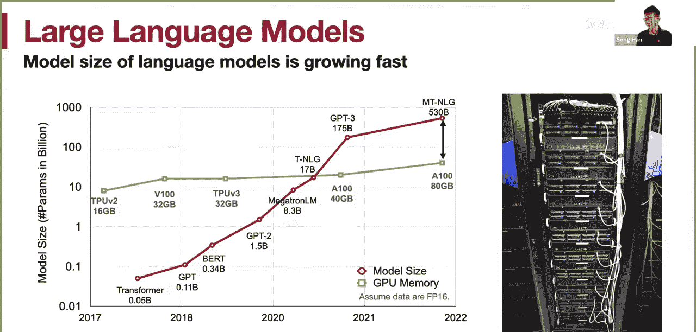

We also designed a couple of techniques to reduce the computation and by finding the redundancy in natural languages。

 actually in actual language， there's a lot of redundancy， say given the sentence。

As a visual treat the film is almost perfect that's the example on the left we can trim it the task is to classify the sentiment so we can trim the sentence to be as treat film perfect or even trim it to film perfect they can still classified this is positive。

 this is positive sentiment。😊，So showing that human language has a lot of redundancy here。

 we can take advantage of that redundancy and do a sparse attention。

 so this is a project we did about four three， four years ago， call spa sparse attention。

 we can actually remove those redundant tokens that doesn't heavily attend to other tokens like in this example。

 I bet the video game is a lot more fun than the film video attend very heavily to game。

 but the word I and the a doesn't attend to any words very heavily so we can safely remove those tokens。

So those are some of the technique we are going to dive deeper in later part of this lecture today we are just giving overview for you to get a taste what we are going to learn。

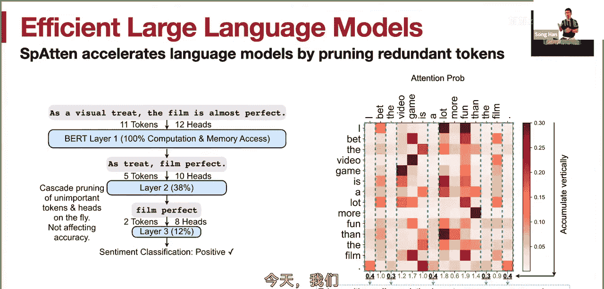

Okay， so these large language models are pretty exciting， how can we deploy them on the edge？

Deploying large language model on the edge would be super useful we can run code pilot services like code completion like office or game chat everything locally on the laptops in the cars in the robots and we don't have to worry about latency。

 networking wfi or sending our private data to the cloud right。

So deploying this large language model locally on the edge is super demanding and in this class we have two lecture and two labs which dedicated to how to deploy a large language model locally on the edge by using large language model quantization techniques so that you can。

Run 7 billion prime or even 13 billion prime per model locally on your laptop。

 So this is a demo showing this is a pretty outdated MacBook is only MacBook with M' one chip。

 not only not even M3 chip， but still it can run reasonably fast to rather seeing code。

Given the prompt to sort and the raid。And we are going to introduce techniques to quantize these large language models from 16 bit to only 4 bit okay gradually from 16 bit to 8 bit using smooth quant and to even4 bit using AWQ activation where weight only quantization actually the smooth quant paper comes from this lecture two years ago as one of the course project with Guangxuan so maybe in this year some of you may come up with even exciting even more exciting projects that may lead to even publication in the future。

 and the key idea is that we find lots of outliers。

 very big values on the right top right corner in the activations and we want to make it smooth make it smooth since matrix multiplication is linear you can scale the weight and gradient so that they can be equalized and smooth such that it'll be much easier to quantize and utilize the full dynamic range。

We are going to implement such algorithm in lab four in lab four。And also， we are going to introduce。

The inference library， efficient inference library in live five so that you can implement both the algorithm。

 the quantization algorithm， and also the inference library on your own。

Wwhich actually require pretty deep understanding of how computer systems work。

 you must be able to write C program， not just Python， but lowlevel C program。

 very comfortably manipulating pointers， single instruction， multiple data familiar with cash。

 how cache， works， what is locality， what is multi threading。

 we are going to implement those techniques， using multi core processors using CMD techniques。

 and also register level parism， so that's why we enforce these prerequisites。

So that you can complete the lasts。So here we have a demo called tinyny chatt。

 which is a Ba inference library by Ho Tian Shaang。

 we can deploy a large language model 7 billion parameter。

 large language model on a Jackson Orin nano， which is very small mobile GPU 3D printed this tiny chat computer to interact with the input in real time。

 and this is showing we can actually run a large language models on resource constrained edge GPU so this is a Jason Orin。

 we can use tiny chat to run large language model on this Jason Orin very smoothly。

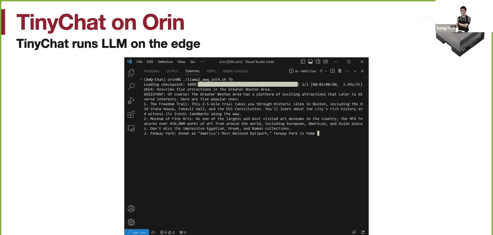

Even 13 bidding parameter model。And this is comparing with quantization without quantization。

 it'll be much faster if can use the activation where quantization the AWQ。

 so on the left hand side is showing running this large language model without quantization is slow and on the right is showing with the fourb quantization is faster from 450 tokens per second all the way to 166 tokens per second。

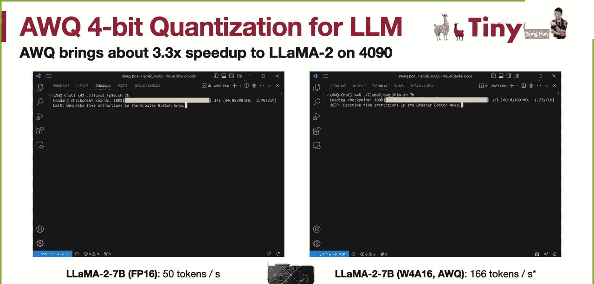

And running low large language model on the edge device can have a lot of applications。

 so for example， I intelligenceence here can do summarization to summarize some of your emails。

 smart reply for your emails and also writing tools to help you correct the sentiment to make it more professional。

 etc。啊So far， we talk about vision。Language， and now let's jump into multimod。

 So what is multimod so。we combine image， language， audio， action， different modalities。

Into project them into the same space and understand and process all these different modalities of input and output different modalities。

 Can we take image， language， audio， video action in and then output potentially not only text。

 but also image， video even actions。 Okay， so that's a multi model problem。

And the challenge here is to how do we align the representation。

 the embedding from different input modalities。So one example is this role called Lava who can understand the images and take language prompt with the input image and output the description in language。

 So here do you know who drew this painting and Lava is going to say the details about its Mona Lisa。

And here is showing with quantization techniques， we can also quantize them to only for bit without losing accuracy。

 like in this example， this is an input image and some text description together with that with naive run to nearest the quantization。

 it's going to say something weird like there are small pictures of the earth and other planets placed on top of the food。

 but with A AWQ quantization is says the me I mean the image is the lighthearted and humorous take and the concept of looking at pictures of the earth from the space。

 right so with proper quantization techniques， we can not only accelerate the large language models。

 but also the visual language models。Later， we designed this Vla and visual language model。

 we are also going to cover how we train and run inference on visual language models。

 so the key idea is to produce the visual tokens。Okay。

 so now only language can be tokenized images can also be tokenized and how do we tokenize images is by using the visual transformers。

 we're going to have a dedicated lecture just to introduce what is a visual transformer and also how do we design efficient vision transformers So with a vision transformer we can project the input image into several tokens。

And can the image token with the text token so basically we can expand this idea to other modalities as well。

 so people are realizing everything can be tokenized， everything is token token in token out。

And we find in this lecture， we are going to learn those training recipes like data and training recipe actually matters more than the architecture itself and why visual instruction tuning is not enough and why we need visual language pretraining and why image taxpayer is not enough。

 but we need to have inter image and text and how do we bind them。

 how do we set the proportion of how much of each。And visual。

 we are also going to talk about visual income context text learning。

Whi is pretty exciting capability and how do we expanded from images to videos which require much longer context length since each frame will take about 200 tokens if you have hourly long video you want to understand like a film that require a very long context so in this lecture we are going to introduce。

Long context techniques， how do we handle the linearly growing memory if rather than rather than naiveively using the linearly growing TV cache。

So here are some of the capabilities modern and visual language models such as Villa can achieve。

 given this video please tell me what happens in the video and Villa can say the video shows a soccer game where our player scores a goal and draw the cheers as the player celebrates it with his teammates okay。

So we have a Tal link here at vla。mt。eddu free to play with it。Given this video。

 according to the video， what will happen likely to happen next。

 Vla says the video video shows a blender with strawberries inside and is likely that the blender will be turned on to blend the strawberries into a smoothie。

 So it has the word knowledge knowing that given such a few frames。

 what's going to happen in the next。 That's also called the world model。 Okay。

 world model with the word knowledge understand how the world works。

 given some frames predict what's going to happen next。Similarly in this case。

 what will likely happen next， Va says the next step in the video is likely involve the person grinding the spices in the motor。

A very interesting capability is the visual income context learning， Okay。

 so what is in context text learning， we're not tidying what is the task。

 but we're just showing some examples。So here the prompt is image Boston， image， Toronto and image。

And it's going to say San Francisco， were not explicitly telling that please tell me what is the city in this image。

But we're just showing some of the examples and then the model is going to understand okay。

 the task is to tell tell the user where is the city， Okay。

 so that is enabled by using interleaved image text training So data are blending this training recipe matters a lot in the area of large language models and we are going to introduce visual language model in this vector。

Okay， next one about world knowledge。So anybody can guess where is this？Givenive in this picture。

Oh very nice very nice spmpei right it required world knowledge you have seen lots of places to understand that but truly the visual language model can also tell where a specific image is actually when I was traveling in Europe earlier this year but I clear I took a random picture and to my surprise it can tell me this is actually a particular place described very very accurately so I was quite amazed by the world knowledge it may have so feel free to play with it。

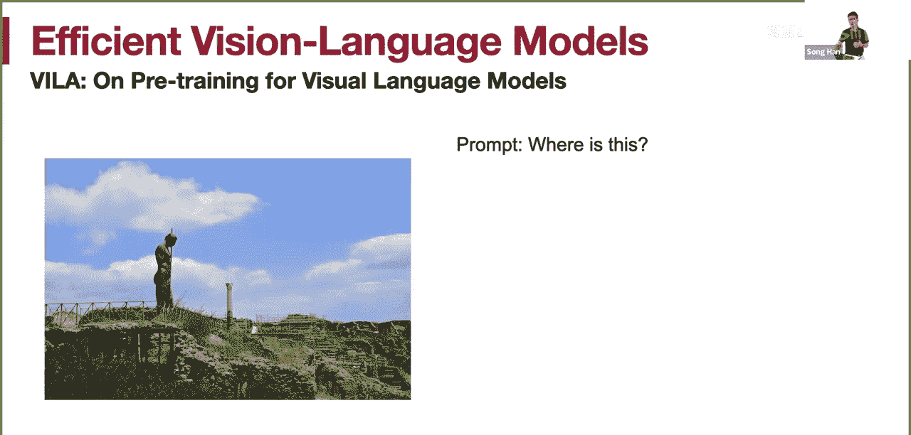

Or even implemented in one of your homework。We're also going to learn this technique。

 can we bring this large language model， vision language model？

Lally to our laptops right so that we can play it with it， interact with it。

 have full control with it， compress all the word knowledge into the laptop so here is what we can do for example describe we can describe the painting in details it's running locally on a laptop。

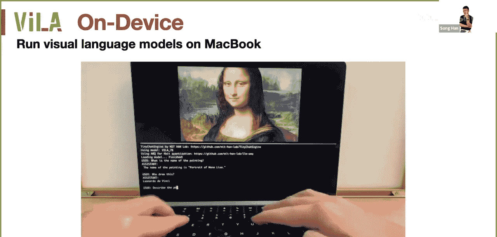

So our lab five。In La 5， we are implementing a language model alone。

 so we can also implement the visual language model as extra bonus， extra credits for extra credits。

 So feel free to talk to me if you want to do the visual language model for La 5。

Something like this time。Okay so another modality would be the action right we can use the visual language model also to output other modalities like actions right so here the instruction is bring me the rice chips from the drawer okay and the current step is opening the drawer it helps do the planning things using the large language model contains a lot of word and model it understand in order to bring the chip。

 you first need to open the drawer and then take the rice chip out of the drawer and then place it and then close the drawer etc right。

But unfortunately， this is accelerated by4 x speed， right is rise only three hertz。

Due to the high computational cost and networking latency。

 because the images are transmitted over the internet to a works stationation and then transmitted back the final result。

 Okay， so this is the R T1 from Google is also already pretty amazing， but。😊。

Highlights how important it is to learn these efficient deployment computing techniques like this lecture。

Similarly， typically for games， Algo beating Li sodo is taking $1，920 CPUs and $280 GPUs， $3。

000 electric bill per game， that's super expensive。Or the alpha fold require 16 TP U V3s。

 which is 128 T PO V3 course train for a few weeks。

 So all these amazing capabilities comes at a high cost。Okay， so。

Let's switch gear from visual language to multimodality now we talk about these three pillars。

 algorithm hardware and data in particular we want to highlight the advancement of hardware that is the driving force for this cabricken of efficient deep burning computing。

So this lecture， we are going to introduce some of the hardware。

However system techniques as well and the philosophy is that we want to do the whole full stack full stack design。

 okay on the software part， full stack design from the algorithm part。

 the demand of computing to the system part which is the supply of computing。

 we want to close the gap by reducing the demand and increasing the supply okay。

So the recent trend of modern hardware design is that the microprocessor frequency at hold。

The single core performance also plateaued more slots sccaping down。

 but the number of course is increasing and the number of transitionors is also increasing so parallel computing。

Specialized computing is the new trend in this context。

And also precision matters with people the communities keep advancing the low precision arithmetic from floating。

32 floating 0。16 to integer 8，8 integer to FP88 bit floating point。

And also even to FP4 four bit floating point， which is to appear in the our latest blackwell amiga GPUs right so the precision is keep decreasing in this lecture we are going to learn all the details about what is the floating point。

 what is FP8 what is E5 M2 okay what is the Mana so what is FP4。

 why blackwell is so amazing it can have a such high peak performance in the quantization part of this lecture。

And on the right hand side is showing the single chip inference performance 300 times in eight years。

 this is from the slide from my PhD advisor， Professor Bill Da。

 is showing that from Scalar32 to FP16 to HMMA tensor core in V100 intake TOs increased to 125 and again it doubled by using in8 in8 IMMA tensor course to using a structure sparsity2 to4 sparsity in A100。

Like 300 performance improving eight years， that's like pretty amazing improvement。

And along this line of innovation。Software is actually playing a very critical role in especially the advanced technology node。

 So this is from 65 nanometer，28 nanometer，7 nanometer，5 nanometer。 You can see the purple part。

 which is the software component。Is getting a very big chunk of the total advanced design costs。

And that's always also creating the mo for a good citizen to be able to attract a lot of good customers and would be programmable has to be easy to use。

 especially the large language model， this generatedative AI the models are changing itating very fast。

 changing every day how to make it flexible and super important So in this lecture we have a lot of focus on the software part of efficiently learning computing。

 we don't design new hardware in this lecture。But how to well。

 utilize existing hardware and what is the implication to design new hardware？

So here we show from 2016 to 2024。The advancement of GPUs。

 we put them into four different benchmarks。 You know。

 the dance F P 16 performance measured in terror operations per second。

 We are going to learn in the next lecture。 What is T ops per second， What does it mean。

With is dance， with sparks， with is that basic teamme。

 So we are going to learn dance and sparks in the pruning lecture from next Thursday。

 and we are going to learn quantization， precision a week after。

So from P100 to B100 is actually 0 times 100 times more TOs per second。

In particular from H100 to B100 even doubled the TOs per second。

 which is super amazing and even didn't consider FP4 if we add FP4 it will be way higher in this chart because it's showing just F 16。

And here is the memory bandwidth， computation is cheap， memory is super expensive。

From a 100 to H 100， it almost doubled and then more than doubled from H 100 to B 100 with respect to the memory bandwidth。

 And we are going to introduce these concepts like why data movement is expensive。

Why energy is dominated by moving data。And here is showing the power， unfortunately。

 the power is also growing pretty fast。From a10 400 watts to 700 watts in H 100 and B100。

 if we have all eight GPUs in a node， you can calculate how much power you have。So eight node。

 all the GPUs will take maybe 405000 watts and altogether the whole node will have 10。

000 watts you have to prepare 10，000 watts just for a single node and as a result you in the space will not be the constraint but the power power supply the energy including is the new bottleneck。

Previously when we are having the a 6000 GPUs so we can have two cables serve the entire rack。

 but now two cables can only serve four node of a100， and only two node of H100 so。

Power efficiency is super important。And in this lecture， later part of this lecture。

 we are going to organize a lab tour so we'll show you down to the basement to our server so that you can see how these models are trained。

 what is like a mini data center， what does it look like， what is the code aisle， hot aisle。

 the rack， the switch， infinni band， the cables and the modern GPU， what does it look like？

And next is the memory， so unfortunately the memory is growing at a slower speed compared with the compute。

 so currently what we have in our lab is 80 gigyte able Android GPUus。

H 100 pretty much stays the same。 and P100 give a pretty exciting leap to almost 1009192 gigys。

 So this is for the cloud for training and serving。So let's also look at the edge。For example。

 on the phone， we want to have those low power chips。 like here is only 10 wts，10 watts， S 8。

55 all the way to S Hgen1 and S Hgen2 is also there， but we didn't find the public。Numbers。

 so we didn't put it there。 The performance is also increasing pretty fast， like a couple of。

Like almost like half a00 like 50 TOs per second and memory is roughly 8， 16 gigabytes or Qm DSP。

Apple also offers this Apple neuro engine， energy efficient and high throughput for machine learning applications。

Similarly with the Quacomm DSP it's 35 TLs per second， however。

 we should not just look at the peak performance like 35 or 52 can make a conclusion that Apple or Quaualcomm which ones faster。

 I actually cannot because it's a multiple dimension the peak performance doesn't indicate doesn't directly translate to measured speed。

 there's so many factors we're going to learn this lecture like the activation data movement weight data movement memory bandwidth utilization all matters a lot。

And also there' is the mobile GPU people very widely use in the cars， for example。

 this is the JN OrI， which is used in many EVs， delivers a couple of hundred TOs per second。

 consume about 60 watts， 64 gigabytes of memory， and there's going to be a new four coming up。

 which is the next generation of AJX OrI。And also there's microcontrollers for many IoT devices like the smart home camera might have one of these small devices。

 arm devices， just a couple of hundred meitts， but the memory is also super small。

 just a few hundred kilobytes of SRAM， maybe a few megabytes of maybe DM or even no DM。

 some micro controllers has completely no DM， you have to manage the memory super carefully。

So from cloud AI to mobile AI to tiny AI there's actually a big gap between the model memory that you have tens of gigabytes versus a couple of hundred kilobytes so each AI device still have a huge gap to cloud processors and what we learned in this lecture is going to try to close the gap by using smaller models。

Okay， so those are the three pillars， the hardwarer， data and the algorithm。

And our goal is rather than using a lot of compute， emitting a lot of carbon。

 using many engineers train a lot of data，1 m hours goal will be how to use less computation。

 less carbon， fewer engineers automated train and less data。So this is a course overview。

 let me use the remaining 10 minutes to cover some of the logistics。

So the lecture is every Tuesday and Thursday from 335 to 455 in this classroom。

 and we will record other classes。The office hour will be after directly after this lecture on every Thursday from 5 to 6 pm the room number is 38344 that's whether where our office is located at feel free to ask questions during the office hour or go to the Piazza make sure you sign up on Piazza。

And also we use tas like other classes to submit the homework。

And you can email us at efficient MLl staff MItedduu if you have any external inquiries。

 we are also going to create a meetinging list， you can make sure you take care of the meetinging list so everybody is welcome to join that meetinging list so that we can broadcast some of the news project ideas。

 some company even want to have those internship openings or full time job openings。

 we can disseminate through that meetinging list so。Stay tuned。

 Reggene will send a notification for the mailing list to sign up。And prerequisites。

 so this year we enforce two prerequisites， one is the 6191。

 which is computation structures since the La5 and Le4 require a deep understanding of how computer systems work like what is catch。

 what is locality， what is parallelism， five stage pipeline page table since we are going to talk about the page attention speculation。

 we're going to talk about specative decoding and most importantly。

 you have to be familiar with comfortable with how to write C programs。

Since the lab will be written in C program and also modern threading techniques。

The second prerequisite is 6。390 old of introduction to machine class。

Make sure you are familiar with how to use Pytorch since all the labs will be using Pytorrch。

So we are going to cover roughly three sections， first section is about efficient inference technique with pruning。

 reducing the number of parameters， quantization， reducing the precision for each parameter and also neural architecture search。

 how do we design efficient neuralnaural architecture。And also distillation。

 how to use a teacher model to distill a smaller model。

 we're also going to talk about efficient training technique。

 how to do grading compression on device training and also find rate learning and parallelization。

 including data parallel model parallel， Paa and parallel and also sequence parallel for large language model。

We're also going to introduce applications specific optimization。

 the most important one of course is transformers and large language models。

 we're going to introduce the entire architecture， how transformer work from the position encoding all the way to what is QKV。

 what is attention， what is different context extension techniques， what is rope， etc。

Were also going to introduce diffusion models， how diffusion model works， video understanding， point。

 cloud understanding， etc。So a key concept is system on algorithm co design。

 which is covering actually combining a lot of knowledge we learn from the E E side。

 the C S side and also the A plus side。So hopefully it'll be a class you can take in later year of your undergrad or maybe in the first couple of years of your PhD to do such interdisciplinary research。

 some the E side， the191， or microcomp project lab， hardware architecture or deep learning。

 those are very related classes， CS side， computer architecture， software， performance engineering。

 mobile sensor sensor computing， AI+D side， Intro to machine learning。

 deep learning advances in computer vision， naturaltro language processing， all related classes。

We will have five labs over the course of the semester。

 we are going to use Google Collabab for the first four labs so you don't have to worry about the hardware。

First one is about pruning， second one about quantization。

 third one is about neuro architecture search， fourth is about large language model compression。

 and the fifth one does require hardware， which is a laptop hopefully you all have a laptop that is more than8 gigabytes of memory。

 make sure you have more than 8 gigabytes of memory and available storage should be at least to five gigabytes。

So unfortunately we don't have the budget to find everyone on laptop。

 but I'm assuming everyone already have a laptop， either XA6 or arm， either Mac， Linux or Windows。

 we have carefully debugged so that it can fit across different platforms and Jha will be the TA if you have any questions related to La5 and hardware。

So reading where will have five labs， each one is 15% followed up followed by a final project。

 25% is open ended， but we'll give you some project ideas to start with it is now in a group of three to four students consisting of a proposal。

 a presentation poster presentation and also a final report just 28%。

We also give44% for participation bonus and all the assignments are due on the 1159 pm on the due date。

And the late policy is that we have six total late days without penalty for the entire semester。

 given the large number of enrollment， we don't have any exception for the six late days。

And a lot of days are counted by day， each new day will the penalty will be  20% or 50%。

 so homework is worth zero credit two days later。So prerequisite all this is quite important。

 so students who don't fulfill the prerequisite will be deregistered in the second week of the class。

 so if you believe you have equivalent prior experience。

 including both computer architecture and also the machine learning。

 please make sure to send us the petition。On this form。

 make sure you take a photo of this form if you don't meet the prerequisites to submit your petition form by this Friday 11 49 pm okay and then our TA will review these petitions and student who't doesn't fulfill the prerequisite will be register next week。

Okay， so these are the five labs and also together with the final projects we did last year it's pretty exciting。

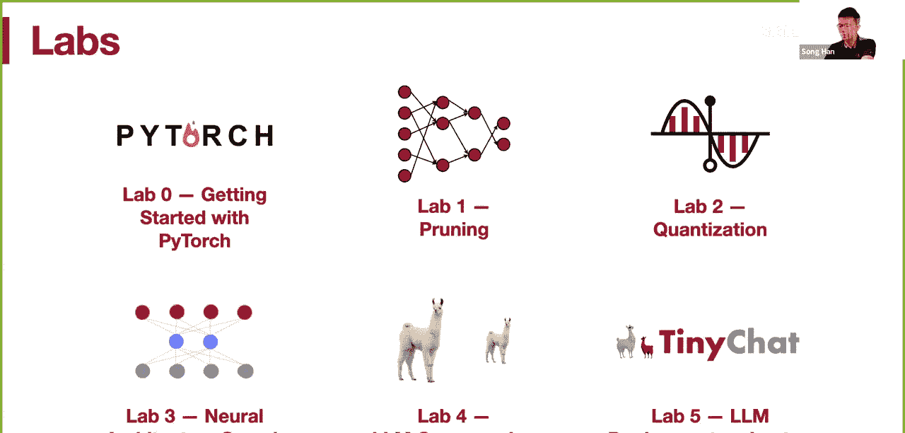

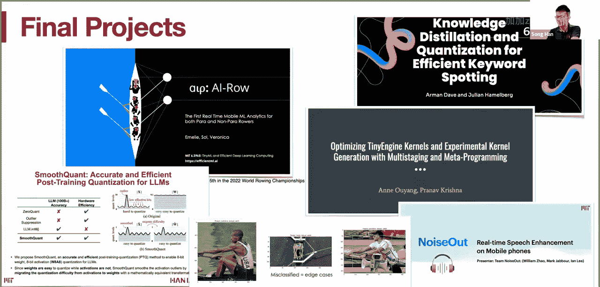

So hopefully you can learn a lot about this amazing efficient deep learning techniques and we'll see you next Tuesday。

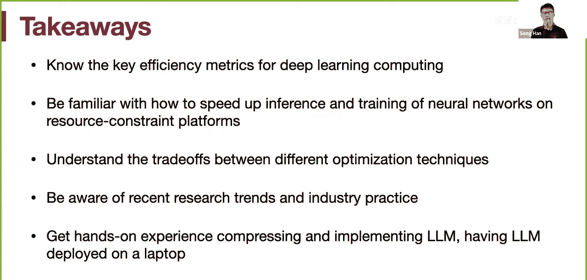