# 【2024】【精译⚡TinyML和高性能大模型推理】麻省理工学院•6.5940 p12 Lecture 12 - Transformer and LLM (MIT 6.5940, Fall 2024, Zoom Recording) [BV1c8wNe1ErX_p12]

Hey good afternoon everyone let's get started with a new chapter about transformer and large language model。

 so this is the mostly exciting chapter of this course lot of modern stuff。

So large language model ChGBT came0 later of 2022 or 2022 which bring a lot of excitement to the community。

 so here we prompted ChGBT to make a cabus for our course。

 tiny ML and efficient discipline computing and this is the cabus that comes out。

With a cause overview with course objectives， prerequisites even come up with a pretty good syllabus introduction to tinyMl edge computing。

 efficient neuroarchits， model compression techniques， conservations， pruns。

 HA hardware makes a lot of sense。

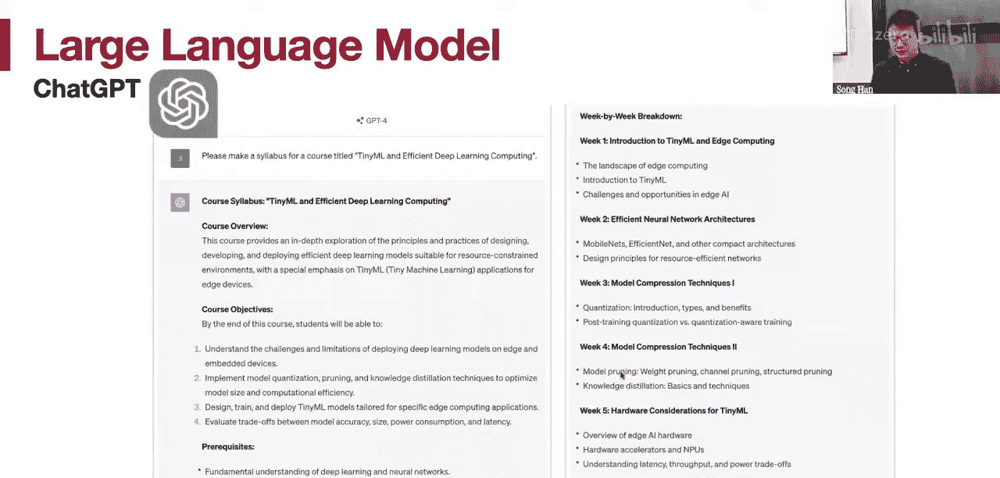

By serving and training such large language model is pretty expensive。

 taking a lot of GPU hours and train and rank inference to scale them up on both training and inference very costly。

 so today we are going to first introduce the techniques behind the large language model。

 what is their work what does the workload look like it's actually much more complicated than just matrix modification lots of details we want to understand deeply about those algorithms before we can accelerate them in the next lecture。

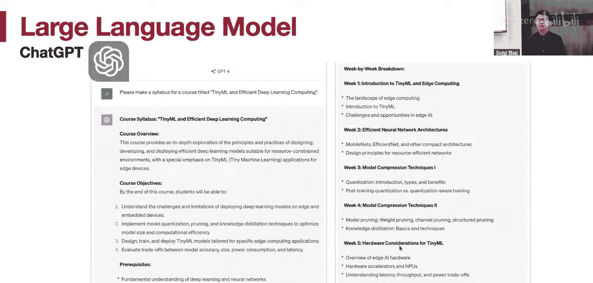

So here are some other examples like Google Translate can easily translate between different languages。

And also here it shows the GitHub Co pilot to write a piece of code here to parse a list of expenses。

 and then it's going to automatically come up with the code generated by GitHub Copi。

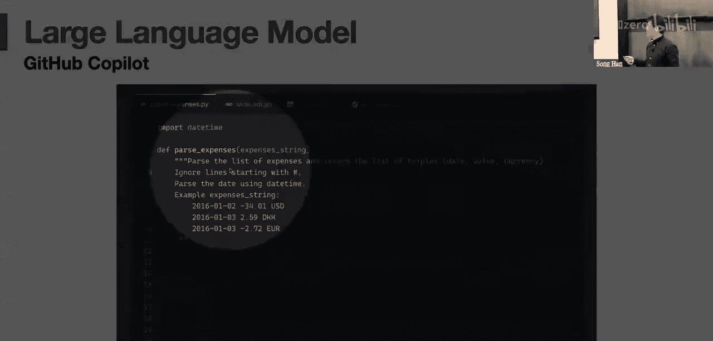

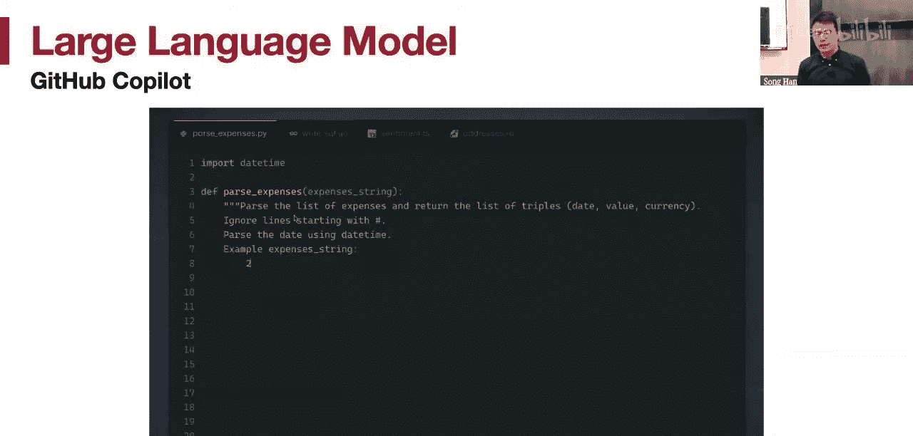

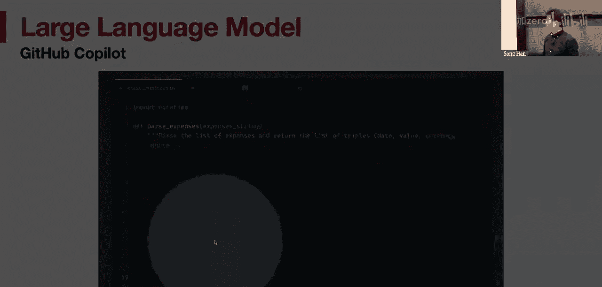

And even multi model， larger language model， building personal assistance， reading your screen。

 reading your pictures， understanding videos， like can this example answer the question。

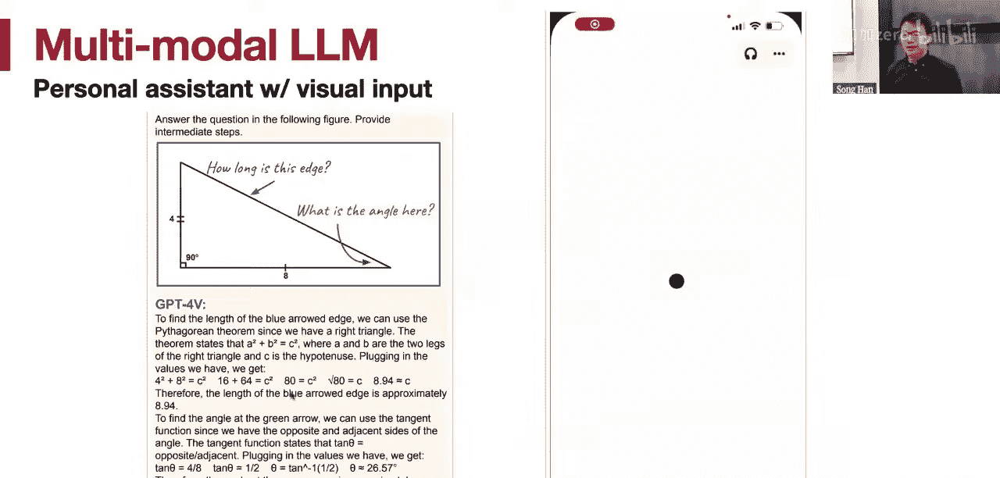

In a following figure， provide intermediate steps， not how long is this edge given here here。

 and then GBT 4 V can calculate four square plus8 square equal C square and then solve for the C。

And here even there is a demo of using TGBT for practical use cases trying to fix。

 trying to lower the seat and is asking how to lower my bike seat and be input it。

 take a photo and input it。To lower your backse， locate a quick release lever。

 if it is a quick release lever， if not， you need an adding wch and then I'm going to take a deeper deeper closer look。

 take another photo。And asked the GB 4B， is this the lever just to confirm some of the details and it's going to。

I' goingm going say it's not a lever， it's a boat， you need an add driver。

 and I'm going to input the menu and also a toolbox。For this kind of interactive chat。

And we are going to see those challenges dealing with those long contexts for such interactive conversation。

Here is my menu and toolbox do I have the right tool yes you have the right tool okay in the left section of the toolbox you have to do this you do this to loose that it can actually refer to reason across these two images one is the menu the other is a toolbox that can tell you according to the menu you should use this tool introduce something。

So we are going to witness some of the technical challenges。

 computing efficiency challenges for such interactive conversation， especially long conversation。

 were going to learn about KV cache where as the conversation gets long and cache will grow linearly how large that will grow and how prohibitive it' going to be。

 especially when we are trying to process videos which contain many frames of images each image to be worth by hundreds of tokens and your KBC will soon grow pretty large。

 we require lots of memory become super expensive， and we are going to discuss techniques to make them more efficient。

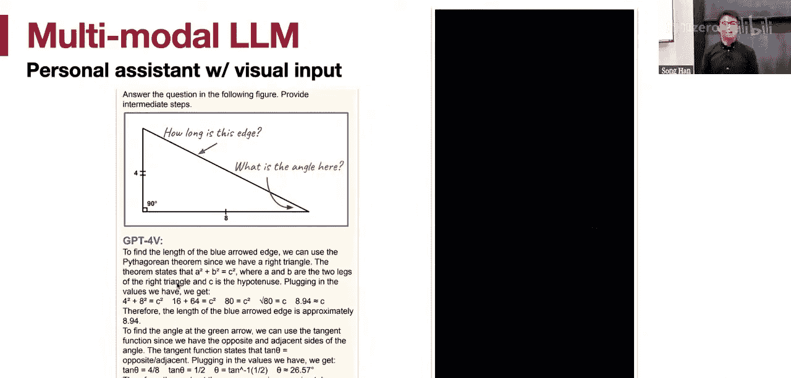

Okay， so this is the lecture plan for today， well first introduce the transformer basics you may heard the paper transformer is all you need。

Even the Nobel Prize is closely related to that， so we're going to learn what are the components of the transformers。

And also we are going to talk about transformer variants， different changes， optimizations。

 and also introduced large language models like Lama  two， Lama3， etc cetera。

 and also advanced topics， including briefly talk about multimod language model。Okay， first chapter。

 transformer basics。So let's first revisit very quickly the NLP tasks。

 what are the categories of NLP tasks， what is the history。

 all people used to deal with it before the transformer era okay。Proboughly two categories of tasks。

 one is discriminative tasks， the other is generative tasks。So disriminative task， given a sentence。

 we want to find some classification result， such as sentiment analysis， text classification。

 text entaillement。Those kind of summary tasks given a fixed sentence， that is a discriminative task。

The generative task， given the sentence we want to generate the next token。

 so that's the language modeling， similarly machine translation。

 given input language translate to another language and also summarize so you need to generate new tokens okay new sentences。

 so those are generative tasks。And pre transformer in。

 people have been using recurrent neuralnes very widely for these tasks okay so you have a fixed working memory。

 fixed working memory。But it struggles to maintain those long long term dependencies okay。

 so if you have a pretty long sentence， you probably want to save a lot of information rather than compressrising all the information within very small。

 very limited amount of hidden layer as we did in recurrent neural nets。

But it's pretty memory efficient you have a fixed amount of you have a fixed hidden layer so I like large amount amount of where the carrier cash will grow in this has fixed memory。

And you can also enroll it okay， to different time steps during the trading time。

 you do back propagation through time to calculate the gradient。

So there's actual dependency across different topicskens。For example。

 the third token depends on the second and the first token。And that limits the training efficiency。

 limits since has limited parallelism， you cannot compute this node and before the node before it。

 okay，s the dependency hurts the parallelism。People have also been using convolution neuronet to deal with language tasks。

 okay so we can do 1D convolution， one dimension convolution， and so these three tokens。

 three dimensions will impact x1 slash x2 slash will depend on zero x1， x2， etc cetera。

 with a receptive field of three。

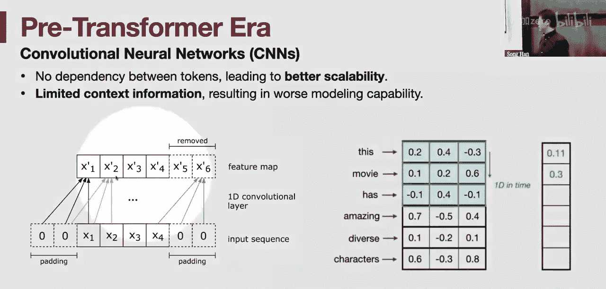

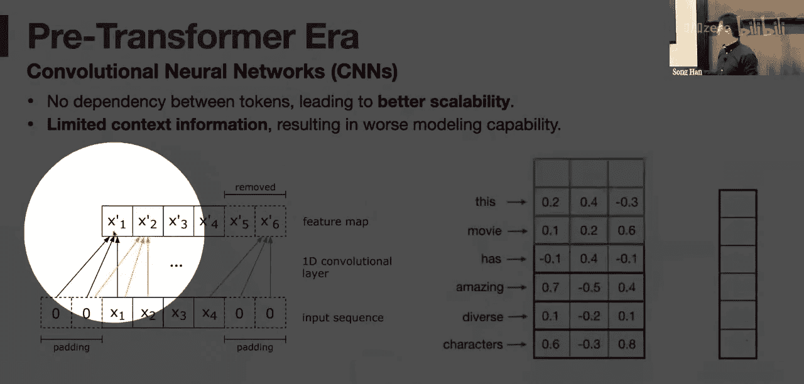

So we can have a sliding window， we have a sentence， this movie has amazing， diverse characters。

And we use a sliding window of three。So each word has an embedding this human dimension is three。

 with have a windows window length of three so that we can。

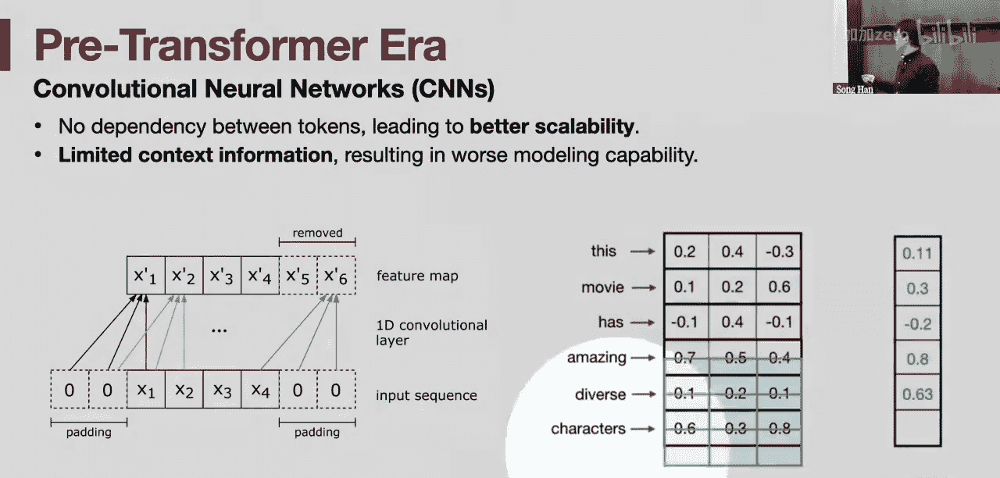

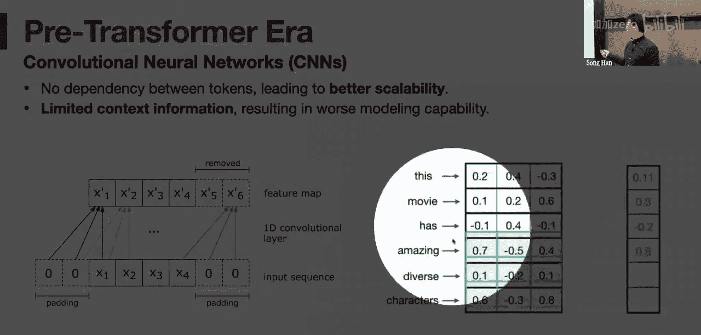

Evolve with a oneing convolution and produce a result for the next layer， get a feature vector。

So what is the limitation here for convolution？Very limited context information。 right。

 You can only see adjacent three tokens。Unlike transformer。

 you want to see the entire sentence everything before it versus only adjacent three tokens。

So naturally， we can deal with that by what， by stacking multiple layers。You can have one layer。

 receptive field of three， two layers， receptive field of five， and then on and so on。

 you can have a larger receptive field by stacking multiple layers。But within a single layer。

 the receptive field is very limited。So there are for RN and RSTMs， there are also two categories。

 one is bidirectional， one is unidirectional， so for the bidirectional RSTM each spoken here can see both the previous state and also the future state。

 that's how we call it bidirectional versus a simple directionional each time step we can only see the previous previous time step。

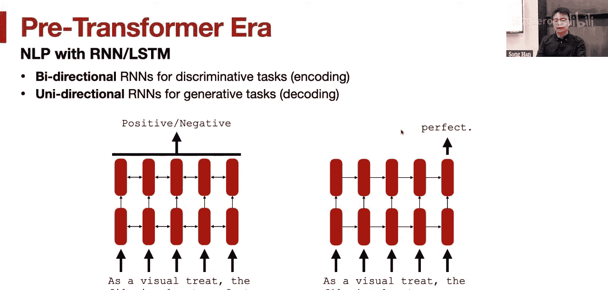

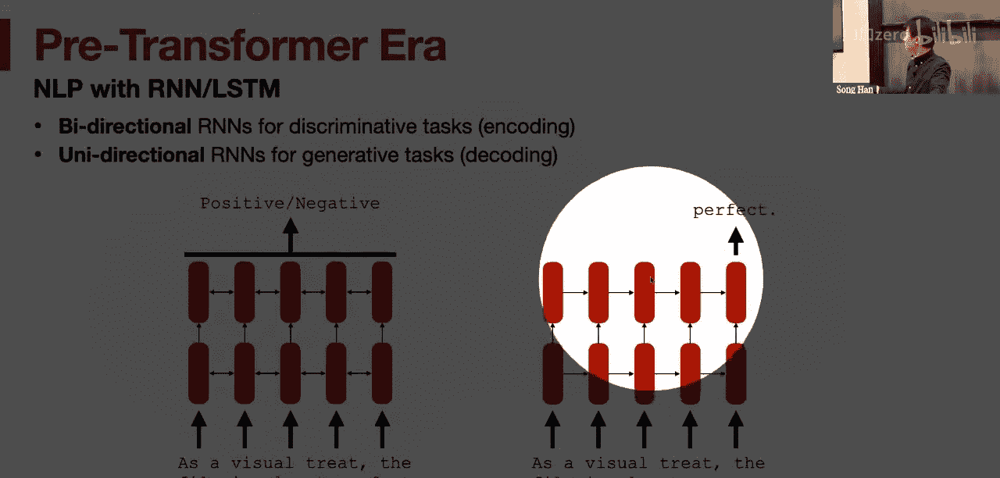

Okay， so bidirectional RNAs are used for distributed tasks for encod versus the Uniidirectal RNAs are used for generative tasks。

啊，Like decoding， because when you are generating a token啊 generating a new word啊。

It is only dependent on the previous。erious therefore。

 unit directional ions are used for generative tasks。

So what are the problems with Rs and ourCs so first of all it's hard to model those long term relationships okay so it takes a pretty long time for the information to properly its actually all sequence last steps to model in the interaction between two topicss。

 for example。

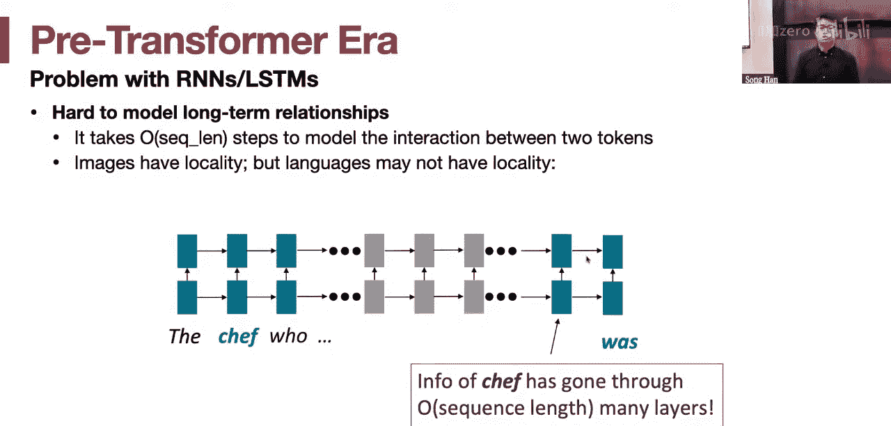

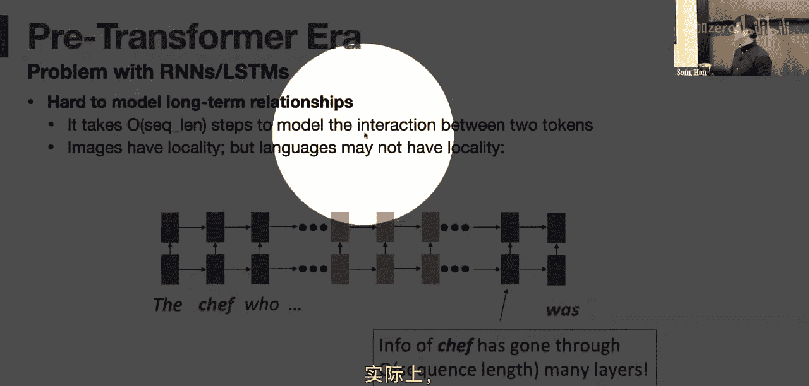

嗯。We want to model words versus shaft and you have to go through any steps or sequence enough steps to model the the interaction between two tokens。

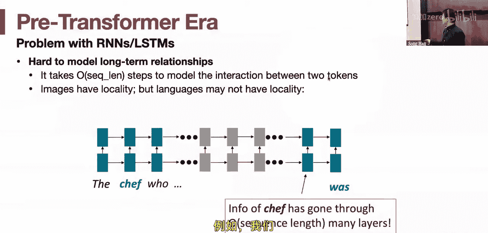

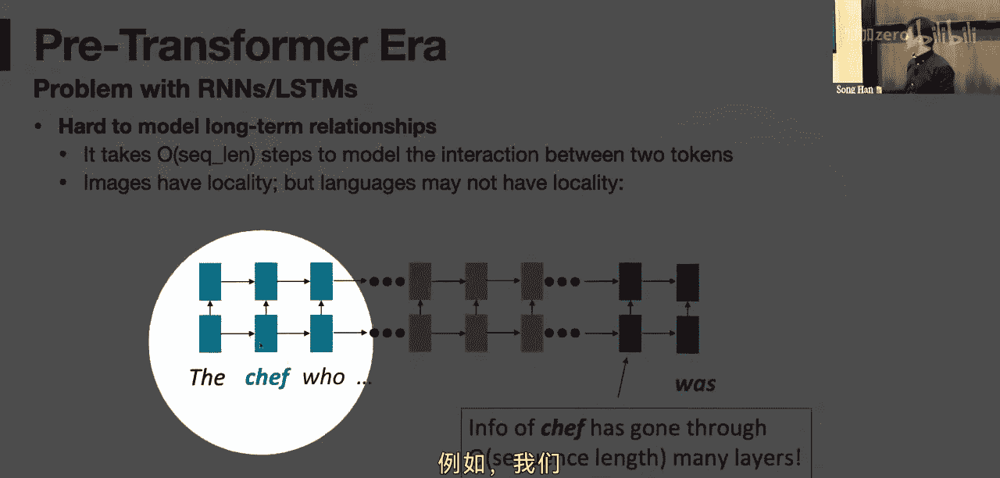

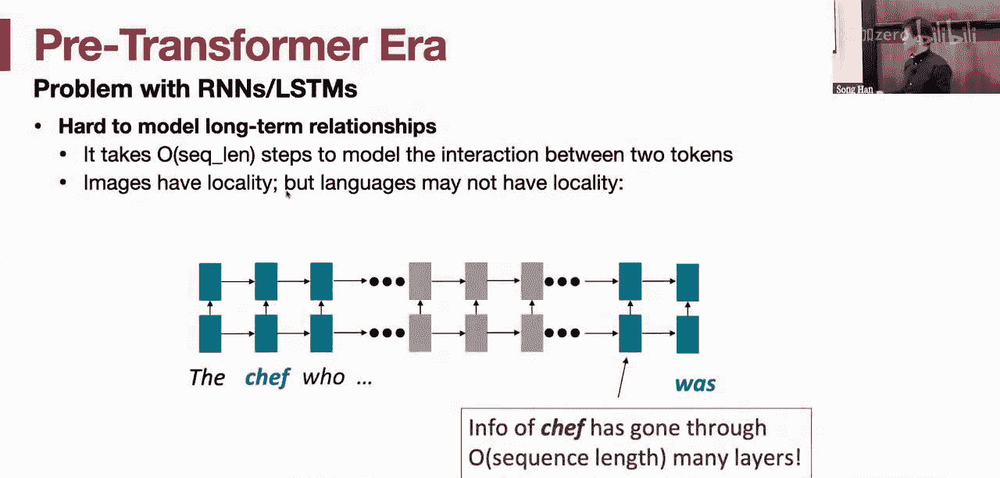

Iages。It's fine， images has locality the two pixel very far away from each other may not interact but languages doesn't have the locality it's highly possible something you said much earlier is very highly correlated with some words some tokens you just said a moment ago so you don't want to go through oh sequenced enough number of the years to model the interaction between two tokens。

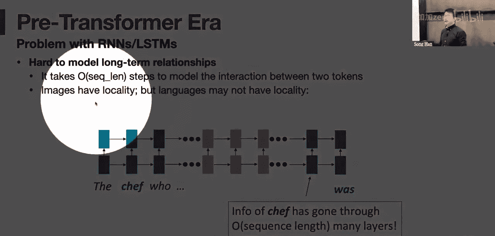

And also the it has limited training terrorism because of the dependency also this is computation graph for Rs。

 this is tab zero， you may have learned those in the prerequisite 606。

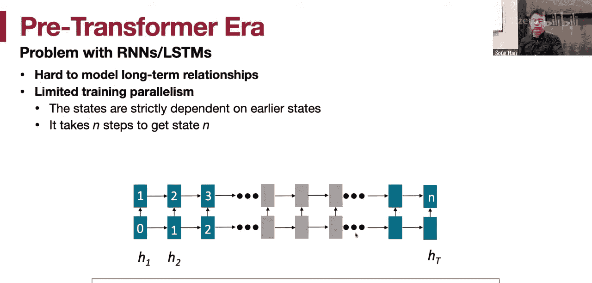

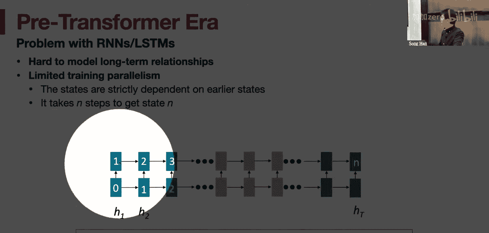

Step time one， time two， time three， and this is the wave from you have to propagate the information it has the dependency。

 you cannot now calculate all the embeddings in parallelise so that results in very limited between par since the states have very strong dependency to the earlier states and it takes n steps to get to step n from step one to select depending it takes n steps you cannot parallellyise。

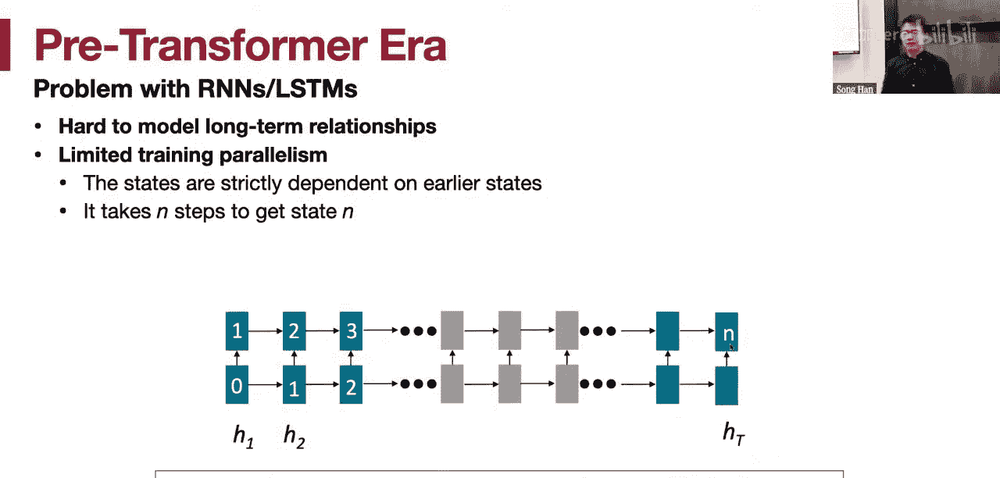

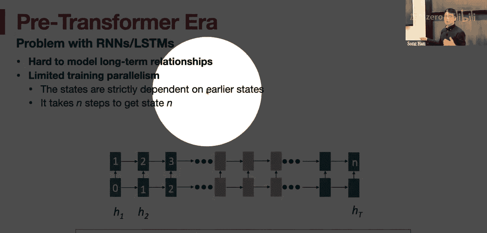

Making the GPU training more difficult。So given those constraints transformer solved a lot of those problems。

 okay so this is the architecture of a transformer block。

 well go through each component step by step， starting with the tokenizer the tokenizer and then how to embed the tokens basically the embedding。

And then we will talk about attention mechanism， including the MHA multiing had attention to model the information between different tokens。

And also the add layer to model the information independently for each dimension， the layer norm。

 the residual connection， the positional encoding， and finally final making the final prediction with a linear hat。

So let's start with the tokenizer， how to tokenize the words。So what is the what is the token。Inly。

 a token is very similar to a word， but it's a basic component of a word， for example。

 large geneative models， large itself is a word is also a token。And geneative does's a single word。

 but it two， it has two tokens， one is gene， the other is relative。A generative with us two tokens。

And models， example啊 actually they are divided into four tokenD啊 dot G dot。For example。

 in this whole paragraph， there are 110 words and that translate to 162 tokens which is slightly more than the number of words because some of the words actually contain two tokens like this one parallel so parallel is one token is one token。

And it's Hanzang experience， actually， Hanzang。Is three tokens times and so that's the slight difference between a number of words and number of tokens intuitively you can just think about a token as a word。

So we want to digitalize everything so that we can process them by computers。

 how do we digitalize the words， the tokens okay so that is embedding okay so we want to have a number to represent each token。

One method is to do the one hot enco， so we have what 00 k columns say we have 100 K words in the vocabulary。

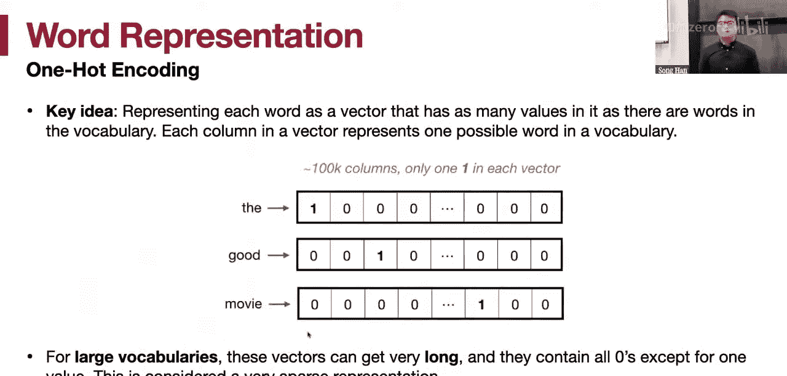

We have only one one with tract so Will。We have the first entry to be one。

 all the remaining entries are zero。2。Maybe the third one， just example， third one is one。

 the others are all the movie， this one is one， so it's one hot only one of entry is one。

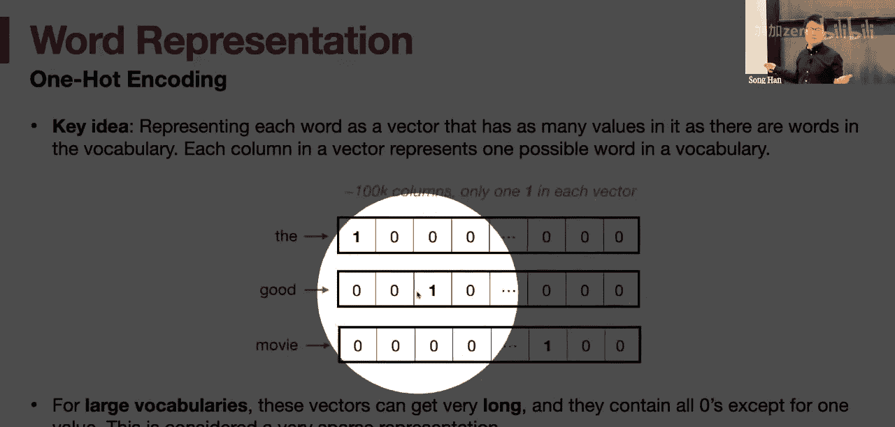

We need a lot of columns since we may need to have a pretty large vocabulary。

Each column in the vector represents one possible word in the vocabulary。

Is this representation efficientff？Actually， it's not because the vector can get very long for a large vocabulary。

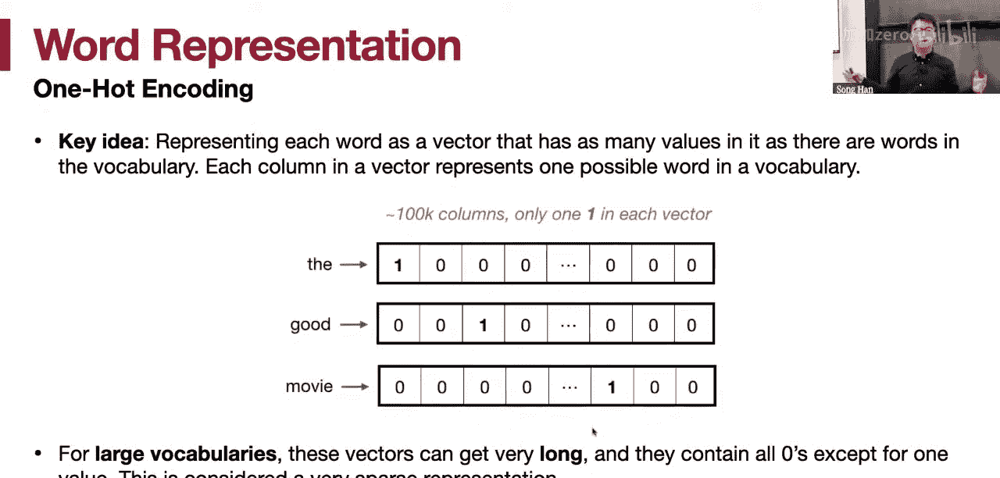

And lot of them are zero， actually a lot of them are zero except for only one that is a super sparse representation you ended up storing a lot of zeros。

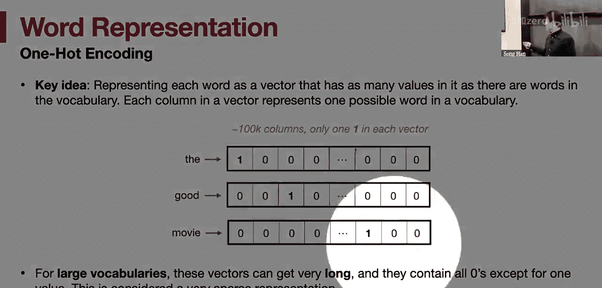

A more efficient way。Is to represent each word using the word embedding and using a vector。

A unique vector to to represent each world。For example。

 here we we are using three dimensional human dimension to represent each word。

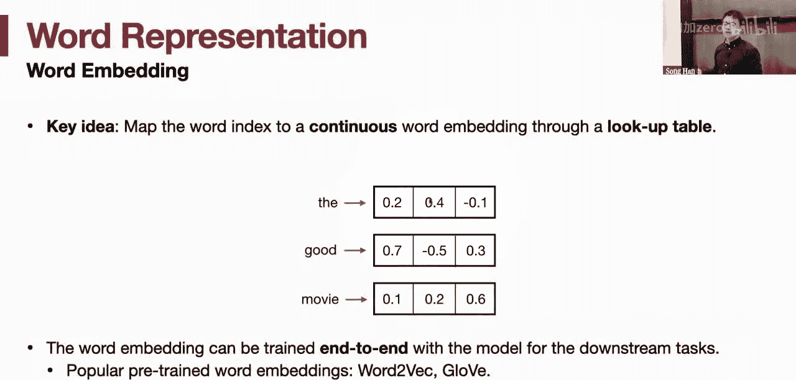

Represented by this vector， 0。2， 0。4 minus 0。1。Food is represented by this three dimensional vector 0。

7 minus 0。50。3 so such word embedding can be trained end to end for a particular task for downstream task。

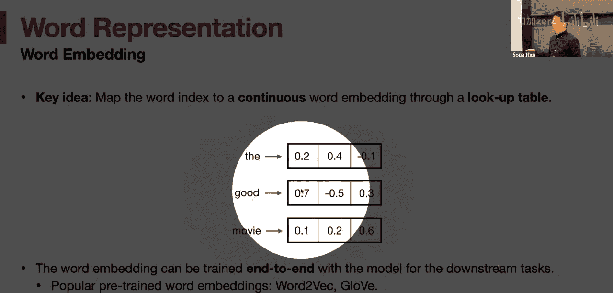

Some of the early pioneer in this area include the World to back， the Bel。

wordord embedding okay nowadays we can train them end to end given the downstream task so in summary each word is represented by a vector okay and that's called the word embedding so that we can feed feed the sentences digitalize the sentences so that we can feed into matrix notifications。

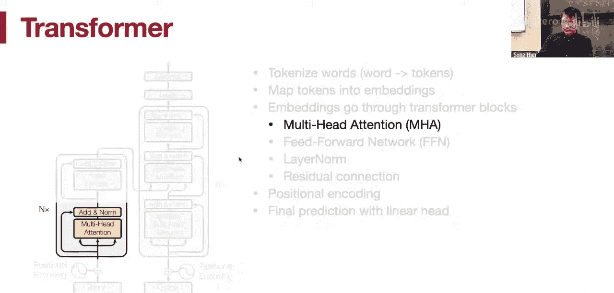

Okay， so after getting the em， we'll process each words each tokens and try to find the relationship between each words each tokens。

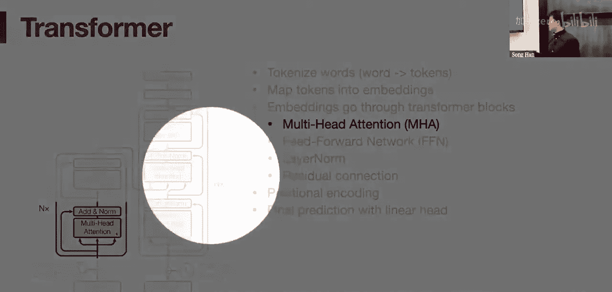

Remember during the convolution and also during the RNNs。

 the limitation is the limited receptive field and limited parallelism so let's see how does body high tension solve those problems？

So here we want to model the relationship between different tokens okay convolution only model the relationship between token and its adjacent neighbors。

 like three adjacent neighbors， very limitedlycept。

But now we want to attend to all the tokens in all the token so that they can interact with each other。

So what do we do here， we have n n tokens， we want to have n square matrix to model the interaction between each of them。

So let's see how do we do that。

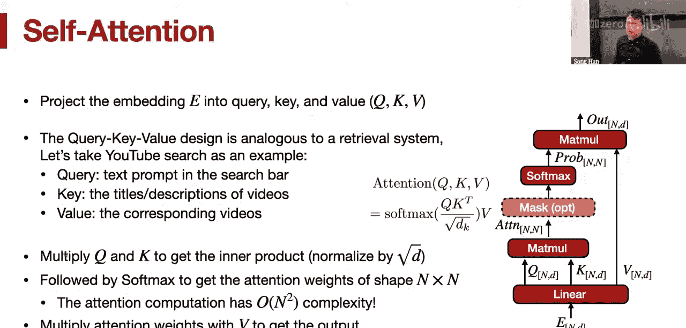

On the right hand side is the computation flow， we first have a input vector n tokens， each token。

 the hidden dimension has B the hidden dimension。

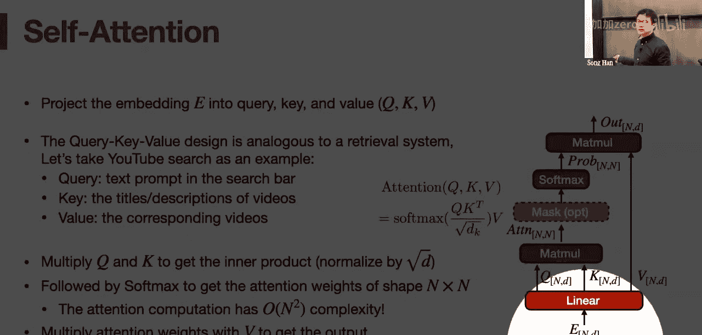

We divided into three parts by passing through three matrices， query， key and value。

And then we vary times the heat transposed。嗯。We get the attention， which is n by n matrix。

 the n by N matrix indicates the relationship between each token since we have n tokens and un tokens。

 we get a square matrix。Oally well apply the mask， maybe the causal mask， soft mask。

 make sure it sum up to one， and then we multiply this weighted attention map with the the value to get the output in that way we min the information between all the tokens。

What is intuition behind that it is the query key value design is very analog to a retrieval system just take a YouTube search as an example。

 so the query is basically like the text part in the search bar which you want trying to search the key is basically the title and the descriptions of any content say video in this case。

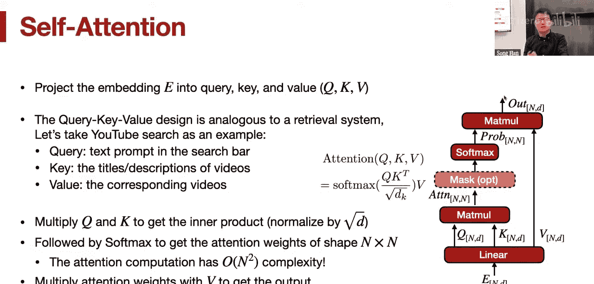

And the value is the corresponding medium when you first find the relationship between the query and the T and that becomes the weighted map。

 a weighted attention map and use that to you a weighted sum of the values if some of them is very related and you have a larger weight because it's not if it's less。

 you have a smaller weight。

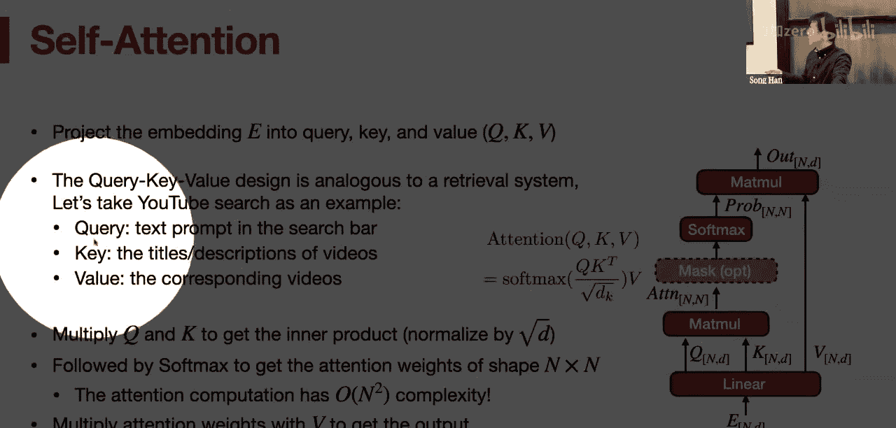

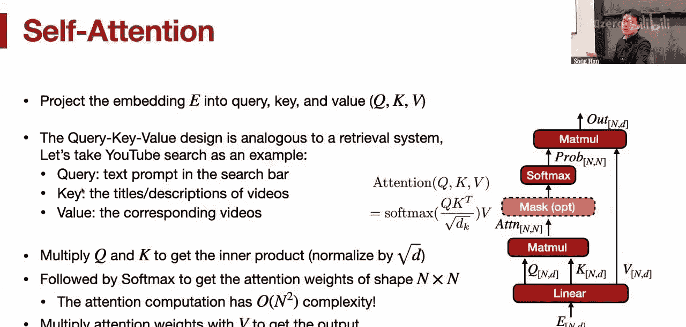

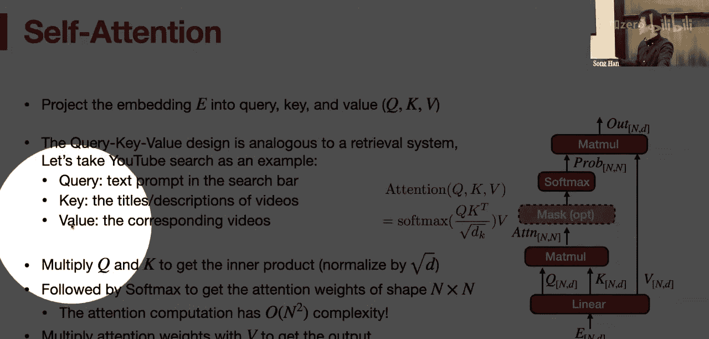

So you have the information to model the entire sequence， not just adjacent three by three5 by five。

 adjacent tokens， but actually all the tokens。

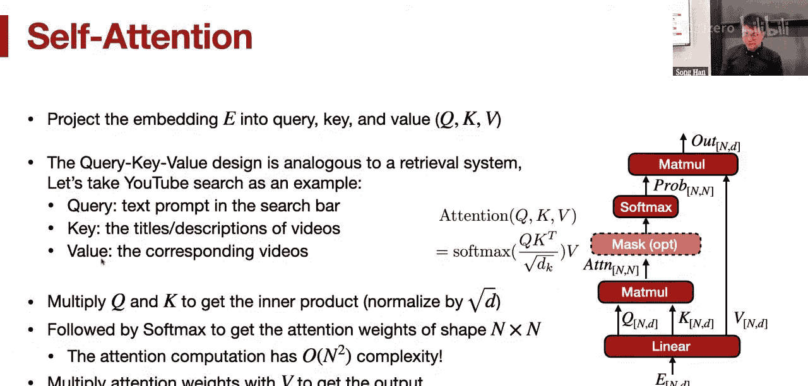

So we do the attention map by multiping the QK transpose to get in the product。

We need to normalize by the hidden dimensions since different model made of different hidden dimension。

Lama two has4K here didn't dimension。For 7 billion parameter model。

 a 70 billion parameter model may have a larger dimension， so we want to normalize that。

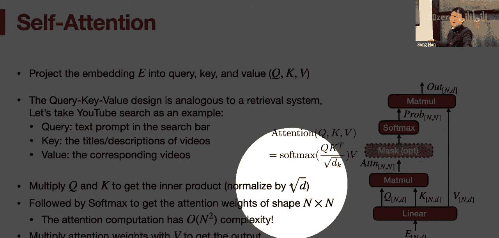

And then we followed by the soft Max to make sure each row sum up to one。

But what is expensive here， so the attention computationplication has ON square complexity since you want to attend each token with each other。

 okay have ON square complexity， which is the bad part。

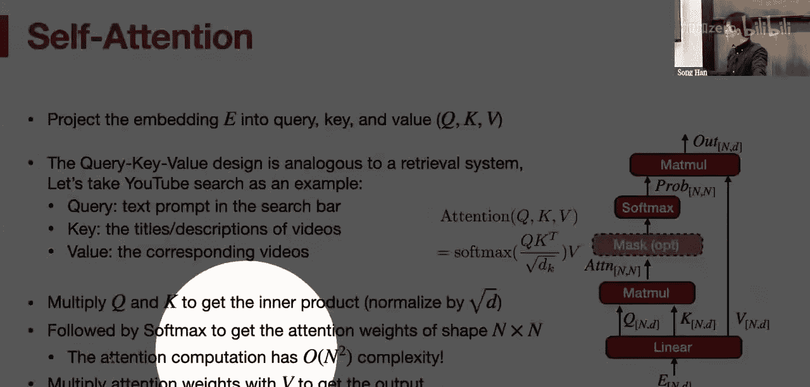

And finally， we multipl the attention weights to do the weekly sum for the value。

 with sum for the value to get the final output。

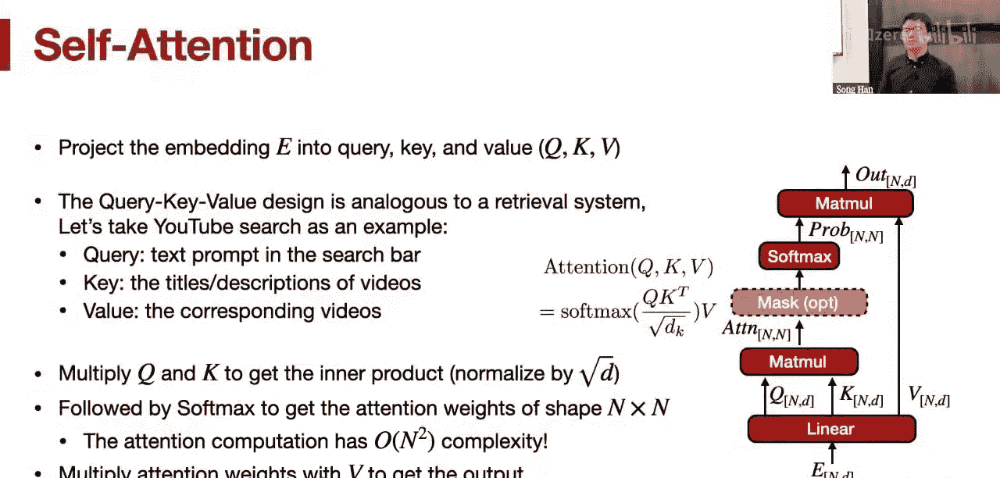

Let's see， what does the attention map look like？So this is a attention map。

 an example of attention matrix for matrix for machine translation， this English here。

 this is the French but here， most of the words are attending to exactly the same words。

 and some of them they are having the reverse order， reverse order。

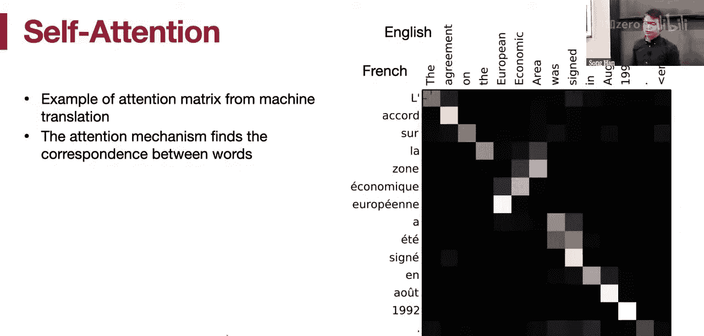

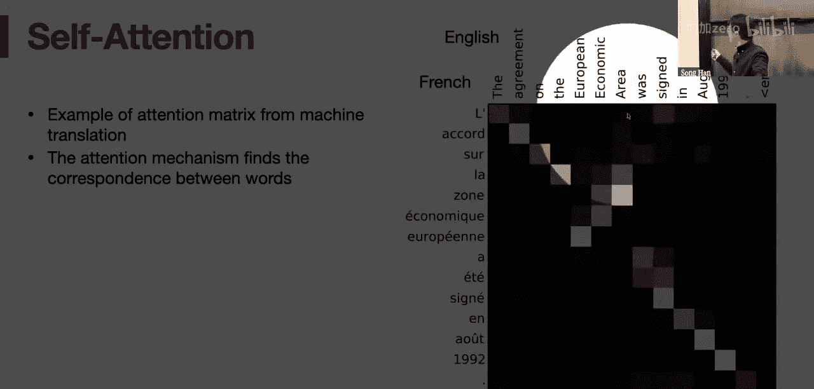

These words actually correspond the later word in English or actually correspond to a later word in French。

 that's why we see this reverse eagonal， and the the remaining words are in a diagonal direction。

 meaning that each token in one language corresponds to the exact location。

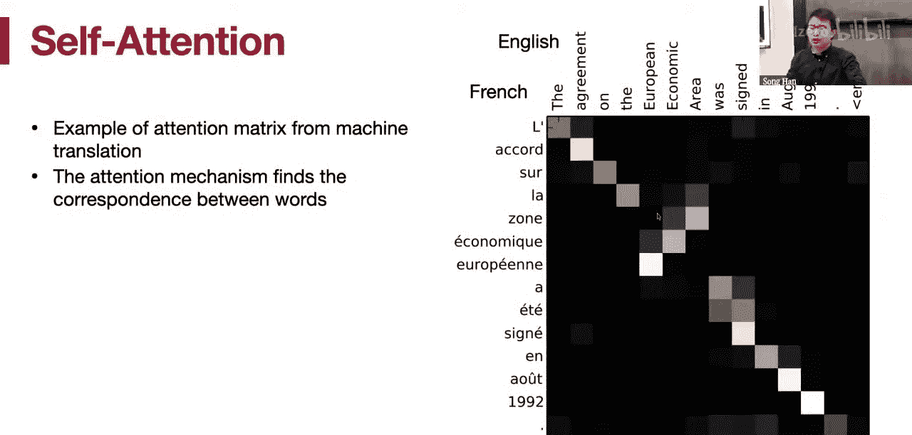

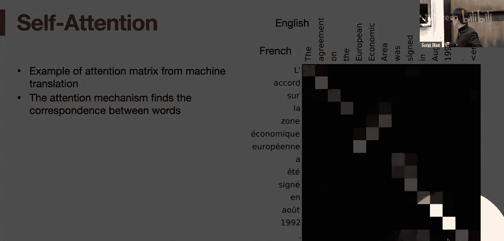

你们那的 language。So the attention mechanism basically finds the correspondence between the words。

 and they are found by training， not by any rules。

嗯。So that is just one head modeling one possible relationship。

 what if we want to model our diverse relationships many relationships so we want to add more heads to introduce this multi head attention。

So each hat captured different semantics。So here we have multiple pads， first one， second one。

 third one， three hass in this case， they each has their own transformation matrix for the QKV。

The final output was contaminated。We just candidateinate the result from different heads。

 go through a linear projection layer， linear projection layer to merge those features。

And why we need multiple hass， this is the visualization of different hass， actually we can see。

And each had capture very different cements， some of them is just diagonal diagonal。

 some of them it has some vertical information captured。Vertical information captured。

 so different hands are capturing the subtle different subtle relationship between different tokens。

Adding the capacity， adding the capacity to the model。

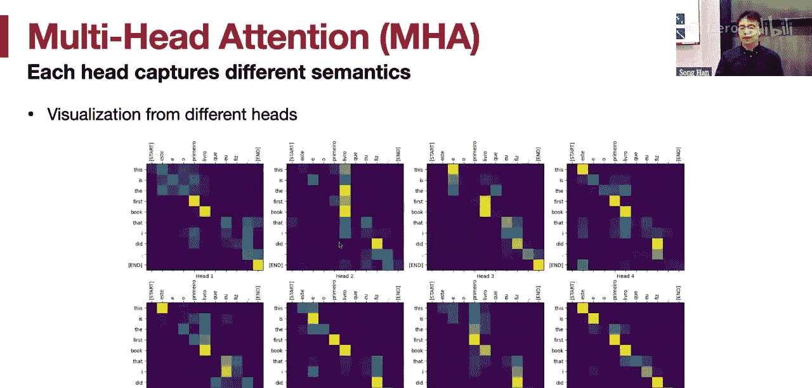

The next attention mask so there are two kinds of masks， one is causal。

 the other is global also this the global attention map meaning that every token can see every token even the we can see the future token and so this is a global n by n everything is one that the mask versus causal okay each token can only see。

Everything before it， but it can see nothing half for that。It we call it causal。

So the attention mask basically is a triangle， the down triangle since you cannot see the future tokens。

 I only huge token， I only see the past tokens。So the。

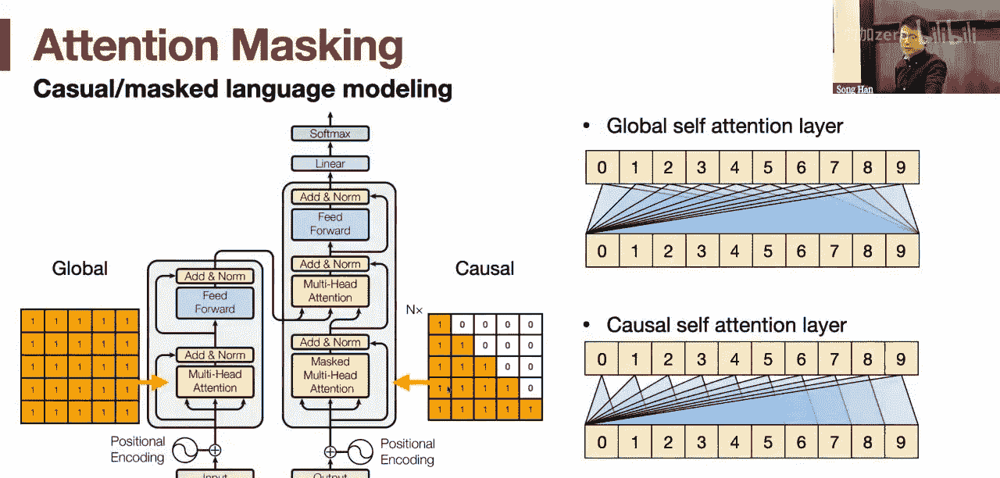

The mask can be represented on the right side。This is a global self attention。

 this is causal selfat in global selfat， each output can see all the inputs。

 no matter if it's before that or it's after that， but in a causal selfat layer each token can only see itself and everything before that。

 for example， token6， I only see token6， everything before token 6 from zero to zero to five。

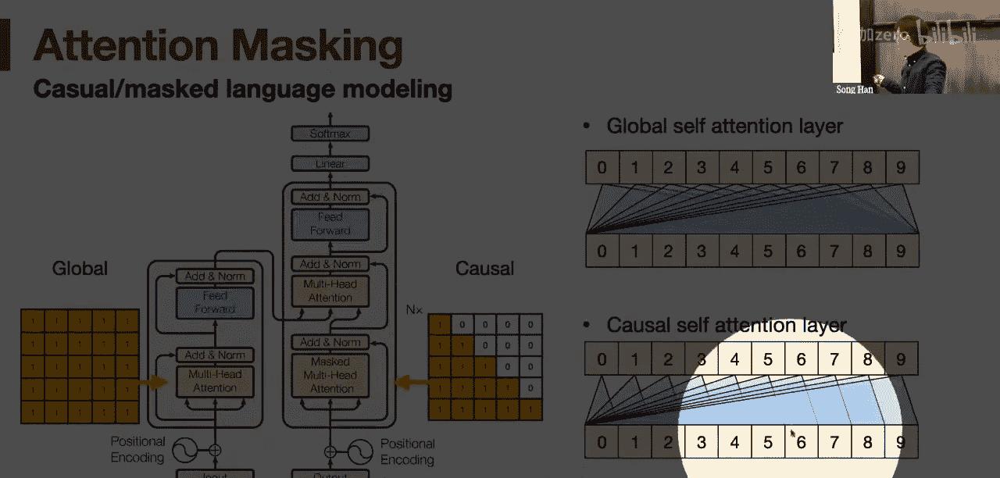

Okay， so that's the difference between the global and the causal self attention。Okay。

 so the next part is the FFN layer since multi high attention focuses on modeling the relationship between the tokens。

There is no element wise not in area， so we not only want to model the relationship between tokens。

 we also want to give some capacity to model the each token independently。

 so we added a a feed forward network as fully connected layer to help with such local feature modeling。

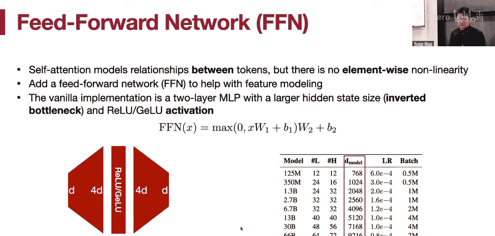

The vanilla implementation consists of two matrix modification locations。

One is projecting from3 to 4D as it's rural reello。Or a kilolu and then convert down to from 40 to B。

 also it can be represented by two matrix modifications。

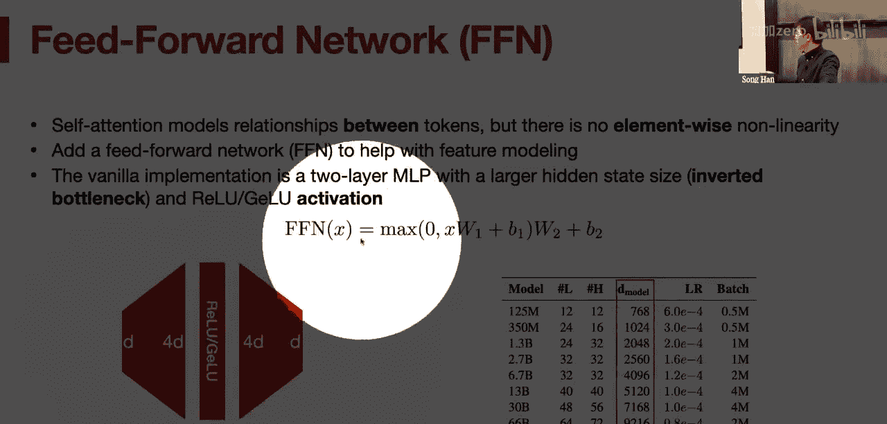

With Re in the middle， so that's the same place。implementationmation。

And let's see for a 7 billion pounds per model， the hidden dimension is roughly be 4K。

For 175 billion planet models well 12 k。

And why do we have such convertedverted bottleneck？

We want to add more information， and provide more capacity。啊，做的F分类。And later。

 we are going to visit some of the design areas paired with such simple FFM layer。

嗯。嗯。嗯。有点个。I我。双方就。嗯，不要。sort of whatever。The normalization D is squared。Yes， not D is basically this。

 for example， 4K， this is the 4K and where's that 4K coming from etter exactly about here。进你一的订单是对。

You can maybe just remember some simple case like for the 7 B， the hidden dimension is4。

And the number of hass is 32 the number of hass is 32 in the 70 margin。

Since 7b model is the one were going to use in the homework， and I sure it's quite widely used。

Easy to deploy， so。All right， and then we have the we want to introduce a later norm later norm function previously we have introduced the batch norm batch norm so across the batch dimension and also the this is a sequence length dimension。

 token one， token two， token  three token 4， so this is sequence length dimension and this is the feature dimension。

 like 4K。

He dimension C that here so different from batch dimension we want to normalize across the feature dimension and normalize across the feature dimension since different model may have different dimensions we want to normalize them some of them may have a pretty small hidden dimension like 700 some of them maybe pretty big 4K 12K etc。

 so we want to normalize across this feature dimension。

By subtracting the mean and also divided by the variance。

 okay and we have two scaling a scalingating factor and a bias okay。

This is a learnable I find transformation， the gama and the beta。

TheGmma and beta actually turn out to be super useful。

We are going to talk about that during the quantization part like the smooth qua or using rotation。

 we can fold lots of the transformations into this gamma and be so when you're doing research pay attention to this gamma and data is but contains very few parameters。

 but they are super powerful。It acts as not only a function to stabilize normalization。

 but also can fold a lot of computing， a lot of the smoothing， for example， quantization。

 lots of smoothing capabilities into these two factors。

And there are roughly in historically two ways to add the normalization， one is pre norm。

 the other is post norm。

Poor basically says you want to first do the multi header pension then normalization。

And the FN the normalization。P normally is basically saying you want to first do the normalization then body had attention。

雷 norm and then fFM。And having this sppass layer took before the later norm and after the MHA。

Actually， the prenorm is getting pretty popular these days due to not only a better training stability。

 but also it's very easy to fold into the fold into the prelo of the matrix modern location them into a single kernel and also you can apply lots of the preprocessing。

 say we can modify the tension is very difficult to quantize due to the of outriers。

 you can fold it by smooth it by folding the factor the modplifierier into the layer norm。

We are going to see more detail about that in the next lecture。Okay。

 so that's the layer norm and also the residual connection。

So different from convolution where a position doesn't matter since for region has its space imvariant。

 but in language。The position matters， the position of each token matters。

 so we want to encode the position into the model， let's see how do we do the positional encoding since attention and FFN they do not differentiate the order of input tokens。

好。So let's see， how do we do that？So positional encoding basically provides the positional information。

 the same token appears in place one versus place 10， they are different。

So we want to add a unique encoding to each verse position in the sentence， okay。

It's a function of the location， the position， we call it absolute position encoding。

So we have a raw word embedding previously， and we want to add to the raw embedding to add the positional information to the raw world embedding。

So here we have an example 2D matrix， one is the feature dimension like 4 k。

 the other is the token dimension， say you have a here it has 50 words。

 50 tokens and here the hidden dimension is 128 in this case， this is the pension map。So。

What we add is that it's a function of the position a it's a function of the omega times t okay。

AndT here is a feature dimension T is a token dimension this token dimension。

 and I is the feature dimension。And if you see the。

The the bars here versus here theyre actually quite different that is due to the frequency is very different and as k gets larger the omega gets pretty smaller the frequency the frequency gets pretty small so actually no change across different key dimensions versus here the frequency is pretty high going from  zero to 5 the change is pretty significant due you have a pretty high frequency versus here we have a very low frequency so this frequency is modulated w is modulated by k。

And K is related to I is basically the feature dimension。So here for every eye and every T。

 every token position， every hidden dimension position have a very unique combination of the position end。

Okay， so here we can finally put it all together to have the entire big picture of the transform transformer architecture。

Do open neither。

Andver word into tokens and then convert tokens into valuess。

We can feed it with the morning high attention。For modeling the information across tokens。

And are the to continue modeling within opens。And then lay an arm。

Reigial connection， finally with the position of enholdding。With knee your head on the top。

 we can make final predictions。

Accuracy wise。Transformer SurpaS is previously published the models a fraction of the training cost securities accuracy measured by the blueor。

 which measures the singularity of the machine trans tax。

To the to a set of referenced translations， strong truth translations。

The former has higher blue store， this is the training cost。

 two or three orders of magnitude and smaller training costs since the architecte for the design is quite efficient。

对。Hey， now let's take a break before we jump into the design variances All right。

 welcome back so let's continue to discuss about transformer design variances so。

Most of the initial design have been very widely used in the community。

 but people designed several variants alternatives， for example， the encoder decor model。

 encoder only model versus the most popular decoder only model。

And also people design from this absolute positional encoding and improve it to relative positional encoding only depend on relative position。

Also several KB cache optimizations， for example， not only the multih attention。

 but a smaller version， which is the multi query attention and also group query attention。

 which is very similar to the normal convolution versus the depthwise convolution versus group group count。

A trade off between the capacity versus computational complexity。And also from the FFN to Jlu。

 the gate linear unit， which is quite widely used these days compared with the original FFN layer。

So let's first talk about only encoder decoder encode only versus decoder only model。

The original transformer is actually an encoder decor architecture， so for example。

 this translation task， we first encode the source sentence， translate English to German。

 this is good and then we pass it through the encoder model and then the decoder model is going to generate the token for the output okay so an encoder on the left and a decoder on the right。

Here we have more examples， translation acceptability and also semantic similarity。

Find the similarity between these two sentences， give the score， summarization。

 give them an input sentence。And summarize into an output sentence。

So it I offer a unified text to text model for transfer learning on various NLP tasks。

And the prompt is usually fed to the encoder， this is the encoding block and then the decoder is going to generate the answers。

 generate the first answer and then the second token and then the third token， one after another。

The second category is the encoder only model， like the bird。

 which is bidirectional encoder representation for transformers。

It is encoder only a language model with two pre training objectives， one is the math language model。

 very widely they used these days， the other is next sentence prediction。

 which is not quite widely used these days。So mask。

 the language model is saying we can mask away like 15% or a certain percentage of input tokens and random and then train the model to predict those mask tokens and those mask tokens can see both the token before it and also the token after that。

For example here we have created the mass， the movie is very boring。

 we put a mask on here and we pass it through the encoder and then try to predict the mass word。

Very rarely you task these days the next sentence prediction to give two sentences and predict whether sentence B is the next sentence of sentence A。

And then the pre model can be fine tuned to downstream the tasks。

So the passion mask for encoder only model is negative full because the token can see not only the future token。

 but also the previous token， but also the future token， so each token can attend to each other。

Dcodeder only model the pension mass重点 half only呃 the down triangle token can only see the previous to。

A token can only see the previous token， but not the future focus。

so GT stands for generative betweentrain transformer is a decoder only language model。

And the pre objective is the next word of prediction given a sentence。

Give us a sentence we're going to predict the thanks word。

So a robot must obey the order in the eighth when you predict it。

And that word can only attend to the tokens before that。

 therefore the attention mask is called and it's only attending to some people for it。

And then similar to the previous， the pretrain model can also be fine tune of different downstream tasks and larger model。

 we don't even need to fine tune， but can have this zero short few short capabilities which we are going to discuss them later。

 so just tell the task or just give a few examples without having to fine tune on a particular task they can realize a new tasks or achieve new tasks。

Now let's switch gear to talk about absolute positional encoding versus the relative positional encoding。

So absolute positionally encoding fields， the positioning information into the input embedding okay and also the QKV。

 so the information is going to propagate through the entire transformer since the input embedding is the very source。

 the very beginning of a transformer。But relatively includingcod。

Keep an eye on the relative distance， relative distance information by impacting only the attention source。

 okay not the input in but the attention source by adding a bias or modifying the queries of the keys。

 not the v okay since the attention map only depends on the query and the key it QK transpose。

Another advantage is that you can deal with lung context。For example， reading a whole book。

 reading a whole movie， very long sometimes。During training time。

 we may not have seen such long contacts， but we want to train short and influence Te law train short Tees law。

 so that's where that's the advantage of relative positional encoding。

It's very easy to extrapolate for long contact and inference time。

So we'll introduce two kinds of relative position holding， one is the tension with linear biases。

 the alobi。

Position， positional including to other is the rotary positional embeddeddding， which is the rope。

So let's start with the byy。 The idea is to change the position including。

To be only related to the relative distance， for example， Q1 and K1， the relative distance is zero。

But Q1， Q2 at K y， but relative distance k minus Q is minus y。嗯QK呃 Q two K two。

 the relatives in distance in0。But here Q4， K2， what is the ra business？It's2 minus four。

 so it's minus2， similarly here， Q5 K4， the relative is is minus1。

So we have this extra。

我开始卖了。Which is an offsetet， which is an offset with the original attention amount。

So to add this offset to the original matrix。Would you find this at the relatively instance？

Instead of adding them to input token embedding， the input token embedding doesn't change。

 but only the attention map changes。

And manually set thisstruct which is modified with position run out by position ining and added to the original attention map。

So that you can capture the information between the relative distance between total gaps。So although。

 for example， some of the token multiplied with each other。It's the same。

 but adding the relative positional encoding the result might be different。

The second one is slightly more difficult， but its very widely used， for example。

 Lama basically is using this rotary positional battery。And so what you do here， we want to rotate。

 we want to rotate the embedding in the 2D space in order to rotate it。

 we first need to cast this very long like 4K embedding into into a two dimensions。

And how do we do that， we split the dimension from D to2 d over two pairs。Okay。

 so we have many pairs， we have two groups， the first half of D， the second half of D。

 we put them together， and now the entry of the first one becomes a2 mean。嗯。

It becomese the two dimensional value x1 and x2， where we can represent x1 and x2 in the 2D space。

And then we are going to rotate it by m theta in M is basically the index， first entry。

 second entry and third entry in sixth entry， if the total hidden dimension is 12。

 the largest position is6 since we are dividing by them by half and put them into a  2D space。

Okay so M is the position of the token and here this index is the position of the in the hidden dimension can we rotated by M data。

 therefore we added this positional information into the original representation of Q and K。

So here we are we need a pretty big number to distinguish different topics。

 so this is the theta representation is 10，000 to the power of minus2 I minus1 divided by D is a given dimension and why do we need a pretty big number since each time will we rotate you want to rotate a pretty small value otherwise if you rotate by two pi you come come back to the you can no longer distinguish these two vectors once is you rotate by two pi you come to the same original place therefore we just want to rotate it by a little bit by a little bit therefore we have a pretty large value here。

in order to distinguish more toolkents， distinguish more toolcts。And what if we use this approach。

 the rotation approach， can you just rotate the representation by grouping every two values into the 2D space and then rotate it。

What if we multiply the query and the key using the rotate in the value so this is rotating the Q rotating the K。

嗯。We are coming from different locations， one is n here other is n。

 and here we are looking at the J p dimension， we plug in， this is original Q。

 originalal K we're rotated by m epsilon in this case。

 and here rotate by n epsilon in this case because m and n is there corresponding token number corresponding token number。

So this is a total number诶呃。Don't please understand this M versus this index。

 so this index is related to the hidden dimension and this m is related to the token number。

 the first token second secondken token third token this is within the two first token within the second token what is the index of the embedding you may have a 4K embedding divided by two we can ranges from zero to 2K。

The phase angle of inner product of two complex numbers is basically the phase difference between two complex vectors。

So if can modify them with the weather。Here we multiply the Q and K together。

 so the phase value would be the difference between the first phase value the first ofq and the phase value of k。

And so'm that's why we have minus and。So I minus n is basically a relative position and that's why we call it relative that's why it's a relative positional recording it only depends on the difference between n and N the token number between Q and K。

Be complicated here， I'll app pause a little bit to answer questions。Yeah。Okay。没有。所这个一下好一下。😊，谢谢你。

Okay， so you have a say。Right basically you have 10 words right you have 10 words the same word appearing in location one versus location10 previously you cannot distinguish that now we want to distinguish whether this word appear in a position one or the last position and that can be distinguished the location so you rotate by m theta m is basically as of your position。

 whether it's  zero，1， two or 10 if it's 10 by vector will be that vector will be rotated by a large larger angle if it's zero it will be rotated by a smaller angle。

And the relationship between Q and K only depends on their relative location and only on dependent on m minus n。

Okay and let's see now what is the general form okay previously we are just multiplying Q and K Q and K it's very easy now we are doing the rotation by working on each pair of the value so by each pair of the value we are them but M D1 and D2 and de D over two y d over two since we are grouping the total hidden dimension the d hidden dimensions into two groups each group has d over two and we put the first one and concatennate them together in the2D space that's why we have D over two right here that's the general form。

Of this rotation of this rotation matrix， and we multiply this rotation matrix with the original matrix。

That's a very simple implementation。So what is good about the role？APo in coding。

 we can extend the contact window。So we can we want to process very long contacts so that we can process very long documents。

 long books and long movies， for example。Like Lama， the original Lama。

 first word has 2 k context last becomes 4K and June4 used to be eight。

fill with the larger contact enough。So we can actually extend the context loss by the interpolation and the interpolation。

For example， in the。He here。We say we wrote it by Amdada。If we have a we doubling的 context long。

 we can roll it by Im data divided by two哎，那个Im data divided by two。So that's the intuition okay。

 we should interpolate this is the original。During the pre training pre trainingion range and we want to fit the same pre trainingion range previously least from zero to 2K now we want to interpolate from  zero to 4K。

So that we put more double in the frequency from here to here。

 and we are interpoolling a lot of dots in between them。

So now we are falling into the same range rather than falling into this unseeneen range during training rather than using this unseen range。

 so we want to change the theta to be theta divided by two so that we can fit longer than a longer context here the blue part here is the original context length。

 this green part is the interpolated context loss。Okay， so that's position encod。

 And now let's talk about the K B cash。Okay，Introduce the multih attention， multi query attention。

 and also the group query attention。So KV cash can be pretty large in long context case。

 say let's see this example very key and value we have three words here。

 I think of three tokens I love triium in this case。And this is inviting x0， I， x1， log2 triium。

 and we projected into the Q0， k0 and the v0， Q1 K1 U1， which would be K2 and2。

Okay and then we calculate the attention score， given this new word premium。

 we calculate the attention score by modifying Qk with a Q2 with k0 and this query2 with P0。

 this is query2 with P1。And then we help few two pay tool。

so that's the we use this as a weighted sum for the values we0 times 0。3， we1 on 0。1， ettera。

So we need to store those keys and values for all the previous tokens so that we can perform the attention computation。

 So in the previous example， when we are operatingating the second the X2 and we need to store the。

Hey and we for the zeroth entry for the first entry， etctera。

 so that we can attend to them to calculate with the attention score like 0。3 and 0。

1 so we need to put。To store these keys and values for all the previous topicskens in the somewhere。

Originally， if we don't have a KB cache we need to recompute each time okay so here we have four tokens token one modified with a Q1。

K1 and we have to compute each time we have to compute everything from21 K1 to2 K1 to23 K1。

 etc cetera， with a KB cache， we don't need to recapute given a new new token terms now we only calculate everything related to that new token。

And for all the previous tokens， we already keep it somewhere rather than recompute it。

 we only recompute for the new token and then we store it for the TV cache and finally we can multiply with the value get away some results。

对。So we only need the current parent token and only calculate the key and the value for the current token and store everything before that in the kidney cache。

And as a result， the Kb cash will get longer and longer because as the sequence gets long。

 the KB cash will grow proportionally。So how do we calculate the size of the every cache？

We can calculate it in this way that by on 27b， the obtain cache will be， first of all。

 you' want to try to mini batch size。Each layer you have independent savingaving cash。

 even has you have an independent saving cash， and this is the hidden dimension of the caaving cache like 128 for each hat。

So what multi by 32 has altogether with a 4K human dimension。

This is a length of percentage and we have multiplied by two because y is for key， one is for value。

Two bytes， because IP 16 that's two bytes so actually that's half a microbyte or 12 kilobyte times the batch times the sentence loss。

Like for Lama 213 B， the layer increased from 32 to 40。

 number of handss also increased from 32 to 40， the in per head stay the same 128。And2 bytes。

 so 800 kilo kilobytes times batch size times n。And similarly。

 for the 70 billion parameter model layer double to 880 mill。

 and has also increased to 64 to2 and a half megabyte per batch size per token。

诶。And actually that can get pretty big， we plug in some numbers if the batch size is one with one times the length is5。

 12， that's actually  one。 more than one gigabyte to the p patch。

If the sequence lines is 4K， which is roughly a paper， a paper。

It will take 10 gigabytes， 10 gigabytes just to throw those bulkqueary cache。

Not to mention if we have multiple users like 16 users， try to read 16 books。

 16 papers at the same time。It actually require 160 gigabytes and each a 100 GPPu is 100 GPU has 80 gigabyte of memory。

 so only storing the KB cache for 16 users that will require2 a100 GPUs。

EachA 100 GPU is pretty expensive， so that increase that has the inference cost。

It can also actually exceed the model size， it grows much quick the model size actually stay the same。

 but this is how we focus the model size。

This is the KV cache size in blue or MHA， this is the batch size， as the number of users increase。

 the memory occupied again that the KV cache will grow linear。

You surpass the model size。So how do we deal with that and we save the community cash by sharing some of the key and values。

So that's the idea for multi query attention compared with the multih attention you have N has for query and also N has for key and value。

 therefore when we are calculating the size of the KB cache。

 we are multiplying with a very big value， the cache KB has。

What we can do here is simplify n hat just one hat。

For query， we still have enhanced， but for P and value， we just don one talking， okay？The the no。

 one copy of the fee， one copy of the value compared with the morning hadation so this the model query attention。

Perries stays the same if you have a lot ofqueries， but keys and values are shared。

 you have just one talking of the key and value。

Unfortunately， this will lose a lot of model capacity。

So a trade off in the middle is the GQA the GQA stands for grouped query attention。

 you have manyqueries still like before， but a group of them like a group of twoqueries share the same P and the same value。

 also a group of twoqueries share the same key and same value。And as a result。

 altogether we have eight， queryry has， two of them share a key and value to have only four keys and four values。

And typically the ratio between group versus the total number of query has is eight times every eight element will share the same key and the value。

This is pretty similar to the normal convolution versus depthwise convolution versus group convolution。

 a tradeoff between the model capacity versus the computation complexity。

So let's see， how does the GQA and group attention and multipar attention help？

Which one will be the lowest？

Modifa。With multi attention， you have only one copy of the weights out of the key and the value。

 so this is multi attention in the bottom， the number has is just one。The。

 the proof period attention you have eight tax versus the full Mo had attention have 64。

So that's the difference between these three different architectures which goes back to the canic he size。

When the pipe size gets longer， actually reduction is pretty significant。

And previously， you require 320 giggobytes。For I believe 70 billion times cannot fit a single node。

 but now its below 8 gig It can fit a single H 100 node。

And let's see how is the accuracy impact actually the GQA。

 the GQA can match the accuracy of the MHA and there are very large model sizes but also here is comparing MHA MQA and GQA。

For glitter benchmarks， you can see monetary attention sometimes lose accuracy a little bit。

 but particularly is doing pretty well， sometimes in a higher accuracy。

Therefore， in later， networks， GQ is very widely used。The last change。

It's actually from SFN layer into the gated linear units。

On the GLU layer， the difference is that FFN just consists of two simple matrix modifications with the such kind of inverted bottleneck with the rhlu or rhlu in the middle。

But three GLU basically have two differences， one is there are three matrix modification one23。

 and there is a gapating element wise function。

They pop the identical y between two the results between these two tensors and then pass it through another matrix modification and y here is A over three。

We have three of them， 8 over three，8 over three，8 over three。

Three of them is eight， same as four perhaps four。It's。

And the second difference is here is using a different activation function。

 a Swish activation function， a Swish activation function。First， mentioned modification。

 itemized modification with another mentioned modification and finally do another much modification。

And these two matrix and modifications can be fused but it came to a single one。

嗯。

And propplexity result wise and we can see though。Using the Su GLU is actually giving a pretty good results。

And here is comparing different activation functions， so this is the Swish function。

 this is the Galu activation function， they look very similar， I would say。

But there's some subtle difference between between between here and the here。

嗯。You can want to go deeper about this switch function。All right。

 so with that we can introduce some of the modern larger language models。

 so they are improving pretty fast， scalingkating up。

People find scaling them up can have very good many different capabilities， for example。

 we call it emergent ability scaling up the model will unlock more capabilities。

 despite that it's taking a lot of due memory and this' in rules of particular memory this is a model size why people need so much model size because they can have a lot of cool capabilities。

For example， here， we give it a very interesting task called the modified and arithmetic。

The symbol represents a simple robust bicycle operation and like 100 plus 200 equals to 301。

 basically added one to the original answer， one plus one equal to three。W are two into the fives。

 and this is the modified arithmetic。And this is accuracy of his new cast。When the model is small。

 the accuracy keeps very low， make no change。No improvement until a certain point。嗯。

Where the model has much ten larger， so this is measuring the model。

Scale measureded by the triion fluxps through a lot of GPQ compute。

 suddenly the accuracy gets much higher， suddenly the emergent abilities will appear。

Similarly for other path， I word I scramble。The capabilityability suddenly increase when the model is not driven very straightforward。

What is the word as scrambling？The word H T E， is's a scramble word the word。

So similarly the word SOH P，CO to the scramble version of written word photos just really shuffled。

The order of the word trying to decipher what its original word so that the word uncraled and the ability doesn't appear until the training fluxs exceed a certain threshold。

 that's why we need large language models due to those emergent abilities。

So G3 basically scaled up to be few short learners they then enabled in context text learning capabilities。

 so these are very important concepts， so what is few short learner。

 what is in context text learning。So in order to learn a new task。

 previously we have to fine tune the model， between tune it and then fine tune it on a specific task that is desired。

 for example， translation you give an example one to the great calculated gradients。

 update the model to another inspiration number two give ground truth between these two languages。

Do the gradeing update and finally we get a new model feed it into a new prompt and try to get a new answer and so thats learning through fan cuing。

 which required that propagation pretty expensive。

And people find that once we scale up a large language model to a much bigger value， bigger size。

 we can generalize to new tasks， new tasks without having to fine tune them。

But through zero short learning or a few short learning。

 zero short learning is basically saying even just direct。

 tell me the description of the new task and then I can they achieve a new task。

Few short learning business has given a few demonstrations。

 given a few examples without telling me what is the past， how to solve the past。

 it can help you solve the past。For example， this is zero zero short learning。So I think the answer。

Given only given an actual language description but here。

 the description is pencilling English to French。And then given the English a little pre the French so this is no gradienting update we never trained our many English to French pairs。

 we never trained on that。And few short learning。

In addition to the test description， we also want to give it a few examples。Examples， examplesles。

 example， English， French pairs， and then given a new word of English is going to predict French。

 so that's few shall learning。

And these large models， when the model gets larger。

 the fu learning capability begins to appear in this area， so that's 175 billion parameters。

This is accuracy， this is a number of examples in the context。

 as you give it more examples in the context， the accuracy will emerge will increase for you big networks。

 but for these small networks， no matter how many examples you feed。

 the contact the accuracy doesn't quite improve。

So this is the GP， this is the GP family， actually working pretty fast。Laer ones are not released。

 so we don't know。And then the open source version quickly catched up since about 2022。

 first one is OPT model， an open betweentrain transformer， large language models。

 man open source different sizes rang from 125 million with 15 million。

This the general shot啊 capability which the few shot啊 capability。And nice。

It's a pretty pioneering work enable us to do a lot of research here is using a very simple random activation in。

 it's using pretty norm we called their only architecture。

And then Matt I released this Lama model and here it's using the switch GLU switchage activation function followed by the gated linear units。

 gateta linear units which's basically three matrixes AD times occupied by3 and it's using a rot rate positional in the we just talk about that。

 the ro rotating interpolation。The7 billion parameter model has 32 hats， 32 layers。

 sometimes lenses only 2K at our time， he dimension is 4K since the he dimension volume use pad is 128。

 32 hats。It has much better performance than previous open source models。And later， they built Lama2。

 which extended the country length from 2K to 4K and also the trading token increased from about one trading into two trading tokens。

And still the。The performance has not saturated if you keep training。

 the accuracy will the complexity will keep decrease。

Ima to introduce with GQA the group query attention to save the size of the given has so that I can fit longer context。

This is for the 7b model。It also introduced instruction to the version using the supervisized fine tune name to align with the human results。

啊，都是喇叭图 chat。And here comparing the capability between it4 Lama two still behind。

So this is where we were in the last year's lecture。And this year， very exciting Lama3 came。

Traing down even larger cos by even spending even more GPU GPU hours more training tokens from100 page。

 trading tokens to 15 trading token multilinggo tokens。

And the GPU resource consumption is much higher it's 50 times more fluxs than the flagship model has 405 billion parameters。

So if one GPU is 8 a dataabyte， you can easily calculate how many GPUs do you need to serve？

啊 the model。It is in a larger context launch， this model has 8K instruction2 version has 128 k long context version。

The post stringion technique will talk about these supervis fine human rejection sampling and PPPO the direct preference optimization techniques。

And a very small model， very popular small model is the Mi 7B model， so it all performed two。

 even 34 billion times per model， an interesting part here is the sliding window attention。

 sliding window attention rather than the full attention here is using the sliding window attention。

系拿送先政发到。And also， use the。We can stack multiple such techniques to achieve a longer contrast enough。

 since just one layer you have limited content enough， you cannot see everything before it。

 but after a couple of years reception field the receptor field。

 the reception field is going to propagate and finally it gets longer。

But it's decateated with some speech too。A very interesting part is the Checha law。

 which is describing the relationship between the parameters and also the number of training tokens。

 so basically' saying that。

The Prime as the parameterer grow from 400 million1 billion one trading。

 the number of training token also need to grow， you cannot just grow the model without growing the data。

 the data and model has grow up proportionly。However。

 the tradeout is different when we consider the inference。Computation， for example。

 Lama model is trained on much larger amount of topics a。

啊，来10 billion times tomorrow。The model is trained by a much larger amount of tokens than 200 way beyond 200 in essentially actually2 trillion tokens so that we can spend more on training so that the inference cost will be lower with the same number of parameters。

 the accuracy will be higher。

All right， so with that we'll conclude the lecture today。

 later we'll continue to talk about those advanced topics in the next Tuesdays lecture。

